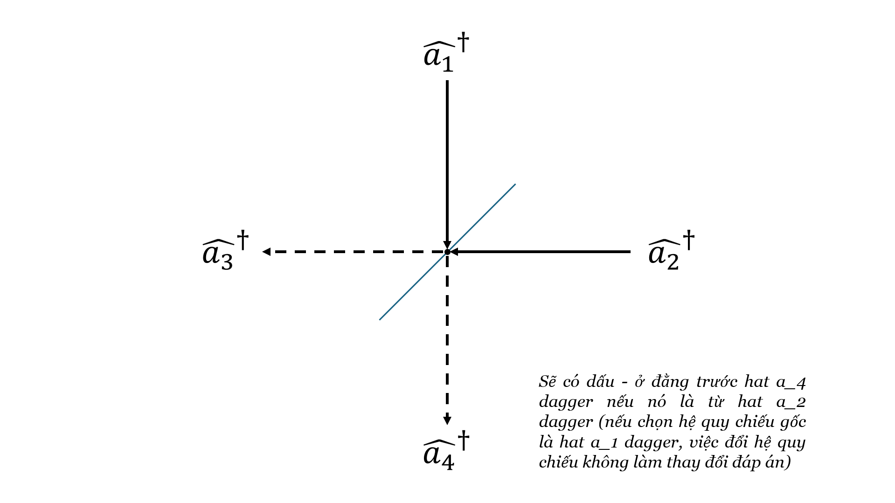
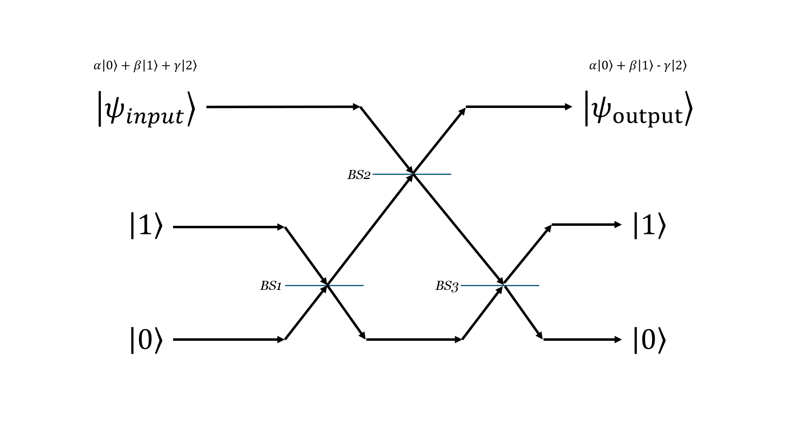

Như đã nói ở phía trên, chúng ta đã có phaseshifter đóng vai trò là $R_z$ và beamsplitter là $R_y$, chỉ từ 2 cổng quay này, kết hợp với CNOT cho ra các tổ hợp các cổng có thể xảy ra. Nhưng việc môi trường Kerr lại quá yếu, khiến photon a tác động lên photon b một lượng quá nhỏ, không đủ, muốn nó thật sự quay một góc tuỳ ý, phải cần tới một tinh thể cả vài km.

Từ đó, chúng ta sinh ra giao thức KLM - Emanuel Knill - Raymond Laflamme - Gerard J. Milburn.

# Hiệu ứng Hong-Ou-Mandel

Khi cho hai dòng photon đi qua BS50:50, lúc đó thì nó sẽ tự chia ra là $\vert 0, 2 \rangle$ hoặc $\vert 2, 0 \rangle$, trường hợp $\vert 1, 1 \rangle$ đã bị biến mất!

Trạng thái đầu vào:

$$
\vert 1, 1 \rangle = \hat{a_1}^\dagger \hat{a_2}^\dagger \vert 0, 0 \rangle
$$

Toán tử sinh của hai đường truyền biến đổi tuyến tính như sau:

$$
\hat{a_1}^\dagger \to \frac 1 {\sqrt 2} \hat{a_3}^\dagger + \frac 1 {\sqrt 2} \hat{a_4}^\dagger, \qquad 
\hat{a_2}^\dagger \to \frac 1 {\sqrt 2} \hat{a_3}^\dagger - \frac 1 {\sqrt 2} \hat{a_4}^\dagger
$$

$$
\vert 1, 1 \rangle \to 
\frac 1 2 \left(\hat{a_3}^\dagger + \hat{a_4}^\dagger \right) \left(\hat{a_3}^\dagger - \hat{a_4}^\dagger  \right) \vert 0, 0 \rangle 
= \frac 1 2 \left((\hat{a_3}^\dagger)^2 - (\hat{a_4}^\dagger )^2 \right) \vert 0, 0 \rangle 
= \frac {\vert 0, 2\rangle - \vert 2, 0 \rangle} {\sqrt 2}
$$

Ý nghĩa: Từ đó sẽ chỉ có hai trường hợp chồng chập xảy ra, là $\vert 2, 0 \rangle$ (2 photon cùng đi đường trên, 0 photon ở đường dưới), hoặc là $\vert 0, 2 \rangle$ (0 photon ở đường trên, 2 photon ở đường dưới), trường hợp cùng phản xạ hoặc cùng đi thẳng đã bị biến mất.

Note: Trong sơ đồ mạch ngang (dual-rail), ta quy ước đường trên ứng với mode 1 ($\hat{a}_1^\dagger$) và đường dưới ứng với mode 2 ($\hat{a}_2^\dagger$).

# NS Gate

Việc của cổng NS là phải điều chỉnh t và r ở cả 3 gương bán mạ BS1, BS2 và BS3, sao cho có thể đảo pha của $\vert 2 \rangle \to - \vert 2 \rangle$, việc này thành công khi và chỉ khi kết quả đo ra ở ancilla ket 1 là 1 và kết quả đo ancilla ket 0 là 0 (tỉ lệ 1/4):

$$
NS(\alpha \vert 0 \rangle + \beta \vert 1 \rangle + \gamma \vert 2 \rangle)
\to
\alpha \vert 0 \rangle + \beta \vert 1 \rangle - \gamma \vert 2 \rangle 
\qquad (25\%)
$$

# Controlled-Z

Và giờ chúng ta sẽ ghép thành một mạch CZ hoàn chỉnh:

$$
input \to BS50:50 \to NS \to NS \to BS50:50 \to output
$$

$$
\vert{}1,1\rangle \xrightarrow{\text{BS}_{50:50}} \frac{\vert{}2,0\rangle - \vert{}0,2\rangle}{\sqrt{2}} \xrightarrow{\text{NS} \otimes \text{NS}} \frac{-\vert{}2,0\rangle - (-\vert{}0,2\rangle)}{\sqrt{2}} = -\frac{\vert{}2,0\rangle - \vert{}0,2\rangle}{\sqrt{2}} \xrightarrow{\text{BS}_{50:50}} -\vert{}1,1\rangle
$$

# Controlled-NOT

Một cách hiển nhiên, chúng ta biết rằng $HZH = X$, vậy là chỉ cần kẹp cổng CZ ở giữa hai cổng Hadamard là được, mà ở trong này Hadamard chính là gương bán mạ BS50:50.

$$
CNOT = (I \otimes H) CZ (I \otimes H)
$$