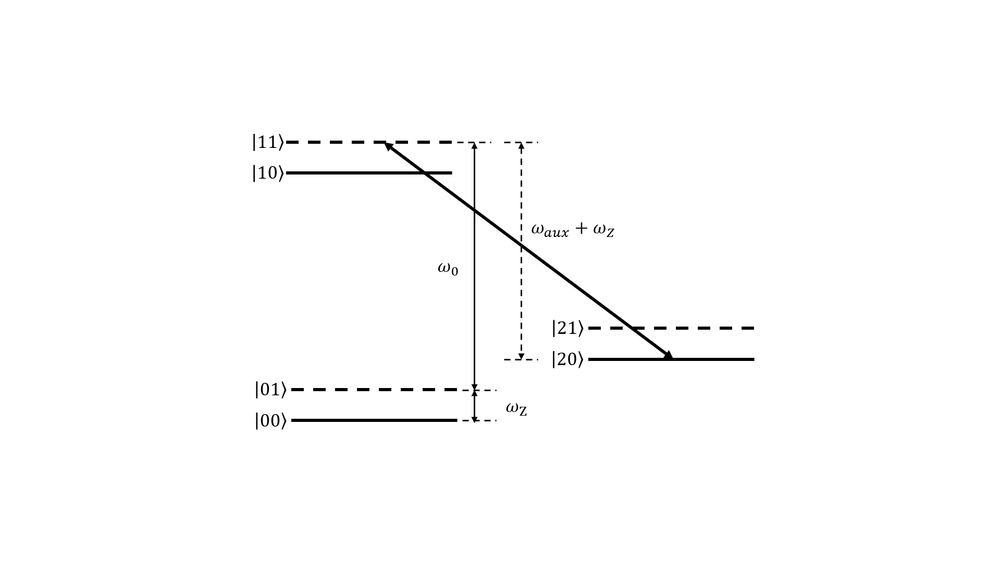
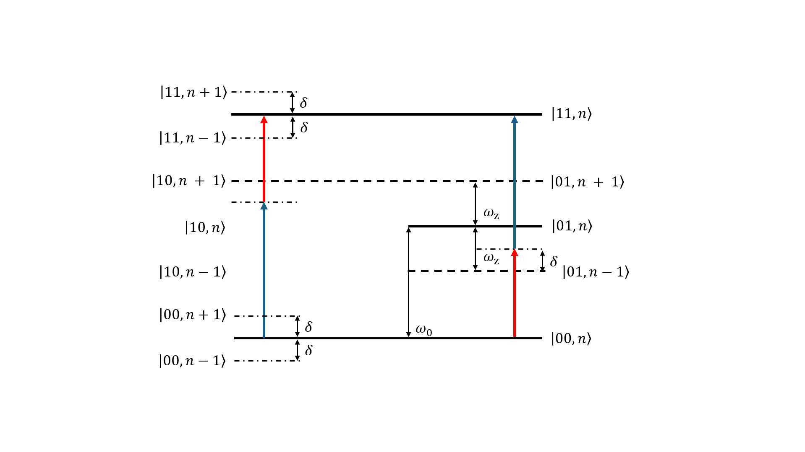

Tại sao có thể nói là cổng Cirac-Zoller quá lỗi thời? Vì trong chính công thức của nó, tồn tại n, và với điều kiện $n = 0$ xuyên suốt quá trình (tức là chỉ cần một giao động nhiễu nhiệt nhỏ của môi trường cũng có thể khiến hệ bị hủy).

# Cổng Cirac-Zoller

Ở đây chúng ta sẽ định nghĩa một số ký hiệu quan trọng của tôi:

$$
(C, T)^{m}
$$

Trong đó:

* $C, T \in {0, 1, 2}$ : ion Control và Target đang ở mức năng lượng nào.
* $m \in {0, 1}$ : m = 0 tức là 0 có phonon, m = 1 là có phonon.
* $(C, T)^m \to \vert Cm\rangle, \vert Tm\rangle$.

Ví dụ:

* $(1, 2)^0$: ion C đang ở $\vert 10 \rangle$ và ion T đang ở $\vert 20\rangle$.

---

$$
\omega_r = \omega_0 - \omega_z \\ 
\omega_r = \omega_0 + \omega_z
$$

---

## Bước 1: Chiếu red sideband vào ion C

Bởi vì setup ban đầu của ion trap là mọi thứ đều không còn phonon, tức là chỉ có 1 trong 2 trường hợp sau đây khả dĩ:

* $C = \vert 00\rangle \to \vert 00 \rangle$ : laser đỏ không đủ để chiếu nó lên bất kỳ một mức năng lượng nào khác cả, bản thân nó cũng không có phonon nên không mượn được.
* $C = \vert 10\rangle \to \vert 01 \rangle$ : laser đỏ chiếu vào, nhưng mà thiếu năng lượng nên mượn tí năng lượng của phonon.

Hay cách biểu diễn theo tôi là:

$$
(0, T)^0 \to (0, T)^0 \\ 
(1, T)^0 \to (0, T)^1
$$

## Bước 2: Chiếu laser $\omega_{aux} + \omega_Z$ vào ion T

4 trạng khả dĩ của ion T.

* $T = \vert 00 \rangle \to \vert 00\rangle$ : không có gì xảy ra.
* $T = \vert 01 \rangle \to \vert 01\rangle$ : không có gì xảy ra.
* $T = \vert 10 \rangle \to \vert 10\rangle$ : không có gì xảy ra.
* $T = \vert 11 \rangle \to \vert 20\rangle$ : do đủ năng lượng yêu cầu, nên hệ nhảy sang.

Hay biểu diễn theo cách của tôi là:

$$
(0, 0)^0 \to (0, 0)^0 \to (0, 0)^0 \\ 
(1, 0)^0 \to (0, 0)^1 \to (0, 0)^1 \\ 
(0, 1)^0 \to (0, 0)^0 \to (0, 0)^0 \\ 
(1, 1)^0 \to (0, 1)^1 \to (0, 2)^0
$$

Mà khi chiếu laser một thời gian đủ lâu, ion T sẽ đi hết một vòng và đảo pha:

$$
\vert 11 \rangle \to \vert 20 \rangle \to -\vert 11 \rangle
$$

## Bước 3: Chiếu laser ngược lại ion C, trả về như cũ.

$$
(0, 0)^0 \to (0, 0)^0 \\ 
(0, 0)^1 \to (1, 0)^0 \\ 
(0, 0)^0 \to (0, 0)^0 \\ 
-(0, 1)^1 \to -(1, 1)^0 
$$

## Truth table

| Trạng thái ban đầu $\vert CT \rangle$ | Bước 1 - Bắn C | Bước 2 - Bắn T | Bước 3 - Bắn C | Trạng thái cuối cùng | 
| :--- | :---: | :---: | :---: | :---: |
| $\vert 00 \rangle$ | $(0, 0)^0$ | $(0, 0)^0$ | $(0, 0)^0$ | $\vert 00 \rangle$ |  
| $\vert 01 \rangle$ | $(0, 1)^0$ | $(0, 1)^0$ | $(0, 1)^0$ | $\vert 01 \rangle$ |  
| $\vert 10 \rangle$ | $(0, 0)^1$ | $(0, 0)^1$ | $(1, 0)^0$ | $\vert 10 \rangle$ |  
| $\vert 11 \rangle$ | $(0, 1)^1$ | $(0, 2)^0 \to -(0,1)^1$ | $-(1, 1)^0$ | -$\vert 11 \rangle$ |  

# Cổng Mølmer–Sørensen

Lý do nhiễu nhiệt khiến cho cổng Cirac-Zoller không hoạt động tốt là rất nhiều, nhưng tôi bị hạn chế, vậy nên tôi chỉ đơn thuần suy nghĩ và diễn giải lý do rằng:

Cổng Cirac-Zoller xây dựng trên giả định rằng $\vert 0, 0 \rangle$ (hay $\vert 0, n \rangle$), khi chiếu laser red thì nó không thể lên $\vert 1, n - 1 \rangle$ được. Cổng CZ hoàn toàn phụ thuộc vào hiệu ứng biên $n = 0$  $(\text{phonon} = 0)$, vì vậy yêu cầu rằng hệ phải làm lạnh lại về cực hạn sau mỗi lần tính toán.

Cổng Molmer-Sorensen có cho phép hệ đi tới các mức đệm, như là $\vert 00, n - 1 \rangle, \vert 11, n + 1 \rangle, ...$, miễn sao lần chiếu thứ hai hệ có thể quay đúng trạng thái cần thiết là được.

Cổng Molmer-Sorensen có tác dụng là $XX(\pi/2)$.

---

$$
\omega_r = \omega_0 - \omega_z + \delta \\ 
\omega_b = \omega_0 + \omega_z - \delta
$$

---

Chiếu đồng thời tia laser mang hai màu red và blue vào hệ trong một khoảng thời gian $T_{ms}$. 

Theo tôi thì hệ phải luôn đảm bảo việc bảo toàn năng lượng, nếu 