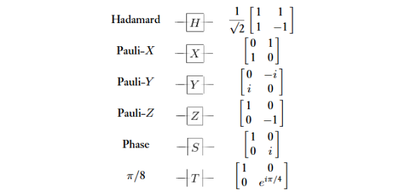
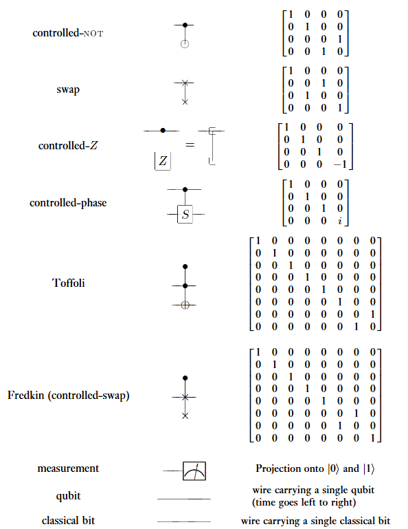

# Danh pháp và ký hiệu

Có một số danh pháp và ký hiệu có hai hoặc nhiều nghĩa được sử dụng phổ biến trong lĩnh cực QCQI. Để tránh sự xảy ra sự nhầm lẫn, phần này sẽ thu thập nhiều danh xưng và ký hiệu thường gặp hơn cả trong số đó, cùng với các quy ước sẽ được tuân thủ xuyên suốt cuốn sách này.

## Đại số tuyến tính và Cơ học lượng tử

## Lý thuyết thông tin và xác suất

## Miscellancea

## Các cổng lượng tử và ký hiệu mạch thường dùng

