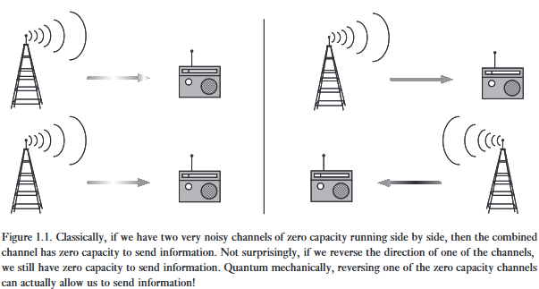

> *"Science offers the boldest metaphysics of the age. It is a thoroughly human construct, driven by the faith that if we dream, press to discover, explain, and dream again, thereby plunging repeatedly into new terrain, the world will somehow come clearer and we will grasp the true strangeness of the universe. And the strangeness will all prove to be connected, and make sense."* 
> - Edward Osborne Wilson

> *"Information is Physical"* 
> - Rolf Landauer

Những khái niệm cơ bản của quantum computation và quantum information là gì? Những khái niệm đó được phát triển như thế nào? Được vào dùng những việc gì? Chúng được trình bày như thế nào trong cuốn sách này? Mục đích của chương giới thiệu này là để phác họa cho một bức tranh tổng thể của lĩnh vực QC và QI này. Mục tiêu là truyền đạt các kiến thức trọng tâm của lĩnh vực này, cung cấp góc nhìn cách chúng phát triển, và giúp bạn quyết định áp dụng như thế nào trong phần sau của cuốn sách.

---

**Global perspective** - Góc nhìn quốc tế hay là Quan điểm toàn cục? Tôi cũng không biết nữa.

Quantum computation và quantum information là một ngành học mà nhiệm vụ xử lý thông tin có thể thực hiện được bằng ***quantum mechanical systems*** hệ thống cơ học lượng tử.

Nghe khá là dễ hiểu và rõ ràng, đúng không? Giống như nhiều ý tưởng đơn giản và sâu sắc khác, phải mất một thời gian dài người ta mới nghĩ đến việc xử lý thông tin bằng hệ thống cơ học lượng tử. Để hiểu tại sao lại như vậy, chúng ta cần phải quay ngược lại thời gian và nhìn vào từng viên gạch đã xây dựng nên nền tảng cơ bản của quantum computation và quantum information - đó là quantum mechanics, computer science, information theory, and cryptography.

Trong chuyến tham quan ngắn gọn về lịch sử của các lĩnh vực này, hãy tự coi mình trước tiên là một nhà vật lý, sau đó là một nhà khoa học máy tính, tiếp theo là một nhà lý thuyết thông tin, và cuối cùng là một nhà mật mã học. để mà có thể hiểu rõ những quan điểm khác nhau đã hội tụ trong quantum computation và quantum information.

# Lịch sử của Điện toán lượng tử và Thông tin lượng tử

Câu chuyện của chúng ta bắt đầu vào những năm đầu của thế kỷ 20, khi một cuộc cách mạng không được báo trước đang diễn ra trong khoa học. Một chuỗi của khủng hoảng và phát sinh trong vật lý.

Vấn đề là khi đó lý thuyết của vật lý (mà bây giờ chúng ta gọi là vật lý cổ điển) đã dự đoán những điều phi lý, ví dụ như là [***Ultraviolet catastrophe***](https://en.wikipedia.org/wiki/Ultraviolet_catastrophe) (thảm họa tia cực tím) liên quan đến việc vô hạn năng lượng, hay là việc dự đoán electrons sẽ di chuyển xoắn ốc không ngừng tiến vào hạt nhân nguyên tử.

Một số bài toán đã được giải quyết bằng cách thêm một số lý thuyết tùy ý vào vật lý cổ điểm, nhưng việc hiểu thêm về hạt nhân và phóng xạ đã mang lại những cách giải thích cố gắng nhưng không thành, khiến cho nó càng ngày càng rắc rối. Cuộc khủng hoảng lên đến đỉnh điểm những năm 1920, sau gần 1/4 thế kỷ, và dẫn đến sự ra đời của ***quantum mechanic*** cơ học lượng tử.

Quantum mechanics đã trở thành một phần không thể thiếu của khoa học kể từ đó, và đã được áp dụng với thành công to lớn cho mọi thứ dưới và bên trong Mặt Trời, bao gồm cấu trúc của nguyên tử, phân rã hạt nhân trong những ngôi sao, vật liệu siêu dẫn, cấu trúc của DNA, và các hạt cơ bản của tự nhiên.

---

## Lịch sử của Quantum Mechanic

**Quantum mechanics là gì?**

Quantum mechanics là một khuôn khổ toán học hay là một chuỗi quy tắc để định hình lý thuyết vật lý.

Ví dụ, có một lý thuyết vật lý tên là ***quantum electrodynamics*** điện động lực học lượng tử, thứ mà miêu tả một cách chính xác đến bất ngờ sự tương tác giữa nguyên tử và ánh sáng. Điện động lực học lượng tử được xây dựng từ khuôn khổ của cơ học lượng tử, nhưng nó có chứa những nguyên tắc cụ thể không được xác định bởi cơ học lượng tử.

Mối quan hệ giữa quantum mechanics với các lý thuyết cụ thể (như là quantum electrodynamics) khá là giống với quan hệ giữa hệ điều hành máy tính với các phần mềm cụ thể - hệ điều hành chỉ thiết lập các tham số và chế độ vận hành cơ bản, nhưng lại để ngỏ các nhiệm cụ thể mà được hoàn thành bởi các ứng dụng.

---

Các nguyên lý của quantum mechanics khá là cơ bản nhưng kể cả chuyên gia cũng cảm thấy nó phản trực giác, và các tiền đề sớm nhất của QC và QI được sinh ra bởi mong muốn lâu dài của các nhà vật lý muốn hiểu quantum mechanics. Nhà phê bình nổi tiếng nhất của cơ học lượng tử, Albert Eistein, đã chết mà mang theo những suy nghĩ không thể hoà giải, trong chính lĩnh vực mà ông đã góp phần kiến tạo nên. Và cả một thế hệ các nhà vật lý kể từ đây phải vật lộn với cơ học lượng tử, trong việc cố gắng làm những dự đoán dễ chấp nhận hơn.

Một trong những mục tiêu của điện toán lượng tử và thông tin lượng tử là phát triển các công cụ giúp mài sắc trực giác của chúng ta về cơ học lượng tử, và làm cho các dự đoán của nó trở nên minh bạch hơn đối với trí tuệ con người.

---

Ví dụ như, vào những năm đầu của 1980, một phong trào nổi lên rằng liệu có khả năng nào cho việc sử dụng các hiệu ứng của lượng tử để truyền tin nhanh hơn ánh sáng hay không - một điều vi phạm nguyên trọng thuyết tương đối của Einstein.

Và kết quả của vấn đề này hóa ra lại phụ thuộc vào việc liệu có khả thi ***clone*** một ***unknown quantum state*** trạng thái lượng tử chưa biết hay không, tức là việc tái tạo bản sao một trạng thái lượng tử. Nếu việc cloning là khả thi, thì nó cũng sẽ khả thi việc truyền tin nhanh hơn tốc độ ánh sáng, bằng cách sử dụng các hiệu ứng lượng tử.

Dù sao thì, cloning - nghe có vẻ rất dễ dàng với các thông tin cổ điển, hóa ra lại không khả thi trong cơ học lượng tử nói chung. Đây được gọi là [***No-cloning theorem***](https://en.wikipedia.org/wiki/No-cloning_theorem) Định lý không thể nhân bản, được phát hiện những năm đầu 1980, một trong những thành quả đầu tiên của QC và QI. 

Một số cải tiến của định lý đã được phát triển, và hiện tại chúng ta đã có những công cụ khái niệm thứ mà cho phép chúng ta hiểu được một thiết bị nhân bản lượng tử (vốn dĩ không hoàn hảo) có thể hoạt động tốt đến mức nào. Những công cụ này, lần lượt được áp dụng để hiểu những khía cạnh khác của quantum mechanics.

---

Một trong nhánh lịch sử liên quan đến việc đóng góp vào sự phát triển của QC và QI là sự quan tâm tới việc đạt được ***complete control over single quantum system*** kiểm soát hoàn toàn các hệ thống lượng tử đơn lẻ, bắt đầu từ những ngày năm 1970. Các ứng dụng của cơ học lượng tử trước những năm 1970 thường liên quan đến mức độ kiểm soát tổng quát đối với một mẫu vật lớn chứa vô số hệ thống cơ học lượng tử, không hệ thống nào có thể truy cập trực tiếp được.

Ví dụ, vật liệu siêu dẫn là một ví dụ tuyệt vời của cơ học lượng tử. Tuy nhiên, vì chất siêu dẫn liên quan đến một lượng lớn kim loại dẫn điện (so với kích thước nguyên tử), chúng ta chỉ có thể khảo sát một vài khía cạnh về bản chất cơ học lượng tử của nó, trong đó, các hệ lượng tử riêng lẻ cấu thành nên chất siêu dẫn vẫn không thể tiếp cận được. Các hệ thống như là ***partical accelerators*** máy gia tốc hạt cho phép truy cập hạn chế vào các hệ lượng tử riêng lẻ, nhưng lại cung cấp rất ít khả năng kiểm soát các hệ thống cấu thành.

---

Kể từ những năm 1970, nhiều kỹ thuật cho việc kiểm soát ***single quantum system*** đã được phát triển.

Lấy ví dụ, phương pháp đã được phát triển là nhốt một nguyên tử đơn lẻ trong một ***'atom trap'***, tách biệt nó với phần còn lại của thế giới và chio phép chúng ta nghiên cứu một số khía cạnh khác trong hành vi của nó với độ chính xác đáng kinh ngạc. [***Scanning tunneling microscope***](https://en.wikipedia.org/wiki/Scanning_tunneling_microscope) Kính hiển vi quét xuyên hầm đã được sử dụng để di chuyển các nguyên tử đơn lẻ, tạo ra các mảng nguyên tử theo ý muốn. Người ta đã chứng minh được các thiết bị điện tử mà hoạt động của chúng chỉ liên quan đến việc truyền tải các electron đơn lẻ.

---

**Tại sao chúng tại lại cần nỗ lực đến vậy để đạt được complete control over single quantum systems - việc kiểm soát hoàn toàn các hệ lượng tử đơn lẻ?**

Tạm gác lại các lý do về công nghệ, và chỉ tập trung vào khoa học thuần túy, câu trả lời chính là việc các nhà nghiên cứu phải hoàn thành việc này bằng linh cảm. Thường thì những phát hiện sâu sắc nhất trong khoa học xuất hiện khi chúng ta phát triển một phương pháp để khám phá một lĩnh vực mới của tự nhiên.

Ví dụ, việc phát minh ra thiên văn học vô tuyến vào những năm 1930 và 1940 đã dẫn đến một loạt các khám phá ngoạn mục, bao gồm lõi thiên hà của dải Ngân hà, các sao xung và chuẩn tinh. Vật lý nhiệt độ thấp đã đạt được những thành công đáng kinh ngạc bằng cách tìm ra các phương pháp để giảm nhiệt độ của các hệ thống khác nhau.

Một cách tương tự, bằng cách đạt được việc kiểm soát hoàn toàn các hệ lượng tử đơn lẻ, chúng ta đang khám phá những vùng tự nhiên hoang sơ với hy vọng phát hiện ra những hiện tượng mới và bất ngờ. Chúng ta mới chỉ bước một vài bước chân đầu tiên, nhưng mà đã cảm thấy một chút bất ngờ thú vị được khám phá trong vùng đất này. 

**Điều gì sẽ xảy ra nếu chúng ta đạt được việc kiểm soát hoàn toàn các hệ lượng tử đơn lẻ, và phát triển chúng thành các hệ phức tạp hơn?**

---

Quantum computation và Quantum information thật sự là thích hợp một cách tự nhiên với chương trình này.

Chúng cung cấp một loạt các thử thách hữu ích ở nhiều mức độ khó khác nhau cho những người đang nghĩ ra các phương pháp để thao tác tốt hơn với các hệ lượng tử đơn lẻ, đồng thời kích thích sự phát triển của các kỹ thuật thí nghiệm mới và cung cấp hướng dẫn về những hướng đi thú vị nhất cho thí nghiệm.

Ngược lại, khả năng kiểm soát các hệ lượng tử đơn lẻ là điều thiết yếu nếu chúng ta muốn khai thác sức mạnh của cơ học lượng tử cho các ứng dụng trong quantum computation và quantum information.

---

Bất chấp sự quan tâm mãnh liệt này, nhưng nỗ lực để xây dựng hệ thống xử lý quantum information vẫn rất khiêm tốn, cho đến ngày nay. Các máy tính lượng tử nhỏ, có khả năng thực hiện hàng chục phép toán trên một vài bit lượng tử (hay qubit), đại diện cho công nghệ tiên tiến nhất trong lĩnh vực tính toán lượng tử.

Các nguyên mẫu thử nghiệm cho việc thực hiện ***quantum cryptography*** mật mã lượng tử – một cách để liên lạc bí mật qua khoảng cách xa – đã được chứng minh và thậm chí đã đạt đến mức có thể hữu ích cho một số ứng dụng thực tế. Tuy nhiên, việc phát triển các kỹ thuật để hiện thực hóa quá trình xử lý thông tin lượng tử quy mô lớn vẫn là một thách thức lớn đối với các nhà vật lý và kỹ sư trong tương lai.

---

## Lịch sử của Computer Science

Và chúng ta sẽ chuyển từ quantum mechanics sang một thành tựu trí tuệ vĩ đại khác của thế kỷ 20, computer science. Nguồn gốc của khoa học máy tính đã bị chìm vào lãng quên suốt chiều dài lịch sử.

Ví dụ, các phiến đất sét chữ hình nêm cho thấy rằng vào thời Hammurabi (khoảng năm 1750 trước Công nguyên), người Babylon đã phát triển một số ý tưởng thuật toán khá tinh vi, và có khả năng nhiều ý tưởng trong số đó có từ thời kỳ thậm chí sớm hơn.

---

Hình thái hiện đại của khoa học máy tính đã được công bố bởi nhà toán học vĩ đại Alan Turing trong một bài báo nổi bật vào năm 1936. Turing đã phát triển chi tiết một khái niệm trừu tượng về cái mà ngày nay chúng ta gọi là một máy tính có thể lập trình được, một mô hình tính toán mà giờ đây được gọi là máy Turing, để tôn vinh ông. Turing đã chỉ ra rằng tồn tại một ***Universal Turing Machine*** Máy Turing Vạn năng có thể được sử dụng để mô phỏng bất kỳ máy Turing nào khác.

Hơn nữa, ông khẳng định rằng Universal Turing Machine nắm bắt đầy đủ ý nghĩa của việc thực hiện một tác vụ bằng phương pháp thuật toán. Nghĩa là, nếu một thuật toán có thể được thực hiện trên bất kỳ phần cứng nào (chẳng hạn như một máy tính cá nhân hiện đại), thì sẽ có một thuật toán tương đương dành cho Máy Turing Vạn năng thực hiện chính xác cùng một tác vụ như thuật toán đang chạy trên máy tính cá nhân đó.

Khẳng định này được gọi là [***Church-Turing thesis***](https://en.wikipedia.org/wiki/Church%E2%80%93Turing_thesis) Giả thuyết Church–Turing để vinh danh Turing cùng một nhà tiên phong khác của khoa học máy tính là Alonzo Church, khẳng định sự tương đương giữa 
khái niệm vật lý về tập hợp các thuật toán có thể thực hiện trên một thiết bị vật lý với khái niệm toán học nghiêm ngặt về Máy Turing Vạn năng. Sự công nhận rộng rãi dành cho giả thuyết này đã đặt nền móng cho sự phát triển của một lý thuyết phong phú trong khoa học máy tính.

---

Không lâu sau bài báo của Turing, những chiếc máy tính đầu tiên được chế tạo từ các linh kiện điện tử đã ra đời. John von Neumann đã phát triển một mô hình lý thuyết đơn giản về cách kết hợp tất cả các thành phần cần thiết theo một cách thực tế để một máy tính có đầy đủ khả năng tương đương với một Máy Turing Vạn năng.

Tuy nhiên, sự phát triển của phần cứng thực sự bứt phá vào năm 1947, khi John Bardeen, Walter Brattain và William Shockley phát triển ra transistor. Kể từ đó, phần cứng máy tính đã gia tăng sức mạnh với tốc độ kinh ngạc, đến mức sự tăng trưởng này đã được Gordon Moore cụ thể hóa vào năm 1965 thành cái mà ngày nay được biết đến là Định luật Moore, định luật phát biểu rằng sức mạnh của máy tính sẽ tăng gấp đôi với chi phí không đổi sau khoảng mỗi hai năm.

---

Thật đáng kinh ngạc, định luật Moore vẫn gần như đúng trong suốt nhiều thập kỷ kể từ năm 1960. Mặc dù vậy, hầu hết các nhà quan sát đều cho rằng chuỗi phát triển kỳ diệu này sẽ kết thúc vào một thời điểm nào đó trong hai thập kỷ đầu thế kỷ 21. Các phương pháp truyền thống trong sản xuất công nghệ máy tính đang vấp phải những khó khăn cơ bản về kích thước. Các hiệu ứng lượng tử đang bắt đầu gây nhiễu loại đến các hoạt động của các thiết bị điện tử khi chúng ngày càng được thu nhỏ lại.

---

Một giải pháp khả dĩ cho vấn đề đặt ra từ sự sụp đổ tất yếu của định luật Moore là chuyển sang một mô hình tính toán khác. Một mô hình như vậy được cung cấp bởi lý thuyết tính toán lượng tử, vốn dựa trên ý tưởng sử dụng quantum mechanics để thực hiện tính toán, thay vì vật lý cổ điển.

Hóa ra, mặc dù một máy tính thông thường có thể được sử dụng để mô phỏng một máy tính lượng tử, nhưng dường như không thể thực hiện việc mô phỏng này một cách hiệu quả. Do đó, máy tính lượng tử mang lại một ưu thế cốt lõi về tốc độ so với máy tính cổ điển. Ưu thế về tốc độ này lớn đến mức mà nhiều nhà nghiên cứu tin rằng không một sự tiến bộ nào có thể hình dung được trong tính toán cổ điển, lại có thể khỏa lấp khoảng cách giữa sức mạnh của một máy tính cổ điển và sức mạnh của một máy tính lượng tử.

---

**Thế nào là một mô phỏng "hiệu quả" và mô phỏng "không hiệu quả" cho một máy tính lượng tử?**

Nhiều khái niệm then chốt để trả lời câu hỏi này đã được phát minh từ rất lâu trước khi khái niệm máy tính lượng tử ra đời. Đặc biệt, ý tưởng về thuật toán hiệu quả và không hiệu quả đã được làm rõ một cách chính xác về mặt toán học, nhờ lĩnh vực lý thuyết độ phức tạp thuật toán. Nói một cách đại khái, một thuật toán hiệu quả là một thuật toán chạy trong thời gian đa thức. Ngược lại, một thuật toán không hiệu quả là một thuật toán chạy trong thời gian siêu đa thức (ví dụ như là hàm mũ).

Điều được nhận thấy vào cuối những năm 1960 đầu những năm 1970 là: mô hình tính toán bằng máy Turing dường như mạnh lớn hơn hoặc bằng bất kỳ mô hình tính toán nào khác, theo nghĩa là một bài toán có thể giải hiệu quả trên mô hình tính toán đó thì cũng có thể giải được hiệu quả trên mô hình máy Turing, bằng cách dùng máy Turing để mô phỏng lại thuật toán kia.

Quan sát này được cụ thể hóa thành một phiên bản tăng cường của Church-Turing thesis:

> *Any algorithmic process can be simulated efficiently using a Turing machine.*

Điểm then chốt trong strong Church-Turing thesis là từ hiệu quả. Nếu luận đề trên là đúng, nó hàm ý rằng bất kể chúng ta sử dụng loại máy nào để thực hiện thuật toán, chiếc máy đó đều có thể mô phỏng một cách hiệu quả bằng máy Turing chẩn. Đây là một bước củng cố quan trọng, bởi nó cho thấy để phân tích liệu một tác vụ tính toán cho trước có thể hoàn thành một cách hiệu quả hay không, chúng ta giờ chỉ cần giới hạn việc phân tích trên mô hình tính toán Turing.

:::{.callout-note}
Ý của tác giả khá là rắc rối. Nhưng mà tóm gọn lại là như sau:

Một thuật toán hiệu quả là một thuật toán có độ phức tạp là hàm đa thức. Ví dụ như $O(n^2)$, khi n = 300, thì máy tính vẫn chạy rất nhanh.

Một thuật toán không hiệu quả là một thuật toán có độ phức tạp là hàm siêu đa thức. Ví dụ như $O(2^n)$, và n tầm 300 là chết.

Và, strong church-turing thesis khẳng định là:

"Mọi máy tính bình thường nếu có giải được với thuật toán hiệu quả, thì máy Turing tệ nhất là cũng giải được bằng nó, và đôi khi là hơn."

Nhưng trong các bài toán mô phỏng lại lượng tử, hay là thuật toán Shor, trong khi máy tính lượng tử có thể giải quyết nó một cách hiệu quả bằng cách sử dụng qubit, thì máy tính cổ điển lại tốn hàm mũ để giải quyết. Vì vậy khẳng định trên là sai.

Vậy đoạn này chứng minh rằng, nếu lúc trước, suy ra từ luận đề strong church-turing, máy tính Turing là mạnh nhất, nếu máy nào có thể làm hiệu quả, thì máy Turing cũng thể làm nó hiệu quả, thì hiện tại, máy tính lượng tử là một phản chứng.
:::

---

Một nhóm thách thức đối với strong Church-Turing thesis đến từ lĩnh vực ***analog computation*** tính toán tương tự. Trong nhiều năm kể từ thời Turing, nhiều nhóm nghiên cứu đã nhận thấy rằng một số loại máy tính tương tự có thể giải quyết hiệu quả những bài toán mà được cho là không có lời giải hiệu quả trên máy Turing. Mới nghe thoáng qua, các máy tính tương tự này dường như đã phản lại luận đề.

Rất tiếc cho analog computation, hóa ra khi đưa vào các giả định thực tế, về sự hiện diện của nhiễu trong các analog computer, sức mạnh vượt trội của chúng lại biến mất trong mọi trường hợp đã biết. Chúng không thể giải quyết hiệu quả những bài toán vốn không thể giải hiệu quả trên máy Turing. Và từ chính bài học này, rằng ảnh hưởng của nhiễu trong thực tế phải được tính đến khi đánh giá mực độ hiệu quả của một mô hình tính toán, chính là một trong những thách thức lớn đầu tiên của quantum computation và quantum information. 

Nhưng may mắn thay, việc quantum computer mạnh hơn Turing computer vẫn là sự thật hiển nhiên, nhờ sự phát triển của lý thuyết ***quantum error-correcting codes*** mã sử lỗi lượng tử và ***fault-tolerant quantum computation*** tính toán lượng tử kháng lỗi. Nhờ đó, khác với analog computation, quantum computation về mặt nguyên tắc có thể chịu đựng một mức độ nhiễu hữu hạn mà vẫn giữ nguyên được các ưu thế tính toán của nó.

---

Thách thức lớn đầu tiên đối với strong Church–Turing thesis xuất hiện vào giữa những năm 1970, khi Robert Solovay và Volker Strassen chỉ ra rằng có thể kiểm tra xem một số nguyên là số nguyên tố hay hợp số bằng cách sử dụng một thuật toán ngẫu nhiên. Nghĩa là, phép kiểm tra tính nguyên tố Solovay–Strassen đã sử dụng tính ngẫu nhiên như một phần cốt lõi của thuật toán.

Thuật toán này không xác định liệu một số nguyên cho trước là nguyên tố hay hợp số với độ chắc chắn tuyệt đối. Thay vào đó, thuật toán có thể xác định rằng một số là "có lẽ là số nguyên tố" hoặc khẳng định chắc chắn nó là hợp số. Bằng cách lặp lại phép kiểm tra Solovay–Strassen một vài lần, người ta có thể xác định với độ chắc chắn gần như tuyệt đối xem một số là nguyên tố hay hợp số.

Phép kiểm tra Solovay–Strassen có ý nghĩa đặc biệt vào thời điểm nó được đề xuất, vì khi đó không có phép kiểm tra tất định nào về tính nguyên tố được biết đến, và cho đến thời điểm viết bài này vẫn chưa có phép kiểm tra nào như vậy. Do đó, có vẻ như những chiếc máy tính có quyền truy cập vào một bộ sinh số ngẫu nhiên sẽ có thể thực hiện một cách hiệu quả các tác vụ tính toán mà vốn không có lời giải hiệu quả trên một máy Turing tất định truyền thống.

Khám phá này đã truyền cảm hứng cho việc tìm kiếm các thuật toán ngẫu nhiên khác, mang lại những thành quả vô cùng tốt đẹp và giúp lĩnh vực này phát triển thành một hướng nghiên cứu cực kỳ thịnh hành.

---

Các thuật toán ngẫu nhiên đặt ra một thách thức đối với Luận đề Church–Turing mạnh, gợi mở rằng tồn tại những bài toán có thể giải một cách hiệu quả nhưng lại không thể giải hiệu quả trên một máy Turing tất định.

Thách thức này dường như được giải quyết một cách dễ dàng bằng một sự điều chỉnh đơn giản đối với Luận đề Church–Turing mạnh:

> *"Any algorithmic process can be simulated efficiently using a probabilistic Turing machine."*

Sự điều chỉnh mang tính tùy tiện này đối với strong Church-Turing thesis có thể khiến bạn cảm thấy khá bất an. Liệu vào một thời điểm nào đó trong tương lai, liệu có một mô hình tính toán nào khác xuất hiện, cho phép người ta giải quyết hiệu quả những bài toán vốn không thể giải hiệu quả trong mô hình tính toán của Turing hay không? Có cách nào để chúng ta tìm ra một mô hình tính toán duy nhất mà đảm bảo có khả năng mô phỏng hiệu quả bất kỳ mô hình tính toán nào khác hay không?

---

Được thôi thúc bởi câu hỏi này, vào năm 1985, David Deutsch đã đặt vấn đề liệu các quy luật vật lý có thể được sử dụng để suy ra một phiên bản còn mạnh mẽ hơn nữa của Church–Turing thesis hay không. Thay vì chấp nhận những ad hoc hypothesis, Deutsch đã tìm đến lý thuyết vật lý để cung cấp một nền móng cho Church–Turing thesis, một nền móng vững chắc tương đương với vị thế của chính lý thuyết vật lý đó.

Cụ thể, Deutsch đã cố gắng định nghĩa một thiết bị tính toán có khả năng mô phỏng một cách hiệu quả một hệ vật lý bất kỳ. Vì các quy luật vật lý về bản chất cuối cùng đều tuân theo cơ học lượng tử, Deutsch đã tự nhiên hướng tới việc xem xét các thiết bị tính toán dựa trên các nguyên lý của cơ học lượng tử. Những thiết bị này, vốn là các mô hình lượng tử tương đương với những cỗ máy được Turing định nghĩa từ 49 năm trước đó, cuối cùng đã dẫn đến khái niệm hiện đại về máy tính lượng tử được sử dụng trong cuốn sách này.

Tại thời điểm viết cuốn sách này, vẫn chưa rõ liệu khái niệm của Deutsch về một ***Universal Quantum Computer*** Máy tính Lượng tử Vạn năng có đủ để mô phỏng một cách hiệu quả một hệ vật lý bất kỳ hay không. Việc chứng minh hoặc bác bỏ giả thuyết này là một trong những bài toán mở lớn nhất của lĩnh vực quantum computation và quantum information. Chẳng hạn, hoàn toàn có khả năng một hiệu ứng nào đó của ***quantum field theory*** lý thuyết trường lượng tử, hoặc một hiệu ứng bí ẩn hơn nữa dựa trên ***string theory*** lý thuyết dây, ***quantum gravity*** hấp dẫn lượng tử hay một lý thuyết vật lý nào khác, có thể đưa chúng ta vượt xa khỏi Universal Quantum Computer của Deutsch, mang lại cho chúng ta một mô hình tính toán còn mạnh mẽ hơn nữa. 

Ở giai đoạn này, chúng ta đơn giản là chưa thể biết được.

:::{.callout-note}

Thêm một số ý:

Trước ông Deutsch thì người ta coi việc "tính toán" là một phạm trù tương đối là trừu tượng và độc lập với thế giới vật chất. Thế nhưng ông này lại suy nghĩ ngược lại, việc tính toán là dựa vào chính quá trình vật lý, và "Because the laws of physics are ultimately quantum mechanical".

Từ đó, một máy tính vạn năng thei Deutsch, chính là một chiếc máy dựa trên Cơ học lượng tử.

Và liệu nó có phải thật sự là mạnh nhất hay chưa? Không ai biết được cho tới hiện nay.

:::

---

Những gì mà mô hình máy tính lượng tử của Deutsch đã mang lại chính là một thách thức đối với strong Church-Turing thesis. Deutsch đã đặt câu hỏi liệu một máy tính lượng tử có thể giải quyết một cách hiệu quả các bài toán tính toán vốn không có lời giải hiệu quả trên máy tính cổ điển, kể cả trên một máy Turing xác suất, hay không? Sau đó, ông đã xây dựng một ví dụ đơn giản gợi mở rằng, trên thực tế, máy tính 
lượng tử thực sự có thể sở hữu sức mạnh tính toán vượt xa sức mạnh của các máy tính cổ điển.

---

Bước đi đầu tiên nổi bật này của Deutsch đã được tiếp tục cải tiến trong thập kỷ sau đó bởi nhiều nhà nghiên cứu, mà đỉnh cao là chứng minh năm 1994 của Peter Shor cho thấy hai bài toán vô cùng quan trọng, bài toán phân tích thừa số nguyên tố và bài toán 'logarit rời rạc', đều có thể giải quết một cách hiệu quả trên một máy tính lượng tử.

Khám phá này đã thu hút sự quan tâm rộng rãi bởi vì hai bài toán trên từng và vẫn đang được tin tưởng phổ biến là không có lời giải hiệu quả cho trên máy tính cổ điển. Các kết quả của Shor là một minh chứng mạnh mẽ cho thấy máy tính lượng tử có sức mạnh vượt trội so với máy Turing, kể cả máy Turing xác suất.

Thêm một bằng chững nữa cho sức mạnh của máy tính lượng tử xuất hiện vào năm 1995, khi Lov Grover chỉ ra rằng một bài toán quan trọng khác, bài toán thực hiện tìm kiếm trong một không gian tìm kiếm không có cấu trúc, cũng có thể được tăng tốc trên một máy tính lượng tử. Mặc dù thuật toán của Grover không mang lại sự tăng tốc ngoạn mục như các thuật toán của Shor, nhưng khả năng ứng dụng rộng rãi của các phương pháp luận dựa trên tìm kiếm đã kich thích sự quan tâm đáng kể dành cho thuật toán của Grover.

---

Vào khoảng thời gian các thuật toán của Shor và Grover được phát kiến, nhiều nhà nghiên cứu cũng đang phát triển một ý tưởng mà Richard Feynman từng đề xuất vào năm 1982. Feynman đã chỉ ra rằng dường như có những khó khăn cốt lõi trong việc mô phỏng các hệ cơ học lượng tử trên máy tính cổ điển, và ông gợi ý rằng việc xây dựng các máy tính dựa trên các nguyên lý của cơ học lượng tử sẽ cho phép chúng ta vượt qua những khó khăn đó. Vào những năm 1990, một số nhóm nghiên cứu đã bắt đầu cụ thể hóa ý tưởng này, chứng minh rằng hoàn toàn có thể sử dụng máy tính lượng tử để mô phỏng một cách hiệu quả các hệ thống vốn không có cách mô phỏng hiệu quả nào trên máy tính cổ điển. Rất có thể một trong những ứng dụng quan trọng nhất của máy tính lượng tử trong tương lai sẽ là thực hiện các mô phỏng cho các hệ cơ học lượng tử quá phức tạp đối với máy tính cổ điển, một bài toán mang những hàm ý khoa học và công nghệ vô cùng sâu sắc.

---

**Máy tính lượng tử có thể giải quyết những bài toán nào khác nhanh hơn máy tính cổ điển?**

Câu trả lời ngắn gọn là chúng ta chưa biết. Việc đưa ra các thuật toán lượng tử hay dường như rất khó. Một người bi quan có thể nghĩ rằng đó là vì chẳng có việc gì mà máy tính lượng tử giỏi hơn ngoài những ứng dụng đã được phát hiện!

Chúng tôi có một góc nhìn khác. Thiết kế thuật toán cho máy tính lượng tử rất khó vì các nhà thiết kế phải đối mặt với hai vấn đề hóc búa mà việc xây dựng thuật toán cho máy tính cổ điển không hề gặp phải.

Thứ nhất, trực giác con người chúng ta bắt nguồn từ thế giới cổ điển. Nếu chúng ta dùng trực giác đó làm trợ giúp để xây dựng thuật toán, thì những ý tưởng thuật toán mà chúng ta nghĩ ra sẽ chỉ là các ý tưởng cổ điển. Để thiết kế ra các thuật toán lượng tử hay, người ta buộc phải ‘tắt’ đi trực giác cổ điển của mình trong ít nhất một phần của quá trình thiết kế, đồng thời phải tận dụng các hiệu ứng thuần túy lượng tử để đạt được mục đích thuật toán mong muốn.

Thứ hai, để thực sự thú vị, việc thiết kế một thuật toán mang tính cơ học lượng tử thôi là chưa đủ. Thuật toán đó phải vượt trội hơn bất kỳ thuật toán cổ điển hiện có nào! Do đó, hoàn toàn có khả năng người ta tìm ra một thuật toán tận dụng các khía cạnh thuần túy lượng tử của cơ học lượng tử, nhưng nó lại không thu hút được sự quan tâm rộng rãi vì các thuật toán cổ điển có đặc tính hiệu năng tương đương đã tồn tại sẵn.

Sự kết hợp của hai vấn đề này khiến việc kiến tạo các thuật toán lượng tử mới trở thành một thử thách lớn lao cho tương lai.

---

Thậm chí một cách rộng lớn hơn, chúng ta có thể đặt câu hỏi liệu có bất kỳ sự tổng quát hóa nào mà chúng ta có thể đưa ra về sức mạnh của máy tính lượng tử so với máy tính cổ điển hay không. 

**Điều gì làm cho máy tính lượng tử mạnh hơn máy tính cổ điển, giả định rằng điều này thực sự đúng?**

**Lớp bài toán nào có thể được giải quyết một cách hiệu quả trên một máy tính lượng tử, và lớp đó so sánh như thế nào với lớp bài toán có thể giải quyết hiệu quả trên một máy tính cổ điển?**

Một trong những điều thú vị nhất về tính toán lượng tử và thông tin lượng tử là chúng ta biết rất ít về câu trả lời cho những câu hỏi này! Đó là một thách thức lớn cho tương lai để hiểu rõ hơn những câu hỏi này.

## Lịch sử của Information Theory

Sau khi đã tiến đến ranh giới cốt lõi của tính toán lượng tử, chúng ta hãy chuyển sang lịch sử của một luồng tư tưởng khác cũng đóng góp vào tính toán lượng tử và thông tin lượng tử: ***Information theory*** Lý thuyết thông tin.

Cùng thời điểm khoa học máy tính bùng nổ vào những năm 1940, một cuộc cách mạng khác cũng đang diễn ra trong sự hiểu biết của chúng ta về truyền thông. Vào năm 1948, Claude Shannon đã xuất bản một cặp bài báo kiệt xuất, đặt nền móng cho lý thuyết hiện đại về information và communication.

---

Có lẽ bước đi then chốt được Shannon thực hiện chính là việc *mathematically define the concept of information*. 

Trong nhiều ngành khoa học toán học, người ta có sự linh hoạt khá lớn khi lựa chọn các định nghĩa nền tảng. Bạn hãy thử suy nghĩ một cách ngây thơ trong vài phút về câu hỏi sau: bạn sẽ làm thế nào để định nghĩa bằng toán học cho khái niệm ***"information source"*** (nguồn thông tin)? 

Đã có nhiều câu trả lời khác nhau cho bài toán này được sử dụng rộng rãi; tuy nhiên, định nghĩa mà Shannon nghĩ ra dường như mang lại nhiều thành quả vượt trội nhất xét về khía cạnh mở rộng tri thức, dẫn đến vô số kết quả sâu sắc và một lý thuyết với cấu trúc phong phú phản ánh chính xác nhiều (dù không phải tất cả) các bài toán truyền thông trong thế giới thực.

---

Shannon quan tâm đến hai câu hỏi then chốt liên quan đến việc truyền tải thông tin qua một kênh truyền thông. 

Thứ nhất, cần những tài nguyên nào để gửi thông tin qua một kênh truyền thông? Ví dụ, các công ty điện thoại cần biết họ có thể truyền tải bao nhiêu thông tin một cách đáng tin cậy qua một cáp điện thoại cho trước. 

Thứ hai, liệu thông tin có thể được truyền đi theo cách sao cho nó được bảo vệ khỏi noise trên kênh truyền thông hay không?

---

Shannon đã trả lời hai câu hỏi này bằng cách chứng minh hai định lý nền tảng của lý thuyết thông tin. 

Định lý thứ nhất, ***Shannon's noiseless channel coding theorem*** định lý mã hóa kênh không nhiễu của Shannon, định lượng các tài nguyên vật lý cần thiết để lưu trữ đầu ra từ một nguồn thông tin. 

Định lý thứ hai, ***Shannon's noisy channel coding theorem*** định lý mã hóa kênh có nhiễu của Shannon, định lượng lượng thông tin tối đa có thể truyền tải một cách đáng tin cậy qua một kênh truyền thông có nhiễu.

Để đạt được việc truyền tải đáng tin cậy khi có sự hiện diện của nhiễu, Shannon đã chỉ ra rằng các ***error-correcting codes*** mã sửa lỗi có thể được sử dụng để bảo vệ thông tin đang được gửi đi. Định lý mã hóa kênh có nhiễu của Shannon đưa ra một giới hạn trên cho mức độ bảo vệ mà các mã sửa lỗi mang lại. Thật không may, định lý của Shannon không chỉ ra một cách tường minh một tập hợp các mã sửa lỗi có tính thực tiễn để đạt tới giới hạn đó.

Từ thời điểm các bài báo của Shannon xuất hiện cho đến nay, các nhà nghiên cứu đã xây dựng ngày càng nhiều lớp mã sửa lỗi tốt hơn trong nỗ lực tiến gần hơn đến giới hạn do định lý Shannon thiết lập. Hiện nay đã tồn tại một lý thuyết tinh vi về các mã sửa lỗi, mang đến cho người dùng vô số lựa chọn trong hành trình thiết kế một mã sửa lỗi tốt. Các mã như vậy được sử dụng ở rất nhiều nơi, chẳng hạn như trong các đầu đọc đĩa đĩa CD, modem máy tính, và các hệ thống thông tin liên lạc qua vệ tinh.

:::{.callout-important}
# Giải thích chi tiết hai định lý của Shannon

**1. Noiseless channel coding theorem - định lý mã hóa kênh không nhiễu.**

Định lý này xác định mức độ nén dữ liệu tối đa mà không làm mất thông tin.

Mức giới hạn lý thuyết để nén mỗi chuỗi tin, chính là chỉ số *Entropy Shannon* $H(x)$. Nếu một nguồn tin có entropy là $H(x)$ bit (ký tự), bạn không thể nén nó xuống dưới $H(x)$ bit (ký tự) mà vẫn giữ nguyên được đầy đủ thông tin ban đầu.

**2. Noisy channel coding theorem - định lý mã hóa kênh có nhiễu.**

Định lý đưa ra khái niệm *Capacity Channel - C*. Đây là tốc độ truyền thông tin tối đa mà một kênh truyền có nhiễu có thể đáp ứng.

Chỉ cần tốn độ truyền tin < C, ta luôn tồn tại một hệ thống mã sửa lỗi nào đó để đưa tỉ lệ lỗi về sát mức 0.

Nhưng, *Shannon's Caveat*, tức là chính ông Shannon có thể chứng minh sự tồn tại của một mã sửa lỗi tối ưu, nhưng ông ấy cũng không biết nó là gì.

:::

---

Lý thuyết thông tin lượng tử cũng đã nối tiếp với những bước phát triển tương tự. Vào năm 1995, Ben Schumacher đã đưa ra một định lý tương đương với định lý mã hóa kênh không nhiễu của Shannon, và trong quá trình đó, ông đã định nghĩa ‘bit lượng tử’ hay ‘qubit’ như một tài nguyên vật lý hữu hình.

Tuy nhiên, chưa có một định lý tương đương nào với định lý mã hóa kênh có nhiễu của Shannon được tìm ra cho thông tin lượng tử. Dù vậy, tương tự như các đối trọng cổ điển của chúng, một lý thuyết về sửa lỗi lượng tử đã được phát triển, cho phép máy tính lượng tử, như đã đề cập, tính toán một cách hiệu quả ngay cả khi có nhiễu, đồng thời cho phép việc truyền thông qua các kênh lượng tử có nhiễu diễn ra một cách đáng tin cậy.

---

Thật vậy, các ý tưởng sửa lỗi cổ điển đã tỏ ra vô cùng quan trọng trong việc phát triển và thấu hiểu các mã sửa lỗi lượng tử. Vào năm 1996, hai nhóm nghiên cứu độc lập, Robert Calderbank và Peter Shor, cùng với Andrew Steane, đã phát hiện ra một lớp mã lượng tử quan trọng mà ngày nay được gọi là mã CSS (đặt theo chữ cái đầu tên của họ).

Công trình này sau đó đã được bao hàm và mở rộng bởi lớp ***stabilizer codes*** mã ổn định, được phát hiện độc lập bởi Robert Calderbank, Eric Rains, Peter Shor, Neil Sloane, và Daniel Gottesman. Bằng cách xây dựng dựa trên những ý tưởng cơ bản của lý thuyết mã tuyến tính cổ điển, những phát kiến này đã thúc đẩy mạnh mẽ sự hiểu biết nhanh chóng về các mã sửa lỗi lượng tử cũng như ứng dụng của chúng trong quantum computation và quantum information.

---

Lý thuyết error-correcting codes được phát triển để bảo vệ các quantum state khỏi noise. Còn việc truyền tải thông tin cổ điển thông thường bằng một kênh lượng tử thì sao? Điều này có thể được thực hiện hiệu quả đến mức nào? Một vài bất ngờ đã được phát hiện trong lĩnh vực này. Vào năm 1992, Charles Bennett và Stephen Wiesner đã giải thích cách truyền tải hai bit thông tin cổ điển trong khi chỉ cần truyền một bit lượng tử từ người gửi đến người nhận, một kết quả được mệnh danh là ***superdense coding*** mã hóa siêu đặc.

Thú vị hơn nữa là các kết quả trong ***distributed quantum computation*** tính toán lượng tử phân tán. Hãy tưởng tượng bạn có hai máy tính được nối mạng, đang cố gắng giải quyết một bài toán cụ thể. Cần bao nhiêu thông tin giao tiếp để giải quyết bài toán đó? Gần đây, người ta đã chỉ ra rằng các máy tính lượng tử có thể đòi hỏi lượng giao tiếp ít hơn theo cấp số nhân để giải quyết một số bài toán so với khi các máy tính nối mạng là cổ điển! Thật không may, cho đến nay những bài toán này chưa phải là những bài toán đặc biệt quan trọng trong bối cảnh thực tế, và chúng vẫn vướng phải một số hạn chế kỹ thuật bất lợi. Một thách thức lớn cho tương lai của tính toán và thông tin lượng tử là tìm ra các bài toán có tầm quan trọng trong thế giới thực mà ở đó tính toán lượng tử phân tán mang lại lợi thế đáng kể so với tính toán cổ điển phân tán.

---

Hãy quay trở lại với information theory đúng nghĩa. Việc nghiên cứu lý thuyết thông tin bắt đầu từ các đặc tính của một kênh truyền thông đơn lẻ. Trong các ứng dụng, chúng ta thường không chỉ làm việc với một kênh truyền thông đơn lẻ mà là các mạnh lưới gồm nhiều kênh. Chủ đề ***networked information theory*** lý thuyết thông tin mạng nghiên cứu các đặc tính mang thông tin của các mạng lưới truyền kênh truyền thông như vậy, và đã phát triển thành bộ môn đầy phong phú và phức tạp.

Ngược lại, việc nghiên cứu ***networked quantum information theory*** lý thuyết thông tin lượng tử mạng vẫn đang ở giai đoạn sơ khai. Ngay cả đối với những câu hỏi rất cơ bản, chúng ta cũng biết rất ít về năng lực mang thông tin của các mạng lưới kênh lượng tử. Một vài kết quả sơ bộ khá nổi bật đã được tìm thấy trong vài năm qua; tuy nhiên, vẫn chưa có một lý thuyết thông tin lượng tử mạng đủ để thuyết phục bạn về giá trị mà một lý thuyết tổng quát như vậy có thể mang lại.

Hãy tưởng tượng rằng chúng ta đang cố gắng truyền thông tin lượng tử từ A đến B thông qua một kênh lượng tử có nhiễu. Nếu kênh đó có dung lượng bằng không đổi với thông tin lượng tử, thì việc truyền tải bất kỳ thông tin nào một cách đáng tin cậy từ A đến B là điều bất khả thi. Thay vào đó, hãy tượng tượng chúng ta xét hai bản sao của kênh đó, hoạt động đồng bộ. Về mặt trực giác, điều này hoàn toàn hiển nhiên (và có thể được chứng minh một cách chặt chẽ) rằng một kênh như vậy cũng có dung lượng bằng không trong việc gửi thông tin lượng tử.

Tuy nhiên, nếu thay vào đó chúng ta đảo ngược chiều của một trong các kênh, như hình 1.1 dưới đây, hóa ra đôi khi chúng ta lại có thể đạt được một dung lượng lớn hơn không để truyền thông tin từ A đến B! Những tính chất phản trực giác như thế này minh họa bản chất kỳ lạ của thông tin lượng tử. Hiểu rõ hơn về các đặc tính mang thông tin của các mạng lưới kênh lượng tử là một bài toán mở lớn trong lĩnh vực quantum computation và quantum information.

:::{.callout-note} 
# Giải thích

**1. Phần bên trái - Classically.**

Ta có hai kênh truyền thông chạy song song. Giả sử đây là hai kênh có nhiễu cực kỳ nặng đến mức dung lượng truyền tin bằng 0 (tức là nếu dùng riêng lẻ từng kênh, ta không thể truyền bất kỳ thông tin đáng tin cậy nào từ người gửi sang người nhận).

Cả hai kênh đều truyền theo cùng một hướng từ trái sang phải. Về mặt trực giác (cả cổ điển lẫn thông thường), nếu bạn ghép hai kênh "vô dụng" (bằng 0) lại với nhau, kết quả thu được vẫn là một kênh tổng hợp hoàn toàn vô dụng, dung lượng truyền tin vẫn bằng 0.

Ngay cả khi bạn đảo ngược chiều của một trong các kênh (cho một kênh truyền từ trái sang phải, kênh kia truyền từ phải sang trái như hình minh họa ở bên phải đường ngăn cách), đối với thế giới cổ điển, dung lượng truyền thông tin từ một phía sang phía kia vẫn cứ bằng 0.

**2. Phần bên phải - Quantum mechanically.**

Trong thế giới lượng tử, nếu bạn có hai kênh lượng tử dung lượng bằng 0 chạy song song ( như hình bên trái), dung lượng kết hợp vẫn bằng 0.

Tuy nhiên, nếu bạn đảo ngược chiều của một trong các kênh (như mô tả ở nửa bên phải của hình: một kênh hướng từ trái sang phải, kênh còn lại hướng từ phải sang trái), điều kỳ diệu xảy ra: dung lượng truyền thông tin có thể trở thành lớn hơn 0!. Và đây được gọi là ***superactivation of quantum capacity***.

Việc đảo chiều dòng chảy thông tin lượng tử tạo ra một sự tương tác phi tuyến tính hoặc ***entanglement assistance*** hiện tượng vướng víu chéo đặc biệt, giúp hai kênh vốn dĩ không có ích gì cả, nhưng khi kết hợp lại theo cách này lại có thể phối hợp để truyền được thông tin.

:::

## Lịch sử của Cryptograpghy

Hãy chuyển sang một lĩnh vực cuối cùng, bước vào nghệ thuật và khoa học lâu đời của ngành ***cryptography*** mật mã học. Nói một cách tổng quát, mật mã học là bài toán thực hiện giao tiếp hoặc tính toán liên quan đến từ hai bên trở lên, những bên có thể không tin tưởng lẫn nhau. Bài toán mật mã nổi tiếng nhất chính là việc truyền tải các thông điệp bí mật.

Giả sử có hai bên muốn giao tiếp với nhau trong vòng bí mật. Chẳng hạn, bạn có thể muốn cung cấp số thẻ tín dụng của mình cho một người bán hàng để đổi lấy hàng hóa, với mong muốn không có bất kỳ bên thứ ba có hại nào chặn bắt được số thẻ tín dụng đó. Cách thức để đạt được điều này là sử dụng một ***cryptographic protocol*** giao thức mật mã.

Chúng ta sẽ mô tả chi tiết cách các giao thức mật mã hoạt động ở phần sau của cuốn sách, nhưng lúc này chỉ cần đưa ra một vài sự phân biệt đơn giản là đủ. Sự phân biệt quan trọng nhất là giữa ***private key cryptosystems*** hệ mã khóa bí mật và ***public key cryptosystems*** hệ mã khóa công khai.

---

Cách thức hoạt động của private key cryptosystem là hai bên, ‘Alice’ và ‘Bob’, muốn giao tiếp bằng cách chia sẻ một khóa bí mật mà chỉ có họ biết. Hình thức chính xác của khóa không quan trọng vào lúc này, hãy hình dung nó như một chuỗi các số không và một (0 và 1). Điểm cốt lõi là khóa này được Alice sử dụng để mã hóa thông tin cô ấy muốn gửi cho Bob.

Sau khi mã hóa, Alice gửi thông tin đã mã hóa đến Bob, người lúc này phải khôi phục lại thông tin ban đầu. Cách thức Alice mã hóa thông điệp phụ thuộc hoàn toàn vào khóa bí mật, do đó để khôi phục được thông điệp gốc, Bob bắt buộc phải biết khóa bí mật nhằm đảo ngược phép biến đổi mà Alice đã áp dụng.

Thật không may, hệ mã hóa khóa bí mật gặp phải một số vấn đề trầm trọng trong nhiều bối cảnh. Vấn đề cơ bản nhất là: làm thế nào để phân phối các khóa này? Theo nhiều khía cạnh, ***key distribution problem*** bài toán phân phối khóa khó khăn chẳng kém gì bài toán ban đầu về việc giữ bí mật thông tin liên lạc, một bên thứ ba có ý đồ xấu có thể đang nghe lén quá trình phân phối khóa, rồi sau đó dùng chiếc khóa bị đánh cắp đó để giải mã toàn bộ thông điệp được truyền đi.

---

Một trong những phát kiến sớm nhất trong quantum computation và quantum information là việc cơ học lượng tử có thể được sử dụng để thực hiện phân phối khóa theo cách mà tính bảo mật của Alice và Bob không thể bị xâm phạm. Quy trình này được gọi là ***quantum cryptography*** mật mã lượng tử hoặc ***quantum key distribution - QKD*** phân phối khóa lượng tử.

Ý tưởng cơ bản là khai thác nguyên lý của cơ học lượng tử rằng việc quan sát (đo đạc) nói chung sẽ làm nhiễu loạn hệ thống đang được quan sát. Do đó, nếu có một kẻ nghe lén rình mò khi Alice và Bob cố gắng truyền khóa của họ, sự hiện diện của kẻ nghe lén sẽ lộ diện dưới dạng một sự nhiễu loạn trên kênh truyền thông mà Alice và Bob đang dùng để thiết lập khóa. Alice và Bob sau đó có thể bỏ đi các bit khóa đã thiết lập trong lúc kẻ nghe lén theo dõi và bắt đầu lại. Những ý tưởng mật mã lượng tử đầu tiên được Stephen Wiesner đề xuất vào cuối những năm 1960, nhưng thật không may đã không được chấp nhận để xuất bản! Vào năm 1984, Charles Bennett và Gilles Brassard, dựa trên công trình trước đó của Wiesner, đã đề xuất một giao thức sử dụng cơ học lượng tử để phân phối khóa giữa Alice và Bob mà không có bất kỳ khả năng bị thỏa hiệp nào. Kể từ đó, nhiều giao thức mật mã lượng tử đã được đề xuất và các mô hình thử nghiệm đã được phát triển. Tại thời điểm viết cuốn sách này, các mô hình thử nghiệm đang tiến gần đến giai đoạn có thể hữu ích trong các ứng dụng thực tế quy mô hạn chế.

---

Loại hệ mã hóa lớn thứ hai là ***public key cryptosystem*** hệ mã hóa khóa công khai. Hệ mã hóa khóa công khai không phụ thuộc vào việc Alice và Bob phải chia sẻ trước một khóa bí mật. Thay vào đó, Bob chỉ cần công bố một ‘khóa công khai’, khóa này được công khai cho tất cả mọi người. Alice có thể sử dụng khóa công khai này để mã hóa một thông điệp rồi gửi cho Bob. Điều thú vị là bên thứ ba không thể dùng khóa công khai của Bob để giải mã thông điệp đó!

Nói một cách nghiêm ngặt, chúng ta không nên nói là 'không thể'. Đúng hơn là, phép biến đổi mã hóa được lựa chọn theo một cách rất thông minh và không hiển nhiên sao cho nó cực kỳ khó (dù không phải là không thể) để đảo ngược nếu chỉ biết khóa công khai. Để làm cho việc đảo ngược trở nên dễ dàng, Bob có một khóa bí mật khớp với khóa công khai của mình, hai khóa này hợp lại cho phép ông dễ dàng thực hiện việc giải mã. Khóa bí mật này không ai khác ngoài Bob biết, do đó Bob có thể tự tin rằng chỉ mình ông mới có thể đọc được nội dung bản truyền của Alice, vì ít có khả năng ai khác đủ sức mạnh tính toán để đảo ngược phép mã hóa nếu chỉ có khóa công khai. Các hệ mã hóa khóa công khai giải quyết bài toán phân phối khóa bằng cách khiến Alice và Bob không cần phải chia sẻ trước một khóa bí mật trước khi giao tiếp.

---

Thật đáng kinh ngạc, mật mã khóa công khai đã không đạt được sự sử dụng rộng rãi cho đến giữa những năm 1970, khi nó được đề xuất một cách độc lập bởi Whitfield Diffie và Martin Hellman, cùng với Ralph Merkle, cách mạng hóa lĩnh vực mật mã học. Một thời gian ngắn sau đó, Ronald Rivest, Adi Shamir, và Leonard Adleman đã phát triển hệ mã hóa RSA, hệ mã hóa khóa công khai được triển khai rộng rãi nhất tại thời điểm viết cuốn sách này, được tin là mang lại sự cân bằng hoàn hảo giữa tính bảo mật và tính khả dụng thực tế. Vào năm 1997, người ta mới tiết lộ rằng những ý tưởng này, mật mã khóa công khai, các hệ mã hóa Diffie–Hellman và RSA, thực ra đã được phát minh từ cuối những năm 1960 và đầu những năm 1970 bởi các nhà nghiên cứu làm việc tại Cơ quan Tình báo Hoàng gia Anh (GCHQ).

Chìa khóa cho sự an toàn của các hệ mã hóa khóa công khai là việc đảo ngược quá trình mã hóa phải cực kỳ khó khăn nếu chỉ có khóa công khai. Chẳng hạn, hóa ra việc đảo ngược quá trình mã hóa của RSA là một bài toán liên quan chặt chẽ đến việc phân tích thừa số nguyên tố. Phần lớn tính bảo mật được giả định của RSA đến từ niềm tin rằng phân tích thừa số nguyên tố là một bài toán khó giải trên máy tính cổ điển. Tuy nhiên, thuật toán nhanh của Shor về phân tích thừa số nguyên tố trên máy tính lượng tử có thể được sử dụng để bẻ khóa RSA! Tương tự, có những hệ mã hóa khóa công khai khác cũng có thể bị bẻ khóa nếu người ta biết một thuật toán nhanh để giải bài toán logarit rời rạc — chẳng hạn như thuật toán lượng tử của Shor cho logarit rời rạc. Ứng dụng thực tiễn này của máy tính lượng tử trong việc bẻ khóa mật mã đã kích thích rất nhiều sự quan tâm đối với quantum computation và quantum information.

Chúng ta đã điểm qua các tiền đề lịch sử cho quantum computation và quantum information. Dĩ nhiên, khi lĩnh vực này phát triển và trưởng thành, nó đã tự nảy mầm các phân ngành nghiên cứu riêng, vốn có tiền đề nằm ngay chính trong quantum computation và quantum information.

---

Có lẽ điều nổi bật nhất trong số này là việc nghiên cứu về ***quantum entanglement*** vướng víu lượng tử. Vướng víu là một tài nguyên mang tính cơ học lượng tử độc nhất đóng vai trò then chốt trong nhiều ứng dụng thú vị nhất của quantum computation và quantum information; vướng víu đối với thế giới cổ điển giống như sắt thép so với thời đại đồ đồng. 

Trong những năm gần đây, đã có nỗ lực rất lớn nhằm hiểu rõ hơn về các tính chất của vướng víu khi xem nó như một tài nguyên cơ bản của Tự nhiên, có tầm quan trọng tương đương với năng lượng, thông tin, entropy, hay bất kỳ tài nguyên cơ bản nào khác. Mặc dù cho đến nay vẫn chưa có một lý thuyết hoàn chỉnh về vướng víu, một số tiến bộ đã đạt được trong việc thấu hiểu tính chất kỳ lạ này của cơ học lượng tử. Nhiều nhà nghiên cứu hy vọng rằng việc nghiên cứu sâu hơn về các tính chất của vướng víu sẽ mang lại những góc nhìn mới giúp thúc đẩy việc phát triển các ứng dụng mới trong quantum computation và quantum information.

# Hướng đi trong tương lai

Chúng ta đã xem xét một số khía cạnh lịch sử và hiện trạng của tính toán lượng tử và thông tin lượng tử. Còn tương lai thì sao? Tính toán lượng tử và thông tin lượng tử có thể mang lại những gì cho khoa học, công nghệ và nhân loại? Những lợi ích nào mà tính toán lượng tử và thông tin lượng tử đem lại cho các lĩnh vực cha đẻ của chúng — khoa học máy tính, lý thuyết thông tin và vật lý? Đâu là những bài toán mở then chốt của tính toán lượng tử và thông tin lượng tử? Chúng ta sẽ đưa ra một vài nhận xét rất ngắn gọn về những câu hỏi tổng quát này trước khi chuyển sang các nghiên cứu chi tiết hơn.

---

Tính toán lượng tử và thông tin lượng tử đã dạy chúng ta cách suy nghĩ một cách vật lý về tính toán, và chúng ta đã phát hiện ra rằng cách tiếp cận này mang lại nhiều năng lực mới mẻ và thú vị cho việc xử lý thông tin và truyền thông. Các nhà khoa học máy tính và lý thuyết thông tin đã được ban tặng một mô hình khám phá mới mẻ và phong phú. Thật vậy, xét theo nghĩa rộng nhất, chúng ta đã học được rằng bất kỳ lý thuyết vật lý nào — chứ không chỉ riêng cơ học lượng tử — đều có thể được sử dụng làm nền tảng cho một lý thuyết về xử lý thông tin và truyền thông. Thành quả của những cuộc thám hiểm này một ngày nào đó có thể dẫn đến các thiết bị xử lý thông tin với năng lực vượt xa các hệ thống máy tính và truyền thông ngày nay, đi kèm với những lợi ích và bất lợi đan xen cho toàn xã hội nói chung.

---

Tính toán lượng tử và thông tin lượng tử chắc chắn mang lại vô số thử thách cho các nhà vật lý, nhưng có lẽ điều tinh tế hơn là những gì mà tính toán lượng tử và thông tin lượng tử có thể mang lại cho vật lý học về lâu dài. Chúng ta tin rằng cũng như việc chúng ta học cách suy nghĩ một cách vật lý về tính toán, chúng ta cũng có thể học cách suy nghĩ một cách tính toán về vật lý.

Trong khi vật lý truyền thống vốn là một bộ môn tập trung vào việc tìm hiểu các đối tượng "cơ bản" và các hệ thống đơn giản, thì nhiều khía cạnh thú vị của Tự nhiên lại chỉ xuất hiện khi các sự vật trở nên lớn hơn và phức tạp hơn. Hóa học và kỹ thuật phần nào giải quyết được độ phức tạp đó, nhưng thường là theo một cách chắp vá. Một trong những thông điệp của tính toán và thông tin lượng tử là các công cụ mới đã sẵn sàng để vượt qua khoảng cách giữa thế giới vi mô và thế giới tương đối phức tạp: tính toán và thuật toán cung cấp các phương tiện có hệ thống để xây dựng và thấu hiểu những hệ thống như vậy.

Việc áp dụng các ý tưởng từ các lĩnh vực này đã bắt đầu mang lại những góc nhìn mới cho vật lý học. Chúng ta hy vọng rằng quan điểm này sẽ nở rộ trong những năm tới thành một phương pháp hiệu quả để thấu hiểu mọi khía cạnh của vật lý học.

---

Chúng ta đã điểm qua một cách ngắn ngủi một số động lực và ý tưởng cốt lõi làm nền tảng cho tính toán lượng tử và thông tin lượng tử. Trong các phần còn lại của chương này, chúng ta sẽ đi sâu hơn về mặt kỹ thuật nhưng vẫn dễ tiếp cận để tìm hiểu về những động lực và ý tưởng đó, với hy vọng mang lại cho bạn một cái nhìn toàn cảnh về lĩnh vực này ở thời điểm hiện tại.