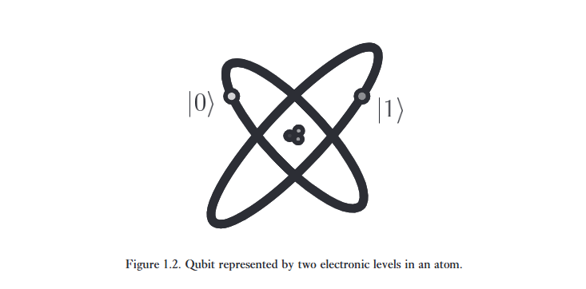
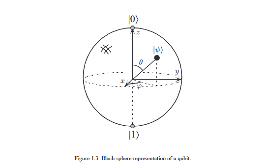

Bit là khái niệm nền tảng của classical computation và classical information. 

Quantum computation và quantum information được xây dựng dựa trên một khái niệm tương tự, đó là bit lượng tử, hay gọi tắt là ***qubit***. Trong phần này, chúng ta sẽ giới thiệu các tính chất của single qubit và multiple qubits, đồng thời so sánh và đối chiếu các tính chất của chúng với các classical bit.

---

***Qubit là gì?*** 

Chúng ta sẽ mô tả qubit như những đối tượng toán học với một số tính chất cụ thể. "Nhưng chờ đã", bạn nói, "tôi tưởng qubit là các vật thể vật lý chứ." Đúng là các qubit, giống như các bit, được hiện thực hóa thành các hệ thống vật lý thực tế, và trong Mục 1.5 cùng Chương 7, chúng ta sẽ mô tả chi tiết cách thức mối liên hệ giữa quan điểm toán học trừu tượng và các hệ thống thực tế được thiết lập. Tuy nhiên, phần lớn thời gian chúng ta đối xử với qubit như những đối tượng toán học trừu tượng. Cái hay của việc coi qubit là các thực thể trừu tượng là nó cho phép chúng ta tự do xây dựng một lý thuyết tổng quát về tính toán lượng tử và thông tin lượng tử mà không phụ thuộc vào một hệ thống cụ thể nào để hiện thực hóa nó.

Vậy thì qubit là gì? Giống như một bit cổ điển có một trạng thái, hoặc là 0 hoặc là 1, một qubit cũng có một trạng thái. Hai trạng thái khả dĩ cho một qubit là các trạng thái $\vert 0\rangle$ và $\vert 1\rangle$, mà như bạn có thể đoán được, tương ứng với các trạng thái 0 và 1 của một bit cổ điển. Ký hiệu như $\vert \psi \rangle$ được gọi là ký hiệu Dirac (Dirac notation), và chúng ta sẽ gặp nó thường xuyên, vì đây là ký hiệu chuẩn cho các trạng thái trong cơ học lượng tử. Sự khác biệt giữa các bit và các qubit là một qubit có thể ở trong một trạng thái khác ngoài $\vert 0\rangle$ hoặc $\vert 1\rangle$. Nó cũng có thể tạo thành các tổ hợp tuyến tính của các trạng thái, thường được gọi là ***superpositions*** chồng chập:

$$
\vert\psi\rangle = \alpha\vert0\rangle + \beta\vert1\rangle \tag {1.1} 
$$

Các số $\alpha$ và $\beta$ là các số phức, mặc dù đối với nhiều mục đích, không mất đi tính tổng quát khi nghĩ chúng là các số thực. Nói cách khác, trạng thái của một qubit là một véc-tơ trong không gian véc-tơ phức hai chiều. Các trạng thái đặc biệt $\vert 0\rangle$ và $\vert 1\rangle$ được gọi là ***computational basis states*** các trạng thái cơ sở tính toán, và tạo thành một cơ sở trực chuẩn cho không gian véc-tơ này.

Chúng ta có thể kiểm tra một bit để xác định xem nó đang ở trạng thái 0 hay 1. Chẳng hạn, máy tính làm việc này suốt thời gian khi chúng truy xuất nội dung bộ nhớ của chúng. Đáng ngạc nhiên là chúng ta không thể kiểm tra một qubit để xác định trạng thái lượng tử của nó, nghĩa là các giá trị của $\alpha$ và $\beta$. Thay vào đó, cơ học lượng tử cho chúng ta biết rằng chúng ta chỉ có thể thu được thông tin hạn chế hơn nhiều về trạng thái lượng tử. Khi chúng ta đo một qubit, ta nhận được kết quả là 0, với xác suất $\vert{}\alpha\vert{}^2$, hoặc kết quả là 1, với xác suất $\vert{}\beta\vert{}^2$. Đương nhiên, $\vert{}\alpha\vert{}^2 + \vert{}\beta\vert{}^2 = 1$, vì các xác suất phải tổng cộng bằng một. Về mặt hình học, chúng ta có thể giải thích điều này như là điều kiện để trạng thái của qubit được chuẩn hóa về độ dài bằng 1. Do đó, nhìn chung trạng thái của một qubit là một véc-tơ đơn vị trong không gian véc-tơ phức hai chiều.   

---

Sự phân đôi này giữa trạng thái không thể quan sát được của một qubit và các phép đo mà chúng ta có thể thực hiện nằm ở cốt lõi của tính toán lượng tử và thông tin lượng tử. 

Trong hầu hết các mô hình trừu tượng của chúng ta về thế giới, có một sự tương ứng trực tiếp giữa các yếu tố của sự trừu tượng và thế giới thực, giống như bản vẽ của kiến trúc sư cho một tòa nhà tương ứng với tòa nhà cuối cùng. Sự thiếu vắng sự tương ứng trực tiếp này trong cơ học lượng tử khiến cho việc trực giác hóa hành vi của các hệ thống lượng tử trở nên khó khăn; tuy nhiên, có một sự tương ứng gián tiếp, vì các trạng thái qubit có thể được thao tác và biến đổi theo những cách dẫn đến các kết quả đo phụ thuộc rõ rệt vào các tính chất khác nhau của trạng thái. Do đó, những trạng thái lượng tử này mang lại các hệ quả thực tế, có thể kiểm chứng bằng thực nghiệm, mà chúng ta sẽ thấy là thiết yếu đối với sức mạnh của tính toán lượng tử và thông tin lượng tử.

Khả năng của một qubit ở trong trạng thái chồng chập đi ngược lại với hiểu biết ‘thông thường’ của chúng ta về thế giới vật lý xung quanh. 

Một bit cổ điển giống như một đồng xu: hoặc là mặt ngửa, hoặc là mặt sấp. Đối với những đồng xu không hoàn hảo, có thể có các trạng thái trung gian như đứng cân bằng trên mép, nhưng những trạng thái đó có thể được bỏ qua trong trường hợp lý tưởng. Ngược lại, một qubit có thể tồn tại trong một tập hợp liên tục các trạng thái nằm giữa $\vert 0\rangle$ và $\vert 1\rangle$ — cho đến khi nó được quan sát. Hãy để chúng tôi nhấn mạnh lại rằng khi một qubit được đo, nó chỉ cho ra kết quả ‘0’ hoặc ‘1’ — một cách mang tính xác suất. Chẳng hạn, một qubit có thể ở trong trạng thái:   

$$
\vert + \rangle = \frac{1}{\sqrt{2}}\vert 0\rangle + \frac{1}{\sqrt{2}}\vert 1\rangle \tag{1.2}
$$

mà khi đo, cho kết quả 0 với tỉ lệ 50% ($\vert{}1/\sqrt{2}\vert{}^2$), và kết quả 1 với tỉ lệ 50%. Chúng ta sẽ thường xuyên quay trở lại với trạng thái này, trạng thái đôi khi được ký hiệu là $\vert +\rangle$.

---

Mặc dù có sự kỳ lạ này, các qubit hoàn toàn có thật, sự tồn tại và hành vi của chúng đã được xác nhận rộng rãi bởi các thực nghiệm (được thảo luận trong Mục 1.5 và Chương 7), và nhiều hệ thống vật lý khác nhau có thể được sử dụng để hiện thực hóa qubit.

Để có một cảm nhận cụ thể về cách một qubit có thể được hiện thực hóa, có thể sẽ hữu ích khi liệt kê một số cách mà việc hiện thực hóa này có thể diễn ra: như hai trạng thái phân cực khác nhau của một photon; như sự định hướng spin của một hạt nhân trong điện trường/từ trường đều; như hai trạng thái của một electron quay quanh một nguyên tử đơn lẻ như được hiển thị trong Hình 1.2. 

Trong mô hình nguyên tử, electron có thể tồn tại ở trạng thái gọi là ***'ground' states*** hoặc trạng thái ***'excited' states***, mà chúng ta sẽ gọi tương ứng là $\vert 0\rangle$ và $\vert 1\rangle$. Bằng cách chiếu ánh sáng vào nguyên tử với năng lượng phù hợp và trong một khoảng thời gian thích hợp, có thể dịch chuyển electron từ trạng thái $\vert 0\rangle$ sang trạng thái $\vert 1\rangle$ và ngược lại. Nhưng thú vị hơn, bằng cách giảm thời gian chúng ta chiếu sáng, một electron ban đầu ở trạng thái $\vert 0\rangle$ có thể được dịch chuyển đến vị trí ‘nửa chừng’ giữa $\vert 0\rangle$ và $\vert 1\rangle$, tức là rơi vào trạng thái $\vert +\rangle$.

Đương nhiên, rất nhiều sự chú ý đã được dành cho ‘ý nghĩa’ hoặc ‘cách diễn giải’ có thể gắn liền với các trạng thái chồng chập, và cho bản chất xác suất vốn có của các quan sát trên các hệ thống lượng tử. Tuy nhiên, nhìn chung, chúng ta sẽ không bận tâm đến những cuộc thảo luận như vậy trong cuốn sách này. Thay vào đó, ý định của chúng ta sẽ là phát triển các bức tranh toán học và khái niệm có tính dự báo.

---

Một bức tranh hữu ích trong việc suy nghĩ về các qubit là biểu diễn hình học sau đây.

Vì $\vert{}\alpha\vert{}^2 + \vert{}\beta\vert{}^2 = 1$, chúng ta có thể viết lại Phương trình (1.1) thành:

$$
\vert\psi\rangle = e^{i\gamma}\left(\cos\frac{\theta}{2}\vert 0\rangle + e^{i\varphi}\sin\frac{\theta}{2}\vert 1\rangle\right), \tag{1.3}
$$

trong đó $\theta, \varphi$ và $\gamma$ là các số thực. Trong Chương 2, chúng ta sẽ thấy rằng ta có thể bỏ qua hệ số $e^{i\gamma}$ ở phía trước, bởi vì nó không có hiệu ứng quan sát được, và vì lý do đó, ta có thể viết một cách hiệu quả là:  

$$
\vert\psi\rangle = \cos\frac{\theta}{2}\vert 0\rangle + e^{i\varphi}\sin\frac{\theta}{2}\vert 1\rangle. \tag {1.4}
$$

Các số $\theta$ và $\varphi$ xác định một điểm trên mặt cầu đơn vị ba chiều, như được hiển thị trong Hình 1.3. Mặt cầu này thường được gọi là ***Bloch sphere*** quả cầu Bloch; nó cung cấp một công cụ hữu ích để trực quan hóa trạng thái của một qubit đơn, và thường đóng vai trò là một bệ phóng thử nghiệm tuyệt vời cho các ý tưởng về tính toán lượng tử và thông tin lượng tử. Nhiều phép toán trên các qubit đơn mà chúng ta mô tả sau này trong chương này được mô tả gọn gàng trong hình ảnh quả cầu Bloch. Tuy nhiên, cần phải ghi nhớ rằng trực giác này bị hạn chế vì không có sự tổng quát hóa đơn giản nào của quả cầu Bloch được biết đến cho nhiều qubit.

:::{.callout-note} 
# Giải thích thêm một chút.

**Tại sao lại sinh thêm 1.4.**

Bởi vì với phương trình ban đầu, $\alpha$ và $\beta$ tốn tới 4 ẩn. Và chúng ta phải biểu diễn nó là một quả cầu trong không gian 4D.

Nhưng vì tính chất đặc biệt, $\vert{}\alpha\vert{}^2 + \vert{}\beta\vert{}^2 = 1$, nên chúng ta có thể bỏ một ẩn tự do. Vì vậy, nếu chọn một hệ tọa độ mới thích hợp thì chúng ta có thể biểu diễn nó, và lúc đó người ta chọn ***Hopf coordinates***. 

Lúc đó, ta có 2 số tự do là:

$$
\alpha = e^{i\gamma}\cos\frac\theta 2 \qquad 
\beta = e^{i\gamma}e^{i\varphi}\sin\frac\theta 2
$$

Nhưng vì thêm một tính chất đặc biệt nào đó, mà việc $e^{i\gamma}$ thay đổi thì không quan sát được. Không có dấu hiệu vật lý nào. Vì vậy có thể rút gọn $e^{i\gamma}$.

Từ đó, phương trình rút gọn lại chỉ còn hai ẩn chính là $\varphi$ và $\theta$, phương trình trở thành:

$$
\vert\psi\rangle = \cos\frac{\theta}{2}\vert 0\rangle + e^{i\varphi}\sin\frac{\theta}{2}\vert 1\rangle. 
$$

và vì chỉ còn 2 ẩn, nên rất dễ và thuận tiện khi thể hiện nó trong không gian 3 chiều, hay là một khối cầu. Với 2 ẩn lần lượt là kinh độ và vĩ độ.

:::

---

**Có bao nhiêu thông tin được biểu diễn bởi một qubit?**

Nghịch lý thay, có vô số điểm trên mặt cầu đơn vị, do đó về nguyên tắc người ta có thể lưu trữ toàn bộ một tác phẩm của Shakespeare trong chuỗi nhị phân vô hạn của $\theta$. Tuy nhiên, kết luận này hóa ra lại mang tính đánh lừa, bởi vì hành vi của một qubit khi được quan sát. Hãy nhớ lại rằng việc đo lường một qubit sẽ chỉ cho ra kết quả hoặc là 0 hoặc là 1. Hơn nữa, phép đo làm thay đổi trạng thái của một qubit, làm nó sụp đổ từ trạng thái chồng chập của $\vert 0\rangle$ và $\vert 1\rangle$ về trạng thái cụ thể phù hợp với kết quả đo. Chẳng hạn, nếu việc đo trạng thái $\vert +\rangle$ cho kết quả 0, thì trạng thái sau phép đo của qubit sẽ là $\vert 0\rangle$. 

**Tại sao loại sự kiện sụp đổ này lại xảy ra?**

Không ai biết cả. Như được thảo luận trong Chương 2, hành vi này đơn giản là một trong những tiên đề cơ bản của cơ học lượng tử. Điều quan trọng đối với các mục đích của chúng ta là từ một phép đo duy nhất, người ta chỉ thu được một bit thông tin duy nhất về trạng thái của qubit, qua đó giải quyết cái nghịch lý hiển nhiên đó. Hóa ra chỉ khi vô số qubit được chuẩn bị y hệt nhau được đo đạc thì người ta mới có thể xác định được $\alpha$ và $\beta$ cho một qubit ở trạng thái được đưa ra trong Phương trình (1.1).

---

Nhưng một câu hỏi thậm chí còn thú vị hơn để đặt ra có thể là: **có bao nhiêu thông tin được biểu diễn bởi một qubit nếu chúng ta không đo đạc nó?**

Đây là một câu hỏi bẫy, bởi vì làm thế nào người ta có thể định lượng thông tin nếu nó không thể được đo đạc? Tuy nhiên, có một điều gì đó mang ý nghĩa khái niệm ở đây, bởi vì khi Tự nhiên tiến hóa một hệ lượng tử cô lập gồm các qubit, mà không thực hiện bất kỳ ‘phép đo’ nào, cô ấy rõ ràng vẫn theo dõi tất cả các biến liên tục mô tả trạng thái, giống như $\alpha$ và $\beta$. Theo một nghĩa nào đó, trong trạng thái của một qubit, Tự nhiên che giấu một lượng lớn ‘thông tin ẩn’. Và điều thú vị hơn nữa là chúng ta sẽ thấy chẳng mấy chốc rằng tiềm năng về lượng ‘thông tin’ bổ sung này tăng lên theo hàm mũ với số lượng qubit. Việc hiểu được thông tin lượng tử ẩn giấu này là một vấn đề mà chúng ta vật lộn trong phần lớn cuốn sách này, và nó nằm ở cốt lõi của những gì làm cho cơ học lượng tử trở thành một công cụ mạnh mẽ cho việc xử lý thông tin.

---

## 1. Multiple qubits

> *"Hilbert space is a big place"*
> Carlton Caves

Giả sử chúng ta có hai qubit. Nếu đây là hai bit cổ điển, thì sẽ có bốn trạng thái khả dĩ: 00, 01, 10 và 11. Tương ứng, một hệ hai qubit có bốn trạng thái cơ sở tính toán được ký hiệu là $\vert 00\rangle, \vert 01\rangle, \vert 10\rangle, \vert 11\rangle$. Một cặp qubit cũng có thể tồn tại trong các trạng thái chồng chập của bốn trạng thái này, do đó trạng thái lượng tử của hai qubit liên quan đến việc gắn một hệ số phức — đôi khi được gọi là ***amplitude*** một biên độ — với mỗi trạng thái cơ sở tính toán, sao cho véc-tơ trạng thái mô tả hai qubit là

$$
\vert\psi\rangle = \alpha_{00}\vert 00\rangle + \alpha_{01}\vert 01\rangle + \alpha_{10}\vert 10\rangle + \alpha_{11}\vert 11\rangle. 
\tag {1.5}
$$

Tương tự như trường hợp của một qubit đơn, kết quả đo $x$ ($= 00, 01, 10$ hoặc $11$) xảy ra với xác suất $\vert{}\alpha_x\vert{}^2$, với trạng thái của các qubit sau phép đo là $\vert x\rangle$. Do đó, điều kiện để các xác suất có tổng bằng một được thể hiện bằng điều kiện chuẩn hóa $\sum_{x\in\{0,1\}^2} \vert{}\alpha_x\vert{}^2 = 1$, trong đó ký hiệu ‘$\{0,1\}^2$’ có nghĩa là ‘tập hợp các chuỗi có độ dài hai với mỗi chữ cái bằng không hoặc một’. 

Đối với một hệ hai qubit, chúng ta có thể đo chỉ một tập hợp con các qubit, giả sử là qubit đầu tiên, và bạn có thể đoán được cách hoạt động này: đo riêng qubit đầu tiên sẽ cho kết quả 0 với xác suất $\vert{}\alpha_{00}\vert{}^2 + \vert{}\alpha_{01}\vert{}^2$, để lại trạng thái sau phép đo

$$
\vert\psi'\rangle = 
\frac{\alpha_{00}\vert 00\rangle + 
\alpha_{01}\vert 01\rangle}{\sqrt{\vert{}\alpha_{00}\vert{}^2 + 
\vert{}\alpha_{01}\vert{}^2}}. 
\tag {1.6}
$$

Lưu ý cách trạng thái sau phép đo được chuẩn hóa lại bởi thừa số $\sqrt{\vert{}\alpha_{00}\vert{}^2 + \vert{}\alpha_{01}\vert{}^2}$ để nó vẫn thỏa mãn điều kiện chuẩn hóa, đúng như chúng ta mong đợi đối với một trạng thái lượng tử hợp lệ. 

---

Một trạng thái hai qubit quan trọng là trạng thái Bell (Bell state) hoặc cặp EPR (EPR pair),

$$
\frac{\vert 00\rangle + \vert 11\rangle}{\sqrt{2}}. \tag {1.7}
$$

Trạng thái có vẻ vô hại này lại chịu trách nhiệm cho rất nhiều điều ngạc nhiên trong quantum computation và quantum information. 

Nó là thành phần cốt lõi trong ***quantum teleportation*** dịch chuyển tức thời lượng tử và ***superdense coding*** mã hóa siêu đặc, những nội dung mà chúng ta sẽ tìm hiểu lần lượt ở Mục 1.3.7 và Mục 2.3, đồng thời là nguyên mẫu cho nhiều trạng thái lượng tử thú vị khác. 

Trạng thái Bell có tính chất là khi đo qubit thứ nhất, người ta thu được hai kết quả khả dĩ: 0 với xác suất $1/2$, để lại trạng thái sau phép đo $\vert\psi'\rangle = \vert 00\rangle$, và 1 với xác suất $1/2$, để lại $\vert\psi'\rangle = \vert 11\rangle$. Kết quả là, việc đo qubit thứ hai luôn cho ra kết quả giống hệt như kết quả đo của qubit thứ nhất. Nghĩa là, các kết quả đo có sự tương quan. Thật vậy, hóa ra các loại phép đo khác cũng có thể được thực hiện trên trạng thái Bell, bằng cách áp dụng trước một số phép toán cho qubit thứ nhất hoặc thứ hai, và rằng các sự tương quan thú vị vẫn sẽ tồn tại giữa kết quả của một phép đo trên qubit thứ nhất và qubit thứ hai. 

Những sự tương quan này đã trở thành chủ đề rất được quan tâm kể từ sau một bài báo nổi tiếng của Einstein, Podolsky và Rosen, trong đó họ lần đầu chỉ ra các tính chất kỳ lạ của các trạng thái như trạng thái Bell. Những nhãn quan của EPR đã được tiếp nhận và cải thiện lớn bởi John Bell, người đã chứng minh được một kết quả đáng kinh ngạc: sự tương quan đo lường trong trạng thái Bell mạnh hơn bất cứ thứ gì từng có thể tồn tại giữa các hệ thống cổ điển. Những kết quả này, được mô tả chi tiết ở Mục 2.6, là dấu hiệu đầu tiên cho thấy cơ học lượng tử cho phép xử lý thông tin vượt xa những gì khả dĩ trong thế giới cổ điển.   

---

Tổng quát hơn, chúng ta có thể xem xét một hệ thống gồm $n$ qubit. Các trạng thái cơ sở tính toán của hệ thống này có dạng $\vert x_1 x_2 \dots x_n\rangle$, và do đó một trạng thái lượng tử của hệ thống như vậy được xác định bởi $2^n$ biên độ. 

Đối với $n = 500$, con số này lớn hơn số nguyên tử ước tính trong Vũ trụ! Cố gắng lưu trữ tất cả các số phức này sẽ là điều bất khả thi trên bất kỳ máy tính cổ điển nào có thể tưởng tượng được. Không gian Hilbert quả thực là một nơi rất rộng lớn. Tuy nhiên, về nguyên tắc, Tự nhiên thao tác với lượng dữ liệu khổng lồ như vậy, ngay cả đối với các hệ thống chỉ chứa vài trăm nguyên tử. Cứ như thể Tự nhiên đang giữ $2^{500}$ mảnh giấy nháp ẩn ở bên cạnh, nơi cô ấy thực hiện các phép tính của mình khi hệ thống tiến hóa. Sức mạnh tính toán tiềm năng to lớn này là thứ mà chúng ta rất muốn tận dụng. 

**Nhưng làm thế nào chúng ta có thể coi cơ học lượng tử như một phép tính toán?**

