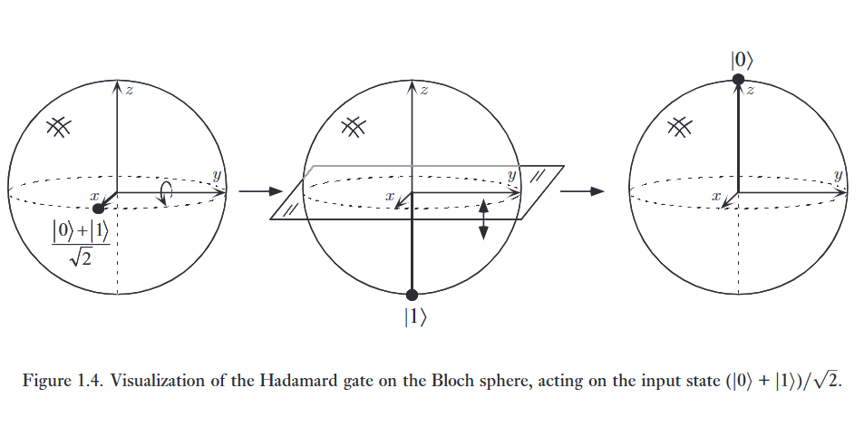
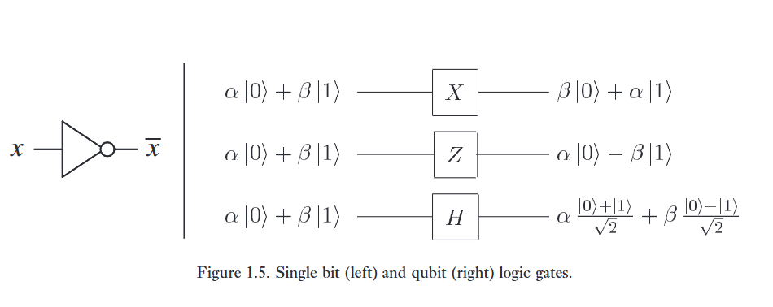
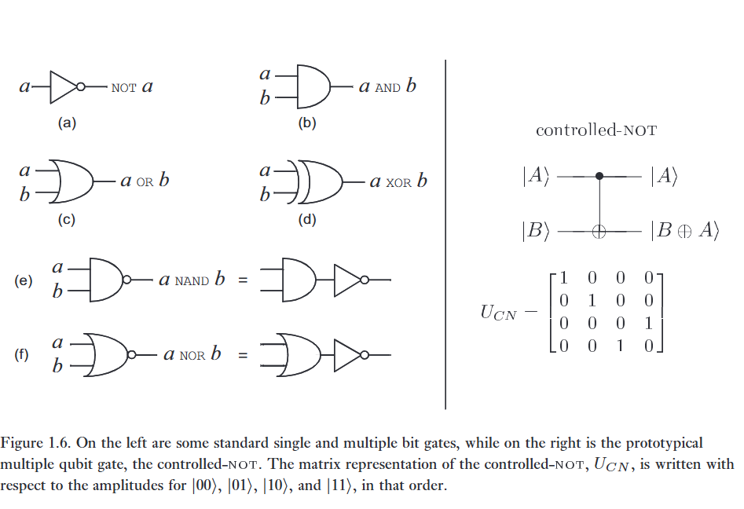
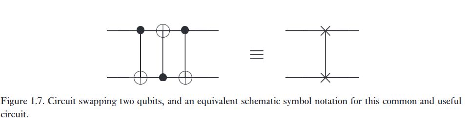
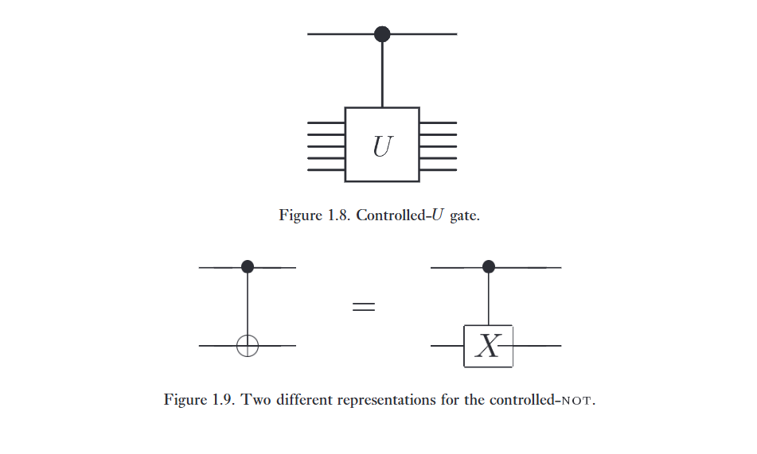
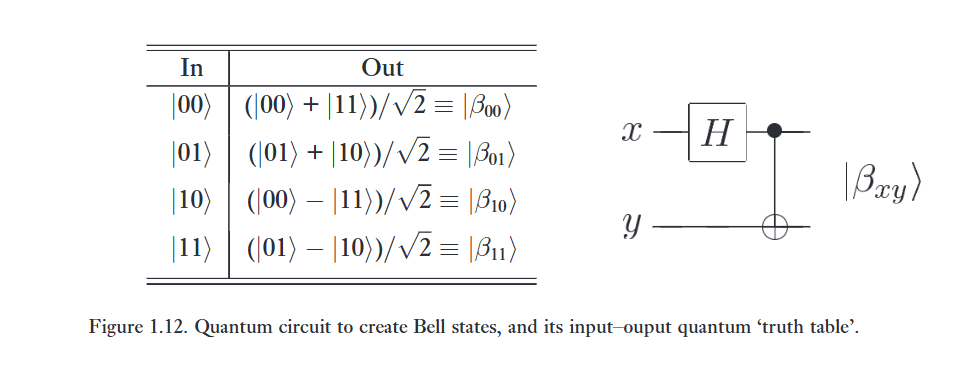
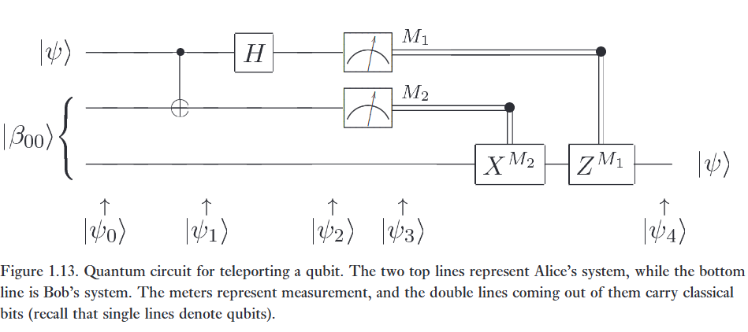

Sự thay đổi xảy ra đối với một trạng thái lượng tử có thể được mô tả bằng ngôn ngữ của quantum computation. Tương tự như cách một máy tính cổ điển được xây dựng từ một mạch điện chứa các dây dẫn và cổng logic, một máy tính lượng tử được xây dựng từ một mạch lượng tử chứa các dây dẫn và các cổng lượng tử sơ cấp để mang đi và thao tác với thông tin lượng tử. 

Trong phần này, chúng ta sẽ mô tả một số cổng lượng tử đơn giản, và trình bày một số mạch ví dụ minh họa ứng dụng của chúng, bao gồm cả một mạch có khả năng dịch chuyển tức thời qubit!

# 1. Single qubit gates

**Có thể định nghĩa một cổng NOT lượng tử tương tự cho các qubit được không?**

Hãy tưởng tượng rằng chúng ta có một quá trình đưa trạng thái $\vert 0\rangle$ thành trạng thái $\vert 1\rangle$, và ngược lại. Một quá trình như vậy rõ ràng sẽ là một ứng cử viên sáng giá cho một chất tương tự lượng tử của cổng NOT. Tuy nhiên, việc chỉ định hành động của cổng trên các trạng thái $\vert 0\rangle$ và $\vert 1\rangle$ không cho chúng ta biết điều gì xảy ra với các trạng thái chồng chập của các trạng thái $\vert 0\rangle$ và $\vert 1\rangle$, nếu không có thêm kiến thức về các tính chất của cổng lượng tử. 

Trên thực tế, cổng NOT lượng tử hoạt động một cách tuyến tính (linearly), nghĩa là nó biến đổi trạng thái   

$$
\alpha\vert 0\rangle + \beta\vert 1\rangle \tag {1.8}
$$

thành trạng thái tương ứng trong đó vai trò của $\vert 0\rangle$ và $\vert 1\rangle$ được hoán đổi cho nhau,

$$
\alpha\vert 1\rangle + \beta\vert 0\rangle. \tag {1.9}
$$

Tại sao cổng NOT lượng tử lại hoạt động theo kiểu tuyến tính chứ không phải theo một cách phi tuyến tính nào đó là một câu hỏi rất thú vị, và câu trả lời không hề hiển nhiên chút nào. Hóa ra hành vi tuyến tính này là một tính chất chung của cơ học lượng tử, và được thúc đẩy rất tốt bởi thực nghiệm; hơn nữa, hành vi phi tuyến tính có thể dẫn đến các nghịch lý rõ rệt như du hành thời gian, truyền thông tin nhanh hơn ánh sáng, và vi phạm các định luật nhiệt động lực học thứ hai. Chúng ta sẽ khám phá điểm này sâu hơn ở các chương sau, nhưng hiện tại chúng ta sẽ tạm coi nó là một điều được thừa nhận.

---

Có một cách thuận tiện để biểu diễn cổng $\text{NOT}$ lượng tử dưới dạng ma trận, cách này xuất phát trực tiếp từ tính tuyến tính của các cổng lượng tử. Giả sử chúng ta định nghĩa một ma trận $X$ để đại diện cho cổng $\text{NOT}$ lượng tử như sau:

$$
X \equiv \begin{bmatrix} 0 & 1 \\ 1 & 0 \end{bmatrix}  \tag {1.10}
$$

(Ký hiệu $X$ cho cổng $\text{NOT}$ lượng tử được sử dụng vì lý do lịch sử.) Nếu trạng thái lượng tử $\alpha\vert 0\rangle + \beta\vert 1\rangle$ được viết dưới dạng ký hiệu véc-tơ là

$$
\begin{bmatrix} \alpha \\ \beta \end{bmatrix}  \tag {1.11}
$$

với phần tử ở trên tương ứng với biên độ của $\vert 0\rangle$ và phần tử ở dưới là biên độ của $\vert 1\rangle$, thì đầu ra tương ứng từ cổng $\text{NOT}$ lượng tử là

$$
X \begin{bmatrix} \alpha \\ \beta \end{bmatrix} = \begin{bmatrix} \beta \\ \alpha \end{bmatrix}  \tag {1.12}
$$

Lưu ý rằng tác động của cổng $\text{NOT}$ là lấy trạng thái $\vert 0\rangle$ và thay thế nó bằng trạng thái tương ứng với cột đầu tiên của ma trận $X$. Tương tự, trạng thái $\vert 1\rangle$ được thay thế bằng trạng thái tương ứng với cột thứ hai của ma trận $X$.

---

Các cổng lượng tử trên một qubit đơn có thể được mô tả bằng các ma trận hai nhân hai. 

**Có ràng buộc nào đối với các ma trận có thể được sử dụng làm cổng lượng tử không?**

Hóa ra là có. Hãy nhớ lại rằng điều kiện chuẩn hóa yêu cầu $\vert{}\alpha\vert{}^2 + \vert{}\beta\vert{}^2 = 1$ đối với một trạng thái lượng tử $\alpha\vert 0\rangle + \beta\vert 1\rangle$. Điều này cũng phải đúng đối với trạng thái lượng tử $\vert\psi'\rangle = \alpha'\vert 0\rangle + \beta'\vert 1\rangle$ sau khi cổng đã tác động. Hóa ra điều kiện thích hợp cho ma trận đại diện cho cổng là ma trận $U$ mô tả cổng một qubit phải là đơn nhất (unitary), nghĩa là $U^\dagger U = I$, trong đó $U^\dagger$ là số phức liên hợp chuyển vị (adjoint) của $U$ (được thu được bằng cách chuyển vị và sau đó lấy số phức liên hợp của $U$), và $I$ là ma trận đơn vị hai nhân hai. Ví dụ, đối với cổng $\text{NOT}$, rất dễ dàng để kiểm tra rằng $X^\dagger X = I$. 

---

Thật đáng kinh ngạc, ràng buộc tính đơn nhất này là ràng buộc duy nhất đối với các cổng lượng tử. Bất kỳ ma trận đơn nhất nào cũng quy định một cổng lượng tử hợp lệ. Ý nghĩa thú vị là, trái ngược với trường hợp cổ điển — nơi chỉ tồn tại một cổng một bit không tầm thường duy nhất là cổng $\text{NOT}$ — có rất nhiều cổng một qubit không tầm thường. Hai cổng quan trọng mà chúng ta sẽ sử dụng sau này là cổng $Z$:

$$
Z \equiv \begin{bmatrix} 1 & 0 \\ 0 & -1 \end{bmatrix} \tag {1.13}
$$

giữ nguyên $\vert 0\rangle$, và lật dấu của $\vert 1\rangle$ thành $-\vert 1\rangle$, và cổng Hadamard:

$$
H \equiv \frac{1}{\sqrt{2}} \begin{bmatrix} 1 & 1 \\ 1 & -1 \end{bmatrix} \tag {1.14}
$$

Cổng này đôi khi được mô tả giống như một cổng "căn bậc hai của NOT", ở chỗ nó biến $\vert 0\rangle$ thành $(\vert 0\rangle + \vert 1\rangle)/\sqrt{2}$ (cột đầu tiên của $H$), nằm "ở giữa" $\vert 0\rangle$ và $\vert 1\rangle$, và biến $\vert 1\rangle$ thành $(\vert 0\rangle - \vert 1\rangle)/\sqrt{2}$ (cột thứ hai của $H$), cũng nằm "ở giữa" $\vert 0\rangle$ và $\vert 1\rangle$. Tuy nhiên, lưu ý rằng $H^2$ không phải là một cổng $\text{NOT}$, vì đại số đơn giản cho thấy rằng $H^2 = I$, và do đó việc áp dụng $H$ hai lần vào một trạng thái sẽ không làm thay đổi gì cả.   

---

Cổng Hadamard là một trong những cổng lượng tử hữu ích nhất, và rất đáng để thử hình dung hoạt động của nó thông qua bức tranh quả cầu Bloch. Trong bức tranh này, hóa ra các cổng một qubit tương ứng với các phép quay và phản xạ của quả cầu. Phép toán Hadamard chỉ đơn giản là một phép quay của quả cầu quanh trục $y$ một góc $90^\circ$, theo sau là một phép quay quanh trục $x$ một góc $180^\circ$, như minh họa trong Hình 1.4. Một số cổng một qubit quan trọng được thể hiện trong Hình 1.5, và được đối chiếu với trường hợp cổ điển.

Có vô số ma trận đơn nhất hai nhân hai, và do đó có vô số cổng một qubit. Tuy nhiên, hóa ra các tính chất của tập hợp đầy đủ có thể được hiểu từ các tính chất của một tập hợp nhỏ hơn nhiều. Ví dụ, như được giải thích ở Hộp 1.1, một cổng đơn nhất một qubit tùy ý có thể được phân rã thành tích của các phép quay 

$$
\begin{bmatrix}
\cos \frac \gamma 2 & -\sin\frac \gamma 2 \\
\sin \frac \gamma 2 & \cos \frac \gamma 2 
\end{bmatrix}
\tag {1.15}
$$

và một cổng mà sau này chúng ta sẽ hiểu là phép quay quanh trục $\hat z$ 

$$
\begin{bmatrix}
e^{-i\beta /2} & 0 \\ 
0 & e^{i\beta/2}
\end{bmatrix}
\tag {1.16}
$$

cùng với một sự dịch pha (toàn cục) - một hệ số nhân hằng số có dạng $e^{i\alpha}$. Các cổng này có thể được chia nhỏ hơn nữa - chúng ta không cần phải thực hiện các cổng này cho các giá trị $\alpha$, $\beta$ và $\gamma$ tùy ý, mà có thể xây dựng các xấp xỉ tốt tùy ý cho các cổng đó chỉ bằng cách sử dụng một số giá trị cố định đặc biệt của $\alpha$, $\beta$ và $\gamma$. 

Bằng cách này, có thể xây dựng một cổng một qubit tùy ý bằng cách sử dụng một tập hợp hữu hạn các cổng lượng tử. Tổng quát hơn, một phép tính toán lượng tử tùy ý trên bất kỳ số lượng qubit nào có thể được tạo ra bởi một tập hợp hữu hạn các cổng được gọi là phổ biến cho tính toán lượng tử. Để có được một tập hợp phổ biến như vậy, trước tiên chúng ta cần giới thiệu một số cổng lượng tử liên quan đến nhiều qubit. 

:::{.callout-note}
# Hộp 1.1. Phân rã các phép toán một qubit

Ở mục 4.2 bắt đầu từ trang 174 trong sách, chúng ta chứng minh rằng một ma trận đơn nhất $2 \times 2$ tùy ý có thể được phân rã thành

$$
U = e^{i\alpha} \begin{bmatrix} e^{-i\beta/2} & 0 \\ 0 & e^{i\beta/2} \end{bmatrix} \begin{bmatrix} \cos\frac{\gamma}{2} & -\sin\frac{\gamma}{2} \\ \sin\frac{\gamma}{2} & \cos\frac{\gamma}{2} \end{bmatrix},\begin{bmatrix} e^{-i\delta/2} & 0 \\ 0 & e^{i\delta/2} \end{bmatrix} 
\tag{1.17}
$$

trong đó $\alpha$, $\beta$, $\gamma$ và $\delta$ là các số thực. Lưu ý rằng ma trận thứ hai chính là một phép quay thông thường. Hóa ra ma trận đầu tiên và ma trận cuối cùng cũng có thể được hiểu là các phép quay trong một mặt phẳng khác. Sự phân rã này có thể được sử dụng để đưa ra một công thức chính xác cho việc thực hiện một cổng logic lượng tử một qubit tùy ý.
:::

# 2. Multiple qubit gates

Bây giờ chúng ta hãy tổng quát hóa từ một qubit sang nhiều qubit. 

Hình 1.6 hiển thị năm cổng cổ điển đa bit đáng chú ý, các cổng $\text{AND}$, $\text{OR}$, $\text{XOR}$ (exclusive-OR), $\text{NAND}$ và $\text{NOR}$. Một kết quả lý thuyết quan trọng là bất kỳ hàm số nào trên các bit đều có thể được tính toán chỉ từ sự kết hợp của các cổng $\text{NAND}$, do đó cổng này được gọi là một cổng vạn năng. Ngược lại, cổng $\text{XOR}$ đứng một mình hoặc thậm chí đi cùng với cổng $\text{NOT}$ thì không vạn năng Một cách để nhận ra điều này là lưu ý rằng việc áp dụng cổng $\text{XOR}$ không làm thay đổi tính chẵn lẻ tổng thể của các bit. Kết quả là, bất kỳ mạch nào chỉ bao gồm các cổng $\text{NOT}$ và $\text{XOR}$ sẽ cho ra các đầu ra có cùng tính chẵn lẻ nếu hai đầu vào $x$ và $y$ có cùng tính chẵn lẻ, từ đó giới hạn lớp các hàm có thể được tính toán, và do đó loại bỏ tính phổ biến.

---

Cổng logic lượng tử đa qubit nguyên mẫu là cổng $\text{controlled-NOT}$ hay cổng $\text{CNOT}$. Cổng này có hai qubit đầu vào, được gọi lần lượt là ***control qubit*** qubit điều khiển và ***target qubit*** qubit mục tiêu. Sơ đồ mạch cho cổng $\text{CNOT}$ được thể hiện ở góc trên bên phải của Hình 1.6; dòng trên đại diện cho qubit điều khiển, trong khi dòng dưới đại diện cho qubit mục tiêu. Hoạt động của cổng có thể được mô tả như sau: 

* Nếu qubit điều khiển được đặt ở $0$, thì qubit mục tiêu được giữ nguyên. 

* Nếu qubit điều khiển được đặt ở $1$, thì qubit mục tiêu bị lật. 

Theo các phương trình:

$$
\vert 00\rangle \to \vert 00\rangle; \tag {vert}01\rangle \to \vert 01\rangle; \tag {vert}10\rangle \to \vert 11\rangle; \tag {vert}11\rangle \to \vert 10\rangle \tag {1.18}
$$

Một cách khác để mô tả cổng $\text{CNOT}$ là sự tổng quát hóa của cổng $\text{XOR}$ cổ điển, vì hành động của cổng có thể được tóm tắt là $\vert A, B\rangle \to \vert A, B \oplus A\rangle$, trong đó $\oplus$ là phép cộng modulo hai, đây chính xác là những gì cổng $\text{XOR}$ thực hiện. Nghĩa là, qubit điều khiển và qubit mục tiêu được thực hiện phép $\text{XOR}$ với nhau và kết quả được lưu trữ trong qubit mục tiêu.

---

Lại một cách khác để mô tả hành động của cổng $\text{CNOT}$ là đưa ra biểu diễn ma trận, như được hiển thị ở góc dưới bên phải của Hình 1.6. Bạn có thể dễ dàng xác minh rằng cột đầu tiên của $U_{CN}$ mô tả sự biến đổi xảy ra đối với $\vert 00\rangle$, và tương tự đối với các trạng thái cơ sở tính toán khác, $\vert 01\rangle$, $\vert 10\rangle$ và $\vert 11\rangle$. Đối với trường hợp một qubit, yêu cầu bảo toàn xác suất được thể hiện qua thực tế rằng $U_{CN}$ là ***unitary matrix***  một ma trận đơn nhất, nghĩa là $U_{CN}^\dagger U_{CN} = I$.  

---

Chúng ta đã nhận thấy rằng cổng $\text{CNOT}$ có thể được coi là một dạng cổng $\text{XOR}$ tổng quát. 

Các cổng cổ điển khác như cổng $\text{NAND}$ hoặc cổng $\text{XOR}$ thông thường có thể được hiểu là các cổng đơn nhất theo một nghĩa tương tự như cách cổng $\text{NOT}$ lượng tử đại diện cho cổng $\text{NOT}$ cổ điển không? 

Hóa ra điều này là không thể. Lý do là vì các cổng $\text{XOR}$ và $\text{NAND}$ về cơ bản là ***irreversible or non-invertible*** không thuận nghịch hoặc không khả nghịch. Ví dụ, cho trước đầu ra $A \oplus B$ từ một cổng $\text{XOR}$, không thể xác định được đầu vào $A$ và $B$ ban đầu là gì; có sự mất mát thông tin không thể khôi phục đi kèm với hành động không khả nghịch của cổng $\text{XOR}$. 

Mặt khác, các cổng lượng tử đơn nhất thì luôn khả nghịch, vì nghịch đảo của một ma trận đơn nhất cũng là một ma trận đơn nhất, và do đó một cổng lượng tử luôn có thể được đảo ngược bởi một cổng lượng tử khác. Hiểu cách thực hiện logic cổ điển theo nghĩa khả nghịch hoặc đảo ngược này sẽ là một bước quan trọng trong việc hiểu cách khai thác sức mạnh của cơ học lượng tử cho tính toán. Chúng ta sẽ giải thích ý tưởng cơ bản về cách thực hiện tính toán khả nghịch (reversible computation) ở Mục 1.4.1.

:::{.callout-note}
# Giải thích thêm cho dễ hiểu

**Trong máy tính cổ điển**

Ví dụ lấy cổng xor, ta có hai bit đầu vào là A và B, thì kết quả cuối cùng chỉ là một bit kết quả (0 hoặc 1).

Vì vậy, chúng ta không biết chính xác đầu vào A và B là gì khi chỉ biết mỗi bit kết quả. Từ đó, thông tin về việc A và B bằng bao nhiêu đã bị trộn lẫn và vướng vào nhau, gọi là mất thông tin. Vì vậy các cổng ở máy tính cổ điển là không khả nghịch, tức là từ một cổng kết quả không thể suy ra được các cổng đầu vào ban đầu.

**Trong máy tính lượng tử**

Ta có cổng CNOT, nhận vào 2 qubit là $\vert A, B \rangle$, và biến đổi chúng thành:

$$
\vert A, B\rangle \rightarrow \vert A, A \oplus B\rangle
$$

nhìn vào kết quả, ta thấy $\vert A \rangle$ vẫn còn được giữ nguyên. Chỉ có qubit thứ hai mới bị biến thành kết quả của $A \oplus B$.

Vì vậy chúng ta có thể khôi phục 2 qubit đầu vào.

**Tại sao**

Bởi vì các ma trận trong lượng tử (hay là cổng logic của nó nhưng ở dạng ma trận) đều phải là ma trận đơn nhất.

Tức là việc ta áp dụng hai lần một cổng nào đó, sẽ cho ra kết quả như ban đầu.

:::

---

Tất nhiên, có rất nhiều cổng lượng tử thú vị khác ngoài cổng $\text{controlled-NOT}$. Tuy nhiên, theo một nghĩa nào đó, cổng $\text{controlled-NOT}$ và các cổng một qubit là các nguyên mẫu cho tất cả các cổng khác vì kết quả tính phổ biến đáng chú ý sau đây: 

**Bất kỳ cổng logic đa qubit nào cũng có thể được cấu thành từ cổng $\text{CNOT}$ và các cổng một qubit.**

Chứng minh được đưa ra ở Mục 4.5, và đây là đối trọng lượng tử của tính phổ biến của cổng $\text{NAND}$.

# 3. Measurements in bases other than the computational basis

Chúng ta đã mô tả các phép đo lượng tử của một qubit đơn ở trạng thái $\alpha\vert 0\rangle + \beta\vert 1\rangle$ mang lại kết quả $0$ hoặc $1$ và để lại qubit ở trạng thái tương ứng $\vert 0\rangle$ hoặc $\vert 1\rangle$, với các xác suất tương ứng là $\vert{}\alpha\vert{}^2$ và $\vert{}\beta\vert{}^2$. Trên thực tế, cơ học lượng tử cho phép sự linh hoạt hơn đôi chút trong lớp các phép đo có thể được thực hiện, mặc dù hoàn toàn không đủ để khôi phục $\alpha$ và $\beta$ từ một phép đo duy nhất!

Lưu ý rằng các trạng thái $\vert 0\rangle$ và $\vert 1\rangle$ chỉ đại diện cho một trong nhiều lựa chọn khả dĩ về các trạng thái cơ sở cho một qubit. Một lựa chọn khả dĩ khác là tập hợp $\vert+\rangle \equiv (\vert 0\rangle + \vert 1\rangle)/\sqrt{2}$ và $\vert-\rangle \equiv (\vert 0\rangle - \vert 1\rangle)/\sqrt{2}$. Một trạng thái tùy ý $\vert\psi\rangle = \alpha\vert 0\rangle + \beta\vert 1\rangle$ có thể được biểu diễn lại theo các trạng thái $\vert+\rangle$ và $\vert-\rangle$:

$$
\vert\psi\rangle = \alpha\vert 0\rangle + \beta\vert 1\rangle = \alpha\frac{\vert+\rangle + \vert-\rangle}{\sqrt{2}} + \beta\frac{\vert+\rangle - \vert-\rangle}{\sqrt{2}} = \frac{\alpha + \beta}{\sqrt{2}}\vert+\rangle + \frac{\alpha - \beta}{\sqrt{2}}\vert-\rangle. 
\tag {1.19}
$$

Hóa ra là có thể coi các trạng thái $\vert+\rangle$ và $\vert-\rangle$ giống như thể chúng là các trạng thái cơ sở tính toán, và đo đạc đối với cơ sở mới này. Đương nhiên, việc đo đạc đối với cơ sở $\vert+\rangle, \vert-\rangle$ mang lại kết quả ‘$+$’ với xác suất $\vert{}\alpha + \beta\vert{}^2/2$ và kết quả ‘$-$' với xác suất $\vert{}\alpha - \beta\vert{}^2/2$, với các trạng thái sau phép đo tương ứng là $\vert+\rangle$ và $\vert-\rangle$, tương ứng.

Tổng quát hơn, cho trước bất kỳ trạng thái cơ sở nào $\vert a\rangle$ và $\vert b\rangle$ cho một qubit, có thể biểu diễn một trạng thái tùy ý dưới dạng một tổ hợp tuyến tính $\alpha\vert a\rangle + \beta\vert b\rangle$ của các trạng thái đó. Hơn nữa, miễn là các trạng thái là ***orthonormal*** trực chuẩn, có thể thực hiện một phép đo đối với cơ sở $\vert a\rangle, \vert b\rangle$, cho ra kết quả $a$ với xác suất $\vert{}\alpha\vert{}^2$ và $b$ với xác suất $\vert{}\beta\vert{}^2$. 

Ràng buộc trực chuẩn là cần thiết để $\vert{}\alpha\vert{}^2 + \vert{}\beta\vert{}^2 = 1$ như chúng ta mong đợi đối với các xác suất. Theo cách tương tự, về nguyên tắc, có thể đo một hệ lượng tử gồm nhiều qubit đối với một cơ sở trực chuẩn tùy ý. Tuy nhiên, chỉ vì có thể làm được về nguyên tắc không có nghĩa là phép đo đó có thể được thực hiện một cách dễ dàng, và chúng ta sẽ quay lại vấn đề làm thế nào để thực hiện hiệu quả một phép đo theo một cơ sở tùy ý ở phần sau.

Có nhiều lý do để sử dụng hình thức mở rộng này cho các phép đo lượng tử, nhưng cuối cùng lý do tốt nhất là thế này: hình thức này cho phép chúng ta mô tả các kết quả thực nghiệm quan sát được, như chúng ta sẽ thấy trong thảo luận của mình về thí nghiệm Stern–Gerlach ở Mục 1.5.1. Một hình thức thậm chí còn tinh vi và thuận tiện hơn (nhưng về cơ bản là tương đương) để mô tả các phép đo lượng tử được mô tả trong chương tiếp theo, Mục 2.2.3.

# 4. Quantum circuits

Chúng ta đã gặp một vài mạch lượng tử đơn giản. Hãy cùng xem xét chi tiết hơn một chút về các thành phần của một mạch lượng tử. 

Một mạch lượng tử đơn giản chứa ba cổng lượng tử được thể hiện trong Hình 1.7. Mạch được đọc từ trái sang phải. Mỗi đường trong mạch đại diện cho một ***wire*** dây dẫn trong mạch lượng tử. Dây dẫn này không nhất thiết phải tương ứng với một sợi dây vật lý; thay vào đó, nó có thể tương ứng với sự trôi qua của thời gian, hoặc có thể là một hạt vật lý như một photon — một hạt ánh sáng — di chuyển từ vị trí này sang vị trí khác trong không gian. Quy ước chung là giả định rằng trạng thái đầu vào của mạch là một trạng thái cơ sở tính toán, thường là trạng thái bao gồm toàn các $\vert 0\rangle$. Quy tắc này bị phá vỡ thường xuyên trong các tài liệu về tính toán lượng tử và thông tin lượng tử, nhưng việc thông báo trước cho người đọc khi điều này xảy ra được coi là lịch sự.  

Mạch trong Hình 1.7 thực hiện một tác vụ đơn giản nhưng hữu ích — nó hoán đổi trạng thái của hai qubit. Để thấy rằng mạch này thực hiện thao tác hoán đổi (swap), hãy lưu ý rằng chuỗi các cổng có trình tự tác động sau đây lên trạng thái cơ sở tính toán $\vert a, b\rangle$:   

$$
\vert a, b\rangle \longrightarrow \vert a, a \oplus b\rangle
$$

$$
\longrightarrow \vert a \oplus (a \oplus b), a \oplus b\rangle = \vert b, a \oplus b\rangle
$$

$$
\longrightarrow \vert b, (a \oplus b) \oplus b\rangle = \vert b, a\rangle \tag {1.20}
$$

trong đó tất cả các phép cộng đều được thực hiện theo modulo 2. Do đó, hiệu ứng của mạch là hoán đổi trạng thái của hai qubit.

---

Có một số tính năng được phép trong mạch cổ điển nhưng thường không xuất hiện trong mạch lượng tử. 

Thứ nhất, chúng ta không cho phép ***'loops'*** "vòng lặp", nghĩa là thông tin phản hồi từ một phần này của mạch lượng tử sang phần khác; chúng ta gọi mạch là ***acyclic*** không có chu trình. 

Thứ hai, các mạch cổ điển cho phép các đường dây được "nối" lại với nhau, một thao tác được gọi là $\text{FANIN}$, với dây đơn kết quả chứa phép toán $\text{OR}$ theo từng bit của các đầu vào. Rõ ràng thao tác này không khả nghịch và do đó không đơn nhất, vì vậy chúng ta không cho phép $\text{FANIN}$ trong các mạch lượng tử của mình. 

Thứ ba, thao tác nghịch đảo của nó, $\text{FANOUT}$, trong đó một vài bản sao của một bit được tạo ra cũng không được phép trong các mạch lượng tử. Trên thực tế, hóa ra quantum mechanic cấm việc sao chép một qubit, khiến thao tác $\text{FANOUT}$ trở thành bất khả thi! Chúng ta sẽ thấy một ví dụ về điều này trong phần tiếp theo khi chúng ta cố gắng thiết kế một mạch để sao chép một qubit.

---

Khi tiến hành, chúng ta sẽ giới thiệu các cổng lượng tử mới khi cần thiết. Thật tiện lợi khi giới thiệu một quy ước khác về các mạch lượng tử tại thời điểm này. Quy ước này được minh họa trong Hình 1.8. Giả sử $U$ là bất kỳ ma trận đơn nhất nào tác động lên một số $n$ qubit nào đó, do đó $U$ có thể được coi là một cổng lượng tử trên các qubit đó. Khi đó chúng ta có thể định nghĩa một cổng $\text{controlled-}U$ vốn là sự mở rộng tự nhiên của cổng $\text{controlled-NOT}$. Cổng này có một qubit điều khiển đơn lẻ, được chỉ định bởi đường có chấm đen, và $n$ qubit mục tiêu, được chỉ định bởi hộp $U$. Nếu qubit điều khiển được đặt ở $0$ thì không có gì xảy ra với các qubit mục tiêu. Nếu qubit điều khiển được đặt ở $1$ thì cổng $U$ được áp dụng lên các qubit mục tiêu. Ví dụ điển hình của cổng $\text{controlled-}U$ là cổng $\text{controlled-NOT}$, đó là cổng $\text{controlled-}U$ với $U = X$, như được minh họa trong Hình 1.9. 

Một thao tác quan trọng khác là phép đo, mà chúng ta biểu diễn bằng ký hiệu "đồng hồ đo", như được hiển thị trong Hình 1.10. Như đã mô tả trước đó, thao tác này chuyển đổi một trạng thái qubit đơn $\vert \psi \rangle = \alpha \vert 0 \rangle + \beta \vert 1 \rangle$ thành một bit cổ điển xác suất M (được phân biệt với qubit bằng cách vẽ nó như một dây dẫn hai đường), có giá trị là 0 với xác suất $\vert \alpha \vert ^2$, hoặc 1 với xác suất $\vert \beta \vert ^2$.

Chúng ta sẽ thấy các mạch lượng tử hữu ích như những mô hình cho tất cả các quá trình lượng tử, bao gồm nhưng không giới hạn ở computation, communication, và thậm chí là quantum noise. Một vài ví dụ đơn giản minh họa điều này dưới đây.

# 5. Quantum copying circuit?

Cổng $\text{CNOT}$ rất hữu ích trong việc minh họa một thuộc tính nền tảng đặc biệt của thông tin lượng tử. Hãy xem xét nhiệm vụ sao chép một bit cổ điển. Điều này có thể được thực hiện bằng cách sử dụng một cổng $\text{CNOT}$ cổ điển, nhận vào bit cần sao chép (ở một trạng thái ẩn $x$ nào đó) và một bit "nháp" (scratchpad bit) được khởi tạo bằng 0, như được minh họa trong Hình 1.11. Đầu ra là hai bit, cả hai đều ở cùng trạng thái $x$.

Giả sử chúng ta cố gắng sao chép một qubit ở trạng thái ẩn $\vert\psi\rangle = a\vert 0\rangle + b\vert 1\rangle$ theo cách tương tự bằng cách sử dụng một cổng $\text{CNOT}$. Trạng thái đầu vào của hai qubit có thể được viết là

$$
\big[a\vert 0\rangle + b\vert 1\rangle\big]\vert 0\rangle = a\vert 00\rangle + b\vert 10\rangle \tag {1.21}
$$

Chức năng của cổng $\text{CNOT}$ là phủ định qubit thứ hai khi qubit thứ nhất là 1, và do đó đầu ra đơn giản là $a\vert 00\rangle + b\vert 11\rangle$. Chúng ta đã sao chép thành công $\vert\psi\rangle$ chưa? Tức là, chúng ta đã tạo ra trạng thái $\vert\psi\rangle\vert\psi\rangle$ chưa? 

Trong trường hợp $\vert\psi\rangle = \vert 0\rangle$ hoặc $\vert\psi\rangle = \vert 1\rangle$ thì đó thực sự là những gì mạch này làm; có thể sử dụng các mạch lượng tử để sao chép thông tin cổ điển được mã hóa dưới dạng $\vert 0\rangle$ hoặc $\vert 1\rangle$. Tuy nhiên, đối với một trạng thái tổng quát $\vert\psi\rangle$, chúng ta thấy rằng:

$$
\vert\psi\rangle\vert\psi\rangle = a^2\vert 00\rangle + ab\vert 01\rangle + ab\vert 10\rangle + b^2\vert 11\rangle \tag {1.22}
$$

So sánh với $a\vert 00\rangle + b\vert 11\rangle$, chúng ta thấy rằng trừ khi $ab = 0$, mạch "sao chép" ở trên không sao chép đầu vào trạng thái lượng tử. Trên thực tế, hóa ra việc tạo ra một bản sao của một trạng thái lượng tử ẩn là bất khả thi. Tính chất này, rằng các qubit không thể bị sao chép, được gọi là ***no-cloning theorem*** định lý cấm sao chép, và đây là một trong những khác biệt chính giữa thông tin lượng tử và thông tin cổ điển. Định lý cấm sao chép được thảo luận chi tiết hơn ở Hộp 12.1 trang 532; chứng minh rất đơn giản và chúng tôi khuyến khích bạn đọc trước phần chứng minh đó ngay bây giờ.

---

Có một cách nhìn khác về sự thất bại của mạch trong Hình 1.11, dựa trên trực giác rằng một qubit theo cách nào đó chứa thông tin "bị ẩn" không thể tiếp cận trực tiếp thông qua phép đo. 

Hãy xem xét điều gì xảy ra khi chúng ta đo một trong các qubit của trạng thái $a\vert 00\rangle + b\vert 11\rangle$. Như đã mô tả trước đây, chúng ta thu được kết quả là $0$ hoặc $1$ với các xác suất tương ứng là $\vert{}a\vert{}^2$ và $\vert{}b\vert{}^2$. Tuy nhiên, một khi một qubit được đo, trạng thái của qubit kia được xác định hoàn toàn và không thể thu được thêm thông tin nào về $a$ và $b$. Theo nghĩa này, thông tin ẩn bổ sung được mang trong qubit ban đầu $\vert\psi\rangle$ đã bị mất trong phép đo đầu tiên và không thể lấy lại được. Tuy nhiên, nếu qubit đã được sao chép, thì trạng thái của qubit kia vẫn phải chứa một phần thông tin ẩn đó. Do đó, một bản sao chắc chắn không thể được tạo ra.

:::{.callout-note}
# Giải thích thêm một số thứ

Ta cho rằng CNOT hoạt động rất tốt ở cổ điển, vì thế nó phải hoạt động tốt ở lượng tử.

Nhưng việc lấy hệ thứ nhất là $\vert\psi\rangle = \alpha\vert 0 \rangle + \beta \vert 1 \rangle$ và hệ thứ hai là $\vert 0 \rangle$ CNOT với nhau, thì sẽ cho ra một hệ bị vướng víu $\alpha \vert 00 \rangle + \beta \vert 1 \rangle$.

Có thể thấy thì nếu ta đo lại phần thứ nhất, thì phần thứ hai bị sụp đổ theo. 

Vì vậy, theo lý thuyết, một trạng thái nhân bản hoàn hảo $\vert \psi \rangle \vert \psi \rangle$ kết quả phải là (1.22). Mỗi qubit đều giữ trọn vẹn thông tin $\vert \psi \rangle$ ban đầu mà không bị ràng buộc số phận lại với nhau.

:::

# 6. Example: Bell states

Hãy cùng xem xét một mạch phức tạp hơn một chút, được thể hiện trong Hình 1.12, có một cổng Hadamart theo sau bởi một cộng CNOT, và biến đổi bốn trạng thái tính toán cơ sở theo bảng được cho. 

Lấy một ví dụ cụ thể, cổng Hadamart nhận đầu vào $\vert 00 \rangle$ thành $(\vert 0 \rangle + \vert 1 \rangle) \vert 0 \rangle / \sqrt 2$, sau đó cổng CNOT cho ra trạng thái đầu ra $(\vert 00 \rangle + \vert 11 \rangle) / \sqrt 2$. Lưu ý cách hoạt động này: đầu tiên, phép biến đổi Hadamart đặt qubit phía trên vào trạng thái chồng chập; điều này sau đó đóng vai trò là một đầu vào điều khiển cho cổng CNOT, và qubit mục tiêu chỉ bị lật khi điều khiển bằng 1. Các trạng thái đầu ra:

$$
\vert\beta_{00}\rangle = \frac{\vert 00\rangle + \vert 11\rangle}{\sqrt{2}}; \tag {1.23}
$$

$$
\vert\beta_{01}\rangle = \frac{\vert 01\rangle + \vert 10\rangle}{\sqrt{2}}; \tag {1.24}
$$

$$
\vert\beta_{10}\rangle = \frac{\vert 00\rangle - \vert 11\rangle}{\sqrt{2}}; \text{ và} \tag {1.25}
$$

$$
\vert\beta_{11}\rangle = \frac{\vert 01\rangle - \vert 10\rangle}{\sqrt{2}} \tag {1.26}
$$

được gọi là ***Bell states*** trạng thái Bell, hoặc đôi khi là ***EPR states*** trạng thái EPR, theo tên của một số người - Bell, và Eistein, Podolsky, và Rosen - những người đầu tiên chỉ ra các tính chất kỳ lạ của các trạng thái như thế này.

Ký hiệu ghi nhớ $\vert\beta_{00}\rangle, \vert\beta_{01}\rangle, \vert\beta_{10}\rangle, \vert\beta_{11}\rangle$ có thể được hiểu thông qua các phương trình   

$$
\vert\beta_{xy}\rangle \equiv \frac{\vert 0, y\rangle + (-1)^x\vert 1, \bar{y}\rangle}{\sqrt{2}}, \tag {1.27}
$$

trong đó $\bar{y}$ là phần bù (phủ định) của $y$

:::{.callout}
# Thử một ví dụ 

Trạng thái ban đầu là $\vert 0 \rangle$ và $\vert 1 \rangle$, $\vert \psi\rangle = \vert 0 \rangle \otimes \vert 1\rangle = \vert 01 \rangle$.

Ban đầu, hệ thứ nhất đi qua cổng Hadamart, vì từ $\vert 01\rangle$ sẽ biến thành:

$$
\vert + \rangle \otimes \vert 1\rangle = \frac {\vert 01\rangle + \vert 11\rangle} {\sqrt 2}
$$

Tiếp theo, hệ đi qua cổng CNOT, $\vert +\rangle$ sẽ là control, còn $\vert 1\rangle$ sẽ là target, vì vậy, hệ sẽ biến thành:

$$
\frac {\vert 01 \rangle + \vert 10 \rangle} {\sqrt 2} = \vert \beta_{01} \rangle
$$
:::

# 7. Example: quantum teleportation

Bây giờ chúng ta sẽ áp dụng các kỹ thuật từ vài trang vừa rồi để hiểu một thứ gì đó phi tầm thường, đầy kinh ngạc và vô cùng thú vị — quantum teleportation! 

Quantum teleportation là một kỹ thuật để di chuyển các quantum state đi xung quanh, ngay cả khi vắng bóng một kênh truyền thông lượng tử nối liền người gửi quantum state với người nhận.

Dưới đây là cách thức hoạt động của quantum teleportation. Alice và Bob đã gặp nhau từ lâu nhưng hiện tại sống rất xa nhau. Khi còn ở bên nhau, họ đã tạo ra một cặp EPR, mỗi người cầm một qubit của cặp EPR đó khi họ chia tay. Nhiều năm sau, Bob đang ở ẩn, và nhiệm vụ của Alice, nếu cô ấy chấp nhận, là chuyển một qubit $\vert{}\psi\rangle$ đến cho Bob. Cô ấy không hề biết trạng thái của qubit này, và hơn thế nữa, cô ấy chỉ có thể gửi thông tin cổ điển cho Bob. Liệu Alice có nên nhận nhiệm vụ này?

Về mặt trực giác, mọi thứ có vẻ khá tồi tệ đối với Alice. Cô ấy không biết trạng thái $\vert{}\psi\rangle$ của qubit mà cô ấy cần gửi cho Bob, và các định luật của cơ học lượng tử ngăn cấm cô ấy xác định trạng thái đó khi trong tay cô ấy chỉ sở hữu một bản sao duy nhất của $\vert{}\psi\rangle$. Tệ hơn nữa, ngay cả khi cô ấy biết trạng thái $\vert{}\psi\rangle$, việc mô tả nó một cách chính xác sẽ tốn một lượng thông tin cổ điển vô hạn vì $\vert{}\psi\rangle$ nhận các giá trị trong một không gian liên tục. Vì vậy, ngay cả khi cô ấy biết $\vert{}\psi\rangle$, Alice sẽ mất cả đời để mô tả trạng thái đó cho Bob. Mọi chuyện có vẻ không mấy khả quan cho Alice. May mắn thay cho Alice, quantum teleportation là một cách thức tận dụng cặp EPR vướng víu nhằm gửi $\vert{}\psi\rangle$ đến cho Bob, chỉ với một chi phí phụ rất nhỏ về classical communication.

Tóm tắt lại, các bước của giải pháp như sau: Alice cho tương tác qubit $\vert{}\psi\rangle$ với nửa cặp EPR của cô ấy, và sau đó đo hai qubit mà cô ấy đang sở hữu, thu được một trong bốn kết quả cổ điển có thể xảy ra: $00, 01, 10,$ và $11$. Cô ấy gửi thông tin này cho Bob. Tùy thuộc vào thông điệp cổ điển của Alice, Bob thực hiện một trong bốn phép toán trên nửa cặp EPR của anh ấy. Thật đáng kinh ngạc, bằng cách làm điều này, anh ấy có thể khôi phục lại chính xác trạng thái ban đầu $\vert{}\psi\rangle$!

Mạch lượng tử được hiển thị trong Hình 1.13 cung cấp một mô tả chính xác hơn về quantum teleportation. Trạng thái cần được dịch chuyển tức thời là $\vert{}\psi\rangle = \alpha\vert{}0\rangle + \beta\vert{}1\rangle$, trong đó $\alpha$ và $\beta$ là các biên độ ẩn chưa biết. Trạng thái đầu vào đi vào mạch $\vert{}\psi_0\rangle$ là:

$$
\vert{}\psi_0\rangle = \vert{}\psi\rangle\vert{}\beta_{00}\rangle \tag {1.28}
$$

$$
= \frac{1}{\sqrt{2}} \big[\alpha\vert 0\rangle(\vert 00\rangle + \vert 11\rangle) + \beta\vert 1\rangle(\vert 00\rangle + \vert 11\rangle)\big], \tag {1.29}
$$

trong đó chúng ta sử dụng quy ước rằng hai qubit đầu tiên (ở bên trái) thuộc về Alice, và qubit thứ ba thuộc về Bob. Như chúng ta đã giải thích trước đó, qubit thứ hai của Alice và qubit của Bob khởi đầu ở trạng thái EPR. Alice gửi các qubit của cô ấy qua một cổng $\text{CNOT}$, thu được:   

$$
\vert\psi_1\rangle = \frac{1}{\sqrt{2}} \big[\alpha\vert 0\rangle(\vert 00\rangle + \vert 11\rangle) + \beta\vert 1\rangle(\vert 10\rangle + \vert 01\rangle)\big]. 
\tag {1.30}
$$

Sau đó cô ấy gửi qubit đầu tiên qua một cổng Hadamard, thu được:

$$
\vert\psi_2\rangle = \frac{1}{2} \big[\alpha(\vert 0\rangle + \vert 1\rangle)(\vert 00\rangle + \vert 11\rangle) + \beta(\vert 0\rangle - \vert 1\rangle)(\vert 10\rangle + \vert 01\rangle)\big]. 
\tag {1.31}
$$

Trạng thái này có thể được viết lại theo cách sau, đơn giản bằng cách nhóm các số hạng lại:

$$
\vert\psi_2\rangle = \frac{1}{2} \big[\vert 00\rangle (\alpha\vert 0\rangle + \beta\vert 1\rangle) + \vert 01\rangle (\alpha\vert 1\rangle + \beta\vert 0\rangle)\\ + \vert 10\rangle (\alpha\vert 0\rangle - \beta\vert 1\rangle) + \vert 11\rangle (\alpha\vert 1\rangle - \beta\vert 0\rangle)\big]. 
\tag {1.32}
$$

Biểu thức này tự nhiên phân rã thành bốn số hạng. Số hạng đầu tiên có các qubit của Alice ở trạng thái $\vert 00\rangle$, và qubit của Bob ở trạng thái $\alpha\vert 0\rangle + \beta\vert 1\rangle$ — chính là trạng thái ban đầu $\vert\psi\rangle$. Nếu Alice thực hiện phép đo và thu được kết quả $00$ thì hệ thống của Bob sẽ ở trạng thái $\vert\psi\rangle$. Tương tự, từ biểu thức trước đó, chúng ta có thể đọc ra trạng thái sau phép đo của Bob, dựa trên kết quả đo của Alice:   

$$
00 \longmapsto \vert\psi_3(00)\rangle \equiv \big[\alpha\vert 0\rangle + \beta\vert 1\rangle\big] \tag {1.33}
$$

$$
01 \longmapsto \vert\psi_3(01)\rangle \equiv \big[\alpha\vert 1\rangle + \beta\vert 0\rangle\big] \tag {1.34}
$$

$$
10 \longmapsto \vert\psi_3(10)\rangle \equiv \big[\alpha\vert 0\rangle - \beta\vert 1\rangle\big] \tag {1.35}
$$

$$
11 \longmapsto \vert\psi_3(11)\rangle \equiv \big[\alpha\vert 1\rangle - \beta\vert 0\rangle\big]. \tag {1.36}
$$

Tùy thuộc vào kết quả đo của Alice, qubit của Bob sẽ kết thúc ở một trong bốn trạng thái khả dĩ. Tất nhiên, để biết nó đang ở trạng thái nào, Bob phải được thông báo về kết quả đo của Alice, chúng ta sẽ chỉ ra sau rằng chính thực tế này ngăn cản việc dịch chuyển tức thời được sử dụng để truyền thông tin nhanh hơn tốc độ ánh sáng.   

Một khi Bob đã biết kết quả đo, Bob có thể "sửa chữa" lại trạng thái của mình, khôi phục lại $\vert{}\psi\rangle$, bằng cách áp dụng cổng lượng tử phù hợp. Ví dụ

* Nếu trong trường hợp kết quả đo là $00$, Bob không cần làm gì cả. 

* Nếu kết quả đo là $01$ thì Bob có thể sửa trạng thái bằng cách áp dụng cổng $X$. 

* Nếu kết quả đo là $10$ thì Bob có thể sửa trạng thái bằng cách áp dụng cổng $Z$. 

* Nếu kết quả đo là $11$ thì Bob có thể sửa trạng thái bằng cách áp dụng đầu tiên cổng $X$ và sau đó là cổng $Z$. 

Tóm lại, Bob cần áp dụng phép biến đổi $Z^{M_1} X^{M_2}$ (lưu ý thời gian đi từ trái sang phải trong sơ đồ mạch, nhưng trong tích ma trận thì các số hạng ở bên phải xảy ra trước) lên qubit của anh ấy, và anh ấy sẽ khôi phục lại trạng thái $\vert{}\psi\rangle$.   

---

Có rất nhiều đặc điểm thú vị về dịch chuyển tức thời, một số trong số đó chúng ta sẽ quay lại bàn sau trong sách. Hiện tại, chúng ta hài lòng với việc bình luận về một vài khía cạnh. 

**Thứ nhất, dịch chuyển tức thời không cho phép truyền các trạng thái lượng tử nhanh hơn ánh sáng sao?**

Điều này có vẻ khá kỳ lạ, bởi vì lý thuyết tương đối ngụ ý rằng việc truyền thông tin nhanh hơn ánh sáng có thể được dùng để gửi thông tin ngược về quá khứ. May mắn thay, dịch chuyển tức thời lượng tử không cho phép truyền thông tin nhanh hơn ánh sáng, bởi vì để hoàn thành việc dịch chuyển tức thời, Alice bắt buộc phải truyền kết quả đo của cô ấy cho Bob qua một kênh truyền thông cổ điển. Chúng ta sẽ chỉ ra ở Phần 2.4.3 rằng nếu không có truyền thông cổ điển này, dịch chuyển tức thời không hề truyền được bất kỳ thông tin nào. Kênh cổ điển bị giới hạn bởi tốc độ ánh sáng, do đó suy ra rằng dịch chuyển tức thời lượng tử không thể thực hiện nhanh hơn tốc độ ánh sáng, giải quyết nghịch lý biểu kiến này.   

Một câu đố **thứ hai về dịch chuyển tức thời là dường như nó tạo ra một bản sao của trạng thái lượng tử đang được dịch chuyển**, vi phạm rõ ràng định lý cấm sao chép được thảo luận ở Phần 1.3.5. Sự vi phạm này chỉ là ảo tưởng vì sau quá trình dịch chuyển tức thời, chỉ còn lại qubit mục tiêu ở trạng thái $\vert{}\psi\rangle$, và qubit dữ liệu ban đầu kết thúc ở một trong các trạng thái cơ sở tính toán $\vert{}0\rangle$ hoặc $\vert{}1\rangle$, tùy thuộc vào kết quả đo trên qubit đầu tiên.   

---

**Chúng ta có thể học được gì từ dịch chuyển tức thời lượng tử?**

Khá nhiều thứ! Nó không chỉ là một thủ thuật gọn gàng mà người ta có thể làm với các trạng thái lượng tử. 

Dịch chuyển tức thời lượng tử nhấn mạnh tính có thể thay thế của các tài nguyên khác nhau trong cơ học lượng tử, cho thấy rằng một cặp EPR được chia sẻ cùng với hai bit truyền thông cổ điển là một tài nguyên ít nhất tương đương với một qubit truyền thông. Tính toán lượng tử và thông tin lượng tử đã hé lộ rất nhiều phương pháp hoán đổi tài nguyên, nhiều phương pháp được xây dựng dựa trên dịch chuyển tức thời lượng tử. 

Cụ thể, trong Chương 10, chúng tôi giải thích cách dịch chuyển tức thời có thể được sử dụng để xây dựng các cổng lượng tử có khả năng chống lại các tác động của nhiễu, và trong Chương 12, chúng tôi chỉ ra rằng dịch chuyển tức thời gắn kết mật thiết với các tính chất của mã sửa lỗi lượng tử. Mặc dù có những kết nối này với các chủ đề khác, nhưng công bằng mà nói chúng ta chỉ mới bắt đầu hiểu tại sao dịch chuyển tức thời lại khả thi trong cơ học lượng tử; trong các chương sau, chúng ta nỗ lực giải thích một số hiểu biết sâu sắc giúp việc hiểu đó trở nên khả thi. 
