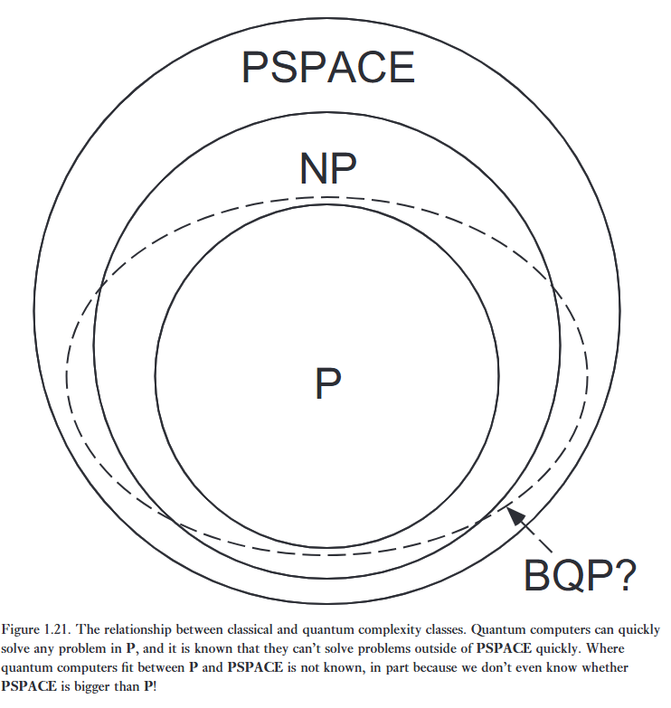

Thuật toán Deutsch–Jozsa gợi ý rằng máy tính lượng tử có thể có khả năng giải quyết một số bài toán tính toán hiệu quả hơn rất nhiều so với máy tính cổ điển. Thật không may, bài toán mà nó giải quyết lại ít có ý nghĩa thực tiễn. 

Liệu có những bài toán thú vị hơn mà lời giải của chúng có thể thu được hiệu quả hơn bằng cách sử dụng các thuật toán lượng tử không? Các nguyên lý nền tảng đằng sau những thuật toán như vậy là gì? Những giới hạn cuối cùng về sức mạnh tính toán của máy tính lượng tử là gì?   

Nói một cách tổng quát, có ba lớp thuật toán lượng tử mang lại ưu thế vượt trội so với các thuật toán cổ điển đã biết:

(1) Lớp thứ nhất: Các thuật toán dựa trên phiên bản lượng tử của phép biến đổi Fourier, một công cụ cũng được ứng dụng rộng rãi trong tính toán cổ điển. Thuật toán Deutsch–Jozsa chính là một ví dụ thuộc loại này, bên cạnh các thuật toán nổi tiếng của Shor dùng để phân tích thừa số nguyên tố và tính ***discrete logarithm*** logarit rời rạc.   

(2) Lớp thứ hai: Các thuật toán ***quantum search algorithms*** tìm kiếm lượng tử.   

(3) Lớp thứ ba: Các thuật toán ***quantum simulation*** mô phỏng lượng tử, trong đó máy tính lượng tử được dùng để mô phỏng chính các hệ thống lượng tử.   

Phần tiếp theo sẽ mô tả ngắn gọn từng lớp thuật toán này, đồng thời tổng kết những gì đã biết hoặc được phỏng đoán về năng lực tính toán cốt lõi của máy tính lượng tử.

# Quantum algorithms based upon the Fourier transform

Phép biến đổi Fourier rời rạc thường được mô tả là biến đổi một tập gồm $N$ số phức $x_0, \dots, x_{N-1}$ thành một tập gồm $N$ số phức $y_0, \dots, y_{N-1}$ được định nghĩa bởi   

$$
y_k \equiv \frac{1}{\sqrt{N}} \sum_{j=0}^{N-1} e^{2\pi i j k / N} x_j. \tag {1.52}
$$

Tất nhiên, phép biến đổi này có vô số ứng dụng trong nhiều nhánh của khoa học; phiên bản biến đổi Fourier của một bài toán thường dễ giải quyết hơn bài toán gốc, từ đó giúp tìm ra lời giải.

Phép biến đổi Fourier hữu ích đến mức một lý thuyết tổng quát đẹp đẽ về các phép biến đổi Fourier đã được phát triển vượt ra ngoài định nghĩa (1.52). Lý thuyết tổng quát này liên quan đến một số ý tưởng kỹ thuật từ lý thuyết ký tự của các nhóm hữu hạn, và chúng ta sẽ không trình bày chi tiết ở đây. Điều quan trọng là phép biến đổi Hadamard được sử dụng trong thuật toán Deutsch–Jozsa chính là một ví dụ thuộc lớp tổng quát này của các phép biến đổi Fourier. Hơn nữa, nhiều thuật toán lượng tử quan trọng khác cũng liên quan đến một dạng phép biến đổi Fourier nào đó.

Các thuật toán lượng tử nổi tiếng quan trọng nhất, các thuật toán nhanh của Shor dùng để phân tích thừa số nguyên tố và tính logarit rời rạc, là hai ví dụ về các thuật toán dựa trên phép biến đổi Fourier được định nghĩa trong Phương trình (1.52). Phương trình (1.52) trông có vẻ không giống cơ học lượng tử theo dạng mà chúng ta vừa viết. Tuy nhiên, hãy tưởng tượng rằng chúng ta định nghĩa một phép biến đổi tuyến tính đơn nhất $U$ trên $n$ qubit thông qua tác động của nó lên các trạng thái cơ sở tính toán $\vert{}j\rangle$, với $0 \le j \le 2^n - 1$,

$$
\vert{}j\rangle \longrightarrow \frac{1}{\sqrt{2^n}} \sum_{k=0}^{2^n - 1} e^{2\pi i j k / 2^n} \vert{}k\rangle. \tag {1.53}
$$

Có thể kiểm tra rằng phép biến đổi này là đơn nhất, và trên thực tế có thể được hiện thực hóa dưới dạng một mạch lượng tử. Hơn nữa, nếu chúng ta viết rõ tác động của nó lên các trạng thái chồng chập,   

$$
\sum_{j=0}^{2^n - 1} x_j \vert{}j\rangle \longrightarrow \frac{1}{\sqrt{2^n}} \sum_{k=0}^{2^n - 1} \left[ \sum_{j=0}^{2^n - 1} e^{2\pi i j k / 2^n} x_j \right] \vert{}k\rangle = \sum_{k=0}^{2^n - 1} y_k \vert{}k\rangle, \tag {1.54}
$$

chúng ta thấy rằng nó tương ứng với ký hiệu véc-tơ cho phép biến đổi Fourier (1.52) trong trường hợp $N = 2^n$.

---

**Chúng ta có thể thực hiện phép biến đổi Fourier nhanh đến mức nào?**

Về mặt cổ điển, phép biến đổi Fourier nhanh tốn khoảng $N \log(N) = n2^n$ bước để biến đổi $N = 2^n$ con số. Trên một máy tính lượng tử, phép biến đổi Fourier có thể được thực hiện chỉ bằng khoảng $\log^2(N) = n^2$ bước, một sự tiết kiệm theo cấp số mũ! Mạch lượng tử để làm điều này được giải thích ở Chương 5.   

Kết quả này dường như chỉ ra rằng máy tính lượng tử có thể được sử dụng để tính toán rất nhanh phép biến đổi Fourier của một véc-tơ gồm $2^n$ số phức, điều này sẽ vô cùng hữu ích trong một loạt các ứng dụng. Tuy nhiên, thực tế không hoàn toàn là như vậy; phép biến đổi Fourier đang được thực hiện trên thông tin được "giấu" trong các biên độ của trạng thái lượng tử. Thông tin này không thể tiếp cận trực tiếp thông qua phép đo. Đương nhiên, điểm mấu chốt là nếu trạng thái đầu ra bị đo đạc, nó sẽ làm sụp đổ từng qubit về trạng thái $\vert{}0\rangle$ hoặc $\vert{}1\rangle$, ngăn cản chúng ta tìm hiểu trực tiếp kết quả biến đổi $y_k$. Ví dụ này nói lên bản chất cốt lõi của bài toán hóc búa khi thiết kế một thuật toán lượng tử. Một mặt, chúng ta có thể thực hiện một số phép tính toán trên $2^n$ biên độ liên kết với $n$ qubit hiệu quả hơn rất nhiều so với những gì có thể thực hiện trên máy tính cổ điển. Nhưng mặt khác, kết quả của một phép tính như vậy lại không khả dụng đối với chúng ta nếu chúng ta tiến hành nó theo một cách thức trực diện. Cần phải có sự khéo léo hơn nữa để khai thác sức mạnh của tính toán lượng tử.   

---

May mắn thay, hóa ra chúng ta có thể sử dụng phép biến đổi Fourier lượng tử để giải quyết hiệu quả một số bài toán mà người ta tin là không có lời giải hiệu quả trên máy tính cổ điển. Những bài toán này bao gồm bài toán của Deutsch, và các thuật toán của Shor dùng để tính logarit rời rạc và phân tích thừa số. Dòng suy nghĩ này đã hội tụ tại khám phá của Kitaev về một phương pháp giải ***Abelian stabilizer problem*** bài toán ổn định Abel, và sự tổng quát hóa thành ***hidden subgroup problem*** bài toán nhóm ẩn,   

> Cho $f$ là một hàm từ một nhóm được sinh hữu hạn $G$ đến một tập hữu hạn $X$ sao cho $f$ là hằng số trên các lớp kề (cosets) của một nhóm con $K$, và phân biệt trên mỗi lớp kề. Cho trước một hộp đen lượng tử để thực hiện phép biến đổi đơn nhất $U\vert{}g\rangle\vert{}h\rangle = \vert{}g\rangle\vert{}h \oplus f(g)\rangle$, với $g \in G, h \in X$, và $\oplus$ là một phép toán nhị phân được chọn thích hợp trên $X$, hãy tìm một tập sinh cho $K$.   

---

Thuật toán Deutsch–Jozsa, các thuật toán của Shor, và các thuật toán lượng tử "nhanh theo cấp số mũ" có liên quan đều có thể được xem là các trường hợp đặc biệt của thuật toán này. Phép biến đổi Fourier lượng tử và các ứng dụng của nó được mô tả ở Chương 5. 

# Quantum search algorithms

Một lớp thuật toán hoàn toàn khác được đại diện bởi thuật toán tìm kiếm lượng tử, có các nguyên lý cơ bản được phát hiện bởi Grover. Thuật toán tìm kiếm lượng tử giải quyết bài toán sau: Cho trước một không gian tìm kiếm có kích thước $N$, và không có kiến thức trước về cấu trúc thông tin trong đó, chúng ta muốn tìm một phần tử của không gian tìm kiếm đó thỏa mãn một tính chất đã biết. Mất bao lâu để tìm được một phần tử thỏa mãn tính chất đó? Về mặt cổ điển, bài toán này đòi hỏi khoảng $N$ phép toán, nhưng thuật toán tìm kiếm lượng tử cho phép giải quyết nó chỉ bằng khoảng $\sqrt{N}$ phép toán.   

Thuật toán tìm kiếm lượng tử chỉ mang lại sự ***quadratic speedup*** tăng tốc bậc hai, trái ngược với sự tăng tốc theo cấp số mũ ấn tượng hơn được cung cấp bởi các thuật toán dựa trên phép biến đổi Fourier lượng tử. Tuy nhiên, thuật toán tìm kiếm lượng tử vẫn thu hút sự quan tâm lớn, vì các phương pháp ***search heuristics*** phỏng đoán tìm kiếm có phạm vi ứng dụng rộng hơn so với các bài toán được giải bằng phép biến đổi Fourier lượng tử, và các biến thể của thuật toán tìm kiếm lượng tử có thể có ích cho một phạm vi rất rộng các bài toán. Thuật toán tìm kiếm lượng tử và các ứng dụng của nó được mô tả ở Chương 6. 

# Quantum simulation

Mô phỏng các hệ thống cơ học lượng tử tự nhiên là một ứng cử viên rõ ràng cho một tác vụ mà máy tính lượng tử có thể vượt trội, nhưng lại được cho là khó trên máy tính cổ điển. Máy tính cổ điển gặp khó khăn trong việc mô phỏng các hệ thống lượng tử tổng quát cũng vì lý do tương tự như lý do chúng gặp khó khăn trong việc mô phỏng máy tính lượng tử — số lượng số phức cần thiết để mô tả một hệ thống lượng tử thường tăng lên theo cấp số mũ theo kích thước của hệ thống, thay vì tăng tuyến tính như xảy ra trong các hệ thống cổ điển. Nhìn chung, việc lưu trữ trạng thái lượng tử của một hệ thống có $n$ thành phần riêng biệt chiếm khoảng $c^n$ bit bộ nhớ trên máy tính cổ điển, trong đó $c$ là một hằng số phụ thuộc vào các chi tiết của hệ thống đang được mô phỏng và độ chính xác mong muốn của mô phỏng. 

---

Ngược lại, một máy tính lượng tử có thể thực hiện mô phỏng bằng cách sử dụng $kn$ qubit, trong đó $k$ lại là một hằng số phụ thuộc vào các chi tiết của hệ thống đang mô phỏng. Điều này cho phép máy tính lượng tử thực hiện hiệu quả các mô phỏng về các hệ thống cơ học lượng tử vốn được cho là không thể mô phỏng hiệu quả trên máy tính cổ điển. Một lưu ý quan trọng là mặc dù máy tính lượng tử có thể mô phỏng nhiều hệ thống lượng tử hiệu quả hơn rất nhiều so với máy tính cổ điển, điều này không có nghĩa là mô phỏng nhanh sẽ cho phép thu được thông tin mong muốn về hệ thống lượng tử đó. Khi bị đo đạc, mô phỏng $kn$ qubit sẽ sụp đổ thành một trạng thái xác định, chỉ cho ra $kn$ bit thông tin; lượng thông tin "ẩn" $c^n$ trong hàm sóng không thể tiếp cận hoàn toàn. Do đó, một bước quan trọng trong việc làm cho các mô phỏng lượng tử trở nên hữu ích là phát triển các phương pháp có hệ thống để có thể trích xuất hiệu quả các câu trả lời mong muốn; cách thực hiện điều này mới chỉ được hiểu một phần.  

---

Bất chấp hạn chế này, mô phỏng lượng tử vẫn có khả năng cao sẽ là một ứng dụng quan trọng của máy tính lượng tử. Việc mô phỏng các hệ thống lượng tử là một bài toán quan trọng trong nhiều lĩnh vực, đặc biệt là hóa học lượng tử (quantum chemistry), nơi các ràng buộc tính toán do máy tính cổ điển gây ra khiến việc mô phỏng chính xác hành vi của ngay cả các phân tử có kích thước trung bình cũng trở nên khó khăn, chưa nói đến các phân tử rất lớn xuất hiện trong nhiều hệ thống sinh học quan trọng. Việc thu được các mô phỏng nhanh hơn và chính xác hơn về các hệ thống như vậy do đó có thể mang lại tác động tích cực là thúc đẩy những tiến bộ trong các lĩnh vực khác mà ở đó các hiện tượng lượng tử đóng vai trò quan trọng.   

Trong tương lai, chúng ta có thể phát hiện ra một hiện tượng vật lý trong Tự nhiên mà không thể mô phỏng một cách hiệu quả trên một máy tính lượng tử. Đây hoàn toàn không phải là tin xấu, mà sẽ là một điều tuyệt vời! Ít nhất, nó sẽ kích thích chúng ta mở rộng các mô hình tính toán của mình để bao hàm hiện tượng mới đó, và gia tăng sức mạnh của các mô hình tính toán vượt ra ngoài mô hình tính toán lượng tử hiện có. Nhiều khả năng cũng sẽ có những hiệu ứng vật lý mới rất thú vị gắn liền với bất kỳ hiện tượng nào như vậy!   

Một ứng dụng khác của mô phỏng lượng tử là như một phương pháp tổng quát để có được góc nhìn sâu sắc hơn về các thuật toán lượng tử khác; ví dụ, trong Mục 6.2, chúng ta giải thích cách thuật toán tìm kiếm lượng tử có thể được xem như là lời giải cho một bài toán mô phỏng lượng tử. Bằng cách tiếp cận bài toán theo cách này, việc hiểu rõ nguồn gốc của thuật toán tìm kiếm lượng tử sẽ trở nên dễ dàng hơn nhiều.

---

Bất chấp hạn chế này, mô phỏng lượng tử vẫn có khả năng cao sẽ là một ứng dụng quan trọng của máy tính lượng tử. Việc mô phỏng các hệ thống lượng tử là một bài toán quan trọng trong nhiều lĩnh vực, đặc biệt là hóa học lượng tử (quantum chemistry), nơi các ràng buộc tính toán do máy tính cổ điển gây ra khiến việc mô phỏng chính xác hành vi của ngay cả các phân tử có kích thước trung bình cũng trở nên khó khăn, chưa nói đến các phân tử rất lớn xuất hiện trong nhiều hệ thống sinh học quan trọng. Việc thu được các mô phỏng nhanh hơn và chính xác hơn về các hệ thống như vậy do đó có thể mang lại tác động tích cực là thúc đẩy những tiến bộ trong các lĩnh vực khác mà ở đó các hiện tượng lượng tử đóng vai trò quan trọng.   

Trong tương lai, chúng ta có thể phát hiện ra một hiện tượng vật lý trong Tự nhiên mà không thể mô phỏng một cách hiệu quả trên một máy tính lượng tử. Đây hoàn toàn không phải là tin xấu, mà sẽ là một điều tuyệt vời! Ít nhất, nó sẽ kích thích chúng ta mở rộng các mô hình tính toán của mình để bao hàm hiện tượng mới đó, và gia tăng sức mạnh của các mô hình tính toán vượt ra ngoài mô hình tính toán lượng tử hiện có. Nhiều khả năng cũng sẽ có những hiệu ứng vật lý mới rất thú vị gắn liền với bất kỳ hiện tượng nào như vậy!   

Một ứng dụng khác của mô phỏng lượng tử là như một phương pháp tổng quát để có được góc nhìn sâu sắc hơn về các thuật toán lượng tử khác; ví dụ, trong Mục 6.2, chúng ta giải thích cách thuật toán tìm kiếm lượng tử có thể được xem như là lời giải cho một bài toán mô phỏng lượng tử. Bằng cách tiếp cận bài toán theo cách này, việc hiểu rõ nguồn gốc của thuật toán tìm kiếm lượng tử sẽ trở nên dễ dàng hơn nhiều.

---

Cuối cùng, mô phỏng lượng tử cũng mang lại một "hệ quả lượng tử" thú vị và lạc quan đối với định luật Moore. Hãy nhớ rằng định luật Moore phát biểu rằng sức mạnh của máy tính cổ điển sẽ tăng gấp đôi sau khoảng mỗi hai năm, với chi phí không đổi.   

Tuy nhiên, giả sử chúng ta đang mô phỏng một hệ thống lượng tử trên một máy tính cổ điển và muốn bổ sung thêm một qubit đơn lẻ (hoặc một hệ thống lớn hơn) vào hệ thống đang được mô phỏng. Điều này làm tăng gấp đôi hoặc hơn thế nữa các yêu cầu về bộ nhớ cần thiết để máy tính cổ điển lưu trữ mô tả trạng thái của hệ thống lượng tử, kèm theo chi phí tương đương hoặc lớn hơn về thời gian cần thiết để mô phỏng động lực học.   

Hệ quả lượng tử của định luật Moore bắt nguồn từ quan sát này, phát biểu rằng máy tính lượng tử đang theo kịp máy tính cổ điển với điều kiện là một qubit đơn lẻ được thêm vào máy tính lượng tử cứ sau mỗi hai năm. Hệ quả này không nên được đón nhận quá nghiêm túc, vì bản chất chính xác của sự gia tăng (nếu có) của tính toán lượng tử so với cổ điển vẫn chưa rõ ràng. Dù vậy, phát biểu mang tính phỏng đoán này giúp truyền tải lý do tại sao chúng ta nên quan tâm đến máy tính lượng tử, và hy vọng rằng một ngày nào đó chúng sẽ có thể vượt trội hơn những chiếc máy tính cổ điển mạnh mẽ nhất, ít nhất là đối với một số ứng dụng. 

# The power of quantum computation

**Máy tính lượng tử mạnh đến mức nào? Điều gì mang lại sức mạnh cho chúng?**

Chưa ai biết câu trả lời cho những câu hỏi này, mặc dù những nghi ngờ được củng cố bởi các ví dụ như phân tích thừa số, vốn gợi ý mạnh mẽ rằng máy tính lượng tử mạnh hơn máy tính cổ điển. Vẫn có khả năng máy tính lượng tử không mạnh hơn máy tính cổ điển, theo nghĩa là bất kỳ bài toán nào có thể được giải quyết hiệu quả trên máy tính lượng tử thì cũng có thể được giải quyết hiệu quả trên máy tính cổ điển. Mặt khác, cuối cùng có thể sẽ được chứng minh rằng máy tính lượng tử mạnh hơn rất nhiều so với máy tính cổ điển. Bây giờ chúng ta sẽ xem xét ngắn gọn những gì đã biết về sức mạnh của tính toán lượng tử.   

---

***Computational complexity theory*** Lý thuyết độ phức tạp tính toán là môn học phân loại độ khó của các bài toán tính toán khác nhau, cả cổ điển lẫn lượng tử, và để hiểu sức mạnh của máy tính lượng tử, trước tiên chúng ta sẽ xem xét một số ý tưởng chung từ độ phức tạp tính toán. Ý tưởng cơ bản nhất là ***complexity class*** lớp độ phức tạp. Một lớp độ phức tạp có thể được coi là một tập hợp các bài toán tính toán, tất cả đều có chung một đặc điểm nào đó liên quan đến tài nguyên tính toán cần thiết để giải quyết các bài toán đó. 

---

Hai trong số các lớp độ phức tạp quan trọng nhất mang tên P và NP. Nói một cách đại khái, P là lớp các bài toán tính toán có thể được giải quyết nhanh chóng trên một máy tính cổ điển. NP là lớp các bài toán có các lời giải có thể được kiểm tra nhanh chóng trên một máy tính cổ điển. Để hiểu sự khác biệt giữa P và NP, hãy xem xét bài toán tìm các thừa số nguyên tố của một số nguyên $n$. Theo những gì đã biết, không có cách nào nhanh chóng để giải bài toán này trên máy tính cổ điển, điều này gợi ý rằng bài toán không nằm trong P. Mặt khác, nếu ai đó nói với bạn rằng một số $p$ nào đó là thừa số của $n$, thì chúng ta có thể nhanh chóng kiểm tra xem điều này có đúng hay không bằng cách chia $n$ cho $p$, vì vậy phân tích thừa số là một bài toán nằm trong NP.

---

Rõ ràng là P là một tập con của NP, vì khả năng giải quyết một bài toán ngụ ý khả năng kiểm tra các lời giải tiềm năng. Điều không rõ ràng là liệu có hay không các bài toán nằm trong NP mà không nằm trong P. Có lẽ bài toán chưa giải được quan trọng nhất trong khoa học máy tính lý thuyết là xác định xem hai lớp này có khác nhau hay không:

$$
\mathbf{P} \overset{?}{\neq} \mathbf{NP}. \tag {1.55}
$$

Hầu hết các nhà nghiên cứu tin rằng NP chứa các bài toán không nằm trong P. Đặc biệt, có một lớp con quan trọng của các bài toán NP, gọi là các bài toán NP-hoàn hảo (NP-complete), có tầm quan trọng đặc biệt vì hai lý do.Thứ nhất, có hàng ngàn bài toán, trong đó nhiều bài toán cực kỳ quan trọng, đã được biết đến là NP-hoàn hảo.Thứ hai, bất kỳ bài toán NP-hoàn hảo cho trước nào, theo một nghĩa nào đó, đều "ít nhất là khó bằng" tất cả các bài toán khác trong NP. Chính xác hơn, một thuật toán để giải một bài toán NP-hoàn hảo cụ thể có thể được điều chỉnh để giải bất kỳ bài toán nào khác trong NP, với một chi phí bổ sung nhỏ (small overhead). Đặc biệt, nếu $\mathbf{P} \neq \mathbf{NP}$, thì suy ra không có bài toán NP-hoàn hảo nào có thể được giải quyết hiệu quả trên một máy tính cổ điển.

---

Người ta chưa biết liệu máy tính lượng tử có thể được sử dụng để giải nhanh tất cả các bài toán trong NP hay không, mặc dù thực tế là chúng có thể được dùng để giải một số bài toán — như phân tích thừa số nguyên tố — vốn được nhiều người tin là nằm trong NP nhưng không nằm trong P. (Lưu ý rằng phân tích thừa số nguyên tố chưa được biết là có phải là bài toán NP-hoàn hảo hay không, nếu không thì chúng ta đã biết cách giải hiệu quả tất cả các bài toán trong NP bằng máy tính lượng tử). Sẽ vô cùng thú vị nếu có thể giải hiệu quả tất cả các bài toán trong NP trên một máy tính lượng tử. Tuy nhiên, có một kết quả phủ định rất thú vị đã biết theo hướng này, vốn loại trừ việc sử dụng một biến thể đơn giản của ***quantum parallelism*** tính song song lượng tử để giải tất cả các bài toán trong NP. Cụ thể, một phương pháp tiếp cận bài toán giải các bài toán trong NP trên máy tính lượng tử là cố gắng sử dụng một dạng song song lượng tử nào đó để tìm kiếm song song qua tất cả các lời giải khả dĩ cho bài toán. Trong Mục 6.6, chúng tôi sẽ chỉ ra rằng không có phương pháp tiếp cận nào dựa trên phương pháp luận tìm kiếm như vậy có thể mang lại một lời giải hiệu quả cho tất cả các bài toán trong NP. Mặc dù thất vọng khi phương pháp tiếp cận này thất bại, điều đó không loại trừ khả năng tồn tại một cấu trúc sâu sắc hơn trong các bài toán thuộc NP cho phép tất cả chúng được giải nhanh chóng bằng máy tính lượng tử.

---

P và NP chỉ là hai trong số rất nhiều lớp độ phức tạp đã được định nghĩa. Một lớp độ phức tạp quan trọng khác là PSPACE. Nói một cách đại khái, PSPACE bao gồm những bài toán có thể được giải bằng cách sử dụng tài nguyên nhỏ về kích thước không gian bộ nhớ (nghĩa là máy tính "nhỏ"), nhưng không nhất thiết về mặt thời gian (các tính toán "dài" vẫn chấp nhận được). PSPACE được tin là lớn hơn một cách nghiêm ngặt so với cả P và NP, mặc dù điều này cũng chưa bao giờ được chứng minh. Cuối cùng, lớp độ phức tạp BPP là lớp các bài toán có thể được giải bằng các thuật toán ngẫu nhiên trong thời gian đa thức, nếu một xác suất lỗi bị chặn (chẳng hạn $1/4$) được cho phép trong lời giải của bài toán. BPP được coi rộng rãi, thậm chí hơn cả P, là lớp các bài toán nên được xem là giải được một cách hiệu quả trên máy tính cổ điển. Chúng tôi đã chọn tập trung ở đây vào P thay vì BPP vì P đã được nghiên cứu sâu hơn, tuy nhiên nhiều ý tưởng và kết luận tương tự cũng nảy sinh trong mối liên hệ với BPP.

---

Còn các lớp độ phức tạp lượng tử thì sao? Chúng ta có thể định nghĩa BQP là lớp của tất cả các bài toán tính toán có thể được giải hiệu quả trên một máy tính lượng tử, nơi một xác suất lỗi bị chặn được phép. (Nói một cách nghiêm ngặt, điều này làm cho BQP tương tự hơn với lớp độ phức tạp cổ điển BPP hơn là P, tuy nhiên chúng ta sẽ bỏ qua sự tinh tế này cho mục đích của thảo luận hiện tại, và coi nó như tương đương lượng tử của P). Vị trí chính xác của BQP so với P, NP và PSPACE hiện vẫn chưa được biết. Những gì đã biết là máy tính lượng tử có thể giải hiệu quả tất cả các bài toán trong P, nhưng không có bài toán nào nằm ngoài PSPACE mà chúng có thể giải hiệu quả. Do đó, BQP nằm đâu đó giữa P và PSPACE, như được minh họa trong Hình 1.21. Một hệ quả quan trọng là nếu chứng minh được rằng máy tính lượng tử mạnh hơn nghiêm ngặt so với máy tính cổ điển, thì suy ra P không bằng PSPACE. Việc chứng minh kết quả sau đã được nhiều nhà khoa học máy tính cố gắng mà không thành công, gợi ý rằng việc chứng minh máy tính lượng tử mạnh hơn máy tính cổ điển có thể là một điều không hề đơn giản, mặc dù có nhiều bằng chứng ủng hộ mệnh đề này.

---

Chúng ta sẽ không suy đoán thêm về sức mạnh tối thượng của tính toán lượng tử lúc này, mà thích chờ cho đến khi chúng ta hiểu rõ hơn về các nguyên lý mà trên đó các thuật toán lượng tử nhanh được xây dựng, một chủ đề chiếm phần lớn Phần II của cuốn sách này. Điều đã rõ ràng là lý thuyết về tính toán lượng tử đặt ra những thách thức thú vị và đáng kể đối với các khái niệm truyền thống về tính toán. Điều làm cho đây trở thành một thách thức quan trọng là mô hình lý thuyết của tính toán lượng tử được tin là có thể hiện thực hóa bằng thực nghiệm, bởi vì — theo hiểu biết tốt nhất của chúng ta — lý thuyết này nhất quán với cách Tự nhiên vận hành. Nếu không phải như vậy thì tính toán lượng tử sẽ chỉ là một sự tò mò toán học khác.