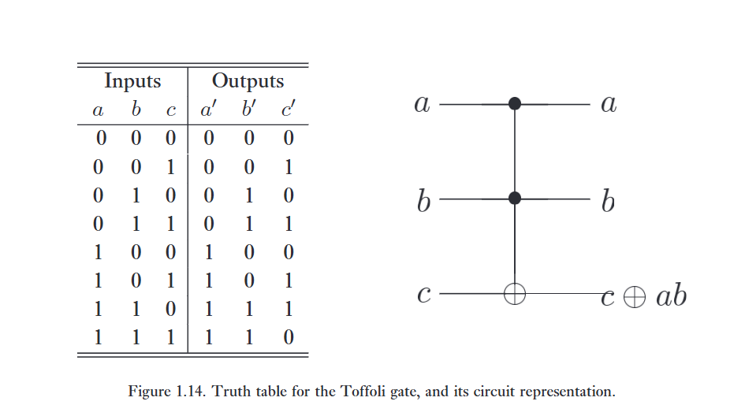
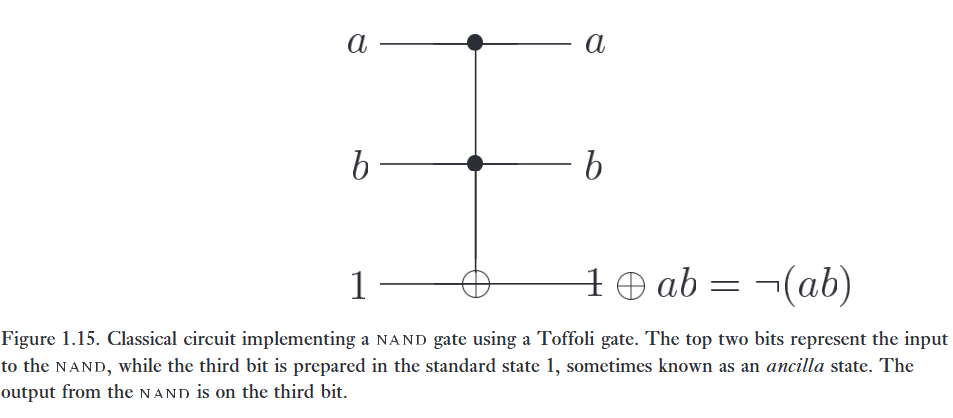
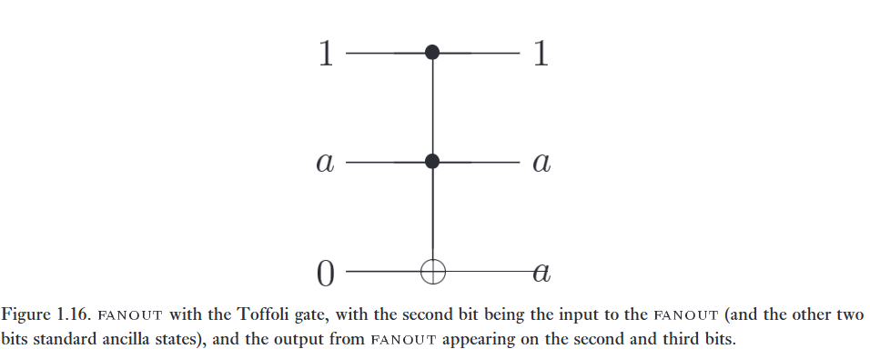
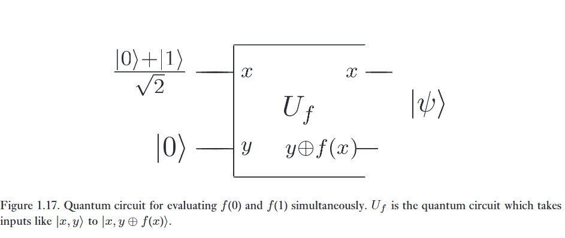
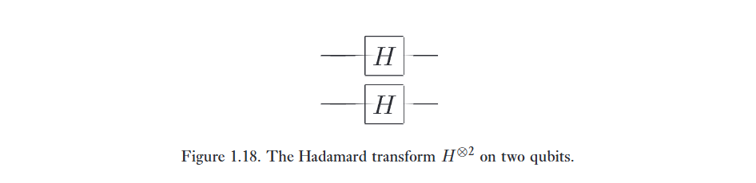
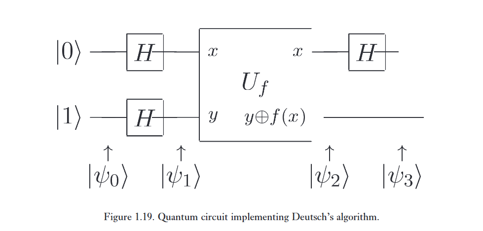

* **Lớp lượng tử nào có thể được thực hiện bằng cách sử dụng các mạch lượng tử?**

* **Lớp lượng tử đó so sánh như thế nào với các phép tính có thể được thực hiện bằng các mạch logic cổ điển?**

* **Liệu chúng ta có thể tìm ra một tác vụ mà máy tính lượng tử có thể thực hiện tốt hơn máy tính cổ điển?**

Trong phần này, chúng ta sẽ nghiên cứu những câu hỏi này, giải thích cách thực hiện các phép tính cổ điển trên máy tính lượng tử, đưa ra một số ví dụ về các bài toán mà máy tính lượng tử mang lại ưu thế so với máy tính cổ điển, và tóm tắt các thuật toán lượng tử đã biết.

:::{.callout-warning}
# tl;dr

Có thể giải quyết bài toán nào? Chúng rộng lớn hơn ra sao so với máy tính cổ điển?

Những bài toán cụ thể nào giúp quantum computer đánh bại hoàn toàn classical computer? (không chỉ tính riêng time complexity)

Đã có những thuật toán nào?
:::

# 1. Classical computations on a quantum computer

**Chúng ta có thể mô phỏng một mạch logic cổ điển bằng một mạch lượng tử không?**

Không có gì ngạc nhiên khi câu trả lời cho câu hỏi này là có. Sẽ rất ngạc nhiên nếu không phải như vậy, vì các nhà vật lý tin rằng mọi khía cạnh của thế giới xung quanh chúng ta, bao gồm cả các mạch logic cổ điển, cuối cùng đều có thể được giải thích bằng cơ học lượng tử. Như đã chỉ ra trước đó, lý do các mạch lượng tử không thể được dùng để mô phỏng trực tiếp các mạch cổ điển là vì các cổng logic lượng tử đơn nhất vốn dĩ có tính thuận nghịch, trong khi nhiều cổng logic cổ điển như cổng $\text{NAND}$ lại vốn dĩ không có tính thuận nghịch.

Bất kỳ mạch cổ điển nào cũng có thể được thay thế bằng một mạch tương đương chỉ chứa các phần tử thuận nghịch, bằng cách sử dụng một cổng thuận nghịch được gọi là ***Toffoli gate*** cổng Toffoli. Cổng Toffoli có ba bit đầu vào và ba bit đầu ra, như được minh họa trong Hình 1.14. 

Hai trong số các bit là control bits không bị ảnh hưởng bởi hoạt động của cổng Toffoli. Bit thứ ba là target bit bị lật nếu cả hai bit điều khiển đều được đặt bằng 1, và ngược lại thì được giữ nguyên. Lưu ý rằng việc áp dụng cổng Toffoli hai lần lên một tập hợp các bit sẽ cho hiệu ứng $(a, b, c) \rightarrow (a, b, c \oplus ab) \rightarrow (a, b, c)$, và do đó cổng Toffoli là một cổng thuận nghịch, vì nghịch đảo của nó chính là chính nó.

---

Cổng Toffoli có thể được dùng để mô phỏng các cổng $\text{NAND}$, như được minh họa trong Hình 1.15, và cũng có thể được dùng để thực hiện thao tác $\text{FANOUT}$, như được minh họa trong Hình 1.16. Với hai phép toán này, việc mô phỏng tất cả các phần tử khác trong một mạch cổ điển trở nên khả thi, và do đó một mạch cổ điển tùy ý có thể được mô phỏng bằng một mạch thuận nghịch tương đương.

---

Cổng Toffoli đã được mô tả như một cổng cổ điển, nhưng nó cũng có thể được triển khai như một cổng logic lượng tử. Theo định nghĩa, việc triển khai logic lượng tử của cổng Toffoli chỉ đơn giản là hoán vị các trạng thái cơ sở tính toán theo cùng cách thức như cổng Toffoli cổ điển. 

Ví dụ, cổng Toffoli lượng tử tác động lên trạng thái $\vert 110\rangle$ sẽ lật qubit thứ ba vì hai qubit đầu tiên đều được đặt bằng 1, dẫn đến kết quả là trạng thái $\vert 111\rangle$. Việc viết ra phép biến đổi này dưới dạng ma trận $U$ kích thước $8 \times 8$ và kiểm tra tường minh rằng $U$ là một ma trận đơn nhất là việc tẻ nhạt nhưng không khó, và do đó cổng Toffoli là một cổng lượng tử hợp lệ. Cổng Toffoli lượng tử có thể được dùng để mô phỏng các cổng logic cổ điển không thuận nghịch, đúng như cổng Toffoli cổ điển đã làm, và đảm bảo rằng máy tính lượng tử có khả năng thực hiện bất kỳ phép tính nào mà một máy tính cổ điển (tất định) có thể làm.  

---

**Sẽ ra sao nếu máy tính cổ điển là không tất định, nghĩa là có khả năng tạo ra các bit ngẫu nhiên được sử dụng trong tính toán?**

Không có gì ngạc nhiên khi máy tính lượng tử có thể dễ dàng mô phỏng điều này. Để thực hiện việc mô phỏng như vậy, hóa ra chỉ cần tạo ra các lần tung đồng xu công bằng ngẫu nhiên, việc này có thể thực hiện bằng cách chuẩn bị một qubit ở trạng thái $\vert{}0\rangle$, cho nó đi qua cổng Hadamard để tạo ra $(\vert{}0\rangle + \vert{}1\rangle)/\sqrt{2}$, và sau đó đo trạng thái. Kết quả thu được sẽ là $\vert{}0\rangle$ hoặc $\vert{}1\rangle$ với xác suất 50/50. Điều này cung cấp cho máy tính lượng tử khả năng mô phỏng hiệu quả một máy tính cổ điển không tất định.

---

Tất nhiên, nếu khả năng mô phỏng các máy tính cổ điển là tính năng duy nhất của máy tính lượng tử thì sẽ có rất ít ý nghĩa trong việc nhọc công khai thác các hiệu ứng lượng tử! Ưu thế của tính toán lượng tử là nhiều hàm mạnh mẽ hơn đáng kể có thể được tính toán bằng cách sử dụng các qubit và cổng lượng tử. Trong một vài phần tiếp theo, chúng tôi giải thích cách thực hiện điều này, với đỉnh cao là thuật toán Deutsch–Jozsa, ví dụ đầu tiên của chúng tôi về một thuật toán lượng tử có khả năng giải quyết một bài toán nhanh hơn bất kỳ thuật toán cổ điển nào.

# 2. Quantum parallelism

***Quantum parallelism*** Song song lượng tử là một tính năng nền tảng của nhiều thuật toán lượng tử. Một cách trực quan, và có nguy cơ bị đơn giản hóa quá mức, song song lượng tử cho phép máy tính lượng tử tính toán một hàm $f(x)$ cho nhiều giá trị $x$ khác nhau cùng một lúc. Trong phần này, chúng tôi giải thích cách song song lượng tử hoạt động, cùng với một số giới hạn của nó.   

---

Giả sử $f(x) : \{0, 1\} \to \{0, 1\}$ là một hàm số với miền xác định và tập giá trị là một bit. Một cách thuận tiện để tính toán hàm này trên máy tính lượng tử là xét một máy tính lượng tử gồm hai qubit bắt đầu ở trạng thái $\vert{}x, y\rangle$. Với một chuỗi cổng logic thích hợp, ta có thể biến đổi trạng thái này thành $\vert{}x, y \oplus f(x)\rangle$, trong đó $\oplus$ biểu thị phép cộng theo modulo 2; thanh ghi thứ nhất được gọi là thanh ghi data, và thanh ghi thứ hai được gọi là thanh ghi target. Phép biến đổi được định nghĩa bởi ánh xạ $\vert{}x, y\rangle \to \vert{}x, y \oplus f(x)\rangle$ được đặt tên là $U_f$, và lưu ý rằng có thể dễ dàng chứng minh đây là một phép biến đổi đơn nhất. Nếu $y = 0$, thì trạng thái cuối cùng của qubit thứ hai chính là giá trị $f(x)$. 

(Ở Phần 3.2.5, chúng tôi chỉ ra rằng với một mạch cổ điển cho trước dùng để tính $f$, sẽ tồn tại một mạch lượng tử có hiệu năng tương đương để tính phép biến đổi $U_f$ trên máy tính lượng tử. Đối với mục đích hiện tại của chúng ta, nó có thể được xem như một hộp đen).

---

Hãy xét mạch được hiển thị trong Hình 1.17, áp dụng $U_f$ cho một đầu vào không nằm trong cơ sở tính toán. Thay vào đó, thanh ghi dữ liệu được chuẩn bị ở trạng thái chồng chập $(\vert{}0\rangle + \vert{}1\rangle)/\sqrt{2}$, có thể được tạo ra bằng cổng Hadamard tác động lên $\vert{}0\rangle$. Sau đó, chúng ta áp dụng $U_f$, dẫn đến trạng thái:   

$$
\frac{\vert{}0, f(0)\rangle + \vert{}1, f(1)\rangle}{\sqrt{2}} \tag {1.37}
$$

Đây là một trạng thái đáng kinh ngạc! Các số hạng khác nhau chứa thông tin về cả $f(0)$ và $f(1)$; gần như thể chúng ta đã tính toán $f(x)$ cho hai giá trị của $x$ cùng một lúc, một tính năng được gọi là "song song lượng tử". Không giống như song song cổ điển — nơi nhiều mạch, mỗi mạch được xây dựng để tính toán $f(x)$, được thực thi đồng thời — ở đây chỉ có một mạch $f(x)$ đơn lẻ được sử dụng để đánh giá hàm số cho nhiều giá trị của $x$ cùng lúc, bằng cách khai thác khả năng của máy tính lượng tử khi ở trong trạng thái chồng chập của các trạng thái khác nhau. 

---

Quy trình này có thể dễ dàng tổng quát hóa cho các hàm trên một số lượng bit tùy ý, bằng cách sử dụng một phép toán chung được gọi là ***Hadamard transform*** phép biến đổi Hadamard, hoặc đôi khi là phép biến đổi Walsh–Hadamard. Phép toán này chỉ đơn giản là $n$ cổng Hadamard tác động song song trên $n$ qubit. Ví dụ, được thể hiện trong Hình 1.18 là trường hợp $n = 2$ với các qubit ban đầu được chuẩn bị ở trạng thái $\vert{}0\rangle$, cho ra kết quả

$$
\left(\frac{\vert{}0\rangle + \vert{}1\rangle}{\sqrt{2}}\right)\left(\frac{\vert{}0\rangle + \vert{}1\rangle}{\sqrt{2}}\right) 
= \frac{\vert{}00\rangle + \vert{}01\rangle + \vert{}10\rangle + \vert{}11\rangle}{2} \tag {1.38}
$$

như là đầu ra. Chúng ta viết $H^{\otimes 2}$ để ký hiệu tác động song song của hai cổng Hadamard, và đọc ký hiệu '$\otimes$' là 'tensor'. Tổng quát hơn, kết quả của việc thực hiện phép biến đổi Hadamard trên $n$ qubit ban đầu ở trạng thái toàn $\vert{}0\rangle$ là   

$$
\frac{1}{\sqrt{2^n}} \sum_x \vert{}x\rangle, \tag {1.39}
$$

trong đó tổng lấy trên tất cả các giá trị khả dĩ của $x$, và chúng ta viết $H^{\otimes n}$ để ký hiệu tác động này. Nghĩa là, phép biến đổi Hadamard tạo ra một trạng thái chồng chập đều của tất cả các trạng thái cơ sở tính toán. Hơn nữa, nó thực hiện điều này một cách cực kỳ hiệu quả, tạo ra trạng thái chồng chập của $2^n$ trạng thái chỉ bằng cách sử dụng đúng $n$ cổng.

Việc đánh giá song song lượng tử của một hàm số với đầu vào $x$ gồm $n$ bit và đầu ra 1 bit, $f(x)$, do đó có thể được thực hiện theo cách sau. Chuẩn bị trạng thái gồm $n + 1$ qubit là $\vert{}0\rangle^{\otimes n}\vert{}0\rangle$, sau đó áp dụng phép biến đổi Hadamard cho $n$ qubit đầu tiên, tiếp theo là mạch lượng tử thực thi $U_f$. Thao tác này tạo ra trạng thái

Việc đánh giá song song lượng tử của một hàm số với đầu vào $x$ gồm $n$ bit và đầu ra 1 bit, $f(x)$, do đó có thể được thực hiện theo cách sau. Chuẩn bị trạng thái gồm $n + 1$ qubit là $\vert{}0\rangle^{\otimes n}\vert{}0\rangle$, sau đó áp dụng phép biến đổi Hadamard cho $n$ qubit đầu tiên, tiếp theo là mạch lượng tử thực thi $U_f$. Thao tác này tạo ra trạng thái
$$
\frac{1}{\sqrt{2^n}} \sum_x \vert{}x\rangle\vert{}f(x)\rangle \tag{1.40}
$$

:::{.callout}
# Nói thêm một chút

Việc giới thiệu hadamart transform của tác giả có lẽ là ý đồ với tiền đề giới thiệu việc có thể tính không chỉ 2 giá trị f(x), mà có thể nâng lên tới n (n thỏa thích).

Tuy là chúng có thể tính được nhiều f() cùng một lúc, nhưng nó chỉ trong thế giới lượng tử. Bởi vì khi chúng ta đo chúng thì tất cả đều đã bị sụp đổ, chỉ còn tồn tại 1 kết quả trả về duy nhất trong cổ điển.

Nhưng việc tính toán 2 cái cùng 1 lúc, rồi khéo léo lồng ghép các cổng logic vào, có thể giúp xác định tính chất của một hàm nào đó, chỉ trong một phép đo! Cụ thẻ là thuật toán Deutsch sẽ giới thiệu ngay sau đây. Chỉ cần 1 lần đo duy nhất là có thể biết được $f(0) = f(1)$ hay $f(0) \neq f(1)$ trong khi thực tế tốn 2 lần để đo.

:::

# 3. Deutsch’s algorithm

Một sửa đổi nhỏ đối với mạch trong Hình 1.17 minh họa cách các mạch lượng tử có thể vượt trội hơn các mạch cổ điển bằng cách thực hiện thuật toán Deutsch (chúng ta thực sự trình bày một phiên bản đơn giản hóa và cải tiến của thuật toán gốc; xem phần 'Lịch sử và đọc thêm' ở cuối chương). Thuật toán Deutsch kết hợp song song lượng tử với một tính chất của cơ học lượng tử được gọi là giao thoa (interference). Như trước đây, hãy sử dụng cổng Hadamard để chuẩn bị qubit thứ nhất ở trạng thái chồng chập $(\vert{}0\rangle + \vert{}1\rangle)/\sqrt{2}$, nhưng bây giờ hãy chuẩn bị qubit thứ hai $y$ ở trạng thái chồng chập $(\vert{}0\rangle - \vert{}1\rangle)/\sqrt{2}$, sử dụng một cổng Hadamard tác động lên trạng thái $\vert{}1\rangle$. Hãy theo dõi các trạng thái để xem điều gì xảy ra trong mạch này, được thể hiện trong Hình 1.19.   

Trạng thái đầu vào

$$
\vert{}\psi_0\rangle = \vert{}01\rangle \tag {1.41}
$$

được đưa qua hai cổng Hadamard để cho ra

$$
\vert{}\psi_1\rangle = 
\left[ \frac{\vert{}0\rangle + \vert{}1\rangle}{\sqrt{2}} \right] 
\left[ \frac{\vert{}0\rangle - \vert{}1\rangle}{\sqrt{2}} \right]. 
\tag {1.42}
$$

Chỉ cần suy nghĩ một chút sẽ thấy rằng nếu chúng ta áp dụng $U_f$ lên trạng thái $\vert{}x\rangle(\vert{}0\rangle - \vert{}1\rangle)/\sqrt{2}$, ta sẽ thu được trạng thái $(-1)^{f(x)}\vert{}x\rangle(\vert{}0\rangle - \vert{}1\rangle)/\sqrt{2}$. 

Do đó, việc áp dụng $U_f$ lên $\vert{}\psi_1\rangle$ để lại cho chúng ta một trong hai khả năng:   

$$
\vert{}\psi_2\rangle = \begin{cases} 
\pm \left[ \frac{\vert{}0\rangle + \vert{}1\rangle}{\sqrt{2}} \right] \left[ \frac{\vert{}0\rangle - \vert{}1\rangle}{\sqrt{2}} \right] & \text{nếu } f(0) = f(1) \\ 
\pm \left[ \frac{\vert{}0\rangle - \vert{}1\rangle}{\sqrt{2}} \right] \left[ \frac{\vert{}0\rangle - \vert{}1\rangle}{\sqrt{2}} \right] & \text{nếu } f(0) \neq f(1). 
\end{cases} 
\tag {1.43}
$$

Cổng Hadamard cuối cùng trên qubit đầu tiên do đó cho chúng ta  

$$
\vert{}\psi_3\rangle = \begin{cases} 
\pm \vert{}0\rangle \left[ \frac{\vert{}0\rangle - \vert{}1\rangle}{\sqrt{2}} \right] & \text{nếu } f(0) = f(1) \\ 
\pm \vert{}1\rangle \left[ \frac{\vert{}0\rangle - \vert{}1\rangle}{\sqrt{2}} \right] & \text{nếu } f(0) \neq f(1). 
\end{cases} 
\tag {1.44}
$$

Nhận ra rằng $f(0) \oplus f(1)$ bằng $0$ nếu $f(0) = f(1)$ và bằng $1$ trong trường hợp ngược lại, chúng ta có thể viết lại kết quả này một cách ngắn gọn là   

$$
\vert{}\psi_3\rangle = \pm \vert{}f(0) \oplus f(1)\rangle \left[ \frac{\vert{}0\rangle - \vert{}1\rangle}{\sqrt{2}} \right], \tag {1.45}$$

vì vậy bằng cách đo qubit đầu tiên, chúng ta có thể xác định được $f(0) \oplus f(1)$. Điều này thực sự rất thú vị: mạch lượng tử đã mang lại cho chúng ta khả năng xác định một thuộc tính toàn cục của $f(x)$, cụ thể là $f(0) \oplus f(1)$, chỉ bằng một lần duy nhất đánh giá $f(x)$! Điều này nhanh hơn so với thiết bị cổ điển, vốn sẽ đòi hỏi ít nhất hai lần đánh giá.  

---

Ví dụ này làm nổi bật sự khác biệt giữa song song lượng tử và các thuật toán ngẫu nhiên cổ điển. 

Một cách ngây thơ, người ta có thể nghĩ rằng trạng thái $\vert{}0\rangle\vert{}f(0)\rangle + \vert{}1\rangle\vert{}f(1)\rangle$ tương đối giống với một máy tính cổ điển xác suất đánh giá $f(0)$ với xác suất một nửa, hoặc $f(1)$ với xác suất một nửa. Sự khác biệt là ở một máy tính cổ điển, hai lựa chọn thay thế này loại trừ lẫn nhau vĩnh viễn; trong một máy tính lượng tử thì có thể để hai lựa chọn thay thế giao thoa với nhau nhằm mang lại một số thuộc tính toàn cục của hàm số $f$, bằng cách sử dụng một thứ gì đó như cổng Hadamard để kết hợp lại các lựa chọn thay thế khác nhau, như đã được thực hiện trong thuật toán Deutsch. 

**Bản chất của việc thiết kế nhiều thuật toán lượng tử là việc lựa chọn khéo léo hàm số và phép biến đổi cuối cùng cho phép xác định hiệu quả thông tin toàn cục hữu ích về hàm số — thông tin mà không thể đạt được nhanh chóng trên một máy tính cổ điển.**

:::{.callout}

Thuật toán Deutsch đưa ra để giải quyết vấn đề rằng, liệu hàm $f : \{0, 1\} \to \{0, 1\}$ là hàm hằng số hay cân bằng? Tức là việc kiểm tra f(0) và f(1) bằng nhau hay không.

Trong khi thế giới cổ điển tốn tới 2 lần đo để biết được, thì thuật toán của ông này chỉ cần 1 lần đo là đã biết.

:::

:::{.callout-important}

# Phase kick back

Là một kỹ thuật trong tính toán lượng tử. Khi mà pha của target qubit được đẩy ngược lại và làm thay đổi pha của control qubit.

Thông thường, trong một cổng điều khiển như CNOT, control qubit sẽ quyết định có làm thay đổi trạng thái của target qubit hay không. Tuy nhiên, khi target qubit nằm trong một trạng thái chồng chập đặc biệt (trạng thái riêng của cổng tác động), trạng thái của nó không đổi, nhưng pha hệ số của nó lại tác động ngược lên control qubit.

Cơ chế.

Giả sử ta có một cổng điều khiển U tác động lên target qubit ở trạng thái $\vert \psi\rangle$, sao cho $U\vert \psi \rangle = -\vert \psi \rangle$ (tức là tạo ra một pha -1).

Khi control qubit ở trạng thái chồng chập $\vert + \rangle$, mạch sẽ diễn biến như sau:

* Nếu là $\vert 0 \rangle$, thì cổng U không kích hoạt, trạng thái sau khi tác động là $\vert 0 \rangle \vert \psi \rangle$.

* Nếu là $\vert 1 \rangle$, thì cổng U kích hoạt, biến $\vert \psi \rangle$ thành $-\vert \psi \rangle$, trạng thái sau cùng là $-\vert 1 \rangle \vert \psi \rangle$.

Kết hợp lại, trạng thái của toàn hệ thống sau cổng điều khiển U là:

$$
\frac {\vert 0 \rangle \vert \psi \rangle - \vert 1 \rangle \vert \psi \rangle} {\sqrt 2} = 
\left( \frac {\vert 0 \rangle - \vert 1 \rangle} {\sqrt 2} \right) \vert \psi \rangle
$$

có thể thấy, từ ban đầu với 2 qubit lần lượt là, $\vert + \rangle$ và $\vert \psi \rangle$, cuối cùng chúng ta đã được là $\vert - \rangle$ và $\vert \psi \rangle$.

target qubit không bị biến đổi, nhưng pha của control qubit đã bị thay đổi.
:::

# 4. The Deutsch–Jozsa algorithm 

# 5. Quantum algorithms summarized