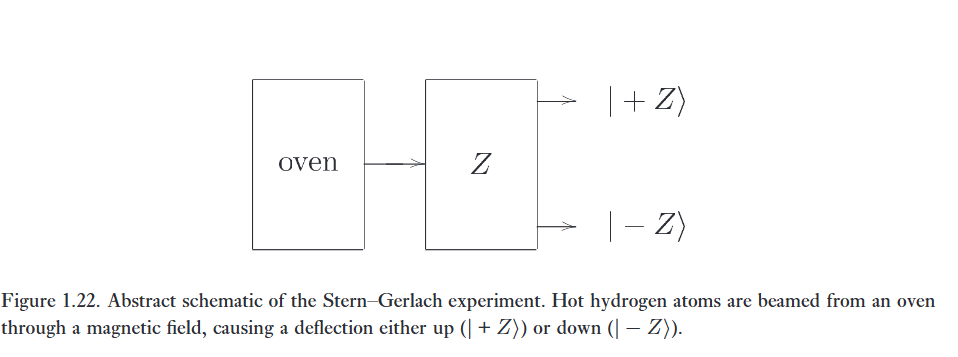
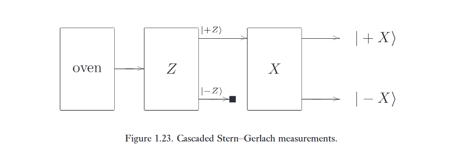
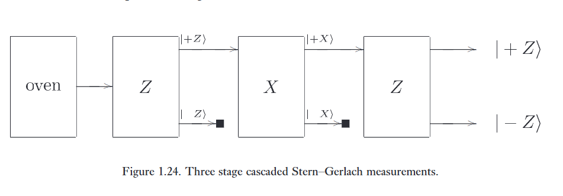

Tính toán lượng tử và thông tin lượng tử là một phát kiến lý thuyết tuyệt vời, nhưng các khái niệm trung tâm của nó, chẳng hạn như ***superposition*** sự chồng chập và ***entanglement*** sự vướng víu, lại đi ngược lại với trực giác mà chúng ta thu nhận được từ thế giới hàng ngày xung quanh mình. 

Chúng ta có bằng chứng nào cho thấy những ý tưởng này thực sự mô tả cách Tự nhiên vận hành? Việc hiện thực hóa các máy tính lượng tử quy mô lớn liệu có khả thi về mặt thực nghiệm hay không? Hay có thể có một nguyên lý vật lý nào đó ngăn cản một cách căn bản việc mở rộng quy mô của chúng?

Trong hai phần tiếp theo, chúng ta sẽ giải quyết những câu hỏi này. Chúng ta bắt đầu bằng việc điểm lại thí nghiệm "Stern–Gerlach" nổi tiếng, vốn cung cấp bằng chứng cho sự tồn tại của các qubit trong Tự nhiên. Sau đó, chúng ta sẽ mở rộng phạm vi, giải quyết bài toán rộng lớn hơn về cách xây dựng các hệ thống xử lý thông tin lượng tử thực tế.

# 1. The Stern-Gerlach experiment

Qubit là nguyên tố nền tảng cho tính toán lượng tử và thông tin lượng tử. Làm thế nào chúng ta biết rằng các hệ thống có tính chất của qubit thực sự tồn tại trong Tự nhiên? Vào thời điểm viết sách, đã có một lượng lớn bằng chứng cho thấy điều này là đúng, nhưng trong những ngày đầu của cơ học lượng tử, cấu trúc qubit hoàn toàn không hề hiển nhiên, và các nhà khoa học đã phải vật lộn với những hiện tượng mà giờ đây chúng ta có thể hiểu dưới dạng các qubit, nghĩa là dưới dạng các hệ lượng tử hai mức năng lượng.

---

Một thí nghiệm ban đầu mang tính quyết định (và rất nổi tiếng) chỉ ra cấu trúc qubit được hình thành bởi Stern vào năm 1921 và thực hiện cùng với Gerlach vào năm 1922 tại Frankfurt. Trong thí nghiệm Stern–Gerlach ban đầu, các nguyên tử nóng được "bắn" từ một lò nung đi qua một từ trường khiến các nguyên tử bị lệch hướng, và sau đó vị trí của mỗi nguyên tử được ghi lại, như được minh họa ở Hình 1.22. Thí nghiệm ban đầu được thực hiện với các nguyên tử bạc, có cấu trúc phức tạp làm che khuất các hiệu ứng mà chúng ta đang thảo luận. Những gì chúng tôi mô tả dưới đây thực chất tuân theo một thí nghiệm năm 1927 được thực hiện bằng cách sử dụng các nguyên tử hydro. Hiệu ứng cơ bản tương tự được quan sát thấy, nhưng với các nguyên tử hydro thì cuộc thảo luận dễ theo dõi hơn. Tuy nhiên, hãy ghi nhớ rằng đặc ân này không có sẵn cho những người ở đầu những năm 1920, và họ phải cực kỳ khéo léo để nghĩ ra các giải thích cho các hiệu ứng phức tạp hơn mà họ quan sát được.   

Các nguyên tử hydro chứa một proton và một electron chuyển động quỹ đạo. Bạn có thể nghĩ electron này giống như một "dòng điện" nhỏ chạy quanh proton. Dòng điện này khiến nguyên tử có một từ trường; mỗi nguyên tử có cái mà các nhà vật lý gọi là ***magnetic dipole moment*** "mô-men lưỡng cực từ". Kết quả là mỗi nguyên tử hành xử giống như một thanh nam châm nhỏ với một trục tương ứng với trục mà electron đang quay xung quanh. Việc ném các thanh nam châm nhỏ xuyên qua một từ trường sẽ khiến các nam châm bị lệch bởi từ trường, và chúng ta kỳ vọng sẽ thấy sự lệch tương tự của các nguyên tử trong thí nghiệm Stern–Gerlach.   

Nguyên tử bị lệch như thế nào phụ thuộc vào cả mô-men lưỡng cực từ của nguyên tử — trục mà electron đang quay xung quanh — và từ trường do thiết bị Stern–Gerlach tạo ra. Chúng ta sẽ không đi sâu vào các chi tiết, nhưng chỉ cần nói rằng bằng cách chế tạo thiết bị Stern–Gerlach một cách phù hợp, chúng ta có thể làm cho nguyên tử bị lệch một lượng phụ thuộc vào thành phần $\hat{z}$ của mô-men lưỡng cực từ của nguyên tử, trong đó $\hat{z}$ là một trục ngoài cố định nào đó. 

---

Hai bất ngờ lớn xuất hiện khi thí nghiệm này được thực hiện. Đầu tiên, vì các nguyên tử nóng thoát ra từ lò nung lẽ ra phải có các lưỡng cực được định hướng ngẫu nhiên theo mọi hướng, nên sẽ dẫn đến việc có một sự phân bố liên tục các nguyên tử được nhìn thấy ở mọi góc thoát ra từ thiết bị Stern–Gerlach. Thay vào đó, những gì được nhìn thấy là các nguyên tử xuất hiện từ một tập hợp các góc rời rạc. Các nhà vật lý đã có thể giải thích điều này bằng cách giả định rằng mô-men lưỡng cực từ của các nguyên tử đã được lượng tử hóa, nghĩa là chúng xuất hiện theo các bội số rời rạc của một lượng cơ bản nào đó.   

Quan sát về hiện tượng lượng tử hóa trong thí nghiệm Stern–Gerlach gây bất ngờ cho các nhà vật lý vào những năm 1920, nhưng không hoàn toàn kinh ngạc vì bằng chứng về các hiệu ứng lượng tử hóa ở các hệ thống khác đang trở nên phổ biến vào thời điểm đó. Điều thực sự đáng ngạc nhiên là số lượng các đỉnh được nhìn thấy trong thí nghiệm. Các nguyên tử hydro được sử dụng vốn dĩ phải có mô-men lưỡng cực từ bằng không. Về mặt cổ điển, điều này tự nó đã đáng ngạc nhiên, vì nó ứng với việc không có chuyển động quỹ đạo nào của electron, nhưng dựa trên những gì được biết về cơ học lượng tử vào thời điểm đó thì đây là một quan niệm có thể chấp nhận được. Vì do đó các nguyên tử hydro sẽ có mô-men từ bằng không, người ta kỳ vọng rằng chỉ có một chùm nguyên tử được nhìn thấy, và chùm này sẽ không bị lệch bởi từ trường. Thay vào đó, hai chùm đã được nhìn thấy: một chùm bị lệch lên trên bởi từ trường, và chùm kia bị lệch xuống dưới!   

Sự chia đôi khó hiểu này đã được giải thích sau rất nhiều nỗ lực bằng cách đặt giả thiết rằng electron trong nguyên tử hydro gắn liền với một đại lượng gọi là spin. Spin này hoàn toàn không liên quan đến chuyển động quay thông thường của electron quanh proton; nó là một đại lượng hoàn toàn mới được gắn liền với một electron. Nhà vật lý vĩ đại Heisenberg đã gọi ý tưởng này là "dũng cảm" vào thời điểm nó được đề xuất, và đây quả thực là một ý tưởng dũng cảm, vì nó giới thiệu một đại lượng vật lý thực sự mới vào Tự nhiên. Spin của electron được giả thiết là tạo ra một đóng góp thêm vào mô-men lưỡng cực từ của nguyên tử hydro, bổ sung cho đóng góp do chuyển động quay quỹ đạo của electron. 

---

**Mô tả thích hợp về spin của electron là gì?**

Theo phỏng đoán ban đầu, chúng ta có thể giả thiết rằng spin được xác định bởi một bit đơn lẻ, ra lệnh cho nguyên tử hydro đi lên hoặc đi xuống. Các kết quả thực nghiệm bổ sung cung cấp thêm thông tin hữu ích để xác định xem phỏng đoán này có cần được tinh chỉnh hay thay thế hay không. 

Hãy biểu diễn thiết bị Stern–Gerlach ban đầu như được thể hiện ở Hình 1.22. Các đầu ra của nó là hai chùm nguyên tử, mà chúng ta sẽ gọi là $\vert{}+Z\rangle$ và $\vert{}-Z\rangle$. (Chúng ta đang sử dụng ký hiệu gợi mở trông có vẻ mang tính cơ học lượng tử, nhưng tất nhiên bạn hoàn toàn tự do sử dụng bất kỳ ký hiệu nào bạn thích.) Bây giờ, giả sử chúng ta mắc nối tiếp hai thiết bị Stern–Gerlach lại với nhau, như được thể hiện ở Hình 1.23. Chúng ta sắp xếp sao cho thiết bị thứ hai bị nghiêng sang một bên, để từ trường làm lệch các nguyên tử theo trục $\hat{x}$. Trong thí nghiệm tưởng tượng của chúng ta, chúng ta sẽ chặn đầu ra $\vert{}-Z\rangle$ từ thiết bị Stern–Gerlach đầu tiên, trong khi đầu ra $\vert{}+Z\rangle$ được gửi qua thiết bị thứ hai được định hướng dọc theo trục $\hat{x}$. Một bộ dò được đặt ở đầu ra cuối cùng để đo sự phân bố của các nguyên tử dọc theo trục $\hat{x}$.

Một lưỡng cực từ cổ điển hướng theo phương $+\hat{z}$ không có mô-men từ tổng hợp theo phương $\hat{x}$, vì vậy chúng ta có thể kỳ vọng rằng đầu ra cuối cùng sẽ có một đỉnh trung tâm. Tuy nhiên, thực nghiệm quan sát thấy có tới hai đỉnh có cường độ bằng nhau! Vì vậy, có lẽ các nguyên tử này rất đặc biệt và có các mô-men từ xác định dọc theo từng trục một cách độc lập. Nghĩa là, có lẽ mỗi nguyên tử đi qua thiết bị thứ hai có thể được mô tả là đang ở một trạng thái mà chúng ta có thể viết là $\vert{}+Z\rangle\vert{}+X\rangle$ hoặc $\vert{}+Z\rangle\vert{}-X\rangle$, nhằm biểu thị hai giá trị spin có thể được quan sát thấy. 

---

Một thí nghiệm khác, được thể hiện ở Hình 1.24, có thể kiểm tra giả thuyết này bằng cách đưa một chùm tia từ đầu ra trước đó đi qua thiết bị Stern–Gerlach thứ hai định hướng theo phương $\hat{z}$. Nếu các nguyên tử giữ nguyên định hướng $\vert{}+Z\rangle$ của chúng, thì đầu ra được kỳ vọng chỉ có một đỉnh tại đầu ra $\vert{}+Z\rangle$. Tuy nhiên, một lần nữa, hai chùm tia lại được quan sát thấy ở đầu ra cuối cùng, với cường độ bằng nhau. Do đó, kết luận rút ra là trái ngược với kỳ vọng cổ điển: một trạng thái $\vert{}+Z\rangle$ thực chất bao gồm các phần bằng nhau của các trạng thái $\vert{}+X\rangle$ và $\vert{}-X\rangle$, và một trạng thái $\vert{}+X\rangle$ bao gồm các phần bằng nhau của các trạng thái $\vert{}+Z\rangle$ và $\vert{}-Z\rangle$. Các kết luận tương tự cũng có thể đạt được nếu thiết bị Stern–Gerlach được canh chỉnh dọc theo một trục khác, chẳng hạn như trục $\hat{y}$.  

---

Mô hình qubit cung cấp một giải thích đơn giản cho hành vi được quan sát bằng thực nghiệm này. Hãy gọi $\vert{}0\rangle$ và $\vert{}1\rangle$ là các trạng thái của một qubit, và thiết lập các phép gán sau:   

$$
\vert{}+Z\rangle \leftarrow \vert{}0\rangle \tag {1.56}
$$
$$
\vert{}-Z\rangle \leftarrow \vert{}1\rangle \tag {1.57}
$$

$$
\vert{}+X\rangle \leftarrow \frac{\vert{}0\rangle + \vert{}1\rangle}{\sqrt{2}} \tag {1.58}
$$

$$
\vert{}-X\rangle \leftarrow \frac{\vert{}0\rangle - \vert{}1\rangle}{\sqrt{2}} \tag {1.59}
$$

Khi đó, kết quả của thí nghiệm Stern–Gerlach mắc nối tiếp có thể được giải thích bằng cách giả định rằng thiết bị Stern–Gerlach theo phương $\hat{z}$ đo đạc spin (tức là qubit) theo cơ sở tính toán $\vert{}0\rangle, \vert{}1\rangle$, và thiết bị Stern–Gerlach theo phương $\hat{x}$ đo đạc spin đối với cơ sở $\frac{\vert{}0\rangle + \vert{}1\rangle}{\sqrt{2}}, \frac{\vert{}0\rangle - \vert{}1\rangle}{\sqrt{2}}$.   

Ví dụ, trong thí nghiệm mắc nối tiếp $\hat{z}-\hat{x}-\hat{z}$, nếu chúng ta giả định rằng các spin ở trạng thái $\vert{}+Z\rangle = \vert{}0\rangle = \frac{\vert{}+X\rangle + \vert{}-X\rangle}{\sqrt{2}}$ sau khi rời khỏi thiết bị Stern–Gerlach đầu tiên, thì xác suất để thu được $\vert{}+X\rangle$ ở thiết bị thứ hai là $1/2$, và xác suất để thu được $\vert{}-X\rangle$ cũng là $1/2$. Tương tự, xác suất để thu được $\vert{}+Z\rangle$ ở thiết bị thứ ba là $1/2$. Do đó, mô hình qubit dự đoán hoàn toàn chính xác các kết quả từ loại thí nghiệm mắc nối tiếp này

---

Ví dụ này minh họa cách các qubit có thể là một cách đáng tin cậy để mô hình hóa các hệ thống trong Tự nhiên. Tất nhiên, nó không xác lập một cách vượt qua mọi hoài nghi rằng mô hình qubit là cách đúng đắn để hiểu về spin của electron – cần có nhiều bằng chứng thực nghiệm củng cố hơn nữa. Tuy nhiên, nhờ vào nhiều thí nghiệm như thế này, giờ đây chúng ta tin rằng spin của electron được mô tả tốt nhất bởi mô hình qubit. Hơn thế nữa, chúng ta tin rằng mô hình qubit (và các sự tổng quát hóa của nó lên các chiều cao hơn; nói cách khác là cơ học lượng tử) có khả năng mô tả mọi hệ thống vật lý. Bây giờ chúng ta chuyển sang câu hỏi về những hệ thống nào đặc biệt thích hợp với việc xử lý thông tin lượng tử.

# 2. Prospects for pratical quantum information processing

Xây dựng các thiết bị xử lý thông tin lượng tử là một thách thức lớn đối với các nhà khoa học và kỹ sư của thiên niên kỷ thứ ba. Liệu chúng ta có vươn lên để đáp ứng thách thức này không? Liệu điều đó có thực sự khả thi không? Có đáng để thử sức không? Nếu có, làm thế nào để thực hiện được kỳ tích đó? Đây là những câu hỏi khó và quan trọng, mà chúng tôi sẽ thử đưa ra các câu trả lời ngắn gọn trong phần này, sẽ được mở rộng thêm trong suốt cuốn sách.   

:::{.callout}
# brief

Bây giờ chúng ta sẽ đặt câu hỏi là, **làm thế nào để chế tạo các phần cứng xử lý thông tin lượng tử?**

Với hai mối đe dọa lớn:

* Vấn đề về nhiễu

* Tính đúng đắn của cơ học lượng tử trong quy mô lớn.
:::

---

Câu hỏi cơ bản nhất là liệu có bất kỳ điểm nguyên lý nào ngăn cản chúng ta thực hiện một hoặc nhiều hình thức xử lý thông tin lượng tử hay không? Hai trở ngại tiềm tàng xuất hiện: rằng nhiễu có thể đặt ra một rào cản cơ bản đối với việc xử lý thông tin lượng tử hữu ích; hoặc rằng cơ học lượng tử có thể không còn đúng đắn.

---

Nhiễu không còn nghi ngờ gì nữa là một vật cản đáng kể đối với sự phát triển của các thiết bị xử lý thông tin lượng tử thực tế. **Liệu đó có phải là một vật cản cơ bản không thể loại bỏ, thứ sẽ ngăn chặn vĩnh viễn sự phát triển của các thiết bị xử lý thông tin lượng tử quy mô lớn hay không?**

Lý thuyết mã sửa lỗi lượng tử chỉ ra mạnh mẽ rằng trong khi nhiễu lượng tử là một vấn đề thực tế cần được giải quyết, nó không tạo ra một vấn đề nguyên lý cơ bản. Cụ thể, có một ***"threshold theorem"*** định lý ngưỡng cho tính toán lượng tử, phát biểu đại khái rằng, miễn là mức độ nhiễu trong máy tính lượng tử có thể được giảm xuống dưới một giá trị "ngưỡng" hằng số nhất định, các mã sửa lỗi lượng tử có thể được sử dụng để đẩy nó xuống thậm chí thấp hơn nữa, về cơ bản là ad infinitum, với một chi phí bổ sung nhỏ về độ phức tạp của phép tính. Định lý ngưỡng đưa ra một số giả định rộng về bản chất và độ lớn của nhiễu xảy ra trong máy tính lượng tử, và kiến trúc có sẵn để thực hiện tính toán lượng tử; tuy nhiên, miễn là các giả định đó được thỏa mãn, các tác động của nhiễu có thể được làm cho không đáng kể đối với việc xử lý thông tin lượng tử. 

Các Chương 8, 10 và 12 thảo luận chi tiết về nhiễu lượng tử, sửa lỗi lượng tử và định lý ngưỡng.   

---

Khả năng thứ hai có thể ngăn cản việc xử lý thông tin lượng tử là nếu cơ học lượng tử không chính xác. 

Thật vậy, việc thăm dò tính hợp lệ của cơ học lượng tử (cả tương đối tính và phi tương đối tính) là một lý do để quan tâm đến việc xây dựng các thiết bị xử lý thông tin lượng tử. Chưa bao giờ trước đây chúng ta khám phá một chế độ của Tự nhiên, nơi mà quyền kiểm soát hoàn toàn đã đạt được đối với các hệ thống lượng tử quy mô lớn, và có lẽ Tự nhiên có thể tiết lộ một số bất ngờ mới trong chế độ này mà không được giải thích đầy đủ bởi cơ học lượng tử. Nếu điều này xảy ra, nó sẽ là một khám phá trọng đại trong lịch sử khoa học, và có thể dự kiến sẽ có những hệ quả đáng kể trong các lĩnh vực khoa học và công nghệ khác, giống như việc phát hiện ra cơ học lượng tử. Một khám phá như vậy cũng có thể tác động đến tính toán lượng tử và thông tin lượng tử; tuy nhiên, liệu tác động đó sẽ làm tăng cường, làm giảm hay không ảnh hưởng đến sức mạnh của việc xử lý thông tin lượng tử thì không thể dự đoán trước. Cho đến khi và trừ khi những hiệu ứng như vậy được tìm thấy, chúng ta không có cách nào biết được chúng có thể ảnh hưởng đến việc xử lý thông tin như thế nào, vì vậy trong phần còn lại của cuốn sách này, chúng ta dựa vào tất cả các bằng chứng cho đến nay và giả định rằng cơ học lượng tử là một mô tả hoàn chỉnh và chính xác về thế giới.

---

Xét thấy không có vật cản cơ bản nào đối với việc xây dựng các thiết bị xử lý thông tin lượng tử, tại sao chúng ta phải đầu tư lượng lớn thời gian và tiền bạc vào nỗ lực đó? Chúng ta đã thảo luận về một số lý do để muốn làm điều này: các ứng dụng thực tế như mật mã học lượng tử và phân tích thừa số nguyên tố của các số hợp lớn; cùng với mong muốn thu được những hiểu biết nền tảng sâu sắc về Tự nhiên và về quá trình xử lý thông tin.   

Đây là những lý do chính đáng, và biện minh cho một khoản đầu tư đáng kể về thời gian và tiền bạc trong nỗ lực xây dựng các thiết bị xử lý thông tin lượng tử. Tuy nhiên, cần phải có một bức tranh rõ ràng hơn về sức mạnh tương đối giữa xử lý thông tin lượng tử và cổ điển để đánh giá đúng ưu nhược điểm của chúng. Để có được bức tranh đó đòi hỏi phải tiếp tục nghiên cứu lý thuyết về nền tảng của tính toán lượng tử và thông tin lượng tử. Mối quan tâm đặc biệt là một câu trả lời dứt khoát cho câu hỏi: "Máy tính lượng tử có mạnh hơn máy tính cổ điển không?" Ngay cả khi câu trả lời này vẫn chưa có sẵn trong hiện tại, việc vạch ra một lộ trình rõ ràng gồm các ứng dụng thú vị ở nhiều mức độ phức tạp khác nhau sẽ rất hữu ích cho các nhà nghiên cứu đang hướng tới việc hiện thực hóa xử lý thông tin lượng tử bằng thực nghiệm.   

---

Về mặt lịch sử, sự tiến bộ của công nghệ thường được thúc đẩy nhanh chóng nhờ sử dụng các động lực ngắn hạn và trung hạn làm bàn đạp cho các mục tiêu dài hạn. Hãy nhớ rằng các bộ vi xử lý ban đầu từng chỉ được dùng làm bộ điều khiển cho thang máy và các thiết bị đơn giản khác, trước khi tiến hóa thành linh kiện cốt lõi trong máy tính cá nhân (và sau đó là những ứng dụng không thể lường trước khác). Dưới đây, chúng ta sẽ phác thảo một lộ trình gồm các mục tiêu từ ngắn hạn đến trung hạn cho những ai muốn đạt được mục tiêu dài hạn là xây dựng hệ thống xử lý thông tin lượng tử quy mô lớn.

Có rất nhiều ứng dụng quy mô nhỏ đáng ngạc nhiên của tính toán lượng tử và thông tin lượng tử đã được biết đến. Không phải tất cả đều hào nhoáng như những người họ hàng của chúng như thuật toán phân tích thừa số lượng tử, nhưng sự dễ dàng tương đối trong việc thực hiện các ứng dụng quy mô nhỏ khiến chúng trở thành những mục tiêu trung hạn vô cùng quan trọng tự thân chúng.   

Kỹ thuật ***quantum state tomography*** chụp cắt lớp trạng thái lượng tử và ***quantum process tomography*** chụp cắt lớp quá trình lượng tử là hai quá trình cơ bản mà sự hoàn thiện của chúng có tầm quan trọng lớn đối với tính toán lượng tử và thông tin lượng tử, đồng thời cũng mang lại sự quan tâm độc lập. Chụp cắt lớp trạng thái lượng tử là một phương pháp dùng để xác định trạng thái lượng tử của một hệ. Để làm được điều này, nó phải vượt qua bản chất "ẩn" của trạng thái lượng tử — hãy nhớ rằng trạng thái không thể được xác định trực tiếp bằng một phép đo đơn lẻ — bằng cách thực hiện việc chuẩn bị lặp đi lặp lại cùng một trạng thái lượng tử, sau đó được đo đạc theo nhiều cách khác nhau nhằm xây dựng nên một mô tả hoàn chỉnh về trạng thái lượng tử đó. Chụp cắt lớp quá trình lượng tử là một quy trình tham vọng hơn (nhưng có liên quan mật thiết) nhằm mô tả hoàn toàn động lực học của một hệ lượng tử. Ví dụ, chụp cắt lớp quá trình lượng tử có thể được sử dụng để mô tả hiệu suất của một cổng lượng tử hoặc kênh truyền thông lượng tử giả định, hoặc để xác định các loại và độ lớn của các quá trình nhiễu khác nhau trong một hệ thống. Bên cạnh các ứng dụng hiển nhiên đối với tính toán và thông tin lượng tử, chụp cắt lớp quá trình lượng tử còn được kỳ vọng sẽ có những ứng dụng quan trọng như một công cụ chẩn đoán giúp hỗ trợ đánh giá và cải thiện các phép toán nguyên thủy trong bất kỳ lĩnh vực khoa học và công nghệ nào mà ở đó các hiệu ứng lượng tử đóng vai trò quan trọng. Kỹ thuật chụp cắt lớp trạng thái và quá trình lượng tử sẽ được mô tả chi tiết hơn trong Chương 8.   

---

Các nguyên hàm truyền thông quy mô nhỏ khác nhau cũng rất được quan tâm. Chúng ta đã đề cập đến mật mã học lượng tử và dịch chuyển tức thời lượng tử. Cái trước có khả năng hữu ích trong các ứng dụng thực tế liên quan đến việc phân phối một lượng nhỏ vật liệu khóa cần có tính bảo mật cao. Các công dụng của dịch chuyển tức thời lượng tử có lẽ còn dễ gây tranh cãi hơn. Chúng ta sẽ thấy trong Chương 12 rằng dịch chuyển tức thời có thể là một nguyên hàm cực kỳ hữu ích để truyền các trạng thái lượng tử giữa các nút cách xa nhau trong một mạng lưới, trong điều kiện có nhiễu. Ý tưởng là tập trung nỗ lực vào việc phân phối các cặp EPR giữa các nút muốn giao tiếp. Các cặp EPR có thể bị hỏng trong quá trình truyền thông, nhưng các giao thức ***"entanglement distillation"*** "chưng cất vướng víu" đặc biệt sau đó có thể được sử dụng để "làm sạch" các cặp EPR này, cho phép chúng được dùng để dịch chuyển tức thời các trạng thái lượng tử từ vị trí này sang vị trí khác. Trên thực tế, các giao thức dựa trên chưng cất vướng víu và dịch chuyển tức thời mang lại hiệu suất vượt trội so với các kỹ thuật sửa lỗi lượng tử thông thường hơn trong việc cho phép truyền thông các qubit không có nhiễu.   

---

Còn quy mô trung hạn thì sao? Một ứng dụng quy mô trung hạn đầy hứa hẹn của việc xử lý thông tin lượng tử là mô phỏng các hệ thống lượng tử. Việc mô phỏng một hệ thống lượng tử chứa thậm chí chỉ vài chục "qubit" (hoặc tương đương tính theo một số hệ thống cơ bản khác) đã vượt quá nguồn lực của cả những siêu máy tính lớn nhất. Một phép tính đơn giản mang tính minh họa. Giả sử chúng ta có một hệ thống chứa 50 qubit. Để mô tả trạng thái của một hệ thống như vậy đòi hỏi $2^{50} \approx 10^{15}$ biên độ phức. Nếu các biên độ được lưu trữ với độ chính xác 128 bit, thì nó đòi hỏi 256 bit hoặc 32 byte để lưu trữ mỗi biên độ, cho tổng cộng $32 \times 10^{15}$ byte thông tin, hoặc khoảng 32 nghìn terabyte thông tin, vượt xa dung lượng của các máy tính hiện có, và tương ứng với dung lượng lưu trữ dự kiến sẽ xuất hiện trong các siêu máy tính vào thập niên thứ hai của thế kỷ 21, với giả định rằng định luật Moore tiếp tục diễn ra đúng tiến độ. 90 qubit ở cùng mức độ chính xác đòi hỏi $32 \times 10^{27}$ byte, mà ngay cả khi được triển khai bằng cách sử dụng các nguyên tử đơn lẻ để biểu diễn các bit, cũng sẽ đòi hỏi hàng kilôgam (hoặc hơn) vật chất.

---

Còn các ứng dụng quy mô lớn thì sao? Bên cạnh việc mở rộng quy mô các ứng dụng như mô phỏng lượng tử và mật mã học lượng tử, tương đối ít ứng dụng quy mô lớn được biết đến: phân tích thừa số các số lớn, tính logarit rời rạc và tìm kiếm lượng tử. Sự quan tâm đến hai ứng dụng đầu xuất phát chủ yếu từ tác động tiêu cực mà chúng sẽ gây ra đối với việc hạn chế tính khả thi của các hệ thống mật mã khóa công khai hiện có. (Chúng cũng có thể mang lại sự quan tâm thực tế đáng kể cho các nhà toán học quan tâm đến các bài toán này đơn giản vì bản thân chúng.) Vì vậy, có vẻ như việc phân tích thừa số và logarit rời rạc sẽ không quá quan trọng như các ứng dụng lâu dài. Tìm kiếm lượng tử có thể cực kỳ hữu ích nhờ tính tiện ích rộng rãi của heuristic tìm kiếm, và chúng ta sẽ thảo luận về một số ứng dụng có thể có ở Chương 6. Điều thực sự tuyệt vời sẽ là có thêm nhiều ứng dụng quy mô lớn hơn nữa của việc xử lý thông tin lượng tử. Đây là một mục tiêu lớn cho tương lai!   

---

Với lộ trình các ứng dụng tiềm năng cho việc xử lý thông tin lượng tử, làm thế nào để đạt được điều đó trong các hệ thống vật lý thực tế? Ở quy mô nhỏ gồm vài qubit, đã có một số đề xuất hoạt động được cho các thiết bị xử lý thông tin lượng tử. Có lẽ dễ hiện thực hóa nhất là các thiết bị dựa trên kỹ thuật quang học, nghĩa là bức xạ điện từ. Các thiết bị đơn giản như gương và bộ chia chùm tia có thể được sử dụng để thực hiện các thao tác cơ bản đối với các photon. Thật thú vị, một khó khăn lớn là việc tạo ra các photon đơn theo yêu cầu; thay vào đó, các nhà thực nghiệm đã chọn sử dụng các sơ đồ tạo ra photon đơn "thỉnh thoảng", một cách ngẫu nhiên, và chờ đợi một sự kiện như vậy xảy ra. Mật mã học lượng tử, ***superdense coding*** mã hóa siêu đặc và dịch chuyển tức thời lượng tử đều đã được hiện thực hóa bằng cách sử dụng các kỹ thuật quang học như vậy. Một ưu điểm lớn của các kỹ thuật quang học là các photon có xu hướng là các chất mang thông tin cơ học lượng tử có độ ổn định cao. Một nhược điểm lớn là các photon không trực tiếp tương tác với nhau. Thay vào đó, sự tương tác phải được trung gian bởi một thứ gì đó khác, như một nguyên tử, điều này làm cho thí nghiệm xuất hiện thêm nhiễu và các biến chứng. Một tương tác hiệu quả giữa hai photon được thiết lập, bản chất hoạt động qua hai bước: photon số một tương tác với nguyên tử, sau đó nguyên tử này tương tác với photon thứ hai, gây ra một sự tương tác tổng thể giữa hai photon.

---

Một sơ đồ thay thế dựa trên các phương pháp bẫy các loại nguyên tử khác nhau: đó là ***ion trap*** bẫy ion, trong đó một số lượng nhỏ các nguyên tử mang điện tích bị bẫy trong một không gian giới hạn; và ***neutral atom traps*** bẫy nguyên tử trung hòa, dùng để bẫy các nguyên tử không mang điện trong một không gian giới hạn. Các sơ đồ xử lý thông tin lượng tử dựa trên bẫy nguyên tử sử dụng các nguyên tử để lưu trữ qubit. Bức xạ điện từ cũng xuất hiện trong các sơ đồ này, nhưng theo một cách khá khác so với cách chúng ta gọi là phương pháp "quang học" để xử lý thông tin lượng tử. Trong các sơ đồ này, các photon được sử dụng để thao tác trên thông tin được lưu trữ ngay bên trong các nguyên tử, thay vì làm nơi lưu trữ thông tin. Các cổng lượng tử một qubit có thể được thực hiện bằng cách áp dụng các xung bức xạ điện từ phù hợp cho từng nguyên tử riêng lẻ. Các nguyên tử láng giềng có thể tương tác với nhau thông qua (ví dụ) lực lưỡng cực cho phép các cổng lượng tử được hoàn thành. Hơn nữa, bản chất tương tác giữa các nguyên tử láng giềng có thể được biến đổi bằng cách áp dụng các xung bức xạ điện từ thích hợp cho các nguyên tử, mang lại cho nhà thực nghiệm quyền kiểm soát các cổng nào được thực hiện trong hệ thống. Cuối cùng, phép đo lượng tử có thể được thực hiện trong các hệ thống này bằng cách sử dụng kỹ thuật nhảy lượng tử đã có từ lâu đời, thực hiện các phép đo trong cơ sở tính toán được sử dụng cho tính toán lượng tử với độ chính xác tuyệt vời.   

---

Một lớp sơ đồ xử lý thông tin lượng tử khác dựa trên ***Nuclear Magnetic Resonance*** Cộng hưởng từ hạt nhân, thường được biết đến với các chữ cái viết tắt là NMR. Các sơ đồ này lưu trữ thông tin lượng tử trong spin hạt nhân của các nguyên tử trong một phân tử, và thao tác trên thông tin đó bằng bức xạ điện từ. Các sơ đồ này đặt ra những khó khăn đặc biệt, bởi vì trong NMR, không thể truy cập trực tiếp vào từng hạt nhân riêng lẻ. Thay vào đó, một số lượng lớn (thường khoảng $10^{15}$) các phân tử gần như giống hệt nhau được lưu trữ trong dung dịch. Các xung điện từ được áp dụng cho mẫu, khiến mỗi phân tử phản hồi theo cùng một cách. Bạn nên coi mỗi phân tử giống như một máy tính độc lập, và mẫu như chứa một số lượng lớn máy tính đều chạy song song (theo nghĩa cổ điển).   

Xử lý thông tin lượng tử bằng NMR phải đối mặt với ba khó khăn đặc biệt khiến nó khá khác biệt so với các sơ đồ xử lý thông tin lượng tử khác. 

Thứ nhất, các phân tử thường được chuẩn bị bằng cách cho chúng cân bằng ở nhiệt độ phòng, cao hơn rất nhiều so với năng lượng lật spin điển hình khiến các spin trở nên gần như hoàn toàn định hướng ngẫu nhiên. Thực tế này làm cho trạng thái ban đầu trở nên "nhiễu" hơn nhiều so với mong muốn đối với việc xử lý thông tin lượng tử. Làm thế nào để vượt qua tiếng ồn này là một câu chuyện thú vị mà chúng ta kể ở Chương 7. 

Thứ hai, lớp các phép đo có thể được thực hiện trong NMR thấp hơn nhiều so với các phép đo tổng quát nhất mà chúng ta muốn thực hiện trong xử lý thông tin lượng tử. Tuy nhiên, đối với nhiều trường hợp xử lý thông tin lượng tử, lớp các phép đo được cho phép trong NMR là đủ. Thứ ba, vì các phân tử không thể được định địa chỉ riêng lẻ trong NMR, bạn có thể đặt câu hỏi làm thế nào các qubit riêng lẻ có thể được thao tác theo một cách thích hợp. May mắn thay, các hạt nhân khác nhau trong phân tử có thể có các tính chất khác nhau cho phép chúng được định địa chỉ riêng lẻ — hoặc ít nhất là được định địa chỉ ở quy mô đủ mịn để cho phép các phép toán thiết yếu cho tính toán lượng tử.

---

Nhiều yếu tố cần thiết để thực hiện xử lý thông tin lượng tử quy mô lớn có thể được tìm thấy trong các đề xuất hiện có: việc chuẩn bị trạng thái tuyệt vời và các phép đo lượng tử có thể được thực hiện trên một số lượng nhỏ qubit trong bẫy ion; động lực học tuyệt vời có thể được thực hiện trong các phân tử nhỏ sử dụng NMR; công nghệ chế tạo trong các hệ thống trạng thái rắn cho phép các thiết kế được mở rộng quy mô một cách đáng kể. Một hệ thống duy nhất hội tụ tất cả các yếu tố này vẫn còn là một chặng đường dài hướng tới cỗ máy tính lượng tử trong mơ. Thật không may, tất cả các hệ thống này rất khác nhau, và chúng ta còn rất nhiều, rất nhiều năm nữa mới có được máy tính lượng tử quy mô lớn. Tuy nhiên, chúng ta tin rằng sự tồn tại của tất cả các tính chất này trong các hệ thống hiện có (dẫu cho khác nhau) là một dấu hiệu tốt cho sự tồn tại lâu dài của các bộ xử lý thông tin lượng tử quy mô lớn. Hơn nữa, điều này gợi ý rằng việc theo đuổi các thiết kế kết hợp (hybrid), cố gắng kết hợp các tính năng tốt nhất của hai hoặc nhiều công nghệ hiện có, mang lại giá trị rất lớn. Ví dụ, có rất nhiều công việc đang được thực hiện trong việc bẫy các nguyên tử bên trong ***electromagnetic cavities*** các hốc điện từ. Điều này cho phép thao tác linh hoạt nguyên tử bên trong hốc thông qua các kỹ thuật quang học, và làm cho việc điều khiển phản hồi theo thời gian thực đối với các nguyên tử đơn lẻ trở nên khả thi theo những cách không có sẵn ở các bẫy nguyên tử thông thường.   

---

Để kết luận, cần lưu ý rằng điều quan trọng là không được đánh giá việc xử lý thông tin lượng tử cứ như thể nó chỉ là một công nghệ xử lý thông tin thông thường khác. Ví dụ, rất dễ có xu hướng gạt bỏ tính toán lượng tử như một mốt công nghệ nhất thời khác trong quá trình tiến hóa của máy tính mà rồi sẽ qua đi theo thời gian, giống như các mốt khác đã qua đi — ví dụ, "bộ nhớ bong bóng?" ***bubble memories*** được tung hô rộng rãi như là "điều lớn lao tiếp theo" trong bộ nhớ vào đầu những năm 1980. Đây là một sai lầm, vì tính toán lượng tử là một mô hình trừu tượng cho việc xử lý thông tin mà có thể có nhiều cách triển khai công nghệ khác nhau. Người ta có thể so sánh hai đề xuất khác nhau về tính toán lượng tử xét trên các ưu điểm công nghệ của chúng — việc so sánh một đề xuất "tốt" với một đề xuất "xấu" là điều hợp lý — tuy nhiên, ngay cả một đề xuất rất tồi cho một máy tính lượng tử cũng mang một bản chất định tính khác biệt so với một thiết kế xuất sắc cho một máy tính cổ điển. 