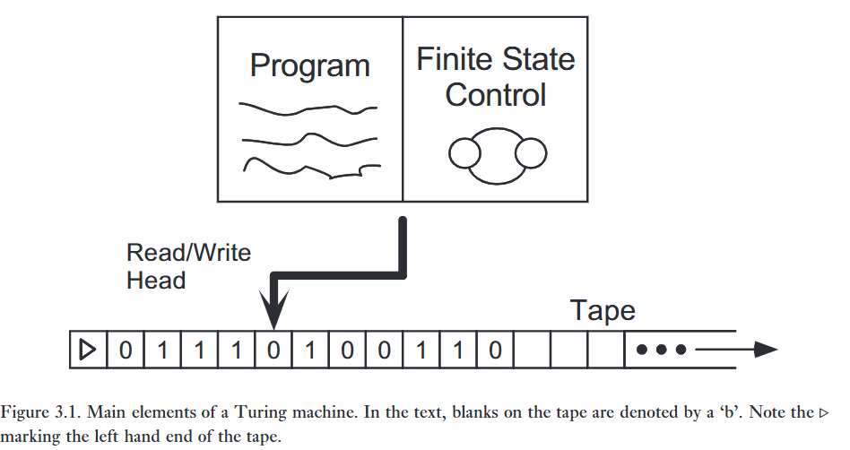
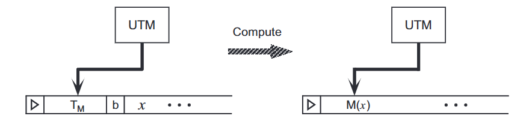
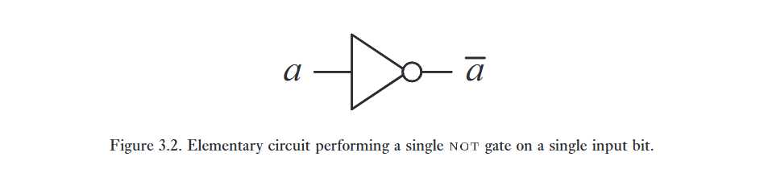
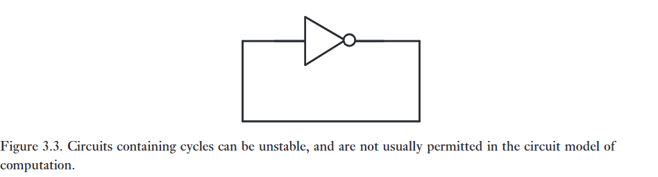
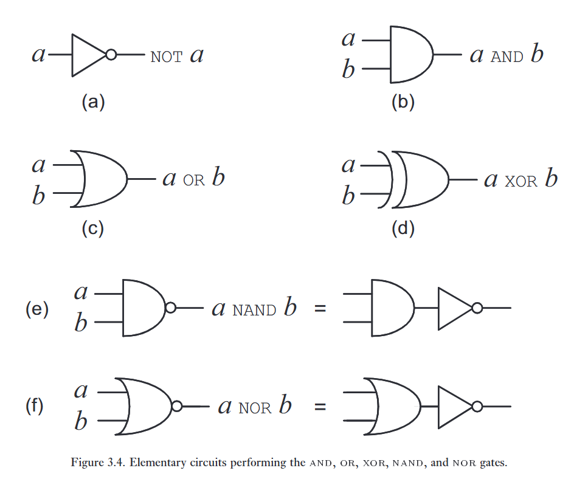
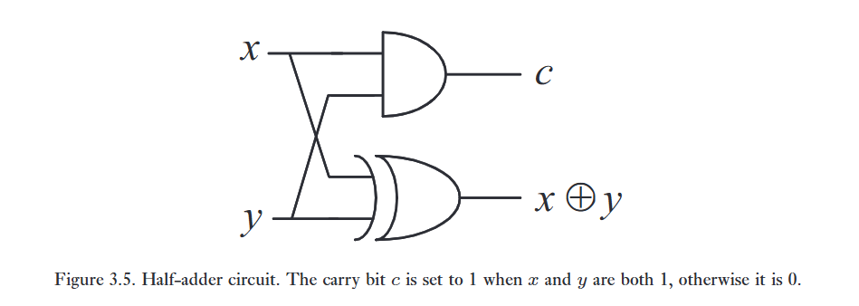
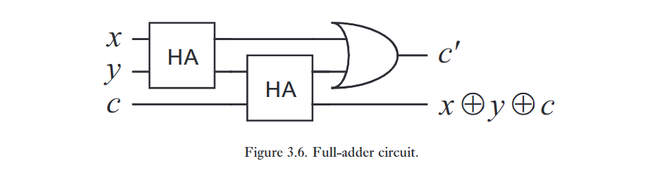
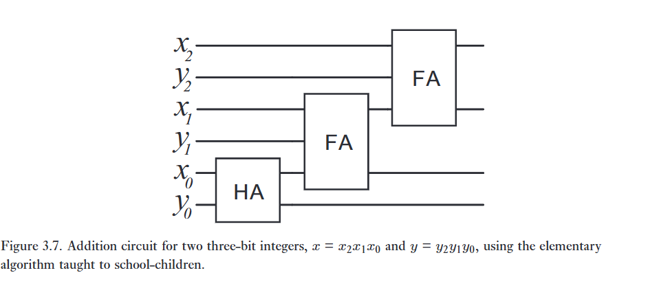
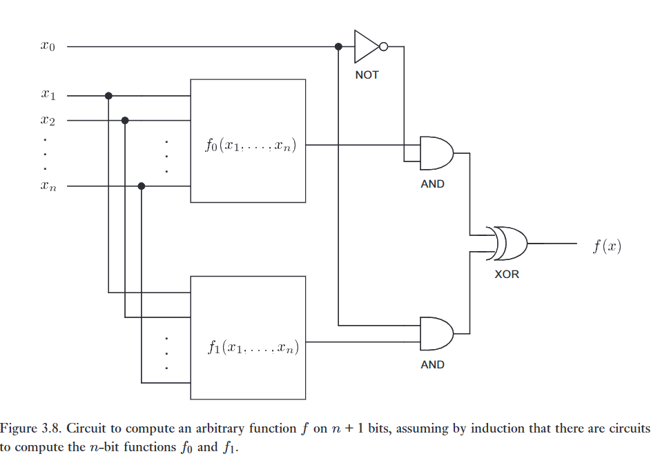

> *'...algorithms are concepts that have existence apart from any programming language.'*
> – Donald Knuth

Việc có một thuật toán để thực hiện một tác vụ nào đó có ý nghĩa gì? Khi còn nhỏ, tất cả chúng ta đều học một quy trình cho phép chúng ta cộng hai số bất kỳ lại với nhau, bất kể những số đó lớn đến mức nào. Đây là một ví dụ về một thuật toán. Việc tìm ra một công thức toán học chính xác cho khái niệm thuật toán là mục tiêu của phần này.   

---

Về mặt lịch sử, khái niệm về một thuật toán đã có từ nhiều thế kỷ trước; sinh viên đại học được học thuật toán hai nghìn năm tuổi của Euclid để tìm ước chung lớn nhất của hai số nguyên dương. Tuy nhiên, phải đến những năm 1930, những khái niệm nền tảng của lý thuyết thuật toán hiện đại, và từ đó là của điện toán, mới được giới thiệu bởi Alonzo Church, Alan Turing, và những người tiên phong khác của kỷ nguyên máy tính. Công trình này nảy sinh nhằm đáp lại một thách thức sâu sắc do nhà toán học vĩ đại David Hilbert đặt ra vào đầu thế kỷ 20. Hilbert đặt câu hỏi liệu có tồn tại một thuật toán nào có thể được sử dụng, về nguyên tắc, để giải quyết tất cả các bài toán của toán học hay không. Hilbert kỳ vọng rằng câu trả lời cho câu hỏi này, đôi khi được biết đến là entscheidungsproblem (bài toán quyết định), sẽ là có.   

Đáng ngạc nhiên thay, câu trả lời cho thách thức của Hilbert hóa ra lại là không: không có thuật toán nào để giải quyết tất cả các bài toán toán học. Để chứng minh điều này, Church và Turing đã phải giải quyết một vấn đề sâu sắc là làm sao nắm bắt được bằng một định nghĩa toán học những gì chúng ta ngụ ý khi sử dụng khái niệm trực quan về một thuật toán. Bằng cách làm như vậy, họ đã đặt nền móng cho lý thuyết thuật toán hiện đại, và hệ quả là cho lý thuyết khoa học máy tính hiện đại.   

---

Trong chương này, chúng tôi sử dụng hai cách tiếp cận có vẻ khác nhau đối với lý thuyết tính toán. Cách tiếp cận đầu tiên là do Turing đề xuất. Turing đã định nghĩa một lớp các máy móc, hiện nay được gọi là máy Turing, nhằm nắm bắt khái niệm về một thuật toán để thực hiện một tác vụ tính toán. Trong Mục 3.1.1, chúng tôi mô tả các máy Turing, và sau đó thảo luận về một số biến thể đơn giản hơn của mô hình máy Turing. Cách tiếp cận thứ hai là thông qua mô hình mạch của tính toán, một cách tiếp cận đặc biệt hữu ích như một sự chuẩn bị cho nghiên cứu sau này của chúng ta về máy tính lượng tử. Mô hình mạch được mô tả trong Mục 3.1.2. Mặc dù các mô hình tính toán này bề ngoài có vẻ khác nhau, nhưng hóa ra chúng lại tương đương. Bạn có thể hỏi, tại sao lại giới thiệu nhiều hơn một mô hình tính toán? Chúng tôi làm như vậy bởi vì các mô hình tính toán khác nhau có thể mang lại những hiểu biết khác nhau trong việc giải quyết các bài toán cụ thể. Hai (hoặc nhiều) cách tư duy về một khái niệm thì tốt hơn là một.

# 1. Turing machines

Các phần tử cơ bản của một máy Turing được minh họa trong Hình 3.1. Một máy Turing chứa bốn phần tử chính: (a) một chương trình (program), khá giống với một máy tính thông thường; (b) một bộ điều khiển trạng thái hữu hạn (finite state control), hoạt động như một bộ vi xử lý được tinh giản, điều phối các hoạt động khác của máy; (c) một dải băng (tape), hoạt động giống như bộ nhớ máy tính; và (d) một đầu đọc-ghi dải băng (read-write tape-head), trỏ đến vị trí trên dải băng hiện đang có thể đọc hoặc ghi. Bây giờ chúng ta mô tả chi tiết hơn từng phần tử trong bốn phần tử này.

---

Bộ điều khiển trạng thái hữu hạn cho một máy Turing bao gồm một tập hợp hữu hạn các trạng thái bên trong (internal states), $q_1, \dots, q_m$. Số lượng $m$ được phép thay đổi; hóa ra đối với $m$ đủ lớn, điều này không ảnh hưởng đến sức mạnh của máy theo bất kỳ cách thiết yếu nào, do đó không mất tính tổng quát, chúng ta có thể giả sử rằng $m$ là một hằng số cố định nào đó. Cách tốt nhất để nghĩ về bộ điều khiển trạng thái hữu hạn là như một loại vi xử lý, điều phối hoạt động của máy Turing. Nó cung cấp bộ nhớ lưu trữ tạm thời bên ngoài dải băng, và một trung tâm nơi tất cả quá trình xử lý cho máy có thể được thực hiện. Ngoài các trạng thái $q_1, \dots, q_m$, còn có hai trạng thái bên trong đặc biệt, được dán nhãn là $q_s$ và $q_h$. Chúng ta gọi chúng lần lượt là trạng thái bắt đầu (starting state) và trạng thái dừng (halting state). Ý tưởng là vào lúc bắt đầu tính toán, máy Turing ở trạng thái bắt đầu $q_s$. Việc thực thi tính toán làm cho trạng thái bên trong của máy Turing thay đổi. Nếu việc tính toán hoàn thành, máy Turing kết thúc ở trạng thái $q_h$ để chỉ báo rằng máy đã hoàn thành hoạt động của nó.

Dải băng của máy Turing là một đối tượng một chiều, trải dài đến vô tận theo một hướng. Dải băng bao gồm một chuỗi vô hạn các ô dải băng (tape squares). Chúng ta đánh số các ô dải băng là $0, 1, 2, 3, \dots$. Mỗi ô dải băng chứa một ký hiệu được lấy từ một bảng chữ cái (alphabet), $\Gamma$, chứa một số lượng hữu hạn các ký hiệu phân biệt. Hiện tại, sẽ thuận tiện nếu giả sử rằng bảng chữ cái chứa bốn ký hiệu, mà chúng ta ký hiệu là $0, 1, b$ (ký hiệu 'trống' - blank), và $\triangleright$, để đánh dấu mép bên trái của dải băng. Ban đầu, dải băng chứa một ký hiệu $\triangleright$ ở đầu bên trái, một số lượng hữu hạn các số $0$ và $1$, và phần còn lại của dải băng chứa các ô trống. Đầu đọc-ghi dải băng xác định một ô duy nhất trên dải băng của máy Turing là ô hiện đang được truy cập bởi máy.   

Tóm lại, máy bắt đầu hoạt động với bộ điều khiển trạng thái hữu hạn ở trạng thái $q_s$, và với đầu đọc-ghi ở ô dải băng ngoài cùng bên trái, ô được đánh số $0$. Quá trình tính toán sau đó tiến hành theo từng bước theo chương trình, sẽ được định nghĩa ở phần dưới. Nếu trạng thái hiện tại là $q_h$, thì quá trình tính toán đã dừng lại, và đầu ra (output) của phép tính là nội dung hiện tại (không trống) của dải băng.  

Một chương trình cho một máy Turing là một danh sách có thứ tự hữu hạn các dòng chương trình có dạng $\langle q, x, q', x', s\rangle$. Phần tử đầu tiên trong dòng chương trình, $q$, là một trạng thái từ tập hợp các trạng thái bên trong của máy. Phần tử thứ hai, $x$, được lấy từ bảng chữ cái các ký hiệu có thể xuất hiện trên dải băng, $\Gamma$. Cách thức hoạt động của chương trình là ở mỗi chu kỳ máy, máy Turing xem qua danh sách các dòng chương trình theo thứ tự, tìm kiếm một dòng $\langle q, x, \cdot, \cdot, \cdot\rangle$, sao cho trạng thái bên trong hiện tại của máy là $q$, và ký hiệu đang được đọc trên dải băng là $x$.   

Nếu nó không tìm thấy dòng chương trình nào như vậy, trạng thái bên trong của máy sẽ được thay đổi thành $q_h$, và máy dừng hoạt động. Nếu một dòng như vậy được tìm thấy, thì dòng chương trình đó được thực thi. Việc thực thi một dòng chương trình bao gồm các bước sau: trạng thái bên trong của máy được đổi thành $q'$; ký hiệu $x$ trên dải băng được ghi đè bởi ký hiệu $x'$, và đầu đọc-ghi dải băng di chuyển sang trái, sang phải, hoặc đứng yên, tùy thuộc vào việc $s$ tương ứng là $-1$, $+1$, hoặc $0$. Ngoại lệ duy nhất cho quy tắc này là nếu đầu đọc-ghi dải băng đang ở ô dải băng ngoài cùng bên trái, và $s = -1$, trong trường hợp đó đầu đọc-ghi vẫn giữ nguyên vị trí.

---

Bây giờ chúng ta đã biết máy Turing là gì, hãy xem nó có thể được sử dụng như thế nào để tính toán một hàm đơn giản. Xét ví dụ sau về một máy Turing. Máy bắt đầu với một số nhị phân, $x$, trên dải băng, theo sau là các khoảng trống (blanks). Máy có ba trạng thái bên trong, $q_1, q_2$, và $q_3$, ngoài trạng thái bắt đầu $q_s$ và trạng thái dừng $q_h$. Chương trình chứa các dòng chương trình sau (các con số ở bên trái là để thuận tiện trong việc tham chiếu đến các dòng chương trình trong phần thảo luận sau, và không phải là một phần của chương trình):   

$$
1: \langle q_s, \triangleright, q_1, \triangleright, +1 \rangle
$$

$$
2: \langle q_1, 0, q_1, b, +1 \rangle
$$

$$
3: \langle q_1, 1, q_1, b, +1 \rangle
$$

$$
4: \langle q_1, b, q_2, b, -1 \rangle
$$

$$
5: \langle q_2, b, q_2, b, -1 \rangle
$$

$$
6: \langle q_2, \triangleright, q_3, \triangleright, +1 \rangle
$$

$$
7: \langle q_3, b, q_h, 1, 0 \rangle
$$   

Chương trình này tính toán hàm gì? Ban đầu máy ở trạng thái $q_s$ và ở vị trí ngoài cùng bên trái của dải băng nên dòng 1, $\langle q_s, \triangleright, q_1, \triangleright, +1 \rangle$, được thực thi, điều này làm cho đầu đọc-ghi di chuyển sang phải mà không thay đổi những gì được viết trên dải băng, nhưng thay đổi trạng thái bên trong của máy thành $q_1$. Ba dòng tiếp theo của chương trình đảm bảo rằng trong khi máy ở trạng thái $q_1$, đầu đọc-ghi sẽ tiếp tục di chuyển sang phải trong khi nó đọc số $0$ (dòng 2) hoặc số $1$ (dòng 3) trên dải băng, ghi đè nội dung dải băng bằng các khoảng trống khi nó di chuyển và duy trì ở trạng thái $q_1$, cho đến khi nó gặp một ô dải băng đã bị trống, tại thời điểm đó đầu đọc-ghi được di chuyển sang trái một vị trí, và trạng thái bên trong được chuyển thành $q_2$ (dòng 4). Dòng 5 sau đó đảm bảo rằng đầu đọc-ghi tiếp tục di chuyển sang trái trong khi các khoảng trống đang được đọc bởi đầu đọc-ghi, mà không thay đổi nội dung của dải băng. Quá trình này tiếp diễn cho đến khi đầu đọc-ghi quay trở lại điểm bắt đầu của nó, tại thời điểm đó nó đọc được ký hiệu $\triangleright$ trên dải băng, thay đổi trạng thái bên trong thành $q_3$, và di chuyển sang phải một bước (dòng 6). Dòng 7 hoàn thành chương trình, đơn giản là in số $1$ lên dải băng, và sau đó dừng lại.   

---

Phân tích trước đó cho thấy chương trình này tính toán hàm hằng $f(x) = 1$. Tức là, bất kể số nào được nhập vào trên dải băng, số $1$ vẫn là đầu ra. Tổng quát hơn, một máy Turing có thể được coi là tính toán các hàm từ các số nguyên không âm thành các số nguyên không âm; trạng thái ban đầu của dải băng được sử dụng để biểu diễn đầu vào cho hàm, và trạng thái cuối cùng của dải băng được sử dụng để biểu diễn đầu ra của hàm.

Phân tích trước đó cho thấy chương trình này tính toán hàm hằng $f(x) = 1$. Tức là, bất kể số nào được nhập vào trên dải băng, số $1$ vẫn là đầu ra. Tổng quát hơn, một máy Turing có thể được coi là tính toán các hàm từ các số nguyên không âm thành các số nguyên không âm; trạng thái ban đầu của dải băng được sử dụng để biểu diễn đầu vào cho hàm, và trạng thái cuối cùng của dải băng được sử dụng để biểu diễn đầu ra của hàm.   

Có vẻ như chúng ta đã tốn rất nhiều công sức chỉ để tính toán hàm đơn giản này bằng cách sử dụng các máy Turing của mình. Liệu có thể xây dựng các hàm phức tạp hơn bằng cách sử dụng các máy Turing không? Ví dụ, liệu chúng ta có thể chế tạo một cỗ máy sao cho khi hai số, $x$ và $y$, được nhập vào trên dải băng với một khoảng trống để phân định chúng, nó sẽ xuất ra tổng $x + y$ trên dải băng? Tổng quát hơn, lớp các hàm nào có thể được tính toán bằng cách sử dụng một máy Turing?   

Hóa ra mô hình tính toán máy Turing có thể được sử dụng để tính toán vô số các hàm khác nhau. Ví dụ, nó có thể được sử dụng để thực hiện tất cả các phép toán số học cơ bản, để tìm kiếm qua văn bản được biểu diễn dưới dạng các chuỗi bit trên dải băng, và nhiều phép toán thú vị khác. Đáng ngạc nhiên là, hóa ra một máy Turing có thể được sử dụng để mô phỏng tất cả các hoạt động được thực hiện trên một máy tính hiện đại! Quả thực, theo một luận đề được đưa ra một cách độc lập bởi Church và bởi Turing, mô hình tính toán máy Turing nắm bắt hoàn toàn khái niệm về việc tính toán một hàm bằng cách sử dụng một thuật toán. Điều này được biết đến là Luận đề Church–Turing (Church-Turing thesis):   

> *The class of functions computable by a Turing machine corresponds exactly to the class of functions which we would naturally regard as being computable by an algorithm.*

Luận đề Church–Turing khẳng định một sự tương đương giữa một khái niệm toán học chặt chẽ – hàm có thể tính toán được bằng máy Turing – và khái niệm trực quan về việc tính toán được bằng một thuật toán có ý nghĩa như thế nào. Luận đề này lấy được tầm quan trọng của nó từ thực tế là nó làm cho việc nghiên cứu các thuật toán trong thế giới thực, trước năm 1936 vốn là một khái niệm khá mơ hồ, trở nên có thể thích ứng với sự nghiên cứu toán học chặt chẽ. Để hiểu ý nghĩa của điểm này, có thể hữu ích khi xem xét định nghĩa của một hàm liên tục (continuous function) từ giải tích thực. Mọi đứa trẻ đều có thể nói cho bạn biết một đường liên tục trên một tờ giấy có ý nghĩa gì, nhưng làm thế nào để nắm bắt trực giác đó trong một định nghĩa chặt chẽ lại khác xa với sự hiển nhiên. Các nhà toán học vào thế kỷ mười chín đã dành rất nhiều thời gian tranh luận về ưu điểm của các định nghĩa khác nhau về tính liên tục trước khi định nghĩa hiện đại về tính liên tục được chấp nhận. Khi đưa ra các định nghĩa nền tảng như định nghĩa về tính liên tục hay khả năng tính toán, điều quan trọng là phải chọn được những định nghĩa tốt, đảm bảo rằng các khái niệm trực quan của một người khớp chặt chẽ với định nghĩa toán học chính xác. Từ quan điểm này, luận đề Church–Turing đơn giản là sự khẳng định rằng mô hình tính toán máy Turing cung cấp một nền tảng tốt cho khoa học máy tính, nắm bắt khái niệm trực quan của một thuật toán trong một định nghĩa chặt chẽ.   

Về mặt suy luận tiên nghiệm (A priori), không hiển nhiên rằng mọi hàm mà chúng ta theo trực giác coi là có thể tính toán được bằng một thuật toán đều có thể được tính toán bằng cách sử dụng một máy Turing. Church, Turing và nhiều người khác đã dành rất nhiều thời gian thu thập bằng chứng cho luận đề Church–Turing, và trong suốt sáu mươi năm không có bằng chứng phản bác nào được tìm thấy. Mặc dù vậy, có khả năng trong tương lai chúng ta sẽ khám phá ra trong Tự nhiên một quá trình tính toán một hàm không thể tính toán được trên một máy Turing. Sẽ thật tuyệt vời nếu điều đó từng xảy ra, bởi vì khi đó chúng ta có thể khai thác quá trình đó để giúp chúng ta thực hiện các tính toán mới không thể thực hiện được trước đây. Tất nhiên, chúng ta cũng sẽ cần phải đại tu lại định nghĩa về khả năng tính toán, và cùng với đó, toàn bộ ngành khoa học máy tính. 

:::{.callout-note collapse="true"}
# Bài tập 3.1: (Các quá trình không thể tính toán trong Tự nhiên) 
Làm thế nào chúng ta có thể nhận ra rằng một quá trình trong Tự nhiên tính toán một hàm không thể tính toán được bởi một máy Turing?   
:::

:::{.callout-note collapse="true"}
# Bài tập 3.2: (Số Turing) 
Chứng minh rằng mỗi máy Turing một dải băng có thể được gán một số từ danh sách $1, 2, 3, \dots$ theo cách sao cho con số đó xác định duy nhất cỗ máy tương ứng. Chúng ta gọi con số này là số Turing của máy Turing tương ứng. (Gợi ý: Mọi số nguyên dương đều có một phân tích ra thừa số nguyên tố duy nhất $p_1^{a_1} p_2^{a_2} \dots p_k^{a_k}$, trong đó $p_i$ là các số nguyên tố phân biệt, và $a_1, \dots, a_k$ là các số nguyên không âm.)
:::

---

Trong các chương sau, chúng ta sẽ thấy rằng các máy tính lượng tử cũng tuân theo luận đề Church–Turing. Nghĩa là, các máy tính lượng tử có thể tính toán cùng một lớp các hàm có thể tính toán được bởi một máy Turing. Sự khác biệt giữa máy tính lượng tử và máy Turing hóa ra lại nằm ở hiệu quả (efficiency) mà phép tính của hàm có thể được thực hiện – có những hàm có thể được tính toán hiệu quả hơn nhiều trên một máy tính lượng tử so với những gì được tin là có thể làm được với một thiết bị tính toán cổ điển như máy Turing.   

Việc chứng minh chi tiết hoàn toàn rằng mô hình tính toán máy Turing có thể được sử dụng để xây dựng tất cả các khái niệm thông thường được sử dụng trong các ngôn ngữ lập trình máy tính nằm ngoài phạm vi của cuốn sách này (xem 'Lịch sử và đọc thêm' ở cuối chương để biết thêm thông tin). Khi chỉ định các thuật toán, thay vì chỉ định rõ ràng máy Turing được sử dụng để tính toán thuật toán, chúng ta sẽ thường sử dụng một mã giả (pseudocode) ở cấp độ cao hơn nhiều, tin tưởng vào luận đề Church-Turing rằng mã giả này có thể được dịch sang mô hình tính toán máy Turing. Chúng ta sẽ không đưa ra bất kỳ loại định nghĩa chặt chẽ nào cho mã giả. Hãy nghĩ về nó như một phiên bản trang trọng hơn một chút của tiếng Anh hoặc, nếu bạn muốn, một phiên bản cẩu thả của một ngôn ngữ lập trình bậc cao như C++ hoặc BASIC. Mã giả cung cấp một cách thuận tiện để biểu diễn các thuật toán, mà không đi sâu vào mức độ chi tiết cực độ mà một máy Turing đòi hỏi. Một ví dụ về việc sử dụng mã giả có thể được tìm thấy trong Hộp 3.2 ở trang 130; nó cũng được sử dụng ở phần sau của cuốn sách để mô tả các thuật toán lượng tử.   

Có nhiều biến thể đối với mô hình máy Turing cơ bản. Chúng ta có thể tưởng tượng các máy Turing với các loại dải băng khác nhau. Ví dụ, người ta có thể xem xét các dải băng vô hạn hai chiều, hoặc có lẽ là tính toán với các dải băng có nhiều hơn một chiều. Cho đến nay, theo những gì được biết, không thể thay đổi bất kỳ khía cạnh nào của mô hình Turing theo một cách hợp lý về mặt vật lý mà lại có thể mở rộng được lớp các hàm có thể tính toán được bởi mô hình này.   

Lấy một ví dụ, hãy xem xét một máy Turing được trang bị nhiều dải băng. Để đơn giản, chúng ta xem xét trường hợp hai dải băng, vì sự tổng quát hóa lên nhiều hơn hai dải băng là rõ ràng từ ví dụ này. Giống như máy Turing cơ bản, một máy Turing hai dải băng có một số lượng hữu hạn các trạng thái bên trong $q_1, \dots, q_m$, một trạng thái bắt đầu $q_s$, và một trạng thái dừng $q_h$. Nó có hai dải băng, mỗi dải chứa các ký hiệu từ một bảng chữ cái hữu hạn các ký hiệu, $\Gamma$. Như trước đây, chúng ta thấy thuận tiện khi giả sử rằng bảng chữ cái chứa bốn ký hiệu, $0, 1, b$ và $\triangleright$, trong đó $\triangleright$ đánh dấu mép bên trái của mỗi dải băng. Máy có hai đầu đọc-dải băng, một cho mỗi dải băng. Sự khác biệt chính giữa máy Turing hai dải băng và máy Turing cơ bản nằm ở chương trình. Các dòng chương trình có dạng $\langle q, x_1, x_2, q', x_1', x_2', s_1, s_2 \rangle$, nghĩa là nếu trạng thái bên trong của máy là $q$, dải băng một đang đọc $x_1$ ở vị trí hiện tại của nó, và dải băng hai đang đọc $x_2$ ở vị trí hiện tại của nó, thì trạng thái bên trong của máy sẽ được đổi thành $q'$, $x_1$ bị ghi đè bằng $x_1'$, $x_2$ bị ghi đè bằng $x_2'$, và các đầu đọc-dải băng cho dải băng một và dải băng hai di chuyển tùy thuộc vào việc $s_1$ hoặc $s_2$ lần lượt bằng $+1, -1$ hay $0$. 

Máy Turing cơ bản và máy Turing hai dải băng là những mô hình tính toán tương đương nhau theo nghĩa mô hình này có thể mô phỏng (simulate) mô hình kia. Giả sử ta có một máy hai dải băng tính toán hàm $f(x)$ dựa trên đầu vào $x$ ở dải băng thứ nhất. Đáng ngạc nhiên là luôn tồn tại một máy một dải băng tương đương cũng có khả năng tính toán hàm $f$ đó. Ý tưởng cơ bản là máy một dải băng sẽ mô phỏng máy hai dải băng bằng cách dùng dải băng duy nhất của nó để lưu trữ nội dung của cả hai dải băng kia. Việc mô phỏng này đòi hỏi một mức chi phí tính toán phụ (computational overhead), nhưng điểm quan trọng là về nguyên tắc nó luôn có thể thực hiện được. Thực tế, tồn tại một máy Turing Vạn năng (Universal Turing machine) có thể mô phỏng bất kỳ máy Turing nào khác!   

Một biến thể thú vị khác của mô hình máy Turing là đưa sự ngẫu nhiên (randomness) vào mô hình. Ví dụ, máy có thể thực thi một dòng lệnh với hiệu ứng như sau: nếu trạng thái bên trong là $q$ và đầu đọc thấy $x$, hãy tung một đồng xu không thiên lệch. Nếu ra ngửa, chuyển trạng thái thành $q_{i_H}$, nếu ra sấp, chuyển thành $q_{i_T}$. Dòng lệnh này có dạng $\langle q, x, q_{i_H}, q_{i_T} \rangle$. Tuy nhiên, ngay cả biến thể này cũng không làm thay đổi sức mạnh thiết yếu của mô hình tính toán máy Turing. Một máy Turing tất định (deterministic) hoàn toàn có thể mô phỏng lại thuật toán trên bằng cách "tìm kiếm vét cạn" (searching out) tất cả các nhánh đường dẫn tính toán có thể xảy ra tương ứng với các giá trị tung đồng xu khác nhau. Việc mô phỏng tất định này có thể kém hiệu quả hơn nhiều so với mô hình ngẫu nhiên, nhưng điểm mấu chốt là lớp các hàm tính toán được không hề thay đổi khi đưa sự ngẫu nhiên vào mô hình cơ sở.   

:::{.callout-note collapse="true"}
# Bài tập 3.3: (Máy Turing đảo ngược chuỗi bit) 
Mô tả một máy Turing nhận đầu vào là một số nhị phân $x$, và xuất ra các bit của $x$ theo thứ tự đảo ngược. (Gợi ý: Trong bài tập này và bài tập tiếp theo, có thể hữu ích nếu sử dụng máy Turing nhiều dải băng và/hoặc các ký hiệu khác ngoài $\triangleright, 0, 1$ và khoảng trống.)   
:::

:::{.callout-note collapse="true"}
# Bài tập 3.4: (Máy Turing cộng modulo 2) 
Mô tả một máy Turing cộng hai số nhị phân $x$ và $y$ theo modulo 2. Các con số được nhập vào dải băng dưới dạng nhị phân, theo định dạng $x$, theo sau là một khoảng trống, theo sau là $y$. Nếu một số không dài bằng số kia thì bạn có thể giả sử nó đã được đệm thêm các số 0 ở đầu để làm cho hai số có cùng độ dài
:::

---

:::{.callout-important}
# Hộp 3.1: Máy Turing Vạn năng (The Universal Turing Machine)
Chúng tôi đã mô tả các máy Turing như chứa ba phần tử có thể thay đổi từ máy này sang máy khác – cấu hình ban đầu của dải băng, các trạng thái bên trong của bộ điều khiển trạng thái hữu hạn, và chương trình cho máy. Một ý tưởng thông minh được biết đến là Máy Turing Vạn năng (Universal Turing Machine - UTM) cho phép chúng ta cố định chương trình và bộ điều khiển trạng thái hữu hạn một lần và mãi mãi, chỉ để lại nội dung ban đầu của dải băng như là phần duy nhất của máy cần được thay đổi.

Máy Turing Vạn năng (xem hình bên dưới) có tính chất sau. Gọi $M$ là một máy Turing bất kỳ, và gọi $T_M$ là số Turing liên kết với máy $M$. Sau đó, trên đầu vào là biểu diễn nhị phân cho $T_M$ theo sau bởi một khoảng trống, theo sau bởi bất kỳ chuỗi ký hiệu $x$ nào trên phần còn lại của dải băng, Máy Turing Vạn năng sẽ đưa ra đầu ra giống hệt bất cứ thứ gì máy $M$ sẽ đưa ra khi nhận đầu vào là $x$. Do đó, Máy Turing Vạn năng có khả năng mô phỏng bất kỳ máy Turing nào khác!

(Mô tả hình ảnh: Một sơ đồ cho thấy dải băng của UTM chứa chuỗi $T_M$, khoảng trống $b$, và dữ liệu $x$. Đầu đọc của UTM trỏ vào $T_M$. Sau quá trình tính toán, dải băng xuất ra kết quả $M(x)$)

Máy Turing Vạn năng có tinh thần tương tự như một máy tính có thể lập trình hiện đại, trong đó hành động mà máy tính sẽ thực hiện – 'chương trình' – được lưu trữ trong bộ nhớ, tương tự như chuỗi bit $T_M$ được lưu trữ ở đầu dải băng bởi Máy Turing Vạn năng. Dữ liệu sẽ được chương trình xử lý được lưu trữ trong một phần bộ nhớ riêng biệt, tương tự như vai trò của $x$ trong Máy Turing Vạn năng. Sau đó, một phần cứng cố định nào đó được sử dụng để chạy chương trình, tạo ra đầu ra. Phần cứng cố định này tương tự như các trạng thái bên trong và chương trình (cố định) đang được thực thi bởi Máy Turing Vạn năng.

Việc mô tả cấu trúc chi tiết của một Máy Turing Vạn năng nằm ngoài phạm vi của cuốn sách này. (Mặc dù những độc giả chăm chỉ có thể muốn thử xây dựng nó.) Điểm then chốt là sự tồn tại của một cỗ máy như vậy, cho thấy rằng một cỗ máy cố định duy nhất có thể được sử dụng để chạy bất kỳ thuật toán nào. Sự tồn tại của một Máy Turing Vạn năng cũng giải thích cho phát biểu trước đây của chúng ta rằng số lượng trạng thái bên trong của một máy Turing không quan trọng lắm, vì miễn là con số $m$ đó vượt qua số lượng cần thiết cho một Máy Turing Vạn năng, một cỗ máy như vậy có thể được sử dụng để mô phỏng một máy Turing với bất kỳ số lượng trạng thái bên trong nào.
:::

---

Hãy quay trở lại với entscheidungsproblem (bài toán quyết định) của Hilbert, nguồn cảm hứng ban đầu cho những người sáng lập ra khoa học máy tính. Có tồn tại một thuật toán nào để quyết định tất cả các bài toán của toán học không? Câu trả lời cho câu hỏi này đã được Church và Turing chứng minh là không. Trong Hộp 3.2, chúng tôi giải thích chứng minh của Turing cho sự thật đáng chú ý này. Hiện tượng không thể quyết định được (undecidability) này ngày nay được biết là mở rộng vượt xa những ví dụ mà Church và Turing đã xây dựng. Chẳng hạn, người ta đã biết rằng bài toán quyết định xem hai không gian tô pô có tương đương tô pô ('đồng phôi' - homeomorphic) với nhau hay không là không thể quyết định được. Có những bài toán đơn giản liên quan đến hành vi của các hệ động lực học cũng không thể quyết định được, như bạn sẽ chứng minh trong Bài toán 3.4. Các tài liệu tham khảo cho những ví dụ này và các ví dụ khác được đưa ra ở phần cuối chương 'Lịch sử và đọc thêm'.

Bên cạnh sự thú vị nội tại của nó, tính không thể quyết định còn báo trước một chủ đề nhận được sự quan tâm rất lớn trong khoa học máy tính, cũng như đối với tính toán lượng tử và thông tin lượng tử: sự phân biệt giữa những bài toán dễ giải, và những bài toán khó giải. Tính không thể quyết định cung cấp ví dụ tối thượng về những bài toán khó giải – khó đến mức trên thực tế chúng là bất khả thi để giải.

:::{.callout-note collapse="true"}
# Bài tập 3.5: (Bài toán dừng không có đầu vào) 
Chứng minh rằng cho trước một máy Turing $M$, không có thuật toán nào để xác định xem liệu $M$ có dừng lại hay không khi đầu vào của máy là một dải băng trống.
:::

:::{.callout-note collapse="true"}
# Bài tập 3.6: (Bài toán dừng xác suất) 
Giả sử chúng ta đánh số các máy Turing xác suất bằng cách sử dụng một sơ đồ tương tự như sơ đồ được tìm thấy trong Bài tập 3.2 và định nghĩa hàm dừng xác suất $h_p(x)$ là $1$ nếu máy $x$ dừng trên đầu vào là $x$ với xác suất ít nhất là $1/2$ và là $0$ nếu máy $x$ dừng trên đầu vào là $x$ với xác suất nhỏ hơn $1/2$. Chứng minh rằng không có máy Turing xác suất nào có thể xuất ra $h_p(x)$ với xác suất chính xác lớn hơn hẳn $1/2$ đối với mọi $x$.
:::

:::{.callout-note collapse="true"}
# Bài tập 3.7: (Oracle dừng) 
Giả sử một hộp đen (black box) được cung cấp cho chúng ta, nó nhận một số nguyên không âm $x$ làm đầu vào, và sau đó xuất ra giá trị của $h(x)$, trong đó $h(\cdot)$ là hàm dừng được định nghĩa trong Hộp 3.2 ở trang 130. Loại hộp đen này đôi khi được gọi là một oracle (nhà tiên tri) cho bài toán dừng. Giả sử chúng ta có một máy Turing thông thường được tăng cường thêm khả năng gọi oracle này. Một cách để hoàn thành việc này là sử dụng một máy Turing hai dải băng, và thêm một lệnh chương trình bổ sung vào máy Turing, dẫn đến việc oracle được gọi, và giá trị của $h(x)$ được in lên dải băng thứ hai, trong đó $x$ là nội dung hiện tại của dải băng thứ hai. Rõ ràng là mô hình tính toán này mạnh mẽ hơn mô hình máy Turing thông thường, vì nó có thể được sử dụng để tính toán hàm dừng. Bài toán dừng cho mô hình tính toán này có không thể quyết định được không? Tức là, một máy Turing được hỗ trợ bởi một oracle cho bài toán dừng có thể quyết định liệu một chương trình dành cho máy Turing có oracle có dừng lại trên một đầu vào cụ thể hay không?
:::

---

# 2. Circuits

Các máy Turing là những mô hình khá lý tưởng hóa của các thiết bị tính toán. Máy tính thực tế có kích thước hữu hạn, trong khi đối với máy Turing, chúng ta đã giả định một máy tính có kích thước không bị giới hạn. Trong phần này, chúng ta xem xét một mô hình tính toán thay thế, mô hình mạch (circuit model), tương đương với máy Turing về mặt sức mạnh tính toán, nhưng thuận tiện và thực tế hơn cho nhiều ứng dụng. Đặc biệt, mô hình tính toán mạch đóng vai trò vô cùng quan trọng như một sự chuẩn bị cho cuộc điều tra của chúng ta về các máy tính lượng tử.   

Một mạch được tạo thành từ các dây dẫn (wires) và các cổng (gates), lần lượt mang thông tin đi vòng quanh và thực hiện các tác vụ tính toán đơn giản. Ví dụ, Hình 3.2 cho thấy một mạch đơn giản lấy đầu vào là một bit duy nhất, $a$. Bit này được truyền qua một cổng NOT, cổng này lật (flip) bit đó, biến $1$ thành $0$ và $0$ thành $1$. Các dây dẫn trước và sau cổng NOT chỉ đơn thuần phục vụ mục đích mang bit đến và đi khỏi cổng NOT; chúng có thể đại diện cho sự di chuyển của bit xuyên qua không gian, hoặc có lẽ chỉ xuyên qua thời gian.

Tổng quát hơn, một mạch có thể liên quan đến nhiều bit đầu vào và đầu ra, nhiều dây dẫn, và nhiều cổng logic. Một cổng logic (logic gate) là một hàm $f : \{0, 1\}^k \to \{0, 1\}^l$ từ một số lượng $k$ bit đầu vào cố định nào đó đến một số lượng $l$ bit đầu ra cố định nào đó. Ví dụ, cổng NOT là một cổng có một bit đầu vào và một bit đầu ra, tính toán hàm $f(a) = 1 \oplus a$, trong đó $a$ là một bit duy nhất, và $\oplus$ là phép cộng modulo 2. Người ta cũng thường đưa ra quy ước rằng không cho phép có vòng lặp (loops) nào trong mạch, để tránh những sự mất ổn định có thể xảy ra, như được minh họa trong Hình 3.3. Chúng ta gọi một mạch như vậy là phi tuần hoàn (acyclic), và chúng ta tuân thủ quy ước rằng các mạch trong mô hình tính toán mạch phải là phi tuần hoàn

Có nhiều cổng logic sơ cấp khác hữu ích cho việc tính toán. Một danh sách một phần bao gồm cổng AND, cổng OR, cổng XOR, cổng NAND, và cổng NOR. Mỗi cổng trong số này lấy hai bit làm đầu vào và tạo ra một bit duy nhất làm đầu ra. Cổng AND xuất ra 1 khi và chỉ khi cả hai đầu vào của nó đều là 1. Cổng OR xuất ra 1 khi và chỉ khi có ít nhất một trong các đầu vào của nó là 1. Cổng XOR xuất ra tổng, modulo 2, của các đầu vào của nó. Các cổng NAND và NOR lần lượt lấy kết quả AND và OR từ các đầu vào của chúng, và sau đó áp dụng một phép NOT cho bất cứ thứ gì được xuất ra. Hoạt động của các cổng này được minh họa trong Hình 3.4.

Có hai 'cổng' quan trọng bị thiếu trong Hình 3.4, đó là cổng FANOUT và cổng CROSSOVER. Trong các mạch, chúng ta thường cho phép các bit 'chia tách' (divide), thay thế một bit bằng hai bản sao của chính nó, một hoạt động được gọi là FANOUT. Chúng ta cũng cho phép các bit chéo qua nhau (CROSSOVER), tức là giá trị của hai bit được hoán đổi cho nhau. Một hoạt động thứ ba bị thiếu trong Hình 3.4, thực sự không hẳn là một cổng logic, đó là cho phép chuẩn bị thêm các bit ancilla (bit phụ trợ) hay bit làm việc (work bits), để cung cấp thêm không gian làm việc trong quá trình tính toán.

Những phần tử mạch đơn giản này có thể được ghép lại với nhau để thực hiện vô số các tính toán khác nhau. Ở phần dưới, chúng ta sẽ chứng minh rằng những phần tử này có thể được sử dụng để tính toán bất kỳ hàm nào. Trong lúc chờ đợi, hãy xem xét một ví dụ đơn giản về một mạch dùng để cộng hai số nguyên $n$ bit, về cơ bản sử dụng cùng một thuật toán được dạy cho học sinh tiểu học trên toàn thế giới.

Phần tử cơ bản trong mạch này là một mạch nhỏ hơn được gọi là bộ bán cộng (half-adder), được hiển thị trong Hình 3.5. Một bộ bán cộng lấy hai bit, $x$ và $y$, làm đầu vào, và xuất ra tổng của các bit $x \oplus y$ modulo 2, cùng với một bit nhớ (carry bit) được đặt thành 1 nếu $x$ và $y$ đều bằng 1, hoặc 0 nếu ngược lại.

Hai bộ bán cộng nối tiếp nhau có thể được sử dụng để xây dựng một bộ cộng đầy đủ (full-adder), như được hiển thị trong Hình 3.6. Một bộ cộng đầy đủ lấy ba bit làm đầu vào, $x, y$, và $c$. Các bit $x$ và $y$ nên được coi là dữ liệu cần cộng, trong khi $c$ là bit nhớ từ một phép tính trước đó. Mạch xuất ra hai bit. Một bit đầu ra là tổng modulo 2, $x \oplus y \oplus c$ của cả ba bit đầu vào. Bit đầu ra thứ hai, $c'$, là một bit nhớ, được đặt thành 1 nếu có hai hoặc nhiều hơn các đầu vào là 1, và bằng 0 nếu ngược lại.

Bằng cách nối tiếp nhiều bộ cộng đầy đủ này lại với nhau, chúng ta thu được một mạch để cộng hai số nguyên $n$ bit, như được minh họa trong Hình 3.7 cho trường hợp $n = 3$.

Trước đó chúng tôi đã tuyên bố rằng chỉ cần một vài cổng cố định là có thể tính toán bất kỳ hàm $f : \{0, 1\}^n \to \{0, 1\}^m$ nào. Bây giờ chúng tôi sẽ chứng minh điều này cho trường hợp đơn giản hóa của một hàm $f : \{0, 1\}^n \to \{0, 1\}$ với $n$ bit đầu vào và một bit đầu ra duy nhất. Một hàm như vậy được gọi là một hàm Boolean, và mạch tương ứng là một mạch Boolean. Chứng minh tính vạn năng (universality) tổng quát theo sau ngay lập tức từ trường hợp đặc biệt của các hàm Boolean.   

Chứng minh bằng quy nạp theo $n$. Đối với $n = 1$, có bốn hàm khả dĩ: hàm đồng nhất (identity), có một mạch bao gồm một dây dẫn duy nhất; phép lật bit (bit flip), được thực hiện bằng cách sử dụng một cổng NOT duy nhất; hàm thay thế bit đầu vào bằng một số 0, có thể đạt được bằng cách AND đầu vào với một bit làm việc (work bit) ban đầu ở trạng thái 0; và hàm thay thế bit đầu vào bằng một số 1, có thể đạt được bằng cách OR đầu vào với một bit làm việc ban đầu ở trạng thái 1.

Để hoàn thành phép quy nạp, giả sử rằng bất kỳ hàm nào trên $n$ bit đều có thể được tính toán bằng một mạch, và gọi $f$ là một hàm trên $n + 1$ bit. Định nghĩa các hàm $n$-bit $f_0$ và $f_1$ bởi $f_0(x_1, \dots, x_n) \equiv f(0, x_1, \dots, x_n)$ và $f_1(x_1, \dots, x_n) \equiv f(1, x_1, \dots, x_n)$. Đây đều là các hàm $n$-bit, do đó theo giả thiết quy nạp, tồn tại các mạch để tính toán những hàm này.   Bây giờ việc thiết kế một mạch tính toán $f$ là một vấn đề dễ dàng. Mạch này tính toán cả $f_0$ và $f_1$ trên $n$ bit cuối cùng của đầu vào. Sau đó, tùy thuộc vào việc bit đầu tiên của đầu vào là 0 hay 1 mà nó xuất ra câu trả lời thích hợp. Một mạch để thực hiện việc này được hiển thị trong Hình 3.8. Điều này hoàn thành phép quy nạp.

Có thể xác định năm phần tử trong cấu trúc mạch vạn năng này: (1) dây dẫn (wires), bảo tồn trạng thái của các bit; (2) bit ancilla được chuẩn bị ở các trạng thái chuẩn, được dùng trong trường hợp chứng minh $n = 1$; (3) phép toán FANOUT, nhận một bit duy nhất làm đầu vào và xuất ra hai bản sao của bit đó; (4) phép toán CROSSOVER, hoán đổi giá trị của hai bit; và (5) các cổng AND, XOR, và NOT. Trong Chương 4, chúng ta sẽ định nghĩa mô hình tính toán mạch lượng tử theo một cách tương tự như các mạch cổ điển. Một điều thú vị cần lưu ý là nhiều phần tử trong số năm phần tử này đặt ra những thách thức thú vị khi mở rộng sang trường hợp lượng tử: không hoàn toàn hiển nhiên rằng các dây dẫn lượng tử tốt để bảo tồn qubit có thể được xây dựng, ngay cả về mặt nguyên tắc, phép toán FANOUT không thể được thực hiện một cách trực tiếp trong cơ học lượng tử, do định lý không sao chép (no-cloning theorem) (như đã giải thích trong Mục 1.3.5), và các cổng AND và XOR là không thể đảo ngược (not invertible), và do đó không thể được triển khai một cách trực tiếp dưới dạng các cổng lượng tử unitary. Chắc chắn có rất nhiều điều để suy nghĩ trong việc định nghĩa một mô hình mạch tính toán lượng tử!   

:::{.callout-note collapse="true"}
# Bài tập 3.8: (Tính vạn năng của NAND) 
Chứng minh rằng cổng NAND có thể được sử dụng để mô phỏng các cổng AND, XOR và NOT, với điều kiện là các dây dẫn, bit ancilla và FANOUT đều có sẵn
:::

Hãy quay trở lại từ cuộc lạc đề ngắn gọn về lượng tử, đến với các tính chất của mạch cổ điển. Chúng ta đã tuyên bố trước đó rằng mô hình máy Turing tương đương với mô hình tính toán mạch. Chúng ta ngụ ý hai mô hình này tương đương nhau theo nghĩa nào? Bề ngoài, hai mô hình có vẻ khá khác biệt. Tính chất không bị giới hạn của một máy Turing khiến chúng trở nên hữu ích hơn trong việc xác định một cách trừu tượng thế nào là một thuật toán, trong khi các mạch lại nắm bắt chặt chẽ hơn những gì một máy tính vật lý thực tế thực hiện.   

Hai mô hình được kết nối với nhau bằng cách giới thiệu khái niệm về một họ mạch đồng nhất (uniform circuit family). Một họ mạch bao gồm một tập hợp các mạch, $\{C_n\}$, được lập chỉ mục bởi một số nguyên dương $n$. Mạch $C_n$ có $n$ bit đầu vào, và có thể có bất kỳ số lượng hữu hạn nào các bit làm việc phụ, và các bit đầu ra. Đầu ra của mạch $C_n$, dựa trên đầu vào là một số $x$ có độ dài tối đa là $n$ bit, được ký hiệu là $C_n(x)$. Chúng ta yêu cầu các mạch phải nhất quán (consistent), nghĩa là, nếu $m < n$ và $x$ có độ dài tối đa là $m$ bit, thì $C_m(x) = C_n(x)$. Hàm được tính toán bởi họ mạch $\{C_n\}$ là hàm $C(\cdot)$ sao cho nếu $x$ có độ dài $n$ bit thì $C(x) = C_n(x)$. Ví dụ, xét một mạch $C_n$ bình phương một số $n$ bit. Điều này định nghĩa một họ mạch $\{C_n\}$ tính toán hàm $C(x) = x^2$, trong đó $x$ là một số nguyên dương bất kỳ.   

Tuy nhiên, việc xem xét các họ mạch không bị hạn chế (unrestricted) là không đủ. Trong thực tế, chúng ta cần một thuật toán để xây dựng mạch. Quả thực, nếu chúng ta không đặt ra bất kỳ hạn chế nào lên họ mạch thì nó sẽ có thể tính toán đủ loại hàm mà chúng ta không kỳ vọng là có thể tính toán được trong một mô hình tính toán hợp lý. Ví dụ, gọi $h_n(x)$ biểu thị hàm dừng (halting function), bị giới hạn ở các giá trị của $x$ có độ dài $n$ bit. Theo đó $h_n$ là một hàm từ $n$ bit thành $1$ bit, và chúng ta đã chứng minh (ở trang trước) rằng tồn tại một mạch $C_n$ để tính toán $h_n(\cdot)$. Do đó, họ mạch $\{C_n\}$ tính toán hàm dừng! Tuy nhiên, điều ngăn cản chúng ta sử dụng họ mạch này để giải quyết bài toán dừng là chúng ta chưa chỉ định một thuật toán cho phép chúng ta xây dựng mạch $C_n$ cho mọi giá trị của $n$. Việc bổ sung yêu cầu này dẫn đến khái niệm về một họ mạch đồng nhất.   

Tức là, một họ mạch $\{C_n\}$ được gọi là một họ mạch đồng nhất (uniform circuit family) nếu có một thuật toán nào đó chạy trên một máy Turing mà, dựa trên đầu vào là $n$, tạo ra một bản mô tả (description) của $C_n$. Nghĩa là, thuật toán xuất ra một bản mô tả về những cổng nào có trong mạch $C_n$, các cổng đó được kết nối với nhau như thế nào để tạo thành một mạch, bất kỳ bit ancilla nào mà mạch yêu cầu, các phép toán FANOUT và CROSSOVER, và vị trí mà đầu ra từ mạch nên được đọc. Ví dụ, họ mạch mà chúng ta đã mô tả trước đó dùng để bình phương các số $n$ bit chắc chắn là một họ mạch đồng nhất, vì có một thuật toán mà khi cho trước $n$, sẽ xuất ra một bản mô tả của mạch cần thiết để bình phương một số $n$ bit. Bạn có thể nghĩ về thuật toán này như một phương tiện mà qua đó một kỹ sư có thể tạo ra một bản mô tả của (và từ đó chế tạo nên) mạch cho bất kỳ $n$ nào. Ngược lại, một họ mạch không đồng nhất được gọi là một họ mạch không đồng nhất (non-uniform circuit family). Không có thuật toán nào để xây dựng mạch cho một $n$ tùy ý, điều này ngăn cản kỹ sư của chúng ta chế tạo các mạch để tính toán các hàm như hàm dừng.   

Về mặt trực giác, một họ mạch đồng nhất là một họ mạch có thể được tạo ra bởi một thuật toán hợp lý nào đó. Người ta có thể chứng minh rằng lớp các hàm tính toán được bởi các họ mạch đồng nhất chính xác giống hệt lớp các hàm có thể được tính toán trên một máy Turing. Với hạn chế về tính đồng nhất này, các kết quả trong mô hình tính toán máy Turing thường có thể được dịch một cách trực tiếp sang mô hình tính toán mạch, và ngược lại. Ở phần sau, chúng ta sẽ dành sự chú ý tương tự cho các vấn đề về tính đồng nhất trong mô hình tính toán mạch lượng tử.