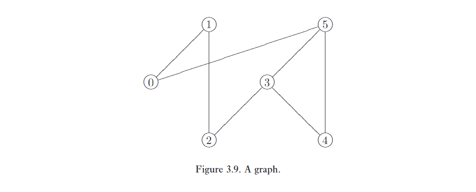
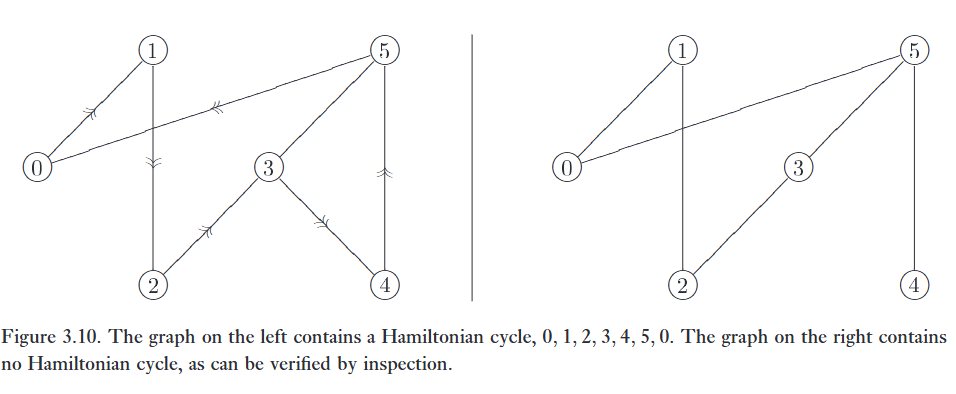
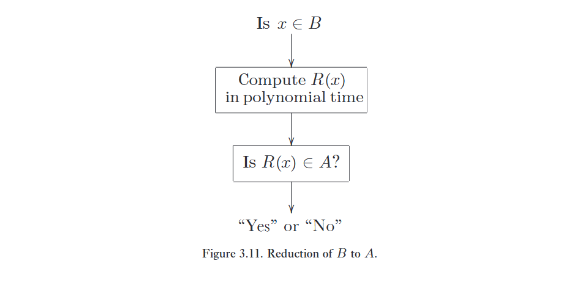
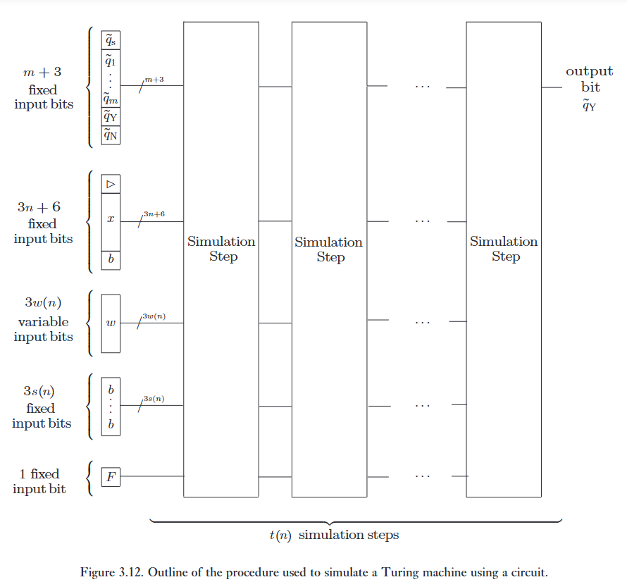
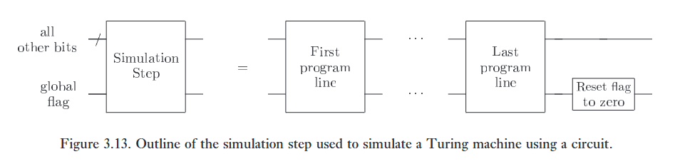
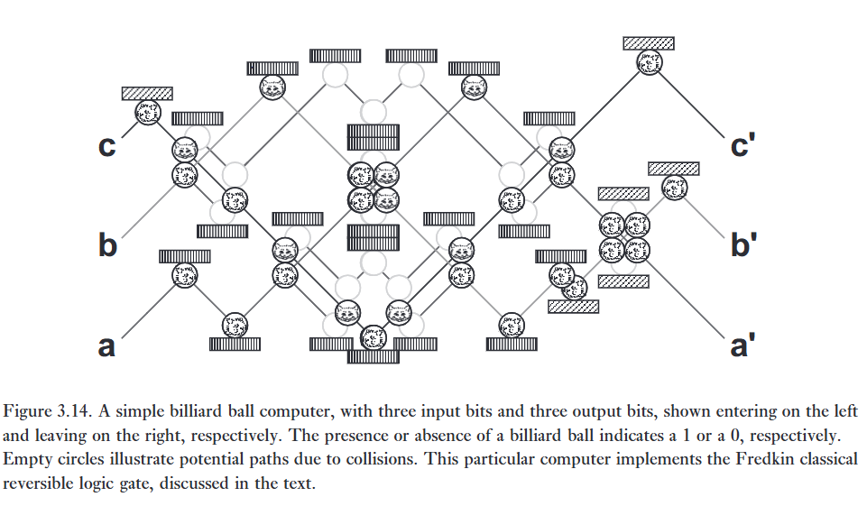
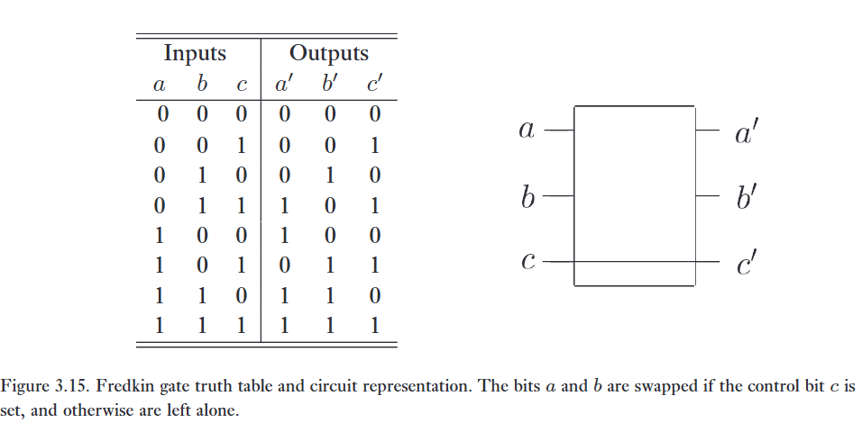
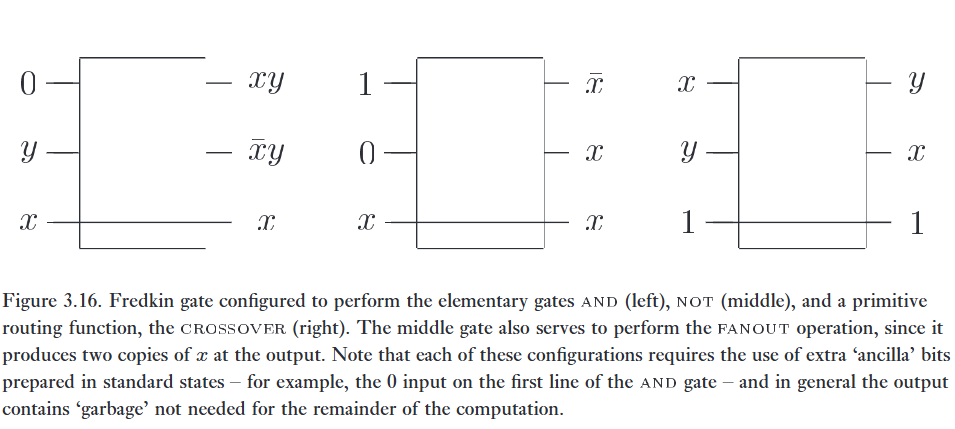

Việc phân tích các bài toán tính toán phụ thuộc vào câu trả lời cho ba câu hỏi nền tảng:   

(1) **Một bài toán tính toán là gì?** 

Nhân hai số với nhau là một bài toán tính toán; lập trình một máy tính để vượt qua khả năng của con người trong việc làm thơ cũng vậy. Để đạt được tiến bộ trong việc phát triển một lý thuyết tổng quát cho việc phân tích các bài toán tính toán, chúng ta sẽ cô lập một lớp đặc biệt các bài toán được gọi là bài toán quyết định (decision problems), và tập trung phân tích của chúng ta vào những bài toán đó. Việc tự giới hạn bản thân theo cách này cho phép phát triển một lý thuyết vừa thanh lịch vừa có cấu trúc phong phú. Quan trọng nhất, đó là một lý thuyết mà các nguyên tắc của nó có ứng dụng vượt xa các bài toán quyết định.   

(2) **Chúng ta có thể thiết kế các thuật toán như thế nào để giải quyết một bài toán tính toán cho trước?** 

Khi một bài toán đã được xác định, những thuật toán nào có thể được sử dụng để giải quyết bài toán đó? Có những kỹ thuật tổng quát nào có thể được sử dụng để giải quyết các lớp bài toán rộng lớn hay không? Làm thế nào chúng ta có thể chắc chắn rằng một thuật toán hành xử đúng như những gì được công bố?   

(3) **Những tài nguyên tối thiểu nào được yêu cầu để giải quyết một bài toán tính toán cho trước?** 

Việc chạy một thuật toán đòi hỏi sự tiêu thụ các tài nguyên, chẳng hạn như thời gian, không gian, và năng lượng. Trong các tình huống khác nhau, có thể mong muốn giảm thiểu sự tiêu thụ của một hoặc nhiều tài nguyên. Chúng ta có thể phân loại các bài toán dựa trên những yêu cầu về tài nguyên cần thiết để giải quyết chúng không?   

---

Trong một vài mục tiếp theo, chúng ta sẽ điều tra ba câu hỏi này, đặc biệt là câu hỏi 1 và 3. Mặc dù câu hỏi 1, 'một bài toán tính toán là gì?', có lẽ là câu hỏi nền tảng nhất, chúng ta sẽ hoãn việc trả lời nó cho đến Mục 3.2.3, tạm dừng trước tiên để thiết lập một số khái niệm nền tảng liên quan đến việc định lượng tài nguyên trong Mục 3.2.1, và sau đó xem xét các ý tưởng then chốt của độ phức tạp tính toán trong Mục 3.2.2.   

Câu hỏi 2, làm thế nào để thiết kế các thuật toán tốt, là chủ đề của một lượng lớn công trình khéo léo bởi nhiều nhà nghiên cứu. Nhiều đến mức trong phần giới thiệu ngắn gọn này, chúng ta thậm chí không thể bắt đầu mô tả những ý tưởng chính được sử dụng trong việc thiết kế các thuật toán tốt. Nếu bạn quan tâm đến chủ đề tuyệt đẹp này, chúng tôi xin chuyển hướng bạn đến phần 'Lịch sử và đọc thêm' ở cuối chương. Sự tiếp xúc trực tiếp và gần gũi nhất của chúng ta với chủ đề này sẽ diễn ra ở phần sau của cuốn sách, khi chúng ta nghiên cứu các thuật toán lượng tử. Các kỹ thuật liên quan đến việc tạo ra các thuật toán lượng tử thường liên quan đến sự pha trộn giữa các ý tưởng sâu sắc hiện có trong thiết kế thuật toán cho máy tính cổ điển, và việc tạo ra các kỹ thuật cơ học lượng tử mới, hoàn toàn nguyên bản dành cho thiết kế thuật toán. Vì lý do này, và bởi vì tinh thần thiết kế thuật toán lượng tử có rất nhiều điểm tương đồng với thiết kế thuật toán cổ điển trong nhiều khía cạnh, chúng tôi khuyến khích bạn làm quen với ít nhất là những ý tưởng cơ bản của thiết kế thuật toán.   

Câu hỏi 3, những tài nguyên tối thiểu nào được yêu cầu để giải quyết một bài toán tính toán cho trước, là trọng tâm chính của một vài phần tiếp theo. Ví dụ, giả sử chúng ta được cho hai số, mỗi số có độ dài $n$ bit, mà chúng ta muốn nhân lại với nhau. Nếu phép nhân được thực hiện trên một máy Turing một dải băng, máy Turing đó phải thực thi bao nhiêu bước tính toán để hoàn thành tác vụ? Bao nhiêu không gian được sử dụng trên máy Turing trong khi hoàn thành tác vụ?   

Đây là những ví dụ về loại câu hỏi tài nguyên mà chúng ta có thể đặt ra. Nói chung, máy tính sử dụng nhiều loại tài nguyên khác nhau, tuy nhiên chúng ta sẽ tập trung phần lớn sự chú ý vào thời gian (time), không gian (space), và năng lượng (energy). Theo truyền thống trong khoa học máy tính, thời gian và không gian là hai mối quan tâm chính về tài nguyên trong việc nghiên cứu thuật toán, và chúng ta nghiên cứu những vấn đề này trong các Mục 3.2.2 đến 3.2.4. Năng lượng là một sự cân nhắc ít quan trọng hơn; tuy nhiên, việc nghiên cứu các yêu cầu về năng lượng lại tạo động lực cho chủ đề tính toán cổ điển khả nghịch (reversible classical computation), điều mà đến lượt nó lại là một điều kiện tiên quyết cho tính toán lượng tử, do đó chúng ta sẽ xem xét các yêu cầu về năng lượng cho tính toán một cách khá chi tiết trong Mục 3.2.5.   

# 1. How to quantify computational resources

Các mô hình tính toán khác nhau dẫn đến những yêu cầu tài nguyên khác nhau cho việc tính toán. Thậm chí một điều đơn giản như việc chuyển đổi từ máy Turing một dải băng sang hai dải băng cũng có thể làm thay đổi các tài nguyên cần thiết để giải quyết một bài toán tính toán cho trước. Đối với một tác vụ tính toán đã được hiểu cực kỳ rõ ràng, ví dụ như phép cộng các số nguyên, thì những sự khác biệt như vậy giữa các mô hình tính toán có thể mang lại sự quan tâm. Tuy nhiên, đối với bước đầu tiên trong việc tìm hiểu một bài toán, chúng ta muốn có một cách để định lượng các yêu cầu tài nguyên mà nó độc lập với những thay đổi tương đối nhỏ nhặt trong mô hình tính toán. Một trong những công cụ đã được phát triển để làm việc này là ký hiệu tiệm cận (asymptotic notation), có thể được sử dụng để tóm tắt hành vi cốt yếu của một hàm. Ký hiệu tiệm cận này có thể được sử dụng, ví dụ, để tóm tắt bản chất của việc một thuật toán cho trước mất bao nhiêu bước thời gian để chạy, mà không phải lo lắng quá nhiều về số đếm thời gian chính xác. Trong phần này, chúng tôi mô tả chi tiết ký hiệu này, và áp dụng nó vào một bài toán đơn giản minh họa cho việc định lượng tài nguyên tính toán – phân tích các thuật toán dùng để sắp xếp một danh sách các tên theo thứ tự bảng chữ cái.   

---

Ví dụ, giả sử rằng chúng ta quan tâm đến số lượng các cổng cần thiết để cộng hai số $n$ bit lại với nhau. Việc đếm chính xác số lượng cổng được yêu cầu sẽ che khuất đi bức tranh toàn cảnh: có lẽ một thuật toán cụ thể yêu cầu $24n + 2\lceil\log n\rceil + 16$ cổng để thực hiện tác vụ này. Tuy nhiên, trong giới hạn kích thước bài toán lớn, số hạng duy nhất có ý nghĩa là số hạng $24n$. Hơn nữa, chúng ta bỏ qua các hằng số nhân vì chúng chỉ có tầm quan trọng thứ yếu đối với việc phân tích thuật toán. Hành vi cốt yếu của thuật toán được tóm tắt bằng cách nói rằng số lượng phép toán được yêu cầu thay đổi tỷ lệ thuận với $n$, trong đó $n$ là số lượng bit trong các số đang được cộng. Ký hiệu tiệm cận bao gồm ba công cụ giúp làm cho khái niệm này trở nên chính xác.   

Ký hiệu $O$ ('big $O$') được sử dụng để thiết lập các giới hạn trên (upper bounds) cho hành vi của một hàm. Giả sử $f(n)$ và $g(n)$ là hai hàm trên tập các số nguyên không âm. Chúng ta nói '$f(n)$ thuộc lớp các hàm $O(g(n))$', hoặc đơn giản là '$f(n)$ là $O(g(n))$', nếu tồn tại các hằng số $c$ và $n_0$ sao cho với mọi giá trị của $n$ lớn hơn $n_0$, ta có $f(n) \le cg(n)$. Tức là, đối với $n$ đủ lớn, hàm $g(n)$ là một giới hạn trên đối với $f(n)$, bỏ qua một hằng số nhân không quan trọng. Ký hiệu big $O$ đặc biệt hữu ích trong việc nghiên cứu hành vi trong trường hợp xấu nhất (worst-case behavior) của các thuật toán cụ thể, nơi mà chúng ta thường hài lòng với một giới hạn trên về lượng tài nguyên mà một thuật toán tiêu thụ.   

Khi nghiên cứu hành vi của một lớp các thuật toán – ví dụ như toàn bộ lớp các thuật toán có thể được sử dụng để nhân hai số – sẽ thật thú vị khi thiết lập các giới hạn dưới (lower bounds) đối với các tài nguyên được yêu cầu. Đối với việc này, ký hiệu $\Omega$ ('big Omega') được sử dụng. Một hàm $f(n)$ được cho là $\Omega(g(n))$ nếu tồn tại các hằng số $c$ và $n_0$ sao cho với mọi $n$ lớn hơn $n_0$, ta có $cg(n) \le f(n)$. Tức là, đối với $n$ đủ lớn, $g(n)$ là một giới hạn dưới đối với $f(n)$, bỏ qua một hằng số nhân không quan trọng.   

Cuối cùng, ký hiệu $\Theta$ ('big Theta') được sử dụng để chỉ ra rằng $f(n)$ có hành vi tiệm cận giống với $g(n)$, bỏ qua các hằng số nhân không quan trọng. Tức là, chúng ta nói $f(n)$ là $\Theta(g(n))$ nếu nó vừa là $O(g(n))$ vừa là $\Omega(g(n))$.   

## Asymptotic notation: examples

Hãy xem xét một vài ví dụ đơn giản về ký hiệu tiệm cận. Hàm $2n$ thuộc lớp $O(n^2)$, vì $2n \le 2n^2$ với mọi $n$ dương. Hàm $2^n$ là $\Omega(n^3)$, vì $n^3 \le 2^n$ đối với $n$ đủ lớn. Cuối cùng, hàm $7n^2 + \sqrt{n}\log(n)$ là $\Theta(n^2)$, vì $7n^2 \le 7n^2 + \sqrt{n}\log(n) \le 8n^2$ đối với mọi giá trị đủ lớn của $n$. Trong một vài bài tập tiếp theo, bạn sẽ làm việc thông qua một số tính chất sơ cấp của ký hiệu tiệm cận khiến nó trở thành một công cụ hữu ích trong việc phân tích các thuật toán.   

:::{.callout-note collapse="true"}
# Bài tập 3.9: 
Chứng minh rằng $f(n)$ là $O(g(n))$ khi và chỉ khi $g(n)$ là $\Omega(f(n))$. Suy ra rằng $f(n)$ là $\Theta(g(n))$ khi và chỉ khi $g(n)$ là $\Theta(f(n))$.   
:::

:::{.callout-note collapse="true"}
# Bài tập 3.10: 
Giả sử $g(n)$ là một đa thức bậc $k$. Chứng minh rằng $g(n)$ là $O(n^l)$ với mọi $l \ge k$.   
:::


:::{.callout-note collapse="true"}
# Bài tập 3.11: 
Chứng minh rằng $\log n$ là $O(n^k)$ với mọi $k > 0$.   
:::

:::{.callout-note collapse="true"}
# Bài tập 3.12: ($n^{\log n}$ là siêu đa thức - super-polynomial) 
Chứng minh rằng $n^k$ là $O(n^{\log n})$ với mọi $k$, nhưng $n^{\log n}$ không bao giờ là $O(n^k)$.   
:::

:::{.callout-note collapse="true"}
# Bài tập 3.13: ($n^{\log n}$ là dưới hàm mũ - sub-exponential) 
Chứng minh rằng $c^n$ là $\Omega(n^{\log n})$ với mọi $c > 1$, nhưng $n^{\log n}$ không bao giờ là $\Omega(c^n)$.   
:::

:::{.callout-note collapse="true"}
# Bài tập 3.14: 
Giả sử $e(n)$ là $O(f(n))$ và $g(n)$ là $O(h(n))$. Chứng minh rằng $e(n)g(n)$ là $O(f(n)h(n))$.   
:::

Một ví dụ về việc sử dụng ký hiệu tiệm cận trong việc định lượng tài nguyên là ứng dụng đơn giản sau đây cho bài toán sắp xếp một danh sách gồm $n$ phần tử tên theo thứ tự bảng chữ cái. Nhiều thuật toán sắp xếp dựa trên phép toán 'so sánh-và-đổi-chỗ' (compare-and-swap): hai phần tử của một danh sách $n$ phần tử được so sánh, và đổi chỗ nếu chúng không đúng thứ tự. Nếu phép toán so sánh-và-đổi-chỗ này là phương tiện duy nhất mà qua đó chúng ta có thể truy cập danh sách, thì cần bao nhiêu phép toán như vậy để đảm bảo rằng danh sách đã được sắp xếp chính xác?   

Một thuật toán so sánh-và-đổi-chỗ đơn giản để giải quyết bài toán sắp xếp như sau: (lưu ý rằng compare-and-swap(j,k) so sánh các mục danh sách được đánh số $j$ và $k$, và đổi chỗ chúng nếu chúng không đúng thứ tự)   

```
for j = 1 to n-1
    for k = j+1 to n
        compare-and-swap(j,k)
    end k
end j
```

Rõ ràng là thuật toán này sắp xếp chính xác một danh sách gồm $n$ cái tên theo thứ tự bảng chữ cái. Lưu ý rằng số lượng phép toán so sánh-và-đổi-chỗ được thuật toán thực thi là $(n - 1) + (n - 2) + \dots + 1 = n(n - 1)/2$. Do đó, số lượng phép toán so sánh-và-đổi-chỗ mà thuật toán sử dụng là $\Theta(n^2)$. Chúng ta có thể làm tốt hơn thế này không? Hóa ra là chúng ta có thể. Người ta đã biết đến các thuật toán như 'heapsort' chạy bằng cách sử dụng $O(n \log n)$ phép toán so sánh-và-đổi-chỗ. Hơn nữa, trong Bài tập 3.15, bạn sẽ làm việc thông qua một lập luận đếm đơn giản cho thấy bất kỳ thuật toán nào dựa trên phép toán so sánh-và-đổi-chỗ đều yêu cầu $\Omega(n \log n)$ phép toán như vậy. Do đó, bài toán sắp xếp nói chung yêu cầu $\Theta(n \log n)$ phép toán so sánh-và-đổi-chỗ.   

:::{.callout-note collapse="true"}
# Bài tập 3.15: (Giới hạn dưới cho các thuật toán sắp xếp dựa trên so sánh-và-đổi-chỗ) 
Giả sử một danh sách $n$ phần tử được sắp xếp bằng cách áp dụng một chuỗi các phép toán so sánh-và-đổi-chỗ cho danh sách. Có $n!$ cách sắp xếp ban đầu có thể có của danh sách. Chứng minh rằng sau khi $k$ phép toán so sánh-và-đổi-chỗ được áp dụng, tối đa $2^k$ trong số các cách sắp xếp ban đầu có thể có sẽ được sắp xếp thành thứ tự chính xác. Kết luận rằng cần phải có $\Omega(n \log n)$ phép toán so sánh-và-đổi-chỗ để sắp xếp tất cả các cách sắp xếp ban đầu có thể có thành thứ tự chính xác.   
:::

# 2. Computational complexity

:::{.callout}
# tl;dr

Một bài toán dễ, dễ xử lý, khả thi (easy, tractable, feasible) nếu tồn tại một thuật để giải quyết bài toán đó sử dụng tài nguyên đa thức.

Một bài toán khó, khó xử lý, bất khả thi (hard, intractable, infeasible) nếu thuật toán tốt nhất có thể yêu cầu tài nguyên hàm mũ.

---

Sự phân loại này khá là thô sô, ví dụ như người ta coi hàm mũ $2^{n/1000}$ là khó hơn $n^1000$, mặc dù thực tế là khi n đủ lớn thì cái đầu tiên dễ hơn nhiều. Nhưng mà chúng ta phải chấp nhận thôi.


:::

> *'The idea that there won’t be an algorithm to solve it – this is something fundamental that won’t ever change – that idea appeals to me'*
> – Stephen Cook

> *'Sometimes it is good that some things are impossible. I am happy there are many things that nobody can do to me.'*
> – Leonid Levin

> *'It should not come as a surprise that our choice of polynomial algorithms as the mathematical concept that is supposed to capture the informal notion of ‘practically efficient computation’ is open to criticism from all sides. [. . . ] Ultimately, our argument for our choice must be this: Adopting polynomial worst-case performance as our criterion of efficiency results in an elegant and useful theory that says something meaningful about practical computation, and would be impossible without this simplification.'*
> – Christos Papadimitriou

**Những tài nguyên về thời gian (time) và không gian (space) nào được yêu cầu để thực hiện một phép tính?**

Trong nhiều trường hợp, đây là những câu hỏi quan trọng nhất mà chúng ta có thể đặt ra về một bài toán tính toán. Các bài toán như cộng và nhân các con số được coi là có thể giải quyết một cách hiệu quả bởi vì chúng ta có các thuật toán nhanh để thực hiện phép cộng và phép nhân, vốn tiêu thụ ít không gian khi chạy. Nhiều bài toán khác không có thuật toán nhanh nào được biết đến, và trên thực tế là không thể giải quyết được, không phải vì chúng ta không thể tìm ra thuật toán để giải bài toán đó, mà bởi vì tất cả các thuật toán đã biết đều tiêu thụ một lượng lớn không gian hoặc thời gian đến mức khiến chúng trở nên vô dụng trong thực tế.   

---

Độ phức tạp tính toán (Computational complexity) là nghiên cứu về các tài nguyên thời gian và không gian cần thiết để giải quyết các bài toán tính toán. **Tác vụ của độ phức tạp tính toán là chứng minh các giới hạn dưới (lower bounds) đối với các tài nguyên được yêu cầu bởi thuật toán tốt nhất có thể để giải quyết một bài toán, ngay cả khi thuật toán đó chưa được biết đến một cách rõ ràng.** Trong phần này và hai phần tiếp theo, chúng tôi đưa ra một cái nhìn tổng quan về độ phức tạp tính toán, các khái niệm chính của nó, và một số kết quả quan trọng nhất của lĩnh vực này. Lưu ý rằng độ phức tạp tính toán theo một khía cạnh nào đó là sự bổ sung cho lĩnh vực thiết kế thuật toán; lý tưởng nhất là các thuật toán hiệu quả nhất mà chúng ta có thể thiết kế sẽ khớp hoàn hảo với các giới hạn dưới được chứng minh bởi độ phức tạp tính toán. Thật không may, điều này thường không xảy ra. Như đã lưu ý, trong cuốn sách này chúng ta sẽ không xem xét thiết kế thuật toán cổ điển ở bất kỳ chiều sâu nào.   

---

Một khó khăn trong việc xây dựng một lý thuyết về độ phức tạp tính toán là các mô hình tính toán khác nhau có thể yêu cầu các tài nguyên khác nhau để giải quyết cùng một bài toán. Chẳng hạn, các máy Turing nhiều dải băng có thể giải quyết nhiều bài toán nhanh hơn đáng kể so với các máy Turing một dải băng. Khó khăn này được giải quyết theo một cách khá thô sơ (coarse). Giả sử một bài toán được chỉ định bằng cách cung cấp $n$ bit làm đầu vào. Ví dụ, chúng ta có thể quan tâm đến việc liệu một số $n$-bit cụ thể có phải là số nguyên tố hay không. Sự phân biệt chính được đưa ra trong độ phức tạp tính toán là giữa các bài toán có thể được giải quyết bằng cách sử dụng các tài nguyên bị giới hạn bởi một đa thức (polynomial) theo $n$, và những bài toán yêu cầu các tài nguyên tăng trưởng nhanh hơn bất kỳ đa thức nào theo $n$. Trong trường hợp sau, chúng ta thường nói rằng các tài nguyên được yêu cầu là có tính hàm mũ (exponential) theo kích thước bài toán, lạm dụng thuật ngữ hàm mũ, vì có những hàm như $n^{\log n}$ tăng trưởng nhanh hơn bất kỳ đa thức nào (và do đó là 'hàm mũ' theo quy ước này), nhưng lại tăng trưởng chậm hơn bất kỳ hàm mũ thực sự nào. Một bài toán được coi là dễ (easy), dễ xử lý (tractable) hay khả thi (feasible) nếu tồn tại một thuật toán để giải quyết bài toán đó sử dụng tài nguyên đa thức, và được coi là khó (hard), khó xử lý (intractable) hay bất khả thi (infeasible) nếu thuật toán tốt nhất có thể yêu cầu tài nguyên hàm mũ.   

Lấy một ví dụ đơn giản, giả sử chúng ta có hai số với biểu diễn nhị phân $x_1 \dots x_{m_1}$ và $y_1 \dots y_{m_2}$, và chúng ta muốn xác định tổng của hai số này. Kích thước tổng cộng của đầu vào là $n \equiv m_1 + m_2$. Rất dễ để thấy rằng hai số này có thể được cộng lại bằng cách sử dụng một số lượng các phép toán sơ cấp tỷ lệ với $\Theta(n)$; thuật toán này sử dụng một số lượng đa thức (thực ra là tuyến tính) các phép toán để thực hiện tác vụ của nó. Ngược lại, người ta tin rằng (mặc dù nó chưa bao giờ được chứng minh!) bài toán phân tích một số nguyên thành các thừa số nguyên tố của nó là khó xử lý. Nghĩa là, người ta tin rằng không có thuật toán nào có thể phân tích một số nguyên $n$-bit tùy ý bằng cách sử dụng $O(p(n))$ phép toán, trong đó $p$ là một hàm đa thức cố định nào đó của $n$. Sau này, chúng tôi sẽ đưa ra nhiều ví dụ khác về các bài toán được tin là khó xử lý theo nghĩa này. 

Sự phân loại đa thức (polynomial) so với hàm mũ (exponential) là khá thô sơ. Trong thực tế, một thuật toán giải quyết một bài toán sử dụng $2^{n/1000}$ phép toán có lẽ hữu ích hơn một thuật toán chạy trong $n^{1000}$ phép toán. Chỉ đối với các kích thước đầu vào rất lớn ($n \approx 10^8$) thì thuật toán đa thức 'hiệu quả' mới được ưa thích hơn thuật toán hàm mũ 'kém hiệu quả', và đối với nhiều mục đích, việc ưu tiên thuật toán 'kém hiệu quả' có thể thực tế hơn.   

Mặc dù vậy, có nhiều lý do để đặt cơ sở cho độ phức tạp tính toán chủ yếu dựa trên sự phân loại đa thức so với hàm mũ. Đầu tiên, về mặt lịch sử, với một vài ngoại lệ, các thuật toán tài nguyên đa thức đã nhanh hơn rất nhiều so với các thuật toán hàm mũ. Chúng ta có thể suy đoán rằng lý do cho điều này là sự thiếu trí tưởng tượng: việc nghĩ ra các thuật toán yêu cầu $n, n^2$ hoặc một số lượng đa thức bậc thấp các phép toán thường dễ dàng hơn nhiều so với việc tìm ra một thuật toán tự nhiên yêu cầu $n^{1000}$ phép toán, mặc dù những ví dụ như trường hợp sau vẫn tồn tại. Do đó, khuynh hướng của tâm trí con người trong việc nghĩ ra các thuật toán tương đối đơn giản đã có nghĩa là trong thực tế, các thuật toán đa thức thường thực hiện hiệu quả hơn nhiều so với những người anh em họ hàm mũ của chúng.   

Một lý do thứ hai và nền tảng hơn cho việc nhấn mạnh sự phân loại đa thức so với hàm mũ được bắt nguồn từ luận đề Church-Turing mạnh (strong Church-Turing thesis). Như đã thảo luận trong Mục 1.1, người ta đã quan sát thấy vào những năm 1960 và 1970 rằng các máy Turing xác suất (probabilistic Turing machines) dường như là mô hình tính toán 'hợp lý' mạnh mẽ nhất. Cụ thể hơn, các nhà nghiên cứu liên tục nhận thấy rằng nếu có thể tính toán một hàm bằng cách sử dụng $k$ phép toán sơ cấp trong một mô hình nào đó không phải là mô hình tính toán máy Turing xác suất, thì luôn luôn có thể tính toán cùng một hàm đó trong mô hình máy Turing xác suất, sử dụng tối đa $p(k)$ phép toán sơ cấp, trong đó $p(\cdot)$ là một hàm đa thức nào đó. Phát biểu này được biết đến là luận đề Church-Turing mạnh: 

:::{.postulates}
# Strong Church–Turing thesis
Any model of computation can be simulated on a probabilistic Turing machine with at most a polynomial increase in the number of elementary operations required.
:::

Luận đề Church-Turing mạnh là một tin tuyệt vời cho lý thuyết về độ phức tạp tính toán, vì nó ngụ ý rằng sự chú ý có thể được giới hạn trong mô hình tính toán máy Turing xác suất. Suy cho cùng, nếu một bài toán không có giải pháp sử dụng tài nguyên đa thức trên một máy Turing xác suất, thì luận đề Church-Turing mạnh ngụ ý rằng nó không có giải pháp hiệu quả trên bất kỳ thiết bị tính toán nào. Do đó, luận đề Church-Turing mạnh ngụ ý rằng toàn bộ lý thuyết về độ phức tạp tính toán sẽ mang một hình thức thanh lịch, độc lập với mô hình (model-independent) nếu khái niệm về sự hiệu quả được đồng nhất với các thuật toán tài nguyên đa thức, và sự thanh lịch này đã cung cấp một động lực mạnh mẽ hướng tới việc chấp nhận sự đồng nhất hóa giữa 'có thể giải quyết bằng tài nguyên đa thức' và 'có thể giải quyết một cách hiệu quả'. Tất nhiên, một trong những lý do chính yếu cho sự quan tâm đến máy tính lượng tử là chúng đặt ra sự hoài nghi đối với luận đề Church-Turing mạnh, bằng cách cho phép giải quyết hiệu quả một bài toán được tin là khó xử lý trên tất cả các máy tính cổ điển, bao gồm cả máy Turing xác suất! Tuy nhiên, việc hiểu và trân trọng vai trò của luận đề Church-Turing mạnh trong công cuộc tìm kiếm một lý thuyết độ phức tạp tính toán độc lập với mô hình vẫn là điều hữu ích.   

Cuối cùng, chúng tôi lưu ý rằng, trong thực tế, các nhà khoa học máy tính không chỉ quan tâm đến việc phân loại bài toán thành đa thức hay hàm mũ. Đây chỉ là cách đầu tiên và thô sơ nhất để hiểu một bài toán tính toán khó đến mức nào. Tuy nhiên, nó là một sự phân biệt cực kỳ quan trọng, và minh họa cho nhiều quan điểm rộng lớn hơn về bản chất của các vấn đề tài nguyên trong khoa học máy tính. Đối với phần lớn cuốn sách này, nó sẽ là mối quan tâm trung tâm của chúng ta trong việc đánh giá hiệu quả của một thuật toán cho trước.   

Sau khi đã xem xét những giá trị của việc phân loại đa thức so với hàm mũ, bây giờ chúng tôi phải thú nhận rằng lý thuyết về độ phức tạp tính toán có một thất bại vô cùng đáng chú ý: có vẻ rất khó để chứng minh rằng tồn tại những lớp bài toán thú vị yêu cầu tài nguyên hàm mũ để giải quyết. Khá dễ dàng để đưa ra các chứng minh phi kiến thiết (non-constructive proofs) rằng hầu hết các bài toán đều yêu cầu tài nguyên hàm mũ (xem Bài tập 3.16 bên dưới), và hơn nữa nhiều bài toán thú vị được suy đoán (conjectured) là yêu cầu tài nguyên hàm mũ cho giải pháp của chúng, nhưng những chứng minh chặt chẽ dường như rất khó để đạt được, ít nhất là với trạng thái kiến thức hiện tại. Thất bại này của độ phức tạp tính toán mang những hàm ý quan trọng đối với tính toán lượng tử, bởi vì hóa ra sức mạnh tính toán của máy tính lượng tử có thể có liên hệ với một số bài toán mở (open problems) lớn trong lý thuyết độ phức tạp tính toán cổ điển. Cho đến khi những bài toán này được giải quyết, không thể tuyên bố một cách chắc chắn rằng một máy tính lượng tử mạnh mẽ về mặt tính toán đến mức nào, hay thậm chí liệu nó có mạnh hơn một máy tính cổ điển hay không!   

:::{.callout-note collapse="true"}
# Bài tập 3.16: (Tồn tại các hàm khó tính toán) 
Chứng minh rằng tồn tại các hàm Boolean trên $n$ đầu vào mà yêu cầu ít nhất $2^n / \log n$ cổng logic để tính toán.   
:::

---

# 3. Decision problems and the complexity classes P and NP

:::{.callout}

# Decision Problems

Bài toán quyết định, là những bài toán trả lời câu hỏi có hay không, yes or no.

Những ý tưởng chính của độ phức tạp được hình thành dưới dạng các bài toán quyết định.

Ví dụ: "Cho một hợp số m nguyên và l < m, liệu m có một thừa số nào nhỏ hơn l hay không?"

---

# P - NP - coNP

P là một lớp bài toán mà khó có thể quyết trong thời gian đa thức

NP là một lớp bài toán mà có thể kiểm tra đáp án có đúng hay không.

coNP là phần bù NP, một lớp bài toán mà có bằng chứng cho các trường hợp trả lời "no"

Ví dụ: Bài toán quyết định được nêu ở trên/

* Nếu có thể giải quyết trong thời gian đa thức, đưa ra witness trong thời gian ngắn, nó là P. Và rõ ràng ở bài trên thì rất khó để có thể đưa ra thừa số trong thời gian nhanh.

* Vì chúng ta có thể kiểm tra một cách rất nhanh chóng, rằng yes, cái này có thỏa mãn hay không bằng các công cụ nhân chia cơ bản. Vì vậy bài toán trên thuộc NP.

---

# NP Complete - NP Hard - NPI

**NP Hard**

Là lớp các bài toán *ít nhất khó bằng* các bài toán khó nhất trong NP.

Tức là bài toán NP Hard không bắt buộc phải thuộc lớp NP, tức là lời giải của chúng thậm chí không kiểm tra nhanh được trong thời gian đa thức, hoặc thậm chí là không quyết định được.

**NP Complete**

Là lớp bài toán thỏa mãn hai điều kiện:

* Thuộc lớp NP.

* Thuộc lớp NP Hard.

Đây là những bài toán khó nhất nằm trong tập NP. Mọi bài toán NP Complete đều là NP Hard, nhưng ngược lại thì không.

**NP Itermediate**

Là trung gian, thuộc lớp NP, nhưng không thuộc P và cũng không phải là NP Complete.

Tức là những bài toán đủ khó để trên tầm của P, nhưng cũng chẳng đủ khó để nằm trong NP Complete.

> Hiện tại người ta đang tập trung nghiên cứu các bài toán này để phục vụ cho computing computation. Và hiện tại cũng có thể nói là chưa có bài toán nào thuộc lớp NPI cả, người ta chỉ đang nghi ngờ bài toán phân tích số nguyên tố thành thừa số nguyên tố thôi.

:::

Nhiều bài toán tính toán được định hình một cách rõ ràng nhất dưới dạng các bài toán quyết định (decision problems) – những bài toán có câu trả lời là có (yes) hoặc không (no). Ví dụ, một số $m$ cho trước có phải là số nguyên tố hay không? Đây là bài toán quyết định tính nguyên tố (primality). Những ý tưởng chính của độ phức tạp tính toán được hình thành một cách dễ dàng nhất và thường xuyên nhất dưới dạng các bài toán quyết định, vì hai lý do: lý thuyết có dạng đơn giản nhất và thanh lịch nhất ở hình thức này, trong khi vẫn có thể khái quát hóa một cách tự nhiên cho các kịch bản phức tạp hơn; và về mặt lịch sử, độ phức tạp tính toán phát sinh chủ yếu từ việc nghiên cứu các bài toán quyết định.   

Mặc dù hầu hết các bài toán quyết định có thể dễ dàng được phát biểu bằng ngôn ngữ đơn giản, quen thuộc, việc thảo luận về các tính chất chung của các bài toán quyết định được hỗ trợ rất nhiều bởi thuật ngữ của các ngôn ngữ hình thức (formal languages). Trong thuật ngữ này, một ngôn ngữ $L$ trên bảng chữ cái $\Sigma$ là một tập con của tập $\Sigma^*$ gồm tất cả các chuỗi ký hiệu (hữu hạn) từ $\Sigma$. Ví dụ, nếu $\Sigma = \{0, 1\}$, thì tập hợp các biểu diễn nhị phân của các số chẵn, $L = \{0, 10, 100, 110, \dots\}$ là một ngôn ngữ trên $\Sigma$.   

Các bài toán quyết định có thể được mã hóa một cách hiển nhiên thành các bài toán về ngôn ngữ. Chẳng hạn, bài toán quyết định tính nguyên tố có thể được mã hóa bằng cách sử dụng bảng chữ cái nhị phân $\Sigma = \{0, 1\}$. Các chuỗi từ $\Sigma^*$ có thể được diễn giải một cách tự nhiên như các số nguyên không âm. Ví dụ, $0010$ có thể được diễn giải là số $2$. Ngôn ngữ $L$ được định nghĩa là bao gồm tất cả các chuỗi nhị phân sao cho con số tương ứng là số nguyên tố.   

Để giải bài toán quyết định tính nguyên tố, thứ mà chúng ta muốn là một máy Turing mà khi bắt đầu với một số $n$ cho trước trên dải băng đầu vào của nó, cuối cùng sẽ xuất ra một kết quả tương đương với 'có' nếu $n$ là số nguyên tố, và xuất ra 'không' nếu $n$ không phải là số nguyên tố. Để làm cho ý tưởng này trở nên chính xác, sẽ thuận tiện nếu ta sửa đổi định nghĩa máy Turing cũ của chúng ta (ở Mục 3.1.1) một chút, thay thế trạng thái dừng $q_h$ bằng hai trạng thái $q_Y$ và $q_N$ để lần lượt biểu diễn các câu trả lời 'có' và 'không'. Trong tất cả các phương diện khác, máy hành xử theo cùng một cách, và nó vẫn dừng lại khi đi vào trạng thái $q_Y$ hoặc $q_N$.   Tổng quát hơn, một ngôn ngữ $L$ được quyết định (decided) bởi một máy Turing nếu máy đó có khả năng quyết định xem một đầu vào $x$ trên dải băng của nó có phải là một thành viên của ngôn ngữ $L$ hay không, cuối cùng dừng lại ở trạng thái $q_Y$ nếu $x \in L$, và cuối cùng dừng lại ở trạng thái $q_N$ nếu $x \notin L$. Chúng ta nói rằng máy đã chấp nhận (accepted) hoặc từ chối (rejected) $x$ tùy thuộc vào việc trường hợp nào trong hai trường hợp này xảy ra.

---

**Chúng ta có thể xác định liệu một số có phải là số nguyên tố hay không nhanh đến mức nào?**

Tức là, máy Turing nhanh nhất để quyết định ngôn ngữ biểu diễn bài toán quyết định tính nguyên tố là gì? Chúng ta nói rằng một bài toán thuộc lớp $\mathbf{TIME}(f(n))$ nếu tồn tại một máy Turing quyết định liệu một ứng cử viên $x$ có thuộc ngôn ngữ đó trong thời gian $O(f(n))$ hay không, trong đó $n$ là độ dài của $x$. Một bài toán được nói là có thể giải quyết trong thời gian đa thức (polynomial time) nếu nó thuộc $\mathbf{TIME}(n^k)$ với một số $k$ hữu hạn nào đó. Tập hợp tất cả các ngôn ngữ thuộc $\mathbf{TIME}(n^k)$, với một số $k$ nào đó, được ký hiệu là $\mathbf{P}$. $\mathbf{P}$ là ví dụ đầu tiên của chúng ta về một lớp độ phức tạp (complexity class). Tổng quát hơn, một lớp độ phức tạp được định nghĩa là một tập hợp các ngôn ngữ. Phần lớn lý thuyết độ phức tạp tính toán liên quan đến việc định nghĩa các lớp độ phức tạp khác nhau, và hiểu được mối quan hệ giữa các lớp độ phức tạp khác nhau.   

Không có gì đáng ngạc nhiên khi có những bài toán không thể được giải quyết trong thời gian đa thức. Thật không may, việc chứng minh rằng bất kỳ bài toán cụ thể nào không thể giải quyết được trong thời gian đa thức dường như rất khó khăn, mặc dù các phỏng đoán thì rất nhiều! Một ví dụ đơn giản về một bài toán quyết định thú vị được tin là không thuộc $\mathbf{P}$ là bài toán quyết định phân tích thừa số (factoring decision problem):   

> PHÂN TÍCH THỪA SỐ: Cho một số nguyên hợp số $m$ và $l < m$, liệu $m$ có một thừa số không tầm thường nào nhỏ hơn $l$ hay không?  

Một tính chất thú vị của việc phân tích thừa số là nếu ai đó tuyên bố rằng câu trả lời là 'có, $m$ thực sự có một thừa số không tầm thường nhỏ hơn $l$' thì họ có thể chứng minh điều này bằng cách đưa ra một thừa số như vậy, thứ mà sau đó có thể được kiểm tra một cách hiệu quả bởi các bên khác, đơn giản bằng cách thực hiện phép chia dài (long-division). Chúng ta gọi một thừa số như vậy là một bằng chứng (witness) cho thực tế rằng $m$ có một thừa số nhỏ hơn $l$. Ý tưởng về một bằng chứng có thể kiểm tra dễ dàng này chính là ý tưởng then chốt trong định nghĩa của lớp độ phức tạp $\mathbf{NP}$, ở phần dưới. Chúng ta đã diễn đạt việc phân tích thừa số như một bài toán quyết định, nhưng bạn có thể dễ dàng xác minh rằng bài toán quyết định này tương đương với việc tìm các thừa số của một số:   

:::{.callout-note collapse="true"}
# Bài tập 3.17 
Chứng minh rằng một thuật toán thời gian đa thức để tìm các thừa số của một số $m$ tồn tại khi và chỉ khi bài toán quyết định phân tích thừa số thuộc $\mathbf{P}$.
:::

Phân tích thừa số là một ví dụ về một bài toán nằm trong một lớp độ phức tạp quan trọng được gọi là $\mathbf{NP}$. Điểm phân biệt các bài toán thuộc $\mathbf{NP}$ là các trường hợp 'có' của một bài toán có thể dễ dàng được kiểm chứng với sự trợ giúp của một bằng chứng (witness) thích hợp. Chặt chẽ hơn, một ngôn ngữ $L$ thuộc $\mathbf{NP}$ nếu có một máy Turing $M$ với các thuộc tính sau:   

(1) Nếu $x \in L$ thì tồn tại một chuỗi bằng chứng $w$ sao cho $M$ dừng ở trạng thái $q_Y$ sau một thời gian đa thức theo $\vert{}x\vert{}$ khi máy được khởi động ở trạng thái $x$-khoảng trống-$w$.

(2) Nếu $x \notin L$ thì đối với tất cả các chuỗi $w$ cố gắng đóng vai trò là một bằng chứng, máy sẽ dừng ở trạng thái $q_N$ sau một thời gian đa thức theo $\vert{}x\vert{}$ khi $M$ được khởi động ở trạng thái $x$-khoảng trống-$w$.   

Có một sự bất đối xứng thú vị trong định nghĩa của $\mathbf{NP}$. Mặc dù chúng ta phải có khả năng quyết định nhanh chóng liệu một bằng chứng khả dĩ cho $x \in L$ có thực sự là một bằng chứng hay không, không có nhu cầu tương tự đối với việc tạo ra một bằng chứng cho $x \notin L$. Ví dụ, trong bài toán phân tích thừa số, chúng ta có một cách dễ dàng để chứng minh rằng một số cho trước có một thừa số nhỏ hơn $m$, nhưng việc đưa ra một bằng chứng để chứng minh rằng một số không có thừa số nào nhỏ hơn $m$ lại khó khăn hơn nhiều. Điều này gợi ý việc định nghĩa $\mathbf{coNP}$, lớp các ngôn ngữ có các bằng chứng cho các trường hợp 'không'; rõ ràng các ngôn ngữ trong $\mathbf{coNP}$ chính là phần bù của các ngôn ngữ trong $\mathbf{NP}$.   

$\mathbf{P}$ và $\mathbf{NP}$ có mối quan hệ như thế nào? Rõ ràng là $\mathbf{P}$ là một tập con của $\mathbf{NP}$. Bài toán mở nổi tiếng nhất trong khoa học máy tính là liệu có tồn tại hay không những bài toán thuộc $\mathbf{NP}$ mà không thuộc $\mathbf{P}$, thường được viết tắt là bài toán $\mathbf{P} \ne \mathbf{NP}$. Hầu hết các nhà khoa học máy tính đều tin rằng $\mathbf{P} \ne \mathbf{NP}$, nhưng bất chấp nhiều thập kỷ làm việc, vẫn chưa ai có thể chứng minh được điều này, và khả năng $\mathbf{P} = \mathbf{NP}$ vẫn còn bỏ ngỏ.   

:::{.callout-note collapse="true"}
# Bài tập 3.18: 
Chứng minh rằng nếu $\mathbf{coNP} \ne \mathbf{NP}$ thì $\mathbf{P} \ne \mathbf{NP}$.   
:::

---

Trong lần làm quen đầu tiên, người ta thường dễ dàng đi đến kết luận rằng phỏng đoán $\mathbf{P} \ne \mathbf{NP}$ hẳn là khá dễ giải quyết. Để thấy tại sao nó thực sự khá tinh tế, sẽ rất hữu ích nếu xem xét một vài ví dụ về các bài toán thuộc $\mathbf{P}$ và $\mathbf{NP}$. Chúng ta sẽ lấy các ví dụ từ lý thuyết đồ thị (graph theory), một nguồn bài toán quyết định phong phú với những ứng dụng thực tế nhiều đến đáng kinh ngạc. Một đồ thị là một tập hợp hữu hạn các đỉnh (vertices) $\{v_1, \dots, v_n\}$ được kết nối bởi các cạnh (edges), là các cặp đỉnh $(v_i, v_j)$. Hiện tại, chúng ta chỉ quan tâm đến các đồ thị vô hướng (undirected graphs), trong đó thứ tự của các đỉnh (trong mỗi cặp cạnh) không quan trọng; những ý tưởng tương tự có thể được điều tra đối với các đồ thị có hướng (directed graphs) trong đó thứ tự của các đỉnh lại quan trọng. Một đồ thị điển hình được minh họa trong Hình 3.9.



Một chu trình (cycle) trong một đồ thị là một chuỗi các đỉnh $v_1, \dots, v_m$ sao cho mỗi cặp $(v_j, v_{j+1})$ là một cạnh, và $(v_1, v_m)$ cũng vậy. Một chu trình đơn (simple cycle) là một chu trình trong đó không có đỉnh nào bị lặp lại, ngoại trừ đỉnh đầu tiên và đỉnh cuối cùng. Một chu trình Hamilton (Hamiltonian cycle) là một chu trình đơn đi qua tất cả các đỉnh trong đồ thị. Các ví dụ về đồ thị có và không có chu trình Hamilton được hiển thị trong Hình 3.10.  



Bài toán chu trình Hamilton (HC) là xác định xem một đồ thị cho trước có chứa một chu trình Hamilton hay không. HC là một bài toán quyết định thuộc $\mathbf{NP}$, vì nếu một đồ thị cho trước có một chu trình Hamilton, thì chu trình đó có thể được sử dụng như một bằng chứng dễ dàng kiểm chứng. Hơn nữa, HC không có thuật toán thời gian đa thức nào được biết đến. Quả thực, HC là một bài toán thuộc lớp được gọi là các bài toán NP-đầy đủ (NP-complete), có thể được coi là những bài toán 'khó nhất' trong $\mathbf{NP}$, theo nghĩa là việc giải quyết HC trong thời gian $t$ cho phép bất kỳ bài toán nào khác trong $\mathbf{NP}$ được giải quyết trong thời gian $O(\text{poly}(t))$. Điều này cũng có nghĩa là nếu bất kỳ bài toán NP-đầy đủ nào có một giải pháp thời gian đa thức thì nó sẽ dẫn đến kết quả là $\mathbf{P} = \mathbf{NP}$.   

Có một bài toán, bài toán quyết định chu trình Euler, bề ngoài có vẻ tương tự như HC, nhưng lại có những tính chất khác biệt đến kinh ngạc. Một chu trình Euler là một cách sắp xếp thứ tự các cạnh của một đồ thị $G$ sao cho mỗi cạnh trong đồ thị được ghé thăm chính xác một lần. Bài toán quyết định chu trình Euler (EC) là xác định xem, cho trước một đồ thị $G$ trên $n$ đỉnh, đồ thị đó có chứa một chu trình Euler hay không. EC, trên thực tế, chính xác là cùng một bài toán như HC, chỉ khác là đường đi ghé thăm các cạnh, thay vì các đỉnh. Xem xét định lý đáng chú ý sau đây, sẽ được chứng minh trong Bài tập 3.20:   

:::{.postulates}
# Định lý 3.1: (Định lý Euler) 
Một đồ thị liên thông chứa một chu trình Euler khi và chỉ khi mọi đỉnh đều có một số chẵn các cạnh liên kết với nó.   
:::

Định lý Euler cung cấp cho chúng ta một phương pháp để giải quyết EC một cách hiệu quả. Đầu tiên, hãy kiểm tra xem đồ thị có liên thông hay không; việc này dễ dàng được thực hiện với $O(n^2)$ phép toán, như được trình bày trong Bài tập 3.19. Nếu đồ thị không liên thông, thì rõ ràng không tồn tại chu trình Euler nào. Nếu đồ thị liên thông thì đối với mỗi đỉnh, hãy kiểm tra xem có số chẵn các cạnh liên kết với đỉnh đó hay không. Nếu tìm thấy một đỉnh mà trường hợp này không đúng, thì không có chu trình Euler nào, ngược lại một chu trình Euler tồn tại. Vì có $n$ đỉnh, và tối đa $n(n - 1)/2$ cạnh, thuật toán này yêu cầu $O(n^3)$ phép toán sơ cấp. Do đó EC thuộc $\mathbf{P}$! Bằng cách nào đó, có một cấu trúc hiện diện trong bài toán ghé thăm mỗi cạnh, thứ có thể được khai thác để cung cấp một thuật toán hiệu quả cho EC, nhưng cấu trúc này dường như không được phản ánh trong bài toán ghé thăm mỗi đỉnh; hoàn toàn không hiển nhiên tại sao một cấu trúc như vậy lại nên hiện diện trong một trường hợp, nhưng không hiện diện trong trường hợp kia, nếu quả thực nó vắng mặt đối với bài toán HC.   

:::{.callout-note collapse="true"}
# Bài tập 3.19: Bài toán REACHABILITY (khả năng tiếp cận) 
là xác định xem có tồn tại một đường đi giữa hai đỉnh được chỉ định trong một đồ thị hay không. Chứng minh rằng REACHABILITY có thể được giải quyết bằng cách sử dụng $O(n)$ phép toán nếu đồ thị có $n$ đỉnh. Sử dụng giải pháp cho REACHABILITY để chứng minh rằng có thể quyết định xem một đồ thị có liên thông hay không trong $O(n^2)$ phép toán.   
:::

:::{.callout-note collapse="true"}
# Bài tập 3.20: (Định lý Euler) 
Chứng minh định lý Euler. Cụ thể, nếu mỗi đỉnh có một số chẵn các cạnh liên kết, hãy đưa ra một thủ tục mang tính kiến thiết để tìm một chu trình Euler.   
:::

Sự tương đương giữa bài toán quyết định phân tích thừa số và bài toán phân tích thừa số đúng nghĩa là một trường hợp đặc biệt của một trong những ý tưởng quan trọng nhất trong khoa học máy tính, một ý tưởng được gọi là quy về (reduction). Về mặt trực giác, chúng ta biết rằng một số bài toán có thể được xem như những trường hợp đặc biệt của những bài toán khác. Một ví dụ ít tầm thường hơn về sự quy về là việc quy HC về bài toán quyết định người bán hàng đi dạo (TSP - traveling salesman decision problem). Bài toán quyết định người bán hàng đi dạo như sau: chúng ta được cho $n$ thành phố $1, 2, \dots, n$ và một khoảng cách nguyên không âm $d_{ij}$ giữa mỗi cặp thành phố. Cho trước một khoảng cách $d$, bài toán là xác định xem có tồn tại một chuyến đi qua tất cả các thành phố với khoảng cách nhỏ hơn $d$ hay không.  

Việc quy $\text{HC}$ về $\text{TSP}$ diễn ra như sau. Giả sử chúng ta có một đồ thị chứa $n$ đỉnh. Chúng ta biến điều này thành một trường hợp của $\text{TSP}$ bằng cách coi mỗi đỉnh của đồ thị như một 'thành phố' và định nghĩa khoảng cách $d_{ij}$ giữa các thành phố $i$ và $j$ là $1$ nếu các đỉnh $i$ và $j$ được kết nối với nhau, và khoảng cách là $2$ nếu các đỉnh không được kết nối. Khi đó, một chuyến đi qua các thành phố có khoảng cách nhỏ hơn $n + 1$ bắt buộc phải có khoảng cách là $n$, và là một chu trình Hamilton cho đồ thị. Ngược lại, nếu tồn tại một chu trình Hamilton thì phải tồn tại một chuyến đi qua các thành phố có khoảng cách nhỏ hơn $n + 1$. Theo cách này, nếu có một thuật toán để giải quyết $\text{TSP}$, chúng ta có thể chuyển đổi nó thành một thuật toán để giải quyết $\text{HC}$ mà không tốn nhiều chi phí phụ (overhead). Từ điều này có thể suy ra hai hệ quả. Đầu tiên, nếu $\text{TSP}$ là một bài toán dễ xử lý, thì $\text{HC}$ cũng dễ xử lý. Thứ hai, nếu $\text{HC}$ là khó thì $\text{TSP}$ cũng phải khó. Đây là một ví dụ về một kỹ thuật tổng quát được gọi là quy về (reduction): chúng ta đã quy bài toán $\text{HC}$ về bài toán $\text{TSP}$. Đây là một kỹ thuật mà chúng ta sẽ sử dụng lặp đi lặp lại trong suốt cuốn sách này.   

Một khái niệm tổng quát hơn về việc quy về được minh họa trong Hình 3.11. Một ngôn ngữ $B$ được cho là có thể quy về (reducible) một ngôn ngữ $A$ khác nếu tồn tại một máy Turing hoạt động trong thời gian đa thức sao cho khi nhận đầu vào là $x$, nó xuất ra $R(x)$, và $x \in B$ khi và chỉ khi $R(x) \in A$. Do đó, nếu chúng ta có một thuật toán để quyết định $A$, thì với một chút chi phí phụ, chúng ta có thể quyết định ngôn ngữ $B$. Theo nghĩa này, ngôn ngữ $B$ về bản chất không khó quyết định hơn ngôn ngữ $A$.   



:::{.callout-note collapse="true"}
# Bài tập 3.21: (Tính chất bắc cầu của phép quy về) 
Chứng minh rằng nếu một ngôn ngữ $L_1$ có thể quy về ngôn ngữ $L_2$ và ngôn ngữ $L_2$ có thể quy về $L_3$ thì ngôn ngữ $L_1$ có thể quy về ngôn ngữ $L_3$.   
:::

Một số lớp độ phức tạp có các bài toán đầy đủ (complete) đối với lớp độ phức tạp đó, nghĩa là có một ngôn ngữ $L$ trong lớp độ phức tạp được coi là 'khó' nhất để quyết định, theo nghĩa là mọi ngôn ngữ khác trong lớp độ phức tạp đó đều có thể được quy về $L$. Không phải tất cả các lớp độ phức tạp đều có các bài toán đầy đủ, nhưng nhiều lớp độ phức tạp mà chúng ta quan tâm đều có các bài toán đầy đủ. Một ví dụ tầm thường được cung cấp bởi $\mathbf{P}$. Gọi $L$ là bất kỳ ngôn ngữ nào thuộc $\mathbf{P}$ không rỗng hoặc không bằng tập hợp tất cả các từ. Tức là, tồn tại một chuỗi $x_1$ sao cho $x_1 \notin L$ và một chuỗi $x_2$ sao cho $x_2 \in L$. Khi đó, bất kỳ ngôn ngữ $L'$ nào khác thuộc $\mathbf{P}$ đều có thể được quy về $L$ bằng cách sử dụng phép quy về sau: cho trước một đầu vào $x$, sử dụng thủ tục quyết định thời gian đa thức để xác định xem $x \in L'$ hay không. Nếu không, hãy đặt $R(x) = x_1$, ngược lại đặt $R(x) = x_2$.   

:::{.callout-note collapse="true"}
# Bài tập 3.22: 
Giả sử $L$ là đầy đủ đối với một lớp độ phức tạp, và $L'$ là một ngôn ngữ khác trong lớp độ phức tạp đó sao cho $L$ quy về $L'$. Chứng minh rằng $L'$ là đầy đủ đối với lớp độ phức tạp đó.   
:::

Ít tầm thường hơn, $\mathbf{NP}$ cũng chứa các bài toán đầy đủ. Một ví dụ quan trọng của một bài toán như vậy và là nguyên mẫu cho tất cả các bài toán NP-đầy đủ khác là bài toán thỏa mãn mạch (circuit satisfiability problem) hay $\text{CSAT}$: cho trước một mạch Boolean được cấu tạo từ các cổng AND, OR và NOT, liệu có tồn tại một phép gán các giá trị cho các đầu vào của mạch dẫn đến việc mạch xuất ra giá trị $1$ hay không, tức là, mạch có có thể thỏa mãn được (satisfiable) đối với một đầu vào nào đó hay không? Tính NP-đầy đủ của $\text{CSAT}$ được biết đến là Định lý Cook–Levin, mà bây giờ chúng ta sẽ phác thảo một chứng minh cho nó. 

:::{.postulates}
# Định lý 3.2: (Cook-Levin) 
$\text{CSAT}$ là bài toán NP-đầy đủ.   
:::

:::{.callout-important}
# Chứng minh

Phần chứng minh gồm có hai phần. Phần đầu tiên của chứng minh là chỉ ra rằng $\text{CSAT}$ thuộc $\mathbf{NP}$, và phần thứ hai là chỉ ra rằng bất kỳ ngôn ngữ nào trong $\mathbf{NP}$ đều có thể quy về $\text{CSAT}$. Cả hai phần của chứng minh đều dựa trên các kỹ thuật mô phỏng: phần đầu tiên của chứng minh chủ yếu chỉ ra rằng một máy Turing có thể mô phỏng một mạch một cách hiệu quả, trong khi phần thứ hai của chứng minh chủ yếu chỉ ra rằng một mạch có thể mô phỏng một máy Turing một cách hiệu quả. Cả hai phần của chứng minh đều khá đơn giản; để minh họa, chúng tôi sẽ trình bày chi tiết hơn một chút về phần thứ hai.   

Phần đầu tiên của chứng minh là chỉ ra rằng $\text{CSAT}$ thuộc $\mathbf{NP}$. Cho trước một mạch chứa $n$ phần tử mạch và một bằng chứng tiềm năng $w$, rõ ràng là rất dễ dàng để kiểm tra trong thời gian đa thức trên một máy Turing xem $w$ có thỏa mãn mạch đó hay không, điều này xác nhận rằng $\text{CSAT}$ thuộc $\mathbf{NP}$.   

Phần thứ hai của chứng minh là chỉ ra rằng bất kỳ ngôn ngữ $L \in \mathbf{NP}$ nào cũng có thể được quy về $\text{CSAT}$. Tức là, chúng ta hướng tới việc chỉ ra rằng tồn tại một phép quy về $R$ tính toán được trong thời gian đa thức sao cho $x \in L$ khi và chỉ khi $R(x)$ là một mạch thỏa mãn được. Ý tưởng của phép quy về là tìm ra một mạch mô phỏng hoạt động của máy $M$ — máy được dùng để kiểm tra các cặp trường hợp-bằng chứng $(x, w)$ đối với ngôn ngữ $L$. Các biến đầu vào cho mạch sẽ đại diện cho bằng chứng; ý tưởng là việc tìm ra một bằng chứng thỏa mãn mạch tương đương với việc máy $M$ chấp nhận $(x, w)$ với một bằng chứng cụ thể $w$ nào đó. Không mất tính tổng quát, chúng ta có thể đưa ra các giả định sau đây về $M$ để đơn giản hóa việc xây dựng:   

(1) Bảng chữ cái dải băng của $M$ là $\triangleright, 0, 1$ và ký hiệu khoảng trống.

(2) $M$ chạy với thời gian tối đa là $t(n)$ và tổng không gian tối đa là $s(n)$, trong đó $t(n)$ và $s(n)$ là các đa thức theo $n$.

(3) Trên thực tế, có thể giả định rằng máy $M$ chạy với đúng thời gian $t(n)$ cho tất cả các đầu vào có kích thước $n$. Điều này được thực hiện bằng cách thêm các dòng $\langle q_Y, x, q_Y, x, 0 \rangle$ và $\langle q_N, x, q_N, x, 0 \rangle$ cho mỗi $x = \triangleright, 0, 1$ và ký hiệu khoảng trống, qua đó buộc máy dừng lại một cách nhân tạo sau đúng $t(n)$ bước.   

Ý tưởng cơ bản của việc thiết kế để mô phỏng máy $M$ được phác thảo trong Hình 3.12. Mỗi trạng thái nội tại của máy Turing được biểu diễn bằng một bit duy nhất trong mạch. Chúng ta đặt tên cho các bit tương ứng là $\tilde{q}_s, \tilde{q}_1, \dots, \tilde{q}_m, \tilde{q}_Y, \tilde{q}_N$. Ban đầu, $\tilde{q}_s$ được thiết lập bằng 1, và tất cả các bit khác biểu diễn trạng thái nội tại được thiết lập bằng 0. Mỗi ô vuông trên dải băng của máy Turing được biểu diễn bằng ba bit: hai bit để biểu diễn chữ cái của bảng chữ cái ($\triangleright, 0, 1$ hoặc khoảng trống) hiện đang nằm trên dải băng, và một bit 'cờ' (flag) duy nhất được đặt thành 1 nếu đầu đọc-ghi đang trỏ vào ô vuông đó, và được đặt thành 0 nếu ngược lại. Chúng ta biểu thị các bit biểu diễn nội dung dải băng bằng $(u_1, v_1), \dots, (u_{s(n)}, v_{s(n)})$ và các bit cờ tương ứng bằng $f_1, \dots, f_{s(n)}$. Ban đầu, các bit $u_j$ và $v_j$ được thiết lập để đại diện cho các đầu vào $x$ và $w$ một cách thích hợp, trong khi $f_1 = 1$ và tất cả các $f_j$ khác bằng 0. Ngoài ra còn có một bit 'cờ toàn cục' (global flag) $F$ đơn lẻ, chức năng của nó sẽ được giải thích sau. $F$ ban đầu được thiết lập bằng 0. Chúng ta coi tất cả các bit đầu vào của mạch là cố định, ngoại trừ những bit biểu diễn bằng chứng $w$, vốn là các bit biến đổi (variable bits) đối với mạch.   

Hành động của $M$ đạt được bằng cách lặp lại $t(n)$ lần một 'bước mô phỏng' (simulation step) mô phỏng việc thực thi một dòng chương trình duy nhất của máy Turing. Mỗi bước mô phỏng có thể được chia nhỏ thành một chuỗi các bước tương ứng lần lượt với các dòng chương trình tương ứng, với một bước cuối cùng để đặt lại cờ toàn cục $F$ về 0, như được minh họa trong Hình 3.13. 



Để hoàn thành việc mô phỏng, chúng ta chỉ cần mô phỏng một dòng chương trình có dạng $\langle q_i, x, q_j, x', s \rangle$. Để thuận tiện, chúng ta giả định $q_i \ne q_j$, nhưng một cấu trúc tương tự cũng hoạt động trong trường hợp $q_i = q_j$. Thủ tục như sau:

(1) Kiểm tra xem $\tilde{q}_i = 1$, cho biết trạng thái hiện tại của máy là $q_i$.

(2) Đối với mỗi ô trên dải băng:

    (a) Kiểm tra xem bit cờ toàn cục có được đặt thành 0 hay không, cho biết máy Turing chưa thực hiện hành động nào.

    (b) Kiểm tra xem bit cờ có được đặt thành 1 hay không, cho biết đầu đọc dải băng đang ở ô này.

    (c) Kiểm tra xem nội dung dải băng được mô phỏng tại vị trí này có phải là $x$ hay không.

    (d) Nếu tất cả các điều kiện đều thỏa mãn, hãy thực hiện các bước sau:

        1. Đặt $\tilde{q}_i = 0$ và $\tilde{q}_j = 1$.

        2. Cập nhật nội dung dải băng được mô phỏng tại ô này thành $x'$.

        3. Cập nhật bit cờ của 'ô' này và các ô lân cận một cách thích hợp, tùy thuộc vào việc $s = +1, 0, -1$, và liệu chúng ta có đang ở đầu tận cùng bên trái của dải băng hay không.

        4. Đặt bit cờ toàn cục thành 1, cho biết vòng tính toán này đã hoàn tất.   
        
Đây là một thủ tục cố định liên quan đến một số lượng bit không đổi, và theo kết quả vạn năng của Mục 3.1.2 có thể được thực hiện bằng cách sử dụng một mạch chứa một số lượng cổng không đổi.



Tổng số lượng cổng trong toàn bộ mạch dễ dàng thấy được là $O(t(n)(s(n) + n))$, có kích thước đa thức. Ở cuối mạch, rõ ràng là $\tilde{q}_Y = 1$ khi và chỉ khi máy $M$ chấp nhận $(x, w)$. Do đó, mạch có thể thỏa mãn được khi và chỉ khi tồn tại $w$ sao cho máy $M$ chấp nhận $(x, w)$, và chúng ta đã tìm thấy phép quy về mong muốn từ $L$ sang $\text{CSAT}$. $\Box$   
:::

$\text{CSAT}$ mở cho chúng ta một bước đệm (a foot in the door) cho phép chúng ta dễ dàng chứng minh rằng nhiều bài toán khác là NP-đầy đủ. Thay vì chứng minh trực tiếp một bài toán là NP-đầy đủ, chúng ta có thể chứng minh nó thuộc $\mathbf{NP}$ và $\text{CSAT}$ quy về nó, do đó theo Bài tập 3.22 bài toán đó phải là NP-đầy đủ. Một mẫu nhỏ các bài toán NP-đầy đủ được thảo luận trong Hộp 3.3. Một ví dụ về một bài toán NP-đầy đủ khác là bài toán thỏa mãn ($\text{SAT}$), được phát biểu dưới dạng một công thức Boolean. Nhắc lại rằng một công thức Boolean $\varphi$ được cấu tạo từ các phần tử sau: một tập hợp các biến Boolean $x_1, x_2, \dots$; các liên kết Boolean, tức là một hàm Boolean với một hoặc hai đầu vào và một đầu ra, chẳng hạn như $\wedge$ (AND), $\vee$ (OR), và $\neg$ (NOT); và các dấu ngoặc đơn. Tính đúng hay sai của một công thức Boolean đối với một tập hợp các biến Boolean cho trước được quyết định theo các quy luật thông thường của đại số Boolean. Ví dụ, công thức $\varphi = x_1 \vee \neg x_2$ có phép gán thỏa mãn là $x_1 = 0$ và $x_2 = 0$, trong khi $x_1 = 0$ và $x_2 = 1$ không phải là một phép gán thỏa mãn. Bài toán thỏa mãn là xác định, cho trước một công thức Boolean $\varphi$, liệu nó có thể thỏa mãn được bởi bất kỳ tập hợp đầu vào khả dĩ nào hay không.   

:::{.callout-note collapse="true"}
# Bài tập 3.23: 
Chứng minh rằng $\text{SAT}$ là NP-đầy đủ bằng cách trước tiên chỉ ra rằng $\text{SAT}$ thuộc $\mathbf{NP}$, và sau đó chỉ ra rằng $\text{CSAT}$ quy về $\text{SAT}$. (Gợi ý: đối với phép quy về, việc đại diện mỗi dây dẫn riêng biệt trong một trường hợp của $\text{CSAT}$ bằng các biến khác nhau trong công thức Boolean có thể sẽ hữu ích.)   
:::

Một trường hợp hạn chế quan trọng của $\text{SAT}$ cũng là NP-đầy đủ là bài toán 3-thỏa mãn ($3\text{SAT}$), liên quan đến các công thức ở dạng chuẩn tắc hội 3 (3-conjunctive normal form). Một công thức được gọi là ở dạng chuẩn tắc hội (conjunctive normal form - CNF) nếu nó là phép AND của một tập hợp các mệnh đề (clauses), mỗi mệnh đề trong đó là phép OR của một hoặc nhiều literal (biến đơn dạng $x$ hoặc $\neg x$). Ví dụ, công thức $(x_1 \vee \neg x_2) \wedge (x_2 \vee x_3 \vee \neg x_4)$ ở dạng chuẩn tắc hội. Một công thức ở dạng 3-chuẩn tắc hội hoặc 3-CNF nếu mỗi mệnh đề có chính xác ba literals. Ví dụ, công thức $(\neg x_1 \vee x_2 \vee \neg x_2) \wedge (\neg x_1 \vee x_3 \vee \neg x_4) \wedge (x_2 \vee x_3 \vee x_4)$ ở dạng 3-chuẩn tắc hội. Bài toán 3-thỏa mãn là xác định xem một công thức ở dạng 3-chuẩn tắc hội có thể thỏa mãn được hay không.   

Chứng minh rằng $3\text{SAT}$ là NP-đầy đủ khá đơn giản, nhưng hơi quá dài để đưa vào tổng quan này. Thậm chí còn hơn cả $\text{CSAT}$ và $\text{SAT}$, $3\text{SAT}$ theo một nghĩa nào đó chính là bài toán NP-đầy đủ chuẩn mực, và nó là cơ sở cho vô số chứng minh rằng các bài toán khác là NP-đầy đủ. Chúng ta kết thúc phần thảo luận về tính NP-đầy đủ với một sự thật bất ngờ rằng $2\text{SAT}$, phiên bản tương tự của $3\text{SAT}$ trong đó mỗi mệnh đề có hai literals, có thể giải quyết được trong thời gian đa thức:   

:::{.callout-note collapse="true"}
# Bài tập 3.24: (2SAT có lời giải hiệu quả) 
Giả sử $\varphi$ là một công thức Boolean ở dạng chuẩn tắc hội, trong đó mỗi mệnh đề chỉ chứa hai literals.

(1) Dựng một đồ thị (có hướng) $G(\varphi)$ với các cạnh có hướng theo cách sau: các đỉnh của $G$ tương ứng với các biến $x_j$ và phủ định $\neg x_j$ của chúng trong $\varphi$. Tồn tại một cạnh (có hướng) $(\alpha, \beta)$ trong $G$ khi và chỉ khi mệnh đề $(\neg \alpha \vee \beta)$ hoặc mệnh đề $(\beta \vee \neg \alpha)$ xuất hiện trong $\varphi$. Chứng minh rằng $\varphi$ không thể thỏa mãn được khi và chỉ khi tồn tại một biến $x$ sao cho có các đường đi từ $x$ đến $\neg x$ và từ $\neg x$ đến $x$ trong $G(\varphi)$.

(2) Chứng minh rằng cho trước một đồ thị có hướng $G$ chứa $n$ đỉnh, có thể xác định xem liệu hai đỉnh $v_1$ và $v_2$ có nối với nhau hay không trong thời gian đa thức.

(3) Tìm một thuật toán hiệu quả để giải $2\text{SAT}$. 
:::

:::{.callout-important}
# Hộp 3.3: Vườn thú các bài toán NP-đầy đủ (A zoo of NP-complete problems)   

Tầm quan trọng của lớp $\mathbf{NP}$ một phần xuất phát từ số lượng khổng lồ các bài toán tính toán đã được biết đến là NP-đầy đủ. Chúng ta không thể hy vọng khảo sát toàn bộ chủ đề này ở đây (xem phần 'Lịch sử và đọc thêm'), nhưng các ví dụ sau đây, được lấy từ nhiều lĩnh vực toán học khác nhau, sẽ đưa ra một ý tưởng về sự pha trộn phong phú của các bài toán được biết đến là NP-đầy đủ.   

* $\text{CLIQUE}$ (lý thuyết đồ thị): Một clique trong một đồ thị vô hướng $G$ là một tập con các đỉnh mà mỗi cặp đỉnh trong đó đều được kết nối bởi một cạnh. Kích thước của một clique là số lượng đỉnh mà nó chứa. Cho trước một số nguyên $m$ và một đồ thị $G$, liệu $G$ có chứa một clique kích thước $m$ hay không?   

* $\text{SUBSET-SUM}$ (số học): Cho trước một tập hợp hữu hạn $S$ các số nguyên dương và một số mục tiêu $t$, liệu có tồn tại một tập con bất kỳ của $S$ có tổng bằng $t$ hay không?   

* $\text{0-1 INTEGER PROGRAMMING}$ (quy hoạch tuyến tính): Cho trước một ma trận $m \times n$ số nguyên $A$ và một vectơ $m$ chiều $y$ với các giá trị nguyên, liệu có tồn tại một vectơ $n$ chiều $x$ với các phần tử nằm trong tập $\{0, 1\}$ sao cho $Ax \le y$ hay không?   

* $\text{VERTEX COVER}$ (lý thuyết đồ thị): Một tập phủ đỉnh (vertex cover) cho một đồ thị vô hướng $G$ là một tập hợp các đỉnh $V'$ sao cho mọi cạnh trong đồ thị đều có một hoặc cả hai đỉnh nằm trong $V'$. Cho trước một số nguyên $m$ và một đồ thị $G$, liệu $G$ có một tập phủ đỉnh $V'$ chứa $m$ đỉnh hay không?   
:::

Giả định rằng $\mathbf{P} \ne \mathbf{NP}$, người ta có thể chứng minh rằng tồn tại một lớp các bài toán khác rỗng $\mathbf{NPI}$ ($\mathbf{NP}$ trung gian - NP intermediate), những bài toán vừa không thể giải quyết được bằng các tài nguyên đa thức, vừa không phải là $\mathbf{NP}$-đầy đủ. Rõ ràng, không có bài toán nào được biết chắc chắn là nằm trong $\mathbf{NPI}$ (nếu không chúng ta đã biết rằng $\mathbf{P} \ne \mathbf{NP}$), nhưng có một vài bài toán được coi là những ứng cử viên đầy triển vọng. Hai trong số những ứng cử viên sáng giá nhất là bài toán phân tích thừa số (factoring) và bài toán đẳng cấu đồ thị (graph isomorphism):   

$\text{GRAPH ISOMORPHISM}$: Giả sử $G$ và $G'$ là hai đồ thị vô hướng trên tập đỉnh $V \equiv \{v_1, \dots, v_n\}$. Liệu $G$ và $G'$ có đẳng cấu với nhau hay không? Nghĩa là, có tồn tại một song ánh $\varphi : V \to V$ sao cho cạnh $(v_i, v_j)$ thuộc $G$ khi và chỉ khi cạnh $(\varphi(v_i), \varphi(v_j))$ thuộc $G'$ hay không?   

Các bài toán trong $\mathbf{NPI}$ thu hút sự quan tâm đặc biệt của các nhà nghiên cứu trong lĩnh vực tính toán lượng tử và thông tin lượng tử vì hai lý do. Thứ nhất, việc tìm kiếm các thuật toán lượng tử nhanh để giải quyết các bài toán không thuộc $\mathbf{P}$ là một mục tiêu rất đáng khao khát. Thứ hai, nhiều người nghi ngờ rằng máy tính lượng tử sẽ không thể giải quyết hiệu quả tất cả các bài toán trong $\mathbf{NP}$, do đó loại trừ các bài toán $\mathbf{NP}$-đầy đủ. Vì vậy, việc tập trung vào lớp $\mathbf{NPI}$ là một điều hoàn toàn tự nhiên. Quả thực, một thuật toán lượng tử nhanh cho bài toán phân tích thừa số đã được phát hiện (Chương 5), và điều này đã thúc đẩy việc tìm kiếm các thuật toán lượng tử nhanh cho các bài toán khác được nghi ngờ là thuộc $\mathbf{NPI}$. 

# 4. A plethora of complexity classes

:::{.callout}

# PSPACE

Là các bài toán quyết định có thể được giải quyết trên một máy Turing sử dụng một số lượng đa thức các bit làm việc.

Rõ ràng $P \subset PSPACE$, một bài toán giải được trong thời gian đa thức, thì cũng chỉ cần đa thức bit để làm việc, không thể nào yêu cầu nhiều hơn được. Và $NP \subset PSPACE$, rõ ràng muốn kiểm tra thì cũng thì cần từng đó bit thôi, cần gì quá.

Nhưng liệu PSPACE có chứa những bài toán không thuộc P hay không? Chưa ai biết được, thử tưởng tượng xem, những bài toán chỉ sử dụng đa thức bit làm việc, lại có thể giải được các bài toán mà tốn cả hàm mũ thời gian.

Và máy tính lượng tử được xây dựng dựa trên giả định $PSPACE \neq P$, vậy nên nếu một mai, giả định này bị bác bỏ thì ngành này đã kết thúc, máy tính lượng tử chẳng mang lợi gì hơn so với máy tính cổ điển.

:::
Chúng ta đã điều tra một số tính chất sơ cấp của vài lớp độ phức tạp quan trọng. Một "ngôi đền" (pantheon) thực sự của các lớp độ phức tạp đang tồn tại, và có nhiều mối quan hệ không tầm thường đã được biết đến hoặc bị nghi ngờ giữa các lớp này. Đối với tính toán lượng tử và thông tin lượng tử, không cần thiết phải hiểu tất cả các lớp độ phức tạp khác nhau đã được định nghĩa. Tuy nhiên, sẽ rất hữu ích nếu chúng ta có sự đánh giá nhất định đối với các lớp độ phức tạp quan trọng hơn, nhiều lớp trong số đó có các phiên bản tương tự tự nhiên trong nghiên cứu tính toán lượng tử và thông tin lượng tử. Hơn nữa, nếu chúng ta muốn hiểu máy tính lượng tử mạnh đến mức nào, thì nhiệm vụ của chúng ta là phải hiểu làm thế nào lớp các bài toán giải được trên máy tính lượng tử lại khớp với vườn thú các lớp độ phức tạp có thể được định nghĩa cho máy tính cổ điển.   

Về cơ bản có ba thuộc tính có thể được thay đổi trong định nghĩa của một lớp độ phức tạp: tài nguyên được quan tâm (thời gian, không gian, ...), loại bài toán đang được xem xét (bài toán quyết định, bài toán tối ưu hóa, ...), và mô hình tính toán nền tảng (máy Turing đơn định, máy Turing xác suất, máy tính lượng tử, ...). Không có gì ngạc nhiên khi điều này cung cấp cho chúng ta một phạm vi khổng lồ để định nghĩa các lớp độ phức tạp. Trong phần này, chúng tôi điểm qua ngắn gọn một số lớp độ phức tạp quan trọng hơn và một số tính chất sơ cấp của chúng. Chúng ta bắt đầu với một lớp độ phức tạp được định nghĩa bằng cách thay đổi tài nguyên quan tâm từ thời gian (time) sang không gian (space).   

Lớp độ phức tạp bị giới hạn không gian tự nhiên nhất là lớp PSPACE gồm các bài toán quyết định có thể được giải quyết trên một máy Turing sử dụng một số lượng đa thức các bit làm việc, mà không có giới hạn về lượng thời gian mà máy có thể sử dụng (xem Bài tập 3.25). Rõ ràng, $\mathbf{P}$ được bao hàm trong $\mathbf{PSPACE}$, vì một máy Turing dừng sau thời gian đa thức chỉ có thể duyệt qua một số lượng đa thức các ô, nhưng điều đúng đắn nữa là $\mathbf{NP}$ là một tập con của $\mathbf{PSPACE}$. Để thấy điều này, giả sử $L$ là một ngôn ngữ bất kỳ thuộc $\mathbf{NP}$. Giả sử các bài toán kích thước $n$ có các bằng chứng với kích thước tối đa là $p(n)$, trong đó $p(n)$ là một đa thức nào đó theo $n$. Để xác định xem bài toán có giải pháp hay không, chúng ta có thể kiểm tra tuần tự tất cả $2^{p(n)}$ bằng chứng khả dĩ. Mỗi bài kiểm tra có thể được chạy trong thời gian đa thức, và do đó là không gian đa thức. Nếu chúng ta xóa tất cả các kết quả làm việc trung gian giữa các bài kiểm tra thì chúng ta có thể kiểm tra tất cả các khả năng bằng cách sử dụng không gian đa thức. 

Thật không may, hiện tại người ta thậm chí còn chưa biết liệu $\mathbf{PSPACE}$ có chứa những bài toán không thuộc $\mathbf{P}$ hay không! Đây là một tình huống khá đáng chú ý — dường như khá hiển nhiên rằng việc có thời gian không giới hạn và tài nguyên không gian đa thức phải mạnh mẽ hơn việc chỉ có một lượng thời gian đa thức. Tuy nhiên, bất chấp những nỗ lực và sự khéo léo đáng kể, điều này vẫn chưa bao giờ được chứng minh. Chúng ta sẽ thấy sau này rằng lớp các bài toán có thể giải quyết trên một máy tính lượng tử trong thời gian đa thức là một tập con của $\mathbf{PSPACE}$, do đó việc chứng minh rằng một bài toán có thể giải quyết hiệu quả trên một máy tính lượng tử mà không thể giải quyết hiệu quả trên một máy tính cổ điển sẽ thiết lập rằng $\mathbf{P} \neq \mathbf{PSPACE}$, và từ đó giải quyết một bài toán tồn đọng lớn của khoa học máy tính. Một cách nhìn lạc quan về kết quả này là những ý tưởng từ tính toán lượng tử có thể hữu ích trong việc chứng minh rằng $\mathbf{P} \neq \mathbf{PSPACE}$. Một cách bi quan, người ta có thể kết luận rằng sẽ còn rất lâu nữa mới có ai đó chứng minh một cách chặt chẽ rằng máy tính lượng tử có thể được sử dụng để giải quyết hiệu quả các bài toán khó xử lý trên máy tính cổ điển. Thậm chí còn bi quan hơn, hoàn toàn có khả năng $\mathbf{P} = \mathbf{PSPACE}$, trong trường hợp đó máy tính lượng tử không mang lại lợi thế nào so với máy tính cổ điển! Tuy nhiên, rất hiếm (nếu có) các nhà lý thuyết độ phức tạp tính toán tin rằng $\mathbf{P} = \mathbf{PSPACE}$.   

:::{.callout-note collapse="true"}
# Bài tập 3.25: ($\mathbf{PSPACE} \subseteq \mathbf{EXP}$) 
Lớp độ phức tạp $\mathbf{EXP}$ (đại diện cho thời gian hàm mũ - exponential time) chứa tất cả các bài toán quyết định có thể được quyết định bởi một máy Turing chạy trong thời gian hàm mũ, tức là thời gian $O(2^{n^k})$, trong đó $k$ là một hằng số bất kỳ. Chứng minh rằng $\mathbf{PSPACE} \subseteq \mathbf{EXP}$. (Gợi ý: Nếu một máy Turing có $l$ trạng thái nội tại, một bảng chữ cái gồm $m$ ký tự, và sử dụng không gian $p(n)$, hãy lập luận rằng máy có thể tồn tại trong một trong tối đa $l m^{p(n)}$ trạng thái khác nhau, và nếu máy Turing muốn tránh các vòng lặp vô hạn thì nó phải dừng lại trước khi thăm lại một trạng thái nào đó.)   
:::

:::{.callout-note collapse="true"}
# Bài tập 3.26: ($\mathbf{L} \subseteq \mathbf{P}$) 
Lớp độ phức tạp $\mathbf{L}$ (đại diện cho không gian logarit - logarithmic space) chứa tất cả các bài toán quyết định có thể được quyết định bởi một máy Turing chạy trong không gian logarit, tức là, trong không gian $O(\log(n))$. Cụ thể hơn, lớp $\mathbf{L}$ được định nghĩa bằng cách sử dụng một máy Turing hai dải băng. Dải băng thứ nhất chứa trường hợp bài toán, có kích thước $n$, và là một dải băng chỉ-đọc (read-only), theo nghĩa là chỉ những dòng chương trình không làm thay đổi nội dung của dải băng thứ nhất mới được phép hoạt động. Dải băng thứ hai là một dải băng làm việc mà ban đầu chỉ chứa các khoảng trống. Yêu cầu về không gian logarit chỉ được áp dụng lên dải băng làm việc thứ hai, duy nhất. Chứng minh rằng $\mathbf{L} \subseteq \mathbf{P}$.

:::

Việc cho phép nhiều thời gian hoặc không gian hơn có mang lại sức mạnh tính toán lớn hơn không? Câu trả lời cho câu hỏi này là có trong cả hai trường hợp. Nói một cách khái quát, định lý phân cấp thời gian (time hierarchy theorem) phát biểu rằng $\mathbf{TIME}(f(n))$ là một tập con thực sự (proper subset) của $\mathbf{TIME}(f(n)\log^2(f(n)))$. Tương tự, định lý phân cấp không gian (space hierarchy theorem) phát biểu rằng $\mathbf{SPACE}(f(n))$ là một tập con thực sự của $\mathbf{SPACE}(f(n)\log(f(n)))$, trong đó $\mathbf{SPACE}(f(n))$, tất nhiên, là lớp độ phức tạp bao gồm tất cả các ngôn ngữ có thể được quyết định với tài nguyên không gian $O(f(n))$. Các định lý phân cấp có những hệ ý thú vị liên quan đến sự bằng nhau của các lớp độ phức tạp. Chúng ta biết rằng   

$$
\mathbf{L} \subseteq \mathbf{P} \subseteq \mathbf{NP} \subseteq \mathbf{PSPACE} \subseteq \mathbf{EXP} \tag{3.1}
$$   

Thật không may, mặc dù mỗi sự bao hàm này được tin tưởng rộng rãi là thực sự, chưa có sự bao hàm nào từng được chứng minh là thực sự. Tuy nhiên, định lý phân cấp thời gian ngụ ý rằng $\mathbf{P}$ là một tập con thực sự của $\mathbf{EXP}$, và định lý phân cấp không gian ngụ ý rằng $\mathbf{L}$ là một tập con thực sự của $\mathbf{PSPACE}$! Vì vậy, chúng ta có thể kết luận rằng ít nhất một trong những sự bao hàm ở (3.1) phải là thực sự, mặc dù chúng ta không biết đó là cái nào.   

Chúng ta nên làm gì với một bài toán một khi chúng ta biết rằng nó là NP-đầy đủ, hoặc một tiêu chí về độ khó nào đó khác được thỏa mãn? Hóa ra đây hoàn toàn chưa phải là sự kết thúc của câu chuyện trong việc phân tích bài toán. Một hướng tấn công khả dĩ là xác định các trường hợp đặc biệt của bài toán có thể dễ bị tấn công giải quyết. Ví dụ, trong Bài tập 3.24, chúng ta đã thấy rằng bài toán $2\text{SAT}$ có một giải pháp hiệu quả, bất chấp tính NP-đầy đủ của $\text{SAT}$.   

Một cách tiếp cận khác là thay đổi loại bài toán đang được xem xét, một chiến thuật thường dẫn đến việc định nghĩa các lớp độ phức tạp mới. Ví dụ, thay vì tìm kiếm các giải pháp chính xác cho một bài toán NP-đầy đủ, chúng ta có thể cố gắng tìm các thuật toán tốt để tìm các giải pháp xấp xỉ (approximate) cho một bài toán. Ví dụ, bài toán $\text{VERTEX COVER}$ là một bài toán NP-đầy đủ, nhưng trong Bài tập 3.27, chúng ta chỉ ra rằng hoàn toàn có thể tìm ra một cách hiệu quả một xấp xỉ cho tập phủ đỉnh tối thiểu sao cho nó chính xác trong khoảng hệ số là hai! Mặt khác, trong Bài toán 3.6, chúng ta chỉ ra rằng không thể tìm được các xấp xỉ cho các giải pháp của $\text{TSP}$ chính xác trong khoảng bất kỳ hệ số nào, trừ khi $\mathbf{P} = \mathbf{NP}$! 

:::{.callout-note collapse="true"}
# Bài tập 3.27: (Thuật toán xấp xỉ cho VERTEX COVER) 
Cho $G = (V, E)$ là một đồ thị vô hướng. Chứng minh rằng thuật toán sau đây tìm được một tập phủ đỉnh cho $G$ nằm trong khoảng gấp hai lần kích thước của một tập phủ đỉnh tối thiểu:   
:::


$$
\begin{aligned} VC &= \emptyset \\ 
E' &= E \\ \text{do } &\text{until } E' = \emptyset \\ 
&\text{let } (\alpha, \beta) \text{ be any edge of } E' \\ 
&VC = VC \cup \{\alpha, \beta\} \\ 
&\text{remove from } E' \text{ every edge incident on } \alpha \text{ or } \beta \\ 
\text{return } &VC \end{aligned}
$$

Tại sao lại có thể xấp xỉ lời giải của một bài toán $\mathbf{NP}$-đầy đủ này, nhưng lại không thể với một bài toán khác? Rốt cuộc thì chẳng phải ta có thể chuyển đổi một cách hiệu quả từ bài toán này sang bài toán khác hay sao? Điều này hoàn toàn đúng, tuy nhiên việc chuyển đổi này không nhất thiết duy trì khái niệm về một 'xấp xỉ tốt' cho một lời giải. Kết quả là, lý thuyết độ phức tạp tính toán của các thuật toán xấp xỉ cho các bài toán trong $\mathbf{NP}$ có một cấu trúc vượt ra ngoài cấu trúc của bản thân $\mathbf{NP}$. Tồn tại cả một lý thuyết độ phức tạp của các thuật toán xấp xỉ, nhưng tiếc là nó nằm ngoài phạm vi của cuốn sách này. Tuy nhiên, ý tưởng cơ bản là định nghĩa một khái niệm về sự quy về tương ứng với khả năng quy một bài toán xấp xỉ này về một bài toán khác một cách hiệu quả, sao cho khái niệm xấp xỉ tốt được bảo toàn. Với một khái niệm như vậy, ta có thể định nghĩa các lớp độ phức tạp như MAXSNP tương tự như lớp $\mathbf{NP}$, là tập hợp các bài toán mà ở đó có thể kiểm chứng một cách hiệu quả các lời giải xấp xỉ cho bài toán. Các bài toán đầy đủ cũng tồn tại cho MAXSNP, giống như đối với $\mathbf{NP}$, và việc xác định xem lớp MAXSNP so sánh như thế nào với lớp các bài toán xấp xỉ giải được một cách hiệu quả là một bài toán mở thú vị.   

Chúng ta kết thúc phần thảo luận bằng một lớp độ phức tạp xuất hiện khi bản thân mô hình tính toán nền tảng bị thay đổi. Giả sử một máy Turing được trang bị khả năng tung đồng xu, sử dụng kết quả tung đồng xu để quyết định những hành động cần thực hiện trong quá trình tính toán. Một máy Turing như vậy có thể chỉ chấp nhận hoặc từ chối các đầu vào với một xác suất nhất định. Lớp độ phức tạp BPP (cho thời gian xác suất với lỗi bị chặn - bounded-error probabilistic time) chứa tất cả các ngôn ngữ $L$ với thuộc tính là tồn tại một máy Turing xác suất $M$ sao cho nếu $x \in L$ thì $M$ chấp nhận $x$ với xác suất ít nhất $3/4$, và nếu $x \notin L$ thì $M$ từ chối $x$ với xác suất ít nhất $3/4$. Bài tập sau đây cho thấy việc lựa chọn hằng số $3/4$ về bản chất là tùy ý:   

:::{.callout-note collapse="true"}
# Bài tập 3.28: (Tính tùy ý của hằng số trong định nghĩa BPP) 
Giả sử $k$ là một hằng số cố định, $1/2 < k \le 1$. Giả sử $L$ là một ngôn ngữ sao cho tồn tại một máy Turing $M$ với thuộc tính là bất cứ khi nào $x \in L$, $M$ chấp nhận $x$ với xác suất ít nhất $k$, và bất cứ khi nào $x \notin L$, $M$ từ chối $x$ me với xác suất ít nhất $k$. Chứng minh rằng $L \in \mathbf{BPP}$.   
:::

Thật vậy, bất đẳng thức Chernoff, được thảo luận trong Hộp 3.4, ngụ ý rằng chỉ với một vài lần lặp lại một thuật toán quyết định một ngôn ngữ trong BPP, xác suất thành công có thể được khuếch đại đến mức về bản chất bằng 1 trên mọi khía cạnh thực tế. Vì lý do này, BPP thậm chí còn hơn cả P mới là lớp các bài toán quyết định thường được coi là giải được một cách hiệu quả trên một máy tính cổ điển, và chính bản sao lượng tử của BPP, được gọi là BQP, mới là điều thú vị nhất trong nghiên cứu của chúng ta về các thuật toán lượng tử.   

# 5. Energy and computation

Độ phức tạp tính toán nghiên cứu lượng thời gian và không gian cần thiết để giải quyết một bài toán tính toán. Một tài nguyên tính toán quan trọng khác là năng lượng. Trong phần này, chúng ta nghiên cứu các yêu cầu về năng lượng cho tính toán. Đáng ngạc nhiên là, hóa ra tính toán, cả cổ điển và lượng tử, về nguyên tắc đều có thể được thực hiện mà không tiêu tốn bất kỳ năng lượng nào! Hóa ra, việc tiêu thụ năng lượng trong tính toán có liên hệ sâu sắc với tính khả nghịch (reversibility) của quá trình tính toán. Xem xét một cổng như cổng $\text{NAND}$, nó nhận hai bit làm đầu vào và tạo ra một bit duy nhất làm đầu ra. Cổng này về bản chất là không khả nghịch (irreversible) bởi vì, nếu chỉ cho biết đầu ra của cổng, đầu vào không thể được xác định duy nhất. Ví dụ, nếu đầu ra của cổng $\text{NAND}$ là $1$, thì đầu vào có thể là bất kỳ trường hợp nào trong số $00, 01$, hoặc $10$. Mặt khác, cổng $\text{NOT}$ là một ví dụ về cổng logic khả nghịch (reversible) bởi vì, khi có đầu ra của cổng $\text{NOT}$, ta hoàn toàn có thể suy luận ra đầu vào chắc chắn phải là gì.   

Một cách khác để hiểu về tính không khả nghịch là suy nghĩ về nó dưới góc độ việc xóa thông tin (information erasure). Nếu một cổng logic là không khả nghịch, thì một phần thông tin đầu vào của cổng đó sẽ bị mất đi không thể khôi phục được khi cổng hoạt động – tức là, một phần thông tin đã bị cổng xóa đi. Ngược lại, trong một tính toán khả nghịch, không có thông tin nào từng bị xóa đi, bởi vì đầu vào luôn có thể được khôi phục ngược lại từ đầu ra. Do đó, nói rằng một tính toán là khả nghịch tương đương với việc nói rằng không có thông tin nào bị xóa đi trong quá trình tính toán.

---

**Sự kết nối giữa việc tiêu thụ năng lượng và tính không khả nghịch trong tính toán là gì?**

Nguyên lý Landauer (Landauer's principle) cung cấp sự kết nối này, phát biểu rằng, để xóa thông tin, hệ thống bắt buộc phải tiêu tán năng lượng. Cụ thể hơn, nguyên lý Landauer có thể được phát biểu như sau:   

:::{.postulates}
# Nguyên lý Landauer (dạng thứ nhất)
Giả sử một máy tính xóa một bit thông tin duy nhất. Lượng năng lượng tiêu tán ra môi trường ít nhất là $k_B T \ln 2$, trong đó $k_B$ là một hằng số phổ quát được gọi là hằng số Boltzmann, và $T$ là nhiệt độ môi trường của máy tính.   
:::


Theo các định luật nhiệt động lực học, nguyên lý Landauer có thể được đưa ra dưới một dạng thay thế, không được phát biểu dưới dạng tiêu tán năng lượng, mà đúng hơn là dưới dạng entropy:   

:::{.postulates}
Nguyên lý Landauer (dạng thứ hai): Giả sử một máy tính xóa một bit thông tin duy nhất. Entropy của môi trường tăng lên ít nhất $k_B \ln 2$, trong đó $k_B$ là hằng số Boltzmann.   
:::

Việc biện minh cho nguyên lý Landauer là một bài toán của vật lý học nằm ngoài phạm vi của cuốn sách này – hãy xem phần 'Lịch sử và đọc thêm' ở cuối chương nếu bạn muốn hiểu tại sao nguyên lý Landauer lại đúng. Tuy nhiên, nếu chúng ta chấp nhận nguyên lý Landauer như một định đề, thì nó đặt ra một số câu hỏi thú vị. Trước hết, nguyên lý Landauer chỉ cung cấp một cận dưới (lower bound) về lượng năng lượng phải được tiêu tán để xóa thông tin. Các máy tính hiện hành có tiến gần đến cận dưới này không? Câu trả lời hóa ra là không mấy gần – các máy tính vào khoảng năm 2000 tiêu tán khoảng $500k_B T \ln 2$ năng lượng cho mỗi phép toán logic cơ bản.   

Mặc dù các máy tính hiện tại còn cách xa giới hạn do nguyên lý Landauer đặt ra, việc hiểu xem mức tiêu thụ năng lượng có thể giảm xuống bao nhiêu vẫn là một vấn đề lý thuyết thú vị. Bên cạnh sự quan tâm nội tại đối với bản thân vấn đề, một lý do thực tế cho sự quan tâm này xuất phát từ định luật Moore: nếu sức mạnh máy tính tiếp tục tăng thì lượng năng lượng tiêu tán cũng phải tăng theo, trừ khi năng lượng tiêu tán trên mỗi phép toán giảm với tốc độ nhanh bằng tốc độ tăng trưởng của sức mạnh tính toán.   

Nếu tất cả các phép tính có thể được thực hiện một cách khả nghịch, thì nguyên lý Landauer sẽ ngụ ý rằng không có cận dưới nào đối với lượng năng lượng do máy tính tiêu tán, vì không có bit nào bị xóa trong quá trình tính toán khả nghịch. Tất nhiên, có khả năng một số nguyên lý vật lý khác có thể yêu cầu năng lượng phải bị tiêu tán trong quá trình tính toán; may mắn thay, điều này hóa ra không đúng. Nhưng liệu có thể thực hiện tính toán vạn năng mà không xóa bất kỳ thông tin nào không? Các nhà vật lý có thể "ăn gian" ở bài toán này để thấy trước rằng câu trả lời cho câu hỏi này chắc chắn là có, bởi vì sự hiểu biết hiện tại của chúng ta về các định luật vật lý là về cơ bản chúng đều khả nghịch. Tức là, nếu chúng ta biết trạng thái cuối cùng của một hệ vật lý khép kín, thì các định luật vật lý cho phép chúng ta tính toán ra trạng thái ban đầu của hệ. Nếu chúng ta tin rằng các định luật đó là đúng, thì chúng ta phải kết luận rằng ẩn bên trong các cổng logic không khả nghịch như $\text{AND}$ và $\text{OR}$, phải tồn tại một sự tính toán khả nghịch nền tảng nào đó. Nhưng sự khả nghịch ẩn giấu này nằm ở đâu, và chúng ta có thể sử dụng nó để xây dựng các máy tính khả nghịch một cách hiển nhiên không?   

---

Chúng ta sẽ sử dụng hai kỹ thuật khác nhau để đưa ra các mô hình dựa trên mạch khả nghịch có khả năng tính toán vạn năng. 

* Mô hình đầu tiên, một máy tính được chế tạo hoàn toàn bằng các quả bóng bi-a và các tấm gương, mang đến một hiện thực hóa cụ thể và đẹp mắt về các nguyên lý của tính toán khả nghịch. 

* Mô hình thứ hai, dựa trên một cổng logic khả nghịch được gọi là cổng Toffoli (mà chúng ta đã gặp lần đầu trong Mục 1.4.1), là một cái nhìn trừu tượng hơn về tính toán khả nghịch, thứ mà sau này sẽ rất hữu ích trong cuộc thảo luận của chúng ta về tính toán lượng tử. 

Người ta cũng có thể chế tạo các máy Turing khả nghịch có tính vạn năng cho tính toán; tuy nhiên, chúng ta sẽ không nghiên cứu chúng ở đây, vì các mô hình mạch khả nghịch hóa ra lại hữu ích hơn nhiều đối với tính toán lượng tử.   

---



Ý tưởng cơ bản của máy tính bóng bi-a được minh họa trong Hình 3.14. Các 'đầu vào' bóng bi-a đi vào máy tính từ phía bên trái, bật ra khỏi các tấm gương và bật vào nhau, trước khi thoát ra dưới dạng 'đầu ra' ở phía bên phải. Sự hiện diện hay vắng mặt của một quả bóng bi-a tại một vị trí đầu vào khả dĩ được sử dụng để biểu thị một giá trị logic 1 hoặc logic 0, tương ứng. Điều hấp dẫn về mô hình này là nó hiển nhiên khả nghịch (manifestly reversible), ở chỗ hoạt động của nó dựa trên các định luật của cơ học cổ điển. Hơn nữa, mô hình tính toán này hóa ra lại mang tính vạn năng (universal) theo nghĩa là nó có thể được sử dụng để mô phỏng một quá trình tính toán tùy ý trong mô hình tính toán mạch tiêu chuẩn.   

Tất nhiên, nếu một máy tính bóng bi-a từng được chế tạo thì nó sẽ cực kỳ không ổn định. Như bất kỳ người chơi bi-a nào cũng có thể chứng thực, một quả bóng bi-a lăn không ma sát trên một bề mặt nhẵn rất dễ bị chệch hướng bởi những nhiễu loạn nhỏ. Mô hình tính toán bóng bi-a phụ thuộc vào sự vận hành hoàn hảo, và sự vắng mặt của các nhiễu loạn bên ngoài như những nhiễu loạn do nhiễu nhiệt gây ra. Có thể thực hiện các hiệu chỉnh định kỳ, nhưng thông tin thu được từ việc làm này sẽ phải bị xóa đi, đòi hỏi phải thực hiện công. Do đó, việc tiêu hao năng lượng phục vụ cho mục đích làm giảm tính nhạy cảm với nhiễu này, một điều cần thiết cho một cỗ máy tính toán thực tế trong thế giới thực. Vì mục đích của phần giới thiệu này, chúng ta sẽ bỏ qua các tác động của nhiễu lên máy tính bóng bi-a, và tập trung vào việc hiểu các yếu tố cốt lõi của tính toán khả nghịch.

---

Máy tính bóng bi-a cung cấp một phương thức thanh lịch để triển khai một cổng logic vạn năng khả nghịch được gọi là cổng Fredkin. Quả thực, các thuộc tính của cổng Fredkin cung cấp một cái nhìn tổng quan đầy đủ thông tin về các nguyên lý chung của các cổng và mạch logic khả nghịch. Cổng Fredkin có ba bit đầu vào và ba bit đầu ra, mà chúng ta lần lượt gọi là $a, b, c$ và $a', b', c'$. Bit $c$ là một bit kiểm soát (control bit), giá trị của nó không bị thay đổi bởi tác động của cổng Fredkin, tức là, $c' = c$. Lý do $c$ được gọi là bit kiểm soát là vì nó kiểm soát những gì xảy ra với hai bit còn lại, $a$ và $b$. Nếu $c$ được đặt thành 0 thì $a$ và $b$ được giữ nguyên, $a' = a, b' = b$. Nếu $c$ được đặt thành 1, $a$ và $b$ được hoán đổi cho nhau, $a' = b, b' = a$. Bảng chân lý rõ ràng của cổng Fredkin được thể hiện trong Hình 3.15. Rất dễ để thấy rằng cổng Fredkin là khả nghịch, bởi vì khi biết đầu ra $a', b', c'$, chúng ta có thể xác định được các đầu vào $a, b, c$. Thực tế, để khôi phục lại các đầu vào ban đầu $a, b$ và $c$ chúng ta chỉ cần áp dụng một cổng Fredkin khác lên $a', b', c'$:   

:::{.callout-note collapse="true"}
# Bài tập 3.29: (Cổng Fredkin tự nghịch đảo) 
Chứng minh rằng việc áp dụng hai cổng Fredkin liên tiếp sẽ cho ra các đầu ra giống hệt như các đầu vào.   
:::

Xem xét các đường đi của các quả bóng bi-a trong Hình 3.14, không khó để kiểm chứng rằng máy tính bóng bi-a này triển khai cổng Fredkin:   

:::{.callout-note collapse="true"}
# Bài tập 3.30: 
Kiểm chứng rằng máy tính bóng bi-a trong Hình 3.14 tính toán cổng Fredkin. 
:::

Ngoài tính khả nghịch, cổng Fredkin còn có một thuộc tính thú vị là số lượng các giá trị 1 được bảo toàn giữa đầu vào và đầu ra. Dưới góc độ của máy tính bóng bi-a, điều này tương ứng với việc số lượng quả bóng bi-a đi vào cổng Fredkin bằng với số lượng quả bóng đi ra. Do đó, đôi khi nó được gọi là một cổng logic khả nghịch bảo toàn (conservative). Các thuộc tính khả nghịch và bảo toàn như vậy thu hút sự quan tâm của một nhà vật lý học bởi vì chúng có thể được giải thích bằng các nguyên lý vật lý cơ bản. Các định luật của Tự nhiên là khả nghịch, với ngoại lệ có thể có là định đề đo lường của cơ học lượng tử, được thảo luận trong Mục 2.2.3 ở trang 84. Thuộc tính bảo toàn có thể được coi là tương tự như các thuộc tính chẳng hạn như bảo toàn khối lượng, hoặc bảo toàn năng lượng. Quả thực, trong mô hình tính toán bóng bi-a, thuộc tính bảo toàn tương ứng chính xác với định luật bảo toàn khối lượng.



$$
> \begin{array}{ccc\|ccc} > \hline \hline > \multicolumn{3}{c\vert{}}{\text{Inputs}} & \multicolumn{3}{c}{\text{Outputs}} \\ > a & b & c & a' & b' & c' \\ > \hline > 0 & 0 & 0 & 0 & 0 & 0 \\ > 0 & 0 & 1 & 0 & 0 & 1 \\ > 0 & 1 & 0 & 0 & 1 & 0 \\ > 0 & 1 & 1 & 1 & 0 & 1 \\ > 1 & 0 & 0 & 1 & 0 & 0 \\ > 1 & 0 & 1 & 0 & 1 & 1 \\ > 1 & 1 & 0 & 1 & 1 & 0 \\ > 1 & 1 & 1 & 1 & 1 & 1 \\ > \hline \hline > \end{array} >
$$



Cổng Fredkin không chỉ khả nghịch và bảo toàn, nó còn là một cổng logic vạn năng! Như được minh họa trong Hình 3.16, cổng Fredkin có thể được cấu hình để mô phỏng các hàm $\text{AND}$, $\text{NOT}$, $\text{CROSSOVER}$ và $\text{FANOUT}$, và do đó có thể được ghép nối tiếp để mô phỏng bất kỳ mạch cổ điển nào.   

Để mô phỏng các cổng không khả nghịch như $\text{AND}$ bằng cổng Fredkin, chúng ta đã sử dụng hai ý tưởng. Thứ nhất, chúng ta cho phép đưa vào các bit 'phụ trợ' (ancilla) cho cổng Fredkin, ở các trạng thái được chuẩn bị đặc biệt, là 0 hoặc 1. Thứ hai, đầu ra của cổng Fredkin chứa 'rác' (garbage) dư thừa không cần thiết cho phần còn lại của quá trình tính toán. Các bit ancilla và bit rác này không trực tiếp quan trọng đối với phép tính. Tầm quan trọng của chúng nằm ở chỗ chúng làm cho quá trình tính toán trở nên khả nghịch. Quả thực, tính không khả nghịch của các cổng như $\text{AND}$ và $\text{OR}$ có thể được xem như là hệ quả của việc các bit ancilla và rác bị 'ẩn đi'. Tóm lại, cho trước bất kỳ mạch cổ điển nào tính toán một hàm $f(x)$, chúng ta có thể xây dựng một mạch khả nghịch tạo thành hoàn toàn từ các cổng Fredkin, trong đó với đầu vào là $x$, cùng với một số bit ancilla ở một trạng thái tiêu chuẩn $a$, tính toán ra $f(x)$, cùng với một số đầu ra 'rác' phụ thêm, $g(x)$. Do đó, chúng ta biểu diễn tác động của quá trình tính toán là $(x, a) \rightarrow (f(x), g(x))$.

---

Bây giờ chúng ta đã biết cách tính toán các hàm một cách khả nghịch. Thật không may, quá trình tính toán này tạo ra các bit rác không mong muốn. Với một số sửa đổi, hóa ra ta có thể thực hiện tính toán sao cho bất kỳ bit rác nào được tạo ra đều ở một trạng thái tiêu chuẩn (standard state). Cấu trúc này mang tính cốt yếu đối với tính toán lượng tử, bởi vì các bit rác có giá trị phụ thuộc vào $x$ nhìn chung sẽ phá hủy các đặc tính giao thoa vốn rất quan trọng đối với tính toán lượng tử. Để hiểu cách thức hoạt động của điều này, thật tiện lợi khi giả định rằng cổng $\text{NOT}$ có sẵn trong kho các cổng khả nghịch của chúng ta, vì vậy chúng ta cũng có thể giả định rằng tất cả các bit ancilla $a$ đều bắt đầu là 0, với các cổng $\text{NOT}$ được thêm vào ở những nơi cần thiết để biến các số 0 ancilla thành số 1. Cũng sẽ tiện lợi khi giả định rằng cổng controlled-$\text{NOT}$ cổ điển có sẵn, được định nghĩa theo cách tương tự với định nghĩa lượng tử ở Mục 1.3.2, tức là, các đầu vào $(c, t)$ được biến thành $(c, t \oplus c)$, trong đó $\oplus$ biểu thị phép cộng modulo 2. Lưu ý rằng $t = 0$ cho $(c, 0) \rightarrow (c, c)$, vì vậy cổng controlled-$\text{NOT}$ có thể được coi là một cổng sao chép khả nghịch hoặc cổng $\text{FANOUT}$, không để lại bit rác ở đầu ra.   

Với các cổng $\text{NOT}$ bổ sung được gắn vào đầu mạch, tác động của phép tính có thể được viết là $(x, 0) \rightarrow (f(x), g(x))$. Chúng ta cũng có thể thêm các cổng $\text{CNOT}$ vào đầu mạch, nhằm tạo ra một bản sao của $x$ mà không bị thay đổi trong quá trình tính toán tiếp theo. Với sửa đổi này, tác động của mạch có thể được viết là   

$$
(x, 0, 0) \rightarrow (x, f(x), g(x)). \tag{3.7}
$$   

Phương trình (3.7) là một cách rất hữu ích để viết tác động của mạch khả nghịch, bởi vì nó cho phép sử dụng một ý tưởng được gọi là tính toán lùi (uncomputation) để loại bỏ các bit rác, với một chi phí nhỏ về thời gian chạy của phép tính. Ý tưởng như sau. Giả sử chúng ta bắt đầu với một máy tính bốn thanh ghi ở trạng thái $(x, 0, 0, y)$. Thanh ghi thứ hai được sử dụng để lưu kết quả của phép tính, và thanh ghi thứ ba được sử dụng để cung cấp không gian làm việc cho phép tính, tức là, chứa các bit rác $g(x)$. Việc sử dụng thanh ghi thứ tư sẽ được mô tả ngay sau đây, và chúng ta giả định nó bắt đầu ở một trạng thái tùy ý $y$.   

Chúng ta bắt đầu như trước, bằng cách áp dụng một mạch khả nghịch để tính $f$, dẫn đến trạng thái $(x, f(x), g(x), y)$. Tiếp theo, chúng ta sử dụng các cổng $\text{CNOT}$ để cộng kết quả $f(x)$ theo từng bit vào thanh ghi thứ tư, đưa cỗ máy về trạng thái $(x, f(x), g(x), y \oplus f(x))$. Tuy nhiên, tất cả các bước được sử dụng để tính $f(x)$ đều khả nghịch và không ảnh hưởng đến thanh ghi thứ tư, vì vậy bằng cách áp dụng chiều đảo ngược của mạch đã dùng để tính $f$, chúng ta đi đến trạng thái $(x, 0, 0, y \oplus f(x))$. Thông thường, chúng ta bỏ qua các số 0 ancilla khỏi phần mô tả quá trình tính giá trị hàm, và chỉ viết tác động của mạch là   

$$
(x, y) \rightarrow (x, y \oplus f(x)). \tag{3.8}
$$   

Nhìn chung chúng ta gọi mạch đã sửa đổi này tính $f$ là mạch khả nghịch tính $f$ (the reversible circuit computing $f$), mặc dù về nguyên tắc có nhiều mạch khả nghịch khác có thể được sử dụng để tính $f$.  