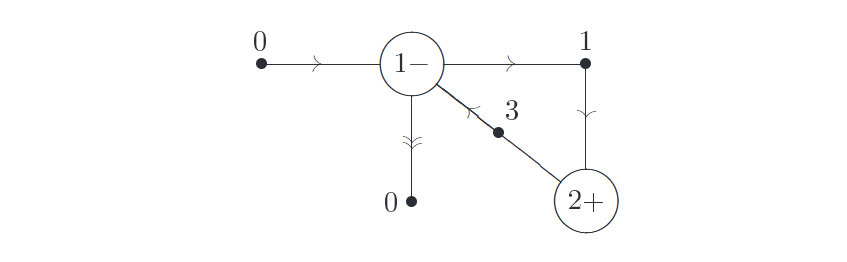

Trong một phần giới thiệu ngắn như chương này, hoàn toàn không thể bao quát chi tiết tất cả những ý tưởng vĩ đại của một lĩnh vực phong phú như khoa học máy tính. Chúng tôi hy vọng đã truyền tải được cho bạn phần nào ý nghĩa của việc tư duy như một nhà khoa học máy tính, và cung cấp một hệ thống từ vựng cơ bản cùng cái nhìn tổng quan về một số khái niệm nền tảng quan trọng trong việc thấu hiểu quá trình tính toán. Để kết thúc chương này, chúng ta sẽ lướt qua một số vấn đề tổng quát hơn, nhằm cung cấp góc nhìn về việc tính toán lượng tử và thông tin lượng tử hòa hợp như thế nào vào bức tranh tổng thể của khoa học máy tính.   

---

Cuộc thảo luận của chúng ta từ trước đến nay xoay quanh mô hình tính toán máy Turing. **Sức mạnh tính toán của các mô hình tính toán phi truyền thống chẳng hạn như máy tính song song lớn (massively parallel computers), máy tính DNA và máy tính tương tự (analog computers) so sánh như thế nào với mô hình tính toán máy Turing chuẩn, và một cách ẩn tàng là với tính toán lượng tử?**

Hãy bắt đầu với các kiến trúc điện toán song song. Đại đa số các máy tính tồn tại đều là máy tính tuần tự (serial computers), xử lý từng lệnh một tại một thời điểm trong một đơn vị xử lý trung tâm nào đó. Ngược lại, máy tính song song có thể xử lý nhiều hơn một lệnh tại một thời điểm, dẫn đến việc tiết kiệm đáng kể thời gian và tiền bạc cho một số ứng dụng. Mặc dù vậy, xử lý song song không mang lại lợi thế cơ bản nào so với mô hình máy Turing chuẩn khi xét đến các vấn đề về hiệu năng (efficiency), bởi vì một máy Turing có thể mô phỏng một máy tính song song với tổng tài nguyên vật lý tương đương theo cấp số đa thức — tổng không gian và thời gian được sử dụng cho quá trình tính toán. Những gì máy tính song song đạt được về mặt thời gian, nó lại mất đi về tổng tài nguyên không gian cần thiết để thực hiện phép tính, dẫn đến kết quả ròng là không có sự thay đổi thiết yếu nào về sức mạnh của mô hình tính toán.   

Một ví dụ cụ thể thú vị về tính toán song song lớn là kỹ thuật máy tính DNA (DNA computing). Một sợi DNA (deoxyribonucleic acid) là một phân tử được cấu thành từ một chuỗi (một polymer) gồm bốn loại nucleotide, được phân biệt bởi các bazơ mà chúng mang theo, ký hiệu là các chữ cái A (adenine), C (cytosine), G (guanine) và T (thymine). Dưới những hoàn cảnh nhất định, hai sợi có thể liên kết (anneal) với nhau để tạo thành một sợi đôi nếu các cặp bazơ tương ứng bổ sung cho nhau (A khớp với T và G khớp với C). Các đầu mút cũng rất khác biệt và phải khớp với nhau một cách thích hợp. Các kỹ thuật hóa học có thể được sử dụng để khuếch đại số lượng các sợi bắt đầu hoặc kết thúc bằng các trình tự cụ thể (phản ứng chuỗi polymerase - PCR), tách các sợi theo chiều dài (điện di trên gel), hòa tan các sợi đôi thành sợi đơn (thay đổi nhiệt độ và pH), đọc trình tự trên một sợi, cắt các sợi ở một vị trí cụ thể (enzyme giới hạn), và phát hiện xem một trình tự DNA nhất định có trong ống nghiệm hay không. Quy trình sử dụng các cơ chế này một cách mạnh mẽ khá phức tạp, nhưng ý tưởng cơ bản có thể được hiểu qua một ví dụ.   

Bài toán đường đi Hamilton có hướng (directed Hamiltonian path problem) là một biến thể đơn giản và có độ khó tương đương với bài toán chu trình Hamilton ở Mục 3.2.2, trong đó mục tiêu là xác định xem có tồn tại một đường đi hay không giữa hai đỉnh xác định $j_1$ và $j_N$ trong một đồ thị có hướng $G$ gồm $N$ đỉnh, đi qua mỗi đỉnh đúng một lần và chỉ tuân theo các hướng cạnh cho phép. Bài toán này có thể được giải quyết bằng một máy tính DNA sử dụng năm bước sau, trong đó $x_j$ được chọn là các trình tự bazơ duy nhất (và $\bar{x}_j$ là các phần bù của chúng), các sợi DNA $x_j x_k$ mã hóa các cạnh, và các sợi $\bar{x}_j \bar{x}_j$ mã hóa các đỉnh:   

(1) Tạo ra các đường đi ngẫu nhiên qua $G$, bằng cách kết hợp một hỗn hợp tất cả các sợi DNA đỉnh và cạnh có thể có, và chờ cho các sợi liên kết.   

(2) Chỉ giữ lại các đường đi bắt đầu bằng $j_1$ và kết thúc bằng $j_N$, bằng cách khuếch đại chỉ các sợi đôi bắt đầu bằng $\bar{x}_{j_1}$ và kết thúc bằng $\bar{x}_{j_N}$.   

(3) Chỉ chọn các đường đi có độ dài $N$, bằng cách tách các sợi theo chiều dài của chúng.   

(4) Chỉ chọn các đường đi đi qua mỗi đỉnh ít nhất một lần, bằng cách hòa tan DNA thành các sợi đơn và liên kết với tất cả các sợi đỉnh có thể có từng cái một và lọc ra chỉ những sợi liên kết.   

(5) Phát hiện xem có sợi nào sống sót sau các bước lựa chọn hay không; nếu có, thì tồn tại một đường đi, và ngược lại thì không.   

Để đảm bảo câu trả lời chính xác với xác suất đủ cao, $x_j$ có thể được chọn chứa nhiều ($\approx 30$) bazơ, và một số lượng lớn ($\approx 10^{14}$ hoặc nhiều hơn là khả thi) các sợi được sử dụng trong phản ứng.  

Các phương pháp phỏng đoán (heuristic methods) có sẵn để cải tiến ý tưởng cơ bản này. Tất nhiên, các phương pháp tìm kiếm vét cạn (exhaustive search) như thế này chỉ hoạt động khi tất cả các đường đi có thể được tạo ra một cách hiệu quả, và do đó số lượng các phân tử được sử dụng phải tăng theo hàm mũ khi kích thước của bài toán tăng lên (số lượng đỉnh trong ví dụ trên). Các phân tử DNA tương đối nhỏ và dễ tổng hợp, và số lượng lớn các tổ hợp DNA mà người ta có thể nhét vào một ống nghiệm có thể trì hoãn sự gia tăng chi phí độ phức tạp theo hàm mũ trong một thời gian — lên tới vài chục đỉnh — nhưng cuối cùng chi phí hàm mũ vẫn giới hạn khả năng ứng dụng của phương pháp này. Do đó, mặc dù máy tính DNA mang lại một mô hình tính toán hấp dẫn và có thể thực hiện được về mặt vật lý để giải quyết một số bài toán nhất định, nhưng nó vẫn là một kỹ thuật tính toán cổ điển và không mang lại sự cải tiến cơ bản nào về nguyên tắc so với một máy Turing.   

Máy tính tương tự (Analog computers) mang đến một hệ thống khác để thực hiện tính toán. Một máy tính là analog khi sự biểu diễn vật lý của thông tin mà nó sử dụng để tính toán dựa trên các bậc tự do liên tục, thay vì các số không và một. Ví dụ, một chiếc nhiệt kế là một máy tính analog. Mạch tương tự, sử dụng điện trở, tụ điện và bộ khuếch đại, cũng được cho là thực hiện tính toán tương tự. Những cỗ máy như vậy có một nguồn tài nguyên vô hạn để khai thác trong giới hạn lý tưởng, vì các biến liên tục như vị trí và điện áp có thể lưu trữ một lượng thông tin không giới hạn. Nhưng điều này chỉ đúng khi vắng bóng nhiễu (noise). Sự hiện diện của một lượng nhiễu hữu hạn làm giảm số lượng trạng thái có thể phân biệt (distinguishable states) của một biến liên tục xuống một số hữu hạn — và do đó giới hạn máy tính analog vào việc biểu diễn một lượng thông tin hữu hạn. Trong thực tế, nhiễu làm cho máy tính analog không có sức mạnh vượt quá máy tính kỹ thuật số thông thường, và qua đó là máy Turing. Người ta có thể nghi ngờ rằng máy tính lượng tử chỉ đơn thuần là máy tính analog, bởi vì việc sử dụng các tham số liên tục trong việc mô tả trạng thái qubit; tuy nhiên, hóa ra các tác động của nhiễu lên máy tính lượng tử có thể được số hóa (digitized) một cách hiệu quả. Kết quả là, lợi thế tính toán của chúng vẫn được duy trì ngay cả khi có sự hiện diện của một lượng nhiễu hữu hạn, như chúng ta sẽ thấy ở Chương 10.   

---

Ảnh hưởng của nhiễu (noise) đối với máy tính kỹ thuật số là gì? Trong những ngày đầu của ngành tính toán, nhiễu là một vấn đề rất thực tế đối với máy tính; ở một số máy tính ban đầu, ống chân không (vacuum tube) có thể bị hỏng sau mỗi vài phút. Ngay cả ngày nay, nhiễu vẫn là một vấn đề đối với các thiết bị tính toán như modem và ổ cứng. Đáng kể lượng công sức đã được cống hiến cho bài toán tìm hiểu cách xây dựng các máy tính đáng tin cậy từ các linh kiện không đáng tin cậy. Von Neumann đã chứng minh rằng điều này là có thể chỉ với sự gia tăng theo cấp số đa thức (polynomial increase) về tài nguyên cần thiết cho quá trình tính toán. Tuy nhiên, trớ trêu thay, máy tính hiện đại không sử dụng bất kỳ kết quả nào trong số đó, bởi vì các linh kiện của máy tính hiện đại cực kỳ đáng tin cậy. Tỷ lệ lỗi từ $10^{-17}$ trở xuống là phổ biến trong các linh kiện điện tử hiện đại. Vì lý do này, các lỗi xảy ra rất hiếm đến mức nỗ lực bổ sung cần thiết để bảo vệ chống lại chúng không được coi là đáng thực hiện. Mặt khác, chúng ta sẽ thấy rằng máy tính lượng tử là những cỗ máy rất mong manh, và có thể sẽ đòi hỏi việc ứng dụng đáng kể các kỹ thuật sửa lỗi.   

Các kiến trúc khác nhau có thể làm thay đổi ảnh hưởng của nhiễu. Ví dụ, nếu ảnh hưởng của nhiễu bị bỏ qua, thì việc chuyển sang một kiến trúc máy tính trong đó nhiều phép toán được thực hiện song song có thể không làm thay đổi số lượng các phép toán cần phải thực hiện. Tuy nhiên, một hệ thống song song có thể chống chịu nhiễu tốt hơn đáng kể, bởi vì ảnh hưởng của nhiễu có ít thời gian hơn để tích lũy. Do đó, trong một phân tích thực tế, phiên bản song song của một thuật toán có thể có những ưu thế đáng kể so với việc triển khai tuần tự. Thiết kế kiến trúc là một lĩnh vực nghiên cứu rất phát triển đối với máy tính cổ điển. Hầu như không có gì tương tự được phát triển theo các hướng tương tự cho máy tính lượng tử, nhưng việc nghiên cứu về nhiễu đã gợi ý một số đặc điểm đáng mong đợi cho các kiến trúc máy tính lượng tử trong tương lai, chẳng hạn như mức độ song song cao.   

---

Mô hình tính toán thứ tư là tính toán phân tán (distributed computation), trong đó có từ hai đơn vị tính toán bị tách biệt về mặt không gian trở lên sẵn có để giải quyết một bài toán tính toán. Rõ ràng là, một mô hình tính toán như vậy không có sức mạnh vượt quá mô hình máy Turing theo nghĩa là nó có thể được mô phỏng một cách hiệu quả trên một máy Turing. Tuy nhiên, tính toán phân tán tạo ra một thách thức mới thú vị về tài nguyên: làm thế nào để tận dụng tốt nhất nhiều đơn vị tính toán khi chi phí giao tiếp (communication) giữa các đơn vị là cao. Vấn đề tính toán phân tán này trở nên đặc biệt thú vị khi các máy tính được kết nối thông qua các mạng tốc độ cao; mặc dù tổng dung lượng tính toán của tất cả các máy tính trên một mạng có thể cực kỳ lớn, việc tận dụng tiềm năng đó là khó khăn. Hầu hết các bài toán thú vị không dễ dàng chia thành các phần độc lập có thể được giải quyết riêng biệt, và thường có thể đòi hỏi giao tiếp toàn cục giữa các hệ thống con tính toán khác nhau để trao đổi các kết quả trung gian hoặc đồng bộ hóa trạng thái. Lĩnh vực độ phức tạp giao tiếp (communication complexity) đã được phát triển để giải quyết các vấn đề như vậy, bằng cách định lượng chi phí của các yêu cầu giao tiếp trong việc giải quyết các bài toán. Khi các tài nguyên lượng tử có sẵn và có thể được trao đổi giữa các máy tính phân tán, chi phí giao tiếp đôi khi có thể được giảm đi đáng kể.   

---

Một chủ đề xuyên suốt qua những suy ngẫm kết luận này và qua toàn bộ cuốn sách là bất chấp sự độc lập truyền thống của khoa học máy tính khỏi các ràng buộc vật lý, cuối cùng các định luật vật lý có tác động to lớn không chỉ đối với cách thức máy tính được hiện thực hóa, mà còn đối với lớp các bài toán mà chúng có khả năng giải quyết. Sự thành công của tính toán lượng tử và thông tin lượng tử như một mô hình tính toán thay thế hợp lý về mặt vật lý đặt ra câu hỏi cho những niềm tin bấy lâu nay của khoa học máy tính, và đẩy các khái niệm của khoa học máy tính lên vị trí tiền tiêu của vật lý. Nhiệm vụ của phần còn lại của cuốn sách này là hòa quyện các ý tưởng từ những lĩnh vực khác biệt này, và tận hưởng những kết quả đạt được!

# Bài tập vui vẻ

## Bài tập 3.1. Minsky Machines

Một máy Minsky bao gồm một tập hợp hữu hạn các thanh ghi $r_1, r_2, \dots, r_k$, mỗi thanh ghi có khả năng chứa một số nguyên không âm tùy ý, và một chương trình được tạo thành từ các lệnh thuộc một trong hai loại. Loại thứ nhất có dạng: 

Ý nghĩa của lệnh này là tại điểm $m$ trong chương trình, thanh ghi $r_j$ được tăng lên một đơn vị, và việc thực thi chuyển tiếp đến điểm $n$ trong chương trình. Loại lệnh thứ hai có dạng:

Ý nghĩa của lệnh này là tại điểm $m$ trong chương trình, thanh ghi $r_j$ bị giảm đi một đơn vị nếu nó chứa một số nguyên dương, và việc thực thi chuyển tiếp đến điểm $n$ trong chương trình. Nếu thanh ghi $r_j$ bằng 0 thì việc thực thi đơn giản chuyển tiếp đến điểm $p$ trong chương trình. Chương trình cho máy Minsky bao gồm một tập hợp các lệnh như vậy, có dạng giống như: 

Điểm bắt đầu và tất cả các điểm dừng có thể có cho chương trình theo quy ước được gán nhãn là số không. Chương trình này lấy nội dung của thanh ghi $r_1$ và cộng chúng vào thanh ghi $r_2$, đồng thời giảm $r_1$ về 0.   

(1) Chứng minh rằng tất cả các hàm tính được (của Turing) đều có thể tính được trên một máy Minsky, theo nghĩa là cho trước một hàm tính được $f(\cdot)$, tồn tại một chương trình máy Minsky sao cho khi các thanh ghi bắt đầu ở trạng thái $(n, 0, \dots, 0)$ sẽ cho ra đầu ra là $(f(n), 0, \dots, 0)$.

(2) Phác thảo chứng minh rằng bất kỳ hàm nào có thể tính được trên một máy Minsky, theo nghĩa vừa định nghĩa, cũng có thể được tính được trên một máy Turing.

## Bài tập 3.2. Vector games

Một trò chơi vector được xác định bởi một danh sách hữu hạn các vector, tất cả đều có cùng số chiều và có các tọa độ nguyên. Trò chơi bắt đầu với một vector $x$ có các tọa độ là số nguyên không âm và cộng vào $x$ vector đầu tiên từ danh sách sao cho vẫn bảo toàn tính không âm của tất cả các thành phần, và lặp lại quá trình này cho đến khi không còn thực hiện được nữa. Chứng minh rằng đối với bất kỳ hàm tính được $f(\cdot)$ nào, tồn tại một trò chơi vector mà khi bắt đầu với vector $(n, 0, \dots, 0)$ sẽ đạt tới $(f(n), 0, \dots, 0)$. (Gợi ý: Chứng minh rằng một trò chơi vector trong không gian $k+2$ chiều có thể mô phỏng một máy Minsky chứa $k$ thanh ghi).

## Bài tập 3.3. Fractan

Một chương trình Fractran được định nghĩa bởi một danh sách các số hữu tỷ dương $q_1, \dots, q_n$. Nó tác động lên một số nguyên dương $m$ bằng cách thay thế nó thành $q_i m$, trong đó $i$ là số nhỏ nhất sao cho $q_i m$ là một số nguyên. Nếu có thời điểm mà không tồn tại số $i$ nào sao cho $q_i m$ là một số nguyên, thì quá trình thực thi dừng lại. Chứng minh rằng đối với bất kỳ hàm tính được $f(\cdot)$ nào, tồn tại một chương trình Fractran mà khi bắt đầu với $2^n$ sẽ đạt tới $2^{f(n)}$ mà không đi qua bất kỳ lũy thừa trung gian nào của 2. (Gợi ý: sử dụng bài tập trước).  

## Bài tập 3.4. Tính không quyết định của các hệ động lực - Undecidability of dynamical systems
Một chương trình Fractran về cơ bản chỉ là một hệ động lực rất đơn giản chuyển các số nguyên dương thành các số nguyên dương. Chứng minh rằng không có thuật toán nào có thể quyết định xem một hệ động lực như vậy có bao giờ đạt tới giá trị 1 hay không.

## Bài tập 3.5. Tính không vạn năng của logic khả nghịch 2-bit - Non-universality of two bit reversible logic
Giả sử chúng ta đang cố gắng xây dựng các mạch chỉ sử dụng các cổng logic khả nghịch 1-bit và 2-bit, cùng với các bit ancilla. Chứng minh rằng có những hàm Boolean không thể được tính toán theo cách này. Suy ra rằng cổng Toffoli không thể được mô phỏng chỉ bằng các cổng khả nghịch 1-bit và 2-bit, ngay cả khi có sự hỗ trợ của các bit ancilla.

## Bài tập 3.6. Độ khó xấp xỉ của TSP - Hardness of approximation of $\text{TSP}$
Cho $r \ge 1$ và giả sử tồn tại một thuật toán xấp xỉ cho bài toán Người bán hàng đi dạo ($\text{TSP}$) được đảm bảo tìm ra hành trình ngắn nhất trong số $n$ thành phố với hệ số sai số trong khoảng $r$. Cho $G = (V, E)$ là bất kỳ đồ thị nào trên $n$ đỉnh. Định nghĩa một trường hợp của $\text{TSP}$ bằng cách đồng nhất các thành phố với các đỉnh trong $V$, và định nghĩa khoảng cách giữa các thành phố $i$ và $j$ là $1$ nếu $(i, j)$ là cạnh của $G$, và là $\lceil r \rceil \vert{}V\vert{} + 1$ trong trường hợp ngược lại. Chứng minh rằng nếu thuật toán xấp xỉ được áp dụng cho trường hợp $\text{TSP}$ này thì nó trả về một chu trình Hamilton cho $G$ nếu có tồn tại, và ngược lại trả về một hành trình có độ dài lớn hơn $\lceil r \rceil \vert{}V\vert{}$. Từ tính đầy đủ $\text{NP}$ của bài toán tìm chu trình Hamilton ($\text{HC}$), suy ra rằng không thể tồn tại một thuật toán xấp xỉ như vậy trừ khi $\mathbf{P} = \mathbf{NP}$. 

## Bài tập 3.7. Máy Turing khả nghịch - Reversible Turing machines
(1) Giải thích cách xây dựng một máy Turing khả nghịch có thể tính toán cùng lớp hàm số như có thể tính được trên một máy Turing thông thường. (Gợi ý: Sẽ hữu ích nếu sử dụng cấu trúc nhiều băng).

(2) Đưa ra các giới hạn tổng quát về không gian và thời gian cho hoạt động của máy Turing khả nghịch của bạn, xét theo thời gian $t(x)$ và không gian $s(x)$ được yêu cầu trên một máy Turing băng đơn thông thường để tính toán một hàm $f(x)$. 

## Bài tập 3.8. Find a hard-to-compute class of functions (Research)
Tìm một lớp hàm tự nhiên trên $n$ đầu vào đòi hỏi một số lượng cổng Boolean vượt quá đa thức (super-polynomial) để tính toán.

## Bài tập 3.9. Reversible PSPACE = PSPACE
Có thể chứng minh rằng bài toán 'thỏa được định lượng' (quantified satisfiability), hay $\text{QSAT}$, là $\text{PSPACE}$-complete. Tức là, mọi ngôn ngữ khác trong $\text{PSPACE}$ có thể được quy về $\text{QSAT}$ trong thời gian đa thức. Ngôn ngữ $\text{QSAT}$ được định nghĩa gồm tất cả các công thức Boolean $\varphi$ với $n$ biến $x_1, \dots, x_n$, và ở dạng chuẩn tuyển hội (conjunctive normal form), sao cho: 

$$
\begin{aligned}
\exists x_1 \forall x_2 \exists x_3 \dots \forall x_n \varphi &\quad \text{if } n \text{ even;} \\ 
\exists x_1 \forall x_2 \exists x_3 \dots \exists x_n \varphi &\quad \text{if } n \text{ odd.}
\end{aligned} 
$$

Chứng minh rằng một máy Turing khả nghịch hoạt động trong không gian đa thức có thể được sử dụng để giải $\text{QSAT}$. Do đó, lớp các ngôn ngữ có thể quyết định bởi một máy tính hoạt động theo lối khả nghịch trong không gian đa thức thì bằng với $\text{PSPACE}$

## Bài tập 3.10. Ancilla bits and efficiency of reversible computation

Cho $p_m$ là số nguyên tố thứ $m$. Phác thảo cấu trúc của một mạch khả nghịch nhận đầu vào là $m$ và $n$ sao cho $n > m$, cho ra đầu ra là tích $p_m p_n$, tức là $(m, n) \rightarrow (p_m p_n, g(m, n))$, trong đó $g(m, n)$ là trạng thái cuối cùng của các bit ancilla được sử dụng bởi mạch. Ước tính số lượng qubit ancilla mà mạch của bạn yêu cầu. Chứng minh rằng nếu có thể tìm thấy một mạch khả nghịch có kích thước đa thức (theo $\log n$) sử dụng $O(\log(\log n))$ bit ancilla thì bài toán phân tích thừa số nguyên tố (factoring) của tích hai số nguyên tố thuộc lớp $\mathbf{P}$.