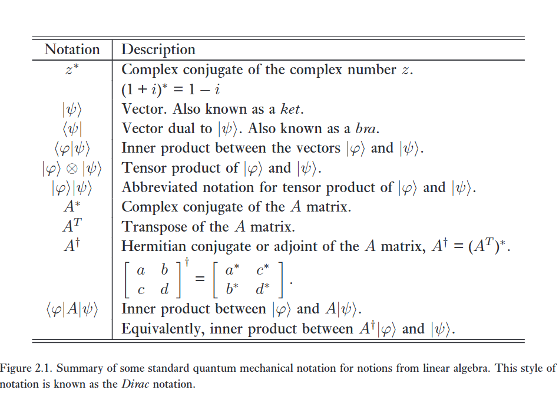
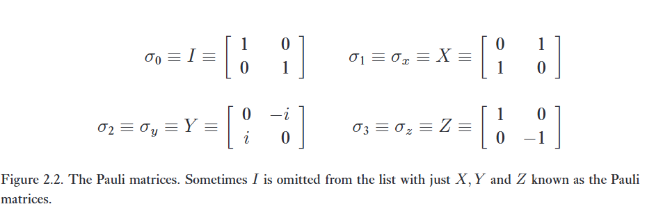

> *'This book is written as much to disturb and annoy as to instruct.'*
> – The first line of About Vectors, by Banesh Hoffmann.

> *'Life is complex – it has both real and imaginary parts.'*
> – Anonymous

Đại số tuyến tính là ngành nghiên cứu về các không gian véc-tơ và các phép toán tuyến tính trên các không gian véc-tơ đó. Sự hiểu biết tốt về cơ học lượng tử dựa trên một nền tảng vững chắc về đại số tuyến tính sơ cấp. Trong mục này, chúng ta sẽ ôn tập một số khái niệm cơ bản từ đại số tuyến tính, đồng thời mô tả các ký hiệu chuẩn được sử dụng cho các khái niệm này trong việc nghiên cứu cơ học lượng tử. Các ký hiệu này được tóm tắt trong Hình 2.1 ở trang 62, với ký hiệu lượng tử ở cột bên trái và mô tả đại số tuyến tính ở cột bên phải. Bạn có thể xem lướt qua bảng đó và xem mình nhận ra bao nhiêu khái niệm ở cột bên phải.   

Theo quan điểm của chúng tôi (chắc chắn là "tôi" ở đây là tác giả sách rồi), trở ngại chính trong việc tiếp thu các tiên đề của cơ học lượng tử không phải là bản thân các tiên đề, mà là khối lượng lớn các khái niệm đại số tuyến tính cần thiết để hiểu chúng. Kết hợp với ký hiệu Dirac bất thường được các nhà vật lý áp dụng cho cơ học lượng tử, nó có thể trông có vẻ (một cách sai lầm) khá đáng sợ. Vì những lý do này, chúng tôi khuyên độc giả chưa quen thuộc với cơ học lượng tử nên đọc lướt qua phần tài liệu tiếp theo, dừng lại chủ yếu để tập trung hiểu các nguyên tắc cơ bản tuyệt đối của ký hiệu đang được sử dụng. Sau đó, hãy tiến hành nghiên cứu cẩn thận chủ đề chính của chương – các tiên đề của cơ học lượng tử – rồi quay lại nghiên cứu sâu hơn về các khái niệm và ký hiệu đại số tuyến tính cần thiết khi cần thiết.

---

Các đối tượng cơ bản của đại số tuyến tính là ***vector spaces*** không gian véc-tơ. Không gian véc-tơ mà chúng ta quan tâm nhất là $\mathbb{C}^n$, không gian của tất cả các bộ $n$ số phức, $(z_1, \dots, z_n)$. Các phần tử của một không gian véc-tơ được gọi là véc-tơ (vectors), và đôi khi chúng ta sẽ sử dụng ký hiệu ma trận cột   

$$
\begin{bmatrix} z_1 \\ \vdots \\ z_n \end{bmatrix} \tag {2.1}
$$

để chỉ một véc-tơ.

Có một phép toán cộng được định nghĩa, nhận các cặp véc-tơ và chuyển thành các véc-tơ khác. Trong $\mathbb{C}^n$, phép cộng véc-tơ được định nghĩa bởi   

$$
\begin{bmatrix} z_1 \\ \vdots \\ z_n \end{bmatrix} + \begin{bmatrix} z'_1 \\ \vdots \\ z'_n \end{bmatrix} \equiv \begin{bmatrix} z_1 + z'_1 \\ \vdots \\ z_n + z'_n \end{bmatrix} \tag {2.2}
$$

trong đó các phép toán cộng ở vế phải chỉ là phép cộng số phức thông thường. Hơn nữa, trong một không gian véc-tơ còn có phép toán nhân với một vô hướng (multiplication by a scalar). Trong $\mathbb{C}^n$, phép toán này được định nghĩa bởi   

$$
z \begin{bmatrix} z_1 \\ \vdots \\ z_n \end{bmatrix} \equiv \begin{bmatrix} zz_1 \\ \vdots \\ zz_n \end{bmatrix} \tag {2.3}
$$

trong đó $z$ là một vô hướng, tức là một số phức, và các phép nhân ở vế phải là phép nhân số phức thông thường. Các nhà vật lý đôi khi gọi các số phức là c-numbers.   

---

Cơ học lượng tử là động lực chính của chúng ta để nghiên cứu đại số tuyến tính, vì vậy chúng ta sẽ sử dụng ký hiệu chuẩn của cơ học lượng tử cho các khái niệm đại số tuyến tính. Ký hiệu cơ học lượng tử chuẩn cho một véc-tơ trong không gian véc-tơ là:   

$$
\vert{}\psi\rangle \quad (2.4)
$$

$\psi$ là một nhãn cho véc-tơ (mọi nhãn đều hợp lệ, mặc dù chúng ta thích sử dụng các nhãn đơn giản như $\psi$ và $\varphi$). Ký hiệu $\vert{}\cdot\rangle$ được sử dụng để chỉ ra rằng đối tượng là một véc-tơ. Toàn bộ đối tượng $\vert{}\psi\rangle$ đôi khi được gọi là một ket, mặc dù chúng ta sẽ không sử dụng thuật ngữ đó thường xuyên.   

Một không gian véc-tơ cũng chứa một véc-tơ không (zero vector) đặc biệt, mà chúng ta ký hiệu là $0$. Nó thỏa mãn tính chất là đối với bất kỳ véc-tơ nào khác $\vert{}v\rangle$, $\vert{}v\rangle + 0 = \vert{}v\rangle$. Lưu ý rằng chúng ta không sử dụng ký hiệu ket cho véc-tơ không – đây là ngoại lệ duy nhất mà chúng ta sẽ thực hiện. Lý do tạo ra ngoại lệ này là vì theo quy ước, ký hiệu "hiển nhiên" cho véc-tơ không, $\vert{}0\rangle$, được dùng để chỉ một ý nghĩa hoàn toàn khác. Phép toán nhân vô hướng sao cho $z0 = 0$ với mọi số phức $z$. Để thuận tiện, chúng ta sử dụng ký hiệu $(z_1, \dots, z_n)$ để biểu thị một ma trận cột có các phần tử $z_1, \dots, z_n$. Trong $\mathbb{C}^n$ phần tử không là $(0, 0, \dots, 0)$. Một không gian con véc-tơ (vector subspace) của một không gian véc-tơ $V$ là một tập hợp con $W$ của $V$ sao cho $W$ cũng là một không gian véc-tơ, nghĩa là, $W$ phải đóng dưới phép nhân vô hướng và phép cộng.

:::{.callout}
# Biên phiên dịch

* $z^*$: ***Complex conjugate*** Số phức liên hợp của số phức z. Ví dụ: $(1 + i)^* = 1-i$.

* $\vert \psi \rangle$: Là một vector, hay còn được gọi là ket

* $\langle \psi \vert$ : Là một vector đối ngẫu với $\vert \psi \rangle$, còn được gọi là một bra.

* $\langle \varphi \vert \psi \rangle$ : Là tích trong (inner products) giữa hai vector bra và ket. Tạo thành một braket hoàn chỉnh.

* $\vert \varphi \rangle \otimes \vert \psi \rangle$ : Tích tensor của hai ket.

* $\vert \varphi \rangle \vert \psi \rangle$ : Cách viết, ký hiệu ngắn gọn hơn của tích tensor.

* $A^*$ : Một ma trận liên hợp phức của ma trận A. 

* $A^T$ : Ma trận chuyển vị của A.

* $A^\dagger$ : Ma trận liên hợp Hermitian hoặc ma trận phụ hợp của ma trận A, được định nghĩa là $A^\dagger = (A^T)^*$. Ví dụ:

$$
\begin{bmatrix} a & b \\ c & d \end{bmatrix}^\dagger = \begin{bmatrix} a^* & c^* \\ b^* & d^* \end{bmatrix}
$$

* $\langle \varphi \vert A \vert \psi \rangle$ : Tích trong giữa vector $\vert \varphi \rangle$ và vector kết quả $A\vert \psi \rangle$. Về mặt toán học, giá trị này hoàn toàn tương đương với tích trong giữa $A^\dagger \vert \varphi \rangle$ và $\vert \psi \rangle$
:::

# 1. Bases and linear independence

Một tập sinh (spanning set) cho một không gian véc-tơ là một tập hợp các véc-tơ $\vert{}v_1\rangle, \dots, \vert{}v_n\rangle$ sao cho bất kỳ véc-tơ $\vert{}v\rangle$ nào trong không gian véc-tơ đều có thể được viết dưới dạng tổ hợp tuyến tính $\vert{}v\rangle = \sum_i a_i\vert{}v_i\rangle$ của các véc-tơ trong tập hợp đó.   

Ví dụ, một tập sinh cho không gian véc-tơ $\mathbb{C}^2$ là tập hợp   

$$
\vert{}v_1\rangle \equiv \begin{bmatrix} 1 \\ 0 \end{bmatrix}; \quad \vert{}v_2\rangle \equiv \begin{bmatrix} 0 \\ 1 \end{bmatrix} \tag {2.5}
$$

vì bất kỳ véc-tơ nào   

$$
\vert{}v\rangle = \begin{bmatrix} a_1 \\ a_2 \end{bmatrix} \tag {2.6}
$$

trong $\mathbb{C}^2$ đều có thể được viết dưới dạng tổ hợp tuyến tính $\vert{}v\rangle = a_1\vert{}v_1\rangle + a_2\vert{}v_2\rangle$ của các véc-tơ $\vert{}v_1\rangle$ và $\vert{}v_2\rangle$. Chúng ta nói rằng các véc-tơ $\vert{}v_1\rangle$ và $\vert{}v_2\rangle$ sinh ra (span) không gian véc-tơ $\mathbb{C}^2$.   

Nhìn chung, một không gian véc-tơ có thể có nhiều tập sinh khác nhau. Một tập sinh thứ hai cho không gian véc-tơ $\mathbb{C}^2$ là tập hợp   

$$
\vert{}v_1\rangle \equiv \frac{1}{\sqrt{2}}\begin{bmatrix} 1 \\ 1 \end{bmatrix}; \quad \vert{}v_2\rangle \equiv \frac{1}{\sqrt{2}}\begin{bmatrix} 1 \\ -1 \end{bmatrix} \tag {2.7}
$$

vì một véc-tơ tùy ý $\vert{}v\rangle = (a_1, a_2)$ có thể được viết dưới dạng tổ hợp tuyến tính của $\vert{}v_1\rangle$ và $\vert{}v_2\rangle$:

$$
\vert{}v\rangle = \frac{a_1 + a_2}{\sqrt{2}}\vert{}v_1\rangle + \frac{a_1 - a_2}{\sqrt{2}}\vert{}v_2\rangle \tag {2.8}
$$

Một tập hợp các véc-tơ khác không $\vert{}v_1\rangle, \dots, \vert{}v_n\rangle$ được gọi là phụ thuộc tuyến tính nếu tồn tại một tập hợp các số phức $a_1, \dots, a_n$ với ít nhất một giá trị $a_i \neq 0$, sao cho:

$$
a_1\vert{}v_1\rangle + a_2\vert{}v_2\rangle + \dots + a_n\vert{}v_n\rangle = 0 \tag {2.9}
$$

Một tập hợp các véc-tơ được gọi là độc lập tuyến tính nếu nó không phụ thuộc tuyến tính.   

Có thể chứng minh rằng bất kỳ hai tập hợp véc-tơ độc lập tuyến tính nào cùng sinh ra một không gian véc-tơ $V$ đều chứa cùng một số lượng phần tử. Chúng ta gọi một tập hợp như vậy là một cơ sở cho $V$. Hơn nữa, một tập cơ sở như vậy luôn tồn tại. Số lượng phần tử trong cơ sở được định nghĩa là số chiều của $V$.   

Trong cuốn sách này, chúng ta sẽ chỉ quan tâm đến các không gian véc-tơ hữu hạn chiều. Có nhiều câu hỏi thú vị và thường khó liên quan đến các không gian vô hạn chiều, nhưng chúng ta sẽ không cần phải bận tâm về những câu hỏi này.   

:::{.callout-note}
# Bài tập 2.1: Chứng minh rằng $(1, -1), (1, 2)$ và $(2, 1)$ phụ thuộc tuyến tính. 

Tìm hệ số $a_1, a_2, a_3$ sao cho:

$$
a_1 (1, -1) + a_2 (1, 2) + a_3 (2, 1) = 0
$$

$$
\begin{cases}
a_1 + a_2 + 2a_3 = 0 \\ 
-a_1 + 2a_2 + a_3 = 0
\end{cases}
$$

Tập nghiệm là $(-t, -t, t)$.

:::

# 2. Linear operators and matrices

Một toán tử tuyến tính (linear operator) giữa các không gian véc-tơ $V$ và $W$ được định nghĩa là bất kỳ hàm số nào $A: V \to W$ có tính tuyến tính đối với các đầu vào của nó:   

$$
A\left(\sum_i a_i\vert{}v_i\rangle\right) = \sum_i a_i A(\vert{}v_i\rangle) \quad (2.10)
$$

Thông thường chúng ta chỉ viết $A\vert{}v\rangle$ để ký hiệu cho $A(\vert{}v\rangle)$. Khi chúng ta nói rằng một toán tử tuyến tính $A$ được định nghĩa trên một không gian véc-tơ $V$, ý của chúng ta là $A$ là một toán tử tuyến tính đi từ $V$ đến $V$. Một toán tử tuyến tính quan trọng trên bất kỳ không gian véc-tơ $V$ nào là toán tử đơn vị (identity operator), $I_V$, được định nghĩa bởi phương trình $I_V\vert{}v\rangle \equiv \vert{}v\rangle$ với mọi véc-tơ $\vert{}v\rangle$. Ở những nơi không gây nhầm lẫn, chúng ta lược bỏ chỉ số dưới $V$ và chỉ viết $I$ để ký hiệu toán tử đơn vị. Một toán tử tuyến tính quan trọng khác là toán tử không (zero operator), mà chúng ta ký hiệu là $0$. Toán tử không ánh xạ mọi véc-tơ thành véc-tơ không, $0\vert{}v\rangle \equiv 0$. Rõ ràng từ phương trình (2.10) rằng một khi tác động của toán tử tuyến tính $A$ lên một cơ sở được xác định, tác động của $A$ sẽ được xác định hoàn toàn trên mọi đầu vào.   

Giả sử $V, W,$ và $X$ là các không gian véc-tơ, và $A: V \to W$ cùng với $B: W \to X$ là các toán tử tuyến tính. Khi đó chúng ta sử dụng ký hiệu $BA$ để ký hiệu phép hợp thành (composition) của $B$ với $A$, được định nghĩa bởi $(BA)(\vert{}v\rangle) \equiv B(A(\vert{}v\rangle))$. Một lần nữa, chúng ta viết $BA\vert{}v\rangle$ như một dạng viết tắt cho $(BA)(\vert{}v\rangle)$.   

Cách thuận tiện nhất để hiểu các toán tử tuyến tính là thông qua biểu diễn ma trận (matrix representations) của chúng. Trên thực tế, quan điểm về toán tử tuyến tính và quan điểm về ma trận hóa ra hoàn toàn tương đương. Tuy nhiên, quan điểm ma trận có thể quen thuộc hơn với bạn. Để thấy được mối liên hệ này, trước hết cần hiểu rằng một ma trận phức $m \times n$ với các phần tử $A_{ij}$ thực chất là một toán tử tuyến tính gửi các véc-tơ trong không gian véc-tơ $\mathbb{C}^n$ đến không gian véc-tơ $\mathbb{C}^m$, dưới phép nhân ma trận của ma trận $A$ với một véc-tơ trong $\mathbb{C}^n$. Chính xác hơn, khẳng định rằng ma trận $A$ là một toán tử tuyến tính có nghĩa là   

$$
A\left(\sum_i a_i\vert{}v_i\rangle\right) = \sum_i a_i A\vert{}v_i\rangle \quad (2.11)
$$

đúng là một phương trình trong đó phép toán là phép nhân ma trận của $A$ với các véc-tơ cột. Rõ ràng, điều này là đúng!   

Chúng ta đã thấy rằng các ma trận có thể được coi là các toán tử tuyến tính. Liệu các toán tử tuyến tính có thể được biểu diễn dưới dạng ma trận không? Thực tế là có, như chúng ta sẽ giải thích ngay sau đây. Sự tương đương giữa hai quan điểm này biện minh cho việc chúng ta thay thế cho nhau các thuật ngữ từ lý thuyết ma trận và lý thuyết toán tử xuyên suốt cuốn sách. Giả sử $A: V \to W$ là một toán tử tuyến tính giữa các không gian véc-tơ $V$ và $W$. Giả sử $\vert{}v_1\rangle, \dots, \vert{}v_m\rangle$ là một cơ sở cho $V$ và $\vert{}w_1\rangle, \dots, \vert{}w_n\rangle$ là một cơ sở cho $W$. Khi đó với mỗi $j$ trong khoảng $1, \dots, m$, tồn tại các số phức $A_{1j}$ thông qua $A_{nj}$ sao cho  

$$
A\vert{}v_j\rangle = \sum_t A_{tj}\vert{}w_t\rangle \quad (2.12)
$$

Ma trận có các phần tử là các giá trị $A_{tj}$ được gọi là tạo thành một biểu diễn ma trận của toán tử $A$. Biểu diễn ma trận này của $A$ hoàn toàn tương đương với toán tử $A$, và chúng ta sẽ sử dụng thay thế cho nhau giữa biểu diễn ma trận và quan điểm toán tử trừu tượng. Lưu ý rằng để thiết lập mối liên hệ giữa ma trận và toán tử tuyến tính, chúng ta phải chỉ định một tập hợp các trạng thái cơ sở đầu vào và đầu ra cho các không gian véc-tơ đầu vào và đầu ra của toán tử tuyến tính

:::{.callout-note}
# Bài tập 2.2: (Biểu diễn ma trận: ví dụ)

Giả sử $V$ là một không gian véc-tơ với các véc-tơ cơ sở $\vert{}0\rangle$ và $\vert{}1\rangle$, và $A$ là một toán tử tuyến tính từ $V$ đến $V$ sao cho $A\vert{}0\rangle = \vert{}1\rangle$ và $A\vert{}1\rangle = \vert{}0\rangle$. Hãy đưa ra biểu diễn ma trận cho $A$, đối với cơ sở đầu vào $\vert{}0\rangle, \vert{}1\rangle$ và cơ sở đầu ra $\vert{}0\rangle, \vert{}1\rangle$. Tìm các cơ sở đầu vào và đầu ra sinh ra một biểu diễn ma trận khác của $A$.   
:::

:::{.callout-note}
# Bài tập 2.3: (Biểu diễn ma trận cho tích các toán tử)

Giả sử $A$ là một toán tử tuyến tính từ không gian véc-tơ $V$ đến không gian véc-tơ $W$, và $B$ là một toán tử tuyến tính từ không gian véc-tơ $W$ đến không gian véc-tơ $X$. Gọi $\vert{}v_i\rangle, \vert{}w_j\rangle,$ và $\vert{}x_k\rangle$ lần lượt là các cơ sở cho các không gian véc-tơ $V, W,$ và $X$. Chứng minh rằng biểu diễn ma trận cho phép biến đổi tuyến tính $BA$ chính là tích ma trận của các biểu diễn ma trận cho $B$ và $A$, đối với các cơ sở phù hợp. 
:::

:::{.callout-note}
# Bài tập 2.4: (Biểu diễn ma trận cho toán tử đơn vị) 

Chứng minh rằng toán tử đơn vị trên một không gian véc-tơ $V$ có biểu diễn ma trận với các giá trị bằng 1 ở đường chéo chính và bằng 0 ở tất cả các vị trí khác, nếu biểu diễn ma trận đó được tính toán đối với cùng một bộ cơ sở đầu vào và đầu ra. Ma trận này được gọi là ma trận đơn vị (identity matrix). 
:::

# 3. The Pauli matrices

Bốn ma trận cực kỳ hữu ích mà chúng ta sẽ thường xuyên có dịp sử dụng là các ma trận Pauli. 

Đây là các ma trận kích thước $2 \times 2$, được ký hiệu bằng nhiều cách khác nhau. Các ma trận này và các ký hiệu tương ứng được thể hiện trong Hình 2.2. Các ma trận Pauli rất hữu ích trong việc nghiên cứu tính toán lượng tử và thông tin lượng tử đến mức chúng ta được khuyến khích ghi nhớ chúng thông qua việc làm chi tiết các ví dụ và bài tập dựa trên chúng ở các mục tiếp theo.   

# 4. Inner products

:::{.callout-warning}
# tl;dr

Trong quantum mechanics, trạng thái của môtj qubit hay hệ lượng tử nằm trong không gian n-chiều phức $\mathbb C^n$, khá là trừu tượng, khá là phản trực giác.

Vì vậy người ta sử dụng tích trong để trả lời 3 thứ:

(1) **Norm**: tính độ dài, trạng thái lượng tử này có chuẩn hóa hợp lệ không (tổng xác suất có bằng 100% hay không)?

(2) **Overlapping**: Hai trạng thái lượng tử giống nhau đến mức nào?

(3) **Orthorgonality**: Hai trạng thái có trực giao hay không? Hai trạng thái có hoàn toàn phân biệt được bằng phép đo hay không? (tức là tích trong bằng 0).

---

Đầu vào sẽ là 2 vector bất kỳ, ví dụ như là ket psi hay ket varphi.

Đầu ra cho duy nhất 1 số phức.

---

Cú pháp:

Tích trong ket v và ket w là: $\langle v \vert w \rangle$.

:::

Một tích trong là một hàm số nhận đầu vào là hai vector $\vert v \rangle$ và $\vert w \rangle$ từ một không gian vector và cho đầu ra là một số phức. Hiện tại, sẽ thuận tiện khi viết tích trong của $\vert v \rangle$ và $\vert w\rangle$ dưới dạng $(\vert v \rangle, \vert w\rangle)$. Đây không phải là ký hiệu cơ học lượng tử chuẩn; vì sự rõ ràng trong sư phạm, ký hiệu $(\cdot, \cdot)$ sẽ đôi khi hữu ích trong chương này. 

Ký hiệu cơ học lượng tử chuẩn cho tích trong $(\vert{}v\rangle, \vert{}w\rangle)$ là $\langle v\vert{}w\rangle$, trong đó $\vert{}v\rangle$ và $\vert{}w\rangle$ là các véc-tơ trong không gian tích trong, và ký hiệu $\langle v\vert{}$ được sử dụng cho véc-tơ đối ngẫu (dual vector) với véc-tơ $\vert{}v\rangle$; véc-tơ đối ngẫu là một toán tử tuyến tính từ không gian tích trong $V$ đến tập hợp các số phức $\mathbb{C}$, được định nghĩa bởi $\langle v\vert{}(\vert{}w\rangle) \equiv \langle v\vert{}w\rangle \equiv (\vert{}v\rangle, \vert{}w\rangle)$. Chúng ta sẽ sớm thấy rằng biểu diễn ma trận của các véc-tơ đối ngẫu chính là một véc-tơ hàng.   

Một hàm số $(\cdot, \cdot)$ từ $V \times V$ đến $\mathbb{C}$ là một tích trong nếu nó thỏa mãn các yêu cầu sau:

(1) $(\cdot, \cdot)$ có tính tuyến tính ở đối số thứ hai:

$$
(\vert{}v\rangle, \sum_i \lambda_i\vert{}w_i\rangle) = \sum_i \lambda_i (\vert{}v\rangle, \vert{}w_i\rangle) \tag {2.13}
$$

(2) $(\vert{}v\rangle, \vert{}w\rangle) = (\vert{}w\rangle, \vert{}v\rangle)^*$.   

(3) $(\vert{}v\rangle, \vert{}v\rangle) \ge 0$ với dấu bằng xảy ra khi và chỉ khi $\vert{}v\rangle = 0$.   

Ví dụ, không gian $\mathbb{C}^n$ có một tích trong được định nghĩa bởi   

$$
((y_1, \dots, y_n), (z_1, \dots, z_n)) \equiv \sum_i y_i^* z_i = \begin{bmatrix} y_1^* & \dots & y_n^* \end{bmatrix} \begin{bmatrix} z_1 \\ \vdots \\ z_n \end{bmatrix} \tag {2.14}
$$

Chúng ta gọi một không gian véc-tơ được trang bị một tích trong là một không gian tích trong (inner product space).

:::{.callout-note}
# Bài tập 2.5
Xác minh rằng $(\cdot, \cdot)$ vừa được định nghĩa thực sự là một tích trong trên $\mathbb{C}^n$.   
:::

:::{.callout-note}
# Bài tập 2.6
Chứng minh rằng bất kỳ tích trong $(\cdot, \cdot)$ nào cũng có tính tuyến tính liên hợp (conjugate-linear) ở đối số thứ nhất:
$$
(\sum_i \lambda_i \vert{}w_i\rangle, \vert{}v\rangle) = \sum_i \lambda_i^* (\vert{}w_i\rangle, \vert{}v\rangle) \tag {2.15}
$$
:::

---

## Hilbert space yapping

Các cuộc thảo luận về cơ học lượng tử thường nhắc đến không gian Hilbert. Trong các không gian véc-tơ phức hữu hạn chiều xuất hiện trong tính toán và thông tin lượng tử, không gian Hilbert hoàn toàn đồng nhất với không gian tích trong. Kể từ bây giờ, chúng ta sử dụng hai thuật ngữ này thay thế cho nhau, ưu tiên dùng thuật ngữ không gian Hilbert. Đối với không gian vô hạn chiều, không gian Hilbert thỏa mãn các giới hạn kỹ thuật bổ sung vượt ra ngoài không gian tích trong, điều mà chúng ta không cần phải bận tâm.   

Các véc-tơ $\vert{}w\rangle$ và $\vert{}v\rangle$ được gọi là trực giao nếu tích trong của chúng bằng không. Ví dụ, $\vert{}w\rangle \equiv (1, 0)$ và $\vert{}v\rangle \equiv (0, 1)$ là trực giao đối với tích trong được định nghĩa bởi phương trình (2.14).   

Chúng ta định nghĩa chuẩn của một véc-tơ $\vert{}v\rangle$ bởi:

$$
\Vert{} \vert{}v\rangle \Vert{} \equiv \sqrt{\langle v\vert{}v\rangle} \quad (2.16)
$$
   
Một véc-tơ đơn vị là một véc-tơ $\vert{}v\rangle$ sao cho $\Vert{} \vert{}v\rangle \Vert{} = 1$. Ta cũng nói rằng $\vert{}v\rangle$ được chuẩn hóa nếu $\Vert{} \vert{}v\rangle \Vert{} = 1$. Thật tiện lợi khi nói đến việc chuẩn hóa một véc-tơ bằng cách chia nó cho chuẩn của chính nó; do đó $\vert{}v\rangle / \Vert{} \vert{}v\rangle \Vert{}$ là dạng chuẩn hóa của $\vert{}v\rangle$, với mọi véc-tơ khác không $\vert{}v\rangle$. 

Một tập hợp các véc-tơ $\vert{}i\rangle$ với chỉ số $i$ được gọi là trực chuẩn nếu mỗi véc-tơ là véc-tơ đơn vị, và các véc-tơ phân biệt trong tập hợp là trực giao với nhau, tức là $\langle i\vert{}j \rangle = \delta_{ij}$, trong đó cả $i$ và $j$ đều được chọn từ tập chỉ số. 

:::{.callout-note}
# Bài tập 2.7.
Chứng minh rằng $\vert w \rangle = (1, 1)$ và $\vert v \rangle = (1, -1)$ là trực chuẩn. Và dạng chuẩn hóa của nó là gì?

Tính:

$$
\langle w \vert = \vert w \rangle ^ \dagger = (w_1^\dagger \ w_2^\dagger)
$$

$$
\langle w \vert v \rangle = \vert w \rangle^\dagger \vert v \rangle = 0
$$

vậy nó trực chuẩn.

Tìm dạng chuẩn hóa:
$$
\text{norm}(\vert w \rangle) = \frac{\vert w \rangle} {\Vert{} \vert{}w\rangle \Vert{}} = \frac 1 {\sqrt 2} (1, 1)
$$

$$
\text{norm}(\vert v \rangle) = \frac{\vert v \rangle} {\Vert{} \vert{}v\rangle \Vert{}} = \frac 1 {\sqrt 2} (1, -1)
$$
:::

---

## Gram-Schmidt procedure

Giả sử $\vert{}w_1\rangle, \dots, \vert{}w_d\rangle$ là một tập cơ sở cho một không gian véc-tơ $V$ có trang bị tích trong. Có một phương pháp hữu ích là thủ tục Gram-Schmidt, có thể được dùng để tạo ra một tập cơ sở trực chuẩn $\vert{}v_1\rangle, \dots, \vert{}v_d\rangle$ cho không gian véc-tơ $V$. Định nghĩa $\vert{}v_1\rangle \equiv \vert{}w_1\rangle / \Vert{} \vert{}w_1\rangle \Vert{}$, và với $1 \le k \le d-1$, định nghĩa $\vert{}v_{k+1}\rangle$ một cách quy nạp bởi:

$$
\vert{}v_{k+1}\rangle \equiv \frac{\vert{}w_{k+1}\rangle - \sum_{t=1}^k \langle v_t \vert{} w_{k+1} \rangle \vert{}v_t\rangle}{\Vert{} \vert{}w_{k+1}\rangle - \sum_{t=1}^k \langle v_t \vert{} w_{k+1} \rangle \vert{}v_t\rangle \Vert{}} \tag {2.17}
$$

Không khó để xác minh rằng các véc-tơ $\vert{}v_1\rangle, \dots, \vert{}v_d\rangle$ tạo thành một tập trực chuẩn đồng thời cũng là một cơ sở cho $V$. Do đó, bất kỳ không gian véc-tơ hữu hạn chiều nào có số chiều $d$ đều có một cơ sở trực chuẩn $\vert{}v_1\rangle, \dots, \vert{}v_d\rangle$.

:::{.callout-note}
# Bài tập 2.8
Chứng minh rằng phương pháp Gram–Schmidt tạo ra một cơ sở trực chuẩn cho V.

:::

---

Kể từ bây giờ, khi nói đến biểu diễn ma trận của một toán tử tuyến tính, chúng ta có ý nói đến biểu diễn ma trận đối với các cơ sở đầu vào và đầu ra trực chuẩn. 

Chúng ta cũng sử dụng quy ước rằng nếu không gian đầu vào và đầu ra của một toán tử tuyến tính giống nhau, thì các cơ sở đầu vào và đầu ra cũng giống nhau, trừ khi có ghi chú khác.

Với những quy ước này, tích trong trên một không gian Hilbert có thể được đưa ra một biểu diễn ma trận thuận tiện. Gọi $\vert{}w\rangle = \sum_i w_i\vert{}i\rangle$ và $\vert{}v\rangle = \sum_j v_j\vert{}j\rangle$ là biểu diễn của các véc-tơ $\vert{}w\rangle$ và $\vert{}v\rangle$ đối với một cơ sở trực chuẩn $\vert{}i\rangle$. Khi đó, vì $\langle i\vert{}j\rangle = \delta_{ij}$, ta có:

$$
\langle v\vert{}w\rangle = \left( \sum_i v_i\vert{}i\rangle, \sum_j w_j\vert{}j\rangle \right) = \sum_{ij} v_i^* w_j \delta_{ij} = \sum_i v_i^* w_i \tag{2.18}
$$

$$
= \begin{bmatrix} v_1^* & \dots & v_n^* \end{bmatrix} \begin{bmatrix} w_1 \\ \vdots \\ w_n \end{bmatrix} \tag{2.19}
$$

Tức là, tích trong của hai véc-tơ bằng với tích trong véc-tơ giữa hai biểu diễn ma trận của các véc-tơ đó, miễn là các biểu diễn được viết đối với cùng một cơ sở trực chuẩn. Chúng ta cũng thấy rằng véc-tơ đối ngẫu $\langle v\vert{}$ có một diễn giải rất đẹp là véc-tơ hàng mà các thành phần của nó là số phức liên hợp của các thành phần tương ứng của biểu diễn véc-tơ cột của $\vert{}v\rangle$. 

---

## Outer product representation

Tồn tại một cách hữu ích để biểu diễn các toán tử tuyến tính bằng cách sử dụng tích trong, được gọi là ***outer product representation*** biểu diễn tích ngoài. 

Giả sử $\vert{}v\rangle$ là một véc-tơ trong không gian tích trong $V$, và $\vert{}w\rangle$ là một véc-tơ trong không gian tích trong $W$. Định nghĩa $\vert{}w\rangle\langle v\vert{}$ là toán tử tuyến tính từ $V$ đến $W$ có tác động được định nghĩa bởi:   

$$
(\vert{}w\rangle\langle v\vert{})(\vert{}v'\rangle) \equiv \vert{}w\rangle\langle v\vert{}v'\rangle = \langle v\vert{}v'\rangle \vert{}w\rangle \tag {2.20}
$$

Phương trình này khớp một cách tuyệt đẹp vào các quy ước ký hiệu của chúng ta, theo đó biểu thức $\vert{}w\rangle\langle v\vert{}v'\rangle$ có thể có một trong hai nghĩa: chúng ta sẽ dùng nó để chỉ kết quả khi toán tử $\vert{}w\rangle\langle v\vert{}$ tác động lên $\vert{}v'\rangle$, và nó có một diễn giải sẵn có là kết quả của phép nhân véc-tơ $\vert{}w\rangle$ với số phức $\langle v\vert{}v'\rangle$. Các định nghĩa của chúng ta được chọn sao cho hai ý nghĩa tiềm năng này trùng khớp với nhau. Quả thực, chúng ta định nghĩa ý nghĩa thứ nhất thông qua ý nghĩa thứ hai!   

:::{.callout}
# Bản chất

Cho hai vector trạng thái $\vert \alpha \rangle, \vert \beta \rangle$, tích ngoài của chúng được ký hiệu là:

$$
\hat P = \vert \alpha \rangle \langle \beta \vert 
$$

Là một ma trận. khi áp dụng ma trận này lên một vector $\vert \psi \rangle$ bất kỳ, nó thành:

$$
\hat P \vert \psi \rangle = (\vert \alpha \rangle \langle \beta \vert) \vert \psi \rangle = \vert a \rangle (\langle \beta \vert \psi \rangle)
$$

vì kết quả của $\langle \beta \vert \psi \rangle$ là một số phức, vì vậy kết quả trả về là một vector mới nằm dọc theo hướng của $\vert \alpha \rangle$, được tỉ lệ hóa bởi biên độ $\langle \beta \vert \psi \rangle$

:::

---

## Completeness Relation

Chúng ta có thể lấy các tổ hợp tuyến tính của các toán tử tích ngoài $\vert{}w\rangle\langle v\vert{}$ một cách trực quan. Theo định nghĩa, $\sum_i a_i\vert{}w_i\rangle\langle v_i\vert{}$ là toán tử tuyến tính mà khi tác động lên $\vert{}v'\rangle$, sẽ tạo ra $\sum_i a_i\vert{}w_i\rangle\langle v_i\vert{}v'\rangle$ làm đầu ra.   

Tính hữu ích của ký hiệu tích ngoài có thể nhận thấy từ một kết quả quan trọng được gọi là hệ thức đầy đủ (completeness relation) cho các véc-tơ trực chuẩn. Gọi $\vert{}i\rangle$ là bất kỳ cơ sở trực chuẩn nào cho không gian véc-tơ $V$, sao cho một véc-tơ tùy ý $\vert{}v\rangle$ có thể được viết là $\vert{}v\rangle = \sum_i v_i\vert{}i\rangle$ với một tập hợp các số phức $v_i$. Lưu ý rằng $\langle i\vert{}v\rangle = v_i$ và do đó   

$$
\left( \sum_i \vert{}i\rangle\langle i\vert{} \right) \vert{}v\rangle = \sum_i \vert{}i\rangle\langle i\vert{}v\rangle = \sum_i v_i\vert{}i\rangle = \vert{}v\rangle \tag {2.21}
$$

Vì phương trình cuối cùng đúng với mọi véc-tơ $\vert{}v\rangle$, suy ra rằng   

$$
\sum_i \vert{}i\rangle\langle i\vert{} = I \tag {2.22}
$$

Phương trình này được gọi là ***completeness relation*** hệ thức đầy đủ. 

---

## $\langle OPR \vert CR \rangle$

Một ứng dụng của hệ thức đầy đủ là cung cấp một phương tiện để biểu diễn bất kỳ toán tử nào dưới ký hiệu tích ngoài. Giả sử $A : V \to W$ là một toán tử tuyến tính, $\vert{}v_i\rangle$ là một cơ sở trực chuẩn cho $V$, và $\vert{}w_j\rangle$ là một cơ sở trực chuẩn cho $W$. Sử dụng hệ thức đầy đủ hai lần, ta thu được   

$$
A = I_W A I_V \tag {2.23}
$$

$$= \sum_{ij} \vert{}w_j\rangle \langle w_j\vert{}A\vert{}v_i\rangle \langle v_i\vert{} \tag {2.24}
$$

$$
= \sum_{ij} \langle w_j\vert{}A\vert{}v_i\rangle \vert{}w_j\rangle\langle v_i\vert{} \tag {2.25}
$$

đó chính là biểu diễn tích ngoài cho $A$. Chúng ta cũng thấy từ phương trình này rằng $A$ có phần tử ma trận $\langle w_j\vert{}A\vert{}v_i\rangle$ ở cột thứ $i$ và hàng thứ $j$, đối với cơ sở đầu vào $\vert{}v_i\rangle$ và cơ sở đầu ra $\vert{}w_j\rangle$.   

Một ứng dụng thứ hai minh họa tính hữu ích của hệ thức đầy đủ là bất đẳng thức Cauchy-Schwarz. Kết quả quan trọng này được thảo luận trong Hộp 2.1 ở trang này. 

:::{.callout-note}
# Bài tập 2.9: (Các toán tử Pauli và tích ngoài) 

Các ma trận Pauli (Hình 2.2 ở trang 65) có thể được coi là các toán tử đối với một cơ sở trực chuẩn $\vert{}0\rangle, \vert{}1\rangle$ cho 
một không gian Hilbert hai chiều. Hãy biểu diễn mỗi toán tử Pauli dưới ký hiệu tích ngoài. 

:::

:::{.callout-note}
# Bài tập 2.10: 

Giả sử $\vert{}v_i\rangle$ là một cơ sở trực chuẩn cho không gian tích trong $V$. Biểu diễn ma trận cho toán tử $\vert{}v_j\rangle\langle v_k\vert{}$ đối với cơ sở $\vert{}v_i\rangle$ là gì?

:::

:::{.callout-important}
# The Cauchy-Schwarz inequality

Bất đẳng thức Cauchy-Schwarz là một yếu tố quan trọng về không gian Hilbert.

Nó khẳng định rằng với bất kỳ 2 vector $\vert v\rangle$ và $\vert w\rangle$ nào, $\vert \langle v \vert w \rangle \vert ^2 \leq \langle v \vert v \rangle \langle w \vert w \rangle$
:::

# 5. Eigenvectors and eigenvalues

Một ***eigenvector*** vector riêng của một toán tử tuyến tính A trên một không gian vector là một vector $\vert v \rangle$ sao cho $\vert v\rangle \neq 0$ và $A\vert v \rangle = v\vert v \rangle$, trong đó v là một số phức được gọi là ***eigenvalue*** của A tương ứng với $\vert v \rangle$.

Cách tính eigenvalue và eigenvector, thông qua hàm đặc trưng:

$$
c(\lambda) \equiv \det \vert {A - \lambda I} \vert 
$$

trong đó, det là hàm định thức cho ma trận. Có thể chứng minh rằng hàm đặc trưng chỉ phụ thuộc vào toán tử A chứ không phụ thuộc vào biểu diễn ma trận cụ thể được sử dụng cho A.

Các nghiệm của phương trình đặc trưng $c(\lambda) = 0$ chính là các eigenvalue của toán tử A. Theo định lý cơ bản của đại số, mọi đa thức đều có ít nhất một nghiệm phức, vì vậy mọi toán tử A đều có ít nhất một eigenvalue và eigenvector tương ứng.

***Eigenspace*** Không gian riêng tương ứng với eigenvalue là v, là tập hợp các vector có eigenvalue là v. Nó là một không gian con vector của không gian vector mà A tác động lên.

:::{.callout}
Phương trình $A\vert v \rangle = v\vert v \rangle$ có ý nghĩa vật lý vô cùng quan trọng.

Khi một toán tử tuyến tính (phép đo) A tác động lên một trạng thái riêng eigenstates ket v, trạng thái đó không bị biến đổi hướng mà chỉ bị nhân với một hệ số scalar v.

Trong cơ học lượng tử, eigenvalue v chính là kết quả đo được thực tế thu được từ phép đo A/
:::

## Diagonal representation

Một ***diagonal representation*** biểu diễn đường chéo cho một toán tử A trên không gian vector V là một biểu diễn

$$
A = \sum_i \lambda_i \vert i \rangle \langle i \vert 
$$

, trong đó các vector $\vert i \rangle$ tạo thành một tập trực chuẩn các eigenvector của A, với các eigenvalue tương ứng $\lambda_i$. Một toán tử được gọi là ***diagonalizable*** chéo hóa được nếu nó có một biểu diễn đường chéo. Trong mục tiếp theo, ta sẽ tìm một tập hợp các điều kiện cần và đủ đơn giản để một toán tử trên không gian Hilbert chéo hóa được. 

Như một ví dụ về biểu diễn đường chéo, lưu ý rằng ma trận Pauli-Z có thể viết được dưới dạng:

$$
Z = \begin{bmatrix}
1 & 0 \\ 
0 & -1
\end{bmatrix}
= \vert 0 \rangle \langle 0 \vert - \vert 1 \rangle \langle 1 \vert \tag {2.29}
$$

trong đó biểu diễn ma trận là đối với các vector trực chuẩn lần lượt là $\vert 0 \rangle$ và $\vert 1 \rangle$. Các biểu diễn đường chéo đôi khi còn được gọi là ***orthonormal decompositions*** phân tích trực chuẩn.

:::{.callout}
# Có thể thấy

biểu diễn chéo là một trường hợp đặc biệt của biểu diễn bằng tích ngoài, theo ***Spectral theorem*** định lý Phổ. Trường hợp đặc biệt khi và chỉ khi A là một toán tử Hermite.

Và một toán tử không chéo hóa được là một toán tử không biểu diễn chéo hóa được.

:::

## Degenerate

Khi một eigenspace có số chiều lớn hơn 1, chúng ta nói rằng nó suy biến. Ví dụ, ma trận A được định nghĩa bởi:

$$
A \equiv \begin{bmatrix}
2 & 0 & 0 \\ 
0 & 2 & 0 \\ 
0 & 0 & 0
\end{bmatrix}
\tag {2.30}
$$

có một eigenspace hai chiều tương ứng với eigenvalue 2. Các eigenvector $(1, 0, 0)$ và $(0, 1, 0)$ được gọi là suy biến vì chúng là các eigenvector độc lập tuyến tính của A có cùng eigenvalue.

:::{.callout}
# Ý nghĩa

Xảy ra khi có nhiều eigenvector độc lập tuyến tính cùng ứng với một eigenvalue.

(Ví dụ hai trạng thái phân biệt, nhưng lại cho ra cùng một kết quả khi đo)

:::

:::{.callout-note collapse="true"}
# Bài tập 2.11: (Phân tích eigenvalue của các ma trận Pauli)

Tìm các eigenvector, eigenvalue, và biểu diễn đường chéo của các ma trận Pauli X, Y, và Z.

**Biểu diễn chéo hóa của Pauli-X:**

$$
X = \begin{bmatrix}
0 & 1 \\ 
1 & 0
\end{bmatrix}
$$

Tính eignevalue:

$$
\det(X - \lambda I) = 0 \\ 
\left|\begin{bmatrix} 0 & 1 \\ 1 & 0 \end{bmatrix} - \lambda \begin{bmatrix} 1 & 0 \\ 0 & 1 \end{bmatrix} \right| = 0 \\ 
\left|\begin{bmatrix} -\lambda & 1 \\ 1 & -\lambda \end{bmatrix} \right| = 0 \\ 
\lambda^2 = 1
$$

Vậy $\lambda = \pm 1$.

Xét eigenvalue = 1, tìm eigenvector tương ứng:

$$
(X - \lambda I) \vert v \rangle = \theta \\ \left(\begin{bmatrix}0 & 1 \\ 1 & 0 \end{bmatrix} - \begin{bmatrix} 1 & 0 \\ 0 & 1 \end{bmatrix} \right) \begin{bmatrix} a \\ b \end{bmatrix} = \begin{bmatrix} 0 \\ 0 \end{bmatrix} \\ 
\begin{bmatrix} -1 & 1 \\ 1 & -1 \end{bmatrix}\begin{bmatrix} a \\ b \end{bmatrix} = \begin{bmatrix} 0 \\ 0 \end{bmatrix} \\
\begin{bmatrix} -a + b \\ a - b \end{bmatrix} = \begin{bmatrix} 0 \\ 0 \end{bmatrix}
$$

Hay a = b. Từ đó ta tìm được eigenvector là:

$$
\begin{bmatrix} a \\ a \end{bmatrix} = a \begin{bmatrix} 1 \\ 1 \end{bmatrix}
$$

chuẩn hóa eigenvector, ta được:

$$
\text{norm}\left(a \begin{bmatrix} 1 \\ 1 \end{bmatrix}\right) = \frac a {\sqrt 2} \begin{bmatrix} 1 \\ 1 \end{bmatrix}
$$

chúng ta có thể bỏ mọe thằng a đi cũng được, chỉ giữ lại mấy cái sau thôi, và có thể phân tích được vector cột 1 1 thành như sau:

$$
\frac {1} {\sqrt 2} \begin{bmatrix} 1 \\ 1 \end{bmatrix} = \frac 1 {\sqrt 2} \left(\begin{bmatrix} 1 \\ 0 \end{bmatrix} + \begin{bmatrix} 0 \\ 1 \end{bmatrix} \right) = \frac 1 {\sqrt 2} (\vert 0 \rangle + \vert 1 \rangle) = \vert + \rangle
$$

vậy, eigenvector của pauli-x ứng với eigenvalue 1 là $\vert + \rangle$.

Tính tương tự với eigenvalue -1, ta tìm được eigenvalue $\vert - \rangle$.

Tổng hợp lại, ta có thể biểu diễn chéo hóa của pauli-x như sau:

$$
X = \vert + \rangle \langle + \vert - \vert - \rangle \langle-\vert 
$$

Qua đó cũng có thể bình luận thêm là pauli-x là diagonalizable.

:::

:::{.callout-note}
# Bài tập 2.12:

Chứng minh rằng ma trận

$$
\begin{bmatrix}
1 & 0 \\ 
1 & 1 
\end{bmatrix} \tag {2.31}
$$

không chéo hóa được.

:::

# 6. Adjoints and Hermitian operators

## Adjoint (Hermitian conjugate)

Giả sử $A$ là một toán tử tuyến tính bất kỳ trên không gian Hilbert $V$. Hóa ra tồn tại duy nhất một toán tử tuyến tính $A^\dagger$ trên $V$ sao cho với mọi véc-tơ $\vert{}v\rangle, \vert{}w\rangle \in V$,   

$$
(\vert{}v\rangle, A\vert{}w\rangle) = (A^\dagger\vert{}v\rangle, \vert{}w\rangle) \tag {2.32}
$$   

Toán tử tuyến tính này được gọi là ***adjoint*** toán tử liên hợp hoặc ***Hermitian conjugate*** liên hợp Hermitian của toán tử $A$. Từ định nghĩa, dễ dàng thấy rằng $(AB)^\dagger = B^\dagger A^\dagger$. Theo quy ước, nếu $\vert{}v\rangle$ là một véc-tơ, thì chúng ta định nghĩa $\vert{}v\rangle^\dagger \equiv \langle v\vert{}$. Với định nghĩa này, không khó để thấy rằng $(A\vert{}v\rangle)^\dagger = \langle v\vert{}A^\dagger$.

:::{.callout-note}
# Bài tập 2.13: 
Nếu $\vert{}w\rangle$ và $\vert{}v\rangle$ là hai véc-tơ bất kỳ, hãy chứng minh rằng $(\vert{}w\rangle\langle v\vert{})^\dagger = \vert{}v\rangle\langle w\vert{}$.   

:::

:::{.callout-note}
# Bài tập 2.14: (Tính phản tuyến tính của toán tử liên hợp) 

Chứng minh rằng phép toán lấy liên hợp phụ hợp có tính phản tuyến tính (anti-linear):

$$
\left( \sum_i a_i A_i \right)^\dagger = \sum_i a_i^* A_i^\dagger \tag {2.33}
$$   

:::

:::{.callout-note}
# Bài tập 2.15: 
Chứng minh rằng $(A^\dagger)^\dagger = A$.

:::

## Hermitian operator (Self-adjoint operator)

Trong biểu diễn ma trận của một toán tử $A$, tác động của phép toán liên hợp Hermitian là biến ma trận của $A$ thành ma trận chuyển vị liên hợp phức, $A^\dagger \equiv (A^*)^T$, trong đó dấu $*$ chỉ phép liên hợp phức, và $T$ chỉ phép chuyển vị. Ví dụ, chúng ta có:   

$$
\begin{bmatrix} 1+3i & 2i \\ 1+i & 1-4i \end{bmatrix}^\dagger = \begin{bmatrix} 1-3i & 1-i \\ -2i & 1+4i \end{bmatrix} \tag {2.34}
$$   

Một toán tử $A$ có liên hợp chính là $A$ được gọi là ***Hermitian operator*** một toán tử Hermitian hoặc ***self-adjoint operator*** tự liên hợp. 

## Projectors

Một lớp toán tử Hermitian quan trọng là các toán tử ***projectors*** chiếu. Giả sử $W$ là một không gian con véc-tơ $k$-chiều của không gian véc-tơ $d$-chiều $V$. Sử dụng thủ tục Gram–Schmidt, ta có thể dựng một cơ sở trực chuẩn $\vert{}1\rangle, \dots, \vert{}d\rangle$ cho $V$ sao cho $\vert{}1\rangle, \dots, \vert{}k\rangle$ là một cơ sở trực chuẩn cho $W$. Theo định nghĩa,   

$$
P \equiv \sum_{i=1}^k \vert{}i\rangle\langle i\vert{} \tag {2.35}
$$   

là toán tử chiếu lên không gian con $W$. Dễ dàng kiểm tra rằng định nghĩa này không phụ thuộc vào cơ sở trực chuẩn $\vert{}1\rangle, \dots, \vert{}k\rangle$ được sử dụng cho $W$. Từ định nghĩa, có thể chứng minh rằng $\vert{}v\rangle\langle v\vert{}$ là Hermitian với bất kỳ véc-tơ $\vert{}v\rangle$ nào, do đó $P$ là Hermitian, $P^\dagger = P$. Chúng ta sẽ thường gọi "không gian véc-tơ $P$" như một cách viết tắt cho không gian véc-tơ mà $P$ chiếu lên. Phần bù trực giao của $P$ là toán tử $Q \equiv I - P$. Dễ thấy rằng $Q$ là một toán tử chiếu lên không gian véc-tơ sinh bởi $\vert{}k+1\rangle, \dots, \vert{}d\rangle$, mà chúng ta cũng gọi là phần bù trực giao của $P$, và có thể ký hiệu là $Q$.   

:::{.callout}
# Nói thêm

**Định nghĩa:**

Một toán tử tuyến tính P trên không gian Hilbert được gọi là projector nếu nó thỏa mãn hai tính chất:

(i) Tính ***Idempotent*** đẳng cấu bình phương: $P^2 = P$.

(ii) Tính Hermitian: $P^\dagger = P$.

**Ví dụ minh họa:**

*Với 1 qubit, không gian Hilbert 2 chiều, chiếu lên một vector cơ sở*. Nó khác là giống việc tìm hình chiếu của một tia trong tọa độ đề các xuống một hệ trục tọa độ x hay y, có thể hiểu đơn giản là vậy.

Ta muốn toán tử chiếu lên trạng thái $\vert 0 \rangle \langle 0 \vert$:

$$
P_0 = \vert 0 \rangle \langle 0 \vert = 
\begin{bmatrix} 1 \\ 0 \end{bmatrix} 
\begin{bmatrix} 1 & 0 \end{bmatrix} = 
\begin{bmatrix} 1 & 0 \\ 0 & 0 \end{bmatrix}
$$

Vậy là ta đã hoàn thành xong set up P. Thử chiếu trạng thái chồng chập:

$$
\vert \psi \rangle = \alpha \vert 0 \rangle + \beta \vert 1 \rangle= \begin{bmatrix} \alpha \\ \beta \end{bmatrix}
$$

tác dụng P lên ket psi:

$$
P_0\vert \psi \rangle = \begin{bmatrix} 1 & 0 \\ 0 & 0 \end{bmatrix} \begin{bmatrix} \alpha \\ \beta \end{bmatrix} = \begin{bmatrix} \alpha \\ 0 \end{bmatrix}
$$

Có thể thấy các thông tin về $\vert 1 \rangle$ đã biến mất, giờ chỉ còn biên độ $\alpha$ là còn.

*Với 2 qubit, không gian Hilbert 4 chiều, chiếu lên một trạng thái Bell đơn lẻ*

Giả sử chúng ta muốn xây dựng $P_{\Phi^+}$ dùng để kiểm tra xem hệ 2 qubit có đang ở trạng thái vướng víu $\vert \Phi^+\rangle$ hay không.

$$
P_{\Phi^+} = \frac{1}{2} \begin{pmatrix} 1 \\ 0 \\ 0 \\ 1 \end{pmatrix} \begin{pmatrix} 1 & 0 & 0 & 1 \end{pmatrix} = \frac{1}{2} \begin{pmatrix} 1 & 0 & 0 & 1 \\  0 & 0 & 0 & 0 \\  0 & 0 & 0 & 0 \\  1 & 0 & 0 & 1 \end{pmatrix}
$$

Và cũng có thể áp dụng lên không gian con nhiều chiều, bằng cách cộng các toán tử chiếu thành phần lại với nhau.

**Ý nghĩa**:

Xác suất để đo được trạng thái $\vert 0\rangle$ khi hệ đang ở trạng thái $\vert \psi \rangle$ được tính thông qua giá trị kỳ vọng của toán tử chiếu $P_0$:

$$
Prob(0) = \langle \psi \vert P_0 \vert \psi \rangle
$$

tức là ta sẽ kẹp thêm toán tử chiếu projector chỉ để kích hệ, tính xác suất xảy ra. Đó là tác dụng lớn nhất của nó tính đến hiện tại.

:::

:::{.callout-note}
# Bài tập 2.16: 

Chứng minh rằng bất kỳ toán tử chiếu $P$ nào cũng thỏa mãn phương trình $P^2 = P$.   

:::

## Normal

Một toán tử $A$ được gọi là ***normal*** chuẩn tắc nếu $AA^\dagger = A^\dagger A$. Rõ ràng, một toán tử Hermitian thì cũng là chuẩn tắc. Tồn tại một định lý biểu diễn đáng chú ý cho các toán tử chuẩn tắc được gọi là ***spectral decomposition*** phân tích phổ, khẳng định rằng một toán tử là chuẩn tắc khi và chỉ khi nó chéo hóa được. Kết quả này được chứng minh trong Hộp 2.2 sau đây:

:::{.callout-important}
# Hộp 2.2. Phân tích phổ (The spectral decomposition)

Phân tích phổ (spectral decomposition) là một định lý biểu diễn cực kỳ hữu ích dành cho các toán tử chuẩn tắc (normal operators).   

**Định lý 2.1:** (Phân tích phổ) Một toán tử chuẩn tắc M bất kỳ trên không gian véc-tơ V đều chéo hóa được đối với một cơ sở trực chuẩn nào đó của V. Ngược lại, bất kỳ toán tử nào chéo hóa được cũng là một toán tử chuẩn tắc.

**Chứng minh:** Chiều ngược lại là một bài tập đơn giản, do đó chúng ta chỉ chứng minh chiều thuận bằng phương pháp quy nạp theo số chiều $d$ của $V$.   

Trường hợp $d = 1$: Mệnh đề là hiển nhiên.   

Trước tiên, xét bước quy nạp:
Gọi $\lambda$ là một giá trị riêng của $M$, $P$ là toán tử chiếu lên không gian riêng ứng với $\lambda$, và $Q$ là toán tử chiếu lên phần bù trực giao của nó. Khi đó:
$$
M = (P + Q)M(P + Q) = PMP + QMP + PMQ + QMQ
$$

Rõ ràng $PMP = \lambda P$. Hơn nữa, $QMP = 0$ vì $M$ biến không gian con $P$ thành chính nó.   

Chúng ta khẳng định rằng $PMQ = 0$. Để thấy điều này, gọi $\vert{}v\rangle$ là một phần tử thuộc không gian con $P$. Khi đó:
$$
M M^\dagger \vert{}v\rangle = M^\dagger M \vert{}v\rangle = \lambda M^\dagger \vert{}v\rangle
$$

Do đó, $M^\dagger \vert{}v\rangle$ có giá trị riêng $\lambda$ và vì thế cũng là một phần tử thuộc không gian con $P$. Suy ra $QM^\dagger P = 0$. Lấy liên hợp Hermitian của phương trình này ta được $PMQ = 0$.   

Do đó, $M = PMP + QMQ$.   

Tiếp theo, chúng ta chứng minh rằng $QMQ$ là một toán tử chuẩn tắc. Để thấy điều này, lưu ý rằng $QM = QM(P + Q) = QMQ$, và $QM^\dagger = QM^\dagger(P + Q) = QM^\dagger Q$. Do đó, theo tính chuẩn tắc của $M$ và quan sát $Q^2 = Q$, ta có:
$$
\begin{aligned} >   QMQ QM^\dagger Q &= QM QM^\dagger Q \quad &(2.37) \\ >   &= QM M^\dagger Q \quad &(2.38) \\ >   &= QM^\dagger M Q \quad &(2.39) \\ >   &= QM^\dagger QMQ \quad &(2.40) \\ >   &= QM^\dagger Q QMQ \quad &(2.41) >   \end{aligned}
$$

do đó $QMQ$ là chuẩn tắc.   

Theo giả thiết quy nạp, $QMQ$ chéo hóa được đối với một cơ sở trực chuẩn nào đó của không gian con $Q$, và $PMP$ vốn đã chéo hóa được đối với một cơ sở trực chuẩn của $P$. Suy ra $M = PMP + QMQ$ chéo hóa được đối với một cơ sở trực chuẩn của toàn bộ không gian véc-tơ. $\blacksquare$   

Dưới dạng biểu diễn tích ngoài, điều này có nghĩa là $M$ có thể được viết dưới dạng:

$$
M = \sum_i \lambda_i \vert{}i\rangle\langle i\vert{}
$$

trong đó $\lambda_i$ là các giá trị riêng của $M$, $\{\vert{}i\rangle\}$ là một cơ sở trực chuẩn cho $V$, và mỗi $\vert{}i\rangle$ là một véc-tơ riêng của $M$ ứng với giá trị riêng $\lambda_i$.   

Dưới dạng các toán tử chiếu, $M = \sum_i \lambda_i P_i$, trong đó $\lambda_i$ lại là các giá trị riêng của $M$, và $P_i$ là toán tử chiếu lên không gian riêng ứng với $\lambda_i$ của $M$. Các toán tử chiếu này thỏa mãn hệ thức đầy đủ $\sum_i P_i = I$ và tính chất trực chuẩn $P_i P_j = \delta_{ij} P_i$.
:::

:::{.callout-note}
# Bài tập 2.17: 

Chứng minh rằng một ma trận chuẩn tắc là Hermitian khi và chỉ khi tất cả các giá trị riêng của nó đều là số thực.  

:::

## Unitary

Một ma trận $U$ được gọi là ***unitary*** trực giao phức nếu $U^\dagger U = I$. Tương tự, một toán tử $U$ được gọi là unitary nếu $U^\dagger U = I$. Dễ dàng kiểm tra rằng một toán tử là unitary khi và chỉ khi mỗi biểu diễn ma trận của nó là unitary. Một toán tử unitary cũng thỏa mãn $U U^\dagger = I$, và do đó $U$ là toán tử chuẩn tắc và có phân tích phổ. Về mặt hình học, các toán tử unitary có vai trò quan trọng vì chúng bảo toàn tích trong giữa các véc-tơ. Để thấy điều này, gọi $\vert{}v\rangle$ và $\vert{}w\rangle$ là hai véc-tơ bất kỳ. Khi đó tích trong của $U\vert{}v\rangle$ và $U\vert{}w\rangle$ bằng với tích trong của $\vert{}v\rangle$ và $\vert{}w\rangle$:

$$
(U\vert{}v\rangle, U\vert{}w\rangle) = \langle v\vert{} U^\dagger U \vert{}w\rangle = \langle v\vert{} I \vert{}w\rangle = \langle v\vert{}w\rangle \tag {2.36}
$$

Kết quả này gợi ý biểu diễn tích ngoài đẹp đẽ sau đây của một toán tử unitary $U$ bất kỳ. Gọi $\{\vert{}v_i\rangle\}$ là một tập cơ sở trực chuẩn bất kỳ. Định nghĩa $\vert{}w_i\rangle \equiv U\vert{}v_i\rangle$, khi đó $\{\vert{}w_i\rangle\}$ cũng là một tập cơ sở trực chuẩn, vì các toán tử unitary bảo toàn tích trong. Lưu ý rằng $U = \sum_i \vert{}w_i\rangle\langle v_i\vert{}$. Ngược lại, nếu $\{\vert{}v_i\rangle\}$ và $\{\vert{}w_i\rangle\}$ là hai cơ sở trực chuẩn bất kỳ, thì dễ dàng kiểm tra rằng toán tử $U$ được định nghĩa bởi $U \equiv \sum_i \vert{}w_i\rangle\langle v_i\vert{}$ là một toán tử unitary.

:::{.callout-note}
# Bài tập 2.18: 
Chứng minh rằng mọi giá trị riêng của một ma trận unitary đều có độ lớn bằng 1, nghĩa là có thể viết dưới dạng $e^{i\theta}$ với $\theta$ là một số thực.

:::

:::{.callout-note}
# Bài tập 2.19: (Các ma trận Pauli: Hermitian và Unitary) 

Chứng minh rằng các ma trận Pauli vừa là Hermitian vừa là Unitary.

:::

:::{.callout-note}
# Bài tập 2.20: (Đổi cơ sở) 

Giả sử $A'$ và $A''$ là các biểu diễn ma trận của một toán tử $A$ trên không gian véc-tơ $V$ đối với hai cơ sở trực chuẩn khác nhau, $\{\vert{}v_i\rangle\}$ và $\{\vert{}w_i\rangle\}$. Khi đó các phần tử của $A'$ và $A''$ là $A'_{ij} = \langle v_i\vert{}A\vert{}v_j\rangle$ và $A''_{ij} = \langle w_i\vert{}A\vert{}w_j\rangle$. Hãy mô tả mối quan hệ giữa $A'$ và $A''$.

:::

## Positive operators

Một lớp con đặc biệt của toán tử Hermitian có vai trò cực kỳ quan trọng là các ***positive operators*** toán tử dương. Một toán tử $A$ được định nghĩa là toán tử dương nếu với mọi véc-tơ $\vert{}v\rangle$, tích trong $(\vert{}v\rangle, A\vert{}v\rangle)$ là một số thực không âm. Nếu $(\vert{}v\rangle, A\vert{}v\rangle) > 0$ với mọi $\vert{}v\rangle \neq 0$ thì ta nói $A$ là xác định dương (strictly positive / positive definite). Trong Bài tập 2.24, bạn sẽ chứng minh rằng một toán tử dương thì tự động là Hermitian, và do đó theo phân tích phổ, nó có biểu diễn đường chéo $\sum_i \lambda_i \vert{}i\rangle\langle i\vert{}$ với các giá trị riêng $\lambda_i \ge 0$.

:::{.callout-note}
# Bài tập 2.21: 

Lặp lại phép chứng minh phân tích phổ trong Hộp 2.2 cho trường hợp $M$ là Hermitian, đơn giản hóa phép chứng minh bất cứ khi nào có thể.

:::

:::{.callout-note}
# Bài tập 2.22: 

Chứng minh rằng hai véc-tơ riêng của một toán tử Hermitian ứng với các giá trị riêng khác nhau bắt buộc phải trực giao với nhau.

:::

:::{.callout-note}
# Bài tập 2.23: 

Chứng minh rằng các giá trị riêng của một toán tử chiếu $P$ đều bằng 0 hoặc 1.

:::

:::{.callout-note}
# Bài tập 2.24: (Tính Hermitian của toán tử dương) 

Chứng minh rằng một toán tử dương bắt buộc phải là Hermitian. (Gợi ý: Chứng minh rằng một toán tử $A$ bất kỳ có thể viết dưới dạng $A = B + iC$ trong đó $B$ và $C$ là các toán tử Hermitian).

:::

:::{.callout-note}
# Bài tập 2.25: 

Chứng minh rằng với bất kỳ toán tử $A$ nào, $A^\dagger A$ luôn là một toán tử dương.

:::

# 7. Tensor products

Tích tensor là một cách kết hợp các không gian véc-tơ lại với nhau để tạo thành các không gian véc-tơ lớn hơn. Cách xây dựng này có vai trò then chốt để hiểu cơ học lượng tử của các hệ nhiều hạt. Phần thảo luận sau đây có một chút trừu tượng và có thể khó theo dõi nếu bạn chưa quen thuộc với tích tensor, vì vậy bạn cứ tự do bỏ qua phần này và xem lại sau khi đến phần thảo luận về tích tensor trong cơ học lượng tử.   

---

Giả sử $V$ và $W$ lần lượt là các không gian véc-tơ có số chiều $m$ và $n$. Để thuận tiện, chúng ta cũng giả sử rằng $V$ và $W$ là các không gian Hilbert. Khi đó $V \otimes W$ (đọc là "$V$ tensor $W$") là một không gian véc-tơ có số chiều $mn$. Các phần tử của $V \otimes W$ là tổ hợp tuyến tính của các 'tích tensor' $\vert{}v\rangle \otimes \vert{}w\rangle$ cấu thành từ các phần tử $\vert{}v\rangle$ của $V$ và $\vert{}w\rangle$ của $W$. Đặc biệt, nếu $\{\vert{}i\rangle\}$ và $\{\vert{}j\rangle\}$ là các cơ sở trực chuẩn cho các không gian $V$ và $W$, thì $\{\vert{}i\rangle \otimes \vert{}j\rangle\}$ là một cơ sở cho $V \otimes W$. Chúng ta thường sử dụng các ký hiệu viết tắt $\vert{}v\rangle\vert{}w\rangle$, $\vert{}v, w\rangle$ hoặc thậm chí $\vert{}vw\rangle$ cho tích tensor $\vert{}v\rangle \otimes \vert{}w\rangle$.   

Ví dụ, nếu $V$ là không gian véc-tơ hai chiều với các véc-tơ cơ sở $\vert{}0\rangle$ và $\vert{}1\rangle$, thì $\vert{}0\rangle \otimes \vert{}0\rangle + \vert{}1\rangle \otimes \vert{}1\rangle$ là một phần tử thuộc $V \otimes W$

Theo định nghĩa, tích tensor thỏa mãn các tính chất cơ bản sau:

(1) Với một số vô hướng $z$ bất kỳ và các phần tử $\vert{}v\rangle$ thuộc $V$ và $\vert{}w\rangle$ thuộc $W$,

$$
z (\vert{}v\rangle \otimes \vert{}w\rangle) = (z\vert{}v\rangle) \otimes \vert{}w\rangle = \vert{}v\rangle \otimes (z\vert{}w\rangle) \tag {2.42}
$$

(2) Với $\vert{}v_1\rangle$ và $\vert{}v_2\rangle$ bất kỳ trong $V$ và $\vert{}w\rangle$ trong $W$,

$$
(\vert{}v_1\rangle + \vert{}v_2\rangle) \otimes \vert{}w\rangle = \vert{}v_1\rangle \otimes \vert{}w\rangle + \vert{}v_2\rangle \otimes \vert{}w\rangle \tag {2.43}
$$

(3) Với $\vert{}v\rangle$ bất kỳ trong $V$ và $\vert{}w_1\rangle, \vert{}w_2\rangle$ trong $W$,

$$
\vert{}v\rangle \otimes (\vert{}w_1\rangle + \vert{}w_2\rangle) = \vert{}v\rangle \otimes \vert{}w_1\rangle + \vert{}v\rangle \otimes \vert{}w_2\rangle \tag {2.44}
$$

Những loại toán tử tuyến tính nào tác động trên không gian $V \otimes W$? Giả sử $\vert{}v\rangle$ và $\vert{}w\rangle$ là các véc-tơ trong $V$ và $W$, còn $A$ và $B$ lần lượt là các toán tử tuyến tính trên $V$ và $W$. Khi đó chúng ta có thể định nghĩa một toán tử tuyến tính $A \otimes B$ trên $V \otimes W$ bằng phương trình:   

$$
(A \otimes B)(\vert{}v\rangle \otimes \vert{}w\rangle) \equiv A\vert{}v\rangle \otimes B\vert{}w\rangle \tag {2.45}
$$

Định nghĩa của $A \otimes B$ sau đó được mở rộng cho tất cả các phần tử của $V \otimes W$ theo cách tự nhiên để đảm bảo tính tuyến tính của $A \otimes B$, nghĩa là:   

$$
(A \otimes B) \left( \sum_i a_i \vert{}v_i\rangle \otimes \vert{}w_i\rangle \right) \equiv \sum_i a_i A\vert{}v_i\rangle \otimes B\vert{}w_i\rangle \tag {2.46}
$$

Có thể chứng minh rằng $A \otimes B$ được định nghĩa theo cách này là một toán tử tuyến tính xác định tốt trên $V \otimes W$. Khái niệm tích tensor của hai toán tử này được mở rộng một cách rõ ràng cho trường hợp $A: V \to V'$ và $B: W \to W'$ ánh xạ giữa các không gian véc-tơ khác nhau. Quả thực, một toán tử tuyến tính $C$ bất kỳ ánh xạ $V \otimes W$ sang $V' \otimes W'$ có thể được biểu diễn dưới dạng tổ hợp tuyến tính của các tích tensor của các toán tử ánh xạ $V$ sang $V'$ và $W$ sang $W'$:   

$$
C = \sum_i c_i A_i \otimes B_i \tag {2.47}
$$

trong đó theo định nghĩa:   

$$
\left( \sum_i c_i A_i \otimes B_i \right) \vert{}v\rangle \otimes \vert{}w\rangle \equiv \sum_i c_i A_i\vert{}v\rangle \otimes B_i\vert{}w\rangle \tag {2.48}
$$

Các tích trong trên các không gian $V$ và $W$ có thể được sử dụng để định nghĩa một tích trong tự nhiên trên $V \otimes W$. Định nghĩa:   

$$
\left( \sum_i a_i \vert{}v_i\rangle \otimes \vert{}w_i\rangle, \sum_j b_j \vert{}v_j'\rangle \otimes \vert{}w_j'\rangle \right) \equiv \sum_{ij} a_i^* b_j \langle v_i\vert{}v_j'\rangle \langle w_i\vert{}w_j'\rangle \tag {2.49}
$$

Có thể chứng minh rằng hàm được định nghĩa như vậy là một tích trong xác định tốt. Từ tích trong này, không gian tích trong $V \otimes W$ thừa hưởng các cấu trúc khác mà chúng ta đã quen thuộc, chẳng hạn như các khái niệm về toán tử liên hợp, tính unitary, tính chuẩn tắc và tính Hermitian.

Tất cả những thảo luận này khá trừu tượng. Nó có thể trở nên cụ thể hơn nhiều bằng cách chuyển sang một biểu diễn ma trận thuận tiện được gọi là tích Kronecker (Kronecker product). Giả sử $A$ là một ma trận kích thước $m \times n$, và $B$ là một ma trận kích thước $p \times q$. Khi đó chúng ta có biểu diễn ma trận:   

$$
A \otimes B \equiv \begin{bmatrix} A_{11}B & A_{12}B & \dots & A_{1n}B \\ A_{21}B & A_{22}B & \dots & A_{2n}B \\ \vdots & \vdots & \vdots & \vdots \\ A_{m1}B & A_{m2}B & \dots & A_{mn}B \end{bmatrix} \tag {2.50}
$$   

Trong biểu diễn này, các thuật ngữ như $A_{11}B$ biểu thị các ma trận con kích thước $p \times q$ mà các phần tử của nó tỉ lệ với $B$, với hằng số tỉ lệ tổng thể là $A_{11}$. Ví dụ, tích tensor của các véc-tơ $(1, 2)$ và $(2, 3)$ là véc-tơ:   

$$
\begin{bmatrix} 1 \\ 2 \end{bmatrix} \otimes \begin{bmatrix} 2 \\ 3 \end{bmatrix} = \begin{bmatrix} 1 \times 2 \\ 1 \times 3 \\ 2 \times 2 \\ 2 \times 3 \end{bmatrix} = \begin{bmatrix} 2 \\ 3 \\ 4 \\ 6 \end{bmatrix} \tag {2.51}
$$   

Tích tensor của các ma trận Pauli $X$ và $Y$ là:   

$$
X \otimes Y = \begin{bmatrix} 0 \cdot Y & 1 \cdot Y \\ 1 \cdot Y & 0 \cdot Y \end{bmatrix} = \begin{bmatrix} 0 & 0 & 0 & -i \\ 0 & 0 & i & 0 \\ 0 & -i & 0 & 0 \\ i & 0 & 0 & 0 \end{bmatrix} \tag {2.52}
$$   

Cuối cùng, chúng tôi đề cập đến ký hiệu hữu ích $\vert{}\psi\rangle^{\otimes k}$, có nghĩa là $\vert{}\psi\rangle$ lấy tích tensor với chính nó $k$ lần. Ví dụ $\vert{}\psi\rangle^{\otimes 2} = \vert{}\psi\rangle \otimes \vert{}\psi\rangle$. Một ký hiệu tương tự cũng được sử dụng cho các toán tử trên các không gian tích tensor. 

   

:::{.callout-note}
# Bài tập 2.26: 

Cho $\vert{}\psi\rangle = (\vert{}0\rangle + \vert{}1\rangle)/\sqrt{2}$. Hãy viết rõ ràng $\vert{}\psi\rangle^{\otimes 2}$ và $\vert{}\psi\rangle^{\otimes 3}$, cả dưới dạng tích tensor như $\vert{}0\rangle\vert{}1\rangle$, và dưới dạng tích Kronecker.
:::

:::{.callout-note}
# Bài tập 2.27: 
Tính biểu diễn ma trận của các tích tensor của các toán tử Pauli:

(a) $X$ và $Z$; 

(b) $I$ và $X$; 

(c) $X$ và $I$. 

Tích tensor có tính giao hoán không? 
:::

:::{.callout-note}
# Bài tập 2.28: 

Chứng minh rằng các phép toán chuyển vị, liên hợp phức, và liên hợp Hermitian phân phối qua tích tensor:
$$
(A \otimes B)^* = A^* \otimes B^*; \quad (A \otimes B)^T = A^T \otimes B^T; \quad (A \otimes B)^\dagger = A^\dagger \otimes B^\dagger \tag {2.53}
$$    
:::

:::{.callout-note}
# Bài tập 2.29: 
Chứng minh rằng tích tensor của hai toán tử unitary là một toán tử unitary.  
:::

:::{.callout-note}
# Bài tập 2.30: 
Chứng minh rằng tích tensor của hai toán tử Hermitian là một toán tử Hermitian.  
:::

:::{.callout-note}
# Bài tập 2.32: 
Chứng minh rằng tích tensor của hai toán tử chiếu là một toán tử chiếu.  
:::

:::{.callout-note}
# Bài tập 2.33: 
Toán tử Hadamard trên một qubit có thể được viết dưới dạng:

$$
H = \frac{1}{\sqrt{2}} \Big[ (\vert{}0\rangle + \vert{}1\rangle)\langle 0\vert{} + (\vert{}0\rangle - \vert{}1\rangle)\langle 1\vert{} \Big] \tag {2.54}
$$   

Hãy chứng minh một cách tường minh rằng phép biến đổi Hadamard trên $n$ qubit, $H^{\otimes n}$, có thể được viết dưới dạng:

$$
H^{\otimes n} = \frac{1}{\sqrt{2^n}} \sum_{x,y} (-1)^{x \cdot y} \vert{}x\rangle\langle y\vert{} \tag{2.55}
$$   

Hãy viết ra biểu diễn ma trận tường minh cho $H^{\otimes 2}$.
:::

# 8. Operator functions

Có rất nhiều hàm quan trọng có thể được định nghĩa cho các toán tử và ma trận. Nói một cách tổng quát, cho một hàm $f$ đi từ tập số phức sang số phức, ta có thể định nghĩa một hàm ma trận tương ứng trên các ma trận chuẩn tắc (hoặc một số lớp con như ma trận Hermitian) thông qua cấu trúc sau.   

Gọi $A = \sum_a a \vert{}a\rangle\langle a\vert{}$ là một phép phân tích phổ cho toán tử chuẩn tắc $A$. Định nghĩa $f(A) \equiv \sum_a f(a) \vert{}a\rangle\langle a\vert{}$. Một chút suy nghĩ cho thấy $f(A)$ được xác định một cách duy nhất. Thủ tục này có thể được sử dụng, ví dụ, để định nghĩa căn bậc hai của một toán tử dương, logarit của một toán tử xác định dương, hoặc hàm mũ của một toán tử chuẩn tắc. Như một ví dụ,   

$$
\exp(\theta Z) = \begin{bmatrix} e^\theta & 0 \\ 0 & e^{-\theta} \end{bmatrix} \tag {2.56}
$$

vì $Z$ có các véc-tơ riêng là $\vert{}0\rangle$ và $\vert{}1\rangle$. 

:::{.callout-note}
# Bài tập 2.34: 

Tìm căn bậc hai và logarit của ma trận   

$$
\begin{bmatrix} 4 & 3 \\ 3 & 4 \end{bmatrix} \tag {2.57}
$$
:::

:::{.callout-note}
# Bài tập 2.35: (Hàm mũ của các ma trận Pauli) 

Cho $\vec{v}$ là một véc-tơ đơn vị thực ba chiều bất kỳ và $\theta$ là một số thực. Chứng minh rằng   

$$
\exp(i\theta \vec{v}\cdot\vec{\sigma}) = \cos(\theta)I + i\sin(\theta)\vec{v}\cdot\vec{\sigma} \tag {2.58}
$$

trong đó $\vec{v}\cdot\vec{\sigma} \equiv \sum_{i=1}^3 v_i \sigma_i$. Bài tập này được tổng quát hóa ở Bài toán 2.1 ở trang 117.

:::

---

Một hàm ma trận quan trọng khác là vết (trace) của một ma trận. Vết của $A$ được định nghĩa là tổng các phần tử trên đường chéo chính của nó:   

$$
\text{tr}(A) \equiv \sum_i A_{ii} \tag {2.59}
$$

Dễ dàng thấy rằng vết có tính tuần hoàn, $\text{tr}(AB) = \text{tr}(BA)$, và tính tuyến tính, $\text{tr}(A + B) = \text{tr}(A) + \text{tr}(B)$, $\text{tr}(zA) = z\text{tr}(A)$, trong đó $A$ và $B$ là các ma trận bất kỳ, còn $z$ là một số phức. Hơn nữa, từ tính tuần hoàn suy ra rằng vết của một ma trận là bất biến dưới phép biến đổi tương đương unitary $A \to U A U^\dagger$, vì $\text{tr}(U A U^\dagger) = \text{tr}(U^\dagger U A) = \text{tr}(A)$. Dựa trên kết quả này, việc định nghĩa vết của một toán tử $A$ bằng vết của bất kỳ biểu diễn ma trận nào của $A$ là hoàn toàn hợp lý. Tính bất biến của vết dưới các phép biến đổi tương đương unitary đảm bảo rằng vết của một toán tử được xác định tốt.

Như một ví dụ về vết (trace), giả sử $\vert{}\psi\rangle$ là một véc-tơ đơn vị và $A$ là một toán tử bất kỳ. Để tính $\text{tr}(A\vert{}\psi\rangle\langle\psi\vert{})$, ta sử dụng phương pháp Gram–Schmidt để mở rộng $\vert{}\psi\rangle$ thành một cơ sở trực chuẩn $\vert{}i\rangle$ sao cho $\vert{}\psi\rangle$ là phần tử đầu tiên. Khi đó ta có:   

$$
\text{tr}(A\vert{}\psi\rangle\langle\psi\vert{}) = \sum_i \langle i\vert{}A\vert{}\psi\rangle\langle\psi\vert{}i\rangle \tag {2.60}
$$   

$$
= \langle\psi\vert{}A\vert{}\psi\rangle \tag {2.61}
$$   

Kết quả này, $\text{tr}(A\vert{}\psi\rangle\langle\psi\vert{}) = \langle\psi\vert{}A\vert{}\psi\rangle$, cực kỳ hữu ích trong việc tính vết của một toán tử.   

:::{.callout-note}
# Bài tập 2.36: 

Chứng minh rằng các ma trận Pauli ngoại trừ $I$ đều có vết bằng 0.   

:::

:::{.callout-note}
# Bài tập 2.37: (Tính tuần hoàn của vết) 

Nếu $A$ và $B$ là hai toán tử tuyến tính, hãy chứng minh rằng:
$$
\text{tr}(AB) = \text{tr}(BA) \tag {2.62}
$$   

:::

   
:::{.callout-note}
# Bài tập 2.38: (Tính tuyến tính của vết) 
Nếu $A$ và $B$ là hai toán tử tuyến tính, hãy chứng minh rằng:
$$
\text{tr}(A + B) = \text{tr}(A) + \text{tr}(B) \tag {2.63}
$$

và nếu $z$ là một số phức bất kỳ, hãy chứng minh rằng:

$$
\text{tr}(zA) = z\text{tr}(A) \tag {2.64}
$$   

:::

:::{.callout-note}
# Bài tập 2.39: (Tích trong Hilbert–Schmidt trên các toán tử) 
Tập hợp $L_V$ các toán tử tuyến tính trên không gian Hilbert $V$ hiển nhiên là một không gian véc-tơ – tổng của hai toán tử tuyến tính là một toán tử tuyến tính, $zA$ là một toán tử tuyến tính nếu $A$ là toán tử tuyến tính và $z$ là số phức, đồng thời tồn tại phần tử không $0$. Một kết quả bổ sung quan trọng là không gian véc-tơ $L_V$ có thể được trang bị một cấu trúc tích trong tự nhiên, biến nó thành một không gian Hilbert:   

(1) Chứng minh rằng hàm $(\cdot, \cdot)$ trên $L_V \times L_V$ được định nghĩa bởi:
$$
(A, B) \equiv \text{tr}(A^\dagger B) \tag {2.65}
$$

là một hàm tích trong. Tích trong này được gọi là tích trong Hilbert–Schmidt hoặc tích trong vết.   

(2) Nếu $V$ có số chiều $d$, hãy chứng minh rằng $L_V$ có số chiều $d^2$.   

(3) Tìm một cơ sở trực chuẩn gồm các ma trận Hermitian cho không gian Hilbert $L_V$

:::

# 9. The commutator and anti-commutator

Giao hoán tử giữa hai toán tử $A$ và $B$ được định nghĩa là:   

$$
[A, B] \equiv AB - BA \quad (2.66)
$$   

Nếu $[A, B] = 0$, tức là $AB = BA$, thì ta nói $A$ giao hoán với $B$. Tương tự, phản giao hoán tử của hai toán tử $A$ và $B$ được định nghĩa bởi:   

$$
\{A, B\} \equiv AB + BA \quad (2.67)
$$   

ta nói $A$ phản giao hoán với $B$ nếu $\{A, B\} = 0$. Hóa ra rất nhiều tính chất quan trọng của các cặp toán tử có thể được suy ra từ giao hoán tử và phản giao hoán tử của chúng. Có lẽ mối liên hệ hữu ích nhất là sự kết nối giữa giao hoán tử và tính chất có thể chéo hóa đồng thời (simultaneously diagonalize) các toán tử Hermitian $A$ và $B$, nghĩa là viết $A = \sum_i a_i \vert{}i\rangle\langle i\vert{}, B = \sum_i b_i \vert{}i\rangle\langle i\vert{}$, trong đó $\vert{}i\rangle$ là một tập cơ sở trực chuẩn chung cho cả $A$ và $B$.   

:::{.callout}
# Nói thêm một chút

Trong đại số thông thường, phép nhân thường có tính giao hoán (AB = BA). Tuy nhiên, đối với tính toán lượng tử, thứ tự thực hiện rất quan trọng.

Ý nghĩa vật lý (Hệ thức bất định Heisenberg): Nếu hai đại lượng vật lý (ví dụ như vị trí x và động lượng p) có giao hoán tử khác không $([A, B] \neq 0)$, điều này có nghĩa là bạn không thể đồng thời đo chính xác tuyệt đối cả hai đại lượng này trên một hệ lượng tử.
:::

---

**Định lý 2.2: (Định lý chéo hóa đồng thời)** Giả sử $A$ và $B$ là các toán tử Hermitian. Khi đó $[A, B] = 0$ khi và chỉ khi tồn tại một cơ sở trực chuẩn sao cho cả $A$ và $B$ đều là đường chéo đối với cơ sở đó. Chúng ta nói rằng $A$ và $B$ được chéo hóa đồng thời trong trường hợp này.   

:::{.callout}
# tl;dr

Nếu hai đại lượng quan sát được (đại diện bởi toán tử Hermitian A và B) có thể đo lường đồng thời mà không làm ảnh hưởng lẫn nhau khi và chỉ khi chúng giao hoán với nhau $([A, B] = 0)$.

Khi $[A, B] = 0$, chúng chia sẽ chung một bộ vector riêng, cho phép chúng ta biểu diễn chúng trên cùng một cơ sở trực chuẩn.
:::

Kết quả này liên kết giao hoán tử của hai toán tử (thường dễ tính toán) với tính chất chéo hóa đồng thời (vốn a priori khá khó xác định). Như một ví dụ, hãy xét:   

$$
[X, Y] = \begin{bmatrix} 0 & 1 \\ 1 & 0 \end{bmatrix} \begin{bmatrix} 0 & -i \\ i & 0 \end{bmatrix} - \begin{bmatrix} 0 & -i \\ i & 0 \end{bmatrix} \begin{bmatrix} 0 & 1 \\ 1 & 0 \end{bmatrix} \quad (2.68)
$$   

$$
= 2i \begin{bmatrix} 1 & 0 \\ 0 & -1 \end{bmatrix} \quad (2.69)
$$   

$$
= 2iZ \quad (2.70)
$$   

do đó $X$ và $Y$ không giao hoán. Như bạn đã chứng minh trong Bài tập 2.11, $X$ và $Y$ không có chung các véc-tơ riêng, đúng như chúng ta kỳ vọng từ định lý chéo hóa đồng thời. 

:::{.callout-important}
# Chứng minh định lý 2.2.

**Chiều thuận:** Nếu $A$ và $B$ chéo hóa trên cùng một cơ sở trực chuẩn, việc tính toán trực tiếp cho thấy $[A, B] = 0$.   

**Chiều đảo:** Dựa trên không gian riêng $V_a$ của $A$ ứng với giá trị riêng $a$, ta định nghĩa toán tử $B_a \equiv P_a B P_a$ (với $P_a$ là toán tử chiếu lên $V_a$). Vì $B_a$ là Hermitian trên $V_a$, nó có một phân tích phổ trên $V_a$. Bằng cách kết hợp các véc-tơ riêng của $B_a$ trên từng không gian riêng $V_a$, ta thu được một tập cơ sở trực chuẩn chung giúp chéo hóa đồng thời cả $A$ và $B$
:::

:::{.callout-note}
# Bài tập 2.40: (Hệ thức giao hoán cho các ma trận Pauli) 

Kiểm tra các hệ thức giao hoán   

$$
[X, Y] = 2iZ; \quad [Y, Z] = 2iX; \quad [Z, X] = 2iY. \tag{2.73}
$$   

Có một cách viết thanh lịch cho điều này sử dụng $\epsilon_{jkl}$, tensor phản đối xứng trên ba chỉ số, mà $\epsilon_{jkl} = 0$ ngoại trừ $\epsilon_{123} = \epsilon_{231} = \epsilon_{312} = 1$, và $\epsilon_{321} = \epsilon_{213} = \epsilon_{132} = -1$:   

$$
[\sigma_j, \sigma_k] = 2i \sum_{l=1}^3 \epsilon_{jkl} \sigma_l. \tag{2.74}
$$   
:::

:::{.callout-note}
# Bài tập 2.41: (Hệ thức phản giao hoán cho các ma trận Pauli) 

Kiểm tra các hệ thức phản giao hoán   
$$
\{\sigma_i, \sigma_j\} = 0 \tag{2.75}
$$

trong đó $i \neq j$ đều được chọn từ tập $1, 2, 3$. Đồng thời kiểm tra rằng ($i = 0, 1, 2, 3$)   
$$
\sigma_i^2 = I. \tag{2.76}
$$   
:::

:::{.callout-note}
# Bài tập 2.42: 

Kiểm tra rằng   
$$
AB = \frac{[A, B] + \{A, B\}}{2}. \tag{2.77}
$$   
:::

:::{.callout-note}
# Bài tập 2.43: 

Chứng minh rằng với $j, k = 1, 2, 3$,   

$$
\sigma_j \sigma_k = \delta_{jk} I + i \sum_{l=1}^3 \epsilon_{jkl} \sigma_l. \tag{2.78}
$$   
:::

:::{.callout-note}
# Bài tập 2.44: 
Giả sử $[A, B] = 0$, $\{A, B\} = 0$, và $A$ khả nghịch. Chứng minh rằng $B$ phải bằng $0$.  

:::

:::{.callout-note}
# Bài tập 2.45: 
Chứng minh rằng $[A, B]^\dagger = [B^\dagger, A^\dagger]$.   

:::

:::{.callout-note}
# Bài tập 2.46: 
Chứng minh rằng $[A, B] = -[B, A]$.    

:::

:::{.callout-note}
# Bài tập 2.47: 
Giả sử $A$ và $B$ là Hermitian. Chứng minh rằng $i[A, B]$ là Hermitian.   

:::

# 10. The polar and singular value decompositions

Phân rã cực và phân rã giá trị kỳ dị là những cách hữu ích để tách các toán tử tuyến tính thành các phần đơn giản hơn. Cụ thể, các phép phân rã này cho phép chúng ta tách các toán tử tuyến tính tổng quát thành tích của các toán tử đơn nhất và các toán tử dương. Mặc dù chúng ta không hiểu quá rõ về cấu trúc của các toán tử tuyến tính tổng quát, nhưng chúng ta hiểu khá chi tiết về các toán tử đơn nhất và các toán tử dương. Phân rã cực và phân rã giá trị kỳ dị cho phép chúng ta áp dụng sự hiểu biết này để hiểu rõ hơn về các toán tử tuyến tính tổng quát.   

---

**Định lý 2.3: (Polar decomposition - Phân rã cực)** 

Cho $A$ là một toán tử tuyến tính trên một không gian vectơ $V$. Khi đó tồn tại các toán tử đơn nhất $U$ và các toán tử dương $J$ và $K$ sao cho   

$$
A = UJ = KU, \tag{2.79}
$$   

trong đó các toán tử dương duy nhất $J$ và $K$ thỏa mãn các phương trình này được định nghĩa bởi $J \equiv \sqrt{A^\dagger A}$ và $K \equiv \sqrt{AA^\dagger}$. Hơn nữa, nếu $A$ khả nghịch thì $U$ là duy nhất.   

Chúng ta gọi biểu thức $A = UJ$ là phân rã cực trái của $A$, và $A = KU$ là phân rã cực phải của $A$. Thường thì chúng ta sẽ lược bỏ thuật ngữ 'phải' hoặc 'trái', và sử dụng thuật ngữ 'phân rã cực' cho cả hai biểu thức, với ngữ cảnh sẽ chỉ rõ ý nào được ám chỉ. 

:::{.callout-important}
# Chứng minh
$J \equiv \sqrt{A^\dagger A}$ là một toán tử dương, do đó nó có thể được biểu diễn bằng phân rã phổ, $J = \sum_i \lambda_i \vert{}i\rangle\langle i\vert{}$ ($\lambda_i \ge 0$). Định nghĩa $\vert{}\psi_i\rangle \equiv A\vert{}i\rangle$. Từ định nghĩa, ta thấy rằng $\langle \psi_i \vert{} \psi_i \rangle = \lambda_i^2$. Hiện tại ta chỉ xét các chỉ số $i$ mà $\lambda_i \neq 0$. Với các $i$ đó, định nghĩa $\vert{}e_i\rangle \equiv \vert{}\psi_i\rangle / \lambda_i$, do đó các vectơ $\vert{}e_i\rangle$ được chuẩn hóa. Hơn nữa, chúng trực giao, bởi vì nếu $i \neq j$ thì $\langle e_i \vert{} e_j \rangle = \langle i \vert{} A^\dagger A \vert{} j \rangle / \lambda_i \lambda_j = \langle i \vert{} J^2 \vert{} j \rangle / \lambda_i \lambda_j = 0$.   

Chúng ta đang xét các $i$ sao cho $\lambda_i \neq 0$. Bây giờ sử dụng quá trình Gram-Schmidt để mở rộng tập trực chuẩn $\vert{}e_i\rangle$ sao cho nó tạo thành một cơ sở trực chuẩn, mà ta cũng ký hiệu là $\vert{}e_i\rangle$. Định nghĩa một toán tử đơn nhất $U \equiv \sum_i \vert{}e_i\rangle \langle i\vert{}$. Khi $\lambda_i \neq 0$, ta có $U J \vert{}i\rangle = \lambda_i \vert{}e_i\rangle = \vert{}\psi_i\rangle = A\vert{}i\rangle$. Khi $\lambda_i = 0$, ta có $U J \vert{}i\rangle = 0 = \vert{}\psi_i\rangle$. Chúng ta đã chứng minh rằng tác dụng của $A$ và $UJ$ trùng khớp trên cơ sở $\vert{}i\rangle$, và do đó $A = UJ$.   

$J$ là duy nhất, vì nhân phương trình $A = UJ$ ở bên trái với phương trình liên hợp $A^\dagger = J U^\dagger$ cho ta $J^2 = A^\dagger A$, từ đó ta thấy rằng $J = \sqrt{A^\dagger A}$ là duy nhất. Suy luận một chút ta thấy rằng nếu $A$ khả nghịch, thì $J$ cũng khả nghịch, do đó $U$ được xác định duy nhất bởi phương trình $U = AJ^{-1}$. Chứng minh cho phân rã cực phải diễn ra tương tự, vì $A = UJ = U J U^\dagger U = KU$, trong đó $K \equiv U J U^\dagger$ là một toán tử dương. Vì $AA^\dagger = K U U^\dagger K = K^2$ nên ta phải có $K = \sqrt{AA^\dagger}$, như đã khẳng định.
:::

Phân rã giá trị kỳ dị kết hợp phân rã cực và định lý phổ.

---

**Hệ quả 2.4: (Phân rã giá trị kỳ dị - Singular value decomposition)**

Cho $A$ là một ma trận vuông. Khi đó tồn tại các ma trận đơn nhất $U$ và $V$, và một ma trận đường chéo $D$ với các phần tử không âm sao cho   

$$
A = U D V . \tag{2.80}
$$

Các phần tử trên đường chéo của $D$ được gọi là các giá trị kỳ dị của $A$.   

:::{.callout-important}
# Chứng minh
Theo phân rã cực, $A = SJ$, với $S$ là toán tử đơn nhất và $J$ là toán tử dương. Theo định lý phổ, $J = T D T^\dagger$, với $T$ là toán tử đơn nhất và $D$ là ma trận đường chéo có các phần tử không âm. Đặt $U \equiv S T$ và $V \equiv T^\dagger$ là hoàn tất chứng minh.   Bài tập 2.48: Phân rã cực của một ma trận dương $P$ là gì? Của một ma trận đơn nhất $U$? Của một ma trận Hermitian $H$?   Bài tập 2.49: Biểu diễn phân rã cực của một ma trận chuẩn tắc (normal matrix) dưới dạng biểu diễn tích ngoài.   
:::

:::{.callout-note}
# Bài tập 2.50: 

Tìm phân rã cực trái và cực phải của ma trận   
$$
\begin{bmatrix} 1 & 0 \\ 1 & 1 \end{bmatrix}. \tag{2.81}
$$
:::