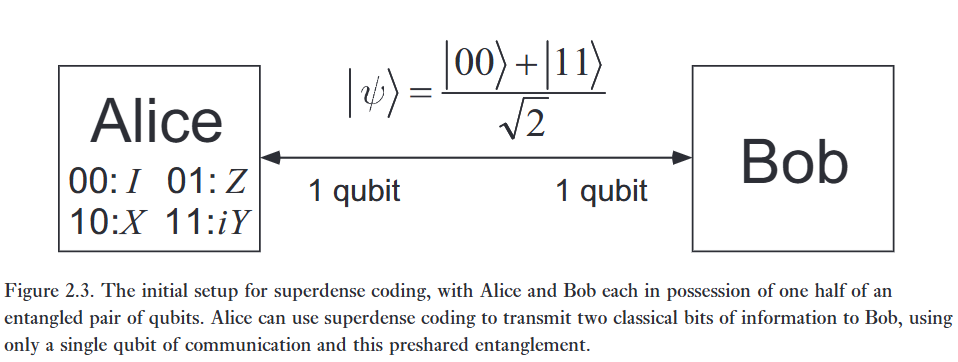

:::{.callout-note}
# Siêu phế

nói chung là vậy, không có ích gì cả.

Cơ bản là tôi muốn truyền thông tin '01', '00', '10', '11', trong khi bit cổ điển phải sử dụng đến 2 bit, thì ở đây dùng 1 qubit vướng víu giữa hai hệ. Mà thậm chí người ta còn không nói là khi giao tiếp truyền thống thì dùng cái gì nữa. 

---

## Bước 1: Tạo vướng víu

Cho 2 qubit ket 0, cái thứ nhất đi qua cổng hadamard, xong rồi cnot 2 cái. Là được một trạng thái vướng víu:

$$
\vert \psi_0 \rangle = \vert 00 \rangle
$$

$$
\vert \psi_1 \rangle = (H \otimes I)(\vert \psi_0 \rangle) = \vert +0\rangle
$$

$$
\vert \psi_2 \rangle = \text{CNOT}(\frac {\vert 00 \rangle + \vert 01 \rangle} {\sqrt 2}) = \frac {\vert 00 \rangle + \vert 11 \rangle} {\sqrt 2}
$$

## Bước 2: Mã hóa nó:

Tùy vào việc Alice muốn gửi 00, 10, 01, 11. Alice sẽ cho nó đi qua cổng tương ứng.

Ví dụ gửi 10, alice cho qubit của mình đi qua cổng pauli-x

$$
\vert \psi_3 \rangle = (X \otimes I)(\vert \psi_2 \rangle) = \frac {\vert 10 \rangle + \vert 01 \rangle} {\sqrt 2}
$$

## Bước 3: Đưa qubit cho thằng Bob

Bây giờ Bob đã cầm 2 qubit, và sẽ tiến hành dịch nó.

Bằng cách là cho đi qua cổng CNOT rồi lấy qubit của alice đi qua cổng Hadamard.

$$
\vert \psi_4 \rangle = \text{CNOT}(\vert \psi_3 \rangle) = \frac {\vert 11 \rangle + \vert 01 \rangle} {\sqrt 2} = \vert + \rangle \vert 1 \rangle
$$

$$
(H \otimes I)(\vert + \rangle \otimes \vert 1 \rangle) = \vert 0 \rangle \vert 1 \rangle
$$

---

Thậm chí là nó chỉ giới hạn 2 qubit, không thể tăng lên 3 qubit để gửi 000, 001, 010, ..., 111  được.

:::

Mã hóa siêu đặc là một ứng dụng đơn giản nhưng đáng ngạc nhiên của cơ học lượng tử sơ cấp. Nó kết hợp tất cả các ý tưởng cơ bản của cơ học lượng tử sơ cấp, như đã được đề cập trong các phần trước, theo một cách cụ thể, không tầm thường, và do đó là một ví dụ lý tưởng về các tác vụ xử lý thông tin có thể đạt được bằng cách sử dụng cơ học lượng tử.   

Mã hóa siêu đặc liên quan đến hai bên, theo quy ước được gọi là 'Alice' và 'Bob', những người ở rất xa nhau. Mục tiêu của họ là truyền một số thông tin cổ điển từ Alice đến Bob. Giả sử Alice sở hữu hai bit thông tin cổ điển mà cô ấy muốn gửi cho Bob, nhưng chỉ được phép gửi một qubit duy nhất cho Bob. Liệu cô ấy có thể đạt được mục tiêu của mình không?   

Mã hóa siêu đặc cho chúng ta biết rằng câu trả lời cho câu hỏi này là có. Giả sử ban đầu Alice và Bob chia sẻ một cặp qubit ở trạng thái vướng víu   

$$
\vert{}\psi\rangle = \frac{\vert{}00\rangle + \vert{}11\rangle}{\sqrt{2}}. \tag{2.133}
$$   

Ban đầu Alice sở hữu qubit thứ nhất, trong khi Bob sở hữu qubit thứ hai, như được minh họa trong Hình 2.3. Lưu ý rằng $\vert{}\psi\rangle$ là một trạng thái cố định; Alice không cần thiết phải gửi cho Bob bất kỳ qubit nào để chuẩn bị trạng thái này. Thay vào đó, một bên thứ ba nào đó có thể chuẩn bị trạng thái vướng víu từ trước, gửi một trong các qubit cho Alice, và qubit còn lại cho Bob.   

Bằng cách gửi qubit duy nhất mà mình sở hữu cho Bob, hóa ra Alice có thể truyền đạt hai bit thông tin cổ điển cho Bob. Dưới đây là thủ tục mà cô ấy sử dụng. Nếu cô ấy muốn gửi chuỗi bit '00' cho Bob thì cô ấy hoàn toàn không làm gì với qubit của mình. Nếu cô ấy muốn gửi '01' thì cô ấy áp dụng phép lật pha $Z$ lên qubit của mình. Nếu cô ấy muốn gửi '10' thì cô ấy áp dụng cổng NOT lượng tử, $X$, lên qubit của mình. Nếu cô ấy muốn gửi '11' thì cô ấy áp dụng cổng $iY$ lên qubit của mình. Bốn trạng thái kết quả dễ dàng nhận thấy là:

$$
00 : \vert{}\psi\rangle \to \frac{\vert{}00\rangle + \vert{}11\rangle}{\sqrt{2}} \tag{2.134}
$$   

$$
01 : \vert{}\psi\rangle \to \frac{\vert{}00\rangle - \vert{}11\rangle}{\sqrt{2}} \tag{2.135}
$$   

$$
10 : \vert{}\psi\rangle \to \frac{\vert{}10\rangle + \vert{}01\rangle}{\sqrt{2}} \tag{2.136}
$$   

$$
11 : \vert{}\psi\rangle \to \frac{\vert{}01\rangle - \vert{}10\rangle}{\sqrt{2}} \tag{2.137}
$$   

Như chúng ta đã lưu ý trong Mục 1.3.6, bốn trạng thái này được gọi là cơ sở Bell, các trạng thái Bell, hoặc các cặp EPR, để vinh danh một số người tiên phong đầu tiên đã đánh giá cao sự mới mẻ của vướng víu lượng tử. Lưu ý rằng các trạng thái Bell tạo thành một cơ sở trực chuẩn, và do đó có thể được phân biệt bằng một phép đo lượng tử thích hợp. Nếu Alice gửi qubit của mình cho Bob, mang lại cho Bob quyền sở hữu cả hai qubit, thì bằng cách thực hiện một phép đo trong cơ sở Bell, Bob có thể xác định chuỗi bit nào trong bốn chuỗi bit có thể có mà Alice đã gửi.   

Tóm lại, Alice, thông qua việc tương tác với chỉ một qubit duy nhất, có khả năng truyền hai bit thông tin cho Bob. Tất nhiên, có hai qubit tham gia vào giao thức này, nhưng Alice không bao giờ cần tương tác với qubit thứ hai. Về mặt cổ điển, nhiệm vụ mà Alice hoàn thành sẽ là bất khả thi nếu cô ấy chỉ truyền đi một bit cổ điển duy nhất, như chúng ta sẽ chỉ ra trong Chương 12. Hơn nữa, giao thức mã hóa siêu đặc đáng chú ý này đã nhận được sự kiểm chứng một phần trong phòng thí nghiệm. (Xem 'Lịch sử và đọc thêm' để biết các tài liệu tham khảo về xác minh thực nghiệm.) Trong các chương sau, chúng ta sẽ thấy nhiều ví dụ khác, một số trong đó còn ngoạn mục hơn nhiều so với mã hóa siêu đặc, về cơ học lượng tử được khai thác để thực hiện các tác vụ xử lý thông tin. Tuy nhiên, một điểm mấu chốt đã có thể được nhìn thấy trong ví dụ tuyệt đẹp này: thông tin có tính vật lý, và những lý thuyết vật lý đáng ngạc nhiên như cơ học lượng tử có thể dự đoán những khả năng xử lý thông tin đầy bất ngờ.   