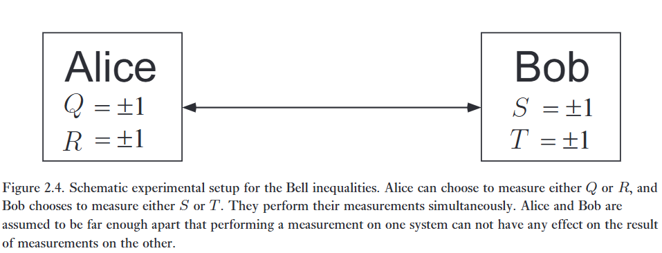

> *'Anybody who is not shocked by quantum theory has not understood it.'*
> – Niels Bohr

> *'I recall that during one walk Einstein suddenly stopped, turned to me and asked whether I really believed that the moon exists only when I look at it. The rest of this walk was devoted to a discussion of what a physicist should mean by the term ‘to exist’.'*
> – Abraham Pais

> *'...quantum phenomena do not occur in a Hilbert space, they occur in a laboratory.'*
> – Asher Peres

> *'...what is proved by impossibility proofs is lack of imagination.'*
> – John Bell

Chương này đã tập trung vào việc giới thiệu các công cụ và toán học của cơ học lượng tử. Khi những kỹ thuật này được áp dụng trong các chương tiếp theo của cuốn sách này, một chủ đề quan trọng lặp đi lặp lại là những tính chất phi cổ điển, bất thường của cơ học lượng tử. Nhưng chính xác thì sự khác biệt giữa cơ học lượng tử và thế giới cổ điển là gì? Hiểu được sự khác biệt này là điều sống còn trong việc học cách thực hiện các tác vụ xử lý thông tin vốn khó hoặc không thể thực hiện được với vật lý cổ điển. Phần này kết thúc chương với một cuộc thảo luận về bất đẳng thức Bell, một ví dụ đầy thuyết phục về một sự khác biệt cốt yếu giữa vật lý lượng tử và vật lý cổ điển.   

Khi chúng ta nói về một vật thể như một người hay một cuốn sách, chúng ta giả định rằng các tính chất vật lý của vật thể đó có một sự tồn tại độc lập với sự quan sát. Tức là, các phép đo chỉ đơn thuần có tác dụng tiết lộ những tính chất vật lý như vậy. Ví dụ, một quả bóng tennis có một trong những tính chất vật lý của nó là vị trí, thứ mà chúng ta thường đo bằng cách sử dụng ánh sáng tán xạ từ bề mặt của quả bóng. Khi cơ học lượng tử đang được phát triển vào những năm 1920 và 1930, một quan điểm kỳ lạ đã nảy sinh, khác biệt rõ rệt so với quan điểm cổ điển. Như đã mô tả ở phần trước trong chương, theo cơ học lượng tử, một hạt không được quan sát không sở hữu các tính chất vật lý tồn tại độc lập với sự quan sát. Thay vào đó, những tính chất vật lý như vậy phát sinh như một hệ quả của các phép đo được thực hiện trên hệ thống. Ví dụ, theo cơ học lượng tử, một qubit không sở hữu các tính chất xác định về 'spin theo hướng $z$, $\sigma_z$', và 'spin theo hướng $x$, $\sigma_x$', mà mỗi tính chất này có thể được tiết lộ bằng cách thực hiện phép đo thích hợp. Đúng hơn là, cơ học lượng tử đưa ra một bộ quy tắc chỉ rõ, cho trước vector trạng thái, các xác suất cho các kết quả đo có thể xảy ra khi đại lượng quan sát $\sigma_z$ được đo, hoặc khi đại lượng quan sát $\sigma_x$ được đo.   

Nhiều nhà vật lý đã bác bỏ quan điểm mới này về Tự nhiên. Người phản đối nổi bật nhất là Albert Einstein. Trong 'bài báo EPR' nổi tiếng, đồng tác giả với Nathan Rosen và Boris Podolsky, Einstein đã đề xuất một thí nghiệm tưởng tượng mà ông tin rằng, đã chứng minh cơ học lượng tử không phải là một lý thuyết hoàn chỉnh về Tự nhiên.   

Bản chất của lập luận EPR là như sau. EPR quan tâm đến những gì họ gọi là 'các yếu tố của thực tại' (elements of reality). Niềm tin của họ là bất kỳ yếu tố thực tại nào như vậy phải được biểu diễn trong bất kỳ lý thuyết vật lý hoàn chỉnh nào. Mục tiêu của lập luận là để chứng tỏ rằng cơ học lượng tử không phải là một lý thuyết vật lý hoàn chỉnh, bằng cách xác định các yếu tố của thực tại không được bao gồm trong cơ học lượng tử. Cách họ cố gắng làm điều này là bằng cách giới thiệu những gì họ tuyên bố là một điều kiện đủ để một tính chất vật lý là một yếu tố của thực tại, cụ thể là, nó có thể được dự đoán với sự chắc chắn giá trị mà tính chất đó sẽ có, ngay trước khi đo lường.   

:::{.callout-note}
# Hộp 2.7: Sự phản tương quan trong thí nghiệm EPR   

Giả sử chúng ta chuẩn bị trạng thái hai qubit   

$$
\vert{}\psi\rangle = \frac{\vert{}01\rangle - \vert{}10\rangle}{\sqrt{2}}, \tag{2.213}
$$

một trạng thái đôi khi được gọi là singlet spin vì các lý do lịch sử. Không khó để chứng minh rằng trạng thái này là một trạng thái vướng víu của hệ hai qubit. Giả sử chúng ta thực hiện phép đo spin dọc theo trục $\vec{v}$ trên cả hai qubit, nghĩa là, chúng ta đo đại lượng quan sát $\vec{v} \cdot \vec{\sigma}$ (được định nghĩa trong Phương trình (2.116) ở trang 90) trên mỗi qubit, thu được kết quả là $+1$ hoặc $-1$ cho mỗi qubit. Hóa ra bất kể chúng ta lựa chọn $\vec{v}$ như thế nào, kết quả của hai phép đo luôn ngược dấu nhau. Nghĩa là, nếu phép đo trên qubit thứ nhất cho kết quả $+1$, thì phép đo trên qubit thứ hai sẽ cho kết quả $-1$, và ngược lại. Giống như thể qubit thứ hai biết được kết quả phép đo trên qubit thứ nhất, bất kể qubit thứ nhất được đo theo cách nào. Để thấy tại sao điều này lại đúng, giả sử $\vert{}a\rangle$ và $\vert{}b\rangle$ là các trạng thái riêng của $\vec{v} \cdot \vec{\sigma}$. Khi đó tồn tại các số phức $\alpha, \beta, \gamma, \delta$ sao cho   

$$
\vert{}0\rangle = \alpha\vert{}a\rangle + \beta\vert{}b\rangle \tag{2.214}
$$   

$$
\vert{}1\rangle = \gamma\vert{}a\rangle + \delta\vert{}b\rangle. \tag{2.215}
$$

Thay thế vào chúng ta thu được   

$$
\frac{\vert{}01\rangle - \vert{}10\rangle}{\sqrt{2}} = (\alpha\delta - \beta\gamma)\frac{\vert{}ab\rangle - \vert{}ba\rangle}{\sqrt{2}}. \tag{2.216}
$$

Nhưng $\alpha\delta - \beta\gamma$ là định thức của ma trận đơn nhất $\begin{bmatrix} \alpha & \beta \\ \gamma & \delta \end{bmatrix}$, và do đó bằng một nhân tố pha $e^{i\theta}$ đối với một số thực $\theta$ nào đó. Do đó   

$$
\frac{\vert{}01\rangle - \vert{}10\rangle}{\sqrt{2}} = \frac{\vert{}ab\rangle - \vert{}ba\rangle}{\sqrt{2}}, \tag{2.217}
$$

sai khác một nhân tố pha toàn cục không thể quan sát được. Kết quả là, nếu phép đo $\vec{v} \cdot \vec{\sigma}$ được thực hiện trên cả hai qubit, thì chúng ta có thể thấy rằng kết quả $+1$ ($-1$) trên qubit thứ nhất kéo theo kết quả $-1$ ($+1$) on qubit thứ hai.
:::

---

Ví dụ, hãy xem xét một cặp qubit vướng víu lần lượt thuộc về Alice và Bob:   

$$
\frac{\vert{}01\rangle - \vert{}10\rangle}{\sqrt{2}}. \tag{2.218}
$$

Giả sử Alice và Bob ở cách xa nhau một khoảng cách rất lớn. Alice thực hiện một phép đo spin dọc theo trục $\vec{v}$, nghĩa là cô ấy đo đại lượng quan sát $\vec{v} \cdot \vec{\sigma}$ (được định nghĩa trong Phương trình (2.116) ở trang 90). Giả sử Alice nhận được kết quả $+1$. Khi đó, một phép tính cơ học lượng tử đơn giản, được đưa ra trong Hộp 2.7, cho thấy cô ấy có thể dự đoán chắc chắn rằng Bob sẽ đo được $-1$ trên qubit của anh ấy nếu anh ấy cũng đo spin dọc theo trục $\vec{v}$. Tương tự, nếu Alice đo được $-1$, thì cô ấy có thể dự đoán chắc chắn rằng Bob sẽ đo được $+1$ trên qubit của anh ấy. Bởi vì Alice luôn luôn có thể dự đoán giá trị của kết quả phép đo được ghi lại khi qubit của Bob được đo theo hướng $\vec{v}$, tính chất vật lý đó phải tương ứng với một yếu tố của thực tại, theo tiêu chuẩn EPR, và nên được biểu diễn trong bất kỳ lý thuyết vật lý hoàn chỉnh nào. Tuy nhiên, cơ học lượng tử tiêu chuẩn, như chúng ta đã trình bày, chỉ đơn thuần cho biết cách tính xác suất của các kết quả đo tương ứng nếu $\vec{v} \cdot \vec{\sigma}$ được đo. Cơ học lượng tử tiêu chuẩn chắc chắn không bao gồm bất kỳ yếu tố cơ bản nào nhằm biểu diễn giá trị của $\vec{v} \cdot \vec{\sigma}$, đối với tất cả các vector đơn vị $\vec{v}$.   

Mục tiêu của EPR là chứng tỏ rằng cơ học lượng tử là không hoàn chỉnh, bằng cách chứng minh rằng cơ học lượng tử thiếu đi một số 'yếu tố của thực tại' thiết yếu, theo tiêu chuẩn của họ. Họ hy vọng có thể ép buộc một sự quay trở lại với góc nhìn cổ điển hơn về thế giới, một thế giới mà trong đó các hệ thống có thể được gán cho những tính chất tồn tại độc lập với các phép đo được thực hiện trên những hệ thống đó. Đáng tiếc cho EPR, hầu hết các nhà vật lý đã không chấp nhận lập luận trên là đủ sức thuyết phục. Nỗ lực áp đặt lên Tự nhiên bằng mệnh lệnh (by fiat) những tính chất mà nó phải tuân theo dường như là một cách rất kỳ quặc để nghiên cứu các định luật của nó.   

Quả thực, tự nhiên đã có màn trả đũa cuối cùng đối với EPR. Gần ba mươi năm sau khi bài báo của EPR được công bố, một thử nghiệm đã được đề xuất để kiểm tra xem liệu bức tranh về thế giới mà EPR hy vọng sẽ quay trở lại có hợp lệ hay không. Hóa ra, tự nhiên đã chứng minh bằng thực nghiệm rằng quan điểm đó là không chính xác, đồng thời lại phù hợp với cơ học lượng tử.

:::{.callout}
# Tức là

Theo vật lý cổ điển, mọi thứ đều đã mang sẵn tính chất đó rồi, việc đo chỉ là khiến chúng lộ ra mà thôi. (Ví dụ như là vị trí của một đồ vật, sẵn thì nó đã ở đó, nhưng nhờ chính phép đo chính là ánh sáng chiếu vào vật rồi chiếu vào mắt, chúng mới hiện ra) (Hay như mặt trăng, nếu chúng ta không nhìn, không đo, ánh sáng không chiếu đến nó, thì nó vẫn ở đó). Nhưng theo cơ học lượng tử, mọi thứ đều chưa được quyết định gì cả, bạn chưa đo, nó không cần phải quyết định xem nên trả về kết quả gì, bạn đo, nó bắt buộc phải chọn 1 trạng thái.

Vì vậy, Eistein đã chọn một thứ gọi là singlet qubit, vì tính chất đặc biệt của nó, mà khi ta đo vật ở hệ A, ta sẽ biết ngay kết quả vật ở hệ B, khi cả hai sụp đổ cùng một lúc. Tưởng tượng xem, cả hai thằng đều không biết gì, tách biệt nhau hoàn toàn, nhưng chỉ cần đo 1 thằng, thì thằng còn lại lập tức cho kết quả đối lại, mà chẳng cần giao tiếp với nhau!

Thế nên Eistein bảo rằng chắc chắn phải có "biến ẩn", chúng chắc chắn là đã thông đồng với nhau, nếu m ra +1 thì t sẽ biến thành -1, hai hạt đã quy định sẵn kết quả của mọi đáp án khả dĩ trong vũ trụ.
:::

---

Chìa khóa cho sự bác bỏ bằng thực nghiệm này là một kết quả được biết đến như là bất đẳng thức Bell. Bất đẳng thức Bell không phải là một kết quả về cơ học lượng tử, vì vậy điều đầu tiên chúng ta cần làm là tạm thời quên đi toàn bộ kiến thức của mình về cơ học lượng tử. Để thu được bất đẳng thức Bell, chúng ta sẽ thực hiện một thí nghiệm tưởng tượng, mà chúng ta sẽ phân tích bằng cách sử dụng các khái niệm nhận thức thông thường của mình về cách thế giới vận hành – loại khái niệm mà Einstein và các cộng sự của ông nghĩ rằng Tự nhiên phải tuân theo. Sau khi chúng ta đã thực hiện phân tích theo nhận thức thông thường, chúng ta sẽ thực hiện một phân tích cơ học lượng tử mà chúng ta có thể chứng minh là không nhất quán với phân tích theo nhận thức thông thường. Sau đó, Tự nhiên có thể được yêu cầu, thông qua một thí nghiệm thực tế, đưa ra quyết định lựa chọn giữa các khái niệm nhận thức thông thường của chúng ta về cách thế giới vận hành, và cơ học lượng tử.   Hãy tưởng tượng chúng ta thực hiện thí nghiệm sau đây, được minh họa trong Hình 2.4. Charlie chuẩn bị hai hạt. Anh ta chuẩn bị các hạt đó như thế nào không quan trọng, miễn là anh ta có khả năng lặp lại quy trình thực nghiệm mà mình sử dụng. Khi anh ta đã thực hiện xong việc chuẩn bị, anh ta gửi một hạt cho Alice, và hạt thứ hai cho Bob.   

Khi Alice nhận được hạt của mình, cô ấy thực hiện một phép đo trên nó. Hãy tưởng tượng rằng cô ấy có sẵn hai thiết bị đo khác nhau, do đó cô ấy có thể chọn thực hiện một trong hai phép đo khác nhau. Những phép đo này là của các tính chất vật lý mà chúng ta sẽ lần lượt dán nhãn là $P_Q$ và $P_R$. Alice không biết trước cô ấy sẽ chọn thực hiện phép đo nào. Thay vào đó, khi nhận được hạt, cô ấy tung một đồng xu hoặc sử dụng một phương pháp ngẫu nhiên nào đó khác để quyết định xem sẽ thực hiện phép đo nào. Để cho đơn giản, chúng ta giả sử rằng mỗi phép đo có thể có một trong hai kết quả, $+1$ hoặc $-1$. Giả sử hạt của Alice có một giá trị $Q$ đối với tính chất $P_Q$. $Q$ được giả định là một tính chất khách quan của hạt của Alice, chỉ đơn thuần được tiết lộ bởi phép đo, giống như cách chúng ta tưởng tượng vị trí của một quả bóng tennis được tiết lộ bởi các hạt ánh sáng tán xạ ra khỏi nó. Tương tự, gọi $R$ biểu thị giá trị được tiết lộ bởi một phép đo tính chất $P_R$.   

Tương tự, giả sử rằng Bob có khả năng đo một trong hai tính chất, $P_S$ hoặc $P_T$, một lần nữa tiết lộ một giá trị tồn tại khách quan $S$ hoặc $T$ cho tính chất đó, mỗi giá trị nhận giá trị $+1$ hoặc $-1$. Bob không quyết định trước xem anh ấy sẽ đo tính chất nào, mà đợi cho đến khi anh ấy nhận được hạt và sau đó chọn một cách ngẫu nhiên. Thời gian của thí nghiệm được sắp xếp sao cho Alice và Bob thực hiện phép đo của họ cùng một lúc (hoặc, sử dụng ngôn ngữ chính xác hơn của thuyết tương đối, theo một cách mất kết nối nhân quả). Do đó, phép đo mà Alice thực hiện không thể làm xáo trộn kết quả phép đo của Bob (hoặc ngược lại), vì các tác động vật lý không thể lan truyền nhanh hơn ánh sáng.   

---

Chúng ta sẽ thực hiện một số phép đại số đơn giản với đại lượng $QS + RS + RT - QT$. Lưu ý rằng
$$
QS + RS + RT - QT = (Q + R)S + (R - Q)T. \tag{2.219}
$$

Bởi vì $R, Q = \pm 1$, suy ra hoặc $(Q + R)S = 0$ hoặc $(R - Q)T = 0$. Trong cả hai trường hợp, dễ dàng nhận thấy từ (2.219) rằng $QS + RS + RT - QT = \pm 2$. Tiếp theo, giả sử rằng $p(q, r, s, t)$ là xác suất để trước khi thực hiện các phép đo, hệ thống ở trạng thái mà $Q = q, R = r, S = s$, và $T = t$. Những xác suất này có thể phụ thuộc vào cách Charlie thực hiện việc chuẩn bị của anh ta, và vào nhiễu thực nghiệm. Gọi $\mathbf{E}(\cdot)$ biểu thị giá trị trung bình của một đại lượng, chúng ta có
$$
\mathbf{E}(QS + RS + RT - QT) = \sum_{qrst} p(q, r, s, t) (qs + rs + rt - qt) \tag{2.220}
$$   

$$
\le \sum_{qrst} p(q, r, s, t) \times 2 \tag{2.221}
$$   

$$
= 2. \tag{2.222}
$$

Ngoài ra,
$$
\mathbf{E}(QS + RS + RT - QT) = \sum_{qrst} p(q, r, s, t) qs + \sum_{qrst} p(q, r, s, t) rs\\ + \sum_{qrst} p(q, r, s, t) rt - \sum_{qrst} p(q, r, s, t) qt \tag{2.223}
$$   

$$= \mathbf{E}(QS) + \mathbf{E}(RS) + \mathbf{E}(RT) - \mathbf{E}(QT). \tag{2.224}
$$

So sánh (2.222) và (2.224), chúng ta thu được Bất đẳng thức Bell,

$$
\mathbf{E}(QS) + \mathbf{E}(RS) + \mathbf{E}(RT) - \mathbf{E}(QT) \le 2. \tag{2.225}
$$   

Kết quả này cũng thường được biết đến là bất đẳng thức CHSH theo tên viết tắt của bốn người khám phá ra nó. Nó là một phần của một tập hợp các bất đẳng thức lớn hơn được gọi chung là các bất đẳng thức Bell, vì bất đẳng thức đầu tiên được tìm ra bởi John Bell.   Bằng cách lặp lại thí nghiệm nhiều lần, Alice và Bob có thể xác định từng đại lượng ở vế trái của bất đẳng thức Bell. Ví dụ, sau khi kết thúc một bộ thí nghiệm, Alice và Bob tập hợp lại để phân tích dữ liệu của họ. Họ xem xét tất cả các thí nghiệm mà Alice đã đo $P_Q$ và Bob đã đo $P_S$. Bằng cách nhân các kết quả thí nghiệm của họ với nhau, họ nhận được một mẫu các giá trị cho $QS$. Bằng cách lấy trung bình trên mẫu này, họ có thể ước tính $\mathbf{E}(QS)$ đến một độ chính xác chỉ bị giới hạn bởi số lượng thí nghiệm mà họ thực hiện. Tương tự, họ có thể ước tính tất cả các đại lượng khác ở vế trái của bất đẳng thức Bell, và từ đó kiểm tra xem nó có được tuân theo trong một thí nghiệm thực tế hay không.   

Đã đến lúc đưa một chút cơ học lượng tử trở lại bức tranh. Hãy tưởng tượng chúng ta thực hiện thí nghiệm cơ học lượng tử sau đây. Charlie chuẩn bị một hệ lượng tử gồm hai qubit ở trạng thái
$$
\vert{}\psi\rangle = \frac{\vert{}01\rangle - \vert{}10\rangle}{\sqrt{2}}. \tag{2.226}
$$

Anh ta chuyển qubit thứ nhất cho Alice, và qubit thứ hai cho Bob. Họ thực hiện các phép đo của các đại lượng quan sát sau:
$$
Q = Z_1 \quad S = \frac{-Z_2 - X_2}{\sqrt{2}} \tag{2.227}
$$   

$$
R = X_1 \quad T = \frac{Z_2 - X_2}{\sqrt{2}}. \tag{2.228}
$$

Các phép tính toán đơn giản chỉ ra rằng các giá trị trung bình cho các đại lượng quan sát này, được viết theo ký hiệu $\langle\cdot\rangle$ của cơ học lượng tử, là:
$$
\langle QS\rangle = \frac{1}{\sqrt{2}}; \quad \langle RS\rangle = \frac{1}{\sqrt{2}}; \quad \langle RT\rangle = \frac{1}{\sqrt{2}}; \quad \langle QT\rangle = -\frac{1}{\sqrt{2}} \tag{2.229}
$$

Do đó,
   
$$
\langle QS\rangle + \langle RS\rangle + \langle RT\rangle - \langle QT\rangle = 2\sqrt{2}. \tag{2.230}
$$

Khoan đã! Chúng ta đã học ở (2.225) rằng giá trị trung bình của $QS$ cộng với giá trị trung bình của $RS$ cộng với giá trị trung bình của $RT$ trừ đi giá trị trung bình của $QT$ không bao giờ có thể vượt quá hai. Thế nhưng ở đây, cơ học lượng tử dự đoán rằng tổng của các giá trị trung bình này mang lại kết quả $2\sqrt{2}$!   

Thật may mắn, chúng ta có thể yêu cầu Tự nhiên giải quyết nghịch lý rõ ràng này cho chúng ta. Những thí nghiệm thông minh sử dụng photon – các hạt ánh sáng – đã được thực hiện để kiểm tra dự đoán (2.230) của cơ học lượng tử so với bất đẳng thức Bell (2.225) mà chúng ta được dẫn dắt đến bởi suy luận nhận thức thông thường của mình. Các chi tiết của những thí nghiệm này nằm ngoài phạm vi của cuốn sách, nhưng kết quả đã vang dội ủng hộ dự đoán của cơ học lượng tử. Bất đẳng thức Bell (2.225) không được Tự nhiên tuân theo.   

Điều này có ý nghĩa gì? Nó có nghĩa là một hoặc nhiều giả định được đưa vào quá trình dẫn xuất bất đẳng thức Bell chắc chắn là không chính xác. Đã có những cuốn sách đồ sộ được viết ra để phân tích các dạng thức khác nhau mà loại lập luận này có thể được xây dựng, và phân tích những giả định khác biệt một cách tinh tế bắt buộc phải có để đi đến các bất đẳng thức kiểu Bell. Ở đây chúng ta chỉ đơn thuần tóm tắt những điểm chính.   

Có hai giả định được đưa ra trong chứng minh của (2.225) đáng bị nghi ngờ:   

(1) Giả định rằng các tính chất vật lý $P_Q, P_R, P_S, P_T$ có các giá trị xác định $Q, R, S, T$ tồn tại độc lập với sự quan sát. Điều này đôi khi được biết đến là giả định về chủ nghĩa hiện thực (realism).

(2) Giả định rằng việc Alice thực hiện phép đo của mình không ảnh hưởng đến kết quả phép đo của Bob. Điều này đôi khi được biết đến là giả định về tính cục bộ (locality).   

Hai giả định này kết hợp với nhau được biết đến là các giả định của hiện thực cục bộ (local realism). Chúng chắc chắn là những giả định hợp lý về mặt trực giác về cách thế giới vận hành, và chúng phù hợp với kinh nghiệm hàng ngày của chúng ta. Tuy nhiên, các bất đẳng thức Bell chỉ ra rằng ít nhất một trong những giả định này là không chính xác.

---

Chúng ta có thể học được gì từ bất đẳng thức Bell? Đối với các nhà vật lý, bài học quan trọng nhất là những trực giác nhận thức thông thường được tin tưởng sâu sắc của họ về cách thế giới vận hành là sai lầm. Thế giới không mang tính hiện thực cục bộ (locally realistic). Hầu hết các nhà vật lý giữ quan điểm rằng chính giả định về chủ nghĩa hiện thực mới là thứ cần phải bị loại bỏ khỏi thế giới quan của chúng ta trong cơ học lượng tử, mặc dù những người khác lại lập luận rằng thay vào đó, giả định về tính cục bộ mới nên bị loại bỏ. Bất chấp điều đó, bất đẳng thức Bell cùng với bằng chứng thực nghiệm vững chắc hiện chỉ ra kết luận rằng một hoặc cả hai yếu tố là tính cục bộ và chủ nghĩa hiện thực phải bị loại bỏ khỏi góc nhìn của chúng ta về thế giới nếu chúng ta muốn phát triển một sự hiểu biết trực giác tốt về cơ học lượng tử.   

Các lĩnh vực tính toán lượng tử và thông tin lượng tử có thể học được những bài học gì từ bất đẳng thức Bell? Về mặt lịch sử, bài học hữu ích nhất có lẽ cũng là bài học mơ hồ nhất: có một điều gì đó vô cùng 'đặc biệt' ẩn chứa bên trong các trạng thái vướng víu như trạng thái EPR. Rất nhiều bước tiến trong tính toán lượng tử và, đặc biệt là, thông tin lượng tử, đã đến từ việc đặt ra một câu hỏi đơn giản: 'một chút vướng víu sẽ mang lại cho tôi điều gì trong bài toán này?' Như chúng ta đã thấy trong viễn tải và mã hóa siêu đặc, và như chúng ta sẽ thấy lặp đi lặp lại ở phần sau của cuốn sách, bằng cách đưa thêm một chút vướng víu vào một bài toán, chúng ta mở ra một thế giới mới của những khả năng không thể tưởng tượng được với thông tin cổ điển. Bức tranh lớn hơn là bất đẳng thức Bell dạy chúng ta rằng vướng víu là một tài nguyên mới về mặt nền tảng trong thế giới, về cơ bản vượt xa các tài nguyên cổ điển; giống như đồ sắt so với thời đại đồ đồng của thế giới cổ điển. Một nhiệm vụ chính yếu của tính toán lượng tử và thông tin lượng tử là khai thác tài nguyên mới này để thực hiện các tác vụ xử lý thông tin vốn bất khả thi hoặc khó khăn hơn rất nhiều với các tài nguyên cổ điển.