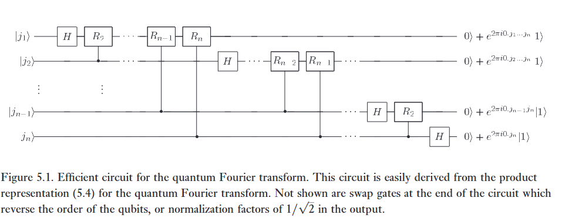

> *'A good idea has a way of becoming simpler and solving problems other than that for which it was intended.'*
> – Robert Tarjan

Một trong những cách hữu ích nhất để giải quyết một bài toán trong toán học hoặc khoa học máy tính là biến đổi nó thành một bài toán khác mà đã biết sẵn lời giải. Có một vài phép biến đổi kiểu này xuất hiện rất thường xuyên và trong nhiều bối cảnh khác nhau đến mức bản thân các phép biến đổi đó được nghiên cứu vì lợi ích của riêng chúng. Một khám phá vĩ đại của tính toán lượng tử là một số phép biến đổi như vậy có thể được tính toán nhanh hơn rất nhiều trên một máy tính lượng tử so với trên một máy tính cổ điển, một khám phá đã cho phép cấu trúc nên các thuật toán nhanh cho máy tính lượng tử.   

Một phép biến đổi như vậy là biến đổi Fourier rời rạc (discrete Fourier transform). Trong ký hiệu toán học thông thường, biến đổi Fourier rời rạc nhận đầu vào là một vector các số phức, $x_0, \dots, x_{N-1}$ trong đó chiều dài $N$ của vector là một tham số cố định. Nó xuất ra dữ liệu đã được biến đổi, một vector các số phức $y_0, \dots, y_{N-1}$, được định nghĩa bởi   

$$
y_k \equiv \frac{1}{\sqrt{N}} \sum_{j=0}^{N-1} x_j e^{2\pi i j k / N}. \tag{5.1}
$$   

Biến đổi Fourier lượng tử (quantum Fourier transform) chính xác là cùng một phép biến đổi đó, mặc dù ký hiệu quy ước cho biến đổi Fourier lượng tử có phần khác biệt. Biến đổi Fourier lượng tử trên một cơ sở trực chuẩn $\vert{}0\rangle, \dots, \vert{}N-1\rangle$ được định nghĩa là một toán tử tuyến tính với tác động sau lên các trạng thái cơ sở,   

$$
\vert{}j\rangle \to \frac{1}{\sqrt{N}} \sum_{k=0}^{N-1} e^{2\pi i j k / N} \vert{}k\rangle. \tag{5.2}
$$   

Một cách tương đương, tác động lên một trạng thái tùy ý có thể được viết là   

$$
\sum_{j=0}^{N-1} x_j \vert{}j\rangle \to \sum_{k=0}^{N-1} y_k \vert{}k\rangle, \tag{5.3}
$$   

trong đó các biên độ $y_k$ là biến đổi Fourier rời rạc của các biên độ $x_j$. Không quá rõ ràng từ định nghĩa, nhưng phép biến đổi này là một phép biến đổi unita, và do đó có thể được triển khai như là động lực học cho một máy tính lượng tử. Chúng ta sẽ chứng minh tính unita của biến đổi Fourier bằng cách cấu trúc một mạch lượng tử mang tính unita rõ ràng để tính toán biến đổi Fourier. Việc chứng minh trực tiếp rằng biến đổi Fourier là unita cũng rất dễ dàng:   

:::{.callout-note collapse="true"}
# Bài tập 5.1: 
Đưa ra một chứng minh trực tiếp rằng phép biến đổi tuyến tính được định nghĩa bởi Phương trình (5.2) là unita.   
:::

:::{.callout-note collapse="true"}
# Bài tập 5.2: 
Tính toán tường minh biến đổi Fourier của trạng thái $n$ qubit $\vert{}00\dots 0\rangle$.   

:::

Trong phần sau đây, chúng ta chọn $N = 2^n$, trong đó $n$ là một số nguyên nào đó, và cơ sở $\vert{}0\rangle, \dots, \vert{}2^n - 1\rangle$ là cơ sở tính toán cho một máy tính lượng tử $n$ qubit. Rất hữu ích khi viết trạng thái $\vert{}j\rangle$ sử dụng biểu diễn nhị phân $j = j_1 j_2 \dots j_n$. Một cách trang trọng hơn, $j = j_1 2^{n-1} + j_2 2^{n-2} + \dots + j_n 2^0$. Cũng rất thuận tiện khi áp dụng ký hiệu $0.j_l j_{l+1} \dots j_m$ để biểu diễn phân số nhị phân $j_l/2 + j_{l+1}/4 + \dots + j_m/2^{m-l+1}$.   

Với một chút đại số, biến đổi Fourier lượng tử có thể được đưa ra dưới dạng biểu diễn tích (product representation) hữu ích sau đây:   

$$
\vert{}j_1, \dots, j_n\rangle \to \frac{\left(\vert{}0\rangle + e^{2\pi i 0.j_n}\vert{}1\rangle\right) \left(\vert{}0\rangle + e^{2\pi i 0.j_{n-1}j_n}\vert{}1\rangle\right) \dots \left(\vert{}0\rangle + e^{2\pi i 0.j_1 j_2 \dots j_n}\vert{}1\rangle\right)}{2^{n/2}}. \tag{5.4}
$$   

Biểu diễn tích này hữu ích đến mức bạn thậm chí có thể muốn coi đây là định nghĩa của biến đổi Fourier lượng tử. Như chúng tôi sẽ giải thích ngay sau đây, biểu diễn này cho phép chúng ta cấu trúc một mạch lượng tử hiệu quả để tính toán biến đổi Fourier, một chứng minh rằng biến đổi Fourier lượng tử là unita, và cung cấp cái nhìn sâu sắc về các thuật toán dựa trên biến đổi Fourier lượng tử. Như một phần thưởng ngẫu nhiên, chúng ta thu được biến đổi Fourier nhanh cổ điển, trong các bài tập! 

Sự tương đương của biểu diễn tích (5.4) và định nghĩa (5.2) bắt nguồn từ một số phép đại số cơ bản:   

$$
\vert{}j\rangle \to \frac{1}{2^{n/2}} \sum_{k=0}^{2^n-1} e^{2\pi i j k / 2^n} \vert{}k\rangle \tag{5.5}
$$   

$$
= \frac{1}{2^{n/2}} \sum_{k_1=0}^{1} \dots \sum_{k_n=0}^{1} e^{2\pi i j (\sum_{l=1}^n k_l 2^{-l})} \vert{}k_1 \dots k_n\rangle \tag{5.6}
$$   

$$
= \frac{1}{2^{n/2}} \sum_{k_1=0}^{1} \dots \sum_{k_n=0}^{1} \bigotimes_{l=1}^n e^{2\pi i j k_l 2^{-l}} \vert{}k_l\rangle \tag{5.7}
$$   

$$
= \frac{1}{2^{n/2}} \bigotimes_{l=1}^n \left[ \sum_{k_l=0}^{1} e^{2\pi i j k_l 2^{-l}} \vert{}k_l\rangle \right] \tag{5.8}
$$   

$$
= \frac{1}{2^{n/2}} \bigotimes_{l=1}^n \left[ \vert{}0\rangle + e^{2\pi i j 2^{-l}} \vert{}1\rangle \right] \tag{5.9}
$$   

$$
= \frac{\left(\vert{}0\rangle + e^{2\pi i 0.j_n}\vert{}1\rangle\right) \left(\vert{}0\rangle + e^{2\pi i 0.j_{n-1}j_n}\vert{}1\rangle\right) \dots \left(\vert{}0\rangle + e^{2\pi i 0.j_1 j_2 \dots j_n}\vert{}1\rangle\right)}{2^{n/2}}. \tag{5.10}
$$   

Biểu diễn tích (5.4) giúp dễ dàng đạo hàm ra một mạch hiệu quả cho biến đổi Fourier lượng tử. Một mạch như vậy được chỉ ra ở Hình 5.1. Cổng $R_k$ biểu thị phép biến đổi unita   

$$
R_k \equiv \begin{bmatrix} 1 & 0 \\ 0 & e^{2\pi i / 2^k} \end{bmatrix}. \tag{5.11}
$$   

 

Để thấy rằng mạch được vẽ trên tính toán biến đổi Fourier lượng tử, hãy xem xét điều gì xảy ra khi trạng thái $\vert{}j_1 \dots j_n\rangle$ được đưa vào. Việc áp dụng cổng Hadamard lên bit đầu tiên tạo ra trạng thái   

$$
\frac{1}{2^{1/2}} \left(\vert{}0\rangle + e^{2\pi i 0.j_1}\vert{}1\rangle\right) \vert{}j_2 \dots j_n\rangle, \tag{5.12}
$$   

bởi vì $e^{2\pi i 0.j_1} = -1$ khi $j_1 = 1$, và là $+1$ trong các trường hợp khác. Việc áp dụng cổng controlled-$R_2$ tạo ra trạng thái   

$$
\frac{1}{2^{1/2}} \left(\vert{}0\rangle + e^{2\pi i 0.j_1 j_2}\vert{}1\rangle\right) \vert{}j_2 \dots j_n\rangle. \tag{5.13}
$$   

Chúng ta tiếp tục áp dụng các cổng controlled-$R_3, R_4$ cho đến $R_n$, mỗi cổng cộng thêm một bit phụ vào pha của hệ số của trạng thái $\vert{}1\rangle$ đầu tiên. Ở cuối quy trình này, chúng ta có trạng thái   

$$
\frac{1}{2^{1/2}} \left(\vert{}0\rangle + e^{2\pi i 0.j_1 j_2 \dots j_n}\vert{}1\rangle\right) \vert{}j_2 \dots j_n\rangle. \tag{5.14}
$$   

Tiếp theo, chúng ta thực hiện một quy trình tương tự lên qubit thứ hai. Cổng Hadamard đưa chúng ta vào trạng thái   

$$
\frac{1}{2^{2/2}} \left(\vert{}0\rangle + e^{2\pi i 0.j_1 j_2 \dots j_n}\vert{}1\rangle\right) \left(\vert{}0\rangle + e^{2\pi i 0.j_2}\vert{}1\rangle\right) \vert{}j_3 \dots j_n\rangle, \tag{5.15}
$$  

và các cổng controlled-$R_2$ cho đến $R_{n-1}$ mang lại trạng thái   

$$
\frac{1}{2^{2/2}} \left(\vert{}0\rangle + e^{2\pi i 0.j_1 j_2 \dots j_n}\vert{}1\rangle\right) \left(\vert{}0\rangle + e^{2\pi i 0.j_2 \dots j_n}\vert{}1\rangle\right) \vert{}j_3 \dots j_n\rangle. \tag{5.16}
$$   

Chúng ta tiếp tục theo cách này cho từng qubit, cho ra trạng thái cuối cùng   

$$
\frac{1}{2^{n/2}} \left(\vert{}0\rangle + e^{2\pi i 0.j_1 j_2 \dots j_n}\vert{}1\rangle\right) \left(\vert{}0\rangle + e^{2\pi i 0.j_2 \dots j_n}\vert{}1\rangle\right) \dots \left(\vert{}0\rangle + e^{2\pi i 0.j_n}\vert{}1\rangle\right). \tag{5.17}
$$   

Các phép toán hoán đổi (xem Mục 1.3.4 để biết mô tả về mạch), được lược bỏ khỏi Hình 5.1 cho rõ ràng, sau đó được sử dụng để đảo ngược thứ tự các qubit. Sau các phép toán hoán đổi, trạng thái của các qubit là   

$$
\frac{1}{2^{n/2}} \left(\vert{}0\rangle + e^{2\pi i 0.j_n}\vert{}1\rangle\right) \left(\vert{}0\rangle + e^{2\pi i 0.j_{n-1} j_n}\vert{}1\rangle\right) \dots \left(\vert{}0\rangle + e^{2\pi i 0.j_1 j_2 \dots j_n}\vert{}1\rangle\right). \tag{5.18}
$$   

So sánh với Phương trình (5.4) chúng ta thấy rằng đây chính là đầu ra mong muốn từ biến đổi Fourier lượng tử. Việc cấu trúc này cũng chứng minh rằng biến đổi Fourier lượng tử là unita, vì mỗi cổng trong mạch là unita. Một ví dụ tường minh cho thấy mạch cho biến đổi Fourier lượng tử trên ba qubit được đưa ra ở Hộp 5.1.   

:::{.callout-important}
# Hộp 5.1: Biến đổi Fourier lượng tử ba qubit   

Để cụ thể hơn, có thể sẽ hữu ích khi nhìn vào mạch điện tường minh cho biến đổi Fourier lượng tử ba qubit:   (

Nhắc lại rằng $S$ và $T$ là cổng phase và cổng $\pi/8$ (xem trang xxiii). Dưới dạng một ma trận, biến đổi Fourier lượng tử trong trường hợp này có thể được viết ra một cách tường minh, sử dụng $\omega = e^{2\pi i/8} = \sqrt{i}$, là   

$$
\frac{1}{\sqrt{8}} \begin{bmatrix} 1 & 1 & 1 & 1 & 1 & 1 & 1 & 1 \\ 1 & \omega & \omega^2 & \omega^3 & \omega^4 & \omega^5 & \omega^6 & \omega^7 \\ 1 & \omega^2 & \omega^4 & \omega^6 & 1 & \omega^2 & \omega^4 & \omega^6 \\ 1 & \omega^3 & \omega^6 & \omega^1 & \omega^4 & \omega^7 & \omega^2 & \omega^5 \\ 1 & \omega^4 & 1 & \omega^4 & 1 & \omega^4 & 1 & \omega^4 \\ 1 & \omega^5 & \omega^2 & \omega^7 & \omega^4 & \omega^1 & \omega^6 & \omega^3 \\ 1 & \omega^6 & \omega^4 & \omega^2 & 1 & \omega^6 & \omega^4 & \omega^2 \\ 1 & \omega^7 & \omega^6 & \omega^5 & \omega^4 & \omega^3 & \omega^2 & \omega^1 \end{bmatrix} . \tag{5.19}
$$

:::