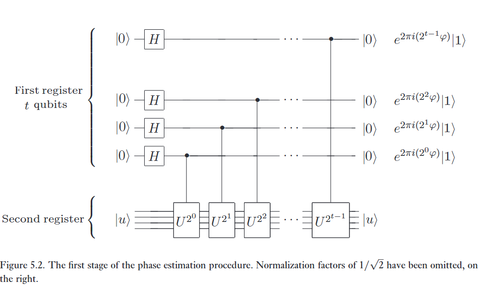
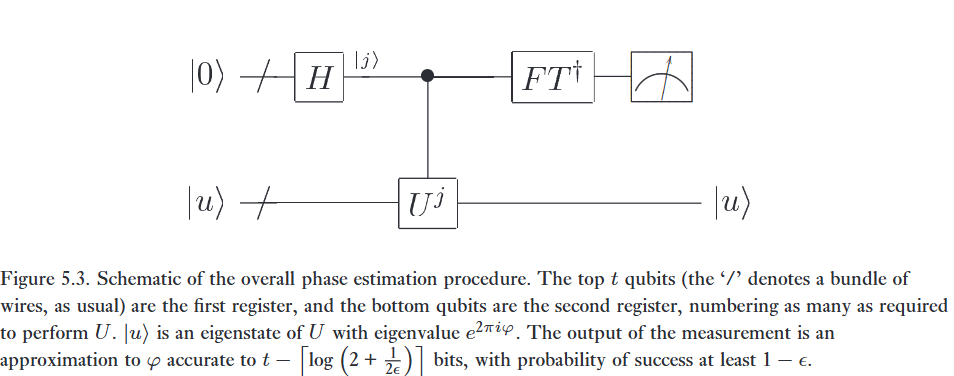

Biến đổi Fourier là chìa khóa cho một quy trình tổng quát được gọi là ước lượng pha, thứ mà đến lượt nó lại là chìa khóa cho nhiều thuật toán lượng tử. Giả sử một toán tử unita $U$ có một vector riêng $\vert{}u\rangle$ với trị riêng $e^{2\pi i \varphi}$, trong đó giá trị của $\varphi$ là chưa biết. Mục tiêu của thuật toán ước lượng pha là ước lượng $\varphi$. Để thực hiện việc ước lượng, chúng ta giả định rằng chúng ta có sẵn các hộp đen (đôi khi được gọi là oracles) có khả năng chuẩn bị trạng thái $\vert{}u\rangle$ và thực hiện phép toán controlled-$U^{2^j}$, đối với các số nguyên không âm $j$ phù hợp. Việc sử dụng các hộp đen chỉ ra rằng quy trình ước lượng pha không phải là một thuật toán lượng tử hoàn chỉnh theo đúng nghĩa của nó. Thay vào đó, bạn nên nghĩ về ước lượng pha như một loại 'chương trình con' (subroutine) hoặc 'mô-đun' mà khi được kết hợp với các chương trình con khác, có thể được sử dụng để thực hiện các tác vụ tính toán thú vị. Trong các ứng dụng cụ thể của quy trình ước lượng pha, chúng ta sẽ làm chính xác điều này, mô tả cách thức các phép toán hộp đen này được thực hiện, và kết hợp chúng với quy trình ước lượng pha để làm các tác vụ thực sự hữu ích. Tuy nhiên, trong thời điểm hiện tại, chúng ta sẽ tiếp tục tưởng tượng chúng như những hộp đen.   

---

:::{.callout}
# tl;dr

## Chuẩn bị

t thanh ghi kết quả, việc t nhiều hay ít ảnh hưởng đến việc xác suất thành công và độ chính xác của varphi.

* Độ chính xác tới $t - \lceil \log(2 + \frac 1 {2\epsilon}) \rceil$ bits.
* Độ thành công ít nhất là $1 - \epsilon$.

một ket u là eigenvector của U.

## Các giai đoạn

**Giai đoạn 1:**

Ném các thông tin của varphi lên từng thanh t một. Ví dụ ta phân tích được là $0.j_1j_2j_3...j_t$ thì ta ném $j_1$ lên thanh 1, rồi từng cái. Bằng cách là Phase kickback, $CU^{2^{i - 1}}$.

**Giai đoạn 2:** 

Ta có thể thấy kết quả khi lấy từng cái thông tin của varphi khá là giống với (5.4), một phép biến đổi Fourier cơ bản. Vì vậy ta có thể thấy là:

$$
\vert \text{current} \rangle = FT \vert \varphi \rangle
$$

**Giai đoạn 3:**

Nhưng mà chúng ta đo ra kết quả thế méo nào được? Thế là phải dùng (h5.1) của bài trước để đảo lại ket current.

Trong hình (5.1) ở bài trước, ta có thể thấy một kiểu mạch biển đổi khác, từ trạng thái bình thường sang biến đổi Fourier, vì vậy giờ chúng ta sẽ đi ngược lại thời gian (và chắc chắn không đụng đến ket u).

Và không sử dụng $R_k$ mà thay vào đó sử dụng $R_k^\dagger$.

Và việc áp dụng $FT^\dagger$ cho ra kết quả cuối cùng là $\vert{}\tilde{\varphi}\rangle$, một kết quả hơi mờ nhòe của ket varphi.

:::

Quy trình ước lượng pha lượng tử sử dụng hai thanh ghi (registers). Thanh ghi thứ nhất chứa $t$ qubit ban đầu ở trạng thái $\vert{}0\rangle$. Cách chúng ta chọn $t$ phụ thuộc vào hai điều: số lượng chữ số có nghĩa (digits of accuracy) mà chúng ta mong muốn có được trong kết quả ước lượng cho $\varphi$, và xác suất mà chúng ta muốn quy trình ước lượng pha thành công là bao nhiêu. Sự phụ thuộc của $t$ vào các đại lượng này xuất hiện một cách tự nhiên từ phân tích sau đây.   

Thanh ghi thứ hai bắt đầu ở trạng thái $\vert{}u\rangle$, và chứa số lượng qubit vừa đủ cần thiết để lưu trữ $\vert{}u\rangle$. Ước lượng pha được thực hiện theo hai giai đoạn. Đầu tiên, chúng ta áp dụng mạch được hiển thị ở Hình 5.2. Mạch bắt đầu bằng cách áp dụng một phép biến đổi Hadamard lên thanh ghi thứ nhất, tiếp theo là việc áp dụng các phép toán controlled-$U$ lên thanh ghi thứ hai, với $U$ được nâng lên các lũy thừa liên tiếp của 2. Trạng thái cuối cùng của thanh ghi thứ nhất dễ dàng thấy là:   

$$
\frac{1}{2^{t/2}} \left(\vert{}0\rangle + e^{2\pi i 2^{t-1} \varphi}\vert{}1\rangle\right) \left(\vert{}0\rangle + e^{2\pi i 2^{t-2} \varphi}\vert{}1\rangle\right) \dots \left(\vert{}0\rangle + e^{2\pi i 2^0 \varphi}\vert{}1\rangle\right) = \frac{1}{2^{t/2}} \sum_{k=0}^{2^t-1} e^{2\pi i \varphi k} \vert{}k\rangle. \tag{5.20}
$$   

Chúng ta lược bỏ thanh ghi thứ hai khỏi mô tả này, vì nó luôn duy trì ở trạng thái $\vert{}u\rangle$ trong suốt quá trình tính toán.   

:::{.callout-note controlled="true"}
# Bài tập 5.7: 
Một cái nhìn sâu sắc hơn vào mạch trong Hình 5.2 có thể đạt được bằng cách chỉ ra, như bạn nên làm ngay lúc này, rằng hiệu ứng của chuỗi các phép toán controlled-$U$ giống như trong Hình 5.2 là đưa trạng thái $\vert{}j\rangle\vert{}u\rangle$ thành $\vert{}j\rangle U^j \vert{}u\rangle$. (Lưu ý rằng điều này không phụ thuộc vào việc $\vert{}u\rangle$ phải là một trạng thái riêng của $U$.)  
:::

Giai đoạn thứ hai của ước lượng pha là áp dụng biến đổi Fourier lượng tử ngược lên thanh ghi thứ nhất. Điều này thu được bằng cách đảo ngược mạch của biến đổi Fourier lượng tử ở phần trước (Bài tập 5.5), và có thể được thực hiện trong $\Theta(t^2)$ bước. Giai đoạn thứ ba và cũng là giai đoạn cuối cùng của ước lượng pha là đọc ra trạng thái của thanh ghi thứ nhất bằng cách thực hiện một phép đo trong cơ sở tính toán. Chúng ta sẽ chỉ ra rằng điều này cung cấp một ước lượng khá tốt cho $\varphi$. Một sơ đồ tổng thể của thuật toán được chỉ ra ở Hình 5.3.   

Để làm sắc nét trực giác của chúng ta về lý do tại sao ước lượng pha hoạt động, giả sử $\varphi$ có thể được biểu diễn chính xác bằng $t$ bit, dưới dạng $\varphi = 0.\varphi_1 \dots \varphi_t$. Khi đó trạng thái (5.20) thu được từ giai đoạn đầu tiên của ước lượng pha có thể được viết lại thành  

$$
\frac{1}{2^{t/2}} \left(\vert{}0\rangle + e^{2\pi i 0.\varphi_t}\vert{}1\rangle\right) \left(\vert{}0\rangle + e^{2\pi i 0.\varphi_{t-1}\varphi_t}\vert{}1\rangle\right) \dots \left(\vert{}0\rangle + e^{2\pi i 0.\varphi_1\varphi_2 \dots \varphi_t}\vert{}1\rangle\right). \tag{5.21}
$$   

Giai đoạn thứ hai của ước lượng pha là áp dụng biến đổi Fourier lượng tử ngược. Nhưng so sánh phương trình trước đó với dạng tích của biến đổi Fourier, Phương trình (5.4), chúng ta thấy rằng trạng thái đầu ra từ giai đoạn thứ hai chính là trạng thái tích $\vert{}\varphi_1 \dots \varphi_t\rangle$. Do đó, một phép đo trong cơ sở tính toán cho chúng ta chính xác $\varphi$!   

Tóm lại, thuật toán ước lượng pha cho phép người ta ước lượng pha $\varphi$ của một trị riêng thuộc một toán tử unita $U$, khi cho trước vector riêng tương ứng $\vert{}u\rangle$. Một đặc điểm thiết yếu ở cốt lõi của quy trình này là khả năng của biến đổi Fourier ngược trong việc thực hiện phép biến đổi   

$$
\frac{1}{2^{t/2}} \sum_{j=0}^{2^t-1} e^{2\pi i \varphi j} \vert{}j\rangle \vert{}u\rangle \to \vert{}\tilde{\varphi}\rangle \vert{}u\rangle, \tag{5.22}
$$   

trong đó $\vert{}\tilde{\varphi}\rangle$ biểu thị một trạng thái là một công cụ ước lượng tốt cho $\varphi$ khi được đo lường.   

# 1. Performance and requirements

Phân tích trên áp dụng cho trường hợp lý tưởng, nơi $\varphi$ có thể được viết chính xác bằng một khai triển nhị phân $t$ bit. Điều gì xảy ra khi không phải như vậy? Hóa ra quy trình mà chúng ta đã mô tả sẽ tạo ra một xấp xỉ khá tốt cho $\varphi$ với xác suất cao, như đã được báo trước bởi ký hiệu được sử dụng trong (5.22). Việc chỉ ra điều này đòi hỏi một vài thao tác cẩn thận.   

Gọi $b$ là số nguyên trong khoảng từ $0$ đến $2^t - 1$ sao cho $b/2^t = 0.b_1 \dots b_t$ là xấp xỉ $t$ bit tốt nhất đối với $\varphi$ mà nhỏ hơn $\varphi$. Tức là, độ lệch $\delta \equiv \varphi - b/2^t$ giữa $\varphi$ và $b/2^t$ thỏa mãn $0 \le \delta \le 2^{-t}$. Chúng ta hướng tới việc chỉ ra rằng quan sát ở cuối quy trình ước lượng pha tạo ra một kết quả gần với $b$, và do đó cho phép chúng ta ước lượng $\varphi$ một cách chính xác, với xác suất cao. Áp dụng biến đổi Fourier lượng tử ngược lên trạng thái (5.20) tạo ra trạng thái   

$$
\frac{1}{2^t} \sum_{k,l=0}^{2^t-1} e^{\frac{-2\pi i k l}{2^t}} e^{2\pi i \varphi k} \vert{}l\rangle. \tag{5.23}
$$   

Gọi $\alpha_l$ là biên độ của $\vert{}(b+l) \pmod{2^t}\rangle$,   

$$
\alpha_l \equiv \frac{1}{2^t} \sum_{k=0}^{2^t-1} \left( e^{2\pi i (\varphi - (b+l)/2^t)} \right)^k. \tag{5.24}
$$   

Đây là tổng của một cấp số nhân (geometric series), do đó   

$$
\alpha_l = \frac{1}{2^t} \left( \frac{1 - e^{2\pi i (2^t \varphi - (b+l))}}{1 - e^{2\pi i (\varphi - (b+l)/2^t)}} \right) \tag{5.25}
$$   

$$
= \frac{1}{2^t} \left( \frac{1 - e^{2\pi i (2^t \delta - l)}}{1 - e^{2\pi i (\delta - l/2^t)}} \right). \tag{5.26}
$$   

Giả sử kết quả của phép đo cuối cùng là $m$. Chúng ta hướng tới việc chặn (bound) xác suất thu được một giá trị $m$ sao cho $\vert{}m - b\vert{} > e$, trong đó $e$ là một số nguyên dương đặc trưng cho dung sai sai số (tolerance to error) mong muốn của chúng ta. Xác suất quan sát thấy một $m$ như vậy được cho bởi   

$$
p(\vert{}m - b\vert{} > e) = \sum_{-2^{t-1} < l \le -(e+1)} \vert{}\alpha_l\vert{}^2 + \sum_{e+1 \le l \le 2^{t-1}} \vert{}\alpha_l\vert{}^2. \tag{5.27}
$$   

Nhưng đối với bất kỳ số thực $\theta$ nào, $\vert{}1 - \exp(i\theta)\vert{} \le 2$, do đó   

$$
\vert{}\alpha_l\vert{} \le \frac{2}{2^t \vert{}1 - e^{2\pi i (\delta - l/2^t)}\vert{}}. \tag{5.28}
$$   

Bằng hình học hoặc giải tích cơ bản $\vert{}1 - \exp(i\theta)\vert{} \ge 2\vert{}\theta\vert{}/\pi$ bất cứ khi nào $-\pi \le \theta \le \pi$. Nhưng khi $-2^{t-1} < l \le 2^{t-1}$ chúng ta có $-\pi \le 2\pi(\delta - l/2^t) \le \pi$. Do đó   

$$
\vert{}\alpha_l\vert{} \le \frac{1}{2^{t+1} (\delta - l/2^t)}. \tag{5.29}
$$   

Kết hợp (5.27) và (5.29) cho ta   

$$
p(\vert{}m - b\vert{} > e) \le \frac{1}{4} \left[ \sum_{l=-2^{t-1}+1}^{-(e+1)} \frac{1}{(l - 2^t \delta)^2} + \sum_{l=e+1}^{2^{t-1}} \frac{1}{(l - 2^t \delta)^2} \right]. \tag{5.30}
$$   

Nhớ lại rằng $0 \le 2^t \delta \le 1$, ta thu được   

$$
p(\vert{}m - b\vert{} > e) \le \frac{1}{4} \left[ \sum_{l=-2^{t-1}+1}^{-(e+1)} \frac{1}{l^2} + \sum_{l=e+1}^{2^{t-1}} \frac{1}{(l - 1)^2} \right] \tag{5.31}
$$   

$$
\le \frac{1}{2} \sum_{l=e}^{2^{t-1}-1} \frac{1}{l^2} \tag{5.32}
$$   

$$
\le \frac{1}{2} \int_{e-1}^{2^{t-1}-1} \frac{dl}{l^2} \tag{5.33}
$$   

$$
= \frac{1}{2(e - 1)}. \tag{5.34}
$$   

Giả sử chúng ta muốn xấp xỉ $\varphi$ đến một độ chính xác $2^{-n}$, tức là, chúng ta chọn $e = 2^{t-n} - 1$. Bằng cách sử dụng $t = n + p$ qubit trong thuật toán ước lượng pha, chúng ta thấy từ (5.34) rằng xác suất thu được một xấp xỉ chính xác đến độ chính xác này là ít nhất $1 - 1/2(2^p - 2)$. Do đó, để thu được thành công $\varphi$ chính xác đến $n$ bit với xác suất thành công ít nhất là $1 - \epsilon$, chúng ta chọn   

$$
t = n + \left\lceil \log \left( 2 + \frac{1}{2\epsilon} \right) \right\rceil. \tag{5.35}
$$

Để sử dụng thuật toán ước lượng pha, chúng ta cần có khả năng chuẩn bị một trạng thái riêng $\vert{}u\rangle$ của $U$. Sẽ ra sao nếu chúng ta không biết cách chuẩn bị một trạng thái riêng như vậy? Giả sử rằng chúng ta chuẩn bị một trạng thái $\vert{}\psi\rangle$ nào đó khác thay vì $\vert{}u\rangle$. Khai triển trạng thái này theo các trạng thái riêng $\vert{}u\rangle$ của $U$ cho ta $\vert{}\psi\rangle = \sum_u c_u \vert{}u\rangle$. Giả sử trạng thái riêng $\vert{}u\rangle$ có trị riêng $e^{2\pi i \varphi_u}$. Về mặt trực giác, kết quả của việc chạy thuật toán ước lượng pha sẽ là đưa ra đầu ra một trạng thái gần với $\sum_u c_u \vert{}\widetilde{\varphi_u}\rangle \vert{}u\rangle$, trong đó $\widetilde{\varphi_u}$ là một xấp xỉ khá tốt cho pha $\varphi_u$. Do đó, chúng ta kỳ vọng rằng việc đọc thanh ghi thứ nhất sẽ cho chúng ta một xấp xỉ tốt cho $\varphi_u$, trong đó $u$ được chọn ngẫu nhiên với xác suất $\vert{}c_u\vert{}^2$. Việc làm cho lập luận này trở nên chặt chẽ được dành cho Bài tập 5.8. Quy trình này cho phép chúng ta tránh việc phải chuẩn bị một trạng thái riêng (có thể chưa biết), với cái giá phải trả là đưa thêm một chút tính ngẫu nhiên vào thuật toán.   

:::{.callout-note collapse="true"}
# Bài tập 5.8: 
Giả sử thuật toán ước lượng pha đưa trạng thái $\vert{}0\rangle\vert{}u\rangle$ thành trạng thái $\vert{}\widetilde{\varphi_u}\rangle\vert{}u\rangle$, sao cho khi cho trước đầu vào $\vert{}0\rangle(\sum_u c_u\vert{}u\rangle)$, thuật toán xuất ra $\sum_u c_u\vert{}\widetilde{\varphi_u}\rangle\vert{}u\rangle$. Hãy chỉ ra rằng nếu $t$ được chọn theo (5.35), thì xác suất để đo được $\varphi_u$ chính xác đến $n$ bit khi kết thúc thuật toán ước lượng pha là ít nhất $\vert{}c_u\vert{}^2 (1 - \epsilon)$.   

:::

Tại sao ước lượng pha lại thú vị? Tự bản thân nó, ước lượng pha giải quyết một bài toán vừa không tầm thường và thú vị từ quan điểm vật lý: làm thế nào để ước lượng trị riêng liên kết với một vector riêng cho trước của một toán tử unita. Tuy nhiên, công dụng thực sự của nó đến từ quan sát rằng các bài toán thú vị khác có thể được giản lược (reduced) về bài toán ước lượng pha, như sẽ được trình bày ở các phần tiếp theo. Thuật toán ước lượng pha được tóm tắt dưới đây. 

:::{.callout}
# note thêm

## The Catch-22 of PEA

Ở hình (5.2) chúng ta yêu cầu tìm chính xác eigenvector của unitary U. Nhưng mà lỡ đối với các unitary U khó tìm eigenvector thì sao? hoặc việc tạo ra nó để cho máy tính cổ điển tìm cũng được?

**Giải pháp**

Hãy truyền một $\vert \psi \rangle$ bừa bất kỳ mà dễ dàng tạo ra được (ví dụ ket 1).

Vì các vector riêng ket u tạo thành 1 cơ sở trực chuẩn, bất kỳ trạng thái ket psi nào cũng có thể được phân tích thành một tổ hợp tuyến tính của các vector riêng:

$$
\vert \psi \rangle = \sum c_u \vert u \rangle
$$

Nhờ tính tuyến tính của các cổng lượng tử, khi ket psi chạy qua mạch PEA, bộ máy sẽ không bị lỗi. Nó sẽ tính toán song song trên tất cả vector riêng cùng một lúc.

Kết quả sẽ là trạng thái vướng víu khổng lồ:

$$
\sum c_u\vert{}\widetilde{\varphi_u}\rangle\vert{}u\rangle
$$

**Đo đạc**

Khi bạn thực hiện đo trên thanh ghi 1, hàm sóng sụp đổ.

Bạn sẽ ngẫu nhiên nhận một pha $\varphi_u$ nào đó, thuộc vào một vector riêng nào đó.

Xác suất để bạn bốc trúng pha $\varphi_u$ đó tỉ lệ thuận với bình phương biên độ $\vert c_u \vert ^2$.

:::

## Algorithm: Quantum phase estimation

Các đầu vào: (1) Một hộp đen thực hiện phép toán controlled-$U^j$, đối với số nguyên $j$, (2) một trạng thái riêng $\vert{}u\rangle$ của $U$ với trị riêng $e^{2\pi i\varphi_u}$, và (3) $t = n + \left\lceil \log \left( 2 + \frac{1}{2\epsilon} \right) \right\rceil$ qubit được khởi tạo ở $\vert{}0\rangle$.   

Đầu ra: Một xấp xỉ $n$-bit $\widetilde{\varphi_u}$ cho $\varphi_u$.   

Thời gian chạy (Runtime): $O(t^2)$ phép toán và một lần gọi (call) hộp đen controlled-$U^j$. Thành công với xác suất ít nhất là $1 - \epsilon$.   

Quy trình:   

(1) $\vert{}0\rangle\vert{}u\rangle$ (trạng thái ban đầu)   

(2) $\to \frac{1}{\sqrt{2^t}} \sum_{j=0}^{2^t-1} \vert{}j\rangle\vert{}u\rangle$ (tạo trạng thái chồng chập)   

(3) $\to \frac{1}{\sqrt{2^t}} \sum_{j=0}^{2^t-1} \vert{}j\rangle U^j \vert{}u\rangle$ (áp dụng hộp đen)
$= \frac{1}{\sqrt{2^t}} \sum_{j=0}^{2^t-1} e^{2\pi i j \varphi_u} \vert{}j\rangle\vert{}u\rangle$ (kết quả của hộp đen)   

(4) $\to \vert{}\widetilde{\varphi_u}\rangle\vert{}u\rangle$ (áp dụng biến đổi Fourier ngược)   

(5) $\to \widetilde{\varphi_u}$ (đo thanh ghi thứ nhất)   

:::{.callout-note collapse="true"}
# Bài tập 5.9: 
Cho $U$ là một phép biến đổi unita với các trị riêng $\pm 1$, tác động lên một trạng thái $\vert{}\psi\rangle$. Sử dụng quy trình ước lượng pha, hãy xây dựng một mạch lượng tử để làm sụp đổ $\vert{}\psi\rangle$ vào một trong hai không gian riêng (eigenspaces) của $U$, đồng thời đưa ra một chỉ báo cổ điển (classical indicator) cho biết trạng thái cuối cùng nằm ở không gian nào. So sánh kết quả của bạn với Bài tập 4.34. 

:::
