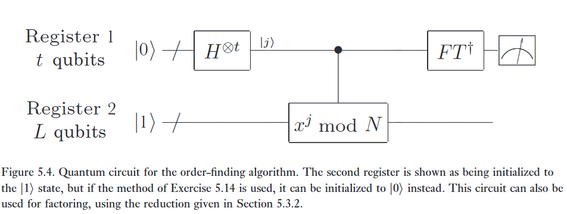
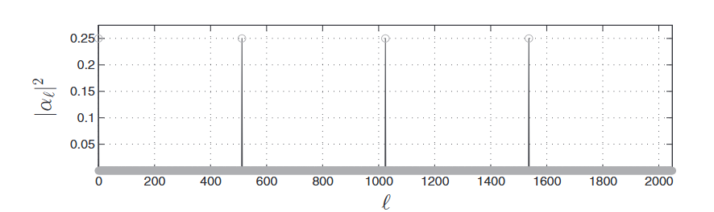

Quy trình ước lượng pha có thể được sử dụng để giải quyết một loạt các bài toán thú vị. Chúng tôi bây giờ mô tả hai trong số những bài toán thú vị nhất này: bài toán tìm bậc, và bài toán phân tích thừa số. Trên thực tế, hai bài toán này tương đương với nhau, do đó trong Mục 5.3.1 chúng tôi giải thích một thuật toán lượng tử để giải quyết bài toán tìm bậc, và trong Mục 5.3.2 chúng tôi giải thích cách bài toán tìm bậc cũng ngụ ý khả năng phân tích thừa số.   

Để hiểu các thuật toán lượng tử cho phân tích thừa số và tìm bậc đòi hỏi một chút kiến thức nền tảng về lý thuyết số (number theory). Tất cả các tài liệu cần thiết được tập hợp lại trong Phụ lục 4. Mô tả mà chúng tôi đưa ra trong hai mục tiếp theo tập trung vào khía cạnh lượng tử của bài toán, và chỉ yêu cầu một chút làm quen với số học modulo (modular arithmetic) để có thể đọc hiểu. Các chứng minh chi tiết cho các kết quả lý thuyết số mà chúng tôi trích dẫn ở đây có thể được tìm thấy trong Phụ lục 4.   

Các thuật toán lượng tử nhanh cho bài toán tìm bậc và phân tích thừa số thú vị vì ít nhất ba lý do. Thứ nhất, và quan trọng nhất theo ý kiến của chúng tôi, chúng cung cấp bằng chứng cho ý tưởng rằng máy tính lượng tử có thể về bản chất mạnh hơn máy tính cổ điển, và đưa ra một thách thức đáng tin cậy đối với luận đề Church-Turing mạnh (strong Church-Turing thesis). Thứ hai, cả hai bài toán đều có đủ giá trị nội tại để biện minh cho sự quan tâm đến bất kỳ thuật toán mới lạ nào, dù là cổ điển hay lượng tử. Thứ ba, và quan trọng nhất từ góc độ thực tiễn, các thuật toán hiệu quả cho bài toán tìm bậc và phân tích thừa số có thể được sử dụng để bẻ khóa hệ thống mật mã khóa công khai RSA (Phụ lục 5).  

# Application: order-finding

:::{.callout}
# Note thêm

## Bài toán mở đầu và một số định nghĩa

Định nghĩa của một bậc là, số r nhỏ nhất sao cho $x^r = 1 (mod N)$, với x, N cho trước và không có ước chung.

Người ta tin rằng không có thuật toán nào có thể sử dụng tài nguyên theo đa thức $O(L)$ (với $L = \lceil \log(N) \rceil$) có thể giải quyết bài toán này. (Có thể thấy L là độ dài của số ;))

Và bài toán của chúng ta là tìm bậc.

---

Thuật toán lượng tử để tìm bậc chính là thuật toán ước lượng pha được áp dụng cho toán tử Unita

$$
U\vert{}y\rangle \equiv \vert{}xy \pmod N\rangle, \tag{5.36}
$$   

trong đó: $0 \leq y \leq 2^L - 1$, và, U không bị đặt vào nếu $0 \leq y \leq N - 1$, và U bị đặt vào nếu $N \leq y \leq 2^L - 1$.

## Suy ra bài toán

Nhìn vào (5.39) ta thấy:

$$
= \exp\left[\frac{2\pi is}{r}\right] \vert{}u_s\rangle. \tag{5.39}
$$

rõ ràng trị riêng của ket u_s là $\exp\left[\frac{2\pi is}{r}\right]$ có dạng $e^{2\pi i \varphi}$, vậy $\varphi = \frac s r$.

Vậy là pha $\varphi$ chính là bằng $s/r$ (với s là một số nguyên ngẫu nhiên từ 0 đến r - 1, và r chính là bậc cần tìm!)

Nói cách khác, nếu máy tính lượng tử đo được pha $\varphi$, thì ra lập tức giải mã ra được chu kỳ r.

## 5.44

Nhưng mà để chạy được PEA, công thức (5.37) đòi hỏi phải biết trước r thì mới tạo được trạng thái riêng $\vert u_s \rangle$. Giống như nghịch lý ở bài trước đã nói.

Kết quả là, hãy nhìn vào phương trình (5.44), nếu lấy tổng chồng chập tất cả các trạng thái riêng của $\vert u_s \rangle$, thì kết quả đại số sẽ gom lại trạng thái cơ sờ cổ điển đơn giản nhất: $\vert 1 \rangle$.

Cuối cùng, nhờ tính tuyến tính lượng tử, khi $\vert 1 \rangle$ chạy qua mạch PEA và đo lường, hệ thống sẽ ngẫu nhiên nhả ra một giá trị pha $\varphi \approx s/r$ ứng với một giá trị s nào đó.

## Làm sao để triển khai cổng Controlled-U^2^j khổng lồ?

box 5.2

## Cách lấy r từ kết quả đo

Vấn đề là khi chạy mạch và đo lường thanh ghi 1, máy tinh lượng tử nhả ra một giá trị thập phân $\varphi$ (được biểu diễn dưới dạng nhị phân với 2L + 1 bits chính xác).

Ta biết rằng $\varphi \approx s/r$. Tuy nhiên, vì $\varphi$ chỉ là một giá trị xấp xỉ bị nhiễu hoặc làm tròn (do hữu hạn qubit), nếu bạn dùng máy tính cổ điển để đổi $\varphi$ thành phân số tối giản theo cách ngây thơ thì bạn sẽ nhận được con số mẫu số khổng lồ, và không liên quan gì đến r.

**Continued Fractions**

Mọi số thực đều có thể biểu diễn thành một Liên phân số! (kiểu  $a_0 + \frac{1}{a_1 + \frac{1}{a_2 + \dots}}$).

Các phân số cắt cụt của chuỗi này đều hội tụ.

Do thiết kế phần cứng dùng $t = 2L + 1$ qubit, sai số giữa pha đo $\varphi$ và phân số $s/r$ luôn bị chặn chặt chẽ dưới ngưỡng $\frac 1 {r^2}$ (5.48)

Và nhờ đó, (thuật toán liên phân số chạy trên máy tính cổ điển với độ phức tạp cực nhanh, chỉ $O(L^3)$) sẽ bóc tách ngay lập tức chuỗi liên phân số của $\varphi$ và trích xuất ra được phân số tối giản $s'/r'$.

## Nhưng mà, bẫy ước số...

Điều gì sẽ xảy ra nếu máy tính lượng tử trả về kết quả là $\varphi \approx s'/r'$, trong đó r' lại là ước của r? (ví du: 2/4, trả về 1/2, mà r = 4 chứ không phải = 2).

**Phương pháp 1: Lặp ngẫu nhiên**

Xác suất để một số s chọn ngẫu nhiên nguyên tố cùng nhau với r là khá lớn (tỉ lệ thuận với $\frac 1 {\log N}$). ($0 \leq x \leq r - 1$)

Chỉ cần lặp lại toàn bộ thí nghiệm $2\log(N)$ lần. Xác suất để ít nhất một lần bốc trúng r nguyên tố cùng nhau với r là rất lớn. (=1)

**Phương pháp 2: Thuật toán vét cạn**

Nếu r' tìm được là một ước số của r, ta sẽ tận dụng nó.

Thay cơ sở x bằng $x' = x^{r'} (\pmod N)$ và tiếp tục chạy tìm bậc trên cơ sở mới này. Sau tối đa $O(L)$ lần lặp, ra sẽ quét sạch mọi ước số và tìm ra chu kỳ chính xác r.

**Phương pháp 3: LCM Trick**

Thay vì lặp nhiều lần hay làm đệ quy dài dòng, ta chỉ cần chạy mạch lượng tử đúng 2 lần độc lập để thu về $r_1'$ và $r_2'$.

Toán học chứng minh rằng xác suất để hai giá trị $s_1'$ và $s_2'$ sinh ra từ hai lần chạy không có chung thừa số nguyên tố là khá cao (bị chặn dưới bởi 1/4).

Khi đó, chu kỳ thực sự r chính là $\text{LCM}(r_1', r_2')$. 

## Cuối cùng

Độ phức tạp là $O(L^3)$.

:::

Đối với các số nguyên dương $x$ và $N$, $x < N$, không có ước chung, bậc của $x$ modulo $N$ được định nghĩa là số nguyên dương nhỏ nhất $r$ sao cho $x^r = 1 \pmod N$. Bài toán tìm bậc là xác định bậc cho một $x$ và $N$ được chỉ định. Người ta tin rằng tìm bậc là một bài toán khó trên máy tính cổ điển, theo nghĩa là không có thuật toán nào được biết đến có thể giải quyết bài toán này sử dụng tài nguyên đa thức theo $O(L)$ bit cần thiết để biểu diễn bài toán, trong đó $L \equiv \lceil \log(N) \rceil$ là số lượng bit cần thiết để biểu diễn $N$. Trong mục này, chúng ta giải thích cách ước lượng pha có thể được sử dụng để thu được một thuật toán lượng tử hiệu quả cho việc tìm bậc.   

:::{.callout-note collapse="true"}
# Bài tập 5.10: 
Chỉ ra rằng bậc của $x = 5$ modulo $N = 21$ là $6$.   

:::

:::{.callout-note collapse="true"}
# Bài tập 5.11: 
Chỉ ra rằng bậc của $x$ thỏa mãn $r \le N$.   

:::

Thuật toán lượng tử để tìm bậc chính là thuật toán ước lượng pha được áp dụng cho toán tử unita   

$$
U\vert{}y\rangle \equiv \vert{}xy \pmod N\rangle, \tag{5.36}
$$   

với $y \in \{0, 1\}^L$ (Lưu ý rằng ở đây và bên dưới, khi $N \le y \le 2^L - 1$, chúng ta sử dụng quy ước rằng $xy \pmod N$ chỉ là chính $y$. Nghĩa là, $U$ chỉ tác động không tầm thường khi $0 \le y \le N-1$). Một phép tính đơn giản cho thấy các trạng thái được định nghĩa bởi   

$$
\vert{}u_s\rangle \equiv \frac{1}{\sqrt{r}} \sum_{k=0}^{r-1} \exp\left[\frac{-2\pi i s k}{r}\right] \vert{}x^k \pmod N\rangle, \tag{5.37}
$$   

đối với số nguyên $0 \le s \le r-1$ là các trạng thái riêng của $U$, vì   

$$
U\vert{}u_s\rangle = \frac{1}{\sqrt{r}} \sum_{k=0}^{r-1} \exp\left[\frac{-2\pi i s k}{r}\right] \vert{}x^{k+1} \pmod N\rangle
$$   

$$
= \exp\left[\frac{2\pi is}{r}\right] \vert{}u_s\rangle. \tag{5.38, 5.39}
$$   

Sử dụng quy trình ước lượng pha cho phép chúng ta thu được, với độ chính xác cao, các trị riêng tương ứng $\exp(2\pi i s/r)$, từ đó chúng ta có thể thu được bậc $r$ với một chút công sức nữa.   

:::{.callout-note collapse="true"}
# Bài tập 5.12: 
Chỉ ra rằng $U$ là unita (Gợi ý: $x$ nguyên tố cùng nhau với $N$, và do đó có nghịch đảo modulo $N$).   
:::

Có hai yêu cầu quan trọng để chúng ta có thể sử dụng quy trình ước lượng pha: chúng ta phải có các quy trình hiệu quả để thực hiện phép toán controlled-$U^{2^j}$ cho bất kỳ số nguyên $j$, và chúng ta phải có khả năng chuẩn bị hiệu quả một trạng thái riêng $\vert{}u_s\rangle$ với một trị riêng không tầm thường, hoặc ít nhất là một chồng chập của các trạng thái riêng như vậy. Yêu cầu đầu tiên được thỏa mãn bằng cách sử dụng một quy trình được gọi là lũy thừa modulo (modular exponentiation), với quy trình này chúng ta có thể thực hiện toàn bộ chuỗi các phép toán controlled-$U^{2^j}$ được áp dụng bởi quy trình ước lượng pha sử dụng $O(L^3)$ cổng, như được mô tả trong Hộp 5.2.   

:::{.callout-important}
# Hộp 5.2: Lũy thừa modulo   

Làm thế nào chúng ta có thể tính toán chuỗi các phép toán controlled-$U^{2^j}$ được sử dụng bởi quy trình ước lượng pha như một phần của thuật toán tìm bậc? Tức là, chúng ta muốn tính phép biến đổi   

$$
\vert{}z\rangle\vert{}y\rangle \to \vert{}z\rangle U^{z_{t-1} 2^{t-1}} \dots U^{z_0 2^0} \vert{}y\rangle \tag{5.40}
$$   

$$
= \vert{}z\rangle \vert{}x^{z_{t-1} 2^{t-1}} \times \dots \times x^{z_0 2^0} y \pmod N \rangle \tag{5.41}
$$   

$$
= \vert{}z\rangle \vert{}x^z y \pmod N\rangle. \tag{5.42}
$$   

Do đó, chuỗi các phép toán controlled-$U^{2^j}$ được sử dụng trong ước lượng pha tương đương với việc nhân nội dung của thanh ghi thứ hai với lũy thừa modulo $x^z \pmod N$, trong đó $z$ là nội dung của thanh ghi thứ nhất. Phép toán này có thể được thực hiện một cách dễ dàng bằng cách sử dụng các kỹ thuật tính toán thuận nghịch (reversible computation). Ý tưởng cơ bản là tính toán thuận nghịch hàm $x^z \pmod N$ của $z$ trong một thanh ghi thứ ba, và sau đó nhân thuận nghịch nội dung của thanh ghi thứ hai với $x^z \pmod N$, sử dụng mẹo khử tính toán (uncomputation) để xóa nội dung của thanh ghi thứ ba khi hoàn thành.   

Thuật toán tính toán lũy thừa modulo có hai giai đoạn. Giai đoạn đầu tiên sử dụng phép nhân modulo để tính toán $x^2 \pmod N$ bằng cách bình phương $x$ modulo $N$, sau đó tính $x^4 \pmod N$ bằng cách bình phương $x^2 \pmod N$, và tiếp tục theo cách này, tính toán $x^{2^j} \pmod N$ cho mọi $j$ lên đến $t-1$. Chúng ta sử dụng $t = 2L + 1 + \lceil \log(2 + \frac{1}{2\epsilon}) \rceil = O(L)$, do đó tổng cộng có $t-1 = O(L)$ phép bình phương được thực hiện với chi phí $O(L^2)$ cho mỗi phép (chi phí này giả định mạch dùng để bình phương thực hiện thuật toán quen thuộc mà tất cả chúng ta học từ nhỏ cho phép nhân), cho tổng chi phí là $O(L^3)$ cho giai đoạn đầu tiên.   

Giai đoạn thứ hai của thuật toán dựa trên quan sát mà chúng ta đã lưu ý,   

$$
x^z \pmod N = \left( x^{z_{t-1} 2^{t-1}} \pmod N \right) \left( x^{z_{t-2} 2^{t-2}} \pmod N \right) \dots \left( x^{z_0 2^0} \pmod N \right). \tag{5.43}
$$   

Thực hiện $t-1$ phép nhân modulo với chi phí $O(L^2)$ mỗi phép, chúng ta thấy rằng tích này có thể được tính toán bằng cách sử dụng $O(L^3)$ cổng. Điều này đủ hiệu quả cho các mục đích của chúng ta, nhưng các thuật toán hiệu quả hơn vẫn có thể thực hiện được dựa trên các thuật toán nhân hiệu quả hơn (xem phần 'Lịch sử và đọc thêm'). Sử dụng các kỹ thuật của Mục 3.2.5, bây giờ việc xây dựng một mạch thuận nghịch với một thanh ghi $t$ bit và một thanh ghi $L$ bit, khi bắt đầu ở trạng thái $\vert{}z\rangle\vert{}y\rangle$ sẽ đầu ra trạng thái $\vert{}z\rangle \vert{}x^z y \pmod N\rangle$, sử dụng $O(L^3)$ cổng, thứ mà có thể được dịch thành một mạch lượng tử sử dụng $O(L^3)$ cổng tính toán phép biến đổi $\vert{}z\rangle\vert{}y\rangle \to \vert{}z\rangle \vert{}x^z y \pmod N\rangle$. 
:::

Yêu cầu thứ hai có vẻ phức tạp hơn một chút: chuẩn bị $\vert{}u_s\rangle$ đòi hỏi chúng ta phải biết $r$, vì vậy điều này là bất khả thi. May mắn thay, có một quan sát thông minh cho phép chúng ta vượt qua bài toán chuẩn bị $\vert{}u_s\rangle$, đó là   

$$
\frac{1}{\sqrt{r}} \sum_{s=0}^{r-1} \vert{}u_s\rangle = \vert{}1\rangle. \tag{5.44}
$$   

Khi thực hiện quy trình ước lượng pha, nếu chúng ta sử dụng $t = 2L + 1 + \lceil \log(2 + \frac{1}{2\epsilon}) \rceil$ qubit trong thanh ghi thứ nhất (tham khảo Hình 5.3), và chuẩn bị thanh ghi thứ hai ở trạng thái $\vert{}1\rangle$ — thứ mà việc xây dựng là tầm thường — thì đối với mỗi $s$ trong khoảng từ $0$ đến $r-1$, chúng ta sẽ thu được một ước lượng của pha $\varphi \approx s/r$ chính xác đến $2L + 1$ bit, với xác suất ít nhất là $(1-\epsilon)/r$. Thuật toán tìm bậc được phác thảo sơ lược trong Hình 5.4.   

:::{.callout-note collapse="true"}
# Bài tập 5.13: 
Chứng minh phương trình (5.44). (Gợi ý: $\sum_{s=0}^{r-1} \exp(-2\pi i s k / r) = r \delta_{k0}$.) Thật vậy, hãy chứng minh rằng   
$$
\frac{1}{\sqrt{r}} \sum_{s=0}^{r-1} e^{2\pi i s k / r} \vert{}u_s\rangle = \vert{}x^k \pmod N\rangle. \tag{5.45}
$$   

:::

:::{.callout-note collapse="true"}
# Bài tập 5.14: 
Trạng thái lượng tử được tạo ra trong thuật toán tìm bậc, trước khi thực hiện biến đổi Fourier ngược, là   

$$
\vert{}\psi\rangle = \sum_{j=0}^{2^t-1} \vert{}j\rangle U^j \vert{}1\rangle = \sum_{j=0}^{2^t-1} \vert{}j\rangle \vert{}x^j \pmod N\rangle, \tag{5.46}
$$   

nếu chúng ta khởi tạo thanh ghi thứ hai là $\vert{}1\rangle$. Hãy chỉ ra rằng trạng thái tương tự sẽ thu được nếu chúng ta thay thế $U^j$ bằng một phép biến đổi unita $V$ khác, cái mà tính toán   

$$
V\vert{}j\rangle\vert{}k\rangle = \vert{}j\rangle \vert{}k + x^j \pmod N\rangle, \tag{5.47}
$$   

và bắt đầu thanh ghi thứ hai ở trạng thái $\vert{}0\rangle$. Đồng thời hãy chỉ ra cách xây dựng $V$ sử dụng $O(L^3)$ cổng.  
:::

## The continued fraction expansion

Việc giảm bài toán tìm bậc về ước lượng pha được hoàn thành bằng cách mô tả cách thu được đáp án mong muốn, $r$, từ kết quả của thuật toán ước lượng pha, $\varphi \approx s/r$. Chúng ta chỉ biết $\varphi$ đến $2L + 1$ bit, nhưng chúng ta cũng biết trước (a priori) rằng nó là một số hữu tỉ — tỉ số của hai số nguyên bị chặn — và nếu chúng ta có thể tính toán phân số gần nhất như vậy với $\varphi$, chúng ta có thể thu được $r$.   

Đáng chú ý là có một thuật toán thực hiện tác vụ này một cách hiệu quả, được gọi là thuật toán liên phân số (continued fractions algorithm). Một ví dụ về cách thức hoạt động này được mô tả trong Hộp 5.3. Lý do thuật toán này thỏa mãn nhu cầu của chúng ta là định lý sau đây, được chứng minh trong Phụ lục 4:   Định lý 5.1: Giả sử $s/r$ là một số hữu tỉ sao cho   

$$
\left\vert{} \frac{s}{r} - \varphi \right\vert{} \le \frac{1}{2r^2}. \tag{5.48}
$$   

Khi đó $s/r$ là một hội tụ (convergent) của liên phân số cho $\varphi$, và do đó có thể được tính toán trong $O(L^3)$ phép toán bằng cách sử dụng thuật toán liên phân số.   

Vì $\varphi$ là một xấp xỉ của $s/r$ chính xác đến $2L + 1$ bit, nên suy ra rằng $\vert{}s/r - \varphi\vert{} \le 2^{-2L-1} \le 1/2r^2$, vì $r \le N \le 2^L$. Do đó, định lý được áp dụng.   

Tóm lại, cho trước $\varphi$, thuật toán liên phân số một cách hiệu quả tạo ra các số $s'$ và $r'$ không có ước chung, sao cho $s'/r' = s/r$. Số $r'$ là ứng viên của chúng ta cho bậc. Chúng ta có thể kiểm tra xem đó có phải là bậc hay không bằng cách tính toán $x^{r'} \pmod N$, và xem kết quả có bằng 1 hay không. Nếu có, thì $r'$ là bậc của $x \pmod N$, và chúng ta đã hoàn thành!   

:::{.callout-important}
# Hộp 5.3: Thuật toán liên phân số   

Ý tưởng của thuật toán liên phân số là mô tả các số thực chỉ bằng các số nguyên, sử dụng các biểu thức có dạng   

$$
[a_0, \dots, a_M] \equiv a_0 + \frac{1}{a_1 + \frac{1}{a_2 + \dots + \frac{1}{a_M}}}, \tag{5.49}
$$   

trong đó $a_0, \dots, a_M$ là các số nguyên dương. (Đối với các ứng dụng trong tính toán lượng tử, việc cho phép $a_0 = 0$ là thuận tiện.) Chúng ta định nghĩa hội tụ (convergent) thứ $m$ ($0 \le m \le M$) của liên phân số này là $[a_0, \dots, a_m]$. Thuật toán liên phân số là một phương pháp để xác định khai triển liên phân số của một số thực bất kỳ.   

Nó rất dễ hiểu thông qua một ví dụ. Giả sử chúng ta đang cố gắng phân rã phân số $31/13$ thành một liên phân số. Bước đầu tiên của thuật toán liên phân số là tách $31/13$ thành phần nguyên và phần phân số của nó,   

$$
\frac{31}{13} = 2 + \frac{5}{13}. \tag{5.50}
$$   

Tiếp theo, chúng ta nghịch đảo phần phân số, thu được   

$$
\frac{31}{13} = 2 + \frac{1}{\frac{13}{5}}. \tag{5.51}
$$   

Các bước này — tách rồi nghịch đảo — bây giờ được áp dụng cho $13/5$, cho ra   

$$
\frac{31}{13} = 2 + \frac{1}{2 + \frac{3}{5}} = 2 + \frac{1}{2 + \frac{1}{\frac{5}{3}}}. \tag{5.52}
$$   

Tiếp theo, chúng ta tách và nghịch đảo $5/3$:   

$$
\frac{31}{13} = 2 + \frac{1}{2 + \frac{1}{1 + \frac{2}{3}}} = 2 + \frac{1}{2 + \frac{1}{1 + \frac{1}{\frac{3}{2}}}}. \tag{5.53}
$$   

Phép phân rã thành liên phân số bây giờ dừng lại, vì   

$$
\frac{3}{2} = 1 + \frac{1}{2} \tag{5.54}
$$   

có thể được viết với số 1 ở tử số mà không cần phải nghịch đảo nữa, cho ra biểu diễn liên phân số cuối cùng của $31/13$ là   

$$
\frac{31}{13} = 2 + \frac{1}{2 + \frac{1}{1 + \frac{1}{2}}}. \tag{5.55}
$$   

Rõ ràng là thuật toán liên phân số dừng lại sau một số hữu hạn các bước "tách và nghịch đảo" đối với bất kỳ số hữu tỉ nào, vì các tử số xuất hiện ($31, 5, 3, 2, 1$ trong ví dụ) giảm dần nghiêm ngặt. Quá trình dừng này diễn ra nhanh đến mức nào? Hóa ra nếu $\varphi = s/r$ là một số hữu tỉ, và $s$ và $r$ là các số nguyên $L$-bit, thì khai triển liên phân số cho $\varphi$ có thể được tính toán bằng cách sử dụng $O(L^3)$ phép toán — $O(L)$ bước "tách và nghịch đảo", mỗi bước sử dụng các cổng $O(L^2)$ cho các phép tính số học cơ bản. 
:::

## Performance

Thuật toán tìm bậc có thể thất bại như thế nào? Có hai khả năng. Đầu tiên, quy trình ước lượng pha có thể tạo ra một ước lượng tồi cho $s/r$. Điều này xảy ra với xác suất cao nhất là $\epsilon$, và có thể làm cho nó trở nên nhỏ đi với một sự gia tăng không đáng kể về kích thước của mạch. Nghiêm trọng hơn, có thể là $s$ và $r$ có ước chung, trong trường hợp đó số $r'$ được trả về bởi thuật toán liên phân số sẽ là một ước số của $r$, chứ không phải bản thân $r$. May mắn thay, có ít nhất ba cách để giải quyết vấn đề này.   

Có lẽ cách trực tiếp nhất là lưu ý rằng đối với một $s$ được chọn ngẫu nhiên trong khoảng từ $0$ đến $r-1$, khả năng cao là $s$ và $r$ nguyên tố cùng nhau, trong trường hợp đó thuật toán liên phân số phải trả về $r$. Để thấy rằng đây là trường hợp như vậy, lưu ý rằng theo Bài tập 4.1 ở trang 638, số lượng các số nguyên tố nhỏ hơn $r$ ít nhất là $r / 2\log r$, và do đó cơ hội để $s$ là số nguyên tố (và do đó, nguyên tố cùng nhau với $r$) ít nhất là $1 / 2\log(r) > 1 / 2\log(N)$. Do đó, lặp lại thuật toán $2\log(N)$ lần, chúng ta sẽ, với xác suất cao, quan sát thấy một pha $s/r$ sao cho $s$ và $r$ nguyên tố cùng nhau, và do đó thuật toán liên phân số tạo ra $r$ như mong muốn.   

Phương pháp thứ hai là lưu ý rằng nếu $r' \neq r$, thì $r'$ được đảm bảo là một ước số của $r$, trừ khi $s = 0$, khả năng này xảy ra với xác suất $1/r \le 1/2$, và có thể được chiết khấu hơn nữa bằng một vài lần lặp. Giả sử chúng ta thay thế $x$ bằng $x' \equiv x^{r'} \pmod N$. Khi đó bậc của $x'$ là $r/r'$. Bây giờ chúng ta có thể lặp lại thuật toán, và cố gắng tính toán bậc của $x'$, nếu thành công, cho phép chúng ta tính toán bậc của $x$, vì $r = r' \times r/r'$. Nếu chúng ta thất bại, thì chúng ta thu được $r''$ là một ước số của $r/r'$, và bây giờ chúng ta cố gắng tính toán bậc của $x'' \equiv (x')^{r''} \pmod N$. Chúng ta lặp lại quy trình này cho đến khi chúng ta xác định được bậc của $x$. Tối đa $\log(r) = O(L)$ lần lặp được yêu cầu, vì mỗi lần lặp làm giảm bậc của ứng viên hiện tại $x^{\dots}$ đi một thừa số ít nhất là hai.   

Phương pháp thứ ba tốt hơn hai phương pháp đầu tiên ở chỗ nó chỉ đòi hỏi một số lần thử hằng số (constant number of trials), thay vì $O(L)$ lần lặp. Ý tưởng là lặp lại quy trình ước lượng pha - liên phân số hai lần, thu được $r_1', s_1'$ vào lần đầu tiên, và $r_2', s_2'$ vào lần thứ hai. Miễn là $s_1'$ và $s_2'$ không có ước chung, $r$ có thể được trích xuất bằng cách lấy bội chung nhỏ nhất (least common multiple) của $r_1$ và $r_2$. Xác suất để $s_1'$ và $s_2'$ không có ước chung được cho bởi   

$$
1 - \sum_q p(q\vert{}s_1')p(q\vert{}s_2'), \tag{5.56}
$$   

trong đó tổng chạy trên tất cả các số nguyên tố $q$, và $p(x\vert{}y)$ ở đây có nghĩa là xác suất của $x$ chia hết $y$. Nếu $q$ chia hết $s_1'$ thì nó cũng phải chia hết giá trị thực của $s$, là $s_1$, ở lần lặp đầu tiên, vì vậy để chặn trên $p(q\vert{}s_1')$ thì chỉ cần chặn trên $p(q\vert{}s_1)$, trong đó $s_1$ được chọn đồng nhất ngẫu nhiên từ $0$ đến $r-1$. Thật dễ dàng để thấy rằng $p(q\vert{}s_1) \le 1/q$, và do đó $p(q\vert{}s_1') \le 1/q$. Tương tự, $p(q\vert{}s_2') \le 1/q$, và do đó xác suất để $s_1'$ và $s_2'$ không có ước chung thỏa mãn   

$$
1 - \sum_q p(q\vert{}s_1')p(q\vert{}s_2') \ge 1 - \sum_q \frac{1}{q^2}. \tag{5.57}
$$   

Vế phải có thể được chặn trên theo một số cách; một kỹ thuật đơn giản được cung cấp trong Bài tập 5.16, cho ra   

$$
1 - \sum_q p(q\vert{}s_1')p(q\vert{}s_2') \ge \frac{1}{4}, \tag{5.58}
$$   

và do đó xác suất thu được $r$ chính xác ít nhất là $1/4$. 

:::{.callout-note collapse="true"}
# Bài tập 5.15: 
Chứng minh rằng bội chung nhỏ nhất (least common multiple) của các số nguyên dương $x$ và $y$ là $xy / \gcd(x, y)$, và do đó có thể được tính toán trong $O(L^2)$ phép toán nếu $x$ và $y$ là các số $L$ bit.   

:::

:::{.callout-note collapse="true"}
# Bài tập 5.16: 
Đối với mọi $x \ge 2$, hãy chứng minh rằng $\int_{x}^{x+1} 1/y^2 \, dy \ge 2/3x^2$. Chỉ ra rằng   

:::

$$
\sum_q \frac{1}{q^2} \le \frac{3}{2} \int_{2}^{\infty} \frac{1}{y^2} \, dy = \frac{3}{4}, \tag{5.59}
$$   

và từ đó suy ra phương trình (5.58) được thỏa mãn.   

---

Yêu cầu tài nguyên (Resource requirements) của thuật toán này là gì?

Phép biến đổi Hadamard đòi hỏi $O(L)$ cổng, và biến đổi Fourier ngược đòi hỏi $O(L^2)$ cổng. Chi phí lớn nhất trong mạch lượng tử thực sự đến từ phép lũy thừa modulo, sử dụng $O(L^3)$ cổng, cho tổng chi phí là $O(L^3)$ cổng trong mạch lượng tử. Thuật toán liên phân số bổ sung thêm $O(L^3)$ cổng nữa, cho tổng chi phí là $O(L^3)$ để thu được $r'$. Sử dụng phương pháp thứ ba để thu được $r$ từ $r'$, chúng ta chỉ cần lặp lại quy trình này một số lần hằng số để thu được bậc $r$, với tổng chi phí là $O(L^3)$. Thuật toán được tóm tắt dưới đây.   

## Algorithm: Quantum order-finding

Thuật toán: Tìm bậc lượng tử (Quantum order-finding)   

Các đầu vào: (1) Một hộp đen $U_{x,N}$ thực hiện phép biến đổi $\vert{}j\rangle\vert{}k\rangle \to \vert{}j\rangle \vert{}k + x^j \pmod N\rangle$, đối với $x$ nguyên tố cùng nhau với số $L$-bit $N$. (2) $t = 2L + 1 + \left\lceil \log \left( 2 + \frac{1}{2\epsilon} \right) \right\rceil$ qubit được khởi tạo ở trạng thái $\vert{}0\rangle$. (3) $L$ qubit được khởi tạo ở trạng thái $\vert{}1\rangle$.   

Đầu ra: Số nguyên dương nhỏ nhất $r > 0$ sao cho $x^r \equiv 1 \pmod N$.   

Thời gian chạy (Runtime): $O(L^3)$ phép toán. Thành công với xác suất $O(1)$.   

Quy trình:   

(1) $\vert{}0\rangle\vert{}1\rangle$ (trạng thái ban đầu)   
(2) $\to \frac{1}{\sqrt{2^t}} \sum_{j=0}^{2^t-1} \vert{}j\rangle\vert{}1\rangle$ (tạo chồng chập)   
(3) $\to \frac{1}{\sqrt{2^t}} \sum_{j=0}^{2^t-1} \vert{}j\rangle \vert{}x^j \pmod N\rangle$ (áp dụng hộp đen $U_{x,N}$) $\approx \frac{1}{\sqrt{r 2^t}} \sum_{s=0}^{r-1} \sum_{j=0}^{2^t-1} e^{2\pi i s j / r} \vert{}j\rangle \vert{}u_s\rangle$ (khai triển theo trạng thái riêng)   
(4) $\to \frac{1}{\sqrt{r}} \sum_{s=0}^{r-1} \vert{}\widetilde{s/r}\rangle \vert{}u_s\rangle$ (áp dụng biến đổi Fourier ngược lên thanh ghi thứ nhất)   
(5) $\to \widetilde{s/r}$ (đo thanh ghi thứ nhất)   
(6) $\to r$ (áp dụng thuật toán liên phân số)

# Application: factoring

> *'The problem of distinguishing prime numbers from composites, and of resolving composite numbers into their prime factors, is one of the most important and useful in all of arithmetic. [ . . . ] The dignity of science seems to demand that every aid to the solution of such an elegant and celebrated problem be zealously cultivated.'*
> – Carl Friedrich Gauss, as quoted by Donald Knuth

Cho một số nguyên dương hợp số $N$, những số nguyên tố nào khi nhân lại với nhau thì bằng nó? Bài toán phân tích thừa số này hóa ra lại tương đương với bài toán tìm bậc mà chúng ta vừa nghiên cứu, theo nghĩa là một thuật toán nhanh cho việc tìm bậc có thể dễ dàng được biến đổi thành một thuật toán nhanh cho việc phân tích thừa số. Trong phần này, chúng tôi giải thích phương pháp được sử dụng để giản lược bài toán phân tích thừa số về bài toán tìm bậc, và đưa ra một ví dụ đơn giản về sự giản lược này.

Việc giản lược bài toán phân tích thừa số về bài toán tìm bậc diễn ra theo hai bước cơ bản. Bước đầu tiên là chỉ ra rằng chúng ta có thể tính toán một thừa số của $N$ nếu chúng ta có thể tìm thấy một nghiệm không tầm thường (non-trivial solution) $x \not\equiv \pm 1 \pmod N$ cho phương trình $x^2 \equiv 1 \pmod N$. Bước thứ hai là chỉ ra rằng một số $y$ được chọn ngẫu nhiên nguyên tố cùng nhau với $N$ có khả năng khá cao sẽ có một bậc $r$ là số chẵn, và sao cho $y^{r/2} \not\equiv \pm 1 \pmod N$, và do đó $x \equiv y^{r/2} \pmod N$ là một nghiệm không tầm thường cho $x^2 \equiv 1 \pmod N$. Hai bước này được hiện thân trong các định lý sau đây, mà chứng minh của chúng có thể được tìm thấy trong Mục A4.3 của Phụ lục 4.

:::{.postulates}
# Định lý 5.2
Giả sử $N$ là một hợp số $L$ bit, và $x$ là một nghiệm không tầm thường cho phương trình $x^2 \equiv 1 \pmod N$ trong khoảng $1 \le x \le N$, tức là, không phải $x \equiv 1 \pmod N$ cũng không phải $x \equiv N - 1 \equiv -1 \pmod N$. Khi đó ít nhất một trong hai $\gcd(x - 1, N)$ và $\gcd(x + 1, N)$ là một thừa số không tầm thường của $N$ mà có thể được tính toán sử dụng $O(L^3)$ phép toán.
:::

:::{.postulates}
# Định lý 5.3
Giả sử $N = p_1^{\alpha_1} \dots p_m^{\alpha_m}$ là sự phân tích ra thừa số nguyên tố của một số nguyên dương hợp số lẻ. Cho $x$ là một số nguyên được chọn ngẫu nhiên đồng nhất, tuân theo các yêu cầu là $1 \le x \le N - 1$ và $x$ nguyên tố cùng nhau với $N$. Cho $r$ là bậc của $x$ modulo $N$. Khi đó

$$
p(r \text{ là số chẵn và } x^{r/2} \not\equiv -1 \pmod N) \ge 1 - \frac{1}{2^m}. \tag{5.60}
$$
:::

Các định lý 5.2 và 5.3 có thể được kết hợp để tạo ra một thuật toán mà với xác suất cao, sẽ trả về một ước số không tầm thường của bất kỳ hợp số N nào. Tất cả các bước trong thuật toán này đều có thể được thực hiện một cách hiệu quả trên máy tính cổ điển, ngoại trừ một "subroutine" dùng để tìm bậc (order-finding) – vốn là thành phần mà cho đến nay, người ta vẫn chưa biết cách thực hiện hiệu quả trên máy tính cổ điển. Bằng cách lặp lại quy trình này, ta có thể tìm được phân tích thừa số nguyên tố đầy đủ của N. Thuật toán được tóm tắt dưới đây.

## Algorithm: Reduction of factoring to order-finding

Thuật toán: Rút gọn bài toán phân tích thừa số về tìm bậc   

Các đầu vào: Một hợp số $N$   

Đầu ra: Một thừa số không tầm thường của $N$.   

Thời gian chạy: Các phép toán $O((\log N)^3)$. Thành công với xác suất $O(1)$.   

Quy trình:   

(1) Nếu $N$ là số chẵn, trả về thừa số 2.   
(2) Xác định xem liệu $N = a^b$ cho các số nguyên $a \ge 1$ và $b \ge 2$, và nếu vậy trả về thừa số $a$ (sử dụng thuật toán cổ điển của Bài tập 5.17).   
(3) Chọn ngẫu nhiên $x$ trong khoảng 1 đến $N-1$. Nếu $\gcd(x, N) > 1$ thì trả về thừa số $\gcd(x, N)$.   
(4) Sử dụng chương trình con tìm bậc để tìm bậc $r$ của $x$ modulo $N$.   
(5) Nếu $r$ là số chẵn và $x^{r/2} \not\equiv -1 \pmod N$ thì tính $\gcd(x^{r/2} - 1, N)$ và $\gcd(x^{r/2} + 1, N)$, và kiểm tra xem một trong những số này có phải là một thừa số không tầm thường hay không, trả về thừa số đó nếu đúng như vậy. Nếu không, thuật toán thất bại.   

Các bước 1 và 2 của thuật toán hoặc trả về một thừa số, hoặc đảm bảo rằng $N$ là một số nguyên lẻ với nhiều hơn một thừa số nguyên tố. Các bước này có thể được thực hiện sử dụng $O(1)$ và $O(L^3)$ phép toán tương ứng. Bước 3 hoặc trả về một thừa số, hoặc tạo ra một phần tử $x$ được chọn ngẫu nhiên của $\{0, 1, 2, \dots, N-1\}$. Bước 4 gọi chương trình con tìm bậc, tính toán bậc $r$ của $x$ modulo $N$. Bước 5 hoàn thành thuật toán, vì Định lý 5.3 đảm bảo rằng với xác suất ít nhất là một phần hai $r$ sẽ là số chẵn và $x^{r/2} \not\equiv -1 \pmod N$, và khi đó Định lý 5.2 đảm bảo rằng hoặc $\gcd(x^{r/2} - 1, N)$ hoặc $\gcd(x^{r/2} + 1, N)$ là một thừa số không tầm thường của $N$. Một ví dụ minh họa việc sử dụng thuật toán này với chương trình con lượng tử tìm bậc được thể hiện trong Hộp 5.4.

:::{.callout-important}
# Hộp 5.4: Phân tích thừa số 15 bằng cơ học lượng tử   

Việc sử dụng thuật toán tìm bậc, ước lượng pha, và khai triển liên phân số trong thuật toán phân tích thừa số lượng tử được minh họa bằng cách áp dụng nó để phân tích $N = 15$. Đầu tiên, chúng ta chọn một số ngẫu nhiên không có ước chung với $N$; giả sử chúng ta chọn $x = 7$. Tiếp theo, chúng ta tính bậc $r$ của $x$ đối với $N$, sử dụng thuật toán tìm bậc lượng tử: bắt đầu với trạng thái $\vert{}0\rangle\vert{}0\rangle$ và tạo ra trạng thái   

$$
\frac{1}{\sqrt{2^t}} \sum_{k=0}^{2^t-1} \vert{}k\rangle\vert{}0\rangle = \frac{1}{\sqrt{2^t}} \big[ \vert{}0\rangle + \vert{}1\rangle + \vert{}2\rangle + \dots + \vert{}2^t - 1\rangle \big] \vert{}0\rangle \tag{5.61}
$$   

bằng cách áp dụng $t = 11$ phép biến đổi Hadamard lên thanh ghi thứ nhất. Việc chọn giá trị này của $t$ đảm bảo xác suất lỗi $\epsilon$ tối đa là $1/4$. Tiếp theo, tính $f(k) = x^k \pmod N$, để lại kết quả ở thanh ghi thứ hai,   

$$
\frac{1}{\sqrt{2^t}} \sum_{k=0}^{2^t-1} \vert{}k\rangle \vert{}x^k \pmod N\rangle \tag{5.62}
$$   

$$
= \frac{1}{\sqrt{2^t}} \big[ \vert{}0\rangle\vert{}1\rangle + \vert{}1\rangle\vert{}7\rangle + \vert{}2\rangle\vert{}4\rangle + \vert{}3\rangle\vert{}13\rangle + \vert{}4\rangle\vert{}1\rangle + \vert{}5\rangle\vert{}7\rangle + \vert{}6\rangle\vert{}4\rangle + \dots \big].
$$   

Bây giờ chúng ta áp dụng phép biến đổi Fourier ngược $FT^\dagger$ lên thanh ghi thứ nhất và đo nó. Một cách để phân tích phân phối của các kết quả thu được là tính toán ma trận mật độ rút gọn (reduced density matrix) cho thanh ghi thứ nhất, và áp dụng $FT^\dagger$ lên nó, rồi tính toán số liệu thống kê của phép đo. Tuy nhiên, vì không có phép toán nào khác được áp dụng lên thanh ghi thứ hai, thay vào đó chúng ta có thể áp dụng nguyên lý phép đo ẩn (Mục 4.4) và giả sử rằng thanh ghi thứ hai được đo, thu được một kết quả ngẫu nhiên từ 1, 7, 4, hoặc 13. Giả sử chúng ta nhận được 4 (bất kỳ kết quả nào cũng hoạt động); điều này có nghĩa là trạng thái đầu vào cho $FT^\dagger$ sẽ là $\sqrt{\frac{4}{2^t}} \big[ \vert{}2\rangle + \vert{}6\rangle + \vert{}10\rangle + \vert{}14\rangle + \dots \big]$. Sau khi áp dụng $FT^\dagger$, chúng ta thu được một trạng thái $\sum_\ell \alpha_\ell \vert{}\ell\rangle$, với phân phối xác suất   

(Biểu đồ phân phối xác suất $\vert{}\alpha_\ell\vert{}^2$ hiển thị các đỉnh tại $0, 512, 1024, 1536$ trên trục $\ell$)   

được biểu diễn cho $2^t = 2048$. Do đó, phép đo cuối cùng cho ra $0, 512, 1024$, hoặc $1536$, mỗi giá trị với xác suất gần như chính xác là $1/4$. Giả sử chúng ta thu được $\ell = 1536$ từ phép đo; do đó tính toán khai triển liên phân số cho ra $1536/2048 = 1/(1 + (1/3))$, suy ra $3/4$ xuất hiện như một hội tụ trong khai triển, cho ra $r = 4$ là bậc của $x = 7$. Tình cờ, $r$ là số chẵn, và hơn nữa, $x^{r/2} \pmod N = 7^2 \pmod{15} = 4 \not\equiv -1 \pmod{15}$, vì vậy thuật toán hoạt động: tính toán ước chung lớn nhất $\gcd(x^{r/2} - 1, 15) = 3$ và $\gcd(x^{r/2} + 1, 15) = 5$ cho chúng ta biết rằng $15 = 3 \times 5$.  
:::

:::{.callout-note collapse="true"}
# Bài tập 5.17: 
Giả sử $N$ dài $L$ bit. Mục đích của bài tập này là tìm một thuật toán cổ điển hiệu quả để xác định xem liệu $N = a^b$ đối với một số nguyên $a \ge 1$ và $b \ge 2$ nào đó hay không. Điều này có thể được thực hiện như sau:

(1) Chứng minh rằng $b$, nếu tồn tại, thỏa mãn $b \le L$.
(2) Chứng minh rằng mất tối đa $O(L^2)$ phép toán để tính $\log_2 N$, $x = y/b$ đối với $b \le L$, và hai số nguyên $u_1$ và $u_2$ gần nhất với $2^x$.
(3) Chứng minh rằng mất tối đa $O(L^2)$ phép toán để tính $u_1^b$ và $u_2^b$ (sử dụng bình phương liên tiếp) và kiểm tra xem một trong hai có bằng $N$ hay không.
(4) Kết hợp các kết quả trước đó để đưa ra một thuật toán $O(L^3)$ phép toán nhằm xác định xem $N = a^b$ đối với các số nguyên $a$ và $b$ hay không.   

:::

:::{.callout-note collapse="true"}
# Bài tập 5.18: (Phân tích thừa số 91) 
Giả sử chúng ta muốn phân tích $N = 91$. Xác nhận rằng các bước 1 và 2 đã được vượt qua. Đối với bước 3, giả sử chúng ta chọn $x = 4$, nguyên tố cùng nhau với $91$. Tính bậc $r$ của $x$ đối với $N$, và chỉ ra rằng $x^{r/2} \pmod{91} = 64 \not\equiv -1 \pmod{91}$, vì vậy thuật toán thành công, cho ra $\gcd(64 - 1, 19) = 7$.

Không có khả năng đây là phương pháp hiệu quả nhất mà bạn từng thấy để phân tích $91$. Thật vậy, nếu tất cả các tính toán phải được thực hiện trên một máy tính cổ điển, phép giản lược này sẽ không tạo ra một thuật toán phân tích thừa số hiệu quả, vì không có phương pháp hiệu quả nào được biết đến để giải quyết bài toán tìm bậc trên một máy tính cổ điển.   

:::

:::{.callout-note collapse="true"}
# Bài tập 5.19: 
Chỉ ra rằng $N = 15$ là con số nhỏ nhất mà chương trình con tìm bậc được yêu cầu, tức là, nó là hợp số nhỏ nhất không phải là số chẵn hay lũy thừa của một số nguyên nhỏ hơn nào đó.  

:::

