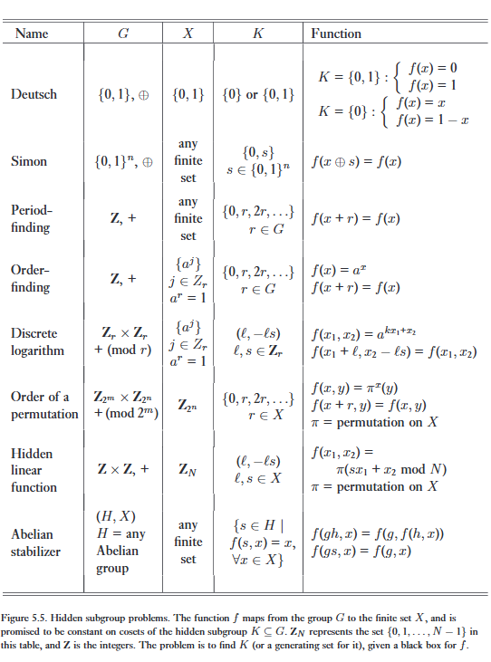

Các ứng dụng chính của biến đổi Fourier lượng tử mà chúng ta đã mô tả cho đến nay trong chương này là ước lượng pha và tìm bậc. Những bài toán nào khác có thể được giải quyết bằng các kỹ thuật này? Trong phần này, chúng ta định nghĩa một bài toán rất tổng quát được gọi là bài toán nhóm con ẩn (hidden subgroup problem), và mô tả một thuật toán lượng tử hiệu quả để giải quyết nó. Bài toán này, bao trùm tất cả các ứng dụng 'nhanh theo hàm mũ' đã biết của biến đổi Fourier lượng tử, có thể được coi là sự tổng quát hóa của nhiệm vụ tìm chu kỳ chưa biết của một hàm tuần hoàn, trong một bối cảnh nơi cấu trúc miền xác định (domain) và miền giá trị (range) của hàm có thể rất phức tạp.   

Để trình bày bài toán này theo cách dễ tiếp cận nhất, chúng ta bắt đầu với hai ứng dụng cụ thể hơn: tìm chu kỳ (của một hàm một chiều), và logarit rời rạc. Sau đó chúng ta sẽ quay trở lại bài toán nhóm con ẩn tổng quát. Lưu ý rằng cách trình bày trong phần này mang tính sơ đồ và khái niệm nhiều hơn so với các phần trước trong chương này; do sự cần thiết, điều này có nghĩa là độc giả quan tâm đến việc hiểu tất cả các chi tiết sẽ phải làm việc chăm chỉ hơn rất nhiều!   

# 1. Period-finding

:::{.callout}
# tl;dr

## Abstract

Thay vì dùng $U\vert x \rangle \vert y \rangle = \vert x \rangle \vert xy \pmod N \rangle$ như ở bài trước, ở bài này chúng ta dùng hộp đen lượng tử chuẩn 

$$
U \vert x \rangle \vert y \rangle = \vert x \rangle \vert y \otimes f(x) \rangle
$$

Hàm f(x) ở đây có thể là bất cứ thứ gì, miễn là nó tuần hoàn $f(x + r) = f(x)$.

## Double Fourier

Ở bài cũ chúng ta dựa vào trạng thái riêng $\vert u_s \rangle$.

Thì ở bài này chúng ta dùng trạng thái $\vert{}\hat{f}(\ell)\rangle$ (5.63), đây chính là Biến đổi Fourier của hàm số f(x), được ghi thẳng vào trong register.

$\vert{}\hat{f}(\ell)\rangle = FT\vert f(x) \rangle$ thì:

$$
\vert{}f(x)\rangle = \frac{1}{\sqrt{r}} \sum_{\ell=0}^{r-1} e^{2\pi i \ell x / r} \vert{}\hat{f}(\ell)\rangle, \tag{5.64}
$$

:::

Hãy xem xét bài toán sau. Giả sử $f$ là một hàm tuần hoàn tạo ra một bit duy nhất làm đầu ra và sao cho $f(x + r) = f(x)$, đối với một số $0 < r < 2^L$ chưa biết, trong đó $x, r \in \{0, 1, 2, \dots\}$. Cho một hộp đen lượng tử $U$ thực hiện phép biến đổi unita $U\vert{}x\rangle\vert{}y\rangle \to \vert{}x\rangle\vert{}y \oplus f(x)\rangle$ (trong đó $\oplus$ biểu thị phép cộng modulo 2) cần bao nhiêu truy vấn hộp đen và các phép toán khác để xác định $r$? Lưu ý rằng trong thực tế $U$ hoạt động trên một miền hữu hạn, kích thước của miền này được xác định bởi độ chính xác mong muốn đối với $r$. Đây là một thuật toán lượng tử giải quyết bài toán này sử dụng một truy vấn, và $O(L^2)$ các phép toán khác:   

## Algorithm: Period-finding

Thuật toán: Tìm chu kỳ   

Các đầu vào:
(1) Một hộp đen thực hiện phép toán $U\vert{}x\rangle\vert{}y\rangle = \vert{}x\rangle\vert{}y \oplus f(x)\rangle$,
(2) một trạng thái để lưu trữ đánh giá hàm, được khởi tạo ở $\vert{}0\rangle$, và
(3) $t = O(L + \log(1/\epsilon))$ qubit được khởi tạo ở $\vert{}0\rangle$.   

Đầu ra: Số nguyên nhỏ nhất $r > 0$ sao cho $f(x + r) = f(x)$.   

Thời gian chạy: Một lần sử dụng $U$, và $O(L^2)$ phép toán. Thành công với xác suất $O(1)$.   

Quy trình:   
(1) $\vert{}0\rangle\vert{}0\rangle$ (trạng thái ban đầu)   
(2) $\to \frac{1}{\sqrt{2^t}} \sum_{x=0}^{2^t-1} \vert{}x\rangle\vert{}0\rangle$ (tạo chồng chập)   
(3) $\to \frac{1}{\sqrt{2^t}} \sum_{x=0}^{2^t-1} \vert{}x\rangle\vert{}f(x)\rangle$ (áp dụng U) $\approx \frac{1}{\sqrt{r 2^t}} \sum_{\ell=0}^{r-1} \sum_{x=0}^{2^t-1} e^{2\pi i \ell x / r} \vert{}x\rangle \vert{}\hat{f}(\ell)\rangle$   
(4) $\to \frac{1}{\sqrt{r}} \sum_{\ell=0}^{r-1} \vert{}\widetilde{\ell/r}\rangle \vert{}\hat{f}(\ell)\rangle$ (áp dụng biến đổi Fourier ngược lên thanh ghi thứ nhất)   
(5) $\to \widetilde{\ell/r}$ (đo thanh ghi thứ nhất)   
(6) $\to r$ (áp dụng thuật toán liên phân số)   

Chìa khóa để hiểu thuật toán này, vốn dựa trên ước lượng pha, và gần như giống hệt với thuật toán tìm bậc lượng tử, là bước 3, trong đó chúng ta giới thiệu trạng thái   

$$
\vert{}\hat{f}(\ell)\rangle \equiv \frac{1}{\sqrt{r}} \sum_{x=0}^{r-1} e^{-2\pi i \ell x / r} \vert{}f(x)\rangle, \tag{5.63}
$$   

biến đổi Fourier của $\vert{}f(x)\rangle$. Đồng nhất thức được sử dụng ở bước 3 dựa trên   

$$
\vert{}f(x)\rangle = \frac{1}{\sqrt{r}} \sum_{\ell=0}^{r-1} e^{2\pi i \ell x / r} \vert{}\hat{f}(\ell)\rangle, \tag{5.64}
$$   

điều này rất dễ để xác minh bằng cách lưu ý rằng $\sum_{\ell=0}^{r-1} e^{2\pi i \ell x / r} = r$ đối với $x$ là một bội số nguyên của $r$, và bằng không trong các trường hợp khác. Sự bằng nhau xấp xỉ ở bước 3 là bắt buộc vì $2^t$ nói chung có thể không phải là một bội số nguyên của $r$ (không cần thiết phải như vậy: điều này đã được tính đến bởi các ranh giới ước lượng pha). Theo Phương trình (5.22), việc áp dụng biến đổi Fourier ngược lên thanh ghi thứ nhất, ở bước 4, cho ra một ước lượng của pha $\ell/r$, trong đó $\ell$ được chọn ngẫu nhiên. $r$ có thể thu được một cách hiệu quả ở bước cuối cùng bằng cách sử dụng khai triển liên phân số. 

---

Tại sao điều này lại hoạt động? 

Một cách để hiểu điều này là nhận ra rằng (5.63) xấp xỉ là biến đổi Fourier trên $\{0, 1, \dots, 2^L - 1\}$ của $\vert{}f(x)\rangle$ (xem Bài tập 5.20), và biến đổi Fourier có một tính chất thú vị và rất hữu ích, được gọi là bất biến dịch chuyển (shift invariance), được mô tả trong Hộp 5.5. Một cách khác là nhận ra rằng những gì thuật toán tìm bậc làm chỉ là tìm chu kỳ của hàm $f(k) = x^k \pmod N$, vì vậy khả năng tìm chu kỳ của một hàm tuần hoàn tổng quát không có gì bất ngờ. Một cách nữa để nhận ra là việc triển khai hộp đen $U$ một cách tự nhiên được thực hiện bằng cách sử dụng một toán tử unita nhất định mà các vector riêng của nó chính xác là $\vert{}\hat{f}(\ell)\rangle$, như được mô tả trong Bài tập 5.21 dưới đây, để quy trình ước lượng pha của Mục 5.2 có thể được áp dụng.   

:::{.callout-note collapse="true"}
# Bài tập 5.20: 
Giả sử $f(x + r) = f(x)$, và $0 \le x < N$, cho $N$ là một bội số nguyên của $r$. Tính toán   

$$
\hat{f}(\ell) \equiv \frac{1}{\sqrt{N}} \sum_{x=0}^{N-1} e^{-2\pi i \ell x / N} f(x), \tag{5.68}
$$   

và liên hệ kết quả với (5.63). Bạn sẽ cần sử dụng thực tế là   

$$
\sum_{k \in \{0, r, 2r, \dots, N-r\}} e^{2\pi i k \ell / N} = \begin{cases} \sqrt{N/r} & \text{if } \ell \text{ is an integer multiple of } N/r \\ 0 & \text{otherwise.} \end{cases} \tag{5.69}
$$   

:::

:::{.callout-note collapse="true"}
# Bài tập 5.21: (Tìm chu kỳ và ước lượng pha) 
Giả sử bạn được cho một toán tử unita $U_y$ thực hiện phép biến đổi $U_y\vert{}f(x)\rangle = \vert{}f(x + y)\rangle$, đối với hàm tuần hoàn được mô tả ở trên.
(1) Chỉ ra rằng các vector riêng của $U_y$ là $\vert{}\hat{f}(\ell)\rangle$, và tính toán các trị riêng của chúng.
(2) Chỉ ra rằng cho trước $\vert{}f(x_0)\rangle$ đối với một $x_0$ nào đó, $U_y$ có thể được sử dụng để hiện thực hóa một hộp đen hữu ích như $U$ trong việc giải quyết bài toán tìm chu kỳ. 

:::

# 2. Discrete logarithms

:::{.callout}
# tl;dr

## Bài chất Logarit Rời rạc

*Bài toán mở đầu:* Cho a (cơ số) và b (kết quả). Tìm số mũ s sao cho $a^s \equiv b \pmod N$. Khác với logarit thực ($s = \log_a b$) tính rất dễ, logarit trên vành số nguyên Modulo N là một bài toán hàm mũ siêu khó.

*Đáp án:* Tác giả xây dựng một hàm hai biến số: $f(x_1, x_2) = b^{x_1}a^{x_2} \pmod N$.

Vì $b = a^s$, ta có thể viết lại hàm số thành: $f(x_1, x_2) = (a^s)^{x_1} a^{x_2} = a^{sx_1 + x_2} \pmod N$. 

## Tuần hoàn, chu kỳ

Hàm số này không tuần hoàn theo 1 số nguyên, mà tuần hoàn theo một vector (2-tuple) trong không gian 2 chiều!

Thật vậy, nếu ta dịch chuyển $x_1$ thêm $\ell$, và dịch chuyển $x_2$ lùi đi $\ell s$, ta có:

$$
f(x_1 + \ell, x_2 - \ell s) = a^{s(x_1 + \ell) + (x_2 - \ell s)} = a^{sx_1 + s\ell + x_2 - s\ell} = a^{sx_1 + x_2} = f(x_1, x_2)
$$   

Nghĩa là, hàm số bị bất biến (hidden subgroup) dọc theo hướng của vector $(\ell, -\ell s)$. Bí mật về logarit $s$ chính là độ dốc (slope) của cái hướng ẩn này!

## 2D QFT

Vì hàm có 2 biến, mạch lượng tử giờ đây cần 2 thanh ghi điều khiển (gồm $x_1$ và $x_2$).

Chú ý vào bước 3 của thuật toán, khi khai triển trạng thái Fourier của hàm $f(x_1, x_2)$, pha của nó tách thành tổng của 2 pha độc lập cho $x_1$ và $x_2$. Thanh ghi 1 bị khóa vào pha $e^{2\pi i (s\ell_2 x_1)/r}$, còn thanh ghi 2 bị khóa vào pha $e^{2\pi i (\ell_2 x_2)/r}$.  

Khi áp dụng QFT ngược độc lập cho cả hai thanh ghi và đo lường, bạn sẽ thu được hai phân số xấp xỉ:

* Thanh ghi 1 thả ra: $\approx sl_2/r$.
* Thanh ghi 2 thả ra: $\approx l_2/r$.

Giờ chỉ cần việc lấy kết quả của Thanh ghi 1 chia cho kết quả của thanh ghi 2:

$$
\frac {sl_2/r}{l_2r} = s
$$

Và thế là khóa S đã có!

:::

Bài toán tìm chu kỳ mà chúng ta vừa xem xét là một bài toán đơn giản, ở chỗ miền xác định và miền giá trị của hàm tuần hoàn là các số nguyên. Điều gì xảy ra khi hàm số phức tạp hơn? Xem xét hàm số $f(x_1, x_2) = a^{sx_1 + x_2} \pmod N$, trong đó tất cả các biến đều là số nguyên, và $r$ là số nguyên dương nhỏ nhất sao cho $a^r \pmod N = 1$. Hàm số này là tuần hoàn, vì $f(x_1 + \ell, x_2 - \ell s) = f(x_1, x_2)$, nhưng bây giờ chu kỳ là một bộ 2 phần tử (2-tuple), $(\ell, -\ell s)$, đối với số nguyên $\ell$. Đây có vẻ là một hàm số kỳ lạ, nhưng nó rất hữu ích trong mật mã học, vì việc xác định $s$ cho phép người ta giải quyết cái được gọi là bài toán logarit rời rạc: cho trước $a$ và $b = a^s$, $s$ là gì? Đây là một thuật toán lượng tử giải quyết bài toán này sử dụng một truy vấn của một hộp đen lượng tử $U$ thực hiện phép biến đổi unita $U\vert{}x_1\rangle\vert{}x_2\rangle\vert{}y\rangle \to \vert{}x_1\rangle\vert{}x_2\rangle\vert{}y \oplus f(x)\rangle$ (trong đó $\oplus$ biểu thị phép cộng bitwise modulo 2), và $O(\lceil \log r \rceil^2)$ các phép toán khác. Chúng ta giả định rằng đã biết số $r > 0$ nhỏ nhất sao cho $a^r \pmod N = 1$, giá trị này có thể thu được bằng cách sử dụng thuật toán tìm bậc đã mô tả trước đó.   

## Algorithm: Discrete logarithm
Thuật toán: Logarit rời rạc   

Các đầu vào:
(1) Một hộp đen thực hiện phép toán $U\vert{}x_1\rangle\vert{}x_2\rangle\vert{}y\rangle = \vert{}x_1\rangle\vert{}x_2\rangle\vert{}y \oplus f(x_1, x_2)\rangle$, đối với $f(x_1, x_2) = b^{x_1} a^{x_2}$,
(2) một trạng thái để lưu trữ đánh giá hàm, được khởi tạo ở $\vert{}0\rangle$, và
(3) hai thanh ghi $t = O(\lceil \log r \rceil + \log(1/\epsilon))$ qubit được khởi tạo ở $\vert{}0\rangle$.   Đầu ra: Số nguyên dương $s$ nhỏ nhất sao cho $a^s = b$.   

Thời gian chạy: Một lần sử dụng $U$, và $O(\lceil \log r \rceil^2)$ phép toán. Thành công với xác suất $O(1)$.   

Quy trình:   

(1) $\vert{}0\rangle\vert{}0\rangle\vert{}0\rangle$ (trạng thái ban đầu)   
(2) $\to \frac{1}{2^t} \sum_{x_1=0}^{2^t-1} \sum_{x_2=0}^{2^t-1} \vert{}x_1\rangle\vert{}x_2\rangle\vert{}0\rangle$ (tạo chồng chập)   
(3) $\to \frac{1}{2^t} \sum_{x_1=0}^{2^t-1} \sum_{x_2=0}^{2^t-1} \vert{}x_1\rangle\vert{}x_2\rangle\vert{}f(x_1, x_2)\rangle$ (áp dụng U)
$\approx \frac{1}{2^t \sqrt{r}} \sum_{\ell_2=0}^{r-1} \sum_{x_1=0}^{2^t-1} \sum_{x_2=0}^{2^t-1} e^{2\pi i (s\ell_2 x_1 + \ell_2 x_2) / r} \vert{}x_1\rangle\vert{}x_2\rangle \vert{}\hat{f}(s\ell_2, \ell_2)\rangle$
$= \frac{1}{\sqrt{r}} \sum_{\ell_2=0}^{r-1} \left[ \frac{1}{\sqrt{2^t}} \sum_{x_1=0}^{2^t-1} e^{2\pi i (s\ell_2 x_1) / r} \vert{}x_1\rangle \right] \left[ \frac{1}{\sqrt{2^t}} \sum_{x_2=0}^{2^t-1} e^{2\pi i (\ell_2 x_2) / r} \vert{}x_2\rangle \right] \vert{}\hat{f}(s\ell_2, \ell_2)\rangle$   
(4) $\to \frac{1}{\sqrt{r}} \sum_{\ell_2=0}^{r-1} \vert{}\widetilde{s\ell_2/r}\rangle \vert{}\widetilde{\ell_2/r}\rangle \vert{}\hat{f}(s\ell_2, \ell_2)\rangle$ (áp dụng biến đổi Fourier ngược lên hai thanh ghi đầu tiên)   
(5) $\to (\widetilde{s\ell_2/r}, \widetilde{\ell_2/r})$ (đo hai thanh ghi đầu tiên)   
(6) $\to s$ (áp dụng thuật toán liên phân số tổng quát)   

Một lần nữa, chìa khóa để hiểu thuật toán này là bước 3, trong đó chúng ta giới thiệu trạng thái   

$$
\vert{}\hat{f}(\ell_1, \ell_2)\rangle = \frac{1}{\sqrt{r}} \sum_{j=0}^{r-1} e^{-2\pi i \ell_2 j / r} \vert{}f(0, j)\rangle, \tag{5.70}
$$   

biến đổi Fourier của $\vert{}f(x_1, x_2)\rangle$ (xem Bài tập 5.22). Trong phương trình này, các giá trị của $\ell_1$ và $\ell_2$ phải thỏa mãn   

$$
\sum_{k=0}^{r-1} e^{2\pi i k (\ell_1 / s - \ell_2) / r} = r. \tag{5.71}
$$   

Nếu không, biên độ của $\vert{}\hat{f}(\ell_1, \ell_2)\rangle$ gần như bằng không. Khai triển liên phân số tổng quát được sử dụng trong bước cuối cùng để xác định $s$ tương tự như các quy trình được sử dụng trong Mục 5.3.1, và được để lại như một bài tập đơn giản để bạn tự xây dựng.   

:::{.callout-note collapse="true"}
# Bài tập 5.22: 
Chỉ ra rằng   

$$
\vert{}\hat{f}(\ell_1, \ell_2)\rangle = \sum_{x_1=0}^{r-1} \sum_{x_2=0}^{r-1} e^{-2\pi i (\ell_1 x_1 + \ell_2 x_2) / r} \vert{}f(x_1, x_2)\rangle = \frac{1}{\sqrt{r}} \sum_{j=0}^{r-1} e^{-2\pi i \ell_2 j / r} \vert{}f(0, j)\rangle, \tag{5.72}
$$

và chúng ta bị ràng buộc phải có $\ell_1 / s - \ell_2$ là một bội số nguyên của $r$ để biểu thức này khác không.   

:::

:::{.callout-note collapse="true"}
# Bài tập 5.23: 
Tính toán   

$$
\frac{1}{r} \sum_{\ell_1=0}^{r-1} \sum_{\ell_2=0}^{r-1} e^{-2\pi i (\ell_1 x_1 + \ell_2 x_2) / r} \vert{}\hat{f}(\ell_1, \ell_2)\rangle \tag{5.73}
$$   

sử dụng (5.70), và chỉ ra rằng kết quả là $f(x_1, x_2)$.   
:::

:::{.callout-note collapse="true"}
# Bài tập 5.24: 
Xây dựng thuật toán liên phân số tổng quát cần thiết trong bước 6 của thuật toán logarit rời rạc để xác định $s$ từ các ước lượng của $s\ell_2 / r$ và $\ell_2 / r$.   

:::

:::{.callout-note collapse="true"}
# Bài tập 5.25: 
Xây dựng một mạch lượng tử cho hộp đen $U$ được sử dụng trong thuật toán logarit rời rạc lượng tử, lấy $a$ và $b$ làm tham số, và thực hiện phép biến đổi unita $\vert{}x_1\rangle\vert{}x_2\rangle\vert{}y\rangle \to \vert{}x_1\rangle\vert{}x_2\rangle\vert{}y \oplus b^{x_1} a^{x_2}\rangle$. Cần bao nhiêu phép toán cơ bản? 

:::

# 3. The hidden subgroup problem

Đến lúc này, một quy luật hẳn đã trở nên rõ ràng: nếu chúng ta được cho một hàm tuần hoàn, ngay cả khi cấu trúc của tính tuần hoàn khá phức tạp, chúng ta thường có thể sử dụng một thuật toán lượng tử để xác định chu kỳ một cách hiệu quả. Tuy nhiên, điều quan trọng là không phải tất cả các chu kỳ của các hàm tuần hoàn đều có thể được xác định. Bài toán tổng quát định nghĩa một khuôn khổ rộng lớn cho những câu hỏi này có thể được diễn đạt một cách súc tích bằng ngôn ngữ của lý thuyết nhóm (xem Phụ lục 2 để ôn tập nhanh) như sau:   

> Cho $f$ là một hàm từ một nhóm sinh hữu hạn $G$ đến một tập hữu hạn $X$ sao cho $f$ là hằng số trên các lớp kề (cosets) của một nhóm con $K$, và phân biệt trên mỗi lớp kề. Cho trước một hộp đen lượng tử để thực hiện phép biến đổi unita $U\vert{}g\rangle\vert{}h\rangle = \vert{}g\rangle\vert{}h \oplus f(g)\rangle$, đối với $g \in G, h \in X$, và $\oplus$ là một phép toán hai ngôi được chọn thích hợp trên $X$, hãy tìm một tập sinh (generating set) cho $K$.   

Tìm bậc, tìm chu kỳ, logarit rời rạc, và nhiều bài toán khác là những trường hợp của bài toán nhóm con ẩn này; một số bài toán thú vị được liệt kê trong Hình 5.5.   

---

Đối với $G$ là một nhóm Abel hữu hạn, một máy tính lượng tử có thể giải quyết bài toán nhóm con ẩn bằng cách sử dụng một số lượng phép toán đa thức theo $\log \vert{}G\vert{}$, và một lần sử dụng đánh giá hàm hộp đen, sử dụng một thuật toán rất giống với các thuật toán khác trong phần này. (Thực tế, giải pháp cho một nhóm Abel sinh hữu hạn cũng khả thi, theo những hướng tương tự, nhưng chúng ta sẽ chỉ bám sát vào trường hợp hữu hạn ở đây.) Chúng tôi sẽ để lại việc đặc tả chi tiết thuật toán cho bạn như một bài tập, điều này sẽ đơn giản sau khi chúng tôi giải thích ý tưởng cơ bản. Nhiều thứ về cơ bản vẫn giữ nguyên, bởi vì các nhóm Abel hữu hạn đẳng cấu (isomorphic) với các tích của các nhóm cộng trên các số nguyên trong số học modulo. Điều này có nghĩa là biến đổi Fourier lượng tử của $f$ trên $G$ được xác định rõ (xem Mục A2.3), và vẫn có thể được thực hiện một cách hiệu quả. Bước không tầm thường đầu tiên của thuật toán là sử dụng một biến đổi Fourier (tổng quát hóa phép toán Hadamard) để tạo ra một chồng chập trên các phần tử của nhóm, sau đó được biến đổi bằng cách áp dụng hộp đen lượng tử cho $f$ trong bước tiếp theo, để cho ra   

$$
\frac{1}{\sqrt{\vert{}G\vert{}}} \sum_{g \in G} \vert{}g\rangle\vert{}f(g)\rangle. \tag{5.74}
$$   

Như trước đây, bây giờ chúng ta muốn viết lại $\vert{}f(g)\rangle$ trong cơ sở Fourier. Chúng ta bắt đầu với   

$$
\vert{}f(g)\rangle = \frac{1}{\sqrt{\vert{}G\vert{}}} \sum_{\ell=0}^{\vert{}G\vert{}-1} e^{2\pi i \ell g / \vert{}G\vert{}} \vert{}\hat{f}(\ell)\rangle, \tag{5.75}
$$

trong đó chúng ta đã chọn $\exp[-2\pi i \ell g / \vert{}G\vert{}]$ như một biểu diễn (xem Bài tập A2.13) của $g \in G$ được lập chỉ mục bởi $\ell$ (biến đổi Fourier ánh xạ giữa các phần tử của nhóm và các biểu diễn: xem Bài tập A2.23). Chìa khóa là nhận ra rằng biểu thức này có thể được đơn giản hóa bởi vì $f$ là hằng số và phân biệt trên các lớp kề của nhóm con $K$, sao cho   

$$
\vert{}\hat{f}(\ell)\rangle = \frac{1}{\sqrt{\vert{}G\vert{}}} \sum_{g \in G} e^{-2\pi i \ell g / \vert{}G\vert{}} \vert{}f(g)\rangle \tag{5.76}
$$   

có biên độ gần bằng không đối với mọi giá trị của $\ell$ ngoại trừ những giá trị thỏa mãn   

$$
\sum_{h \in K} e^{-2\pi i \ell h / \vert{}G\vert{}} = \vert{}K\vert{}. \tag{5.77}
$$   

Nếu chúng ta có thể xác định $\ell$, thì việc sử dụng các ràng buộc tuyến tính được đưa ra bởi biểu thức này cho phép chúng ta xác định các phần tử của $K$, và vì $K$ là nhóm Abel, điều này cho phép chúng ta cuối cùng xác định một tập sinh cho toàn bộ nhóm con ẩn, giải quyết bài toán.   

Tuy nhiên, cuộc sống không đơn giản như vậy. Một lý do quan trọng tại sao các thuật toán tìm chu kỳ và logarit rời rạc hoạt động là do sự thành công của khai triển liên phân số trong việc thu được $\ell$ từ $\ell/\vert{}G\vert{}$. Trong những bài toán đó, $\ell$ và $\vert{}G\vert{}$ được sắp xếp để không có bất kỳ ước chung nào, với xác suất cao. Tuy nhiên, trong trường hợp tổng quát, điều này có thể không đúng, vì $\vert{}G\vert{}$ được tự do là một hợp số với nhiều ước số, và chúng ta không có thông tin tiên nghiệm hữu ích nào về $\ell$.   

May mắn thay, bài toán này có thể được giải quyết: như đã đề cập ở trên, bất kỳ nhóm Abel hữu hạn $G$ nào cũng đẳng cấu với một tích của các nhóm cyclic có bậc là lũy thừa của số nguyên tố, tức là, $G = \mathbb{Z}_{p_1} \times \mathbb{Z}_{p_2} \times \dots \times \mathbb{Z}_{p_M}$, trong đó $p_i$ là các số nguyên tố, và $\mathbb{Z}_{p_i}$ là nhóm trên các số nguyên $\{0, 1, \dots, p_i - 1\}$ với phép cộng modulo $p_i$ là phép toán nhóm. Do đó, chúng ta có thể biểu diễn lại pha xuất hiện trong (5.75) dưới dạng   

$$
e^{2\pi i \ell g / \vert{}G\vert{}} = \prod_{i=1}^M e^{2\pi i \ell_i' g_i / p_i} \tag{5.78}
$$   

đối với $g_i \in \mathbb{Z}_{p_i}$. Quy trình ước lượng pha bây giờ cung cấp cho chúng ta các $\ell_i'$, từ đó chúng ta xác định $\ell$, và theo đó, lấy mẫu $K$ như đã mô tả ở trên, để giải quyết bài toán nhóm con ẩn.   

:::{.callout-note collapse="true"}
# Bài tập 5.26: 
Vì $K$ là một nhóm con của $G$, khi chúng ta phân rã $G$ thành một tích của các nhóm cyclic có bậc là lũy thừa của số nguyên tố, điều này cũng phân rã $K$. Hãy biểu diễn lại (5.77) để chỉ ra rằng việc xác định $\ell_i'$ cho phép người ta lấy mẫu từ nhóm con cyclic $K_{p_i}$ tương ứng của $K$.   

:::

:::{.callout-note collapse="true"}
# Bài tập 5.27: 
Tất nhiên, việc phân rã một nhóm Abel hữu hạn tổng quát $G$ thành một tích của các nhóm cyclic có bậc là lũy thừa của số nguyên tố thường là một bài toán khó (ít nhất là khó bằng việc phân tích các số nguyên, chẳng hạn). Ở đây, các thuật toán lượng tử lại đến để giải cứu: hãy giải thích cách các thuật toán trong chương này có thể được sử dụng để phân rã $G$ một cách hiệu quả như mong muốn.   

:::

:::{.callout-note collapse="true"}
# Bài tập 5.28: 
Viết ra một đặc tả chi tiết về thuật toán lượng tử để giải quyết bài toán nhóm con ẩn, hoàn chỉnh với các ước tính về thời gian chạy và xác suất thành công, đối với các nhóm Abel hữu hạn.   

:::

:::{.callout-note collapse="true"}
# Bài tập 5.29: 
Đưa ra các thuật toán lượng tử để giải quyết các bài toán Deutsch và Simon được liệt kê trong Hình 5.5, sử dụng khuôn khổ của bài toán nhóm con ẩn.

:::

# 4. Other quantum algorithms?

Một trong những khía cạnh hấp dẫn nhất của khuôn khổ mô tả các thuật toán lượng tử dưới dạng bài toán nhóm con ẩn là sự gợi ý rằng các bài toán khó hơn có thể được giải quyết bằng cách xem xét các nhóm $G$ và hàm $f$ khác nhau. Chúng ta chỉ mới mô tả giải pháp của bài toán này cho các nhóm Abel. Còn về các nhóm phi Abel (non-Abelian groups) thì sao? Chúng khá thú vị (xem Phụ lục 2 để thảo luận về các biến đổi Fourier tổng quát trên các nhóm phi Abel): ví dụ, bài toán đẳng cấu đồ thị (graph isomorphism) là xác định xem hai đồ thị cho trước có giống nhau dưới một phép hoán vị nào đó của các nhãn của $n$ đỉnh hay không (Mục 3.2.3). Các phép hoán vị này có thể được mô tả như các phép biến đổi dưới nhóm đối xứng $S_n$, và các thuật toán để thực hiện biến đổi Fourier nhanh trên các nhóm này là có tồn tại. Tuy nhiên, một thuật toán lượng tử để giải quyết hiệu quả bài toán đẳng cấu đồ thị vẫn còn chưa được biết đến.   

Ngay cả khi các trường hợp tổng quát hơn của bài toán nhóm con ẩn vẫn không thể giải được bằng máy tính lượng tử, việc có khuôn khổ thống nhất này vẫn hữu ích, bởi vì nó cho phép chúng ta đặt câu hỏi về cách người ta có thể bước ra ngoài những giới hạn của nó. Thật khó để tin rằng tất cả các thuật toán lượng tử nhanh sẽ từng được khám phá ra sẽ chỉ là những cách để giải quyết bài toán nhóm con ẩn. Nếu người ta nghĩ về những bài toán này như được dựa trên tính chất bất biến lớp kề (coset invariance) của biến đổi Fourier, thì trong việc tìm kiếm các thuật toán mới, có lẽ điều cần làm sau đó là nghiên cứu các phép biến đổi khác với các tính bất biến khác. Đi theo một hướng khác, người ta có thể hỏi: những bài toán nhóm con ẩn khó nào có thể được giải quyết một cách hiệu quả nếu có một trạng thái lượng tử tùy ý (nhưng được chỉ định độc lập với bài toán) như một trợ thủ? Suy cho cùng, như đã thảo luận trong Chương 4, hầu hết các trạng thái lượng tử thực sự khó chế tạo theo hàm mũ. Một trạng thái như vậy có thể là một tài nguyên hữu ích (một 'hộp đen lượng tử' thực sự), nếu các thuật toán lượng tử tồn tại để sử dụng chúng nhằm giải quyết các bài toán khó!   

Bài toán nhóm con ẩn cũng nắm bắt một ràng buộc quan trọng nằm bên dưới lớp các thuật toán lượng tử mà nhanh hơn theo hàm mũ so với các bản sao cổ điển (đã biết) của chúng: đây là một bài toán cam kết (promise problem), nghĩa là nó có dạng 'F(X) được cam kết là có tính chất này và tính chất nọ: hãy mô tả tính chất đó'. Có lẽ khá đáng thất vọng, chúng tôi sẽ chỉ ra ở phần cuối của chương tiếp theo rằng, trong việc giải quyết các bài toán mà không có một loại cam kết nào đó, máy tính lượng tử không thể đạt được tốc độ tăng tốc hàm mũ so với máy tính cổ điển; tốc độ tăng tốc tốt nhất là đa thức. Mặt khác, điều này cho chúng ta một manh mối quan trọng về những loại bài toán nào mà máy tính lượng tử có thể giỏi: nhìn lại, bài toán nhóm con ẩn có thể được coi là một ứng cử viên tự nhiên cho tính toán lượng tử. Còn những bài toán tự nhiên nào khác nữa? Hãy nghĩ về nó!

:::{.callout-note collapse="true"}
# Bài toán 5.1: 
Xây dựng một mạch lượng tử để thực hiện biến đổi Fourier lượng tử   

$$
\vert{}j\rangle \to \frac{1}{\sqrt{p}} \sum_{k=0}^{p-1} e^{2\pi i j k / p} \vert{}k\rangle \tag{5.79}
$$   

trong đó $p$ là một số nguyên tố.   
:::

:::{.callout-note collapse="true"}
# Bài toán 5.2: (Biến đổi Fourier lượng tử được đo đạc) 
Giả sử biến đổi Fourier lượng tử được thực hiện như là bước cuối cùng của một quá trình tính toán lượng tử, theo sau là một phép đo trong cơ sở tính toán. Chỉ ra rằng sự kết hợp giữa biến đổi Fourier lượng tử và phép đo tương đương với một mạch bao gồm hoàn toàn các cổng một qubit và phép đo, với sự điều khiển cổ điển, và không có cổng hai qubit nào. Bạn có thể thấy phần thảo luận ở Mục 4.4 là hữu ích.   

:::

:::{.callout-note collapse="true"}
# Bài toán 5.3: (Thuật toán Kitaev) 
Xem xét mạch lượng tử   

  

trong đó $\vert{}u\rangle$ là một trạng thái riêng của $U$ với trị riêng $e^{2\pi i \varphi}$. Chỉ ra rằng qubit trên cùng được đo là 0 với xác suất $p \equiv \cos^2(\pi \varphi)$. Vì trạng thái $\vert{}u\rangle$ không bị ảnh hưởng bởi mạch nên nó có thể được tái sử dụng; nếu $U$ có thể được thay thế bằng $U^k$, trong đó $k$ là một số nguyên tùy ý dưới sự kiểm soát của bạn, hãy chỉ ra rằng bằng cách lặp lại mạch này và tăng $k$ một cách thích hợp, bạn có thể thu được hiệu quả số lượng bit của $p$ nhiều như mong muốn, và do đó, của $\varphi$. Đây là một giải pháp thay thế cho thuật toán ước lượng pha.   

:::

:::{.callout-note collapse="true"}
# Bài toán 5.4: 
Ranh giới thời gian chạy $O(L^3)$ mà chúng ta đã đưa ra cho thuật toán phân tích thừa số là không chặt chẽ (not tight). Chỉ ra rằng có thể đạt được một ranh giới trên tốt hơn là $O(L^2 \log L \log \log L)$ phép toán.   

:::

:::{.callout-note collapse="true"}
# Bài toán 5.5: (Các nhóm con ẩn phi Abel - Nghiên cứu) 
Cho $f$ là một hàm trên một nhóm hữu hạn $G$ đến một miền hữu hạn tùy ý $X$, được cam kết là hằng số và phân biệt trên các lớp kề trái phân biệt của một nhóm con $K$. Bắt đầu với trạng thái   

$$
\frac{1}{\sqrt{\vert{}G\vert{}^m}} \sum_{g_1, \dots, g_m} \vert{}g_1, \dots, g_m\rangle \vert{}f(g_1), \dots, f(g_m)\rangle, \tag{5.80}
$$   

và chứng minh rằng việc chọn $m = 4\log\vert{}G\vert{} + 2$ cho phép $K$ được xác định với xác suất ít nhất là $1 - 1/\vert{}G\vert{}$. Lưu ý rằng $G$ không nhất thiết phải là nhóm Abel, và không bắt buộc phải có khả năng thực hiện biến đổi Fourier trên $G$. Kết quả này cho thấy người ta có thể tạo ra (chỉ sử dụng $O(\log\vert{}G\vert{})$ lời gọi hộp đen) một kết quả cuối cùng trong đó các kết quả trạng thái thuần tương ứng với các nhóm con ẩn có thể có khác nhau là gần như trực giao. Tuy nhiên, người ta chưa biết liệu có tồn tại một POVM nào cho phép xác định nhóm con ẩn một cách hiệu quả (nghĩa là sử dụng các phép toán $\text{poly}(\log\vert{}G\vert{})$) từ trạng thái cuối cùng này hay không.   

:::

:::{.callout-note collapse="true"}
# Bài toán 5.6: (Phép cộng bằng biến đổi Fourier) 
Xem xét nhiệm vụ xây dựng một mạch lượng tử để tính toán $\vert{}x\rangle \to \vert{}x + y \pmod{2^n}\rangle$, trong đó $y$ là một hằng số cố định, và $0 \le x < 2^n$. Chỉ ra rằng một cách hiệu quả để làm điều này, đối với các giá trị của $y$ chẳng hạn như $1$, là đầu tiên thực hiện một biến đổi Fourier lượng tử, sau đó áp dụng các dịch chuyển pha một qubit, sau đó là một biến đổi Fourier ngược. Những giá trị nào của $y$ có thể được cộng dễ dàng theo cách này, và cần bao nhiêu phép toán? 

:::

