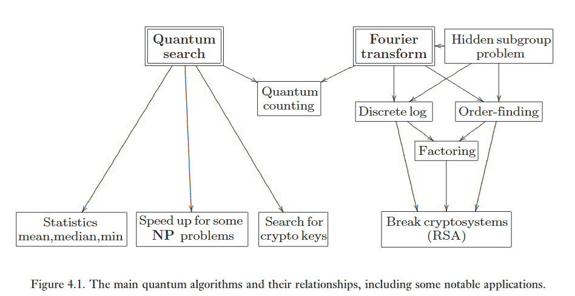

:::{.callout-note}
# tl;dr

Trang này đặt câu hỏi máy tính lượng tử hữu ích ở đâu và giới thiệu hai họ thuật toán. QFT dẫn tới tìm chu kỳ, bài toán nhóm con ẩn, phân tích thừa số và logarit rời rạc; thuật toán Shor vì thế đe dọa mật mã khóa công khai như RSA. Grover tăng tốc bậc hai cho tìm kiếm không cấu trúc, với ứng dụng tìm cực trị, ước lượng thống kê, đếm nghiệm và vét khóa đối xứng. Một số bài toán NP có thể được tăng tốc khi tìm kiếm trực tiếp là phương pháp tốt nhất đã biết, nhưng điều đó không làm NP-complete trở nên dễ nói chung. Đếm lượng tử kết hợp tìm kiếm với QFT để ước lượng số nghiệm. Các lợi thế nêu ở đây so sánh với thuật toán cổ điển tốt nhất đã biết; chúng không có nghĩa bài toán vốn bất khả thi trên máy cổ điển. Vì sáng tạo thuật toán lượng tử khó và trực giác cổ điển thường không đủ, chương kế tiếp giới thiệu mạch lượng tử và cách đo chi phí bằng số cổng, độ sâu.
:::

# 1. Quantum Algorithms

**Một máy tính lượng tử hữu ích cho việc gì?**

Tất cả chúng ta đều quen thuộc với sự bực bội khi cần thêm tài nguyên máy tính để giải quyết một bài toán tính toán. Về mặt thực tế, nhiều bài toán thú vị là không thể giải quyết được trên một máy tính cổ điển, không phải vì về nguyên tắc chúng không thể giải được, mà là vì tài nguyên khổng lồ (astronomical) cần thiết để giải quyết các trường hợp thực tế của bài toán.   

Lời hứa hẹn ngoạn mục của máy tính lượng tử là cho phép các thuật toán mới biến các bài toán đòi hỏi tài nguyên quá đắt đỏ để giải trên máy tính cổ điển trở nên khả thi. Tại thời điểm viết sách, có hai lớp thuật toán lượng tử rộng lớn được biết đến thực hiện lời hứa này. 

* Lớp thuật toán thứ nhất dựa trên biến đổi Fourier lượng tử (quantum Fourier transform) của Shor, và bao gồm các thuật toán đáng chú ý để giải quyết các bài toán phân tích thừa số nguyên tố (factoring) và logarit rời rạc (discrete logarithm), mang lại một sự tăng tốc theo hàm mũ (exponential speedup) nổi bật so với các thuật toán cổ điển tốt nhất được biết đến. 

* Lớp thuật toán thứ hai dựa trên thuật toán của Grover để thực hiện tìm kiếm lượng tử (quantum searching). Chúng mang lại sự tăng tốc bậc hai (quadratic speedup) ít nổi bật hơn nhưng vẫn đáng kinh ngạc so với các thuật toán cổ điển khả dĩ tốt nhất. Thuật toán tìm kiếm lượng tử có được tầm quan trọng từ việc sử dụng rộng rãi các kỹ thuật dựa trên tìm kiếm trong các thuật toán cổ điển, điều mà trong nhiều trường hợp cho phép một sự điều chỉnh trực tiếp từ thuật toán cổ điển để tạo ra một thuật toán lượng tử nhanh hơn. 

---

Hình 4.1 phác họa trạng thái kiến thức về các thuật toán lượng tử tại thời điểm viết sách, bao gồm một số ứng dụng mẫu của các thuật toán đó. Đương nhiên, ở cốt lõi của sơ đồ là biến đổi Fourier lượng tử và thuật toán tìm kiếm lượng tử. Đáng chú ý đặc biệt trong hình là thuật toán đếm lượng tử (quantum counting algorithm). Thuật toán này là sự kết hợp khéo léo giữa các thuật toán tìm kiếm lượng tử và biến đổi Fourier, có thể được sử dụng để ước tính số lượng nghiệm của một bài toán tìm kiếm nhanh hơn mức có thể trên một máy tính cổ điển.   

Thuật toán tìm kiếm lượng tử có nhiều ứng dụng tiềm năng, trong đó chỉ một vài ứng dụng được minh họa. Nó có thể được sử dụng để trích xuất các số liệu thống kê, chẳng hạn như phần tử nhỏ nhất, từ một tập dữ liệu không có thứ tự, nhanh hơn mức có thể trên một máy tính cổ điển. Nó có thể được sử dụng để tăng tốc các thuật toán cho một số bài toán thuộc lớp $\mathbf{NP}$ — cụ thể là những bài toán mà phương pháp tìm kiếm nghiệm trực tiếp (straightforward search) là thuật toán tốt nhất được biết đến. Cuối cùng, nó có thể được sử dụng để tăng tốc quá trình tìm kiếm khóa đối với các hệ thống mật mã chẳng hạn như Tiêu chuẩn Mã hóa Dữ liệu (DES) được sử dụng rộng rãi. Những ứng dụng này và các ứng dụng khác được giải thích trong Chương 6.   

(Hình 4.1. Các thuật toán lượng tử chính và các mối quan hệ giữa chúng, bao gồm một số ứng dụng nổi bật.)   

Biến đổi Fourier lượng tử cũng có nhiều ứng dụng thú vị. Nó có thể được sử dụng để giải quyết các bài toán logarit rời rạc và phân tích thừa số nguyên tố. Những kết quả này, đến lượt chúng, cho phép một máy tính lượng tử phá vỡ nhiều hệ thống mật mã phổ biến nhất hiện đang được sử dụng, bao gồm hệ thống mật mã RSA. Biến đổi Fourier cũng hóa ra có liên quan chặt chẽ đến một bài toán quan trọng trong toán học, bài toán tìm nhóm con ẩn (tìm kiếm chu kỳ của một hàm tuần hoàn là một trường hợp tổng quát của bài toán này). Biến đổi Fourier lượng tử và một số ứng dụng của nó, bao gồm các thuật toán lượng tử nhanh cho bài toán phân tích thừa số nguyên tố và logarit rời rạc, được giải thích trong Chương 5.

---

**Tại sao lại có quá ít thuật toán lượng tử được biết đến là tốt hơn các bản sao cổ điển của chúng?**

Câu trả lời là việc nghĩ ra các thuật toán lượng tử tốt dường như là một bài toán khó. Có ít nhất hai lý do cho điều này. Thứ nhất, thiết kế thuật toán, dù là cổ điển hay lượng tử, đều không phải là một công việc dễ dàng! Lịch sử của các thuật toán cho chúng ta thấy rằng thường đòi hỏi sự khéo léo đáng kể để nghĩ ra các thuật toán gần như tối ưu, ngay cả đối với những bài toán dường như rất đơn giản, như phép nhân hai số. Việc tìm kiếm các thuật toán lượng tử tốt trở nên khó khăn gấp đôi bởi vì có thêm một ràng buộc là chúng ta muốn các thuật toán lượng tử của mình phải tốt hơn các thuật toán cổ điển tốt nhất được biết đến. Lý do thứ hai cho sự khó khăn trong việc tìm kiếm các thuật toán lượng tử tốt là trực giác của chúng ta thích nghi với thế giới cổ điển tốt hơn nhiều so với thế giới lượng tử. Nếu chúng ta suy nghĩ về các bài toán bằng trực giác bẩm sinh của mình, thì những thuật toán mà chúng ta nghĩ ra sẽ là các thuật toán cổ điển. Cần có những hiểu biết sâu sắc đặc biệt và những thủ thuật đặc biệt để nghĩ ra các thuật toán lượng tử tốt.   

Việc nghiên cứu sâu hơn về các thuật toán lượng tử sẽ được hoãn lại cho đến chương tiếp theo. Trong chương này, chúng tôi cung cấp một ngôn ngữ hiệu quả và mạnh mẽ để mô tả các thuật toán lượng tử, ngôn ngữ của các mạch lượng tử — sự lắp ráp các tập hợp thành phần rời rạc để mô tả các quy trình tính toán. Cấu trúc này sẽ cho phép chúng ta định lượng chi phí của một thuật toán thông qua các đại lượng như tổng số cổng cần thiết, hoặc độ sâu của mạch (circuit depth). Ngôn ngữ mạch cũng đi kèm với một hộp công cụ gồm các thủ thuật giúp đơn giản hóa việc thiết kế thuật toán và mang lại sự hiểu biết khái niệm một cách dễ dàng.

:::{.callout}
# Tại sao vậy?

1. Rào cản cổ điển

* Ví dụ bài toán nhân hay số nguyên N chữ số tưởng như chỉ mất $O(N^2)$, nhưng phải mất hàng thập kỷ để người ta tìm ra thuật toán Karatsuba $O(N^{1.58})$, rồi thuật toán Toom-Cook, và cuối cùng là FFT với $O(NlogN)$.

* Và quay lại với lượng tử, chúng ta lại phải thiết kế một thuật toán mà chạy ít nhất là bằng thuật toán chạy nhanh nhất của cổ điển.

2. Rào cảo ngôn ngữ

* Trực giác của chúng ta mắc kẹt ở thế giới cổ điển/

* Chúng ta phải ép não tư duy theo ngôn ngữ của đại số tuyến tính, không gian Hilbert, các phép biến đổi Unita.
:::
