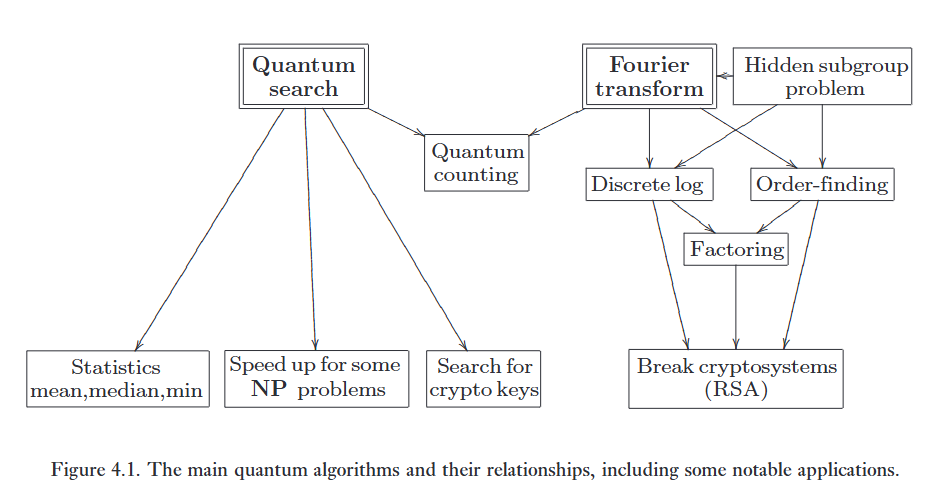

> *'The theory of computation has traditionally been studied almost entirely in the abstract, as a topic in pure mathematics. This is to miss the point of it. Computers are physical objects, and computations are physical processes. What computers can or cannot compute is determined by the laws of physics alone, and not by pure mathematics.'*
> – David Deutsch

> *'Like mathematics, computer science will be somewhat different from the other sciences, in that it deals with artificial laws that can be proved, instead of natural laws that are never known with certainty.'*
> – Donald Knuth

> *'The opposite of a profound truth may well be another profound truth.'*
> – Niels Bohr

Chương này mở đầu Phần II của cuốn sách, trong đó chúng ta khám phá chi tiết về tính toán lượng tử. Chương này phát triển các nguyên lý nền tảng của tính toán lượng tử, và thiết lập các khối cấu trúc cơ bản cho các mạch lượng tử, một ngôn ngữ phổ quát để mô tả các quá trình tính toán lượng tử phức tạp. Hai thuật toán lượng tử nền tảng được biết đến cho đến nay được xây dựng từ các mạch này trong hai chương tiếp theo. 

Chương 5 trình bày biến đổi Fourier lượng tử (quantum Fourier transform) và các ứng dụng của nó trong việc ước lượng pha (phase estimation), tìm chu kỳ (order-finding) và phân tích thừa số nguyên tố (factoring). 

Chương 6 mô tả thuật toán tìm kiếm lượng tử, và các ứng dụng của nó trong tìm kiếm cơ sở dữ liệu, đếm (counting) và tăng tốc các nghiệm cho các bài toán NP-đầy đủ (NP-complete). 

Chương 7 khép lại Phần II với cuộc thảo luận về cách thức tính toán lượng tử một ngày nào đó có thể được hiện thực hóa bằng thực nghiệm. Hai chủ đề khác thu hút sự quan tâm lớn đối với tính toán lượng tử, nhiễu lượng tử (quantum noise) và sửa lỗi lượng tử (quantum error-correction), được hoãn lại cho đến Phần III của cuốn sách, xét đến tầm ảnh hưởng rộng rãi của chúng ngay cả bên ngoài lĩnh vực tính toán lượng tử.

:::{.callout}
# tl;dr

Chương 4: sẽ học cách chế tạo các viên gạch cơ bản của qc: cổng Pauli, cổng Hadamard, Phase, CNOT, Toffoli và cấu trúc mạch.

Chương 5 (Thuật toán Shor): sử dụng các tính chất chu kỳ, đánh sập hệ thống mã hóa RSA.

Chương 6 (Thuật toán Grover): tăng tốc độ tìm kiếm, gặp lại các bài toán NP-Compelete.
:::

Có hai ý tưởng chính được giới thiệu trong chương này. 

* Thứ nhất, chúng tôi giải thích chi tiết mô hình cơ bản của tính toán lượng tử, mô hình mạch lượng tử. 

* Thứ hai, chúng tôi chứng minh rằng tồn tại một tập hợp nhỏ các cổng mang tính vạn năng (universal), nghĩa là, bất kỳ phép tính lượng tử nào cũng có thể được biểu diễn dưới dạng các cổng đó. 

Dọc theo quá trình này, chúng tôi cũng có dịp mô tả nhiều kết quả cơ bản khác của tính toán lượng tử. Mục 4.1 mở đầu chương với một cái nhìn tổng quan về các thuật toán lượng tử, tập trung vào những thuật toán nào đã được biết đến, và các kỹ thuật thống nhất làm nền tảng cho việc xây dựng chúng. Mục 4.2 là một nghiên cứu chi tiết về các phép toán trên một qubit (single qubit operations). Bất chấp sự đơn giản của chúng, các phép toán một qubit mang đến một sân chơi phong phú để xây dựng các ví dụ và kỹ thuật, và việc hiểu chúng một cách chi tiết là điều cốt yếu. Mục 4.3 chỉ ra cách thực hiện các phép toán unita có điều khiển (controlled unitary operations) trên nhiều qubit, và Mục 4.4 thảo luận về sự mô tả của phép đo lường trong mô hình mạch lượng tử. Những yếu tố này sau đó được tập hợp lại trong Mục 4.5 cho việc phát biểu và chứng minh định lý vạn năng. Chúng tôi tóm tắt tất cả các yếu tố cơ bản của tính toán lượng tử trong Mục 4.6, và thảo luận về các biến thể khả dĩ của mô hình, cũng như câu hỏi quan trọng về mối quan hệ sức mạnh tính toán giữa máy tính cổ điển và máy tính lượng tử. Mục 4.7 kết thúc chương với một ứng dụng quan trọng và đầy tính hướng dẫn của tính toán lượng tử trong việc mô phỏng (simulation) các hệ lượng tử thực tế.   

---

Chương này có lẽ là chương đòi hỏi người đọc làm việc nhiều nhất (reader-intensive) trong tất cả các chương của cuốn sách, với mật độ bài tập cao để bạn hoàn thành, và việc giải thích lý do cho cường độ này là điều đáng giá. Đạt được sự thuần thục với các yếu tố cơ bản của mô hình tính toán mạch lượng tử là khá dễ dàng, nhưng đòi hỏi phải thấm nhuần một số lượng lớn các kết quả và kỹ thuật đơn giản, những thứ phải trở thành bản năng (second nature) nếu người ta muốn tiến tới bài toán khó khăn hơn là thiết kế các thuật toán lượng tử. Vì lý do này, chúng tôi áp dụng một cách tiếp cận định hướng theo ví dụ (example-oriented) trong chương này, và yêu cầu bạn điền vào nhiều chi tiết, nhằm đạt được sự thuần thục như vậy. Có thể có được một cái nhìn tổng quan ít chuyên sâu hơn, nhưng phần nào hời hợt về các yếu tố cơ bản của tính toán lượng tử bằng cách nhảy cóc sang Mục 4.6

:::{.callout}
# tl;dr

Xuyên suốt chương 4, tác giả sẽ chứng minh rằng điều kỳ diệu của đại số tuyến tính: Không cần chế tạo vô hạn các loại thiết bị lượng tử, chỉ cần một tập hợp rất nhỏ các cổng logic rời rạc (hadamard, phase, pi/8, cnot) là có thể xấp xỉ bất kỳ phép biến đổi Unita U nào trên không gian Hilbert 2^n chiều với độ chính xác tùy ý.

Và tác giả bắt làm nhiều bài tập.

:::

# 1. Quantum Algorithms

**Một máy tính lượng tử hữu ích cho việc gì?**

Tất cả chúng ta đều quen thuộc với sự bực bội khi cần thêm tài nguyên máy tính để giải quyết một bài toán tính toán. Về mặt thực tế, nhiều bài toán thú vị là không thể giải quyết được trên một máy tính cổ điển, không phải vì về nguyên tắc chúng không thể giải được, mà là vì tài nguyên khổng lồ (astronomical) cần thiết để giải quyết các trường hợp thực tế của bài toán.   

Lời hứa hẹn ngoạn mục của máy tính lượng tử là cho phép các thuật toán mới biến các bài toán đòi hỏi tài nguyên quá đắt đỏ để giải trên máy tính cổ điển trở nên khả thi. Tại thời điểm viết sách, có hai lớp thuật toán lượng tử rộng lớn được biết đến thực hiện lời hứa này. 

* Lớp thuật toán thứ nhất dựa trên biến đổi Fourier lượng tử (quantum Fourier transform) của Shor, và bao gồm các thuật toán đáng chú ý để giải quyết các bài toán phân tích thừa số nguyên tố (factoring) và logarit rời rạc (discrete logarithm), mang lại một sự tăng tốc theo hàm mũ (exponential speedup) nổi bật so với các thuật toán cổ điển tốt nhất được biết đến. 

* Lớp thuật toán thứ hai dựa trên thuật toán của Grover để thực hiện tìm kiếm lượng tử (quantum searching). Chúng mang lại sự tăng tốc bậc hai (quadratic speedup) ít nổi bật hơn nhưng vẫn đáng kinh ngạc so với các thuật toán cổ điển khả dĩ tốt nhất. Thuật toán tìm kiếm lượng tử có được tầm quan trọng từ việc sử dụng rộng rãi các kỹ thuật dựa trên tìm kiếm trong các thuật toán cổ điển, điều mà trong nhiều trường hợp cho phép một sự điều chỉnh trực tiếp từ thuật toán cổ điển để tạo ra một thuật toán lượng tử nhanh hơn. 

:::{.callout}
# tl;dr

Tại sao lại cần máy tính lượng tử?

Cả hai lớp bài toán trên đều có thể giải quyết trên máy Turing cổ điển, việc chúng ta dùng máy tính lượng tử cốt chỉ để phân bổ lại tài nguyên tính toán bằng cách lợi dụng không gian Hilbert và sự giao thoa để vượt qua các rào cản tài nguyên.
:::

---

Hình 4.1 phác họa trạng thái kiến thức về các thuật toán lượng tử tại thời điểm viết sách, bao gồm một số ứng dụng mẫu của các thuật toán đó. Đương nhiên, ở cốt lõi của sơ đồ là biến đổi Fourier lượng tử và thuật toán tìm kiếm lượng tử. Đáng chú ý đặc biệt trong hình là thuật toán đếm lượng tử (quantum counting algorithm). Thuật toán này là sự kết hợp khéo léo giữa các thuật toán tìm kiếm lượng tử và biến đổi Fourier, có thể được sử dụng để ước tính số lượng nghiệm của một bài toán tìm kiếm nhanh hơn mức có thể trên một máy tính cổ điển.   

Thuật toán tìm kiếm lượng tử có nhiều ứng dụng tiềm năng, trong đó chỉ một vài ứng dụng được minh họa. Nó có thể được sử dụng để trích xuất các số liệu thống kê, chẳng hạn như phần tử nhỏ nhất, từ một tập dữ liệu không có thứ tự, nhanh hơn mức có thể trên một máy tính cổ điển. Nó có thể được sử dụng để tăng tốc các thuật toán cho một số bài toán thuộc lớp $\mathbf{NP}$ — cụ thể là những bài toán mà phương pháp tìm kiếm nghiệm trực tiếp (straightforward search) là thuật toán tốt nhất được biết đến. Cuối cùng, nó có thể được sử dụng để tăng tốc quá trình tìm kiếm khóa đối với các hệ thống mật mã chẳng hạn như Tiêu chuẩn Mã hóa Dữ liệu (DES) được sử dụng rộng rãi. Những ứng dụng này và các ứng dụng khác được giải thích trong Chương 6.   

(Hình 4.1. Các thuật toán lượng tử chính và các mối quan hệ giữa chúng, bao gồm một số ứng dụng nổi bật.)   

Biến đổi Fourier lượng tử cũng có nhiều ứng dụng thú vị. Nó có thể được sử dụng để giải quyết các bài toán logarit rời rạc và phân tích thừa số nguyên tố. Những kết quả này, đến lượt chúng, cho phép một máy tính lượng tử phá vỡ nhiều hệ thống mật mã phổ biến nhất hiện đang được sử dụng, bao gồm hệ thống mật mã RSA. Biến đổi Fourier cũng hóa ra có liên quan chặt chẽ đến một bài toán quan trọng trong toán học, bài toán tìm nhóm con ẩn (tìm kiếm chu kỳ của một hàm tuần hoàn là một trường hợp tổng quát của bài toán này). Biến đổi Fourier lượng tử và một số ứng dụng của nó, bao gồm các thuật toán lượng tử nhanh cho bài toán phân tích thừa số nguyên tố và logarit rời rạc, được giải thích trong Chương 5.

:::{.callout}
# tl;dr

1. Thuật toán Tìm kiếm - Grover's Search

Nó là một thuật toán giúp tăng tốc bậc hai cho các bài tối ưu hóa.

* Thống kê: Tìm Max/Min hoặc tìm Mean của một hàm số phức tạp mà không cần tính toán hàm đó tại mọi điểm.

* Tấn công Mật mã đối xứng: Với chuẩn mã hóa DES (hoặc AES hiện nay), thuật toán tốt nhất của máy cổ điển là thử từng khóa một.

* Tăng tốt các bài toán NP.

2. Thuật toán biến đổi Fourier lượng tử - QFT - Shor's algo

* Bài toán nhóm con ẩn (hidden subgroup problem): đây là bài toán gốc rễ của QFT, QFT cực kỳ xuất sắc trong việc phân tích các hàm có tính chu kỳ ẩn.

* Tấn công Mật mã bất đối xứng: RSA, ECC.
:::

---

**Tại sao lại có quá ít thuật toán lượng tử được biết đến là tốt hơn các bản sao cổ điển của chúng?**

Câu trả lời là việc nghĩ ra các thuật toán lượng tử tốt dường như là một bài toán khó. Có ít nhất hai lý do cho điều này. Thứ nhất, thiết kế thuật toán, dù là cổ điển hay lượng tử, đều không phải là một công việc dễ dàng! Lịch sử của các thuật toán cho chúng ta thấy rằng thường đòi hỏi sự khéo léo đáng kể để nghĩ ra các thuật toán gần như tối ưu, ngay cả đối với những bài toán dường như rất đơn giản, như phép nhân hai số. Việc tìm kiếm các thuật toán lượng tử tốt trở nên khó khăn gấp đôi bởi vì có thêm một ràng buộc là chúng ta muốn các thuật toán lượng tử của mình phải tốt hơn các thuật toán cổ điển tốt nhất được biết đến. Lý do thứ hai cho sự khó khăn trong việc tìm kiếm các thuật toán lượng tử tốt là trực giác của chúng ta thích nghi với thế giới cổ điển tốt hơn nhiều so với thế giới lượng tử. Nếu chúng ta suy nghĩ về các bài toán bằng trực giác bẩm sinh của mình, thì những thuật toán mà chúng ta nghĩ ra sẽ là các thuật toán cổ điển. Cần có những hiểu biết sâu sắc đặc biệt và những thủ thuật đặc biệt để nghĩ ra các thuật toán lượng tử tốt.   

Việc nghiên cứu sâu hơn về các thuật toán lượng tử sẽ được hoãn lại cho đến chương tiếp theo. Trong chương này, chúng tôi cung cấp một ngôn ngữ hiệu quả và mạnh mẽ để mô tả các thuật toán lượng tử, ngôn ngữ của các mạch lượng tử — sự lắp ráp các tập hợp thành phần rời rạc để mô tả các quy trình tính toán. Cấu trúc này sẽ cho phép chúng ta định lượng chi phí của một thuật toán thông qua các đại lượng như tổng số cổng cần thiết, hoặc độ sâu của mạch (circuit depth). Ngôn ngữ mạch cũng đi kèm với một hộp công cụ gồm các thủ thuật giúp đơn giản hóa việc thiết kế thuật toán và mang lại sự hiểu biết khái niệm một cách dễ dàng.

:::{.callout}
# Tại sao vậy?

1. Rào cản cổ điển

* Ví dụ bài toán nhân hay số nguyên N chữ số tưởng như chỉ mất $O(N^2)$, nhưng phải mất hàng thập kỷ để người ta tìm ra thuật toán Karatsuba $O(N^{1.58})$, rồi thuật toán Toom-Cook, và cuối cùng là FFT với $O(NlogN)$.

* Và quay lại với lượng tử, chúng ta lại phải thiết kế một thuật toán mà chạy ít nhất là bằng thuật toán chạy nhanh nhất của cổ điển.

2. Rào cảo ngôn ngữ

* Trực giác của chúng ta mắc kẹt ở thế giới cổ điển/

* Chúng ta phải ép não tư duy theo ngôn ngữ của đại số tuyến tính, không gian Hilbert, các phép biến đổi Unita.
:::

