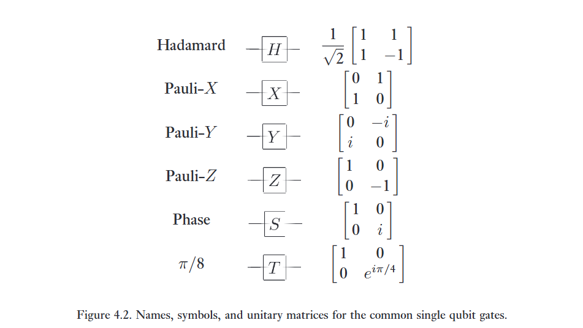

Việc phát triển hộp công cụ tính toán lượng tử của chúng ta bắt đầu bằng các phép toán trên hệ lượng tử đơn giản nhất trong tất cả — một qubit đơn lẻ. Các cổng một qubit đã được giới thiệu trong Mục 1.3.1. Hãy cùng tóm tắt nhanh những gì chúng ta đã học ở đó; bạn có thể thấy hữu ích khi tham khảo các ghi chú về ký hiệu ở trang xxiii khi chúng ta tiến hành.Một qubit đơn lẻ là một vector $\vert{}\psi\rangle = a\vert{}0\rangle + b\vert{}1\rangle$ được tham số hóa bởi hai số phức thỏa mãn $\vert{}a\vert{}^2 + \vert{}b\vert{}^2 = 1$. Các phép toán trên một qubit phải bảo toàn chuẩn (norm) này, và do đó được mô tả bởi các ma trận unita $2 \times 2$. Trong số này, một số ma trận quan trọng nhất là các ma trận Pauli; thật hữu ích khi liệt kê lại chúng ở đây:

$$
X = \begin{bmatrix} 0 & 1 \\ 1 & 0 \end{bmatrix}; \quad Y = \begin{bmatrix} 0 & -i \\ i & 0 \end{bmatrix}; \quad Z = \begin{bmatrix} 1 & 0 \\ 0 & -1 \end{bmatrix}. \tag{4.1}
$$

Ba cổng lượng tử khác sẽ đóng một phần lớn trong những phần tiếp theo, cổng Hadamard (ký hiệu là $H$), cổng pha (ký hiệu là $S$), và cổng $\pi/8$ (ký hiệu là $T$):

$$
H = \frac{1}{\sqrt{2}} \begin{bmatrix} 1 & 1 \\ 1 & -1 \end{bmatrix}; \quad S = \begin{bmatrix} 1 & 0 \\ 0 & i \end{bmatrix}; \quad T = \begin{bmatrix} 1 & 0 \\ 0 & \exp(i\pi/4) \end{bmatrix}. \tag{4.2}
$$

Một vài sự kiện đại số hữu ích cần ghi nhớ là $H = (X + Z)/\sqrt{2}$ và $S = T^2$. Bạn có thể tự hỏi tại sao cổng $T$ lại được gọi là cổng $\pi/8$ trong khi $\pi/4$ mới là giá trị xuất hiện trong định nghĩa. Lý do là về mặt lịch sử, cổng này thường được gọi là cổng $\pi/8$, đơn giản bởi vì khi bỏ qua một pha toàn cục (global phase) không quan trọng, $T$ tương đương với một cổng có $\exp(\pm i\pi/8)$ xuất hiện trên các đường chéo của nó.

$$
T' = \exp(i\pi/8) \begin{bmatrix} \exp(-i\pi/8) & 0 \\ 0 & \exp(i\pi/8) \end{bmatrix}. \tag{4.3}
$$

Mặc dù vậy, cách đặt tên theo một số khía cạnh là khá đáng tiếc, và chúng ta thường gọi cổng này là cổng $T$.Cũng cần nhắc lại rằng một qubit đơn lẻ ở trạng thái $a\vert{}0\rangle + b\vert{}1\rangle$ có thể được hình dung như một điểm $(\theta, \varphi)$ trên mặt cầu đơn vị, trong đó $a = \cos(\theta/2)$, $b = e^{i\varphi} \sin(\theta/2)$, và $a$ có thể được coi là số thực vì pha toàn cục của trạng thái là không thể quan sát được. Đây được gọi là biểu diễn mặt cầu Bloch, và vector $(\cos\varphi\sin\theta, \sin\varphi\sin\theta, \cos\theta)$ được gọi là vector Bloch. Chúng ta sẽ thường xuyên quay lại hình ảnh này như một sự hỗ trợ cho trực giác.

:::{.callout-note}
# Bài tập 4.1: 
Trong Bài tập 2.11, bài mà bạn nên làm ngay bây giờ nếu bạn chưa làm, bạn đã tính toán các vector riêng của các ma trận Pauli. Hãy tìm các điểm trên mặt cầu Bloch tương ứng với các vector riêng được chuẩn hóa của các ma trận Pauli khác nhau.

---

Ta có công thức:

$$
\vert \psi \rangle = \cos \left(\frac \theta 2 \right) \vert 0 \rangle + e^{i\phi}\sin \left(\frac \theta 2\right) \vert 1 \rangle
$$

tọa độ điểm trên quả cầu Bloch:

$$
r = (x, y, z) = (\sin\theta\cos\phi, \sin\theta\sin\phi, \cos\theta)
$$

Ở bài trước tính được các eigenvalue và eigenvector bằng các biểu diễn ngoài sau:

$$
X = \vert + \rangle \langle + \vert - \vert - \rangle \langle - \vert  \\ 
Y = -i \vert 0 \rangle \langle 1 \vert + i \vert 1 \rangle \langle 0 \vert \\ 
Z = \vert 0 \rangle \langle 0 \vert - \vert 1 \rangle \langle 1 \vert 
$$

# 1. Pauli-X 

* Eigenvector ứng với eigenvalue = 1 là: $\vert + \rangle = \frac 1 {\sqrt 2} \begin{bmatrix} 1 \\ 1 \end{bmatrix} = \frac 1 {\sqrt 2} \vert 0 \rangle + \frac 1 {\sqrt 2} \vert 1 \rangle$.
    * Ta có: $\cos\left(\frac \theta 2\right) = \frac 1 {\sqrt 2} \Leftrightarrow \theta = \frac \pi 2$.
    * $e^{i\phi}\sin\left(\frac \theta 2\right) = \frac 1 {\sqrt 2} \Leftrightarrow e^{i\phi}\frac {\sqrt 2} 2 = \frac 1 {\sqrt 2} \Leftrightarrow e^{i\phi} = 1 \Leftrightarrow \phi = 0$

  Với $\theta = \frac \pi 2$ và $\phi = 0$, thì tương ứng với $r = (1, 0, 0)$ trên quả cầu.

* Eigenvector úng với eigenvalue = -1 là: $\vert - \rangle = \frac 1 {\sqrt 2} \begin{bmatrix} 1 \\ -1 \end{bmatrix} = \frac 1 {\sqrt 2} \vert 0 \rangle - \frac 1 {\sqrt 2} \vert 1 \rangle$.
    * Ta có: $\cos\left(\frac \theta 2\right) = \frac 1 {\sqrt 2} \Leftrightarrow \theta = \frac \pi 2$.
    * $e^{i\phi}\sin\left(\frac \theta 2\right) = -\frac 1 {\sqrt 2} \Leftrightarrow e^{i\phi}\frac {\sqrt 2} 2 = -\frac 1 {\sqrt 2} \Leftrightarrow e^{i\phi} = -1 \Leftrightarrow \phi = \pi$

  Với $\theta = \frac \pi 2$ và $\phi = \pi$, thì tương ứng với $r = (-1, 0, 0)$ trên quả cầu.

# 2, 3. Làm tương tự vậy đi, lười gõ quá :")
:::

Các ma trận Pauli tạo ra ba lớp ma trận unita hữu ích khi chúng được lũy thừa hóa, các toán tử quay (rotation operators) quanh các trục $\hat{x}$, $\hat{y}$, và $\hat{z}$, được định nghĩa bởi các phương trình:

$$
R_x(\theta) \equiv e^{-i\theta X/2} = \cos\frac{\theta}{2}I - i\sin\frac{\theta}{2}X = \begin{bmatrix} \cos\frac{\theta}{2} & -i\sin\frac{\theta}{2} \\ -i\sin\frac{\theta}{2} & \cos\frac{\theta}{2} \end{bmatrix} \tag{4.4}
$$

$$
R_y(\theta) \equiv e^{-i\theta Y/2} = \cos\frac{\theta}{2}I - i\sin\frac{\theta}{2}Y = \begin{bmatrix} \cos\frac{\theta}{2} & -\sin\frac{\theta}{2} \\ \sin\frac{\theta}{2} & \cos\frac{\theta}{2} \end{bmatrix} \tag{4.5}
$$

$$
R_z(\theta) \equiv e^{-i\theta Z/2} = \cos\frac{\theta}{2}I - i\sin\frac{\theta}{2}Z = \begin{bmatrix} e^{-i\theta/2} & 0 \\ 0 & e^{i\theta/2} \end{bmatrix}. \tag{4.6}
$$

:::{.callout-note}
# Bài tập 4.2: 
Chứng minh $\exp(iAx) = \cos(x)I + i\sin(x)A$ với $A^2 = I$

---

Khai triển Taylor $exp(iAx)$, ta được:

$$
e^{iAx} = \sum_{n = 0}^{\infty} \frac {(iAx)^{n}} {n!}
$$

tách bậc chẵn với bậc lẻ ra:

$$
e^{iAx} = 
\sum_{k = 0}^{\infty} \frac {(iAx)^{2k}} {(2k)!}
+ \sum_{k = 0}^{\infty} \frac {(iAx)^{2k + 1}} {(2k + 1)!}
$$

Ta có:

* $A^{2k} = I$ (ví $A^2 = I$).
* $A^{2k + 1} = A$.
* $i^{2k} = (-1)^k$.
* $i^{2k + 1} = (-1)^k i$.

$$
e^{iAx} = 
\sum_{k = 0}^{\infty} \frac {(-1)^k \cdot x^{2k}} {(2k)!} I
+ \sum_{k = 0}^{\infty} \frac {(-1)^k \cdot x^{2k + 1}} {(2k + 1)!}iA
$$

Dễ thấy khai triển taylor của sinx và cosx. Vậy cuối cùng ta được:

$$
e^{iAx} = \cos(x)I + i\sin(x)A
$$

:::

:::{.callout-note}
# Bài tập 4.3
Chứng minh cổng $\pi/8$ thỏa mãn $T = R_z(\pi/4)$ bỏ qua pha toàn cục.

---

Ma trận $T$ là:

$$
T = \begin{bmatrix} 1 & 0 \\ 0 & \exp(i\pi/4) \end{bmatrix}
$$

Với $\theta = \pi/4$ toán tử quay $R_z$ sẽ có dạng:

$$
R_z(\pi/4) = \begin{bmatrix} \exp(-i\pi/8) & 0 \\ 0 & \exp(i\pi/8) \end{bmatrix}
$$

Đưa $\exp(-i\pi/8)$ ra ngoài.

$$
R_z(\pi/4) = \exp(-i\pi/8)\begin{bmatrix} 1 & 0 \\ 0 & \exp(i\pi/8) \cdot \exp(i\pi/8) \end{bmatrix} = \exp(-i\pi/8) T 
$$

Nhân cả hai vế với $\exp(i\pi/8)$, ta được:

$$
T = \exp(i\pi/8)R_z(\pi/4)
$$
:::

:::{.callout-note}
# Bài tập 4.4
Biểu diễn cổng Hadamard $H$ qua tích của $R_x, R_z$ và $e^{i\varphi}$

---

Bằng một cách thần kỳ nào đó, chúng ta biết được cổng Hadamard sẽ quay quay trục z pi/2, quay quanh trục x pi/2, rồi lại quay quanh trục z pi/2. Ta có:

$$
R_z(\pi/2) = \begin{bmatrix} \exp(-i\pi/4) & 0 \\ 0 & \exp(i\pi/4) \end{bmatrix}; \\
R_x(\pi/2) = \begin{bmatrix} \cos(\pi/4) & -i\sin(\pi/4) \\ -i\sin(\pi/4) & \cos(\pi/4) \end{bmatrix} = 
\frac 1 {\sqrt 2} \begin{bmatrix} 1& -i \\ -i & 1 \end{bmatrix}
$$

Nhân $R_zR_xR_z$ theo thứ tự từ phải sang trái, ta được:

$$
R_zR_xR_z = \begin{bmatrix} \exp(-i\pi/4) & 0 \\ 0 & \exp(i\pi/4) \end{bmatrix} 
\frac 1 {\sqrt 2} \begin{bmatrix} 1& -i \\ -i & 1 \end{bmatrix}
 \begin{bmatrix} \exp(-i\pi/4) & 0 \\ 0 & \exp(i\pi/4) \end{bmatrix} 
$$

$$
= \begin{bmatrix} \exp(-i\pi/4) & 0 \\ 0 & \exp(i\pi/4) \end{bmatrix} 
\frac 1 {\sqrt 2} \begin{bmatrix} \exp(-i\pi/4) & -i\exp(i\pi/4) \\ -i\exp(-i\pi/4) & \exp(i\pi/4) \end{bmatrix}
$$

$$
= \frac 1 {\sqrt 2} \begin{bmatrix} \exp(-i\pi/2) & -i \\ -i & \exp(i\pi/2) \end{bmatrix}
$$

Mà theo công thức Euler, ta có $\exp(i\pi/2) \approx i$ và $\exp(-i\pi/2) \approx -i$, ta được:

$$
= \frac 1 {\sqrt 2} \begin{bmatrix} -i & -i \\ -i & i \end{bmatrix}
$$

$$
= -i \cdot H
$$

Nhân cả hai vế với $\exp(i\pi/2)$, ta được:

$$
H = e^{i\pi/2} R_z(\pi/2) R_x(\pi/2) R_z(\pi/2)
$$

:::

Nếu $\hat{n} = (n_x, n_y, n_z)$ là một vector đơn vị thực trong không gian ba chiều thì chúng ta tổng quát hóa các định nghĩa trước đó bằng cách định nghĩa một phép quay một góc $\theta$ quanh trục $\hat{n}$ bởi phương trình

$$
R_{\hat{n}}(\theta) \equiv \exp(-i\theta \hat{n} \cdot \vec{\sigma} / 2) = \cos\left(\frac{\theta}{2}\right) I - i \sin\left(\frac{\theta}{2}\right) (n_x X + n_y Y + n_z Z), \tag{4.8}
$$   

trong đó $\vec{\sigma}$ biểu diễn vector ba thành phần $(X, Y, Z)$ gồm các ma trận Pauli.   

:::{.callout-note collapse="true"}
# Bài tập 4.5: 
Chứng minh rằng $(\hat{n} \cdot \vec{\sigma})^2 = I$, và sử dụng điều này để kiểm chứng Phương trình (4.8).  

---

Cho $\hat n = (n_x, n_y, n_z)$ là vector đơn vị, vậy nên: $n_x^2 + n_y^2 + n_z^2 = 1$.

Ma trận tổng hợp:

$$
N = \hat n \cdot \sigma = n_xX + n_yY + n_zZ
$$

Bình phương ma trận, nhân phân phối đa thức:

$$
N^2 = n_x^2 X^2 + n_y^2 Y^2 + n_z^2 Z^2 + n_xn_y(XY + YX) + n_xn_z(XZ + ZX) + n_yn_z(YZ + ZY)
$$

Mà ta biết được:

* Bình phương X, Y, Z bằng ma trận đơn vị: $X^2 = Y^2 = Z^2 = I$.
* Chúng anti-commutator với nhau: $XY + YX = XZ + ZX = YZ + ZY = 0$

Cuối cùng:

$$
N^2 = (n_x^2 + n_y^2 + n_z^2) I = 1 \cdot I = I
$$

--- 

Kiểm chứng thì giống bài tập ở trên, chỉ có điều bài ở trên thì cho sẵn bình phương A = I, thì ở đây ta có chứng minh được bình phương N bằng I.

:::

:::{.callout-note collapse="true"}
# Bài tập 4.6: (Diễn giải mặt cầu Bloch của các phép quay) 
Một lý do tại sao các toán tử $R_{\hat{n}}(\theta)$ được gọi là các toán tử quay là sự thật sau đây, điều mà bạn phải chứng minh. 

Giả sử một qubit đơn lẻ có một trạng thái được biểu diễn bởi vector Bloch $\vec{\lambda}$. Khi đó tác động của phép quay $R_{\hat{n}}(\theta)$ lên trạng thái là quay nó một góc $\theta$ quanh trục $\hat{n}$ của mặt cầu Bloch. Sự thật này giải thích cho hệ số hai trông khá bí ẩn trong định nghĩa của các ma trận quay. 

---

:::

:::{.callout-note collapse="true"}
# Bài tập 4.7:
Chứng minh rằng $XYX = -Y$ và sử dụng điều này để chứng minh rằng $XR_y(\theta)X = R_y(-\theta)$.

---

# Chứng minh $XYX = -Y$

Từ tính chất chống giao hoán, ta có $XY = -YX$.

$$
(XY)X = (-YX)X \Leftrightarrow XYX = -YX^2 \Leftrightarrow XYX = -YI
$$
:::

:::{.callout-note collapse="true"}
# Bài tập 4.8: 
Một toán tử unita một qubit tùy ý có thể được viết dưới dạng

$$
U = \exp(i\alpha)R_{\hat{n}}(\theta) \tag{4.9}
$$   

với một số thực $\alpha$ và $\theta$ nào đó, và một vector đơn vị thực ba chiều $\hat{n}$.   

(1) Chứng minh sự thật này.   
(2) Tìm các giá trị cho $\alpha, \theta$, và $\hat{n}$ tạo ra cổng Hadamard $H$.   
(3) Tìm các giá trị cho $\alpha, \theta$, và $\hat{n}$ tạo ra cổng phase 

$$
S = \begin{bmatrix} 1 & 0 \\ 0 & i \end{bmatrix}. \tag{4.10}
$$ 

---

# 1. Chưa học đại số Lie

skip

# 2. Cổng Hadamard

$$
H = \frac 1 {\sqrt 2} \begin{bmatrix} 1 & 1 \\ 1 & -1 \end{bmatrix} = \frac 1 {\sqrt 2} X + \frac 1 {\sqrt 2} Z
$$

Đồng nhất hệ số với U:

$$
e^{i\alpha} \cos \left(\frac \theta 2 \right)I - i e^{i\alpha} \sin\left(\frac\theta 2\right)(n_xX + n_yY + n_zZ) \\ 
= \frac 1 {\sqrt 2} X + \frac 1 {\sqrt 2} Z
$$

Rõ ràng ta thấy bên RHS không tồn tại I, vậy có thể nói:

$$
\cos \left(\frac \theta 2 \right) = 0 \Leftrightarrow \theta = \pi
$$

Thay $\theta = \pi$ vào ta được:

$$
-i e^{i\alpha} (n_xX + n_yY + n_zZ) = \frac 1 {\sqrt 2} X + \frac 1 {\sqrt 2} Z
$$
 
Chọn $\alpha = \pi/2$ để $-ie^{i\alpha} = -i (i) = 1$, khi đó:

$$
n_xX + n_yY + n_zZ = \frac 1 {\sqrt 2} X + \frac 1 {\sqrt 2} Z
$$

Kết luận: 

* $\theta = \pi$.
* $\alpha = \pi/2$.
* $\hat n = (\frac 1 {\sqrt 2}, 0, \frac 1 {\sqrt 2})$.

# 3. Cổng Phase

$$
S = \begin{bmatrix} 1 & 0 \\ 0 & i \end{bmatrix}
$$

Rõ ràng là không thấy $e^{i\alpha}$ đâu, vì vậy ta phải tách ra để thấy:

$$
S = e^{i\pi/4} \begin{bmatrix} e^{-i\pi/4} & 0 \\ 0 & e^{i\pi/4} \end{bmatrix}
$$

Mà ma trận bên trong ngoặc vuông chính là $R_z$ với $\theta = \pi/2$. Do đó:

$$
S = e^{i\pi/4} R_z(\pi/2)
$$

Kết luận:

* $\alpha = \pi/4$.
* $\theta = \pi/2$.
* $\hat n = (0, 0, 1)$.
:::

## Phân rã Euler

Mọi chuyển động trên mặt cầu Bloch, dù có phức tạp đến đâu, đều cót hể đặt được bằng cách:

(1) Quay quanh trục Z một góc delta.
(2) Quay quanh trục Y một góc gamma.
(3) Quay quanh trục Z một góc beta.
(4) Cộng thêm một pha toàn cục exp(i alpha).

Không nhất thiết phải là Z-Y-Z, mà còn có thể là X-Y-X, hoặc thậm chí là hai trục $\hat n$ và $\hat m$ tùy ý (miễn chúng không song song).

:::{.postulates}
# Định lý 4.1: Phân rã Z - Y cho môt qubit

Giả sử U là một phép toán Unita trên một qubit đơn lẻ. Khi đó tồn tại các số thức $\alpha$, $\beta$, $\gamma$, $\delta$ sao cho:

$$
U = e^{i\alpha}R_z(\beta)R_y(\gamma)R_z(\delta). \tag{4.11}
$$
:::

:::{.callout-important}
# Chứng minh
Vì $U$ là ma trận unita, các hàng và các cột của $U$ trực chuẩn (orthonormal) với nhau, từ đó suy ra tồn tại các số thực $\alpha, \beta, \gamma,$ và $\delta$ sao cho

$$
U = \begin{bmatrix} e^{i(\alpha-\beta/2-\delta/2)} \cos\frac{\gamma}{2} & -e^{i(\alpha-\beta/2+\delta/2)} \sin\frac{\gamma}{2} \\ e^{i(\alpha+\beta/2-\delta/2)} \sin\frac{\gamma}{2} & e^{i(\alpha+\beta/2+\delta/2)} \cos\frac{\gamma}{2} \end{bmatrix}. \tag{4.12}
$$

Phương trình (4.11) giờ đây tuân theo ngay lập tức từ định nghĩa của các ma trận quay và phép nhân ma trận. $\square$ 
:::

:::{.callout-note collapse="true"}
# Bài tập 4.9: 
Giải thích tại sao bất kỳ toán tử unita một qubit nào cũng có thể được viết dưới dạng (4.12).

---

Ta có:

$$
R_y(\gamma) = \begin{bmatrix} \cos \frac \gamma 2 & -\sin\frac\theta 2 \\ \sin\frac\theta 2 & \cos\frac\theta 2 \end{bmatrix}
$$

$$
R_z(\beta) = \begin{bmatrix} e^{-i\beta/2} & 0 \\ 0 & e^{i\beta/2} \end{bmatrix} \\ 
R_z(\delta) = \begin{bmatrix} e^{-i\delta/2} & 0 \\ 0 & e^{i\delta/2} \end{bmatrix}
$$

Nhân lại với nhau thôi:

$$
R_z(\beta)R_y(\gamma)R_z(\delta) = \begin{bmatrix} e^{-i\beta/2} & 0 \\ 0 & e^{i\beta/2} \end{bmatrix} \begin{bmatrix} \cos \frac \gamma 2 & -\sin\frac\theta 2 \\ \sin\frac\theta 2 & \cos\frac\theta 2 \end{bmatrix} \begin{bmatrix} e^{-i\delta/2} & 0 \\ 0 & e^{i\delta/2} \end{bmatrix}
$$

Là ra được (4.12).

:::

:::{.callout-note collapse="true"}
# Bài tập 4.10: (X-Y decomposition of rotations) 
Hãy đưa ra một cách phân rã tương tự như Định lý 4.1 nhưng sử dụng $R_x$ thay vì $R_z$.   

---

Dùng nguyên lý của cổng Hadamard. 

Cổng Hadamard biến trục Z thành trục X. Hệ quả đại số của việc này là:

* $H \cdot R_z(\theta) \cdot H = R_x(\theta)$.
* $H \cdot R_y(\theta) \cdot H = R_y(-\theta)$.
* $H \cdot H = I$.

Giả sử có một phép biến đổi V nào đó, áp dụng định lý chuẩn là Y-Z-Y cho biến đổi này.

$$
V = e^{i\alpha'} R_z(\beta)R_y(\gamma)R_z(\delta)
$$

Bây giờ thêm hai cổng Hadamard ở hai đầu để thành một biển đổi mới: $U = H \cdot V \cdot H$

$$
U = H [e^{i\alpha'} R_z(\beta)R_y(\gamma)R_z(\delta)] H
$$

Chèn lén $H \cdot H$ vào giữa các phép quay ở vế phải (vì $H \cdot H$ vô hại như nhân với 1):

$$
U = e^{i\alpha'} \left(H \cdot R_z(\beta) \cdot H\right) \left(H \cdot R_y(\gamma) \cdot H\right) \left(H \cdot R_z(\delta) \cdot H\right)
$$

Áp dụng tính chất như ban đầu đã nói, ta lập tức thu được cách phân rã mới:

$$
U = e^{i\alpha'}R_x(\beta)R_y(-\gamma)R_x(\delta)
$$
:::

:::{.callout-note collapse="true"}
# Bài tập 4.11: 
Giả sử $\hat{m}$ và $\hat{n}$ là các vector đơn vị thực không song song trong không gian ba chiều. Sử dụng Định lý 4.1 để chứng minh rằng một toán tử unita một qubit tùy ý $U$ có thể được viết là   

$$
U = e^{i\alpha}R_{\hat{n}}(\beta)R_{\hat{m}}(\gamma)R_{\hat{n}}(\delta), \tag{4.13}
$$   

với các lựa chọn phù hợp cho $\alpha, \beta, \gamma$ và $\delta$.

---

Thật ra thì quay theo yzy hay xyx gì cũng có thể bao phủ toàn quả cầu thôi, trừ khi chọn hai trục song song nhau thì nó mới bị sập về 2D.

Vậy nên nó chẳng khác gì yzy cả, chỉ là yzy thì được người ta đặt tên.
:::

:::{.postulates}
# Hệ quả 4.2
Giả sử $U$ là một cổng unita trên một qubit đơn lẻ. Khi đó tồn tại các toán tử unita $A, B, C$ trên một qubit đơn lẻ sao cho $ABC = I$ và $U = e^{i\alpha} AXBXC$, trong đó $\alpha$ là một hệ số pha toàn cục nào đó.
:::

:::{.callout-important}
# Chứng minh
Trong ký hiệu của Định lý 4.1, đặt $A \equiv R_z(\beta)R_y(\gamma/2)$, $B \equiv R_y(-\gamma/2)R_z(-(\delta+\beta)/2)$ và $C \equiv R_z((\delta-\beta)/2)$. Lưu ý rằng
$$
ABC = R_z(\beta)R_y\left(\frac{\gamma}{2}\right) R_y\left(-\frac{\gamma}{2}\right) R_z\left(-\frac{\delta+\beta}{2}\right) R_z\left(\frac{\delta-\beta}{2}\right) = I. \tag{4.14}
$$

Vì $X^2 = I$, và sử dụng Bài tập 4.7, ta thấy rằng
$$
XBX = XR_y\left(-\frac{\gamma}{2}\right)XXR_z\left(-\frac{\delta+\beta}{2}\right)X = R_y\left(\frac{\gamma}{2}\right)R_z\left(\frac{\delta+\beta}{2}\right). \tag{4.15}
$$

Do đó
$$
AXBXC = R_z(\beta)R_y\left(\frac{\gamma}{2}\right) R_y\left(\frac{\gamma}{2}\right) R_z\left(\frac{\delta+\beta}{2}\right) R_z\left(\frac{\delta-\beta}{2}\right) \tag{4.16}
$$   

$$
= R_z(\beta)R_y(\gamma)R_z(\delta). \tag{4.17}
$$

Vậy $U = e^{i\alpha}AXBXC$ và $ABC = I$, như yêu cầu. $\square$ 
:::

:::{.callout-note collapse="true"}
# Bài tập 4.12: 
Đưa ra $A, B, C$, và $\alpha$ cho cổng Hadamard.
:::

:::{.callout-note collapse="true"}
# Bài tập 4.13: (Các đồng nhất thức mạch - Circuit identities) 
Rất hữu ích khi có thể đơn giản hóa các mạch bằng cách quan sát, sử dụng các đồng nhất thức phổ biến. Chứng minh ba đồng nhất thức sau:
$$
HXH = Z; \quad HYH = -Y; \quad HZH = X. \tag{4.18}
$$

:::

:::{.callout-note collapse="true"}
# Bài tập 4.14: 
Sử dụng bài tập trước để chứng minh rằng $HTH = R_x(\pi/4)$, bỏ qua một pha toàn cục.
:::

:::{.callout-note collapse="true"}
# Bài tập 4.15: (Kết hợp các phép toán một qubit - Composition of single qubit operations) 
Biểu diễn Bloch cung cấp một cách tuyệt vời để hình dung tác động của việc kết hợp hai phép quay.

(1) Chứng minh rằng nếu một phép quay một góc $\beta_1$ quanh trục $\hat{n}_1$ được theo sau bởi một phép quay một góc $\beta_2$ quanh trục $\hat{n}_2$, thì phép quay tổng hợp là một góc $\beta_{12}$ quanh trục $\hat{n}_{12}$ được cho bởi
$$
c_{12} = c_1c_2 - s_1s_2 \hat{n}_1 \cdot \hat{n}_2 \tag{4.19}
$$   

$$
s_{12}\hat{n}_{12} = s_1c_2\hat{n}_1 + c_1s_2\hat{n}_2 - s_1s_2 \hat{n}_2 \times \hat{n}_1, \tag{4.20}
$$

trong đó $c_i = \cos(\beta_i/2)$, $s_i = \sin(\beta_i/2)$, $c_{12} = \cos(\beta_{12}/2)$, và $s_{12} = \sin(\beta_{12}/2)$.

(2) Chứng minh rằng nếu $\beta_1 = \beta_2$ và $\hat{n}_1 = \hat{z}$ thì các phương trình này đơn giản hóa thành
$$
c_{12} = c^2 - s^2 \hat{z} \cdot \hat{n}_2 \tag{4.21}
$$   

$$
s_{12}\hat{n}_{12} = sc(\hat{z} + \hat{n}_2) - s^2 \hat{n}_2 \times \hat{z}, \tag{4.22}
$$

trong đó $c = c_1$ và $s = s_1$
:::

Các ký hiệu cho các cổng một qubit phổ biến được thể hiện trong Hình 4.2. Nhắc lại các thuộc tính cơ bản của mạch lượng tử: thời gian trôi từ trái sang phải; các đường dây (wires) biểu diễn qubit, và dấu '/' có thể được sử dụng để chỉ một chùm qubit.

:::{.callout}
# tl;dr

# Sức mạnh của Hệ quả 4.2

Giả sử muốn thiết kế một cổng Controlled-U bất kỳ (controlled-u tức là nếu thanh điều khiển là 1 thì áp dụng cổng u lên thanh mục tiêu, nếu thanh điều khiển là 0 thì không làm gì cả). Thật là bất tiện khi phải chế tạo từng controlled-u riêng cho từng loại U khác nhau.

Vì vậy chúng ta chỉ cần tìm cổng A, B, C và alpha tương ứng, sao cho ABC = I.

# Phép chuyển đổi cơ sở

Đồng nhất thức $HXH = Z$ và $HZH = X$ khá là mạnh. Việc kẹp như vậy có thể làm cho từ cơ sở tính toán ban đầu là $\vert 0 \rangle, \vert 1 \rangle$ thành $\vert + \rangle, \vert - \rangle$, ... 

Khi kẹp cổng Pauli-Z vào giữa hai cổng Hadamard, nó sẽ hoạt động y hệt cổng Pauli-X trên cơ sở mới.

:::