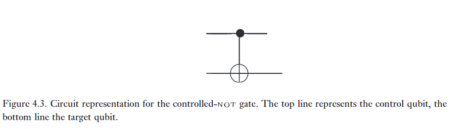
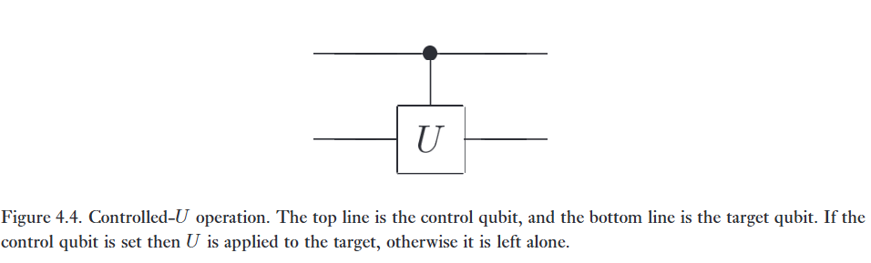
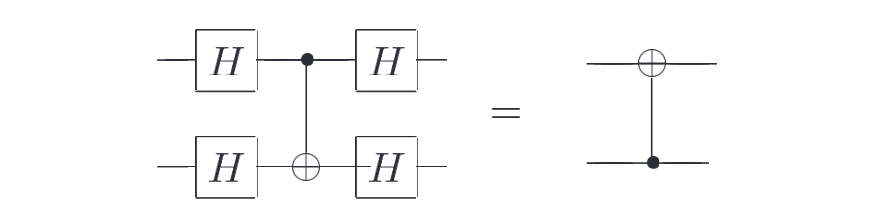
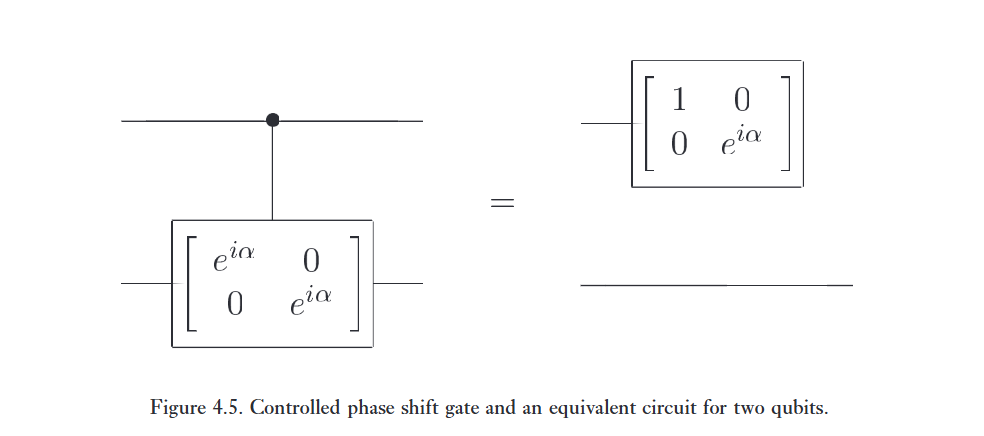
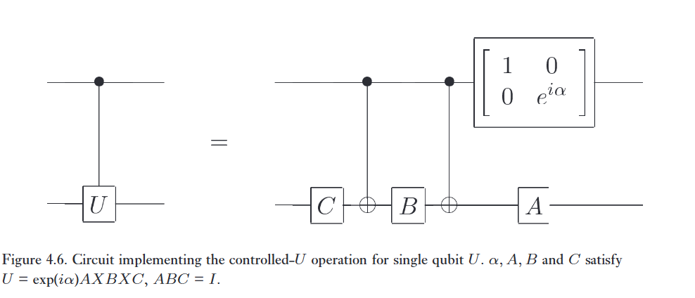
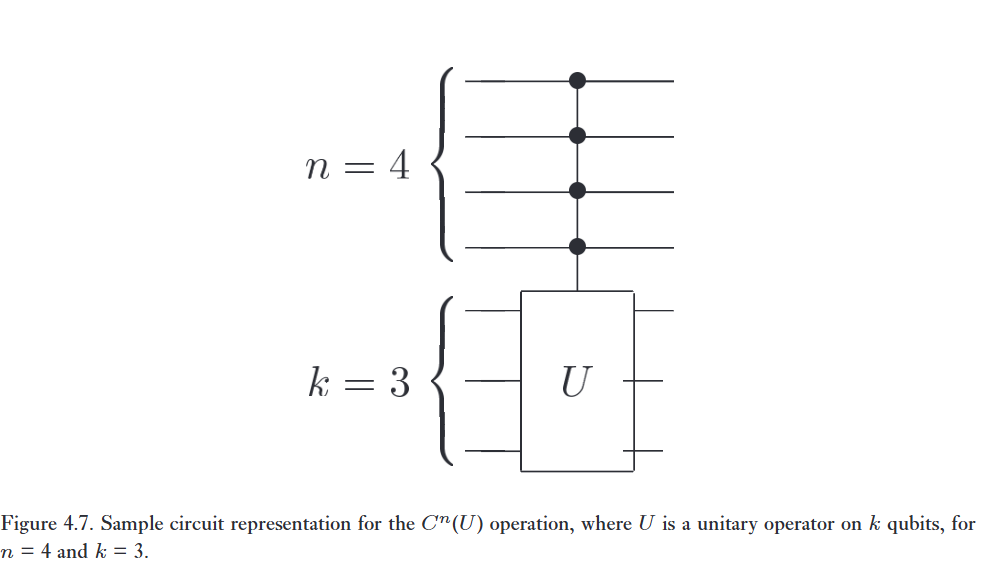
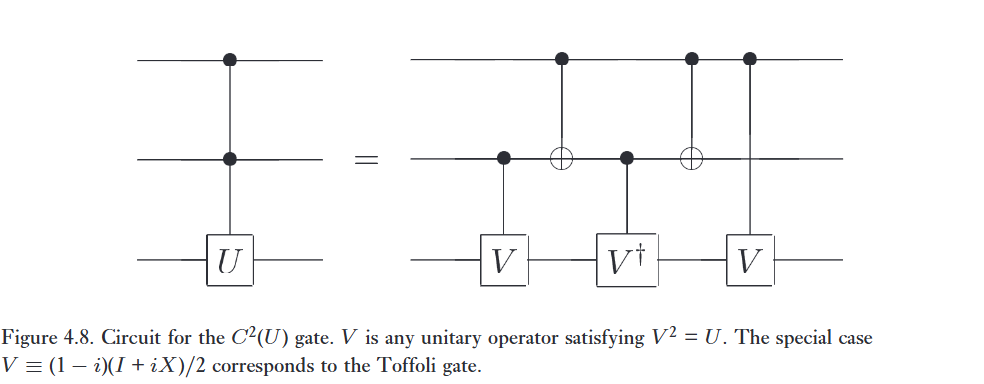
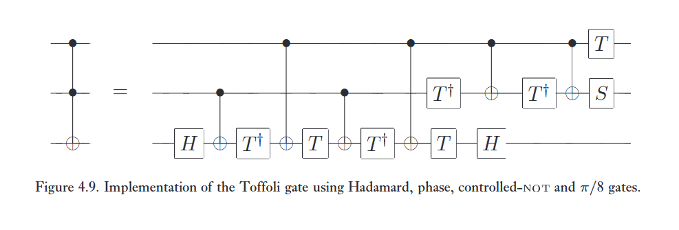
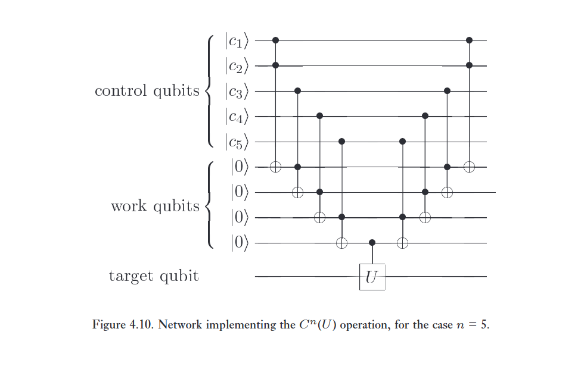
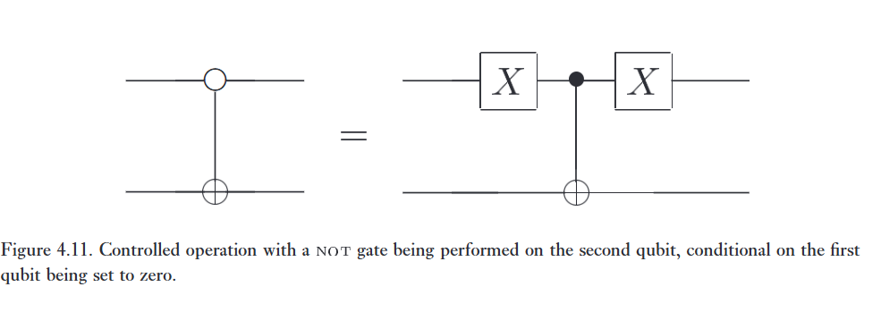

'Nếu A đúng, thì thực hiện B'. Loại phép toán có điều khiển này là một trong những thứ hữu ích nhất trong điện toán, cả cổ điển lẫn lượng tử. Trong phần này, chúng tôi giải thích cách thức các phép toán có điều khiển phức tạp có thể được triển khai bằng cách sử dụng các mạch lượng tử được xây dựng từ các phép toán cơ bản.   

Phép toán có điều khiển nguyên mẫu là cổng controlled-NOT, thứ mà chúng ta đã gặp trong Mục 1.2.1. Nhắc lại rằng cổng này, mà chúng ta sẽ thường gọi là CNOT, là một cổng lượng tử có hai qubit đầu vào, lần lượt được gọi là qubit điều khiển (control qubit) và qubit mục tiêu (target qubit). Nó được vẽ như trong Hình 4.3. Xét theo cơ sở tính toán (computational basis), tác động của CNOT được cho bởi $\vert c \rangle \vert t \rangle \Rightarrow \vert c \rangle \vert t \otimes c \rangle$; tức là, nếu qubit điều khiển được đặt thành $\vert 1 \rangle$ thì qubit mục tiêu bị lật, nếu không thì qubit mục tiêu được giữ nguyên. Do đó, trong cơ sở tính toán $\vert \text{control}, \text{target} \rangle$, biểu diễn ma trận của CNOT là:

$$
\begin{bmatrix} 1 & 0 & 0 & 0 \\ 0 & 1 & 0 & 0 \\ 0 & 0 & 0 & 1 \\ 0 & 0 & 1 & 0 \end{bmatrix}. \tag{4.23}
$$

Tổng quát hơn, giả sử $U$ là một phép toán unita một qubit tùy ý. Một phép toán controlled-$U$ là một phép toán hai qubit, lại có một qubit điều khiển và một qubit mục tiêu. Nếu qubit điều khiển được kích hoạt (set) thì $U$ được áp dụng lên qubit mục tiêu, nếu không qubit mục tiêu được giữ nguyên; tức là, $\vert{}c\rangle\vert{}t\rangle \rightarrow \vert{}c\rangle U^c \vert{}t\rangle$. Phép toán controlled-$U$ được biểu diễn bởi mạch được thể hiện trong Hình 4.4. 

:::{.callout-note collapse="true"}
# Bài tập 4.16: (Biểu diễn ma trận của các cổng đa qubit) 
Ma trận unita $4 \times 4$ cho mạch

trong cơ sở tính toán là gì? Ma trận unita cho mạch

trong cơ sở tính toán là gì?

---

Dây thẳng tức là I.

$$
U_1 = x_2 \otimes x_1 = H \otimes I = \frac 1 {\sqrt 2} \begin{bmatrix} 1 \cdot I & 1 \cdot I \\ 1 \cdot I & -1 \cdot I \end{bmatrix} 
$$

$$
H \otimes I = \frac{1}{\sqrt{2}} \begin{bmatrix} 1 \cdot \begin{bmatrix} 1 & 0 \\ 0 & 1 \end{bmatrix} & 1 \cdot \begin{bmatrix} 1 & 0 \\ 0 & 1 \end{bmatrix} \\ 1 \cdot \begin{bmatrix} 1 & 0 \\ 0 & 1 \end{bmatrix} & -1 \cdot \begin{bmatrix} 1 & 0 \\ 0 & 1 \end{bmatrix} \end{bmatrix}
$$

$$
U_1 = \frac{1}{\sqrt{2}} \begin{bmatrix} 1 & 0 & 1 & 0 \\ 0 & 1 & 0 & 1 \\ 1 & 0 & -1 & 0 \\ 0 & 1 & 0 & -1 \end{bmatrix}
$$

Ở U thứ hai thì ngược lại tí:

$$
U_2 = I \otimes H = \begin{bmatrix} 1 \cdot H & 0 \cdot H \\ 0 \cdot H & 1 \cdot H \end{bmatrix}
$$

$$
I \otimes H = \begin{bmatrix} \frac{1}{\sqrt{2}}\begin{bmatrix} 1 & 1 \\ 1 & -1 \end{bmatrix} & \begin{bmatrix} 0 & 0 \\ 0 & 0 \end{bmatrix} \\ \begin{bmatrix} 0 & 0 \\ 0 & 0 \end{bmatrix} & \frac{1}{\sqrt{2}}\begin{bmatrix} 1 & 1 \\ 1 & -1 \end{bmatrix} \end{bmatrix}
$$

$$
U_2 = \frac{1}{\sqrt{2}} \begin{bmatrix} 1 & 1 & 0 & 0 \\ 1 & -1 & 0 & 0 \\ 0 & 0 & 1 & 1 \\ 0 & 0 & 1 & -1 \end{bmatrix}
$$
:::

:::{.callout-note collapse="true"}
# Bài tập 4.17: (Xây dựng CNOT từ các cổng controlled-Z) 
Xây dựng một cổng $\text{CNOT}$ từ một cổng controlled-$Z$, tức là cổng mà tác động của nó trong cơ sở tính toán được xác định bởi ma trận unita

$$
\begin{bmatrix} 1 & 0 & 0 & 0 \\ 0 & 1 & 0 & 0 \\ 0 & 0 & 1 & 0 \\ 0 & 0 & 0 & -1 \end{bmatrix}
$$
và hai cổng Hadamard, chỉ rõ các qubit điều khiển và qubit mục tiêu.

---

Ở bài trước ta có đồng nhất thức HZH = X rồi.

Mà CNOT cũng là CX, tức là, kiểm soát trên trục X.

Mà giờ ta muốn CZ, kiểm soát trên trục Z, thì chỉ cần kẹp CZ ở giữa 2 cổng Hadamard
:::

:::{.callout-note collapse="true"}
# Bài tập 4.18:
Chứng minh rằng

:::

:::{.callout-note collapse="true"}
# Bài tập 4.19: (Tác động của CNOT lên ma trận mật độ) 
Cổng $\text{CNOT}$ là một phép hoán vị đơn giản mà tác động của nó lên một ma trận mật độ $\rho$ là sắp xếp lại các phần tử trong ma trận. Hãy viết rõ ràng tác động này trong cơ sở tính toán.   

---

Vì CNOT là unitary U, vì vậy nó có thể được áp dụng trong công thức tiến hóa theo thời gian của ma trận mật độ:

$$
\rho' = U_{CNOT} \rho U_{CNOT}^\dagger
$$

Trong cơ sở tính toán, cổng CNOT giữ nguyên các trạng thái $\vert 00 \rangle$, $\vert 01 \rangle$, và $\vert 10 \rangle \rightarrow \vert 11 \rangle$, $\vert 11 \rangle \rightarrow \vert 10 \rangle$.

$$
\rho = \begin{bmatrix} \rho_{00} & \rho_{01} & \rho_{02} & \rho_{03} \\ \rho_{10} & \rho_{11} & \rho_{12} & \rho_{13} \\ \rho_{20} & \rho_{21} & \rho_{22} & \rho_{23} \\ \rho_{30} & \rho_{31} & \rho_{32} & \rho_{33} \end{bmatrix} \xrightarrow{CNOT} \rho' = \begin{bmatrix} \rho_{00} & \rho_{01} & \rho_{03} & \rho_{02} \\ \rho_{10} & \rho_{11} & \rho_{13} & \rho_{12} \\ \rho_{30} & \rho_{31} & \rho_{33} & \rho_{32} \\ \rho_{20} & \rho_{21} & \rho_{23} & \rho_{22} \end{bmatrix}
$$
:::

:::{.callout-note collapse="true"}
# Bài tập 4.20: (Các phép biến đổi cơ sở của CNOT) 
Không giống như các cổng cổ điển lý tưởng, các cổng lượng tử lý tưởng không có các đầu vào 'trở kháng cao' (high-impedance) (như cách gọi của các kỹ sư điện). Trên thực tế, vai trò của 'điều khiển' và 'mục tiêu' là tùy ý – chúng phụ thuộc vào việc bạn nghĩ thiết bị đang hoạt động trên cơ sở nào. Chúng ta đã mô tả cách thức $\text{CNOT}$ hoạt động đối với cơ sở tính toán, và trong mô tả này, trạng thái của qubit điều khiển không bị thay đổi. Tuy nhiên, nếu chúng ta làm việc trong một cơ sở khác thì qubit điều khiển thực sự bị thay đổi: chúng ta sẽ chỉ ra rằng pha của nó bị lật phụ thuộc vào trạng thái của qubit 'mục tiêu'! Chứng minh rằng   

Giới thiệu các trạng thái cơ sở $\vert{}\pm\rangle \equiv (\vert{}0\rangle \pm \vert{}1\rangle)/\sqrt{2}$, sử dụng đồng nhất thức mạch này để chứng minh rằng tác động của một $\text{CNOT}$ với qubit thứ nhất làm điều khiển và qubit thứ hai làm mục tiêu là như sau:

$$
\vert{}+\rangle\vert{}+\rangle \rightarrow \vert{}+\rangle\vert{}+\rangle \tag{4.24}
$$   

$$
\vert{}-\rangle\vert{}+\rangle \rightarrow \vert{}-\rangle\vert{}+\rangle \tag{4.25}
$$ 

$$
\vert{}+\rangle\vert{}-\rangle \rightarrow \vert{}-\rangle\vert{}-\rangle \tag{4.26}
$$  

$$
\vert{}-\rangle\vert{}-\rangle \rightarrow \vert{}+\rangle\vert{}-\rangle. \tag{4.27}
$$ 

Do đó, đối với cơ sở mới này, trạng thái của qubit mục tiêu không bị thay đổi, trong khi trạng thái của qubit điều khiển bị lật nếu mục tiêu bắt đầu là $\vert{}-\rangle$, nếu không nó được giữ nguyên. Tức là, trong cơ sở này, mục tiêu và điều khiển về cơ bản đã hoán đổi vai trò cho nhau!

---

Ta gọi các phép biến đổi này là:

$$
M = (H \otimes H) \cdot \text{CNOT}_{1 \rightarrow 2} \cdot (H \otimes H)
$$

Mà ở bài 4.17, ta đã chứng minh được rằng $\text{CNOT}_{1 \rightarrow 2} = (I \otimes H) \cdot CZ \cdot (I \otimes H)$, vậy:

$$
M = (H \otimes H) \cdot [(I \otimes H) \cdot CZ \cdot (I \otimes H)] \cdot (H \otimes H)
$$

rút gọn ta được:

$$
M = (H \otimes I) \cdot CZ \cdot (H \otimes I)
$$

Mà ở bài 4.18, ta biết được CZ không phân biệt control với target, nên có thể đảo cho nhau được, và áp dụng thêm 4.17, ta được:

$$
M = \text{CNOT}_{2 \rightarrow 1}
$$

---

Áp dụng CNOT (đổi chỗ vị trí thứ 3 và thứ 4) trực tiếp lên phân bố xác suất của các trạng thái cơ sở kép:

* $\vert + \rangle \vert + \rangle = \frac 1 2 (\vert 00 \rangle + \vert 01 \rangle + \vert 10 \rangle + \vert 11 \rangle)$, đổi chỗ vị trí thứ 3 và 4 không làm thay đổi. Kết quả giữ nguyên $\vert + \rangle \vert + \rangle$.
* $\vert - \rangle \vert + \rangle = \frac 1 2 (\vert 00 \rangle + \vert 01 \rangle - \vert 10 \rangle - \vert 11 \rangle)$, đổi chỗ vị trí thứ 3 và 4 không làm thay đổi. Kết quả giữ nguyên $\vert + \rangle \vert + \rangle$.
* $\vert + \rangle \vert - \rangle = \frac 1 2 (\vert 00 \rangle - \vert 01 \rangle + \vert 10 \rangle - \vert 11 \rangle)$, đổi chỗ vị trí thứ 3 và 4 làm kết quả thay đổi. Kết quả cuối cùng là $\vert - \rangle \vert - \rangle$.
* $\vert - \rangle \vert - \rangle = \frac 1 2 (\vert 00 \rangle - \vert 01 \rangle - \vert 10 \rangle + \vert 11 \rangle)$, đổi chỗ vị trí thứ 3 và 4 làm kết quả thay đổi. Kết quả cuối cùng là $\vert + \rangle \vert - \rangle$.

Qua 4 phương trình trên, có thể thấy trạng thái dây thứ 2 là không đổi, nhưng mà nếu dây thứ hai là - thì dây thứ nhất sẽ bị đổi dấu. Chứng minh rằng trong cơ sở mới, vai trò của control và target đã thực sự tráo đổi cho nhau.

:::

:::{.callout}
# Phase kickback

Trong cơ sở tính toán chuẩn $\vert 0 \rangle, \vert 1 \rangle$, cổng CNOT là một chiều: Qubit điều khiển điều khiển qubit mục tiêu, nhưng target không bao giờ làm thay đổi control.

Tuy nhiên ở bài 4.20 đã cho thấy, khi kẹp cổng CNOT giữa các cổng hadamard (chuyển cơ sở $\vert + \rangle, \vert - \rangle$) thì khi đó điều kỳ lạ xảy ra:

* Qubit target là $\vert - \rangle$, control đang từ $\vert + \rangle$ biến thành $\vert - \rangle$.
* Qubit target đã trở thành control, lật ngược trạng tahsi của qubit điều khiển ban đầu.

:::

Mục tiêu trước mắt của chúng ta là hiểu cách thức triển khai phép toán controlled-$U$ đối với một cổng unita một qubit $U$ tùy ý, chỉ sử dụng các phép toán một qubit và cổng $\text{CNOT}$. Chiến lược của chúng ta là một quy trình gồm hai phần dựa trên phép phân rã $U = e^{i\alpha}AXBXC$ được đưa ra trong Hệ quả 4.2 ở trang 176.   

Bước đầu tiên của chúng ta sẽ là áp dụng phép dịch pha $\exp(i\alpha)$ lên qubit mục tiêu, được điều khiển bởi qubit điều khiển. Tức là, nếu qubit điều khiển là $\vert{}0\rangle$, thì qubit mục tiêu được giữ nguyên, trong khi nếu qubit điều khiển là $\vert{}1\rangle$, một phép dịch pha $\exp(i\alpha)$ được áp dụng lên qubit mục tiêu. Một mạch triển khai phép toán này chỉ sử dụng một cổng unita một qubit được mô tả ở phía bên phải của Hình 4.5. Để kiểm chứng rằng mạch này hoạt động chính xác, lưu ý rằng tác động của mạch ở phía bên phải là
$$
\vert{}00\rangle \rightarrow \vert{}00\rangle, \quad \vert{}01\rangle \rightarrow \vert{}01\rangle, \quad \vert{}10\rangle \rightarrow e^{i\alpha}\vert{}10\rangle, \quad \vert{}11\rangle \rightarrow e^{i\alpha}\vert{}11\rangle, \tag{4.28}
$$

điều này chính xác là những gì được yêu cầu cho phép toán có điều khiển ở phía bên trái.

Giờ đây chúng ta có thể hoàn thành việc xây dựng phép toán controlled-$U$, như được thể hiện trong Hình 4.6. Để hiểu tại sao mạch này hoạt động, hãy nhớ lại từ Hệ quả 4.2 rằng $U$ có thể được viết dưới dạng $U = e^{i\alpha}AXBXC$, trong đó $A, B$ và $C$ là các phép toán một qubit sao cho $ABC = I$. Giả sử rằng qubit điều khiển được kích hoạt. Khi đó phép toán $e^{i\alpha}AXBXC = U$ được áp dụng lên qubit thứ hai. Mặt khác, nếu qubit điều khiển không được kích hoạt, thì phép toán $ABC = I$ được áp dụng lên qubit thứ hai; tức là, không có sự thay đổi nào được tạo ra. Nghĩa là, mạch này triển khai phép toán controlled-$U$.   

Bây giờ chúng ta đã biết cách đặt điều kiện dựa trên một qubit đơn lẻ được kích hoạt, thế còn việc đặt điều kiện dựa trên nhiều qubit thì sao? Chúng ta đã gặp một ví dụ về việc đặt điều kiện dựa trên nhiều qubit, cổng Toffoli, cổng lật qubit thứ ba, qubit mục tiêu, với điều kiện là hai qubit đầu tiên, các qubit điều khiển, được đặt thành một. Tổng quát hơn, giả sử chúng ta có $n + k$ qubit, và $U$ là một toán tử unita $k$ qubit. Khi đó chúng ta định nghĩa phép toán có điều khiển $C^n(U)$ bởi phương trình   

$$
C^n(U)\vert{}x_1x_2 \dots x_n\rangle\vert{}\psi\rangle = \vert{}x_1x_2 \dots x_n\rangle U^{x_1x_2\dots x_n}\vert{}\psi\rangle, \tag{4.29}
$$ 

trong đó $x_1x_2 \dots x_n$ trong số mũ của $U$ mang ý nghĩa là tích (product) của các bit $x_1, x_2, \dots, x_n$. Tức là, toán tử $U$ được áp dụng lên $k$ qubit cuối cùng nếu $n$ qubit đầu tiên đều bằng một, và ngược lại thì không làm gì cả. Những phép toán có điều kiện như vậy hữu ích đến mức chúng tôi giới thiệu một ký hiệu mạch đặc biệt cho chúng, được minh họa trong Hình 4.7. Trong phần tiếp theo, chúng ta giả sử rằng $k = 1$, cho đơn giản. $k$ lớn hơn có thể được xử lý bằng cách sử dụng các phương pháp về cơ bản là tương tự, tuy nhiên đối với $k \ge 2$ có thêm một sự phức tạp là chúng ta chưa biết cách thực hiện các phép toán tùy ý trên $k$ qubit. 

Giả sử $U$ là một toán tử unita một qubit, và $V$ là một toán tử unita được chọn sao cho $V^2 = U$. Khi đó phép toán $C^2(U)$ có thể được triển khai sử dụng mạch được thể hiện trong Hình 4.8

:::{.callout-note collapse="true"}
# Bài tập 4.21: 
Kiểm chứng rằng Hình 4.8 triển khai phép toán $C^2(U)$.   

---

Riel, thật, nó triển khai thật.

btw, $C^n(U)$ có thể hiểu là, phải có đủ n qubit control đang bật (=1) thì nó mới tác dụng lên target bằng cổng U. Còn nếu không thì nó không làm, (tức là nhân với I).

:::

:::{.callout-note collapse="true"}
# Bài tập 4.22: 
Chứng minh rằng một cổng $C^2(U)$ (đối với bất kỳ cổng unita một qubit $U$ nào) có thể được xây dựng sử dụng nhiều nhất tám cổng một-qubit, và sáu cổng controlled-$\text{NOT}$.
:::

:::{.callout-note collapse="true"}
# Bài tập 4.23: 
Xây dựng một cổng $C^1(U)$ cho $U = R_x(\theta)$ và $U = R_y(\theta)$, chỉ sử dụng $\text{CNOT}$ và các cổng một qubit. Bạn có thể giảm số lượng cổng một qubit cần thiết trong cấu trúc này từ ba xuống hai không? 

---

R_y(\theta) có A = I, mà ta có thể bỏ ra được, vậy chỉ còn 2 cổng đơn qubit là B và C. 

Còn R_x(\theta), không thể kiếm A,B,C sao cho có ít nhất 1 cái là I nên nó không giảm xuống 2 được
:::

Cổng Toffoli quen thuộc là một trường hợp đặc biệt cực kỳ quan trọng của phép toán $C^2(U)$,

trường hợp $C^2(X)$. Bằng cách định nghĩa $V \equiv (1 - i)(I + iX)/2$ và lưu ý rằng $V^2 = X$, chúng ta thấy rằng Hình 4.8 đưa ra một cách triển khai cổng Toffoli thông qua các phép toán một và hai qubit. Từ góc nhìn cổ điển, đây là một kết quả đáng chú ý; hãy nhớ lại từ Bài tập 3.5 rằng các cổng khả nghịch cổ điển một và hai bit là không đủ để triển khai cổng Toffoli, hay tổng quát hơn, là tính toán vạn năng. Ngược lại, trong trường hợp lượng tử, chúng ta thấy rằng các cổng khả nghịch một và hai qubit là đủ để triển khai cổng Toffoli, và cuối cùng sẽ chứng minh rằng chúng đủ cho tính toán vạn năng.   

Cuối cùng, chúng ta sẽ chứng minh rằng với bất kỳ cổng nào cũng có thể được phân tích với độ chính xác tùy ý chỉ từ các cổng Hadamard, CNOT, và T. Vì tính hữu ích to lớn của cổng Toffoli, việc tìm hiểu cách xây dựng nó chỉ từ tập cổng này rất được quan tâm. Hình 4.9 minh họa một mạch đơn giản cho cổng Toffoli được cấu thành từ các cổng Hadamard, phase, $\text{CNOT}$ và $\pi/8$

:::{.callout-note collapse="true"}
# Bài tập 4.24: 
Kiểm chứng rằng Hình 4.9 thực sự triển khai cổng Toffoli.
:::

:::{.callout-note collapse="true"}
# Bài tập 4.25: (Xây dựng cổng Fredkin - Fredkin gate construction) 
Nhắc lại rằng cổng Fredkin (cổng đổi chỗ có điều khiển - controlled-swap) thực hiện phép biến đổi được cho bởi ma trận 8×8 ở phương trình (4.30):
$$
\begin{bmatrix} 
1 & 0 & 0 & 0 & 0 & 0 & 0 & 0 \\ 
0 & 1 & 0 & 0 & 0 & 0 & 0 & 0 \\ 
0 & 0 & 1 & 0 & 0 & 0 & 0 & 0 \\ 
0 & 0 & 0 & 1 & 0 & 0 & 0 & 0 \\ 
0 & 0 & 0 & 0 & 1 & 0 & 0 & 0 \\ 
0 & 0 & 0 & 0 & 0 & 0 & 1 & 0 \\ 
0 & 0 & 0 & 0 & 0 & 1 & 0 & 0 \\ 
0 & 0 & 0 & 0 & 0 & 0 & 0 & 1 
\end{bmatrix} \tag{4.30}
$$

(1) Đưa ra một mạch lượng tử sử dụng ba cổng Toffoli để xây dựng cổng Fredkin (Gợi ý: hãy suy nghĩ về cách xây dựng cổng swap — bạn có thể điều khiển từng cổng một).   
(2) Chứng minh rằng cổng Toffoli đầu tiên và cuối cùng có thể được thay thế bằng các cổng $\text{CNOT}$.   
(3) Bây giờ, hãy thay thế cổng Toffoli ở giữa bằng mạch trong Hình 4.8 để thu được cấu trúc cổng Fredkin chỉ sử dụng sáu cổng hai qubit.   
(4) Bạn có thể tìm ra một cấu trúc thậm chí còn đơn giản hơn, chỉ với năm cổng hai qubit không?
:::

:::{.callout-note collapse="true"}
# Bài tập 4.26: 
Chứng minh rằng mạch trong hình bên dưới (với các cổng quay $R_y(\pi/4)$, $R_y(\pi/2)$, v.v.) chỉ khác cổng Toffoli ở các pha tương đối. Cụ thể, mạch biến đổi trạng thái $\vert{}c_1, c_2, t\rangle$ thành $e^{i\theta(c_1, c_2, t)}\vert{}c_1, c_2, t \oplus c_1 \cdot c_2\rangle$, trong đó $e^{i\theta(c_1, c_2, t)}$ là một hệ số pha tương đối. Những cổng như vậy đôi khi rất hữu ích trong các cấu trúc thực nghiệm, nơi việc triển khai một cổng sai khác với Toffoli chỉ ở pha tương đối sẽ dễ dàng hơn nhiều so với việc làm trực tiếp cổng Toffoli. 
:::

:::{.callout-note collapse="true"}
# Bài tập 4.27: 
Chỉ sử dụng các cổng $\text{CNOT}$ và Toffoli, hãy xây dựng một mạch lượng tử thực hiện phép biến đổi đại diện bởi ma trận $8 \times 8$ ở phương trình (4.31):   

$$
\begin{bmatrix}
1 & 0 & 0 & 0 & 0 & 0 & 0 & 0 \\
0 & 0 & 0 & 0 & 0 & 0 & 0 & 1 \\
0 & 1 & 0 & 0 & 0 & 0 & 0 & 0 \\
0 & 0 & 1 & 0 & 0 & 0 & 0 & 0 \\
0 & 0 & 0 & 1 & 0 & 0 & 0 & 0 \\
0 & 0 & 0 & 0 & 1 & 0 & 0 & 0 \\
0 & 0 & 0 & 0 & 0 & 1 & 0 & 0 \\ 
0 & 0 & 0 & 0 & 0 & 0 & 1 & 0
\end{bmatrix} \tag{4.31}
$$   

Loại phép toán hoán vị vòng quanh một phần (partial cyclic permutation operation) này sẽ rất hữu ích sau này trong Chương 7.
:::

Chúng ta có thể triển khai các cổng $C^n(U)$ bằng cách sử dụng các cổng hiện có của chúng ta như thế nào, trong đó $U$ là một phép toán unita một qubit tùy ý? Một mạch cực kỳ đơn giản để đạt được nhiệm vụ này được minh họa trong Hình 4.10. Mạch được chia thành ba giai đoạn, và sử dụng một số ít ($n - 1$) qubit làm việc (working qubits / ancilla qubits), tất cả đều bắt đầu và kết thúc ở trạng thái $\vert{}0\rangle$.   

Giả sử các qubit điều khiển đang ở trạng thái cơ sở tính toán $\vert{}c_1, c_2, \dots, c_n\rangle$. Giai đoạn đầu tiên của mạch là thực hiện phép $\text{AND}$ khả nghịch tất cả các bit điều khiển $c_1, \dots, c_n$ lại với nhau để tạo ra tích $c_1 \cdot c_2 \dots c_n$. Để làm điều này, cổng đầu tiên trong mạch thực hiện $\text{AND}$ hai bit $c_1$ và $c_2$ với nhau, sử dụng một cổng Toffoli, làm thay đổi trạng thái của qubit làm việc đầu tiên thành $\vert{}c_1 \cdot c_2\rangle$. Cổng Toffoli tiếp theo thực hiện $\text{AND}$ bit $c_3$ với tích $c_1 \cdot c_2$, làm thay đổi trạng thái của qubit làm việc thứ hai thành $\vert{}c_1 \cdot c_2 \cdot c_3\rangle$. Chúng ta tiếp tục áp dụng các cổng Toffoli theo cách này, cho đến khi qubit làm việc cuối cùng ở trạng thái $\vert{}c_1 \cdot c_2 \dots c_n\rangle$.   

Tiếp theo, một phép toán $U$ trên qubit mục tiêu được thực hiện, có điều kiện là qubit làm việc cuối cùng được đặt bằng một. Tức là, $U$ chỉ được áp dụng khi và chỉ khi tất cả các bit từ $c_1$ đến $c_n$ đều được bật. Cuối cùng, phần sau của mạch chỉ đơn giản là đảo ngược các bước của giai đoạn đầu tiên, đưa tất cả các qubit làm việc trở về trạng thái ban đầu $\vert{}0\rangle$. Do đó, kết quả kết hợp là áp dụng toán tử unita $U$ lên qubit mục tiêu, khi và chỉ khi tất cả các bit điều khiển từ $c_1$ đến $c_n$ đều được bật, đúng như mong muốn.   

:::{.callout-note collapse="true"}
# Bài tập 4.28: 
Đối với $U = V^2$ với $V$ là unita, hãy xây dựng một cổng $C^5(U)$ tương tự như trong Hình 4.10, nhưng không sử dụng qubit làm việc nào. Bạn có thể sử dụng các cổng controlled-$V$ và controlled-$V^\dagger$. 
:::

:::{.callout-note collapse="true"}
# Bài tập 4.29: 
Tìm một mạch chứa $O(n^2)$ cổng Toffoli, $\text{CNOT}$ và các cổng một qubit để thực hiện cổng $C^n(X)$ (với $n > 3$), mà không sử dụng qubit làm việc nào. 
:::

:::{.callout-note collapse="true"}
# Bài tập 4.30: 
Giả sử $U$ là một phép toán unita một qubit. Tìm một mạch chứa $O(n^2)$ cổng Toffoli, $\text{CNOT}$ và các cổng một qubit để thực hiện cổng $C^n(U)$ (với $n > 3$), mà không sử dụng qubit làm việc nào. 
:::

Trong các cổng có điều khiển mà chúng ta đã xem xét, động lực có điều kiện trên qubit mục tiêu xảy ra nếu các bit điều khiển được đặt thành một. Tất nhiên, không có gì đặc biệt về số một, và việc xem xét các động lực xảy ra có điều kiện khi bit điều khiển được đặt thành không thường rất hữu ích. Chẳng hạn, giả sử chúng ta muốn triển khai một cổng hai qubit trong đó qubit thứ hai ('mục tiêu') bị lật, có điều kiện là qubit thứ nhất ('điều khiển') được đặt thành không. Trong Hình 4.11, chúng ta giới thiệu ký hiệu mạch cho cổng này, cùng với một mạch tương đương xét theo các cổng mà chúng ta đã giới thiệu. Nói chung, chúng ta sẽ sử dụng ký hiệu vòng tròn mở (open circle) để chỉ điều kiện trên qubit được đặt thành không, trong khi vòng tròn đặc (closed circle) chỉ điều kiện trên qubit được đặt thành một.   

Một ví dụ công phu hơn về quy ước này, liên quan đến ba qubit điều khiển, được minh họa trong Hình 4.12. Phép toán $U$ được áp dụng lên qubit mục tiêu nếu qubit thứ nhất và thứ ba được đặt thành không, và qubit thứ hai được đặt thành một. Thật dễ dàng để kiểm chứng bằng cách quan sát rằng mạch ở phía bên phải của hình thực hiện phép toán mong muốn. Tổng quát hơn, thật dễ dàng để chuyển đổi giữa các mạch đưa ra điều kiện trên các qubit được đặt thành một và các mạch đưa ra điều kiện trên các qubit được đặt thành không, bằng cách chèn các cổng $X$ ở các vị trí thích hợp, như được minh họa trong Hình 4.12. 

Một quy ước khác đôi khi hữu ích là cho phép các cổng controlled-$\text{NOT}$ có nhiều mục tiêu, như được thể hiện trong Hình 4.13. Ký hiệu tự nhiên này có nghĩa là khi qubit điều khiển là 1, thì tất cả các qubit được đánh dấu bằng ký hiệu $\oplus$ sẽ bị lật, và ngược lại thì không có gì xảy ra. Ví dụ, nó rất thuận tiện khi được sử dụng trong việc xây dựng các hàm cổ điển chẳng hạn như các phép hoán vị, hoặc trong các bộ mã hóa và giải mã cho các mạch sửa lỗi lượng tử, như chúng ta sẽ thấy ở Chương 10.

:::{.callout-note collapse="true"}
# Bài tập 4.31: (Các đồng nhất thức mạch bổ sung - More circuit identities) 
Hãy để các chỉ số dưới biểu thị toán tử tác động lên qubit nào, và hãy để $C$ là một cổng $\text{CNOT}$ với qubit 1 là qubit điều khiển và qubit 2 là qubit mục tiêu. Chứng minh các đồng nhất thức sau:   

$$
C X_1 C = X_1 X_2 \tag{4.32}
$$

$$
C Y_1 C = Y_1 X_2 \tag{4.33}
$$   

$$
C Z_1 C = Z_1 \tag{4.34}
$$   

$$
C X_2 C = X_2 \tag{4.35}
$$   

$$
C Y_2 C = Z_1 Y_2 \tag{4.36}
$$

$$
C Z_2 C = Z_1 Z_2 \tag{4.37}
$$ 

$$
R_{z, 1}(\theta) C = C R_{z, 1}(\theta) \tag{4.38}
$$   

$$
R_{x, 2}(\theta) C = C R_{x, 2}(\theta) \tag{4.39}
$$
:::