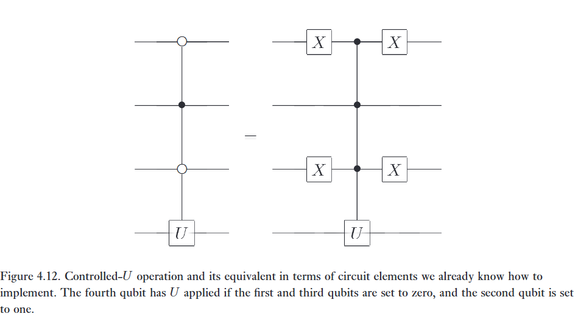
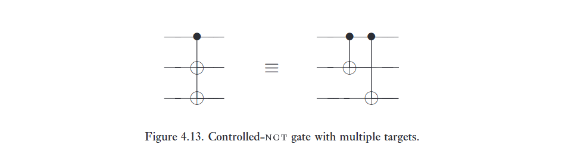
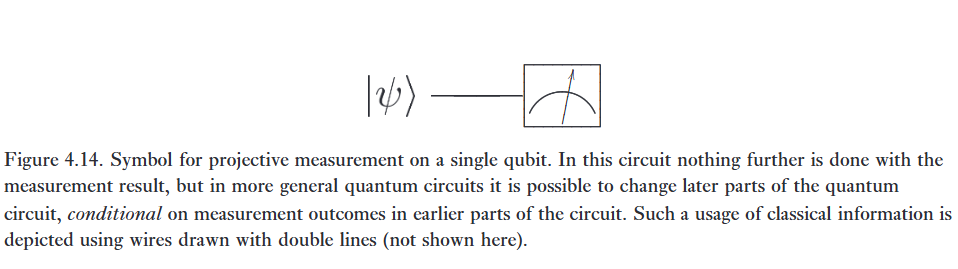
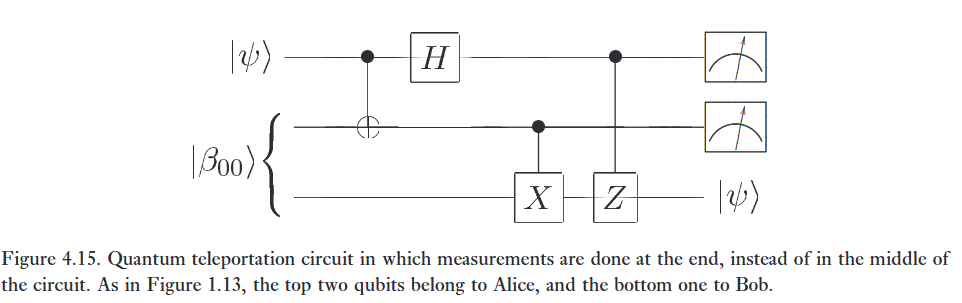
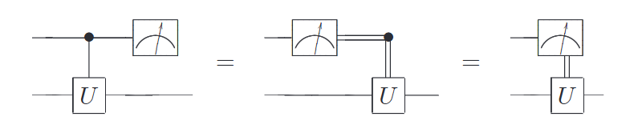

Một yếu tố cuối cùng được sử dụng trong các mạch lượng tử, đôi khi gần như ngầm định, là phép đo lường. Trong các mạch của chúng ta, chúng ta sẽ biểu thị một phép đo lường chiếu (projective measurement) trong cơ sở tính toán (Mục 2.2.5) bằng cách sử dụng biểu tượng 'đồng hồ đo' (meter), được minh họa trong Hình 4.14. Trong lý thuyết mạch lượng tử, theo quy ước, người ta không sử dụng bất kỳ ký hiệu đặc biệt nào để biểu thị các phép đo lường tổng quát hơn, bởi vì, như đã giải thích trong Chương 2, chúng luôn có thể được biểu diễn bằng các phép biến đổi unita với các qubit ancilla, theo sau là các phép đo lường chiếu.   

Có hai nguyên lý quan trọng về mạch lượng tử mà ta cần ghi nhớ. Cả hai nguyên lý đều khá hiển nhiên; tuy nhiên, chúng có tính ứng dụng cao đến mức đáng để nhấn mạnh từ sớm. Nguyên lý đầu tiên là các phép toán có điều khiển theo kiểu cổ điển (classically conditioned operations) có thể được thay thế bằng các phép toán có điều kiện lượng tử (quantum conditioned operations):   

:::{.postulates}
# Nguyên lý đo lường trì hoãn (Principle of deferred measurement)
Các phép đo lường luôn có thể được dịch chuyển từ một giai đoạn trung gian của một mạch lượng tử xuống cuối mạch; nếu các kết quả đo lường được sử dụng ở bất kỳ giai đoạn nào của mạch thì các phép toán được điều khiển bằng kết quả cổ điển có thể được thay thế bằng các phép toán lượng tử có điều kiện.
:::

Thường thì, các phép đo lượng tử được thực hiện như một bước trung gian trong một mạch lượng tử, và các kết quả đo lường được sử dụng để điều khiển có điều kiện các cổng lượng tử tiếp theo. Đây là trường hợp, ví dụ, trong mạch viễn tải (teleportation) ở Hình 1.13 trên trang 27. Tuy nhiên, các phép đo lường như vậy luôn luôn có thể được dời xuống cuối mạch. Hình 4.15 minh họa cách điều này có thể được thực hiện bằng cách thay thế tất cả các phép toán có điều kiện cổ điển bằng các phép toán có điều kiện lượng tử tương ứng. (Tất nhiên, một phần diễn giải của mạch này như là thực hiện sự 'viễn tải' bị mất đi, bởi vì không có thông tin cổ điển nào được truyền từ Alice đến Bob, nhưng rõ ràng là tác động tổng thể của hai mạch lượng tử là như nhau, đây mới là điểm then chốt.)   

:::{.callout}
# Nói thêm

Nguyên lý này khẳng định: không cần phải đo ngay lúc giữa chừng, chỉ cần thay if cổ điển đó bằng if lượng tử - CNOT, rồi đo ở cuối cùng.

Điều này giúp mạch lượng tử hoàn toàn thuần khiết, chỉ gồm các ma trận Unita, từ đầu đến cuối, giúp quá trình phân tích toán học và sữa lỗi lượng tử dễ dàng hơn.
:::

Nguyên lý thứ hai thậm chí còn hiển nhiên hơn – và hữu ích một cách đáng ngạc nhiên! 

:::{.postulates}
# Nguyên lý đo lường ngầm định (Principle of implicit measurement)
Không mất tính tổng quát, bất kỳ đường dây lượng tử nào không được kết thúc (các qubit không được đo lường) ở cuối một mạch lượng tử đều có thể được giả định là đã được đo lường.   
:::

Để hiểu tại sao điều này đúng, hãy tưởng tượng bạn có một mạch lượng tử chỉ chứa hai qubit, và chỉ có qubit thứ nhất được đo lường ở cuối mạch. Khi đó các thống kê đo lường quan sát được tại thời điểm này hoàn toàn được xác định bởi ma trận mật độ rút gọn (reduced density matrix) của qubit thứ nhất. Tuy nhiên, nếu một phép đo lường cũng được thực hiện trên qubit thứ hai, thì sẽ rất đáng ngạc nhiên nếu phép đo lường đó có thể thay đổi các thống kê đo lường trên qubit thứ nhất. Bạn sẽ chứng minh điều này trong Bài tập 4.32 bằng cách chỉ ra rằng ma trận mật độ rút gọn của qubit thứ nhất không bị ảnh hưởng bởi việc thực hiện một phép đo lường trên qubit thứ hai.   

:::{.callout}
# Nói thêm 

## Mạch viễn tải không còn mạnh nữa

Áp dụng nguyên lý đo lường ngầm định vào, ta có thể thay 2 đường dây thông tin cổ điển thành đường dâu lượng tử, và thay các thao tác điều khiển cổ điển bằng các cổng CNOT và CZ lượng tử thuần túy.

Và? Mạch vẫn đúng về mặt toán học, nhưng nó không còn viễn tải nữa, nó trở thành một mạch tính toán cục bộ khổng lồ, nơi alice và bob phải đưa qubit của họ lại gần nhau để thực hiện cổng CNOT.

## Nguyên lý Đo lường Ngầm định

Khi bạn bỏ mặc một qubit không đo lường ở cuối mạch, toán học tương ứng với hành động này là tính vết riêng từng phần trên không gian Hilbert của qubit đó để lấy ma trận mật độ rút gọn rho.

Việc bạn có đo hay không đo qubit thứ hai không làm thay đổi rho của qubit thứ nhất. Đây là biểu hiện toán học của **Định lý không truyền tín hiệu** (Người quan sát A không thể biết người quan sát B đã đo qubit của mình hay chưa chỉ bằng cách nhìn vào các thống kê đo lường cục bộ của riêng mình).
:::

---

Khi bạn xem xét vai trò của các phép đo lường trong các mạch lượng tử, điều quan trọng cần ghi nhớ là trong vai trò như một giao diện giữa thế giới lượng tử và thế giới cổ điển, phép đo lường thường được coi là một phép toán không thể đảo ngược (irreversible), phá hủy thông tin lượng tử và thay thế nó bằng thông tin cổ điển. Tuy nhiên, trong một số trường hợp được thiết kế cẩn thận, điều này không nhất thiết phải đúng, như được minh họa một cách sinh động qua viễn tải và sửa lỗi lượng tử (Chương 10). Điểm chung của viễn tải và sửa lỗi lượng tử là trong cả hai trường hợp, kết quả đo lường đều không tiết lộ bất kỳ thông tin nào về danh tính của trạng thái lượng tử đang được đo lường. Quả thực, chúng ta sẽ thấy ở Chương 10 rằng đây là một đặc điểm tổng quát hơn của phép đo lường – để một phép đo lường có thể đảo ngược, nó phải không tiết lộ thông tin nào về trạng thái lượng tử đang được đo lường!  

:::{.callout}
# Làm sao để đo một hệ lượng tử mà không làm sụp đổ nó?

Câu hỏi này đã giúp định hình nên ngành sữa lỗi mã lượng tử QEC.

:::

:::{.callout-note collapse="true"}
# Bài tập 4.32: 
Giả sử $\rho$ là ma trận mật độ mô tả một hệ hai qubit. Giả sử chúng ta thực hiện một phép đo chiếu (projective measurement) trong cơ sở tính toán trên qubit thứ hai. Gọi $P_0 = \vert{}0\rangle\langle0\vert{}$ và $P_1 = \vert{}1\rangle\langle1\vert{}$ lần lượt là các toán tử chiếu lên trạng thái $\vert{}0\rangle$ và $\vert{}1\rangle$ của qubit thứ hai. Gọi $\rho'$ là ma trận mật độ được gán cho hệ thống sau phép đo bởi một người quan sát không biết kết quả đo lường. Chứng minh rằng
$$
\rho' = P_0\rho P_0 + P_1\rho P_1. \tag{4.40}
$$

Đồng thời chứng minh rằng ma trận mật độ rút gọn của qubit thứ nhất không bị ảnh hưởng bởi phép đo, tức là $\text{tr}_2(\rho) = \text{tr}_2(\rho')$.   
:::

:::{.callout-note collapse="true"}
# Bài tập 4.33: (Đo lường trong cơ sở Bell - Measurement in the Bell basis) 
Mô hình đo lường mà chúng ta đã xác định cho mô hình mạch lượng tử là các phép đo chỉ được thực hiện trong cơ sở tính toán. Tuy nhiên, thường thì chúng ta muốn thực hiện phép đo trong một cơ sở khác, được xác định bởi một tập hợp đầy đủ các trạng thái trực chuẩn. Để thực hiện phép đo này, đơn giản là biến đổi unita từ cơ sở mà chúng ta muốn đo về cơ sở tính toán, sau đó tiến hành đo lường. Ví dụ, hãy chứng minh rằng mạch   

thực hiện một phép đo trong cơ sở của các trạng thái Bell. Cụ thể hơn, hãy chứng minh rằng mạch này dẫn đến một phép đo được thực hiện với các phần tử POVM tương ứng là bốn toán tử chiếu lên các trạng thái Bell. Các toán tử đo lường tương ứng là gì? 

:::

:::{.callout-note collapse="true"}
# Bài tập 4.34: (Đo lường một toán tử) 
Giả sử chúng ta có một toán tử một qubit $U$ với các giá trị riêng là $\pm 1$, sao cho $U$ vừa là toán tử Hermitian vừa là toán tử unita, do đó nó có thể được coi vừa là một đại lượng quan sát được (observable) vừa là một cổng lượng tử. Giả sử chúng ta muốn đo đại lượng quan sát $U$. Tức là, chúng ta mong muốn thu được một kết quả đo lường chỉ ra một trong hai giá trị riêng, và để lại một trạng thái hậu đo lường là vector riêng tương ứng. Điều này có thể được triển khai bằng một mạch lượng tử như thế nào? Chứng minh rằng mạch sau đây triển khai một phép đo lường của $U$:   

:::

:::{.callout-note collapse="true"}
# Bài tập 4.35: (Phép đo lường giao hoán với các điều khiển) 
Một hệ quả của nguyên lý đo lường trì hoãn là các phép đo lường giao hoán với các cổng lượng tử khi qubit được đo là một qubit điều khiển, tức là:   

(Nhắc lại rằng các đường nét đôi biểu diễn các bit cổ điển trong sơ đồ này.) Chứng minh đẳng thức đầu tiên. Mạch ngoài cùng bên phải chỉ đơn giản là một ký hiệu thuận tiện để mô tả việc sử dụng một kết quả đo lường để điều khiển một cổng lượng tử theo kiểu cổ điển.

:::

