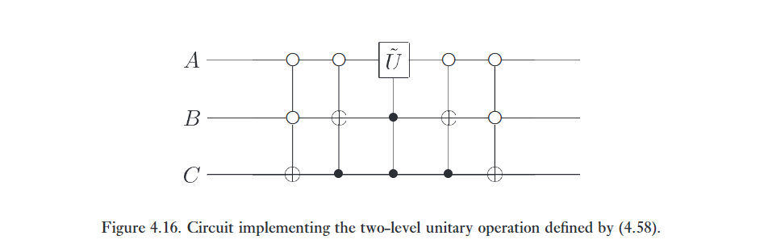
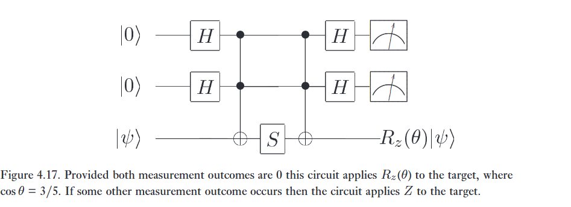
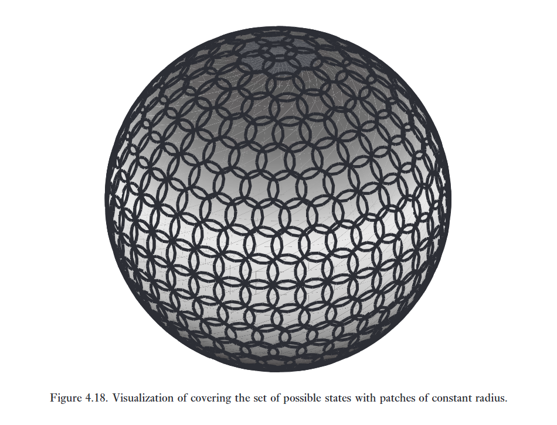

Một tập hợp nhỏ các cổng (ví dụ: $\text{AND}, \text{OR}, \text{NOT}$) có thể được sử dụng để tính toán một hàm cổ điển tùy ý, như chúng ta đã thấy ở Mục 3.1.2. Chúng ta nói rằng một tập hợp cổng như vậy là vạn năng (universal) đối với tính toán cổ điển. Trên thực tế, vì cổng Toffoli là vạn năng đối với tính toán cổ điển, nên các mạch lượng tử bao hàm (subsume) các mạch cổ điển. Một kết quả vạn năng tương tự cũng đúng đối với tính toán lượng tử, trong đó một tập hợp các cổng được cho là vạn năng đối với tính toán lượng tử nếu bất kỳ phép toán unita nào cũng có thể được xấp xỉ với độ chính xác tùy ý bởi một mạch lượng tử chỉ bao gồm các cổng đó.   

Bây giờ chúng tôi mô tả ba cấu trúc vạn năng đối với tính toán lượng tử. Các cấu trúc này xây dựng dựa trên nhau, và đạt đến đỉnh điểm ở một chứng minh rằng bất kỳ phép toán unita nào cũng có thể được xấp xỉ với độ chính xác tùy ý bằng cách sử dụng các cổng Hadamard, phase, $\text{CNOT}$, và $\pi/8$. Bạn có thể tự hỏi tại sao cổng phase lại xuất hiện trong danh sách này, vì nó có thể được xây dựng từ hai cổng $\pi/8$; nó được đưa vào vì vai trò tự nhiên của nó trong các cấu trúc chống chịu lỗi (fault-tolerant constructions) được mô tả trong Chương 10.   

* Cấu trúc thứ nhất chứng minh rằng một toán tử unita tùy ý có thể được biểu diễn một cách chính xác (exactly) dưới dạng tích của các toán tử unita mà mỗi toán tử chỉ tác động không tầm thường (non-trivially) lên một không gian con (subspace) được nối bởi hai trạng thái cơ sở tính toán.
* Cấu trúc thứ hai kết hợp cấu trúc thứ nhất với các kết quả của phần trước để chứng minh rằng một toán tử unita tùy ý có thể được biểu diễn một cách chính xác bằng cách sử dụng cổng một qubit và cổng $\text{CNOT}$.
* Cấu trúc thứ ba kết hợp cấu trúc thứ hai với một chứng minh rằng phép toán một qubit có thể được xấp xỉ với độ chính xác tùy ý bằng cách sử dụng các cổng Hadamard, phase, và $\pi/8$. Đến lượt nó, điều này ngụ ý rằng bất kỳ phép toán unita nào cũng có thể được xấp xỉ với độ chính xác tùy ý bằng cách sử dụng các cổng Hadamard, phase, $\text{CNOT}$, và $\pi/8$.  

Các cấu trúc của chúng tôi nói rất ít về tính hiệu quả (efficiency) — bao nhiêu cổng (nhiều theo đa thức hay hàm mũ) phải được kết hợp để tạo ra một phép biến đổi unita cho trước. Trong Mục 4.5.4, chúng tôi chứng minh rằng tồn tại các phép biến đổi unita đòi hỏi một số lượng cổng nhiều theo hàm mũ để xấp xỉ. Tất nhiên, mục tiêu của tính toán lượng tử là tìm ra các họ phép biến đổi unita thú vị có thể được thực hiện một cách hiệu quả.   

:::{.callout-note collapse="true"}
# Bài tập 4.36: 
Xây dựng một mạch lượng tử để cộng hai số hai bit $x$ và $y$ theo modulo 4. Tức là, mạch phải thực hiện phép biến đổi $\vert{}x, y\rangle \rightarrow \vert{}x, x + y \pmod 4\rangle$. 
:::

:::{.callout}
# roadmap

Kế hoạch 3 bước để chứng minh rằng có thể chế tạo một máy tính lượng tử vạn năng chỉ bằng 4 loại cổng logic H, S, CNOT, T.

## Bước 1. Chia để trị

Từ một ma trận lớn, tách ra thành tích các ma trận nhỏ hơn.

## Bước 2. Rút gọn về Cổng 1-qubit và CNOT

## Bước 3. Xấp xỉ rời rạc
:::

# 1. Two-level unitary gates are universal

Xem xét một ma trận unita $U$ tác động lên một không gian Hilbert $d$ chiều. Trong phần này, chúng tôi giải thích cách $U$ có thể được phân rã thành một tích của các ma trận unita hai mức (two-level unitary matrices); tức là, các ma trận unita chỉ tác động không tầm thường (non-trivially) lên hai hoặc ít hơn các thành phần vector. Ý tưởng cốt lõi đằng sau sự phân rã này có thể được hiểu bằng cách xem xét trường hợp khi $U$ là ma trận $3 \times 3$, vì vậy giả sử rằng $U$ có dạng   

$$
U = \begin{bmatrix} a & d & g \\ b & e & h \\ c & f & j \end{bmatrix}. \tag{4.41}
$$   

Chúng ta sẽ tìm các ma trận unita hai mức $U_1, \dots, U_3$ sao cho

$$
U_3 U_2 U_1 U = I. \tag{4.42}
$$ 

Từ đó suy ra

$$
U = U_1^\dagger U_2^\dagger U_3^\dagger. \tag{4.43}
$$   

$U_1, U_2$ và $U_3$ đều là các ma trận unita hai mức, và thật dễ dàng để thấy rằng các nghịch đảo của chúng, $U_1^\dagger, U_2^\dagger$ và $U_3^\dagger$ cũng là các ma trận unita hai mức. Do đó, nếu chúng ta có thể chứng minh được phương trình (4.42), thì chúng ta sẽ chỉ ra được cách chia nhỏ $U$ thành một tích của các ma trận unita hai mức.   

Sử dụng quy trình sau để xây dựng $U_1$: nếu $b = 0$ thì đặt

$$
U_1 \equiv \begin{bmatrix} 1 & 0 & 0 \\ 0 & 1 & 0 \\ 0 & 0 & 1 \end{bmatrix}. \tag{4.44}
$$   

Nếu $b \neq 0$ thì đặt

$$
U_1 \equiv \begin{bmatrix} \frac{a^*}{\sqrt{\vert{}a\vert{}^2+\vert{}b\vert{}^2}} & \frac{b^*}{\sqrt{\vert{}a\vert{}^2+\vert{}b\vert{}^2}} & 0 \\ \frac{b}{\sqrt{\vert{}a\vert{}^2+\vert{}b\vert{}^2}} & \frac{-a}{\sqrt{\vert{}a\vert{}^2+\vert{}b\vert{}^2}} & 0 \\ 0 & 0 & 1 \end{bmatrix}. \tag{4.45}
$$   

Lưu ý rằng trong cả hai trường hợp $U_1$ đều là một ma trận unita hai mức, và khi chúng ta nhân các ma trận ra, ta được

$$
U_1 U = \begin{bmatrix} a' & d' & g' \\ 0 & e' & h' \\ c' & f' & j' \end{bmatrix}. \tag{4.46}
$$   

Điểm then chốt cần lưu ý là phần tử ở giữa trong cột ngoài cùng bên trái bằng không. Chúng ta ký hiệu các phần tử khác trong ma trận bằng một dấu phẩy generic $'$ ; giá trị thực tế của chúng không quan trọng. 

Bây giờ áp dụng một quy trình tương tự để tìm một ma trận hai mức $U_2$ sao cho $U_2 U_1 U$ không có phần tử nào ở góc dưới cùng bên trái. Tức là, nếu $c' = 0$ thì ta đặt   

$$
U_2 \equiv \begin{bmatrix} a^{\prime *} & 0 & 0 \\ 0 & 1 & 0 \\ 0 & 0 & 1 \end{bmatrix}, \tag{4.47}
$$   

trong khi nếu $c' \neq 0$ thì ta đặt

$$
U_2 \equiv \begin{bmatrix} \frac{a^{\prime *}}{\sqrt{\vert{}a'\vert{}^2+\vert{}c'\vert{}^2}} & 0 & \frac{c^{\prime *}}{\sqrt{\vert{}a'\vert{}^2+\vert{}c'\vert{}^2}} \\ 0 & 1 & 0 \\ \frac{c'}{\sqrt{\vert{}a'\vert{}^2+\vert{}c'\vert{}^2}} & 0 & \frac{-a'}{\sqrt{\vert{}a'\vert{}^2+\vert{}c'\vert{}^2}} \end{bmatrix}. \tag{4.48}
$$   

Trong cả hai trường hợp, khi chúng ta thực hiện phép nhân ma trận, ta thấy rằng

$$
U_2 U_1 U = \begin{bmatrix} 1 & d'' & g'' \\ 0 & e'' & h'' \\ 0 & f'' & j'' \end{bmatrix}. \tag{4.49}
$$   

Vì $U, U_1$ và $U_2$ đều là các ma trận unita, nên suy ra $U_2 U_1 U$ cũng là ma trận unita, và do đó $d'' = g'' = 0$, vì hàng đầu tiên của $U_2 U_1 U$ phải có chuẩn (norm) bằng 1. Cuối cùng, đặt   

$$
U_3 \equiv \begin{bmatrix} 1 & 0 & 0 \\ 0 & e^{\prime \prime *} & f^{\prime \prime *} \\ 0 & h^{\prime \prime *} & j^{\prime \prime *} \end{bmatrix}. \tag{4.50}
$$   

Giờ đây thật dễ dàng để kiểm chứng rằng $U_3 U_2 U_1 U = I$, và do đó $U = U_1^\dagger U_2^\dagger U_3^\dagger$, đây chính là sự phân rã của $U$ thành các ma trận unita hai mức.   

Tổng quát hơn, giả sử $U$ tác động lên một không gian $d$ chiều. Khi đó, theo một cách thức tương tự như trường hợp $3 \times 3$, chúng ta có thể tìm được các ma trận unita hai mức $U_1, \dots, U_{d-1}$ sao cho ma trận $U_{d-1} U_{d-2} \dots U_1 U$ có một số 1 ở góc trên cùng bên trái, và tất cả các vị trí khác trong hàng đầu tiên và cột đầu tiên đều là số 0. Sau đó, chúng ta lặp lại quy trình này cho ma trận con unita $(d-1) \times (d-1)$ ở góc dưới cùng bên phải của $U_{d-1} U_{d-2} \dots U_1 U$, và cứ tiếp tục như vậy, với kết quả cuối cùng là một ma trận unita $d \times d$ tùy ý có thể được viết dưới dạng   

$$
U = V_1 \dots V_k, \tag{4.51}
$$   

trong đó các ma trận $V_i$ là các ma trận unita hai mức, và $k \le (d-1) + (d-2) + \dots + 1 = d(d-1)/2$.   

:::{.callout-note collapse="true"}
# Bài tập 4.37: 
Đưa ra sự phân rã của phép biến đổi

$$
\frac{1}{2} \begin{bmatrix} 1 & 1 & 1 & 1 \\ 1 & i & -1 & -i \\ 1 & -1 & 1 & -1 \\ 1 & -i & -1 & i \end{bmatrix} \tag{4.52}
$$   

thành một tích của các ma trận unita hai mức. Đây là một trường hợp đặc biệt của phép biến đổi Fourier lượng tử, thứ mà chúng ta sẽ nghiên cứu chi tiết hơn trong chương tiếp theo.   
:::

Một hệ quả của kết quả trên là một ma trận unita tùy ý trên một hệ $n$ qubit có thể được viết dưới dạng một tích của nhiều nhất $2^{n-1}(2^n - 1)$ ma trận unita hai mức. Đối với các ma trận unita cụ thể, có thể tìm được những cách phân rã hiệu quả hơn nhiều, nhưng như bạn sẽ chứng minh ngay bây giờ, tồn tại những ma trận không thể bị phân rã thành một tích của ít hơn $d - 1$ ma trận unita hai mức!   

:::{.callout}
# note thêm

## Ý tưởng của thuật toán

Thay vì cố gắng nhân các ma trận nhỏ với nhau để ra được U, tác giả làm ngược lại, bắt đầu từ U, tìm các nhân nó với các ma trận U1, U2, U3, để biến nó thành ma trận I. (4.42)

Một khi đã tìm được U1, U2, U3 thỏa mãn = I, chỉ cần lấy liên hợp phức, ta đã có công thức phân rã của U (4.43).

## Ma trận Unita 2 mức là gì?

Nhìn vào phương trình (4.45), U1 là ma trận 3x3, nhưng thật ra nó chỉ hành động trên không gian 2 chiều, cột cuối cùng, hàng cuối cùng của nó giống hệ ma trận đơn vị.

Vì vậy, trong vật lý lượng tử, điều này có nghĩa là U1 chỉ tác động lên 2 trạng thái cơ sở 00 và 01, hoàn toàn không chạm vào trạng thái thứ 3 - 10.

Khái niệm "2-level" này bắt nguồn từ vật lý nguyên tử, nơi tia laser chỉ kích thích electron nhảy giữa đúng 2 mức năng lượng, bỏ qua các mức năng lượng khác.

## Tại sao cấu trúc của U1 lại trong kỳ lạ (4.45)

Thật nó chính là Khử Gauss, nhưng thay vì dùng biến đổi hàng cơ bản, nó dùng phép quay Givens **Givens rotations** để duy trì tính Unita trong suốt quá trình biến đổi.

:::

:::{.callout-note collapse="true"}
# Bài tập 4.38: 
Chứng minh rằng tồn tại một ma trận unita $d \times d$ $U$ không thể bị phân rã thành một tích của ít hơn $d - 1$ ma trận unita hai mức.   
:::

# 2. Single qubit and CNOT gates are universal

Chúng ta vừa chỉ ra rằng một ma trận unita tùy ý trên một không gian Hilbert $d$ chiều có thể được viết dưới dạng một tích của các ma trận unita hai mức. Bây giờ chúng ta sẽ chứng minh rằng các cổng một qubit và cổng $\text{CNOT}$ cùng nhau có thể được sử dụng để triển khai một phép toán unita hai mức tùy ý trên không gian trạng thái của $n$ qubit. Kết hợp các kết quả này, chúng ta thấy rằng các cổng một qubit và $\text{CNOT}$ có thể được sử dụng để triển khai một phép toán unita tùy ý trên $n$ qubit, và do đó chúng là vạn năng đối với tính toán lượng tử.   

Giả sử $U$ là một ma trận unita hai mức trên một máy tính lượng tử $n$ qubit. Giả sử cụ thể rằng $U$ tác động không tầm thường lên không gian được giăng bởi các trạng thái cơ sở tính toán $\vert{}s\rangle$ và $\vert{}t\rangle$, trong đó $s = s_1 \dots s_n$ và $t = t_1 \dots t_n$ là các khai triển nhị phân cho $s$ và $t$. Gọi $\tilde{U}$ là ma trận con unita $2 \times 2$ không tầm thường của $U$; $\tilde{U}$ có thể được coi như một toán tử unita trên một qubit đơn lẻ.   

Mục tiêu trước mắt của chúng ta là xây dựng một mạch triển khai $U$, được xây dựng từ các cổng một qubit và cổng $\text{CNOT}$. Để làm điều này, chúng ta cần sử dụng mã Gray (Gray codes). Giả sử chúng ta có các số nhị phân phân biệt, $s$ và $t$. Một mã Gray kết nối $s$ và $t$ là một chuỗi các số nhị phân, bắt đầu bằng $s$ và kết thúc bằng $t$, sao cho các thành viên kề nhau trong danh sách khác biệt nhau chính xác một bit. Ví dụ, với $s = 101001$ và $t = 110011$, chúng ta có mã Gray   

$$
\begin{matrix} 1 & 0 & 1 & 0 & 0 & 1 \\ 1 & 0 & 1 & 0 & 1 & 1 \\ 1 & 0 & 0 & 0 & 1 & 1 \\ 1 & 1 & 0 & 0 & 1 & 1 \end{matrix} \tag{4.53} 
$$   

Gọi $g_1$ đến $g_m$ là các phần tử của một mã Gray kết nối $s$ và $t$, với $g_1 = s$ và $g_m = t$. Lưu ý rằng chúng ta luôn có thể tìm được một mã Gray sao cho $m \le n + 1$ vì $s$ và $t$ có thể khác nhau ở nhiều nhất $n$ vị trí. 

Ý tưởng cơ bản của mạch lượng tử triển khai $U$ là thực hiện một chuỗi các cổng tạo ra các sự thay đổi trạng thái $\vert{}g_1\rangle \rightarrow \vert{}g_2\rangle \rightarrow \dots \rightarrow \vert{}g_{m-1}\rangle$, sau đó thực hiện một phép toán controlled-$\tilde{U}$, với qubit mục tiêu nằm ở bit duy nhất mà $g_{m-1}$ và $g_m$ khác nhau, và cuối cùng là hoàn tác (undo) giai đoạn đầu tiên, biến đổi $\vert{}g_{m-1}\rangle \rightarrow \vert{}g_{m-2}\rangle \dots \rightarrow \vert{}g_1\rangle$. Mỗi bước này đều có thể dễ dàng triển khai bằng cách sử dụng các phép toán đã được phát triển trước đó trong chương này, và kết quả cuối cùng là sự triển khai của $U$.   

Một mô tả chính xác hơn về việc triển khai như sau. Bước đầu tiên là hoán đổi các trạng thái $\vert{}g_1\rangle$ và $\vert{}g_2\rangle$. Giả sử $g_1$ và $g_2$ khác nhau ở chữ số thứ $i$. Khi đó chúng ta hoàn thành việc hoán đổi bằng cách thực hiện một phép lật bit có điều khiển (controlled bit flip) trên qubit thứ $i$, với điều kiện là giá trị của các qubit khác phải giống hệt như các giá trị xuất hiện trong cả $g_1$ và $g_2$. Tiếp theo, chúng ta sử dụng một phép toán có điều khiển để hoán đổi $\vert{}g_2\rangle$ và $\vert{}g_3\rangle$. Chúng ta tiếp tục theo cách này cho đến khi hoán đổi $\vert{}g_{m-2}\rangle$ với $\vert{}g_{m-1}\rangle$. Tác động của chuỗi $m - 2$ phép toán này là đạt được phép biến đổi:  

$$
\vert{}g_1\rangle \rightarrow \vert{}g_{m-1}\rangle \tag{4.54}
$$

$$
\vert{}g_2\rangle \rightarrow \vert{}g_1\rangle \tag{4.55}
$$

$$
\vert{}g_3\rangle \rightarrow \vert{}g_2\rangle \tag{4.56}
$$

$$
\dots \dots \dots
$$

$$
\vert{}g_{m-1}\rangle \rightarrow \vert{}g_{m-2}\rangle. \tag{4.57}
$$

Tất cả các trạng thái cơ sở tính toán khác đều được giữ nguyên bởi chuỗi phép toán này. Tiếp theo, giả sử $g_{m-1}$ và $g_m$ khác nhau ở bit thứ $j$. Chúng ta áp dụng một phép toán controlled-$\tilde{U}$ với qubit thứ $j$ làm mục tiêu, có điều kiện là các qubit khác có cùng giá trị như chúng xuất hiện trong cả $g_{m-1}$ và $g_m$. Cuối cùng, chúng ta hoàn thành phép toán $U$ bằng cách hoàn tác các phép toán hoán đổi: chúng ta hoán đổi $\vert{}g_{m-1}\rangle$ với $\vert{}g_{m-2}\rangle$, sau đó $\vert{}g_{m-2}\rangle$ với $\vert{}g_{m-3}\rangle$ và cứ thế, cho đến khi chúng ta hoán đổi $\vert{}g_2\rangle$ với $\vert{}g_1\rangle$.   

Một ví dụ đơn giản sẽ làm sáng tỏ thêm quy trình này. Giả sử chúng ta mong muốn triển khai phép biến đổi unita hai mức:   

$$
U = \begin{bmatrix} a & 0 & 0 & 0 & 0 & 0 & 0 & c \\ 0 & 1 & 0 & 0 & 0 & 0 & 0 & 0 \\ 0 & 0 & 1 & 0 & 0 & 0 & 0 & 0 \\ 0 & 0 & 0 & 1 & 0 & 0 & 0 & 0 \\ 0 & 0 & 0 & 0 & 1 & 0 & 0 & 0 \\ 0 & 0 & 0 & 0 & 0 & 1 & 0 & 0 \\ 0 & 0 & 0 & 0 & 0 & 0 & 1 & 0 \\ b & 0 & 0 & 0 & 0 & 0 & 0 & d \end{bmatrix}. \tag{4.58}
$$

Ở đây, $a, b, c$ và $d$ là các số phức bất kỳ sao cho $\tilde{U} \equiv \begin{bmatrix} a & c \\ b & d \end{bmatrix}$ là một ma trận unita. Chú ý rằng $U$ chỉ tác động không tầm thường lên các trạng thái $\vert{}000\rangle$ và $\vert{}111\rangle$. Chúng ta viết một mã Gray kết nối 000 và 111:   

$$
\begin{matrix} A & B & C \\ 0 & 0 & 0 \\ 0 & 0 & 1 \\ 0 & 1 & 1 \\ 1 & 1 & 1 \end{matrix} \tag{4.59}
$$

Từ đây chúng ta đọc ra được mạch điện cần thiết, hiển thị trong Hình 4.16. Hai cổng đầu tiên xáo trộn các trạng thái sao cho $\vert{}000\rangle$ được hoán đổi với $\vert{}011\rangle$. Tiếp theo, phép toán $\tilde{U}$ được áp dụng lên qubit đầu tiên của các trạng thái $\vert{}011\rangle$ và $\vert{}111\rangle$, với điều kiện là qubit thứ hai và thứ ba đang ở trạng thái $\vert{}11\rangle$. Cuối cùng, chúng ta xáo trộn ngược lại các trạng thái (unshuffle), đảm bảo rằng $\vert{}011\rangle$ được hoán đổi trở lại với trạng thái $\vert{}000\rangle$. 

Quay trở lại trường hợp tổng quát, chúng ta thấy rằng việc triển khai phép toán unita hai mức $U$ đòi hỏi nhiều nhất $2(n - 1)$ phép toán có điều khiển để hoán đổi $\vert{}g_1\rangle$ với $\vert{}g_{m-1}\rangle$ và sau đó hoán đổi ngược lại. Mỗi phép toán có điều khiển này có thể được thực hiện bằng cách sử dụng $O(n)$ cổng một qubit và $\text{CNOT}$; phép toán controlled-$\tilde{U}$ cũng đòi hỏi $O(n)$ cổng. Do đó, việc triển khai $U$ đòi hỏi $O(n^2)$ cổng một qubit và $\text{CNOT}$. Chúng ta đã thấy ở phần trước rằng một ma trận unita tùy ý trên không gian trạng thái $2^n$ chiều của $n$ qubit có thể được viết dưới dạng một tích của $O(2^{2n}) = O(4^n)$ phép toán unita hai mức. Kết hợp các kết quả này, chúng ta thấy rằng một phép toán unita tùy ý trên $n$ qubit có thể được triển khai bằng cách sử dụng một mạch chứa $O(n^2 4^n)$ cổng một qubit và $\text{CNOT}$. Rõ ràng, cấu trúc này không cung cấp các mạch lượng tử hiệu quả cho lắm! Tuy nhiên, chúng tôi sẽ chỉ ra ở Mục 4.5.4 rằng cấu trúc này gần như tối ưu theo nghĩa là tồn tại các phép toán unita đòi hỏi số lượng cổng theo hàm mũ để triển khai. Do đó, để tìm ra các thuật toán lượng tử nhanh, chúng ta rõ ràng sẽ cần một cách tiếp cận khác với cách được thực hiện trong cấu trúc vạn năng.   

:::{.callout-note collapse="true"}
# Bài tập 4.39: 
Tìm một mạch lượng tử sử dụng các phép toán một qubit và $\text{CNOT}$ để triển khai phép biến đổi   
$$
\begin{bmatrix} 1 & 0 & 0 & 0 & 0 & 0 & 0 & 0 \\ 0 & 1 & 0 & 0 & 0 & 0 & 0 & 0 \\ 0 & 0 & a & 0 & 0 & 0 & 0 & c \\ 0 & 0 & 0 & 1 & 0 & 0 & 0 & 0 \\ 0 & 0 & 0 & 0 & 1 & 0 & 0 & 0 \\ 0 & 0 & 0 & 0 & 0 & 1 & 0 & 0 \\ 0 & 0 & 0 & 0 & 0 & 0 & 1 & 0 \\ 0 & 0 & b & 0 & 0 & 0 & 0 & d \end{bmatrix}, \tag{4.60}
$$   

trong đó $\tilde{U} = \begin{bmatrix} a & c \\ b & d \end{bmatrix}$ là một ma trận unita $2 \times 2$ tùy ý.

---

:::

:::{.callout}
# Note

Một ma trận Unita U -> tích các ma trận hai mức.

Ma trận hai mức -> cổng một qubit + cổng CNOT

Vậy suy ra bất kỳ ma trận Unita U nào cũng có thể tạo bởi các cổng qubit và CNOT.

---

## Gray code

Nhưng lỡ U có thể tác động từ $\vert s \rangle$ tới $\vert t \rangle$ ví dụ như $\vert 000 \rangle$ đến $\vert 111 \rangle$ thì sao?

Ta biết rằng cổng một qubit chỉ có thể tác động lên qubit đó, còn cổng CNOT chỉ chạm tối đa 2 qubit cùng lúc.

Đáp án là dùng Gray code, khoảng cách hamming giữa chúng = 1, vì vậy ý tưởng là sẽ nhích từng tí một, 000 -> 001 -> 011 -> 111.

---

## Thế

cuối cùng nó để làm gì?

Nhìn phương trình (4.58) ta thấy tằng tất cả các chỉ số trên đường chéo chính đều bằng 1, chỉ trừ cột 0 và cột 7, từ đó suy ra ma trận unitary U này chỉ tác động lên hai trạng thái 000 và 111. Nhưng mà một ma trận U ngã hai mức, chỉ tác động lên tối đa 2 qubit, vì thế chúng ta phải dịch chuyển địa chỉ của 000 đến 011 (bằng Gray code) từ đó mới có thể áp dụng được U hai mức.

Mà chắc chắn ma trận U không đơn giản như vậy rồi, vậy nên chúng ta có thể áp dụng cái đầu tiên đã nói, một ma trận U có thể tách thành tích các ma trận U ngã hai mức.
:::

# 3. A discrete set of universal operations

Trong phần trước, chúng ta đã chứng minh rằng $\text{CNOT}$ và các ma trận unita một qubit cùng nhau tạo thành một tập hợp vạn năng cho tính toán lượng tử. Thật không may, không có phương pháp đơn giản nào được biết đến để triển khai tất cả các cổng này theo cách có khả năng chống chịu lại lỗi (resistant to errors). May mắn thay, trong phần này chúng ta sẽ tìm thấy một tập hợp rời rạc các cổng có thể được sử dụng để thực hiện tính toán lượng tử vạn năng, và trong Chương 10, chúng ta sẽ chỉ ra cách thực hiện các cổng này theo cách chống lại lỗi, sử dụng các mã sửa lỗi lượng tử.   

## Approximating unitary operators 

Rõ ràng, một tập hợp rời rạc các cổng không thể được sử dụng để triển khai một phép toán unita tùy ý một cách chính xác, vì tập hợp các phép toán unita là liên tục. Thay vào đó, hóa ra một tập hợp rời rạc có thể được sử dụng để xấp xỉ bất kỳ phép toán unita nào. Để hiểu điều này hoạt động như thế nào, trước tiên chúng ta cần nghiên cứu xem việc xấp xỉ một phép toán unita có nghĩa là gì. Giả sử $U$ và $V$ là hai toán tử unita trên cùng một không gian trạng thái. $U$ là toán tử unita mục tiêu mà chúng ta muốn triển khai, và $V$ là toán tử unita thực sự được triển khai trong thực tế. Chúng ta định nghĩa sai số (error) khi $V$ được triển khai thay vì $U$ là:   

$$
E(U, V) \equiv \max_{\vert{}\psi\rangle} \vert{}\vert{}(U - V)\vert{}\psi\rangle\vert{}\vert{}, \tag{4.61}
$$   

trong đó giá trị lớn nhất được lấy trên tất cả các trạng thái lượng tử chuẩn hóa $\vert{}\psi\rangle$ trong không gian trạng thái. Trong Hộp 4.1 ở trang 195, chúng tôi chỉ ra rằng độ đo sai số này có một cách diễn giải là nếu $E(U, V)$ nhỏ, thì bất kỳ phép đo lường nào được thực hiện trên trạng thái $V\vert{}\psi\rangle$ sẽ cho ra các thống kê đo lường xấp xỉ giống như một phép đo lường trên $U\vert{}\psi\rangle$, đối với bất kỳ trạng thái ban đầu $\vert{}\psi\rangle$ nào. Cụ thể hơn, chúng tôi chỉ ra rằng nếu $M$ là một phần tử POVM trong một POVM tùy ý, và $P_U$ (hoặc $P_V$) là xác suất thu được kết quả này nếu $U$ (hoặc $V$) được thực hiện với trạng thái bắt đầu $\vert{}\psi\rangle$, thì:   

$$
\vert{}P_U - P_V\vert{} \le 2E(U, V). \tag{4.62}
$$   

Do đó, nếu $E(U, V)$ nhỏ, thì các kết quả đo lường xảy ra với các xác suất tương tự nhau, bất kể $U$ hay $V$ được thực hiện. Cũng được chỉ ra trong Hộp 4.1 là nếu chúng ta thực hiện một chuỗi các cổng $V_1, \dots, V_m$ nhằm mục đích xấp xỉ một chuỗi các cổng khác $U_1, \dots, U_m$, thì các sai số cộng dồn nhiều nhất là tuyến tính:   

$$
E(U_m U_{m-1} \dots U_1, V_m V_{m-1} \dots V_1) \le \sum_{j=1}^m E(U_j, V_j). \tag{4.63}
$$   

Các kết quả xấp xỉ (4.62) và (4.63) cực kỳ hữu ích. Giả sử chúng ta muốn thực hiện một mạch lượng tử chứa $m$ cổng, từ $U_1$ đến $U_m$. Thật không may, chúng ta chỉ có thể xấp xỉ cổng $U_j$ bằng cổng $V_j$. Để xác suất của các kết quả đo lường khác nhau thu được từ mạch xấp xỉ nằm trong khoảng dung sai $\Delta > 0$ so với các xác suất chính xác, thì chỉ cần $E(U_j, V_j) \le \Delta / (2m)$, theo các kết quả (4.62) và (4.63).

:::{.callout-important}
# Hộp 4.1: Xấp xỉ các mạch lượng tử   

Giả sử một hệ lượng tử bắt đầu ở trạng thái $\vert{}\psi\rangle$, và chúng ta thực hiện phép toán unita $U$ hoặc phép toán unita $V$. Tiếp theo đó, chúng ta thực hiện một phép đo lường. Gọi $M$ là một phần tử POVM gắn liền với phép đo lường, và gọi $P_U$ (hoặc $P_V$) là xác suất thu được kết quả đo lường tương ứng nếu phép toán $U$ (hoặc $V$) được thực hiện. Khi đó   

$$
\vert{}P_U - P_V\vert{} = \vert{}\langle\psi\vert{}U^\dagger M U\vert{}\psi\rangle - \langle\psi\vert{}V^\dagger M V\vert{}\psi\rangle\vert{}. \tag{4.64}
$$   

Gọi $\vert{}\Delta\rangle \equiv (U - V)\vert{}\psi\rangle$. Một chút đại số đơn giản và bất đẳng thức Cauchy–Schwarz cho thấy rằng   

$$
\vert{}P_U - P_V\vert{} = \vert{}\langle\psi\vert{}U^\dagger M\vert{}\Delta\rangle + \langle\Delta\vert{}M V\vert{}\psi\rangle\vert{} \tag{4.65}
$$   

$$
\le \vert{}\langle\psi\vert{}U^\dagger M\vert{}\Delta\rangle\vert{} + \vert{}\langle\Delta\vert{}M V\vert{}\psi\rangle\vert{} \tag{4.66}
$$   

$$
\le \vert{}\vert{}\Delta\vert{}\vert{} + \vert{}\vert{}\Delta\vert{}\vert{} \tag{4.67}
$$   

$$
\le 2E(U, V). \tag{4.68}
$$   

Bất đẳng thức $\vert{}P_U - P_V\vert{} \le 2E(U, V)$ đưa ra biểu thức định lượng cho ý tưởng rằng khi sai số $E(U, V)$ nhỏ, thì sự khác biệt về xác suất giữa các kết quả đo lường cũng nhỏ.   

Giả sử chúng ta thực hiện một chuỗi các cổng $V_1, V_2, \dots, V_m$ nhằm mục đích xấp xỉ một chuỗi các cổng khác, $U_1, U_2, \dots, U_m$. Hóa ra sai số gây ra bởi toàn bộ chuỗi các cổng không hoàn hảo này lớn nhất cũng chỉ bằng tổng các sai số trong từng cổng riêng lẻ,   

$$
E(U_m U_{m-1} \dots U_1, V_m V_{m-1} \dots V_1) \le \sum_{j=1}^m E(U_j, V_j). \tag{4.69}
$$   

Để chứng minh điều này, chúng ta bắt đầu với trường hợp $m = 2$. Lưu ý rằng đối với một trạng thái $\vert{}\psi\rangle$ nào đó, chúng ta có   

$$
E(U_2 U_1, V_2 V_1) = \vert{}\vert{}(U_2 U_1 - V_2 V_1)\vert{}\psi\rangle\vert{}\vert{} \tag{4.70}
$$   

$$
= \vert{}\vert{}(U_2 U_1 - V_2 U_1)\vert{}\psi\rangle + (V_2 U_1 - V_2 V_1)\vert{}\psi\rangle\vert{}\vert{}. \tag{4.71}
$$   

Sử dụng bất đẳng thức tam giác $\vert{}\vert{}\vert{}a\rangle + \vert{}b\rangle\vert{}\vert{} \le \vert{}\vert{}\vert{}a\rangle\vert{}\vert{} + \vert{}\vert{}\vert{}b\rangle\vert{}\vert{}$, chúng ta thu được

$$
E(U_2 U_1, V_2 V_1) \le \vert{}\vert{}(U_2 - V_2)U_1\vert{}\psi\rangle\vert{}\vert{} + \vert{}\vert{}V_2(U_1 - V_1)\vert{}\psi\rangle\vert{}\vert{} \tag{4.72}
$$   

$$
\le E(U_2, V_2) + E(U_1, V_1), \tag{4.73}
$$   

đây chính là kết quả mong muốn. Kết quả cho số $m$ tổng quát được suy ra bằng phương pháp quy nạp.  
:::

:::{.callout}
# Tại sao lại xuất hiện xấp xỉ?

Rõ ràng là **mọi ma trận Unita U luôn luôn biểu diễn chính xác tuyệt đối** thành tích của các ma trận hai mức, và các ma trận hai mức này lại biểu diễn chính xác tuyệt đối thành các cổng CNOT và cổng xoay 1-qubit.

Nhưng rõ ràng các R_x, R_y, R_z, có các tham số theta, phi, là tham số thực trong đó, vì vậy không có cách nào biểu diễn một cách chính xác hoàn toàn.

Tóm lại thì:

Gray code + CNOT + Các phép xoay liên tục $R_z(\theta), R_y(\theta)$ -> Chính xác 100%.

Gray code + CNOT + Tập hợp cổng rời rạc $\{H, S, T\}$ -> Xấp xỉ đúng với độ chính xác epsilon tùy ý.

## Phép màu của sự Cộng dồn tuyến tính (4.63)

Trong khi các hệ thống analog, sai số nhỏ ở đầu mạch có thể bị khuếch đại theo hàm mũ (hiệu ứng cánh bướm) khiến kết quả cuối cùng hoàn toàn vô nghìa.

Thì trong hệ lượng tử, các sai số không bao giờ bị khuếch đại. Sai số tổng cộng của một mạch điện dài chỉ bằng tổng các sai số của từng tổng cộng lại. 

:::

## Universality of Hadamard + phase + CNOT + π/8 gates

Giờ đây chúng ta đang ở một vị thế tốt để nghiên cứu việc xấp xỉ các phép toán unita tùy ý bằng các tập hợp cổng rời rạc. Chúng ta sẽ xem xét hai tập hợp cổng rời rạc khác nhau, cả hai đều là vạn năng. Tập hợp đầu tiên, tập hợp chuẩn (standard set) của các cổng vạn năng, bao gồm các cổng Hadamard, phase, controlled-$\text{NOT}$ và $\pi/8$. Chúng tôi cung cấp các cấu trúc chống chịu lỗi cho các cổng này ở Chương 10; chúng cũng cung cấp một cấu trúc vạn năng đặc biệt đơn giản. Tập hợp cổng thứ hai mà chúng ta xem xét bao gồm cổng Hadamard, cổng phase, cổng controlled-$\text{NOT}$, và cổng Toffoli. Các cổng này cũng đều có thể được thực hiện một cách chống chịu lỗi; tuy nhiên, chứng minh tính vạn năng và cấu trúc chống chịu lỗi cho các cổng này kém hấp dẫn hơn một chút.

Chúng ta bắt đầu chứng minh tính vạn năng bằng cách chỉ ra rằng các cổng Hadamard và $\pi/8$ có thể được sử dụng để xấp xỉ bất kỳ phép toán unita một qubit nào với độ chính xác tùy ý. Xem xét các cổng $T$ và $HTH$. $T$ là, bỏ qua một pha toàn cục không quan trọng, một phép quay $\pi/4$ radian quanh trục $\hat{z}$ trên mặt cầu Bloch, trong khi $HTH$ là một phép quay $\pi/4$ radian quanh trục $\hat{x}$ trên mặt cầu Bloch (Bài tập 4.14). Kết hợp hai phép toán này cho ta, bỏ qua một pha toàn cục,

$$
\exp\left(-i \frac{\pi}{8} Z\right) \exp\left(-i \frac{\pi}{8} X\right) = \left[ \cos\frac{\pi}{8} I - i \sin\frac{\pi}{8} Z \right] \left[ \cos\frac{\pi}{8} I - i \sin\frac{\pi}{8} X \right] \tag{4.74}
$$

$$
= \cos^2\frac{\pi}{8} I - i \left[ \cos\frac{\pi}{8} (X + Z) + \sin\frac{\pi}{8} Y \right] \sin\frac{\pi}{8}. \tag{4.75}
$$

Đây là một phép quay của mặt cầu Bloch quanh một trục dọc theo $\vec{n} = (\cos\frac{\pi}{8}, \sin\frac{\pi}{8}, \cos\frac{\pi}{8})$ với vector đơn vị tương ứng $\hat{n}$, và quay một góc $\theta$ được định nghĩa bởi $\cos(\theta/2) \equiv \cos^2\frac{\pi}{8}$. Tức là, chỉ sử dụng các cổng Hadamard và $\pi/8$, chúng ta có thể xây dựng được $R_{\hat{n}}(\theta)$. Hơn nữa, góc $\theta$ này có thể được chứng minh là một bội số vô tỉ của $2\pi$. Việc chứng minh sự thật sau cùng này hơi vượt quá phạm vi của chúng ta; xem phần cuối chương 'Lịch sử và đọc thêm'.

Tiếp theo, chúng ta chỉ ra rằng việc lặp lại nhiều lần $R_{\hat{n}}(\theta)$ có thể được sử dụng để xấp xỉ với độ chính xác tùy ý bất kỳ phép quay $R_{\hat{n}}(\alpha)$ nào. Để thấy điều này, gọi $\delta > 0$ là độ chính xác mong muốn, và gọi $N$ là một số nguyên lớn hơn $2\pi/\delta$. Định nghĩa $\theta_k$ sao cho $\theta_k \in [0, 2\pi)$ và $\theta_k = (k\theta)\pmod{2\pi}$. Khi đó, nguyên lý chuồng bồ câu (pigeonhole principle) ngụ ý rằng có các số $j$ và $k$ phân biệt trong khoảng từ $1, \dots, N$ sao cho $\vert{}\theta_k - \theta_j\vert{} \le 2\pi/N < \delta$. Không mất tính tổng quát, giả sử rằng $k > j$, vì vậy chúng ta có $\vert{}\theta_{k-j}\vert{} < \delta$. Vì $j \neq k$ và $\theta$ là một bội số vô tỉ của $2\pi$, chúng ta phải có $\theta_{k-j} \neq 0$. Suy ra chuỗi $\theta_{l(k-j)}$ lấp đầy khoảng $[0, 2\pi)$ khi $l$ thay đổi, sao cho các thành viên kề nhau của chuỗi cách nhau không quá $\delta$. Suy ra đối với bất kỳ $\epsilon > 0$ nào, tồn tại một số $n$ sao cho

$$
E(R_{\hat{n}}(\alpha), R_{\hat{n}}(\theta)^n) < \frac{\epsilon}{3}. \tag{4.76}
$$   

Bài tập 4.40: Với $\alpha$ và $\beta$ tùy ý, hãy chứng minh rằng

$$
E(R_{\hat{n}}(\alpha), R_{\hat{n}}(\alpha + \beta)) = \vert{}1 - \exp(i\beta/2)\vert{}, \tag{4.77}
$$

và sử dụng điều này để biện minh cho (4.76).   

Giờ đây chúng ta đã ở vị thế có thể kiểm chứng rằng bất kỳ phép toán một qubit nào cũng có thể được xấp xỉ với độ chính xác tùy ý bằng cách sử dụng các cổng Hadamard và $\pi/8$. Đại số đơn giản ngụ ý rằng với mọi $\alpha$,

$$
HR_{\hat{n}}(\alpha)H = R_{\hat{m}}(\alpha), \tag{4.78}
$$

trong đó $\hat{m}$ là một vector đơn vị theo hướng $(\cos\frac{\pi}{8}, -\sin\frac{\pi}{8}, \cos\frac{\pi}{8})$, từ đó suy ra
$$
E(R_{\hat{m}}(\alpha), R_{\hat{m}}(\theta)^n) < \frac{\epsilon}{3}. \tag{4.79}
$$

Nhưng theo Bài tập 4.11, một ma trận unita $U$ tùy ý trên một qubit có thể được viết thành
$$
U = R_{\hat{n}}(\beta) R_{\hat{m}}(\gamma) R_{\hat{n}}(\delta), \tag{4.80}
$$

nếu bỏ qua một dịch chuyển pha toàn cục không quan trọng. Các kết quả (4.76) và (4.79), cùng với bất đẳng thức chuỗi (4.63) do đó ngụ ý rằng đối với các số nguyên dương phù hợp $n_1, n_2, n_3$,
$$
E(U, R_{\hat{n}}(\theta)^{n_1} H R_{\hat{n}}(\theta)^{n_2} H R_{\hat{n}}(\theta)^{n_3}) < \epsilon. \tag{4.81}
$$

Tức là, cho trước bất kỳ toán tử unita một qubit $U$ nào và bất kỳ $\epsilon > 0$ nào, ta hoàn toàn có thể xấp xỉ $U$ trong khoảng sai số $\epsilon$ bằng cách sử dụng một mạch chỉ bao gồm các cổng Hadamard và cổng $\pi/8$.   

Vì các cổng $\pi/8$ và Hadamard cho phép chúng ta xấp xỉ bất kỳ toán tử unita một qubit nào, từ các lập luận ở Mục 4.5.2 suy ra rằng chúng ta có thể xấp xỉ bất kỳ mạch lượng tử $m$ cổng nào, như sau. Cho một mạch lượng tử chứa $m$ cổng, có thể là các cổng CNOT hoặc các cổng unita một qubit, chúng ta có thể xấp xỉ nó bằng cách sử dụng các cổng Hadamard, controlled-NOT và $\pi/8$ (sau này, chúng ta sẽ thấy rằng các cổng phase làm cho việc xấp xỉ có khả năng chống chịu lỗi, nhưng đối với lập luận vạn năng hiện tại thì chúng không hoàn toàn cần thiết). Nếu chúng ta mong muốn độ chính xác $\epsilon$ cho toàn bộ mạch, thì điều này có thể đạt được bằng cách xấp xỉ mỗi cổng unita một qubit bằng quy trình trên trong khoảng sai số $\epsilon/m$ và áp dụng bất đẳng thức chuỗi (4.63) để thu được độ chính xác $\epsilon$ cho toàn bộ mạch.   

Quy trình xấp xỉ các mạch lượng tử bằng một tập hợp cổng rời rạc này hiệu quả đến mức nào? Đây là một câu hỏi quan trọng. Ví dụ, giả sử rằng việc xấp xỉ một cổng unita một qubit tùy ý trong khoảng cách $\epsilon$ đòi hỏi $\Omega(2^{1/\epsilon})$ cổng từ tập hợp rời rạc. Khi đó, để xấp xỉ mạch lượng tử $m$ cổng được xem xét ở đoạn trước sẽ đòi hỏi $\Omega(m 2^{m/\epsilon})$ cổng, một sự gia tăng theo hàm mũ so với kích thước mạch ban đầu!. May mắn thay, tốc độ hội tụ tốt hơn thế này rất nhiều. Về mặt trực giác, có vẻ hợp lý khi chuỗi các góc $\theta_k$ 'lấp đầy' khoảng $[0, 2\pi)$ theo một cách ít nhiều đồng đều, do đó để xấp xỉ một cổng một qubit tùy ý hẳn sẽ cần khoảng $\Theta(1/\epsilon)$ cổng từ tập hợp rời rạc. Nếu chúng ta sử dụng ước tính này cho số lượng cổng cần thiết để xấp xỉ một cổng một qubit tùy ý, thì số lượng cần thiết để xấp xỉ một mạch $m$ cổng với độ chính xác $\epsilon$ trở thành $\Theta(m^2/\epsilon)$. Đây là sự gia tăng bậc hai so với kích thước ban đầu của mạch, $m$, điều này đối với nhiều ứng dụng có thể là đủ. 

Tuy nhiên, thật đáng chú ý, một tốc độ hội tụ nhanh hơn nhiều có thể được chứng minh. Định lý Solovay-Kitaev, được chứng minh ở Phụ lục 3, ngụ ý rằng một cổng unita một qubit tùy ý có thể được xấp xỉ với độ chính xác $\epsilon$ bằng cách sử dụng $O(\log^c(1/\epsilon))$ cổng từ tập hợp rời rạc của chúng ta, trong đó $c$ là một hằng số xấp xỉ bằng $2$. Do đó, định lý Solovay-Kitaev ngụ ý rằng để xấp xỉ một mạch chứa $m$ cổng $\text{CNOT}$ và các cổng unita một qubit tới độ chính xác $\epsilon$ thì đòi hỏi $O(m \log^c(m/\epsilon))$ cổng từ tập hợp rời rạc, một sự gia tăng đa logarit (polylogarithmic) so với kích thước của mạch ban đầu, điều này có khả năng được chấp nhận cho gần như tất cả các ứng dụng.   

Tóm lại, chúng ta đã chỉ ra rằng các cổng Hadamard, phase, controlled-$\text{NOT}$ và $\pi/8$ là vạn năng cho tính toán lượng tử theo nghĩa là cho trước một mạch chứa các cổng $\text{CNOT}$ và các cổng unita một qubit tùy ý, hoàn toàn có thể mô phỏng mạch này với độ chính xác tốt bằng cách chỉ sử dụng tập hợp cổng rời rạc này. Hơn nữa, quá trình mô phỏng có thể được thực hiện một cách hiệu quả, theo nghĩa là chi phí hoạt động (overhead) cần thiết để thực hiện mô phỏng là đa thức theo $\log(m/\epsilon)$, trong đó $m$ là số lượng cổng trong mạch ban đầu, và $\epsilon$ là độ chính xác mong muốn của phép mô phỏng.   

:::{.callout-note collapse="true"}
# Bài tập 4.41: 
Bài tập này và hai bài tập tiếp theo phát triển một cấu trúc chỉ ra rằng các cổng Hadamard, phase, controlled-$\text{NOT}$ và Toffoli là vạn năng.   

Chứng minh rằng mạch ở Hình 4.17 áp dụng phép toán $R_z(\theta)$ lên qubit thứ ba (mục tiêu) nếu các kết quả đo lường đều là $0$, trong đó $\cos\theta = 3/5$, và nếu không thì áp dụng $Z$ lên qubit mục tiêu. Chứng minh rằng xác suất để cả hai kết quả đo lường đều là $0$ là $5/8$, và giải thích làm thế nào việc sử dụng lặp đi lặp lại mạch này và các cổng $Z = S^2$ có thể được dùng để áp dụng một cổng $R_z(\theta)$ với xác suất tiến tới 1.   

:::

:::{.callout-note collapse="true"}
# Bài tập 4.42: (Tính vô tỉ của $\theta$) 
Giả sử $\cos\theta = 3/5$. Chúng ta đưa ra một chứng minh bằng phản chứng rằng $\theta$ là một bội số vô tỉ của $2\pi$.

(1) Sử dụng thực tế rằng $e^{i\theta} = (3 + 4i)/5$, chứng minh rằng nếu $\theta$ là số hữu tỉ, thì phải tồn tại một số nguyên dương $m$ sao cho $(3 + 4i)^m = 5^m$.
(2) Chứng minh rằng $(3 + 4i)^m = 3 + 4i \pmod 5$ với mọi $m > 0$, và kết luận rằng không thể tồn tại $m$ nào sao cho $(3 + 4i)^m = 5^m$.  

:::

:::{.callout-note collapse="true"}
# Bài tập 4.44:

Conf mấy bai nx luoi go
:::

# 4. Approximating arbitrary unitary gates is generically hard

Chúng ta đã thấy rằng bất kỳ phép biến đổi unita nào trên $n$ qubit đều có thể được xây dựng từ một tập hợp nhỏ các cổng cơ bản. Có phải lúc nào cũng có thể làm điều này một cách hiệu quả không? Tức là, cho trước một phép biến đổi unita $U$ trên $n$ qubit, liệu có luôn tồn tại một mạch có kích thước đa thức theo $n$ để xấp xỉ $U$ hay không? Câu trả lời cho câu hỏi này hóa ra lại là một chữ không vang dội: trên thực tế, hầu hết các phép biến đổi unita chỉ có thể được triển khai một cách rất kém hiệu quả. Một cách để thấy điều này là xem xét câu hỏi: cần bao nhiêu cổng để tạo ra một trạng thái tùy ý của $n$ qubit? Một lập luận đếm đơn giản cho thấy rằng điều này đòi hỏi một số lượng phép toán theo hàm mũ, một cách tổng quát; từ đó suy ra ngay lập tức rằng có những phép toán unita đòi hỏi số lượng phép toán theo hàm mũ. Để thấy điều này, giả sử chúng ta có sẵn $g$ loại cổng khác nhau, và mỗi cổng hoạt động trên nhiều nhất $f$ qubit đầu vào. Những con số này, $f$ và $g$, được cố định bởi phần cứng máy tính mà chúng ta có sẵn, và có thể được coi là các hằng số. Giả sử chúng ta có một mạch lượng tử chứa $m$ cổng, bắt đầu từ trạng thái cơ sở tính toán $\vert{}0\rangle^{\otimes n}$. Đối với bất kỳ cổng cụ thể nào trong mạch, do đó có nhiều nhất $\left[ \binom{n}{f} \right]^g = O(n^{fg})$ lựa chọn khả dĩ. Từ đó suy ra rằng có nhiều nhất $O(n^{fgm})$ trạng thái khác nhau có thể được tính toán bằng cách sử dụng $m$ cổng. 

Giả sử chúng ta mong muốn xấp xỉ một trạng thái cụ thể, $\vert{}\psi\rangle$, trong phạm vi khoảng cách $\epsilon$. Ý tưởng của chứng minh là bao phủ tập hợp tất cả các trạng thái khả dĩ bằng một tập hợp các 'mảng' ('patches'), mỗi mảng có bán kính $\epsilon$ (Hình 4.18), và sau đó chứng minh rằng số lượng mảng cần thiết tăng gấp đôi theo hàm mũ (doubly exponentially) đối với $n$; việc so sánh với số lượng hàm mũ các trạng thái khác nhau có thể được tính toán bằng cách sử dụng $m$ cổng sẽ ngụ ý kết quả.   

Quan sát đầu tiên chúng ta cần là không gian của các vector trạng thái của $n$ qubit có thể được coi chính là mặt cầu đơn vị $(2^{n+1}-1)$ chiều. Để thấy điều này, giả sử trạng thái $n$ qubit có các biên độ $\psi_j = X_j + iY_j$, trong đó $X_j$ và $Y_j$ lần lượt là phần thực và phần ảo của biên độ thứ $j$. Điều kiện chuẩn hóa cho các trạng thái lượng tử có thể được viết là $\sum_j (X_j^2 + Y_j^2) = 1$, đây chính là điều kiện để một điểm nằm trên mặt cầu đơn vị trong $2^{n+1}$ chiều thực, tức là, mặt cầu đơn vị $(2^{n+1}-1)$ chiều.   Tương tự, diện tích bề mặt có bán kính $\epsilon$ ở gần $\vert{}\psi\rangle$ xấp xỉ bằng thể tích của một hình cầu $(2^{n+1}-2)$ chiều có bán kính $\epsilon$. Sử dụng công thức $S_k(r) = 2\pi^{(k+1)/2}r^k / \Gamma((k+1)/2)$ cho diện tích bề mặt của một mặt cầu $k$-chiều có bán kính $r$, và $V_k(r) = 2\pi^{(k+1)/2}r^{k+1} / [(k+1)\Gamma((k+1)/2)]$ cho thể tích của một hình cầu $k$-chiều có bán kính $r$, chúng ta thấy rằng số lượng mảng cần thiết để bao phủ không gian trạng thái sẽ xấp xỉ bằng  

$$
\frac{S_{2^{n+1}-1}(1)}{V_{2^{n+1}-2}(\epsilon)} = \frac{\sqrt{\pi} \Gamma(2^n - \frac{1}{2}) (2^{n+1}-1)}{\Gamma(2^n) \epsilon^{2^{n+1}-1}}, \tag{4.82}
$$   

trong đó $\Gamma$ là dạng tổng quát hóa thông thường của hàm giai thừa. Nhưng $\Gamma(2^n - 1/2) \ge \Gamma(2^n) / 2^n$, do đó số lượng mảng cần thiết để bao phủ không gian ít nhất là   

$$
\Omega\left( \frac{1}{\epsilon^{2^{n+1}-1}} \right). \tag{4.83}
$$   

Nhớ lại rằng số lượng mảng có thể đạt tới bằng $m$ cổng là $O(n^{fgm})$, vì vậy để đạt tới tất cả các mảng $\epsilon$, chúng ta phải có   

$$
O(n^{fgm}) \ge \Omega\left( \frac{1}{\epsilon^{2^{n+1}-1}} \right), \tag{4.84}
$$   

điều này cho chúng ta   

$$
m = \Omega\left( \frac{2^n \log(1/\epsilon)}{\log(n)} \right). \tag{4.85}
$$   

Tức là, có những trạng thái của $n$ qubit đòi hỏi $\Omega(2^n \log(1/\epsilon)/\log(n))$ phép toán để xấp xỉ trong phạm vi khoảng cách $\epsilon$. Con số này phụ thuộc theo hàm mũ vào $n$, và do đó là 'khó' (difficult), theo ý nghĩa của độ phức tạp tính toán đã được giới thiệu trong Chương 3. Hơn nữa, điều này ngay lập tức ngụ ý rằng có những phép biến đổi unita $U$ trên $n$ qubit đòi hỏi $\Omega(2^n \log(1/\epsilon)/\log(n))$ phép toán để xấp xỉ bằng một mạch lượng tử thực hiện một phép toán $V$ sao cho $E(U, V) \le \epsilon$.   

Ngược lại, bằng cách sử dụng các cấu trúc vạn năng của chúng ta và định lý Solovay-Kitaev, ta suy ra rằng một phép toán unita $U$ tùy ý trên $n$ qubit có thể được xấp xỉ trong phạm vi khoảng cách $\epsilon$ bằng cách sử dụng $O(n^2 4^n \log^c(n^2 4^n / \epsilon))$ cổng. Do đó, cấu trúc cho tính vạn năng mà chúng tôi đã đưa ra là tối ưu (nếu bỏ qua một hệ số đa thức); thật không may, nó không giải quyết được vấn đề xác định những họ phép toán unita nào có thể được tính toán một cách hiệu quả trong mô hình mạch lượng tử. 

# 5. Quantum computational complexity

Trong Chương 3, chúng tôi đã mô tả một lý thuyết về 'độ phức tạp tính toán' cho các máy tính cổ điển nhằm phân loại các yêu cầu về tài nguyên để giải quyết các bài toán tính toán trên các máy tính cổ điển. Không có gì ngạc nhiên khi có một sự quan tâm đáng kể đến việc phát triển một lý thuyết về độ phức tạp tính toán lượng tử, và liên hệ nó với lý thuyết độ phức tạp tính toán cổ điển. Mặc dù mới chỉ có những bước đi đầu tiên được thực hiện theo hướng này, nhưng chắc chắn đây sẽ là một hướng đi vô cùng hiệu quả cho các nhà nghiên cứu trong tương lai. Chúng tôi hài lòng với việc trình bày một kết quả về các lớp độ phức tạp lượng tử, liên hệ lớp độ phức tạp lượng tử BQP với lớp độ phức tạp cổ điển PSPACE. Cuộc thảo luận của chúng tôi về kết quả này khá phi hình thức (informal); để biết thêm chi tiết, bạn được khuyên tham khảo bài báo của Bernstein và Vazirani được trích dẫn ở phần cuối chương 'Lịch sử và đọc thêm'.   

Hãy nhớ lại rằng PSPACE đã được định nghĩa trong Chương 3 là lớp các bài toán quyết định (decision problems) có thể được giải quyết trên một máy Turing bằng cách sử dụng bộ nhớ (không gian) đa thức theo kích thước bài toán và một khoảng thời gian tùy ý. BQP là một lớp độ phức tạp mang tính bản chất lượng tử bao gồm các bài toán quyết định có thể được giải quyết với xác suất lỗi bị chặn (bounded probability of error) bằng cách sử dụng một mạch lượng tử có kích thước đa thức. Trịnh trọng hơn một chút, chúng ta nói một ngôn ngữ $L$ thuộc BQP nếu có một họ các mạch lượng tử kích thước đa thức quyết định ngôn ngữ đó, chấp nhận (accept) các chuỗi thuộc ngôn ngữ với xác suất ít nhất là $3/4$, và từ chối (reject) các chuỗi không thuộc ngôn ngữ với xác suất ít nhất là $3/4$. Trong thực tế, điều này có nghĩa là mạch lượng tử nhận đầu vào là các chuỗi nhị phân, và cố gắng xác định xem chúng có phải là các phần tử của ngôn ngữ hay không. Ở phần kết thúc của mạch, một qubit được đo lường, với $0$ chỉ ra rằng chuỗi đã được chấp nhận, và $1$ chỉ ra sự từ chối. Bằng cách kiểm tra chuỗi vài lần để xác định xem nó có thuộc $L$ hay không, chúng ta có thể xác định với xác suất rất cao xem một chuỗi cho trước có nằm trong $L$ hay không.   

Tất nhiên, một mạch lượng tử là một thực thể cố định, và bất kỳ mạch lượng tử cho trước nào cũng chỉ có thể quyết định xem các chuỗi có độ dài hữu hạn nào đó có thuộc $L$ hay không. Vì lý do này, chúng ta sử dụng toàn bộ một họ các mạch trong định nghĩa của BQP; đối với mỗi độ dài đầu vào khả dĩ, sẽ có một mạch khác nhau trong họ này. Chúng tôi đặt thêm hai ràng buộc lên mạch ngoài tiêu chí chấp nhận / từ chối đã được mô tả. Thứ nhất, kích thước của các mạch chỉ được phép tăng theo đa thức với kích thước của chuỗi đầu vào $x$ mà chúng ta đang cố gắng xác định xem $x \in L$ hay không. Thứ hai, chúng tôi yêu cầu các mạch phải được tạo ra một cách đồng nhất (uniformly generated), theo một nghĩa tương tự như điều đã được mô tả ở Mục 3.1.2. Yêu cầu về tính đồng nhất này phát sinh bởi vì, trong thực tế, khi được cho một chuỗi $x$ có độ dài $n$ nào đó, ai đó sẽ phải xây dựng một mạch lượng tử có khả năng quyết định xem $x$ có thuộc $L$ hay không. Để làm như vậy, họ sẽ cần phải có một tập hợp rõ ràng các hướng dẫn — một thuật toán — để xây dựng mạch. Vì lý do này, chúng tôi yêu cầu các mạch lượng tử của chúng ta phải được tạo ra một cách đồng nhất, tức là, có một máy Turing có khả năng xuất ra một cách hiệu quả bản mô tả của mạch lượng tử. Ràng buộc này có vẻ khá nặng tính kỹ thuật, và trong thực tế thì gần như luôn được thỏa mãn một cách hiển nhiên, nhưng nó giúp chúng ta tránh được những ví dụ bệnh hoạn (pathological examples) như ví dụ đã được mô tả ở Mục 3.1.2. (Bạn cũng có thể tự hỏi liệu máy Turing được sử dụng trong yêu cầu tính đồng nhất là máy Turing lượng tử hay cổ điển thì có quan trọng hay không; hóa ra là điều đó không quan trọng — xem 'Lịch sử và đọc thêm'.) 

Một trong những kết quả quan trọng nhất trong độ phức tạp tính toán lượng tử là $\text{BQP} \subseteq \text{PSPACE}$. Rõ ràng là $\text{BPP} \subseteq \text{BQP}$, trong đó $\text{BPP}$ là lớp độ phức tạp cổ điển của các bài toán quyết định có thể được giải quyết với xác suất lỗi bị chặn bằng cách sử dụng thời gian đa thức trên một máy Turing cổ điển. Do đó chúng ta có chuỗi bao hàm $\text{BPP} \subseteq \text{BQP} \subseteq \text{PSPACE}$. Việc chứng minh rằng $\text{BQP} \neq \text{BPP}$ – về mặt trực giác là phát biểu cho rằng máy tính lượng tử mạnh hơn máy tính cổ điển – do đó sẽ ngụ ý rằng $\text{BPP} \neq \text{PSPACE}$. Tuy nhiên, hiện tại người ta chưa biết liệu $\text{BPP} \neq \text{PSPACE}$ hay không, và việc chứng minh điều này sẽ đại diện cho một bước đột phá lớn trong khoa học máy tính cổ điển! Vì vậy, việc chứng minh máy tính lượng tử mạnh hơn máy tính cổ điển sẽ có một số hệ ý vô cùng thú vị đối với độ phức tạp tính toán cổ điển! Thật không may, điều đó cũng có nghĩa là việc đưa ra một chứng minh như vậy có thể khá khó khăn.   

Tại sao lại có $\text{BQP} \subseteq \text{PSPACE}$? Đây là một phác thảo trực giác của chứng minh (chứng minh chặt chẽ được để lại cho các tài liệu tham khảo trong phần 'Lịch sử và đọc thêm'). Giả sử chúng ta có một máy tính lượng tử $n$ qubit, và thực hiện một phép tính liên quan đến một chuỗi $p(n)$ cổng, trong đó $p(n)$ là một đa thức theo $n$. Giả sử mạch lượng tử bắt đầu ở trạng thái $\vert{}0\rangle$, chúng tôi sẽ giải thích cách đánh giá trong không gian đa thức trên một máy tính cổ điển xác suất mà nó kết thúc ở trạng thái $\vert{}y\rangle$. Giả sử các cổng được thực thi trên máy tính lượng tử, theo thứ tự, là $U_1, U_2, \dots, U_{p(n)}$. Khi đó xác suất để kết thúc ở trạng thái $\vert{}y\rangle$ là bình phương mô-đun của   $$\langle y \vert{} U_{p(n)} \dots U_2 U_1 \vert{} 0 \rangle. \tag{4.86}$$   Đại lượng này có thể được ước lượng trong không gian đa thức trên một máy tính cổ điển. Ý tưởng cơ bản là chèn hệ thức đầy đủ $\sum_x \vert{}x\rangle\langle x\vert{} = I$ vào giữa mỗi số hạng trong (4.86), thu được   

$$
\langle y \vert{} U_{p(n)} \dots U_2 U_1 \vert{} 0 \rangle = \sum_{x_1, \dots, x_{p(n)-1}} \langle y \vert{} U_{p(n)} \vert{} x_{p(n)-1} \rangle \langle x_{p(n)-1} \vert{} U_{p(n)-1} \dots U_2 \vert{} x_1 \rangle \langle x_1 \vert{} U_1 \vert{} 0 \rangle. \tag{4.87}
$$   

Bởi vì các cổng unita riêng lẻ xuất hiện trong tổng này là các phép toán như cổng Hadamard, $\text{CNOT}$, vân vân, rõ ràng là mỗi số hạng trong tổng có thể được tính toán với độ chính xác cao bằng cách chỉ sử dụng không gian đa thức trên một máy tính cổ điển, và do đó toàn bộ tổng nói chung có thể được tính toán bằng cách sử dụng không gian đa thức, vì các số hạng riêng lẻ trong tổng có thể được xóa đi sau khi được cộng vào tổng đang chạy (running total). Tất nhiên, thuật toán này khá chậm, vì có số lượng số hạng theo hàm mũ trong tổng cần được tính toán và cộng vào tổng; tuy nhiên, chỉ tốn một lượng không gian đa thức, và do đó $\text{BQP} \subseteq \text{PSPACE}$, như chúng ta đã đặt ra để chứng minh.   

Một quy trình tương tự có thể được sử dụng để mô phỏng một tính toán lượng tử tùy ý trên một máy tính cổ điển, bất kể độ dài của phép tính lượng tử đó là bao nhiêu. Do đó, lớp các bài toán có thể giải quyết được trên một máy tính lượng tử với tài nguyên thời gian và không gian không giới hạn không lớn hơn lớp các bài toán có thể giải quyết được trên một máy tính cổ điển. Nói cách khác, điều này có nghĩa là máy tính lượng tử không vi phạm luận đề Church–Turing rằng bất kỳ quá trình thuật toán nào cũng có thể được mô phỏng một cách hiệu quả (mô phỏng được) bằng cách sử dụng một máy Turing. Tất nhiên, máy tính lượng tử có thể hiệu quả hơn (efficient) nhiều so với các đối tác cổ điển của chúng, qua đó thách thức luận đề Church–Turing mạnh rằng bất kỳ quá trình thuật toán nào cũng có thể được mô phỏng một cách hiệu quả bằng cách sử dụng một máy Turing xác suất.  

# 6. Summary of the quantum circuit model of computation

Trong cuốn sách này, thuật ngữ 'máy tính lượng tử' đồng nghĩa với mô hình mạch lượng tử của tính toán. Chương này đã cung cấp một cái nhìn chi tiết về các mạch lượng tử, các phần tử cơ bản của chúng, các họ cổng vạn năng, và một số ứng dụng. Trước khi chúng ta chuyển sang các ứng dụng phức tạp hơn, hãy tóm tắt các yếu tố then chốt của mô hình mạch lượng tử của tính toán:   

(1) Các tài nguyên cổ điển (Classical resources): Một máy tính lượng tử bao gồm hai phần, một phần cổ điển và một phần lượng tử. Về nguyên tắc, không cần đến phần cổ điển của máy tính, nhưng trong thực tế, một số tác vụ nhất định có thể được thực hiện dễ dàng hơn nhiều nếu các phần của phép tính có thể được thực hiện một cách cổ điển. Ví dụ, nhiều kế hoạch cho sửa lỗi lượng tử (Chương 10) có khả năng liên quan đến các tính toán cổ điển nhằm tối đa hóa hiệu quả. Mặc dù các tính toán cổ điển luôn có thể được thực hiện, về mặt nguyên tắc, trên một máy tính lượng tử, nhưng có thể thuận tiện hơn khi thực hiện các phép tính đó trên một máy tính cổ điển.   

(2) Một không gian trạng thái phù hợp (A suitable state space): Một mạch lượng tử hoạt động trên một số lượng $n$ các qubit. Do đó, không gian trạng thái là một không gian Hilbert phức $2^n$ chiều. Các trạng thái tích có dạng $\vert{}x_1, \dots, x_n\rangle$, trong đó $x_i = 0, 1$, được biết đến như là các trạng thái cơ sở tính toán của máy tính. $\vert{}x\rangle$ biểu thị một trạng thái cơ sở tính toán, trong đó $x$ là số mà biểu diễn nhị phân của nó là $x_1 \dots x_n$.   

(3) Khả năng chuẩn bị các trạng thái trong cơ sở tính toán (Ability to prepare states in the computational basis): Giả định rằng bất kỳ trạng thái cơ sở tính toán $\vert{}x_1, \dots, x_n\rangle$ nào cũng có thể được chuẩn bị trong không quá $n$ bước.   

(4) Khả năng thực hiện các cổng lượng tử (Ability to perform quantum gates): Các cổng có thể được áp dụng cho bất kỳ tập con các qubit nào như mong muốn, và một họ các cổng vạn năng có thể được triển khai. Ví dụ, phải có khả năng áp dụng cổng $\text{CNOT}$ cho bất kỳ cặp qubit nào trong máy tính lượng tử. Các cổng Hadamard, phase, $\text{CNOT}$ và $\pi/8$ tạo thành một họ các cổng mà từ đó bất kỳ phép toán unita nào cũng có thể được xấp xỉ, và do đó là một tập hợp cổng vạn năng. Các họ vạn năng khác cũng tồn tại.   

(5) Khả năng thực hiện các phép đo lường trong cơ sở tính toán (Ability to perform measurements in the computational basis): Các phép đo lường có thể được thực hiện trong cơ sở tính toán của một hoặc nhiều qubit trong máy tính. 

Mô hình mạch lượng tử của tính toán lượng tử tương đương với nhiều mô hình tính toán khác đã được đề xuất, theo nghĩa là các mô hình khác dẫn đến những yêu cầu về tài nguyên về cơ bản là giống nhau cho cùng một bài toán. Lấy một ví dụ đơn giản minh họa cho ý tưởng cơ bản, người ta có thể tự hỏi liệu việc chuyển sang một thiết kế dựa trên các hệ lượng tử ba mức (three-level quantum systems), thay vì các qubit hai mức, có mang lại bất kỳ lợi thế tính toán nào hay không. Tất nhiên, mặc dù có thể có một số lợi thế nhỏ khi sử dụng các hệ lượng tử ba mức (qutrits) so với các hệ hai mức, nhưng mọi sự khác biệt về cơ bản sẽ là không đáng kể từ quan điểm lý thuyết. Ở một mức độ bớt tầm thường hơn, mô hình tính toán 'máy Turing lượng tử' (quantum Turing machine), một sự tổng quát hóa lượng tử của mô hình máy Turing cổ điển, đã được chứng minh là tương đương với mô hình dựa trên các mạch lượng tử. Chúng tôi không xem xét mô hình tính toán đó trong cuốn sách này, nhưng độc giả quan tâm đến việc tìm hiểu thêm về máy Turing lượng tử có thể tham khảo các tài liệu được đưa ra ở phần cuối chương 'Lịch sử và đọc thêm'.

Bất chấp sự đơn giản và tính hấp dẫn của mô hình mạch lượng tử, thật hữu ích khi ghi nhớ những lời phê bình, những sửa đổi, và những sự mở rộng khả dĩ. Ví dụ, hoàn toàn không rõ liệu các giả định cơ bản làm nền tảng cho không gian trạng thái và các điều kiện bắt đầu trong mô hình mạch lượng tử có được biện minh một cách thỏa đáng hay không. Mọi thứ đều được phát biểu dưới dạng các không gian trạng thái có số chiều hữu hạn. Liệu có thu được lợi ích gì không nếu sử dụng các hệ thống mà không gian trạng thái của chúng là vô hạn chiều (infinite dimensional)? Giả định rằng trạng thái bắt đầu của máy tính là một trạng thái cơ sở tính toán cũng không hề bắt buộc; chúng ta biết rằng nhiều hệ thống trong Tự nhiên 'thích' nằm ở các trạng thái vướng víu cao độ của nhiều hệ thống; liệu có khả năng khai thác sự ưa thích này để thu được sức mạnh tính toán bổ sung hay không? Rất có thể việc có quyền truy cập vào các trạng thái nhất định sẽ cho phép các phép tính toán cụ thể được thực hiện dễ dàng hơn nhiều so với việc chúng ta bị ép buộc phải bắt đầu trong cơ sở tính toán. Tương tự như vậy, khả năng thực hiện một cách hiệu quả các phép đo lường gây vướng víu (entangling measurements) trong các cơ sở đa qubit có thể cũng hữu ích ngang với khả năng thực hiện các phép toán unita gây vướng víu. Quả thực, hoàn toàn có khả năng khai thác những phép đo lường như vậy để thực hiện các tác vụ vốn dĩ là không thể giải quyết được (intractable) trong giới hạn của mô hình mạch lượng tử.

Một cuộc kiểm tra chi tiết và nỗ lực biện minh cho nền tảng vật lý của mô hình mạch lượng tử nằm ngoài phạm vi của cuộc thảo luận hiện tại, và, thực tế là, nằm ngoài phạm vi của những kiến thức hiện tại! Bằng cách nêu lên những vấn đề này, chúng tôi mong muốn giới thiệu câu hỏi về tính trọn vẹn (completeness) của mô hình mạch lượng tử, và nhấn mạnh lại quan điểm nền tảng rằng thông tin mang tính vật lý (information is physical). Trong nỗ lực hình thành các mô hình cho quá trình xử lý thông tin, chúng ta phải luôn cố gắng quay trở lại với các định luật vật lý cơ bản. Đối với mục đích của cuốn sách này, chúng ta sẽ ở lại bên trong mô hình mạch lượng tử của tính toán. Nó cung cấp một mô hình tính toán phong phú và mạnh mẽ nhằm khai thác các đặc tính của cơ học lượng tử để thực hiện những kỳ tích đáng kinh ngạc trong xử lý thông tin, mà không hề có tiền lệ trong thế giới cổ điển. Liệu có tồn tại những mô hình tính toán hợp lý về mặt vật lý nào vượt xa khỏi mô hình mạch lượng tử hay không là một câu hỏi đầy mê hoặc mà chúng tôi để ngỏ cho bạn.