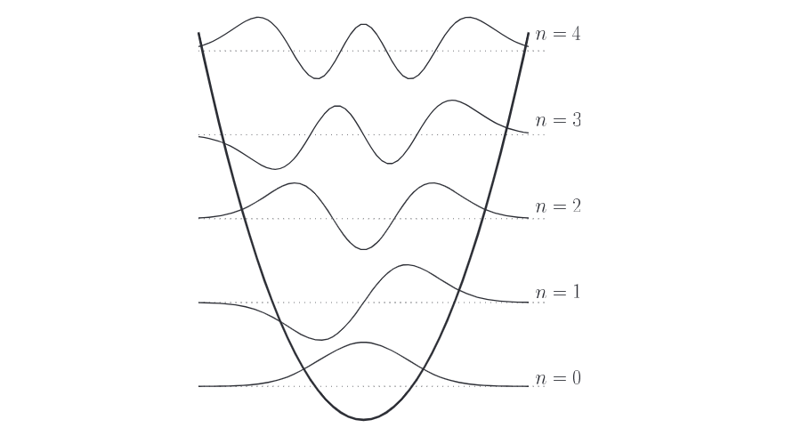

Trước khi tiếp tục mô tả một mô hình vật lý hoàn chỉnh cho một máy tính lượng tử có thể hiện thực hóa được, chúng ta hãy dừng lại một chút để xem xét một hệ thống rất sơ cấp – dao động tử điều hòa đơn giản (simple harmonic oscillator) – và thảo luận lý do tại sao nó không đóng vai trò là một máy tính lượng tử tốt. Hình thức luận (formalism) được sử dụng trong ví dụ này cũng sẽ làm cơ sở để nghiên cứu các hệ thống vật lý khác.   

# 1. Physical apparatus

Một ví dụ về dao động tử điều hòa đơn giản là một hạt nằm trong giếng thế năng parabol, $V(x) = m\omega^2 x^2 / 2$. Trong thế giới cổ điển, đây có thể là một vật nặng gắn trên lò xo, dao động qua lại khi năng lượng được truyền qua lại giữa thế năng của lò xo và động năng của vật nặng. Nó cũng có thể là một mạch điện cộng hưởng, nơi năng lượng dao động qua lại giữa cuộn cảm và tụ điện. Trong những hệ thống này, tổng năng lượng của hệ là một tham số liên tục.   

Trong miền lượng tử, vốn đạt được khi sự ghép cặp (coupling) với thế giới bên ngoài trở nên rất nhỏ, tổng năng lượng của hệ chỉ có thể nhận một tập hợp các giá trị rời rạc. Một ví dụ được đưa ra bởi một mode đơn lẻ của bức xạ điện từ bị bẫy trong một hốc cộng hưởng có hệ số phẩm chất $Q$ cao; tổng lượng năng lượng (sai khác một mức dịch chuyển cố định) chỉ có thể là bội số nguyên của $\hbar\omega$, một thang năng lượng được quyết định bởi hằng số cơ bản $\hbar$ và tần số của bức xạ bị bẫy, $\omega$.   

Tập hợp các trạng thái riêng năng lượng rời rạc của một dao động tử điều hòa đơn giản có thể được gắn nhãn là $\vert{}n\rangle$, trong đó $n = 0, 1, \dots, \infty$. Mối liên hệ với tính toán lượng tử xuất hiện bằng cách lấy một tập con hữu hạn của các trạng thái này để biểu diễn các qubit. Các qubit này sẽ có thời gian sống được quyết định bởi các tham số vật lý chẳng hạn như hệ số phẩm chất $Q$ của hốc cộng hưởng, vốn có thể được làm cho rất lớn bằng cách tăng độ phản xạ của các thành hốc. Hơn nữa, các phép biến đổi unita có thể được áp dụng chỉ bằng cách để hệ thống tự tiến hóa theo thời gian. Tuy nhiên, tồn tại những vấn đề với sơ đồ này, như sẽ trở nên rõ ràng ở bên dưới. Chúng ta bắt đầu bằng việc nghiên cứu Hamiltonian của hệ thống, sau đó thảo luận cách người ta có thể triển khai các cổng logic lượng tử đơn giản chẳng hạn như cổng controlled-NOT.   

# 2. The Hamiltonian

Hamiltonian cho một hạt nằm trong một thế năng parabol một chiều là   

$$
H = \frac{p^2}{2m} + \frac{1}{2}m\omega^2 x^2, \tag{7.4}
$$   

trong đó $p$ là toán tử động lượng của hạt, $m$ là khối lượng, $x$ là toán tử vị trí, và $\omega$ liên quan đến độ sâu của thế năng. Hãy nhớ lại rằng $x$ và $p$ là các toán tử trong biểu thức này (xem Hộp 7.2), thứ có thể được viết lại thành   

$$
H = \hbar\omega \left( a^\dagger a + \frac{1}{2} \right), \tag{7.5}
$$   

trong đó $a^\dagger$ và $a$ là các toán tử sinh (creation) và hủy (annihilation), được định nghĩa là   

$$
a = \frac{1}{\sqrt{2m\hbar\omega}} (m\omega x + ip) \tag{7.6}
$$   

$$
a^\dagger = \frac{1}{\sqrt{2m\hbar\omega}} (m\omega x - ip). \tag{7.7}
$$   

Năng lượng điểm không (zero point energy) $\hbar\omega/2$ đóng góp một thừa số pha toàn cục không quan sát được, thứ có thể được bỏ qua cho mục đích hiện tại của chúng ta.   

Các trạng thái riêng $\vert{}n\rangle$ của $H$, với $n = 0, 1, \dots$, có các tính chất   

$$
a^\dagger a \vert{}n\rangle = n\vert{}n\rangle \tag{7.10}
$$   

$$
a^\dagger \vert{}n\rangle = \sqrt{n + 1} \vert{}n + 1\rangle \tag{7.11}
$$   

$$
a \vert{}n\rangle = \sqrt{n} \vert{}n - 1\rangle. \tag{7.12}
$$   

Sau này, chúng ta sẽ thấy rất thuận tiện khi biểu diễn các tương tác với một dao động tử điều hòa đơn giản bằng cách đưa vào các số hạng bổ sung liên quan đến $a$ và $a^\dagger$, và các tương tác giữa các dao động tử với nhau bằng các số hạng chẳng hạn như $a_1^\dagger a_2 + a_1 a_2^\dagger$. Tuy nhiên, hiện tại chúng ta chỉ giới hạn sự chú ý của mình vào một dao động tử đơn lẻ.   

Bài tập 7.1: Sử dụng thực tế rằng $x$ và $p$ không giao hoán, và trên thực tế $[x, p] = i\hbar$, hãy chỉ ra một cách tường minh rằng $a^\dagger a = H/\hbar\omega - 1/2$.   

Bài tập 7.2: Cho biết $[x, p] = i\hbar$, hãy tính $[a, a^\dagger]$.   

Bài tập 7.3: Hãy tính $[H, a]$ và sử dụng kết quả đó để chỉ ra rằng nếu $\vert{}\psi\rangle$ là một trạng thái riêng của $H$ với năng lượng $E \ge n\hbar\omega$, thì $a^n\vert{}\psi\rangle$ là một trạng thái riêng với năng lượng $E - n\hbar\omega$.   

Bài tập 7.4: Hãy chỉ ra rằng $\vert{}n\rangle = \frac{(a^\dagger)^n}{\sqrt{n!}} \vert{}0\rangle$.   Bài tập 7.5: Hãy kiểm chứng rằng Các phương trình (7.11) và (7.12) nhất quán với (7.10) và điều kiện chuẩn hóa $\langle n\vert{}n\rangle = 1$.   

Sự tiến hóa theo thời gian của các trạng thái riêng được cho bởi việc giải phương trình Schrödinger, (2.86), từ đó chúng ta tìm thấy rằng trạng thái $\vert{}\psi(0)\rangle = \sum_n c_n(0)\vert{}n\rangle$ tiến hóa theo thời gian để trở thành   

$$
\vert{}\psi(t)\rangle = e^{-iHt/\hbar}\vert{}\psi(0)\rangle = \sum_n c_n e^{-in\omega t}\vert{}n\rangle. \tag{7.13}
$$   

Chúng ta sẽ giả định vì mục đích thảo luận rằng một trạng thái tùy ý có thể được chuẩn bị một cách hoàn hảo, và rằng trạng thái của hệ thống có thể được đo lường chiếu (Mục 2.2.3), nhưng ngoài ra, không có bất kỳ tương tác nào với thế giới bên ngoài, sao cho hệ thống là hoàn toàn kín.

:::{.callout-important}
# Hộp 7.2: Dao động tử điều hòa lượng tử   

Dao động tử điều hòa là một khái niệm cực kỳ quan trọng và hữu ích trong việc mô tả thế giới vật lý bằng cơ học lượng tử, và một cách tốt để bắt đầu hiểu các tính chất của nó là xác định các trạng thái riêng năng lượng của Hamiltonian của nó, (7.4). Một cách để làm điều này đơn giản là giải phương trình Schrödinger   

$$
\frac{-\hbar^2}{2m}\frac{d^2\psi_n(x)}{dx^2} + \frac{1}{2}m\omega^2 x^2 \psi_n(x) = E\psi_n(x) \tag{7.8}
$$   

để tìm $\psi_n(x)$ và các trị riêng năng lượng $E$, thỏa mãn điều kiện biên $\psi(x) \to 0$ tại $x = \pm\infty$, và $\int \vert{}\psi(x)\vert{}^2 = 1$; năm nghiệm đầu tiên được phác họa tại đây:   

Những hàm sóng này mô tả biên độ xác suất để tìm thấy một hạt trong dao động tử điều hòa tại các vị trí khác nhau bên trong thế năng.   

Mặc dù những hình ảnh này có thể mang lại một số trực giác về những gì một hệ vật lý đang làm trong không gian tọa độ, nhưng nhìn chung chúng ta sẽ quan tâm nhiều hơn đến các tính chất đại số trừu tượng của các trạng thái. Cụ thể, giả sử $\vert{}\psi\rangle$ thỏa mãn (7.8) với năng lượng $E$. Khi đó, bằng cách định nghĩa các toán tử $a$ và $a^\dagger$ như trong (7.6)–(7.7), chúng ta thấy rằng vì $[H, a^\dagger] = \hbar\omega a^\dagger$, ta có   

$$
Ha^\dagger\vert{}\psi\rangle = \left([H, a^\dagger] + a^\dagger H\right)\vert{}\psi\rangle = (\hbar\omega + E)a^\dagger\vert{}\psi\rangle, \tag{7.9}
$$   

nghĩa là, $a^\dagger\vert{}\psi\rangle$ là một trạng thái riêng của $H$, với năng lượng $E + \hbar\omega$! Tương tự, $a\vert{}\psi\rangle$ là một trạng thái riêng với năng lượng $E - \hbar\omega$. Bởi vì điều này, $a^\dagger$ và $a$ được gọi là các toán tử nâng (raising) và hạ (lowering). Từ đó suy ra rằng $a^{\dagger n}\vert{}\psi\rangle$ là các trạng thái riêng với mọi số nguyên $n$, có mức năng lượng là $E + n\hbar\omega$. Do đó tồn tại vô số trạng thái riêng năng lượng, có các mức năng lượng cách đều nhau một khoảng bằng $\hbar\omega$. Hơn nữa, vì $H$ là toán tử xác định dương (positive definite), bắt buộc phải tồn tại một trạng thái $\vert{}\psi_0\rangle$ nào đó sao cho $a\vert{}\psi_0\rangle = 0$; đây chính là trạng thái cơ bản (ground state) – trạng thái riêng của $H$ có năng lượng thấp nhất. Những kết quả này nắm bắt một cách hiệu quả bản chất của dao động tử điều hòa lượng tử, và cho phép chúng ta sử dụng ký hiệu gọn gàng $\vert{}n\rangle$ cho các trạng thái riêng, trong đó $n$ là một số nguyên, và $H\vert{}n\rangle = \hbar(n + 1/2)\vert{}n\rangle$. Chúng ta sẽ thường xuyên làm việc với $\vert{}n\rangle$, $a$, và $a^\dagger$ trong chương này, bởi vì các dao động tử điều hòa xuất hiện dưới lớp vỏ bọc của rất nhiều hệ vật lý khác nhau.  
:::

# 3. Quantum computation

Giả sử chúng ta muốn thực hiện tính toán lượng tử chỉ với một dao động tử điều hòa đơn giản duy nhất được mô tả ở trên. Ta có thể làm được gì? Lựa chọn tự nhiên nhất để biểu diễn các qubit chính là các trạng thái riêng năng lượng $\vert{}n\rangle$. Lựa chọn này cho phép chúng ta thực hiện một cổng controlled-NOT theo cách sau đây. Hãy nhớ lại rằng phép biến đổi này thực hiện ánh xạ   

$$
\begin{aligned} \vert{}00\rangle_L &\rightarrow \vert{}00\rangle_L \\ \vert{}01\rangle_L &\rightarrow \vert{}01\rangle_L \\ \vert{}10\rangle_L &\rightarrow \vert{}11\rangle_L \\ \vert{}11\rangle_L &\rightarrow \vert{}10\rangle_L, \end{aligned} \tag{7.14}
$$   

trên các trạng thái hai qubit (ở đây, chỉ số dưới $L$ được dùng để phân biệt rõ ràng các trạng thái 'logic' với các trạng thái cơ sở của dao động tử điều hòa). Hãy mã hóa hai qubit này bằng cách sử dụng ánh xạ   

$$
\begin{aligned} \vert{}00\rangle_L = \vert{}0\rangle \\ \vert{}01\rangle_L = \vert{}2\rangle \\ \vert{}10\rangle_L = (\vert{}4\rangle + \vert{}1\rangle)/\sqrt{2} \\ \vert{}11\rangle_L = (\vert{}4\rangle - \vert{}1\rangle)/\sqrt{2}. \end{aligned} \tag{7.15}
$$   

Bây giờ, giả sử rằng tại thời điểm $t = 0$, hệ thống bắt đầu ở một trạng thái được sinh bởi các trạng thái cơ sở này, và chúng ta chỉ cần để hệ thống tự tiến hóa tới thời điểm $t = \pi/\hbar\omega$. Điều này làm cho các trạng thái riêng năng lượng trải qua phép biến đổi $\vert{}n\rangle \rightarrow \exp(-i\pi a^\dagger a)\vert{}n\rangle = (-1)^n\vert{}n\rangle$, sao cho $\vert{}0\rangle$, $\vert{}2\rangle$, và $\vert{}4\rangle$ giữ nguyên không đổi, nhưng $\vert{}1\rangle \rightarrow -\vert{}1\rangle$. Kết quả là, chúng ta thu được phép biến đổi cổng controlled-NOT như mong muốn.   

Tổng quát hơn, điều kiện cần và đủ để một hệ vật lý có khả năng thực hiện một phép biến đổi unita $U$ đơn giản là toán tử tiến hóa theo thời gian của hệ, $T = \exp(-iHt)$, được xác định bởi Hamiltonian $H$ của nó, phải có phổ trị riêng gần như giống hệt với $U$. Trong trường hợp trên, cổng controlled-NOT rất dễ triển khai bởi vì nó chỉ có các trị riêng là $+1$ và $-1$; do đó rất dễ dàng sắp xếp một cách mã hóa để thu được các trị riêng y hệt từ toán tử tiến hóa theo thời gian của dao động tử điều hòa. Hamiltonian của một dao động tử có thể được gây nhiễu loạn để hiện thực hóa gần như bất kỳ phổ trị riêng nào, và bất kỳ số lượng qubit nào cũng có thể được biểu diễn chỉ bằng cách ánh xạ chúng vào vô số trạng thái riêng của hệ thống. Điều này gợi ý rằng có lẽ người ta có thể hiện thực hóa toàn bộ một chiếc máy tính lượng tử chỉ bên trong một dao động tử điều hòa đơn giản duy nhất!  

# 4. Drawbacks

Tất nhiên, có rất nhiều vấn đề với kịch bản ở trên. Rõ ràng, người ta không phải lúc nào cũng biết trước phổ trị riêng của toán tử unita cho một phép tính lượng tử nhất định, ngay cả khi người ta có thể biết cách xây dựng toán tử đó từ các cổng sơ cấp. Trên thực tế, đối với hầu hết các bài toán được giải quyết bằng thuật toán lượng tử, việc biết được phổ trị riêng đồng nghĩa với việc đã biết trước lời giải rồi!   

Một vấn đề hiển nhiên khác là kỹ thuật được sử dụng ở trên không cho phép ghép nối tầng (cascade) một phép tính này với một phép tính khác, bởi vì nhìn chung, việc ghép nối liên tiếp hai phép biến đổi unita sẽ tạo ra một phép biến đổi mới có các trị riêng hoàn toàn không liên quan gì tới ban đầu.   

Cuối cùng, ý tưởng sử dụng một dao động tử điều hòa đơn lẻ để thực hiện tính toán lượng tử là sai lầm về mặt bản chất bởi vì nó bỏ qua nguyên lý biểu diễn thông tin dạng số (digital). Một không gian Hilbert có $2^n$ chiều khi được ánh xạ vào không gian trạng thái của một dao động tử điều hòa đơn lẻ sẽ phải cho phép sự tồn tại của các trạng thái có mức năng lượng lên tới $2^n\hbar\omega$. Ngược lại, cũng chính không gian Hilbert đó có thể thu được bằng cách sử dụng $n$ hệ lượng tử hai mức, vốn chỉ tiêu tốn mức năng lượng tối đa là $n\hbar\omega$. Có thể đưa ra sự so sánh tương tự giữa một chiếc núm xoay cổ điển có $2^n$ nấc chỉnh, và một thanh ghi gồm $n$ bit cổ điển. Tính toán lượng tử được xây dựng dựa trên nền tảng của tính toán số (digital), chứ không phải tính toán tương tự (analog).   

Những đặc điểm chính của máy tính lượng tử dao động tử điều hòa được tóm tắt dưới đây (mỗi hệ thống mà chúng ta xem xét cũng sẽ được tóm tắt theo cách tương tự ở cuối mục tương ứng). Với phần này, chúng ta khép lại việc nghiên cứu các dao động tử đơn lẻ, và chuyển sang các hệ thống gồm nhiều dao động tử điều hòa, được tạo thành từ các photon và nguyên tử.

# Harmonic oscillator quantum computer

* Biểu diễn qubit: Các mức năng lượng $\vert{}0\rangle, \vert{}1\rangle, \dots, \vert{}2^n\rangle$ của một dao động tử lượng tử đơn lẻ cung cấp $n$ qubit.   
* Tiến hóa unita: Các phép biến đổi $U$ tùy ý được hiện thực hóa bằng cách khớp phổ trị riêng của chúng với phổ trị riêng được cho bởi Hamiltonian $H = a^\dagger a$.   
* Chuẩn bị trạng thái ban đầu: Không được xem xét.   
* Đọc kết quả (Readout): Không được xem xét.   
* Nhược điểm: Không phải là một biểu diễn dạng số (digital)! Ngoài ra, việc khớp các trị riêng để hiện thực hóa các phép biến đổi là bất khả thi đối với một toán tử $U$ tùy ý, vốn nhìn chung có các trị riêng chưa biết trước. 