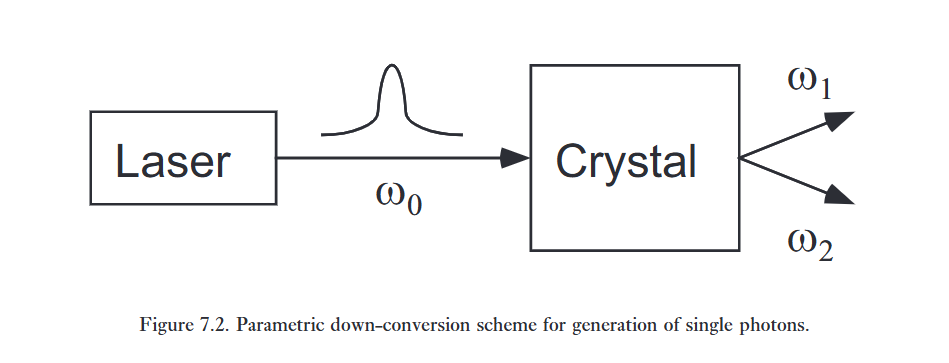

Một hệ thống vật lý hấp dẫn để biểu diễn một bit lượng tử là photon quang học. Photon là các hạt không mang điện tích, và không tương tác quá mạnh với nhau, hay thậm chí với phần lớn vật chất. Chúng có thể được dẫn truyền dọc theo những khoảng cách xa với độ suy hao thấp trong các sợi quang, được làm trễ một cách hiệu quả bằng cách sử dụng các bộ dịch pha (phase shifters), và được kết hợp dễ dàng bằng các bộ tách chùm tia (beamsplitters). Các photon thể hiện những hiện tượng lượng tử đặc trưng, chẳng hạn như sự giao thoa được tạo ra trong các thí nghiệm hai khe. Hơn nữa, về mặt nguyên tắc, các photon có thể được làm cho tương tác với nhau, bằng cách sử dụng các môi trường quang học phi tuyến đóng vai trò trung gian cho các tương tác. Vẫn tồn tại những vấn đề với kịch bản lý tưởng này; tuy nhiên, ta có thể học được rất nhiều điều từ việc nghiên cứu các thành phần, kiến trúc, và những nhược điểm của một bộ xử lý thông tin lượng tử photon quang học, như chúng ta sẽ thấy trong mục này.   

# 1. Physical apparatus

Hãy bắt đầu bằng việc xem xét các photon đơn lẻ là gì, chúng có thể biểu diễn các trạng thái lượng tử như thế nào, và các linh kiện thực nghiệm hữu ích để thao tác trên photon. Hành vi cổ điển của các bộ dịch pha, bộ tách chùm tia, và môi trường quang học phi tuyến Kerr sẽ được mô tả.   

Các photon có thể biểu diễn các qubit theo cách sau đây. Như chúng ta đã thấy trong phần thảo luận về dao động tử điều hòa đơn giản, năng lượng trong một hốc cộng hưởng điện từ được lượng tử hóa theo từng đơn vị $\hbar\omega$. Mỗi lượng tử như vậy được gọi là một photon. Một hốc cộng hưởng hoàn toàn có thể chứa một sự chồng chập của không hoặc một photon, một trạng thái có thể được biểu diễn dưới dạng một qubit $c_0\vert{}0\rangle + c_1\vert{}1\rangle$, nhưng chúng ta sẽ làm một điều khác. Hãy xét hai hốc cộng hưởng, có tổng năng lượng là $\hbar\omega$, và quy ước hai trạng thái của một qubit là việc photon nằm ở hốc này ($\vert{}01\rangle$) hay hốc kia ($\vert{}10\rangle$). Trạng thái vật lý của một sự chồng chập do đó sẽ được viết là $c_0\vert{}01\rangle + c_1\vert{}10\rangle$; chúng ta sẽ gọi đây là biểu diễn đường ray kép (dual-rail representation). Lưu ý rằng chúng ta sẽ tập trung vào các photon đơn lẻ truyền đi dưới dạng một bó sóng (wavepacket) trong không gian tự do, thay vì nằm yên bên trong một hốc cộng hưởng; người ta có thể hình dung điều này giống như có một hốc cộng hưởng di chuyển dọc theo bó sóng. Mỗi hốc cộng hưởng trong trạng thái qubit của chúng ta do đó sẽ tương ứng với một mode không gian khác nhau.   

Một sơ đồ để tạo ra các photon đơn lẻ trong phòng thí nghiệm là làm suy giảm (giảm cường độ) đầu ra của một tia laser. Một tia laser phát ra một trạng thái được gọi là trạng thái kết hợp (coherent state), $\vert{}\alpha\rangle$, được định nghĩa là   

$$
\vert{}\alpha\rangle = e^{-\vert{}\alpha\vert{}^2/2} \sum_{n=0}^{\infty} \frac{\alpha^n}{\sqrt{n!}} \vert{}n\rangle, \tag{7.16}
$$   

trong đó $\vert{}n\rangle$ là một trạng thái riêng năng lượng gồm $n$ photon. Trạng thái này, vốn đã được nghiên cứu kỹ lưỡng trong lĩnh vực quang học lượng tử, có rất nhiều tính chất đẹp đẽ mà chúng ta sẽ không mô tả ở đây. Chỉ cần hiểu rằng các trạng thái kết hợp được bức xạ một cách tự nhiên từ các dao động tử được dẫn động chẳng hạn như một tia laser khi được bơm lên cao hơn ngưỡng phát laser của nó. Lưu ý rằng năng lượng trung bình (tính theo đơn vị $\hbar\omega$) là $\langle\alpha\vert{}n\vert{}\alpha\rangle = \vert{}\alpha\vert{}^2$. Khi bị làm suy giảm, một trạng thái kết hợp đơn giản là trở thành một trạng thái kết hợp yếu hơn, và một trạng thái kết hợp yếu có thể được chế tạo để chỉ có duy nhất một photon, với xác suất cao.   

:::{.callout-note collapse="true"}
# Bài tập 7.6: (Các trạng thái riêng của toán tử hủy photon) 
Hãy chứng minh rằng một trạng thái kết hợp là một trạng thái riêng của toán tử hủy photon, tức là, hãy chỉ ra rằng $a\vert{}\alpha\rangle = \lambda\vert{}\alpha\rangle$ với một hằng số $\lambda$ nào đó.   

---

Chứng minh rằng, với $\lambda \in \mathbb{R}$:

$$
a \vert \alpha \rangle = \lambda \vert \alpha \rangle
$$

Thay phương trình (7.16) vào ta được:

$$
a \vert \alpha \rangle = a\left(e^{-\vert{}\alpha\vert{}^2/2} \sum_{n=0}^{\infty} \frac{\alpha^n}{\sqrt{n!}} \vert{}n\rangle\right)
$$

$$
a \vert \alpha \rangle = e^{-\vert{}\alpha\vert{}^2/2} \sum_{n=0}^{\infty} \frac{\alpha^n}{\sqrt{n!}} a\vert{}n\rangle
$$

Mà ở 7.3.2, ta được biết rằng $a \vert n \rangle = \sqrt n \vert n - 1\rangle$ ($a \vert 0 \rangle = 0$), thay vào ta được:

$$
a \vert \alpha \rangle = e^{-\vert{}\alpha\vert{}^2/2} \sum_{n=1}^{\infty} \frac{\alpha \cdot \alpha^{n - 1}}{\sqrt{(n-1)!}} \vert{}n - 1\rangle
$$

Đặt $m = n - 1$, rút $\alpha$ ra ngoài, ta được:

$$
a \vert \alpha \rangle = \alpha \left( e^{-\vert \alpha \vert^2 / 2} \sum_{n = 0}^{\infty} \frac {\alpha^m}{\sqrt{m!}} \vert m \rangle \right) 
$$

$$
a \vert \alpha \rangle = \alpha \vert \alpha \rangle
$$

:::

Ví dụ, với $\alpha = \sqrt{0.1}$, chúng ta thu được trạng thái $\sqrt{0.90}\vert{}0\rangle + \sqrt{0.09}\vert{}1\rangle + \sqrt{0.002}\vert{}2\rangle + \cdots$. Do đó, nếu có ánh sáng lọt qua được bộ suy giảm, người ta biết rằng đó là một photon đơn lẻ với xác suất tốt hơn $95\%$; xác suất thất bại do đó là $5\%$. Cũng lưu ý rằng trong $90\%$ thời gian, không có photon nào đi qua cả; nguồn phát này do đó có tốc độ là $0.1$ photon trên mỗi đơn vị thời gian. Cuối cùng, nguồn phát này không chỉ ra (thông qua một phép đọc cổ điển nào đó) thời điểm một photon được phát ra hay không; hai nguồn phát như vậy không thể được đồng bộ hóa với nhau.   

---

Khả năng đồng bộ hóa tốt hơn có thể đạt được bằng cách sử dụng biến đổi giảm tham số (parametric down-conversion). Quá trình này bao gồm việc chiếu các photon có tần số $\omega_0$ vào một môi trường quang học phi tuyến chẳng hạn như $\text{KH}_2\text{PO}_4$ để tạo ra các cặp photon ở các tần số $\omega_1 + \omega_2 = \omega_0$. Động lượng cũng được bảo toàn, sao cho $\vec{k}_1 + \vec{k}_2 = \vec{k}_0$, vì vậy khi một photon đơn lẻ $\omega_2$ được phát hiện (một cách phá hủy), thì một photon đơn lẻ $\omega_1$ được biết là đang tồn tại (Hình 7.2). Bằng cách ghép nối điều này với một cổng (gate), vốn chỉ mở ra khi một photon đơn lẻ (trái ngược với hai hoặc nhiều hơn) được phát hiện, và bằng cách làm trễ một cách thích hợp đầu ra của nhiều nguồn biến đổi giảm tham số, về mặt nguyên tắc, người ta có thể thu được nhiều photon đơn lẻ truyền đi đồng bộ về mặt thời gian, nằm trong độ phân giải thời gian của bộ dò và cổng.  

Các photon đơn lẻ có thể được phát hiện với hiệu suất lượng tử cao trên một dải bước sóng rộng, bằng cách sử dụng nhiều công nghệ khác nhau. Đối với mục đích của chúng ta, đặc tính quan trọng nhất của một bộ dò (detector) là khả năng xác định với xác suất cao xem có không hay một photon tồn tại trong một mode không gian cụ thể. Đối với biểu diễn đường ray kép (dual-rail), điều này chuyển thành một phép đo chiếu trong cơ sở tính toán. Trong thực tế, những sự không hoàn hảo làm giảm xác suất có thể phát hiện được một photon đơn lẻ; hiệu suất lượng tử (quantum efficiency) $\eta$ ($0 \le \eta \le 1$) của một bộ dò quang là xác suất mà một photon đơn lẻ chiếu tới bộ dò tạo ra được một cặp hạt tải quang (photocarrier pair) đóng góp vào dòng điện của bộ dò. Các đặc tính quan trọng khác của một bộ dò là băng thông (độ đáp ứng theo thời gian), nhiễu, và 'số đếm tối' ('dark counts') – tức là các hạt tải quang được sinh ra ngay cả khi không có photon nào chiếu tới.  

Ba trong số những thiết bị dễ tiếp cận nhất về mặt thực nghiệm để thao tác trên các trạng thái photon là gương phản xạ, bộ dịch pha (phase shifters) và bộ tách chùm tia (beamsplitters). Các gương có độ phản xạ cao phản xạ photon và làm thay đổi hướng truyền của chúng trong không gian. Những chiếc gương có độ suy hao $0.01\%$ không phải là hiếm. Chúng ta sẽ mặc nhiên coi những linh kiện này là lý tưởng trong kịch bản của mình. Một bộ dịch pha chẳng qua chỉ là một tấm môi trường trong suốt có chiết suất $n$ khác với chiết suất của không gian tự do, $n_0$; ví dụ, thủy tinh borosilicate thông thường có $n \approx 1.5n_0$ ở các bước sóng quang học. Việc truyền qua một môi trường như vậy trên một quãng đường $L$ làm thay đổi pha của một photon một lượng $e^{ikL}$, trong đó $k = n\omega/c_0$, và $c_0$ là tốc độ ánh sáng trong chân không. Do đó, một photon truyền qua bộ dịch pha sẽ chịu một độ dịch pha bằng $e^{i(n-n_0)L\omega/c_0}$ so với một photon đi cùng quãng đường đó trong không gian tự do.   

Một linh kiện hữu ích khác, bộ tách chùm tia, chẳng qua chỉ là một mảnh thủy tinh được tráng bạc một phần, phản xạ một phần $R$ ánh sáng tới, và truyền qua phần $1 - R$. Trong phòng thí nghiệm, một bộ tách chùm tia thường được chế tạo từ hai lăng kính, với một lớp kim loại mỏng kẹp ở giữa, được vẽ sơ đồ như trong Hình 7.3. Sẽ rất thuận tiện khi định nghĩa góc $\theta$ của một bộ tách chùm tia theo công thức $\cos\theta = R$; lưu ý rằng góc này tham số hóa lượng phản xạ một phần, và không nhất thiết có liên quan gì đến hướng đặt vật lý của bộ tách chùm tia. Hai đầu vào và hai đầu ra của thiết bị này có mối liên hệ với nhau bởi   

$$
\begin{aligned} a_{out} = a_{in}\cos\theta + b_{in}\sin\theta \\ b_{out} = -a_{in}\sin\theta + b_{in}\cos\theta, \end{aligned} \begin{gathered} (7.17) \\ (7.18) \end{gathered}
$$   

trong đó về mặt cổ điển chúng ta coi $a$ và $b$ là các trường điện từ của bức xạ tại hai cổng. Lưu ý rằng trong định nghĩa này chúng ta đã chọn một quy ước pha phi tiêu chuẩn thuận tiện cho mục đích của mình. Trong trường hợp đặc biệt của bộ tách chùm tia $50/50$, $\theta = 45^\circ$.   

---

Quang học phi tuyến cung cấp một linh kiện hữu ích cuối cùng cho bài toán này: một loại vật liệu

có chiết suất $n$ tỷ lệ thuận với tổng cường độ ánh sáng $I$ truyền qua nó:   

$$
n(I) = n + n_2 I . \tag{7.19}
$$   

Hiện tượng này được gọi là hiệu ứng Kerr quang học (optical Kerr effect), và nó xảy ra (rất yếu) ngay cả trong những vật liệu bình thường như thủy tinh và nước đường. Trong các loại thủy tinh pha tạp, hệ số $n_2$ nằm trong khoảng từ $10^{-14}$ đến $10^{-7}\text{ cm}^2/\text{W}$, còn trong các chất bán dẫn, giá trị này từ $10^{-10}$ đến $10^2$. Về mặt thực nghiệm, hành vi đáng quan tâm là khi hai chùm ánh sáng có cường độ bằng nhau được truyền đi gần như song song cùng chiều qua một môi trường Kerr, mỗi chùm tia sẽ chịu một độ dịch pha phụ thêm bằng $e^{i n_2 I L \omega / c_0}$ so với trường hợp chỉ có một chùm tia đơn lẻ truyền qua. Điều này sẽ là lý tưởng nếu chiều dài $L$ có thể lớn tùy ý, nhưng đáng tiếc là phương án đó thất bại bởi vì hầu hết các môi trường Kerr cũng đồng thời hấp thụ ánh sáng rất mạnh, hoặc tán xạ ánh sáng ra khỏi mode không gian mong muốn. Đây chính là lý do chủ yếu khiến một chiếc máy tính lượng tử dùng photon đơn lẻ trở nên phi thực tế, như chúng ta sẽ thảo luận trong Mục 7.4.3.   

Tiếp theo, chúng ta sẽ chuyển sang phần mô tả lượng tử của các linh kiện quang học này.   

# 2. Quantum computation

Các phép biến đổi unita tùy ý có thể được áp dụng lên thông tin lượng tử, vốn được mã hóa bằng các photon đơn lẻ trong biểu diễn đường ray kép (dual-rail) $c_0\vert{}01\rangle + c_1\vert{}10\rangle$, bằng cách sử dụng các bộ dịch pha (phase shifters), bộ tách chùm tia (beamsplitters), và môi trường quang học phi tuyến Kerr. Cách thức hoạt động của quá trình này có thể được hiểu theo cách sau đây, bằng việc đưa ra mô tả Hamiltonian cơ học lượng tử cho từng thiết bị này.   

Sự tiến hóa theo thời gian của một mode hốc cộng hưởng bức xạ điện từ được mô hình hóa về mặt cơ học lượng tử bởi một dao động tử điều hòa, như chúng ta đã thấy trong Mục 7.3.2. $\vert{}0\rangle$ là trạng thái chân không, $\vert{}1\rangle = a^\dagger\vert{}0\rangle$ là trạng thái một photon, và tổng quát, $\vert{}n\rangle = \frac{a^{\dagger n}}{\sqrt{n!}}\vert{}0\rangle$ là trạng thái $n$ photon, trong đó $a^\dagger$ là toán tử sinh của mode đó. Sự tiến hóa trong không gian tự do được mô tả bởi Hamiltonian   

$$
H = \hbar\omega a^\dagger a , \tag{7.20}
$$   

và áp dụng (7.13), chúng ta thấy rằng trạng thái $\vert{}\psi\rangle = c_0\vert{}0\rangle + c_1\vert{}1\rangle$ tiến hóa theo thời gian để trở thành $\vert{}\psi(t)\rangle = c_0\vert{}0\rangle + c_1 e^{-i\omega t}\vert{}1\rangle$. Lưu ý rằng biểu diễn đường ray kép rất thuận tiện bởi vì sự tiến hóa tự do chỉ làm thay đổi $\vert{}\varphi\rangle = c_0\vert{}01\rangle + c_1\vert{}10\rangle$ một lượng pha toàn cục, vốn không thể phát hiện được. Do đó, đối với đa tạp (manifold) các trạng thái đó, Hamiltonian tiến hóa bằng không.   

## Phase shifter

Một bộ dịch pha $P$ hoạt động giống hệt như sự tiến hóa theo thời gian thông thường, nhưng với một tốc độ khác, và chỉ khu trú tại các mode đi xuyên qua nó. Điều này là bởi vì ánh sáng truyền chậm lại trong một môi trường có chiết suất lớn hơn; cụ thể, ánh sáng mất thêm một khoảng thời gian $\Delta \equiv (n - n_0)L/c_0$ để truyền đi quãng đường $L$ trong một môi trường có chiết suất $n$ so với trong chân không. Ví dụ, tác động của $P$ lên trạng thái chân không là không làm gì cả: $P\vert{}0\rangle = \vert{}0\rangle$, nhưng trên trạng thái một photon, người ta thu được $P\vert{}1\rangle = e^{i\Delta}\vert{}1\rangle$.   

$P$ thực hiện một phép toán logic hữu ích trên một trạng thái đường ray kép. Việc đặt một bộ dịch pha vào một mode sẽ làm trễ sự tiến hóa pha của nó so với mode còn lại, vốn truyền đi cùng một quãng đường nhưng không đi qua bộ dịch pha. Đối với các trạng thái đường ray kép, điều này biến đổi $c_0\vert{}01\rangle + c_1\vert{}10\rangle$ thành $c_0 e^{-i\Delta/2}\vert{}01\rangle + c_1 e^{i\Delta/2}\vert{}10\rangle$, sai khác một pha toàn cục không đáng kể. Hãy nhớ lại từ Mục 4.2 rằng phép toán này chẳng qua chỉ là một phép quay,   

$$
R_z(\Delta) = e^{-iZ\Delta/2} , \tag{7.21}
$$   

trong đó chúng ta quy ước số không logic là $\vert{}0_L\rangle = \vert{}01\rangle$ và số một logic là $\vert{}1_L\rangle = \vert{}10\rangle$, còn $Z$ là toán tử Pauli thông thường. Do đó, người ta có thể coi $P$ như là kết quả của sự tiến hóa theo thời gian dưới tác dụng của Hamiltonian   

$$
H = (n_0 - n)Z , \tag{7.22}
$$   

trong đó $P = \exp(-iHL/c_0)$.   

:::{.callout-note collapse="true"}
# Bài tập 7.7: 
Hãy chỉ ra rằng mạch dưới đây biến đổi một trạng thái đường ray kép theo công thức   

$$
\vert{}\psi_{out}\rangle = \begin{bmatrix} e^{i\pi} & 0 \\ 0 & 1 \end{bmatrix} \vert{}\psi_{in}\rangle , \tag{7.23}
$$   

nếu chúng ta coi đường dây phía trên biểu diễn mode $\vert{}01\rangle$, và $\vert{}10\rangle$ là mode phía dưới, còn ô vuông chứa $\pi$ biểu diễn một độ dịch pha một lượng $\pi$:   

(Sơ đồ mạch quang học: Trạng thái đầu vào $\vert{}\psi_{in}\rangle$ đi vào hai đường dây song song; đường dây phía trên đi qua một khối vuông ghi chữ $\pi$, đường dây phía dưới đi thẳng không có phần tử nào, đầu ra thu được $\vert{}\psi_{out}\rangle$.)   

Lưu ý rằng trong các 'mạch quang học' như vậy, sự lan truyền trong không gian được biểu diễn một cách tường minh bằng cách đặt vào các phần tử mạch tập trung (lumped circuit elements) như ở hình trên, nhằm biểu diễn sự tiến hóa pha. Trong biểu diễn đường ray kép, sự tiến hóa theo (7.20) chỉ làm thay đổi trạng thái logic một lượng pha toàn cục không quan sát được, và do đó chúng ta được tự do bỏ qua nó và chỉ giữ lại các độ dịch pha tương đối.   

---

Ta thấy rằng $\Delta = \pi$, tức là:

$$
\vert 01 \rangle = e^{i\pi} \vert 01 \rangle
$$

Nếu chúng ta coi đường dây phía trên biểu diễn mode $\vert 01 \rangle$, và đường dây phía dưới là $\vert 10 \rangle$ thì:

$$
\vert \psi_{in} \rangle = c_0 \vert 01\rangle + c_1 \vert 10 \rangle
$$

Áp lên dây đầu một độ dịch pha một lượng pi:

$$
\vert{}\psi_{out}\rangle = c_0 e^{i\pi}\vert{}01\rangle + c_1\vert{}10\rangle = \begin{bmatrix} e^{i\pi} c_0 \\ c_1 \end{bmatrix} = \begin{bmatrix} e^{i\pi} & 0 \\ 0 & 1 \end{bmatrix} \begin{bmatrix} c_0 \\ c_1 \end{bmatrix} = \begin{bmatrix} e^{i\pi} & 0 \\ 0 & 1 \end{bmatrix} \vert{}\psi_{in}\rangle.
$$

:::

:::{.callout-note collapse="true"}
# Bài tập 7.8: 
Hãy chỉ ra rằng $P\vert{}\alpha\rangle = \vert{}\alpha e^{i\Delta}\rangle$ trong đó $\vert{}\alpha\rangle$ là một trạng thái kết hợp (lưu ý rằng, nhìn chung, $\alpha$ là một số phức!).

---

Chứng minh rằng:

$$
P \vert\alpha\rangle = \vert\alpha e^{i\Delta}\rangle 
$$

Bằng một cách tuyệt vời, tác giả đã chứng minh được: $P \vert n \rangle = e^{in\Delta}\vert n \rangel = (e^\Delta)^n \vert n\rangle$

Thay trạng thái kết hợp ketalpha ở phương trình (7.16) vào:

$$
\begin{aligned} 
P\vert{}\alpha\rangle = P \left( e^{-\vert{}\alpha\vert{}^2/2} \sum_{n=0}^{\infty} \frac{\alpha^n}{\sqrt{n!}} \vert{}n\rangle \right) \\
= e^{-\vert{}\alpha\vert{}^2/2} \sum_{n=0}^{\infty} \frac{\alpha^n}{\sqrt{n!}} \left(P\vert{}n\rangle\right) \\
= e^{-\vert{}\alpha\vert{}^2/2} \sum_{n=0}^{\infty} \frac{\alpha^n (e^{i\Delta})^n}{\sqrt{n!}} \vert{}n\rangle \\
= e^{-\vert{}\alpha\vert{}^2/2} \sum_{n=0}^{\infty} \frac{(\alpha e^{i\Delta})^n}{\sqrt{n!}} \vert{}n\rangle. 
\end{aligned}
$$

Vì một điều tuyệt vời, độ trễ $\Delta$ là một số thực, vì vậy:

$$
\vert e^{i\Delta} \vert = 1 \\ 
\vert \alpha e^{i\Delta} \vert ^2 = \vert \alpha \vert ^2 \vert e^{i\Delta} \vert ^2 = \vert \alpha \vert ^2
$$

Thay vào ta được:

$$
P\vert{}\alpha\rangle = e^{-\vert{}\alpha e^{i\Delta}\vert{}^2/2} \sum_{n=0}^{\infty} \frac{(\alpha e^{i\Delta})^n}{\sqrt{n!}} \vert{}n\rangle = \vert{}\alpha e^{i\Delta}\rangle
$$
:::

## Beamsplitter

Một mô tả Hamiltonian tương tự cho bộ tách chùm tia cũng tồn tại, nhưng thay vì dẫn dắt nó theo lối hiện tượng luận, chúng ta hãy bắt đầu trực tiếp từ Hamiltonian và chỉ ra cách hành vi cổ điển kỳ vọng ở Các phương trình (7.17)–(7.18) nảy sinh từ đó. Hãy nhớ lại rằng bộ tách chùm tia tác động lên hai mode, thứ mà chúng ta sẽ mô tả bằng các toán tử sinh (hủy) $a$ ($a^\dagger$) và $b$ ($b^\dagger$). Hamiltonian của hệ là   

$$
H_{bs} = i\theta \left( a b^\dagger - a^\dagger b \right) , \tag{7.24}
$$   

và bộ tách chùm tia thực hiện phép toán unita   

$$
B = \exp \left[ \theta \left( a^\dagger b - a b^\dagger \right) \right] . \tag{7.25}
$$   

Các phép biến đổi do $B$ thực hiện lên $a$ và $b$, vốn sẽ hữu ích về sau, được tìm thấy là   

$$
B a B^\dagger = a \cos\theta + b \sin\theta \quad \text{và} \quad B b B^\dagger = -a \sin\theta + b \cos\theta . \tag{7.26}
$$   

Chúng ta kiểm chứng các hệ thức này bằng cách sử dụng công thức Baker–Campbell–Hausdorff (xem thêm Bài tập 4.49)   

$$
e^{\lambda G} A e^{-\lambda G} = \sum_{n=0}^{\infty} \frac{\lambda^n}{n!} C_n , \tag{7.27}
$$   

trong đó $\lambda$ là một số phức, $A$, $G$, và $C_n$ là các toán tử, và $C_n$ được định nghĩa đệ quy dưới dạng dãy các giao hoán tử $C_0 = A$, $C_1 = [G, C_0]$, $C_2 = [G, C_1]$, $C_3 = [G, C_2]$, $\dots$, $C_n = [G, C_{n-1}]$. Bởi vì từ $[a, a^\dagger] = 1$ và $[b, b^\dagger] = 1$ ta suy ra được $[G, a] = -b$ và $[G, b] = a$ đối với $G \equiv a^\dagger b - a b^\dagger$, nên khi khai triển $B a B^\dagger$ ta thu được các hệ số của chuỗi là   

$$
C_0 = a, \quad C_1 = [G, a] = -b, \quad C_2 = [G, C_1] = -a, \quad C_3 = [G, C_2] = -[G, C_0] = b,
$$   

mà tổng quát lên là   

$$
C_{n \text{ chẵn}} = i^n a \tag{7.28}
$$   

$$
C_{n \text{ lẻ}} = i^{n+1} b . \tag{7.29}
$$   

Từ đây, kết quả mong muốn của chúng ta suy ra một cách trực tiếp:   

$$
B a B^\dagger = e^{\theta G} a e^{-\theta G} \tag{7.30}
$$

$$
= \sum_{n=0}^{\infty} \frac{\theta^n}{n!} C_n \tag{7.31}
$$

$$
= \sum_{n \text{ even}} \frac{(i\theta)^n}{n!} a + i \sum_{n \text{ lẻ}} \frac{(i\theta)^n}{n!} b \tag{7.32}
$$

$$
= a \cos\theta - b \sin\theta . \tag{7.33} 
$$   

Phép biến đổi $B b B^\dagger$ được tìm thấy một cách tầm thường bằng cách hoán đổi $a$ và $b$ trong lời giải trên. Lưu ý rằng toán tử bộ tách chùm tia nảy sinh từ một mối liên hệ sâu sắc giữa bộ tách chùm tia và đại số của nhóm $SU(2)$, như được giải thích trong Hộp 7.3.   Xét trên phương diện các cổng logic lượng tử, $B$ thực hiện một phép toán hữu ích. Trước hết hãy lưu ý rằng $B\vert{}00\rangle = \vert{}00\rangle$, nghĩa là khi không có photon nào ở cả hai mode đầu vào, thì cũng sẽ không có photon nào tồn tại ở cả hai mode đầu ra. Khi có một photon tồn tại trong mode $a$, nhớ lại rằng $\vert{}1\rangle = a^\dagger\vert{}0\rangle$, chúng ta tìm thấy rằng   

$$
B\vert{}01\rangle = B a^\dagger \vert{}00\rangle = B a^\dagger B^\dagger B \vert{}00\rangle = \\
\left( a^\dagger \cos\theta + b^\dagger \sin\theta \right)\vert{}00\rangle = \cos\theta\vert{}01\rangle + \sin\theta\vert{}10\rangle . \tag{7.34}
$$   

Tương tự, $B\vert{}10\rangle = \cos\theta\vert{}10\rangle - \sin\theta\vert{}01\rangle$. Do đó, trên đa tạp các trạng thái $\vert{}0_L\rangle$ và $\vert{}1_L\rangle$, chúng ta có thể viết $B$ dưới dạng   

$$
B = \begin{bmatrix} \cos\theta & -\sin\theta \\ \sin\theta & \cos\theta \end{bmatrix} = e^{i\theta Y} . \tag{7.35}
$$   

Các bộ dịch pha và bộ tách chùm tia khi kết hợp cùng nhau cho phép thực hiện các phép toán một qubit tùy ý lên qubit quang học của chúng ta. Đây là một hệ quả của Định lý 4.1 ở trang 175, vốn phát biểu rằng mọi phép toán một qubit đều có thể được sinh ra từ các phép quay quanh trục $\hat{z}$, $R_z(\alpha) = \exp(-i\alpha Z/2)$, và các phép quay quanh trục $\hat{y}$, $R_y(\alpha) = \exp(-i\alpha Y/2)$. Một bộ dịch pha thực hiện các phép quay $R_z$, còn một bộ tách chùm tia thực hiện các phép quay $R_y$. 

:::{.callout-note collapse="true"}
# Bài tập 7.9: (Cổng Hadamard quang học) 
Hãy chỉ ra rằng mạch dưới đây hoạt động như một cổng Hadamard trên các trạng thái photon đơn lẻ đường ray kép (dual-rail), tức là $\vert{}01\rangle \to (\vert{}01\rangle + \vert{}10\rangle)/\sqrt{2}$ và $\vert{}10\rangle \to (\vert{}01\rangle - \vert{}10\rangle)/\sqrt{2}$ sai khác một pha toàn cục:   

(Sơ đồ mạch: Hai đường dẫn quang học đi vào một bộ tách chùm tia $50/50$ có dấu chấm đen ở nửa lăng kính trên; sau đó nhánh đầu ra phía trên đi qua một bộ dịch pha $\pi$, còn nhánh phía dưới đi thẳng.)   

---

Sử dụng khai triển Baker-Campbell-Hausdorff ở phương trinfg (7.33).

$$
Ba^\dagger B^\dagger = a^\dagger\cos\theta - b^\dagger\sin\theta \\
Bb^\dagger B^\dagger = a^\dagger\cos\theta + b^\dagger\sin\theta
$$

với $\theta = \pi/4$.

Ta có:

$$
B\vert{}01\rangle = \frac{\vert{}01\rangle - \vert{}10\rangle}{\sqrt{2}}, \qquad B\vert{}10\rangle = \frac{\vert{}01\rangle + \vert{}10\rangle}{\sqrt{2}}
$$

Biểu diễn dưới dạng ma trận trong cơ sở $\{\vert 01\rangle, \vert 10 \rangle\}$:

$$
B = \frac 1 {\sqrt 2} \begin{bmatrix} 1 & 1 \\ -1 & 2 \end{bmatrix}
$$

Và nhánh trên tác động thêm bộ dịch pha pi nữa.

$$
P_b(\pi) = \begin{bmatrix} 1 & 0 \\ 0 & -1 \end{bmatrix}
$$

Tổng hợp toàn mạch:

$$
U = P_b(\pi) B = \begin{bmatrix} 1 & 0 \\ 0 & -1 \end{bmatrix} \frac{1}{\sqrt{2}}\begin{bmatrix} 1 & 1 \\ -1 & 1 \end{bmatrix} = \frac{1}{\sqrt{2}}\begin{bmatrix} 1 & 1 \\ 1 & -1 \end{bmatrix} = H.
$$
:::

:::{.callout-note collapse="true"}
# Bài tập 7.10: (Giao thoa kế Mach–Zehnder) 
Giao thoa kế là các công cụ quang học được dùng để đo những độ dịch pha nhỏ, vốn được cấu tạo từ hai bộ tách chùm tia. Nguyên lý hoạt động cơ bản của chúng có thể được hiểu thông qua bài tập đơn giản này.   

(1) Lưu ý rằng mạch này thực hiện phép toán đồng nhất (identity):   

(Sơ đồ 1: Hai cổng vào $b$ (trên) và $a$ (dưới) đi qua bộ tách chùm tia thứ nhất có dấu chấm ở nửa trên, sau đó hai nhánh song song đi tiếp qua bộ tách chùm tia thứ hai có dấu chấm ở nửa dưới, cho ra hai cổng $b'$ (trên) và $a'$ (dưới).)   

(2) Hãy tính phép toán quay (trên các trạng thái đường ray kép) mà mạch này thực hiện, dưới dạng một hàm theo độ dịch pha $\varphi$:   

(Sơ đồ 2: Giống Sơ đồ 1, nhưng trên nhánh song song phía trên ở giữa hai bộ tách chùm tia có đặt thêm một bộ dịch pha $\varphi$.)   

---

Toán tử dịch pha có ma trận:

$$
P_b(\varphi) = \begin{bmatrix} 1 & 0 \\ 0 & e^{i\varphi} \end{bmatrix}
$$

Sử dụng ma trận B từ (7.35).

$$
U_2(\varphi) = B^\dagger P_b(\varphi) B \\ 
$$

$$
= \frac{1}{2} \begin{bmatrix} 1 & 1 \\ -1 & 1 \end{bmatrix} \begin{bmatrix} 1 & 0 \\ 0 & e^{i\varphi} \end{bmatrix} \begin{bmatrix} 1 & -1 \\ 1 & 1 \end{bmatrix} \\ 
$$

$$
= \frac{1}{2} \begin{bmatrix} 1 + e^{i\varphi} & -1 + e^{i\varphi} \\ -1 + e^{i\varphi} & 1 + e^{i\varphi} \end{bmatrix}. 
$$

Rút thừa số pha toàn cục $e^{i\varphi/2}$ ra ngoài và dùng công thức Euler $\cos(\varphi/2) = \frac{e^{i\varphi/2} + e^{-i\varphi/2}}{2}$, $i\sin(\varphi/2) = \frac{e^{i\varphi/2} - e^{-i\varphi/2}}{2}$:

$$
U_2(\varphi) = e^{i\varphi/2} \begin{bmatrix} \cos(\varphi/2) & i\sin(\varphi/2) \\ i\sin(\varphi/2) & \cos(\varphi/2) \end{bmatrix} = e^{i\varphi/2} R_x(-\varphi).
$$

---

Về mặt vật lý, giao thoa kế Mach-Zehnder biến độ lệch pha $\varphi$ thành phép quay quanh trục $\hat x$ trên mặt cầu Bloch.

:::

:::{.callout-note collapse="true"}
# Bài tập 7.11: 
Trạng thái $B\vert{}2, 0\rangle$ bằng bao nhiêu khi $\theta = \pi/4$?   

---

Trạng thái $\vert 2, 0 \rangle$ biểu diễn 2 photon ở mode thứ nhất và 0 photon ở mode thứu hai.

$$
\vert 2, 0 \rangle = \frac {(b^\dagger)^2} {\sqrt {2!}} \vert 0, 0 \rangle
$$

Dùng biến đổi BbB với theta = pi/4:

$$
\begin{aligned} B\vert{}2, 0\rangle = \frac{1}{\sqrt{2}} B (b^\dagger)^2 \vert{}0, 0\rangle \\ = \frac{1}{\sqrt{2}} \left(B b^\dagger B^\dagger\right)^2 B\vert{}0, 0\rangle \\ = \frac{1}{\sqrt{2}} \left(\frac{b^\dagger - a^\dagger}{\sqrt{2}}\right)^2 \vert{}0, 0\rangle. \end{aligned}
$$

Khai triển bình phương

$$
\begin{aligned} B\vert{}2, 0\rangle & = \frac{1}{2\sqrt{2}} \left( (b^\dagger)^2 - 2 a^\dagger b^\dagger + (a^\dagger)^2 \right) \vert{}0, 0\rangle \\ & = \frac{1}{2\sqrt{2}} \left( \sqrt{2}\vert{}2, 0\rangle - 2\vert{}1, 1\rangle + \sqrt{2}\vert{}0, 2\rangle \right) \\ & = \frac{1}{2}\vert{}2, 0\rangle - \frac{1}{\sqrt{2}}\vert{}1, 1\rangle + \frac{1}{2}\vert{}0, 2\rangle. \end{aligned}
$$

:::

:::{.callout-note collapse="true"}
# Bài tập 7.12: (Bộ tách chùm tia lượng tử với đầu vào cổ điển) 
Trạng thái $B\vert{}\alpha\rangle\vert{}\beta\rangle$ bằng bao nhiêu, trong đó $\vert{}\alpha\rangle$ và $\vert{}\beta\rangle$ là hai trạng thái kết hợp như trong Phương trình (7.16)? (Gợi ý: hãy nhớ lại rằng $\vert{}n\rangle = \frac{(a^\dagger)^n}{\sqrt{n!}}\vert{}0\rangle$.)

:::

:::{.callout-important}
# Hộp 7.3: Đối xứng $SU(2)$ và các bộ tách chùm tia lượng tử   
Có một mối liên hệ thú vị giữa nhóm Lie $SU(2)$ và đại số của hai dao động tử điều hòa ghép cặp, vốn rất hữu ích để hiểu phép biến đổi của bộ tách chùm tia lượng tử. Hãy đồng nhất   

$$
a^\dagger a - b^\dagger b \rightarrow Z \tag{7.36}
$$

$$
a^\dagger b \rightarrow \sigma_+ \tag{7.37}
$$

$$
a b^\dagger \rightarrow \sigma_- , \tag{7.38}
$$   

trong đó $Z$ là toán tử Pauli, và $\sigma_\pm = (X \pm iY)/2$ là các toán tử nâng và hạ được định nghĩa theo các ma trận Pauli $X$ và $Y$. Từ các hệ thức giao hoán của $a$, $a^\dagger$, $b$, và $b^\dagger$, ta dễ dàng kiểm chứng rằng các định nghĩa này thỏa mãn các hệ thức giao hoán thông thường của các toán tử Pauli, (2.40). Cũng lưu ý rằng toán tử tổng số hạt, $a^\dagger a + b^\dagger b$, giao hoán với $\sigma_z$, $\sigma_+$, và $\sigma_-$, đúng như lẽ tự nhiên, vì nó là một đại lượng bất biến dưới các phép quay trong không gian $SU(2)$. Sử dụng $X = a^\dagger b + a b^\dagger$ và $Y = -i(a^\dagger b - a b^\dagger)$ trong toán tử quay $SU(2)$ truyền thống   

$$
R(\hat{n}, \theta) = e^{-i\theta \vec{\sigma}\cdot\hat{n}/2} \tag{7.39}
$$   

sẽ cho chúng ta toán tử bộ tách chùm tia mong muốn khi trục $\hat{n}$ được chọn là trục $-\hat{y}$.   
:::

## Nonlinear Kerr media

Hiệu ứng quan trọng nhất của một môi trường Kerr là sự điều biến pha chéo (cross phase modulation) mà nó tạo ra giữa hai mode ánh sáng. Về mặt cổ điển, hiện tượng này được mô tả bởi số hạng $n_2$ trong phương trình (7.19), thực chất là một tương tác hiệu dụng giữa các photon thông qua sự trung gian của các nguyên tử trong môi trường Kerr. Về mặt cơ học lượng tử, hiệu ứng này được mô tả bởi Hamiltonian   

$$
H_{xpm} = -\chi a^\dagger a b^\dagger b , \tag{7.40}
$$   

trong đó $a$ và $b$ mô tả hai mode truyền qua môi trường, và đối với một tinh thể có chiều dài $L$ chúng ta thu được phép biến đổi unita   

$$
K = e^{i\chi L a^\dagger a b^\dagger b} . \tag{7.41}
$$   

$\chi$ là một hệ số liên quan đến $n_2$, và hệ số cảm thụ phi tuyến bậc ba thường được ký hiệu là $\chi^{(3)}$. Việc chứng minh rằng hành vi cổ điển kỳ vọng nảy sinh từ Hamiltonian này được để lại làm Bài tập 7.14 cho bạn đọc.   

Bằng cách kết hợp môi trường Kerr với các bộ tách chùm tia, một cổng controlled-NOT có thể được xây dựng theo cách sau đây. Đối với các trạng thái một photon, chúng ta thấy rằng   

$$
K\vert{}00\rangle = \vert{}00\rangle \tag{7.42} \\ K\vert{}01\rangle
$$

$$
= \vert{}01\rangle \tag{7.43} \\ K\vert{}10\rangle 
$$

$$
= \vert{}10\rangle \tag{7.44} \\ K\vert{}11\rangle 
$$

$$
= e^{i\chi L}\vert{}11\rangle , \tag{7.45}
$$   

và chúng ta hãy chọn $\chi L = \pi$, sao cho $K\vert{}11\rangle = -\vert{}11\rangle$. Bây giờ hãy xét hai trạng thái đường ray kép (dual-rail), tức là bốn mode ánh sáng. Chúng nằm trong một không gian được sinh bởi bốn trạng thái cơ sở $\vert{}e_{00}\rangle = \vert{}1001\rangle$, $\vert{}e_{01}\rangle = \vert{}1010\rangle$, $\vert{}e_{10}\rangle = \vert{}0101\rangle$, $\vert{}e_{11}\rangle = \vert{}0110\rangle$. Lưu ý rằng chúng ta đã đảo ngược thứ tự thông thường của hai mode đối với cặp đầu tiên cho thuận tiện (về mặt vật lý, hai mode này có thể dễ dàng hoán đổi cho nhau bằng gương phản xạ). Bây giờ, nếu một môi trường Kerr được đặt vào để tác động lên hai mode nằm giữa, thì chúng ta thấy rằng $K\vert{}e_i\rangle = \vert{}e_i\rangle$ với mọi $i$ ngoại trừ $K\vert{}e_{11}\rangle = -\vert{}e_{11}\rangle$. Điều này rất hữu ích bởi vì phép toán controlled-NOT có thể được phân tích thành   

$$
\underbrace{\begin{bmatrix} 1 & 0 & 0 & 0 \\ 0 & 1 & 0 & 0 \\ 0 & 0 & 0 & 1 \\ 0 & 0 & 1 & 0 \end{bmatrix}}_{U_{CN}} = \underbrace{\frac{1}{\sqrt{2}}\begin{bmatrix} 1 & 1 & 0 & 0 \\ 1 & -1 & 0 & 0 \\ 0 & 0 & 1 & 1 \\ 0 & 0 & 1 & -1 \end{bmatrix}}_{I \otimes H} \underbrace{\begin{bmatrix} 1 & 0 & 0 & 0 \\ 0 & 1 & 0 & 0 \\ 0 & 0 & 1 & 0 \\ 0 & 0 & 0 & -1 \end{bmatrix}}_{K} \underbrace{\frac{1}{\sqrt{2}}\begin{bmatrix} 1 & 1 & 0 & 0 \\ 1 & -1 & 0 & 0 \\ 0 & 0 & 1 & 1 \\ 0 & 0 & 1 & -1 \end{bmatrix}}_{I \otimes H} , \tag{7.46}
$$   

trong đó $H$ là phép biến đổi Hadamard một qubit (được triển khai đơn giản bằng các bộ tách chùm tia và bộ dịch pha), còn $K$ là tương tác Kerr mà chúng ta vừa xem xét, với $\chi L = \pi$. Một thiết bị như vậy đã từng được xem xét trước đây để chế tạo một cổng logic quang học cổ điển khả nghịch, như được mô tả trong Hộp 7.4; trong chế độ một photon, nó cũng hoạt động như một cổng logic lượng tử.   

Tóm lại, cổng CNOT có thể được xây dựng từ môi trường Kerr, và các phép toán một qubit tùy ý được hiện thực hóa bằng cách sử dụng các bộ tách chùm tia và bộ dịch pha. Các photon đơn lẻ có thể được tạo ra bằng cách sử dụng các tia laser suy giảm, và được phát hiện bằng các bộ dò quang. Như vậy, về mặt lý thuyết, một chiếc máy tính lượng tử có thể được hiện thực hóa bằng cách sử dụng các linh kiện quang học này! 

# 3. Drawback

Biểu diễn một qubit bằng photon đơn lẻ là một ý tưởng hấp dẫn. Các photon đơn lẻ tương đối dễ tạo ra và đo lường, và trong biểu diễn đường ray kép (dual-rail), ta có thể thực hiện các phép toán một qubit tùy ý. Đáng tiếc là việc làm cho các photon tương tác với nhau lại rất khó khăn – những môi trường phi tuyến Kerr tốt nhất hiện có đều rất yếu, và không thể tạo ra một sự điều biến pha chéo (cross phase modulation) bằng $\pi$ giữa các trạng thái photon đơn lẻ. Trên thực tế, bởi vì chiết suất phi tuyến thường thu được bằng cách sử dụng một môi trường nằm gần một cộng hưởng quang học, nên luôn có một lượng hấp thụ nhất định đi kèm với tính phi tuyến đó, và về mặt lý thuyết người ta có thể ước tính rằng trong cách bố trí tốt nhất như vậy, có xấp xỉ $50$ photon phải bị hấp thụ cho mỗi một photon trải qua được sự điều biến pha chéo bằng $\pi$. Điều này có nghĩa là triển vọng xây dựng các máy tính lượng tử từ các linh kiện quang học phi tuyến truyền thống là cực kỳ mong manh.   

Tuy nhiên, từ việc nghiên cứu chiếc máy tính lượng tử quang học này, chúng ta đã thu được một số hiểu biết sâu sắc đầy giá trị về bản chất của kiến trúc (architecture) và thiết kế hệ thống của một chiếc máy tính lượng tử. Giờ đây chúng ta có thể hình dung một chiếc máy tính lượng tử thực tế trong phòng thí nghiệm sẽ trông như thế nào (giá như có sẵn các linh kiện đủ tốt để chế tạo nó), và một đặc điểm nổi bật là nó được cấu tạo gần như hoàn toàn từ các giao thoa kế quang học (optical interferometers). Trong thiết bị này, thông tin được mã hóa đồng thời trong cả số lượng photon lẫn pha của photon, và các giao thoa kế được dùng để chuyển đổi qua lại giữa hai dạng biểu diễn đó. Mặc dù việc chế tạo các giao thoa kế quang học ổn định là khả thi, nhưng nếu một biểu diễn thay thế dùng hạt có khối lượng được lựa chọn cho qubit, thì việc xây dựng các giao thoa kế ổn định sẽ nhanh chóng trở nên vô cùng khó khăn do bước sóng de Broglie đặc trưng của chúng quá ngắn. Ngay cả với biểu diễn quang học, việc giữ ổn định hàng loạt giao thoa kế lồng ghép vào nhau vốn cần thiết để chạy một thuật toán lượng tử lớn cũng đã là một thách thức trong phòng thí nghiệm.   

Trong lịch sử, các máy tính cổ điển quang học từng được kỳ vọng đầy hứa hẹn sẽ thay thế cho các cỗ máy điện tử, nhưng cuối cùng chúng đã không đạt được kỳ vọng khi người ta không tìm ra các vật liệu quang học có tính phi tuyến đủ mạnh, và khi những ưu thế về tốc độ cũng như tính song song của chúng không đủ bù đắp cho các nhược điểm về căn chỉnh quang học và công suất tiêu thụ. Mặt khác, truyền thông quang học lại là một lĩnh vực sống còn và quan trọng; một lý do cho điều này là đối với các khoảng cách lớn hơn một centimet, năng lượng cần thiết để truyền đi một bit bằng một photon qua sợi quang nhỏ hơn năng lượng cần thiết để nạp điện cho một đường truyền dẫn điện tử $50\text{ ohm}$ điển hình trên cùng khoảng cách đó. Tương tự như vậy, rất có thể các qubit quang học sẽ tìm thấy ngôi nhà tự nhiên của mình trong lĩnh vực truyền thông thông tin lượng tử, chẳng hạn như trong mật mã lượng tử, hơn là trong lĩnh vực tính toán.   

Bất chấp những nhược điểm mà việc hiện thực hóa máy tính lượng tử quang học đang phải đối mặt, hình thức luận lý thuyết mô tả chúng lại đóng vai trò nền tảng tuyệt đối trong tất cả các phương pháp hiện thực hóa khác mà chúng ta sẽ nghiên cứu trong phần còn lại của chương này. Trên thực tế, bạn có thể coi hệ thống mà chúng ta sắp chuyển sang nghiên cứu tiếp theo chẳng qua chỉ là một dạng máy tính lượng tử quang học khác, nhưng sử dụng một loại môi trường phi tuyến khác (và tốt hơn nhiều!).   

# Optical photon quantum computer

**Biểu diễn qubit:** Vị trí của một photon đơn lẻ giữa hai mode, $\vert{}01\rangle$ và $\vert{}10\rangle$, hoặc trạng thái phân cực.   

**Tiến hóa unita:** Các phép biến đổi tùy ý được xây dựng từ các bộ dịch pha (các phép quay $R_z$), bộ tách chùm tia (các phép quay $R_y$), và môi trường phi tuyến Kerr, thứ cho phép hai photon đơn lẻ điều biến pha chéo lẫn nhau, thực hiện phép toán $\exp\left[i\chi L\vert{}11\rangle\langle 11\vert{}\right]$.   

**Chuẩn bị trạng thái ban đầu:** Tạo ra các trạng thái photon đơn lẻ (ví dụ bằng cách làm suy giảm ánh sáng laser).   

**Đọc kết quả (Readout):** Phát hiện các photon đơn lẻ (ví dụ sử dụng ống nhân quang điện).   

**Nhược điểm:** Khó hiện thực hóa được các môi trường phi tuyến Kerr có tỷ số giữa độ mạnh điều biến pha chéo trên tổn hao hấp thụ đủ lớn.

# KLM

Xem thêm ở đây: 