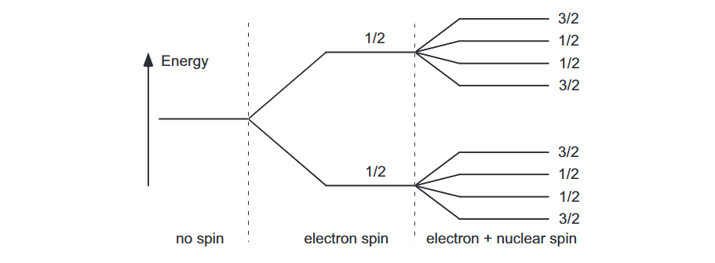
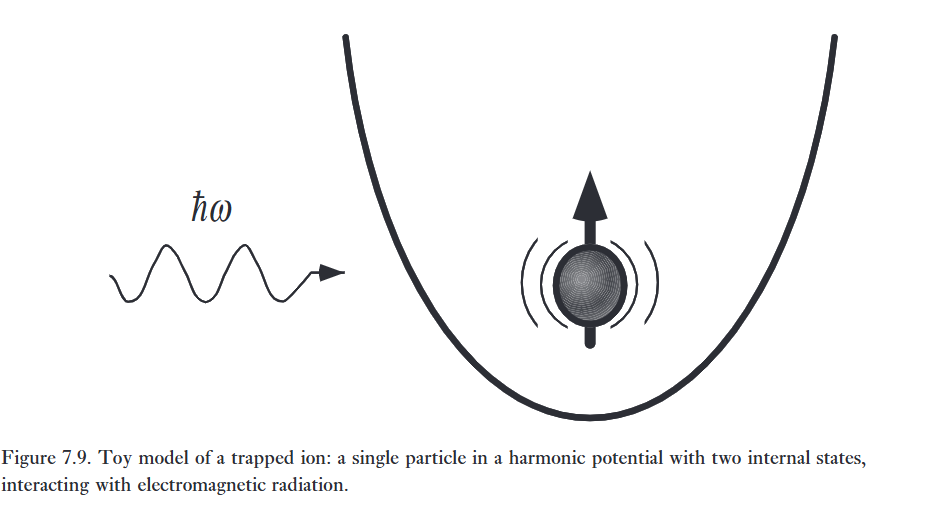
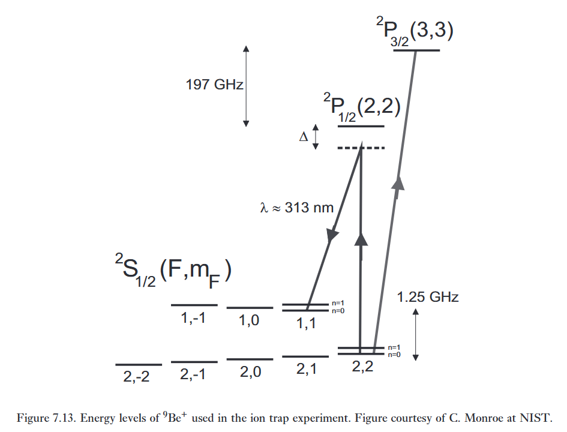
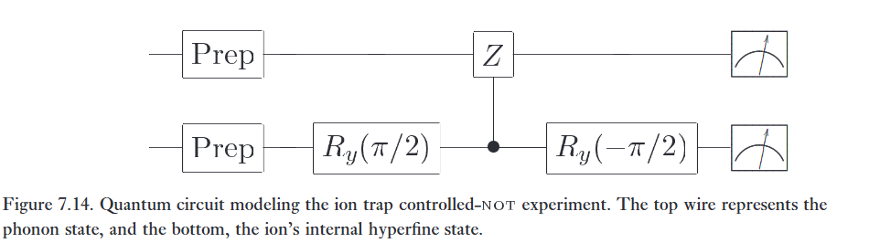

Cho đến phần này của chương, chúng ta chủ yếu tập trung vào việc biểu diễn các qubit bằng photon. Bây giờ hãy chuyển sang các cách biểu diễn sử dụng trạng thái nguyên tử và hạt nhân. Cụ thể, như chúng ta đã thấy ở Mục 7.1, spin của electron và spin của hạt nhân cung cấp những cách biểu diễn tiềm năng tốt cho qubit. Spin là một khái niệm kỳ lạ (nhưng hoàn toàn có thật!) (Hộp 7.7), nhưng vì sự chênh lệch năng lượng giữa các trạng thái spin khác nhau thường rất nhỏ so với các thang năng lượng khác (chẳng hạn như động năng của các nguyên tử thông thường ở nhiệt độ phòng), các trạng thái spin của một nguyên tử thường khó quan sát, và thậm chí còn khó điều khiển hơn. Tuy nhiên, trong những môi trường được thiết kế tinh vi, việc điều khiển cực kỳ chính xác là hoàn toàn khả thi. Những điều kiện như vậy được tạo ra bằng cách cô lập và bẫy một số lượng nhỏ các nguyên tử mang điện trong các bẫy điện từ, sau đó làm lạnh các nguyên tử cho đến khi động năng của chúng thấp hơn nhiều so với phần đóng góp năng lượng của spin. Sau khi làm điều này, ánh sáng đơn sắc chiếu tới có thể được điều chỉnh tần số để gây ra các chuyển dời có chọn lọc làm thay đổi một số trạng thái spin nhất định tùy thuộc vào các trạng thái spin khác. Đây chính là bản chất của cách các ion bị bẫy có thể được dùng để thực hiện tính toán lượng tử, như chúng ta sẽ mô tả trong mục này. Chúng ta bắt đầu với tổng quan về thiết bị thí nghiệm và các thành phần chính của nó, sau đó trình bày một Hamiltonian mô hình hóa hệ thống. Chúng ta mô tả một thí nghiệm đã được thực hiện để chứng minh một cổng controlled-NOT với các ion $^9\text{Be}$ bị bẫy, và sau đó kết thúc với một vài nhận xét về tiềm năng cũng như hạn chế của phương pháp này. 

:::{.callout-important}
# Hộp 7.7: Spin   

Spin là một khái niệm kỳ lạ. Khi một hạt có spin, nó sở hữu một mômen từ hệt như thể nó là một hạt cấu hợp có một dòng điện chạy vòng quanh một mạch kín. Nhưng electron là các hạt cơ bản, còn các quark cấu tạo nên nucleon thì không được biết đến là tạo ra spin thông qua chuyển động quỹ đạo. Hơn nữa, spin của một hạt chỉ luôn mang giá trị nguyên hoặc bán nguyên.   

Tuy nhiên, spin hoàn toàn có thật, và là một phần quan trọng của vật lý đời thường. Các hạt có spin nguyên, được gọi là boson, bao gồm cả photon. Vì không có khối lượng, photon có phần đặc biệt và chỉ có các thành phần spin $\pm 1$ (và không có spin bằng không); những thành phần này tương ứng với hai trạng thái phân cực trực giao quen thuộc. Kính râm làm từ các tấm phân cực nhựa rẻ tiền phát huy hiệu quả khi lái xe là bởi vì ánh sáng mặt trời bị phân cực một phần theo hướng ngược lại sau khi phản xạ khỏi các bề mặt như mặt đường (ánh sáng phân cực có điện trường song song với mặt phân cách luôn phản xạ một phần bất kể góc tới là bao nhiêu, trái ngược với phân cực từ ngang vốn không phản xạ khi góc tới đạt góc Brewster). Các hạt có spin bán nguyên, được gọi là fermion, bao gồm electron, proton và neutron. Đây là các hạt "spin-$1/2$", ở chỗ thành phần spin của chúng có thể là $+1/2$ (spin "lên" - up) hoặc $-1/2$ (spin "xuống" - down). Khi chúng ta nói "spin", thông thường điều được ám chỉ là một hạt spin-$1/2$.   

Các trạng thái riêng năng lượng của một nguyên tử có liên quan mật thiết đến spin, và sự kết hợp của nhiều spin. Ví dụ, hạt nhân của $^9\text{Be}$ có spin $3/2$. Các spin tương tác với từ trường giống hệt như các mômen từ; trong một từ trường $\vec{B}$, một electron có spin $\vec{S}$ mang năng lượng $g_e \vec{S}\cdot\vec{B}$, và tương tự, một hạt nhân $\vec{I}$ mang năng lượng $g_n \vec{I}\cdot\vec{B}$. Minh họa bằng hình ảnh, chẳng hạn, phần đóng góp của spin vào các mức năng lượng của nguyên tử có thể được hình dung như sau:   

 

trong đó chúng ta giả sử một electron có spin-$1/2$, và một hạt nhân có spin-$3/2$. Bằng cách điều chỉnh tần số của tia laser chiếu tới sao cho thật chuẩn xác, bất kỳ chuyển dời nào trong số này đều có thể được chọn lọc, miễn là các định luật bảo toàn (Mục 7.5.1) được thỏa mãn. Cụ thể, định luật bảo toàn mômen động lượng ngụ ý rằng khi một photon bị hấp thụ bởi một nguyên tử, một đơn vị mômen động lượng hoặc spin phải thay đổi giữa trạng thái đầu và trạng thái cuối. Do đó, các trạng thái này phải có các giá trị mômen động lượng xác định; điều này có thể được tính đến.   

Không giống như các biến liên tục chẳng hạn như vị trí và động lượng, cùng các hệ không gian Hilbert vô hạn chiều khác vốn bắt buộc phải bị cắt cụt một cách nhân tạo để biểu diễn các bit lượng tử, các trạng thái spin cung cấp những cách biểu diễn tuyệt vời cho thông tin lượng tử bởi vì chúng sống trong một không gian trạng thái vốn dĩ đã hữu hạn chiều. 
:::

:::{.callout-note collapse="true"}
# Bài tập 7.24: 
Năng lượng của một spin hạt nhân trong từ trường xấp xỉ bằng $\mu_{\text{N}}B$, trong đó $\mu_{\text{N}} = eh/4\pi m_{\text{p}} \approx 5\times 10^{-27}$ joule trên tesla là magneton Bohr hạt nhân. Hãy tính năng lượng của một spin hạt nhân trong từ trường $B = 10$ tesla, và so sánh với năng lượng nhiệt $k_{\text{B}}T$ tại $T = 300\text{ K}$. 
:::

---

# 1. Physical apparatus

Một máy tính lượng tử bẫy ion có các thành phần chính là một bẫy điện từ đi kèm với các tia laser, các đầu dò quang điện, và các ion.

# Trap geometry and lasers

Thiết bị thí nghiệm chính, một bẫy điện từ được chế tạo từ bốn điện cực hình trụ, được minh họa trong Hình 7.7. Các đoạn đầu mút của các điện cực được đặt một điện áp phân cực $U_0$ khác với phần giữa, sao cho các ion bị giam giữ dọc trục bởi một thế tĩnh $\Phi_{\text{dc}} = \kappa U_0 \left[ z^2 - (x^2 + y^2) \right]/2$ dọc theo trục $\hat{z}$ ($\kappa$ là một hệ số hình học). Tuy nhiên, một kết quả được biết đến với tên gọi định lý Earnshaw phát biểu rằng một điện tích không thể bị giam giữ trong không gian ba chiều chỉ bằng các thế tĩnh. Do đó, để tạo ra sự giam giữ, hai trong số các điện cực được nối đất, trong khi hai điện cực còn lại được điều khiển bởi một điện áp dao động nhanh tạo ra một thế tần số vô tuyến (RF) $\Phi_{\text{rf}} = (V_0 \cos \Omega_T t + U_r)(1 + (x^2 - y^2)/R^2)/2$, trong đó $R$ là một hệ số hình học. Các phân đoạn của các điện cực được ghép nối điện dung sao cho thế RF là không đổi trên toàn bộ chiều dài của chúng. Sự kết hợp giữa $\Phi_{\text{dc}}$ và $\Phi_{\text{rf}}$ tạo ra, xét theo giá trị trung bình (qua chu kỳ $\Omega_T$), một thế điều hòa theo các phương $x, y$ và $z$. Cùng với lực đẩy Coulomb giữa các ion, điều này mang lại một Hamiltonian chi phối chuyển động của $N$ ion bên trong bẫy:   

$$
H = \sum_{i=1}^{N} \frac{M}{2} \left( \omega_x^2 x_i^2 + \omega_y^2 y_i^2 + \omega_z^2 z_i^2 + \frac{\vert{}\vec{p}_i\vert{}^2}{M^2} \right) + \sum_{i=1}^{N} \sum_{j>i} \frac{e^2}{4\pi\epsilon_0\vert{}\vec{r}_i - \vec{r}_j\vert{}} \tag{7.92}
$$

trong đó $M$ là khối lượng của mỗi ion. Thông thường, $\omega_x, \omega_y \gg \omega_z$ theo thiết kế, sao cho tất cả các ion nhìn chung nằm thẳng hàng dọc theo trục $\hat{z}$. Khi số lượng ion trở nên lớn, cấu hình hình học của các ion có thể trở nên khá phức tạp, tạo thành các dạng zíc-zắc và các mẫu hình khác, nhưng chúng ta sẽ chỉ tập trung vào trường hợp đơn giản khi chỉ có một vài ion bị bẫy, xếp theo cấu hình dạng chuỗi thẳng hàng.

---

Cũng giống như một vật nặng gắn trên lò xo có thể hành xử như một hệ lượng tử khi sự tương tác với thế giới bên ngoài trở nên đủ nhỏ, chuyển động của ion bị giam giữ bằng điện từ sẽ trở nên lượng tử hóa khi nó được cô lập đủ tốt. Trước tiên hãy hiểu sự lượng tử hóa này có nghĩa là gì, sau đó sẽ xem xét các tiêu chuẩn cô lập. Như chúng ta đã thấy trong Mục 7.3, các mức năng lượng của một dao động tử điều hòa cách đều nhau theo đơn vị $\hbar\omega_z$. Trong bẫy ion, ở chế độ mà chúng ta đang quan tâm, các trạng thái riêng năng lượng này biểu diễn các mode (chế độ) dao động khác nhau của toàn bộ chuỗi ion thẳng hàng chuyển động cùng nhau như một vật thể thống nhất, với khối lượng $NM$. Chúng được gọi là các mode khối tâm (center of mass modes). Mỗi lượng tử năng lượng dao động $\hbar\omega_z$ được gọi là một phonon, và có thể được xem như một hạt, hệt như một lượng tử bức xạ điện từ trong hốc cộng hưởng là một photon.   

Để mô tả về phonon ở trên có hiệu lực, cần phải thỏa mãn một số tiêu chuẩn nhất định. Thứ nhất, sự ghép nối (tương tác) với môi trường phải đủ nhỏ sao cho quá trình nhiệt hóa (thermalization) không làm ngẫu nhiên hóa trạng thái của hệ (và do đó khiến hệ hành xử theo kiểu cổ điển). Về mặt vật lý, điều có thể xảy ra là các điện trường và từ trường thăng giáng ở gần đó đẩy vào các ion, khiến trạng thái chuyển động của chúng nhảy một cách ngẫu nhiên giữa các trạng thái riêng năng lượng. Những nguồn nhiễu như vậy gần như không thể tránh khỏi về mặt kỹ thuật, bởi vì chẳng hạn, người ta không thể cấp nguồn cho các điện cực giam giữ từ một nguồn điện áp hoàn hảo; nguồn cấp sẽ luôn có một điện trở hữu hạn, và điện trở này sinh ra nhiễu Johnson (nhiễu nhiệt), vốn có các thăng giáng ở những thang thời gian mà các ion nhạy cảm. Điện trường trên các vùng cục bộ (local patches) của điện cực cũng có thể thăng giáng, làm kích thích ngẫu nhiên chuyển động của các ion. Khi tính ngẫu nhiên tăng lên, các tính chất lượng tử của trạng thái ion bị mất đi, và hành vi của chúng trở nên được mô tả tốt bởi các giá trị trung bình thống kê cổ điển. Ví dụ, cả động lượng và vị trí của chúng đều trở nên xác định rõ ràng, điều không thể đồng thời đúng đối với một hệ lượng tử. Tuy nhiên, trên thực tế, hầu hết các nguồn nhiễu kỹ thuật đều có thể được kiểm soát khá tốt, đến mức chúng không làm nóng hay làm mất pha (dephase) các ion bị bẫy quá nhiều trong thang thời gian của hầu hết các thí nghiệm. Một phần, lý do quan trọng giúp điều này khả thi là chừng nào phép xấp xỉ điều hòa còn đúng, các ion bị bẫy sẽ rất kén chọn tần số nhiễu mà chúng nhạy cảm; giống như các chuyển dời giữa các mức năng lượng nguyên tử chỉ có thể được chọn lọc bởi bức xạ điều chỉnh đúng tần số, chỉ những thăng giáng có mật độ phổ công suất cao xung quanh tần số $\omega_z$ mới ảnh hưởng đến các ion.

Việc các ion phải đủ lạnh cũng rất quan trọng để phép xấp xỉ điều hòa một chiều có hiệu lực. Thế năng thực tế không có dạng bậc hai đối với các độ dịch chuyển lớn dọc theo bất kỳ hướng nào ra xa tâm bẫy. Và các mode dao động bậc cao hơn — trong đó các ion chuyển động tương đối với nhau (thay vì chuyển động cùng nhau) — phải có năng lượng cao hơn nhiều so với mode khối tâm. Khi điều này được thỏa mãn, và các ion được làm lạnh xuống trạng thái cơ bản của chuyển động, sự chuyển dời của chúng lên trạng thái năng lượng cao hơn kế tiếp diễn ra thông qua việc hấp thụ một phonon khối tâm; quá trình này có liên quan đến hiệu ứng Mössbauer, trong đó một photon bị hấp thụ bởi các nguyên tử trong một tinh thể mà không tạo ra các phonon cục bộ bởi vì toàn bộ tinh thể cùng giật lùi (recoil) đồng thời.

---

Một tiêu chuẩn khác cần phải được thỏa mãn là bề rộng dao động của ion trong thế năng của bẫy phải nhỏ hơn so với bước sóng của ánh sáng tới. Tiêu chuẩn Lamb–Dicke này được biểu diễn một cách thuận tiện thông qua tham số Lamb–Dicke $\eta \equiv 2\pi z_0/\lambda$, trong đó $\lambda$ là bước sóng, và $z_0 = \sqrt{\hbar / 2NM\omega}$ là thang chiều dài đặc trưng của khoảng cách giữa các ion trong bẫy. Tiêu chuẩn Lamb–Dicke đòi hỏi $\eta \ll 1$; điều này không nhất thiết phải được đáp ứng một cách khắt khe để bẫy ion trở nên hữu ích cho tính toán lượng tử, nhưng ít nhất người ta mong muốn có $\eta \approx 1$, nhằm mục đích có thể phân giải (nhắm riêng) từng ion bằng các chùm tia laser khác nhau, mà không làm cho trạng thái chuyển động của chúng trở nên quá khó để kích thích bằng quang học khi thực hiện các phép toán logic.

![Hình 7.8: Phương pháp làm lạnh dải biên (Sideband cooling), minh họa các chuyển dời giữa $\vert{}0, n\rangle$ và $\vert{}1, m\rangle$, trong đó $0$ và $1$ là hai mức năng lượng điện tử, còn $n$ và $m$ là các mức phonon biểu diễn trạng thái chuyển động của ion. Ánh sáng laser được điều chỉnh để có năng lượng thấp hơn một phonon so với chuyển dời điện tử, sao cho chẳng hạn trạng thái $\vert{}0, 3\rangle$ chuyển lên trạng thái $\vert{}1, 2\rangle$, như hình vẽ. Nguyên tử sau đó tự phát phân rã về mức năng lượng điện tử thấp hơn $0$ (các đường lượn sóng), đi ngẫu nhiên về một trong các trạng thái $\vert{}0, 1\rangle$, $\vert{}0, 2\rangle$, hoặc $\vert{}0, 3\rangle$ (với xác suất gần như bằng nhau). Lưu ý rằng ánh sáng laser thực chất gây ra tất cả các chuyển dời khả dĩ giữa $\vert{}0, n\rangle$ và $\vert{}1, n-1\rangle$, vì tất cả các chuyển dời này đều có cùng mức năng lượng. Tuy nhiên, quá trình này không hề chạm tới trạng thái $\vert{}0, 0\rangle$, và cuối cùng đó chính là trạng thái mà nguyên tử sẽ dừng lại](../../img/7.8.png)

:::{.callout}
# Note thêm

## Cách vượt qua Định lý Earnshaw - Bẫy Paul

Không thể nhốt một hạt mang điện đứng yên chỉ bằng điện áp một chiều (DC) tĩnh. (Giống như việc đặt một viên bi lên cái yên ngựa).

Thế tĩnh $\Phi_{dc}$ bóp chặt hai đầu (trục z) để viên bi không trượt lên trước hay ra sau. Nhưng đổi lại hai bên hông (trục xy) lại trũng xuống khiến viên bi sẽ rơi ra ngoài.

Giải pháp: Nối đất với 2 thanh kim loại, và cấp điện AC tần số cao RF cho 2 thanh còn lại. Viên bi tính trượt sang trái thì lại bị đảo lại, trượt sang phải, rồi lại đảo lại, ... Cuối cùng nó ở ngay chính giữa.

## Phân tích Hamiltonian

Cụm thứ nhất: Là năng lượng do trap ép từng ion ở tâm. Và người ta cố tình chỉnh $\omega_x, \omega_y \gg \omega_z$, tức là theo phương z thì "lỏng" hơn nhiều do với việc ép theo 2 phương còn lại.

Cụm thứ hai: Do các ion mang điện tích dương, chúng cũng đẩy nhau. Vì vậy phải thêm lực đẩy tĩnh điện Coulomb.

## 2 điều kiện để chuỗi ion rung động nhịp nhàng

Điều kiện 1: Chống lại nhiễu điện từ

* Muốn nhốt ion thì phải dùng thanh điện cực kim loại, mà dây dẫn hay nguồn điện này cũng có điện trở, sinh ra nhiệt, làm các electron chạy loạn xạ - Nhiễu Johnson. 

* Bề mặt kim loại cũng có những vết bẩn, khuyết tật tạo ra điện trường nhiễu cục bộ.

Nhờ có cấu trúc bẫy điều hòa, chuỗi ion rung động cực kỳ kén sóng. nó chỉ bị ảnh hưởng bởi những rung động có cùng tần số khớp đúng với tần số riêng $\omega_z$ của nó. Mọi tần số noise khác đều không quan tâm, nên chỉ cần lọc sạch nhiễu ở quanh dải tần số riêng đó là được.

Điều kiện 2: Làm lạnh sâu

* Công thức lò xo điều hòa ($U \propto z^2$) chỉ đúng khi các ion rung động **rất nhẹ** quanh tâm trap. Nếu ion còn nóng, nó văng ra quá xa tâm trap thì lực điện trường bị méo đi, và các ion bắt đầu rung lắc, xô lệch vào nhau.

* Hiệu ứng Mössbauer: Là hiện tượng hấp thụ và phản xạ cộng hưởng, tức là khi đã đứng yên gần như tuyệt đối, thì chỉ cần tác động ion đứng đầu, thì cả chuỗi ion sẽ khóa chặt với nhau thành 1 khối cứng nhắc, khi bắn laser vào 1 cái, thì đồng bộ cộng hưởng dịch chuyển chung, tạo thành 1 hạt phonon chuẩn xác.

## Sideband Cooling

Trạng thái của ion được ký hiệu là $\vert e, n \rangle$ trong đó $e \in \{0, 1\}$ là mức năng lượng bên trong nguyên tử, còn $n \in \{0, 1, 2, 3, ...\}$ là số lượng hạt rung động (phonon).

* Bước 1: Bắn laser thiếu năng lượng, thay vì bắn đủ năng lượng để bắn từ 03 lên 13, người ta chỉ bắn lên 12, tức là nguyên tử phải lấy chính năng lượng rung động của mình để bù vào.

* Bước 2: Khi đang ở 12, nguyên từ không bền nên tự phát xạ ánh sáng và rơi tự do xuống mức điện tử 0. Khi rơi như vật - Lamb-Dicke - số phonon thường là giữ nguyên $12 \to 02$, hoặc thỉnh thoảng tăng/giảm 1 đơn bị, 03 hoặc 01, với xác suất nganng nhau.

* Kết quả: Cứ mỗi chu kỳ, trung bình nguyên tử bị mất 1 hạt phonon, tụt dần từ n = 3 2 1 0, khi đã chạm 00, tia laser thiếu năng lượng không thể kích thích nó được nữa, nguyên tử ở trạng thái lạnh tuyệt đối. 

:::

## Atomic structure

Mục đích của thiết bị bẫy được mô tả ở trên là cho phép làm lạnh các ion đến mức trạng thái dao động của chúng đủ gần với trạng thái không có phonon ($\vert{}0\rangle$), vốn là trạng thái ban đầu thích hợp cho việc tính toán. Tương tự như vậy, các trạng thái bên trong của các ion cũng phải được khởi tạo một cách phù hợp, để chúng có thể được sử dụng nhằm lưu trữ thông tin lượng tử. Bây giờ chúng ta hãy xem xét các trạng thái bên trong này là gì, và hiểu tại sao chúng lại là những cách biểu diễn qubit tốt bằng cách ước tính thời gian sống kết hợp (coherent lifetime) của chúng.   

Các trạng thái nguyên tử bên trong có liên quan đến ion bị bẫy mà chúng ta sẽ xem xét bắt nguồn từ sự kết hợp $F$ giữa spin của electron $S$ và spin của hạt nhân $I$, cho ra $F = S + I$. Phần lý thuyết chính quy mô tả điều này — được gọi là phép cộng mômen động lượng (addition of angular momenta) — không chỉ mô tả những cơ sở vật lý quan trọng để hiểu về cấu trúc nguyên tử, mà còn là một cơ chế thú vị cho thông tin lượng tử. Một photon đơn lẻ tương tác với một nguyên tử có thể cung cấp hoặc mang đi một đơn vị mômen động lượng, như chúng ta đã thấy ở Mục 7.5.1. Nhưng có rất nhiều nguồn mômen động lượng khả dĩ bên trong một nguyên tử: mômen quỹ đạo, spin của electron, và spin của hạt nhân. Nó đến từ đâu được quyết định một phần bởi các mức năng lượng được chọn lọc bởi năng lượng của photon, nhưng vượt ra ngoài điều đó, bản thân photon không thể phân biệt được giữa các nguồn khác nhau này, và để mô tả những gì xảy ra, chúng ta phải chọn một hệ cơ sở trong đó tổng mômen động lượng trở thành một tính chất được xác định duy nhất của trạng thái.   

Ví dụ, hãy xét hai spin-$1/2$. Cơ sở "tính toán" cho không gian hai qubit này là $\vert{}00\rangle, \vert{}01\rangle, \vert{}10\rangle, \vert{}11\rangle$, nhưng để sinh ra không gian trạng thái này, chúng ta hoàn toàn có thể chọn hệ cơ sở:   

$$
\vert{}0,0\rangle_J = \frac{\vert{}01\rangle - \vert{}10\rangle}{\sqrt{2}} \tag{7.93}
$$

$$
\vert{}1,-1\rangle_J = \vert{}00\rangle \tag{7.94}
$$

$$
\vert{}1,0\rangle_J = \frac{\vert{}01\rangle + \vert{}10\rangle}{\sqrt{2}} \tag{7.95}
$$

$$
\vert{}1,1\rangle_J = \vert{}11\rangle \tag{7.96}
$$

Các trạng thái cơ sở này rất đặc biệt, bởi vì chúng là các trạng thái riêng của toán tử tổng mômen động lượng, được định nghĩa bởi $j_x = (X_1 + X_2)/2$, $j_y = (Y_1 + Y_2)/2$, $j_z = (Z_1 + Z_2)/2$, và:   

$$
J^2 = j_x^2 + j_y^2 + j_z^2 \tag{7.97}
$$

Các trạng thái $\vert{}j, m_j\rangle_J$ là các trạng thái riêng của $J^2$ với trị riêng $j(j+1)$, và đồng thời là trạng thái riêng của $j_z$, với trị riêng $m_j$. Đây là những trạng thái tự nhiên được chọn lọc bởi nhiều tương tác vật lý; chẳng hạn, trong một từ trường hướng theo trục $\hat{z}$, mômen từ $\mu$ trong Hamiltonian $\mu B_z$ tỷ lệ thuận với $m_j$, vốn là thành phần của tổng mômen động lượng theo phương $\hat{z}$.   

Lý thuyết về phép cộng mômen động lượng rất tinh vi và đã được phát triển hoàn thiện, và chúng ta mới chỉ chạm tới bề mặt của nó (đối với độc giả quan tâm, một số bài tập liên quan được cung cấp bên dưới, và các chỉ dẫn tài liệu được đưa ra trong mục "Lịch sử và đọc thêm" ở cuối chương). Tuy nhiên, một số quan sát thú vị liên quan đến thông tin lượng tử đã có thể được rút ra từ các ví dụ trên. Thông thường, chúng ta nghĩ về các trạng thái vướng víu (entangled states) như các trạng thái Bell (Mục 1.3.6) là những trạng thái phi tự nhiên của vật chất, bởi vì chúng có những tính chất phi định xứ kỳ lạ. Tuy nhiên, trạng thái $\vert{}0,0\rangle_J$ lại chính là một trạng thái Bell! Tại sao Tự nhiên lại ưu ái trạng thái này ở đây? Đó là bởi vì một tính đối xứng mà theo đó tương tác liên quan đến mômen từ là bất biến dưới phép hoán đổi hai spin. Những tính đối xứng như vậy thực chất xuất hiện rộng rãi trong Tự nhiên, và có tiềm năng rất hữu ích cho việc thực hiện các phép đo và phép toán tạo vướng víu.  

# 2. The Hamiltonian

Việc kết hợp các mô hình đơn giản hóa đã nêu ở mục trước cho bẫy điện từ điều hòa và cấu trúc nguyên tử mang lại cho chúng ta mô hình đơn giản (toy model) sau đây cho một bộ xử lý thông tin lượng tử bẫy ion. Hãy tưởng tượng một spin hai mức đơn lẻ tương tác thông qua tương tác lưỡng cực từ thông thường $H_I = -\vec{\mu}\cdot\vec{B}$ với một trường điện từ, trong đó mômen lưỡng cực $\vec{\mu} = \mu_m \vec{S}$ tỷ lệ thuận với toán tử spin $\vec{S}$, và từ trường là $\vec{B} = B_1 \hat{x} \cos(kz - \omega t + \varphi)$, với $B_1$ là cường độ trường, $k$ là động lượng (số sóng) theo phương $\hat{z}$, $\omega$ là tần số, và $\varphi$ là pha của sóng. Lưu ý rằng trong mục này, chúng ta sẽ sử dụng $S_x = X/2$, $S_y = Y/2$, và $S_z = Z/2$ làm các toán tử spin; chúng liên hệ với các toán tử Pauli thông qua một hệ số bằng hai.   

Bên cạnh tương tác điện từ thông thường, còn có các tương tác với các mode (chế độ) dao động. Về mặt vật lý, spin bị giam giữ bên trong một thế năng điều hòa có thang năng lượng $\hbar\omega_z$ (Hình 7.9), sao cho vị trí của nó trở nên lượng tử hóa và chúng ta phải mô tả nó bằng một toán tử $z = z_0(a^\dagger + a)$, trong đó $a^\dagger, a$ là các toán tử nâng và hạ cho các mode dao động của hạt, biểu diễn sự sinh và hủy các phonon.   

Hãy giả sử rằng hạt được làm lạnh xuống gần mode dao động thấp nhất của nó, sao cho bề rộng dao động của nó trong giếng thế là nhỏ so với bước sóng của ánh sáng tới, tức là tham số Lamb–Dicke $\eta \equiv kz_0$ là nhỏ. Định nghĩa tần số Rabi của spin là $\Omega = \mu_m B_1/2\hbar$, và nhắc lại rằng $S_x = (S_+ + S_-)/2$, ta thấy rằng Hamiltonian tương tác được đơn giản hóa trong giới hạn $\eta$ nhỏ để trở thành:   

$$
H_I = -\vec{\mu}\cdot\vec{B} \tag{7.116}
$$

$$
H_I \approx \left[ \frac{\hbar\Omega}{2} \left( S_+ e^{i(\varphi - \omega t)} + S_- e^{-i(\varphi - \omega t)} \right) \right]
\\
+ \left[ i \frac{\eta\hbar\Omega}{2} \left\{ S_+ a + S_- a^\dagger + S_+ a^\dagger + S_- a \right\} \left( e^{i(\varphi - \omega t)} - e^{-i(\varphi - \omega t)} \right) \right] \tag{7.117}
$$

Số hạng thứ nhất trong ngoặc vuông bắt nguồn từ Hamiltonian Jaynes–Cummings thông thường như chúng ta đã thấy ở Mục 7.5.2, vốn xảy ra khi vị trí $z$ của spin là một hằng số. Tuy nhiên, nó đã được đơn giản hóa và không chứa các toán tử photon bởi vì hóa ra miễn là $B_1$ là một trạng thái kết hợp mạnh, chúng ta có thể bỏ qua các tính chất lượng tử của ánh sáng và chỉ giữ lại một Hamiltonian mô tả sự tiến hóa của trạng thái nguyên tử bên trong. Thực tế, một điều khá đáng chú ý là một trạng thái kết hợp của trường sáng không bị vướng víu (entangled) với nguyên tử sau khi tương tác với nó (đúng tới một mức độ xấp xỉ cực kỳ tốt); đây là một kết quả sâu sắc mà bạn có thể khám phá thêm bằng cách xem Bài toán 7.3 ở cuối chương. Chúng ta cũng sẽ đề cập đến sự thật này khi mô tả hiện tượng cộng hưởng ở Mục 7.7.2.   

Số hạng thứ hai trong ngoặc vuông mô tả sự ghép nối (tương tác) giữa trạng thái chuyển động của ion với trạng thái spin của nó, thông qua việc từ trường mà ion cảm nhận được phụ thuộc vào vị trí của nó. Bốn số hạng trong ngoặc nhọn tương ứng với bốn chuyển dời (hai đi lên và hai đi xuống) được gọi là các dải biên chuyển động đỏ và xanh (red and blue motional sidebands), minh họa trong Hình 7.10.   

Lý do tại sao các chuyển dời dải biên này có tần số $\omega_0 \pm \omega_z$ rất dễ thấy khi ta đưa thêm vào Hamiltonian của hạt tự do:   

$$
H_0 = \hbar\omega_0 S_z + \hbar\omega_z a^\dagger a \tag{7.118}
$$

điều này làm cho các toán tử spin và phonon tiến hóa theo thời gian dưới dạng:   

$$
S_+(t) = S_+ e^{i\omega_0 t}, \quad S_-(t) = S_- e^{-i\omega_0 t} \tag{7.119}
$$

$$
a^\dagger(t) = a^\dagger e^{i\omega_z t}, \quad a(t) = a e^{-i\omega_z t} \tag{7.120}
$$

Do đó, trong hệ quy chiếu (bức tranh tương tác) của $H_0$, các số hạng trội nhất của $H'_I = e^{iH_0 t/\hbar} H_I e^{-iH_0 t/\hbar}$ được tìm thấy là:   

$$
H'_I = \begin{cases} i\frac{\eta\hbar\Omega}{2} \left( S_+ a^\dagger e^{i\varphi} - S_- a e^{-i\varphi} \right) & \omega = \omega_0 + \omega_z \\ i\frac{\eta\hbar\Omega}{2} \left( S_+ a e^{i\varphi} - S_- a^\dagger e^{-i\varphi} \right) & \omega = \omega_0 - \omega_z \end{cases} \tag{7.121}
$$

trong đó tần số của trường điện từ, $\omega$, được chỉ ra ở vế bên phải.   

Việc mở rộng mô hình trên từ một spin lên $N$ spin cùng bị giam giữ trong một thế năng điều hòa rất đơn giản nếu chúng ta giả sử rằng chúng dùng chung một mode dao động khối tâm duy nhất, vốn có năng lượng thấp hơn nhiều so với bất kỳ mode dao động nào khác của hệ thống. Một phép mở rộng trực tiếp của lý thuyết cho thấy sự điều chỉnh duy nhất cần thiết là thay thế $\Omega$ bằng $\Omega/\sqrt{N}$, bởi vì tất cả $N$ hạt đều chuyển động tập thể cùng nhau. 

# 3. Quantum computation

Tính toán lượng tử với các ion bị bẫy đòi hỏi người ta phải có khả năng xây dựng các phép biến đổi đơn nguyên (unitary transforms) tùy ý trên các trạng thái bên trong của các nguyên tử. Bây giờ chúng ta sẽ chỉ ra cách thực hiện điều này qua ba bước: chúng ta mô tả (1) cách thực hiện các phép toán một qubit tùy ý trên trạng thái nguyên tử (spin) bên trong, (2) một phương pháp để thực hiện cổng có điều khiển hai qubit giữa trạng thái spin và trạng thái phonon, và (3) một cách để hoán đổi (swap) thông tin lượng tử giữa spin và phonon. Từ những khối xây dựng cơ bản này, sau đó chúng ta sẽ mô tả một thí nghiệm đã được thực hiện để chứng minh một cổng controlled-NOT, hoàn chỉnh với cả khâu chuẩn bị trạng thái và đọc kết quả.

## Single qubit operations

Việc chiếu một trường điện từ được điều chỉnh đúng tần số $\omega_0$ sẽ bật số hạng Hamiltonian bên trong:   

$$
H_I^{\text{internal}} = \frac{\hbar\Omega}{2} \left( S_+ e^{i\varphi} + S_- e^{-i\varphi} \right) \tag{7.122}
$$

Bằng cách chọn pha $\varphi$ và khoảng thời gian tương tác một cách phù hợp, điều này cho phép chúng ta thực hiện các phép toán quay $R_x(\theta) = \exp(-i\theta S_x)$ và $R_y(\theta) = \exp(-i\theta S_y)$, qua đó, theo Định lý 4.1 ở trang 175, cho phép chúng ta thực hiện bất kỳ phép toán một qubit nào trên trạng thái spin. Chúng ta sẽ ký hiệu các phép quay tác động lên ion thứ $j$ bằng một chỉ số dưới, ví dụ như $R_{xj}(\theta)$. 

## Controlled phase-flip gate

Bây giờ, giả sử rằng một qubit được lưu trữ trong trạng thái spin bên trong của nguyên tử, và một qubit khác được lưu trữ bằng cách sử dụng các trạng thái phonon $\vert{}0\rangle$ và $\vert{}1\rangle$. Nếu đúng như vậy, chúng ta có thể thực hiện một cổng lật pha có điều khiển, với phép biến đổi đơn nguyên:   

$$
\begin{bmatrix} 1 & 0 & 0 & 0 \\ 0 & 1 & 0 & 0 \\ 0 & 0 & 1 & 0 \\ 0 & 0 & 0 & -1 \end{bmatrix} \tag{7.123}
$$

Cách dễ nhất để giải thích cách thực hiện điều này là với một nguyên tử có mức năng lượng thứ ba, như minh họa trong Hình 7.11 (mức năng lượng phụ này về cơ bản không bắt buộc phải có; xem Bài toán 7.4). Một tia laser được điều chỉnh tới tần số $\omega_{\text{aux}} + \omega_z$, nhằm gây ra các chuyển dời giữa các trạng thái $\vert{}20\rangle$ và $\vert{}11\rangle$; điều này bật lên một Hamiltonian có dạng:   

$$
H_{\text{aux}} = i \frac{\eta\hbar\Omega'}{2} \left( S'_+ e^{i\varphi} - S'_- e^{-i\varphi} \right) \tag{7.124}
$$

trong đó $S'_+$ và $S'_-$ biểu thị các chuyển dời giữa $\vert{}20\rangle$ và $\vert{}11\rangle$, và chúng ta giả sử rằng các trạng thái chuyển động bậc cao hơn đều không có hạt chiếm giữ. Lưu ý rằng vì tính duy nhất của tần số này, không có chuyển dời nào khác bị kích thích. Chúng ta chiếu tia laser với pha và khoảng thời gian để thực hiện một xung $2\pi$ (tức là phép quay $R_x(2\pi)$) trên không gian được sinh bởi $\vert{}11\rangle$ và $\vert{}20\rangle$, vốn chính là phép biến đổi đơn nguyên $\vert{}11\rangle \rightarrow -\vert{}11\rangle$. Tất cả các trạng thái khác vẫn giữ nguyên không đổi, với giả định rằng các trạng thái không mong muốn chẳng hạn như $\vert{}1,2\rangle$ có biên độ xác suất bằng không. Điều này hiện thực hóa phép biến đổi của (7.123) như mong muốn. Chúng ta sẽ viết cổng này là $C_j(Z)$ (biểu thị một phép toán controlled-$Z$), trong đó $j$ chỉ ra ion nào đang được áp dụng cổng. Lưu ý rằng cùng một phonon được dùng chung bởi tất cả các ion, vì nó là một phonon khối tâm; chính vì điều này, mượn thuật ngữ kỹ thuật, nó được gọi là qubit "xe buýt" (bus qubit) phonon trong các tài liệu chuyên ngành.   

(Cổng này được gọi là cổng Cirac–Zoller, nhưng hiện nay người ta đã thay thế bằng cổngMølmer–Sørensen.)

## Swap gate

Cuối cùng, chúng ta cần một cách nào đó để hoán đổi các qubit giữa trạng thái spin bên trong của nguyên tử và trạng thái phonon. Điều này có thể được thực hiện bằng cách điều chỉnh một tia laser tới tần số $\omega_0 - \omega_z$, và bố trí pha sao cho chúng ta thực hiện phép quay $R_y(\pi)$ trên không gian con được sinh bởi $\vert{}01\rangle$ và $\vert{}10\rangle$, vốn chính là phép biến đổi đơn nguyên:   

$$
\begin{bmatrix} 1 & 0 & 0 & 0 \\ 0 & 0 & 1 & 0 \\ 0 & -1 & 0 & 0 \\ 0 & 0 & 0 & 1 \end{bmatrix} \tag{7.125}
$$

trên không gian $\vert{}00\rangle, \vert{}01\rangle, \vert{}10\rangle, \vert{}11\rangle$. Nếu trạng thái ban đầu là $a\vert{}00\rangle + b\vert{}10\rangle$ (tức là phonon ban đầu ở trạng thái $\vert{}0\rangle$), thì trạng thái sau phép hoán đổi sẽ là $a\vert{}00\rangle + b\vert{}01\rangle$, do đó điều này hoàn thành thao tác hoán đổi mong muốn. Chúng ta sẽ viết phép toán này là $\text{SWAP}_j$ khi tác động lên ion $j$; phép toán nghịch đảo $\overline{\text{SWAP}}_j$ tương ứng với $R_y(-\pi)$. Về mặt kỹ thuật, vì có dấu trừ ở phần tử $\vert{}10\rangle\langle 01\vert{}$ của $R_y(\pi)$, đây không phải là một phép hoán đổi hoàn hảo, nhưng nó tương đương với một phép hoán đổi sai khác một pha tương đối (xem Bài tập 4.26). Vì vậy, đôi khi thao tác này được gọi là một "phép toán ánh xạ" (mapping operation) thay vì gọi là phép hoán đổi. 

## Controlled-NOTE gate

Việc ghép các cổng này lại với nhau cho phép chúng ta xây dựng một cổng $\text{CNOT}$ tác động lên hai ion $j$ (điều khiển - control) và $k$ (mục tiêu - target) bằng chuỗi các phép toán:   

$$
\text{CNOT}_{jk} = H_k \, \overline{\text{SWAP}}_k \, C_j(Z) \, \text{SWAP}_k \, H_k \tag{7.126}
$$

(thời gian chạy từ phải sang trái, như thông lệ đối với nhân ma trận) trong đó $H_k$ là một cổng Hadamard (được xây dựng từ các phép quay $R_y$ và $R_x$ trên ion $k$). Điều này rất giống với cách một cổng controlled-NOT được xây dựng bằng cách sử dụng các bộ tách chùm tia và môi trường quang học Kerr, như trong Phương trình (7.46).

# 4. Experiment

Một cổng controlled-NOT sử dụng một ion bị bẫy đơn lẻ đã được trình diễn thực nghiệm (xem mục "Lịch sử và đọc thêm" ở cuối chương); cách thức chính xác mà thí nghiệm này được thực hiện rất giàu tính khai sáng. Trong thí nghiệm, một ion $^9\text{Be}^+$ đơn lẻ được bẫy trong một bẫy ion RF cộng hưởng đồng trục, có cấu trúc hình học khác với bẫy ion tuyến tính ở Hình 7.7, nhưng tương đương về mặt chức năng, và tương tự như bức ảnh chụp một bẫy ion thực tế trong Hình 7.12. Beryli được chọn vì cấu trúc mức năng lượng siêu tinh tế và điện tử thuận tiện của nó, như minh họa trong Hình 7.13. Các mức năng lượng $^2\text{S}_{1/2}(1, 1)$ và $^2\text{S}_{1/2}(2, 2)$ (Bài tập 7.28) được dùng làm trạng thái qubit bên trong của nguyên tử, còn các trạng thái phonon $\vert{}0\rangle$ và $\vert{}1\rangle$ được dùng làm một qubit khác (được ký hiệu trong hình là $n = 0$ và $n = 1$).

Chuyển dời $\approx 313\text{ nm}$ giữa hai mức $^2\text{S}_{1/2}(1, 1)$ và $^2\text{S}_{1/2}(2, 2)$ không được thực hiện bằng cách điều chỉnh một tia laser đơn lẻ tới tần số chuyển dời, mà thay vào đó là dùng hai tia laser có hiệu tần số đúng bằng tần số của chuyển dời đó. Phương pháp chuyển dời Raman (Raman transition) này giúp đơn giản hóa các yêu cầu về độ ổn định pha của laser. Trạng thái $^2\text{S}_{1/2}(2, 0)$ được dùng làm mức năng lượng phụ (auxiliary level); các trạng thái $^2\text{S}_{1/2}$ có mức năng lượng khác nhau là nhờ một từ trường $0.18\text{ millitesla}$ được đặt vào hệ thống. Ion bị bẫy có các tần số dao động $(\omega_x, \omega_y, \omega_z)/2\pi = (11.2, 18.2, 29.8)\text{ MHz}$ trong bẫy, và độ trải hàm sóng trạng thái cơ bản $n_x = 0$ vào khoảng $7\text{ nm}$, mang lại tham số Lamb–Dicke vào khoảng $\eta_x = 0.2$. Tần số Rabi của chuyển dời cộng hưởng là $\Omega/2\pi = 140\text{ kHz}$, của hai dải biên chuyển động là $\eta_x\Omega/2\pi = 30\text{ kHz}$, và của chuyển dời phụ là $\eta_x\Omega'/2\pi = 12\text{ kHz}$.   

---

Trạng thái của ion được khởi tạo bằng phương pháp làm lạnh Doppler và làm lạnh dải biên (sideband cooling) để thu được trạng thái $\vert{}00\rangle = \vert{}^2\text{S}_{1/2}(2, 2)\rangle \vert{}n_x = 0\rangle$ với xác suất xấp xỉ $95\%$. Sau đó, các trạng thái bên trong và trạng thái chuyển động của ion được chuẩn bị vào một trong bốn trạng thái cơ sở $\vert{}00\rangle, \vert{}01\rangle, \vert{}10\rangle$, hoặc $\vert{}11\rangle$ bằng cách sử dụng các phép toán một qubit, rồi một cổng controlled-NOT được thực hiện bằng ba xung laser, lần lượt triển khai phép quay $R_y(\pi/2)$ lên qubit trạng thái bên trong, một phép toán controlled-$Z$ giữa hai qubit, và sau đó là một phép quay $R_y(-\pi/2)$ lên qubit trạng thái bên trong. Rất dễ dàng để chứng minh (Bài tập 7.32) rằng mạch lượng tử này, được vẽ trong Hình 7.14, hiện thực hóa một cổng controlled-NOT.   

Việc đọc kết quả tính toán (readout) được thực hiện thông qua hai phép đo. Phép đo thứ nhất là thu thập ánh sáng huỳnh quang phát ra từ ion khi chiếu ánh sáng phân cực tròn $+$ được điều chỉnh tới chuyển dời "tuần hoàn" (cycling transition) $^2\text{S}_{1/2}(2, 2) - {}^2\text{P}_{3/2}(3, 3)$. Ánh sáng này hầu như không ghép nối (tương tác) với trạng thái $^2\text{S}_{1/2}(1, 1)$, và do đó cường độ huỳnh quang quan sát được tỷ lệ thuận với xác suất qubit trạng thái bên trong đang ở trạng thái $\vert{}0\rangle$; đây là một phép đo xạ ảnh (projective measurement).   

Kỹ thuật đo lường này rất mạnh mẽ bởi vì chuyển dời trên lặp đi lặp lại nhiều lần — ion hấp thụ một photon, nhảy lên trạng thái $^2\text{P}_{3/2}(3, 3)$, sau đó phát xạ một photon và phân rã ngược trở lại đúng trạng thái $^2\text{S}_{1/2}(2, 2)$ nơi nó bắt đầu. Hàng nghìn chu kỳ hoặc hơn có thể xảy ra, cho phép tích lũy dữ liệu thống kê tốt. Phép đo thứ hai tương tự như phép đo thứ nhất, nhưng một xung hoán đổi (swap pulse) được áp dụng trước đó để trao đổi qubit chuyển động và qubit trạng thái bên trong; điều này giúp đo xạ ảnh qubit trạng thái chuyển động.   

Thí nghiệm được thực hiện đã kiểm chứng bảng chân trị cổ điển (classical truth table) của phép toán controlled-NOT và, về nguyên tắc, bằng cách chuẩn bị các trạng thái đầu vào chồng chập và đo các ma trận mật độ đầu ra, phép biến đổi đơn nguyên này có thể được mô tả đặc tính hoàn toàn bằng phương pháp chụp cắt lớp quá trình (Chương 8). Cổng controlled-NOT đòi hỏi khoảng $50\text{ micro-giây}$ để thực hiện với công suất quang học được sử dụng trong thí nghiệm. Mặt khác, thời gian kết hợp (coherence time) được đo vào khoảng vài trăm đến vài nghìn micro-giây. Các cơ chế mất kết hợp (decoherence) chiếm ưu thế bao gồm sự mất ổn định về công suất chùm tia laser, tần số và biên độ điện áp điều khiển bẫy ion RF, cùng với các từ trường thăng giáng từ bên ngoài. Hơn nữa, thí nghiệm này chỉ liên quan đến một ion duy nhất, và chỉ có hai qubit, do đó chưa hữu ích cho việc tính toán thực tế; để trở nên hữu ích, một cổng controlled-NOT nhìn chung phải được áp dụng giữa các ion khác nhau, chứ không chỉ giữa một ion đơn lẻ với trạng thái chuyển động của chính nó.

---

Tuy nhiên, các hạn chế về mặt kỹ thuật có lẽ hoàn toàn có thể vượt qua được, và thời gian sống có thể được kéo dài bằng cách chỉ sử dụng trạng thái chuyển động vốn có tuổi thọ ngắn một cách ngắt quãng (tạm thời), nhằm tận dụng thời gian kết hợp (coherence times) dài hơn nhiều của các trạng thái nguyên tử bên trong. Và việc mở rộng quy mô lên số lượng ion lớn hơn là hoàn toàn khả thi về mặt ý tưởng. Minh họa trong Hình 7.15 là một chuỗi gồm 40 ion thủy ngân đã được bẫy thành công. Còn rất nhiều rào cản để biến những hệ thống như vậy hoạt động thành các cỗ máy xử lý thông tin lượng tử hữu ích, nhưng những bất ngờ về mặt công nghệ là một câu chuyện không hồi kết. Một ngày nào đó, có lẽ, các ion bị bẫy như thế này có thể trở thành các thanh ghi qubit trong một chiếc máy tính lượng tử.

:::{.callout-note collapse="true"}
# Bài tập 7.32: 
Hãy chứng minh rằng mạch lượng tử trong Hình 7.14 tương đương (sai khác các pha tương đối) với một cổng controlled-NOT, trong đó trạng thái phonon đóng vai trò là qubit điều khiển.
:::

# Ion trap quantum computer

**Biểu diễn qubit:** Trạng thái siêu tinh tế (spin hạt nhân) của một nguyên tử, và các mode dao động mức thấp nhất (phonon) của các nguyên tử bị bẫy.   

**Tiến hóa đơn nguyên:** Các phép biến đổi tùy ý được xây dựng từ việc chiếu các xung laser điều khiển trạng thái nguyên tử từ bên ngoài, thông qua tương tác Jaynes–Cummings. Các qubit tương tác với nhau thông qua một trạng thái phonon dùng chung.   

**Chuẩn bị trạng thái ban đầu:** Làm lạnh các nguyên tử (bằng cách bẫy và sử dụng phương pháp bơm quang học) về trạng thái cơ bản của chuyển động, và trạng thái cơ bản siêu tinh tế.   

**Đọc kết quả:** Đo mật độ chiếm giữ (xác suất) của các trạng thái siêu tinh tế.   

**Hạn chế:** Thời gian sống của phonon ngắn, và các ion rất khó được chuẩn bị ở trạng thái cơ bản của chuyển động.  

# sketch

Cổng Mølmer–Sørensen, đọc ở đây : 