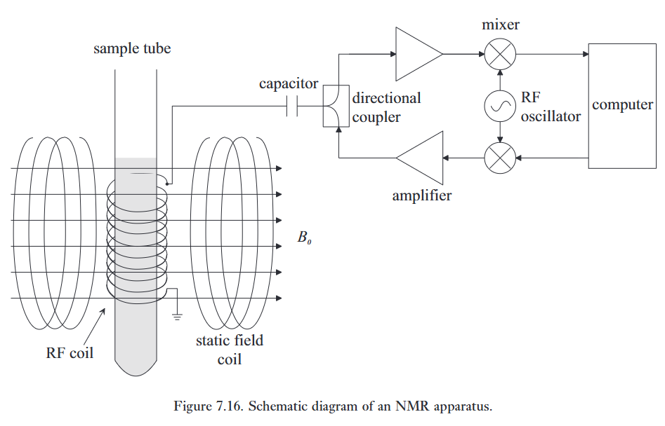
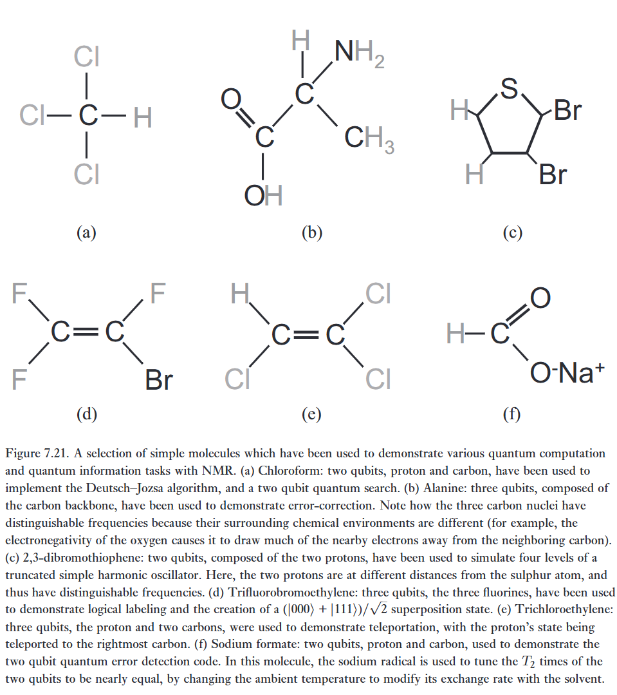

Các hệ spin hạt nhân sẽ gần như lý tưởng cho tính toán lượng tử nếu như các ghép nối (tương tác) spin–spin có thể đủ lớn và điều khiển được; đây là một quan sát quan trọng rút ra từ nghiên cứu của chúng ta về bẫy ion ở mục trước. Hạn chế chính của máy tính lượng tử bẫy ion là sự yếu ớt của kỹ thuật ghép nối spin–spin qua trung gian phonon và tính dễ bị tổn thương của nó trước sự mất kết hợp (decoherence). Một cách để né tránh hạn chế này là bẫy các phân tử thay vì các nguyên tử đơn lẻ — các tương tác lưỡng cực từ và tương tác tiếp xúc Fermi qua trung gian electron giữa các hạt nhân lân cận sẽ cung cấp những ghép nối tự nhiên mạnh mẽ. Tuy nhiên, do có quá nhiều mode dao động, các phân tử đơn lẻ rất khó để bẫy và làm lạnh, và do đó việc điều khiển cũng như phát hiện bằng quang học đối với các spin hạt nhân trong các phân tử bị bẫy là không khả thi ngoại trừ trong những trường hợp đặc biệt.   

Mặt khác, việc điều khiển và phát hiện trực tiếp các trạng thái spin hạt nhân bằng sóng điện từ tần số vô tuyến (RF) là một lĩnh vực đã phát triển rất hoàn thiện, được biết đến với tên gọi cộng hưởng từ hạt nhân (NMR). Các kỹ thuật này được sử dụng rộng rãi trong hóa học, chẳng hạn để đo tính chất của chất lỏng, chất rắn và chất khí, để xác định cấu trúc phân tử, và để chụp ảnh vật liệu cũng như cả các hệ thống sinh học. Rất nhiều ứng dụng này đã thúc đẩy công nghệ NMR trở nên cực kỳ tinh vi, cho phép điều khiển và quan sát từ hàng chục đến hàng trăm và hàng nghìn hạt nhân trong một thí nghiệm.   

Tuy nhiên, có hai vấn đề nảy sinh khi sử dụng NMR cho tính toán lượng tử. Thứ nhất, vì mômen từ hạt nhân quá nhỏ, cần phải có một số lượng lớn (nhiều hơn $\approx 10^8$) phân tử hiện diện để tạo ra một tín hiệu cảm ứng có thể đo được. Về mặt ý niệm, một phân tử đơn lẻ có thể là một máy tính lượng tử tuyệt vời, nhưng làm sao điều này có thể đúng đối với một tập hợp (ensemble) gồm vô số phân tử? Cụ thể, đầu ra của một phép đo NMR là giá trị trung bình trên tất cả các tín hiệu của phân tử; liệu đầu ra trung bình của một tập hợp các máy tính lượng tử có mang ý nghĩa gì không? Thứ hai, NMR thường được áp dụng cho các hệ vật lý ở trạng thái cân bằng tại nhiệt độ phòng, nơi năng lượng spin $\hbar\omega$ nhỏ hơn rất nhiều so với năng lượng nhiệt $k_{\text{B}}T$. Điều này có nghĩa là trạng thái ban đầu của các spin gần như hoàn toàn ngẫu nhiên. Tính toán lượng tử truyền thống đòi hỏi hệ thống phải được chuẩn bị ở một trạng thái thuần (pure state); làm thế nào có thể thực hiện tính toán lượng tử với một hệ thống đang ở trong một trạng thái hỗn hợp có entropy cao (high entropy mixed state)?   

Các giải pháp cho hai vấn đề này đã biến NMR trở thành một phương pháp đặc biệt hấp dẫn và giàu tính khai sáng để triển khai tính toán lượng tử, bất chấp những hạn chế khắt khe bắt nguồn từ bản chất nhiệt của các hệ thống thông thường. Có thể rút ra rất nhiều bài học từ NMR: chẳng hạn như các kỹ thuật điều khiển các Hamiltonian thực tế để thực hiện các phép biến đổi đơn nguyên tùy ý, các phương pháp mô tả đặc tính và né tránh sự mất kết hợp (cũng như các sai số hệ thống), và những cân nhắc nảy sinh khi lắp ráp các thành phần để triển khai các thuật toán lượng tử hoàn chỉnh trên toàn bộ hệ thống. Chúng ta bắt đầu với phần mô tả thiết bị vật lý và Hamiltonian chính có liên quan, sau đó thảo luận về cách thức xử lý thông tin lượng tử bằng NMR trở nên khả thi bất chấp trạng thái đầu vào nhiệt và bài toán tập hợp (ensemble), và kết thúc bằng một số thí nghiệm đã được thực hiện nhằm trình diễn các thuật toán lượng tử, cùng với những nhược điểm của phương pháp này.

# 1. Physical apparatus

Hãy bắt đầu với phần mô tả tổng quan về thiết bị, mà cơ chế hoạt động của nó sẽ được mô hình hóa chi tiết bằng toán học sau này. Hai bộ phận chính của một hệ thống NMR xung (pulsed NMR) dành cho các mẫu chất lỏng, vốn là đối tượng chúng ta sẽ tập trung ở đây, là mẫu thử (sample) và phổ kế NMR (NMR spectrometer). Một phân tử điển hình có thể được sử dụng sẽ chứa một số lượng $n$ các proton có spin $1/2$ (các hạt nhân khả dĩ khác bao gồm $^{13}\text{C}$, $^{19}\text{F}$, $^{15}\text{N}$, và $^{31}\text{P}$), và tạo ra một tín hiệu NMR ở tần số khoảng $500\text{ MHz}$ khi được đặt trong một từ trường khoảng $11.7\text{ tesla}$. Tần số của các hạt nhân khác nhau bên trong một phân tử có thể chênh lệch nhau từ vài $\text{kHz}$ đến hàng trăm $\text{kHz}$ do sự khác biệt của các từ trường cục bộ gây ra bởi hiệu ứng che chắn của môi trường hóa học (chemical environment shielding effects). Các phân tử này thường được hòa tan trong một dung môi, giúp giảm nồng độ xuống mức mà các tương tác giữa các phân tử trở nên không đáng kể, để lại một hệ thống có thể được mô tả rất tốt như một tập hợp (ensemble) gồm các "máy tính" lượng tử $n$ qubit.   

Bản thân chiếc phổ kế được chế tạo từ các mạch điện tử tần số vô tuyến (RF) và một nam châm siêu dẫn lớn, bên trong lòng của nó đặt ống thủy tinh chứa mẫu thử, như minh họa trong Hình 7.16. Tại đó, từ trường tĩnh $B_0$ hướng theo trục $\hat{z}$ được tinh chỉnh cẩn thận để đồng nhất trên một thể tích xấp xỉ $1\text{ cm}^3$ với độ chính xác tốt hơn một phần tỷ ($1$ part in $10^9$). Các cuộn dây hình yên ngựa (saddle coils) hoặc cuộn dây Helmholtz trực giao nằm trong mặt phẳng ngang cho phép áp đặt các từ trường dao động nhỏ dọc theo các phương $\hat{x}$ và $\hat{y}$. Các trường này có thể được bật và tắt dưới dạng xung cực nhanh để điều khiển các trạng thái spin hạt nhân. Chính các cuộn dây này cũng là một phần của các mạch cộng hưởng được dùng để thu nhận tín hiệu RF sinh ra bởi các hạt nhân đang tiến động (rất giống với cách một thanh nam châm đang quay tạo ra dòng điện cảm ứng xoay chiều trong một cuộn dây đặt gần đó).   

Một thí nghiệm điển hình bắt đầu bằng một khoảng thời gian chờ đợi dài để các hạt nhân nhiệt hóa về trạng thái cân bằng; quá trình này có thể mất vài phút đối với các mẫu chất lỏng được chuẩn bị kỹ. Dưới sự điều khiển của một máy tính (cổ điển), các xung RF sau đó được phát ra để thực hiện phép biến đổi mong muốn lên trạng thái của các hạt nhân. Các bộ khuếch đại xung công suất cao sau đó được ngắt đi thật nhanh và một bộ tiền khuếch đại độ nhạy cao được kích hoạt, nhằm đo lường trạng thái cuối cùng của các spin. Đầu ra này, được gọi là tín hiệu suy giảm cảm ứng tự do (free induction decay - FID), được biến đổi Fourier để thu được một phổ tần số với các đỉnh phổ (peaks) có diện tích là hàm số của các trạng thái spin (Hình 7.17).   

Có nhiều vấn đề thực tế quan trọng dẫn đến những sai lệch có thể quan sát được. Chẳng hạn, sự không đồng nhất trong không gian của từ trường tĩnh khiến các hạt nhân ở các vùng khác nhau của từ trường tiến động ở những tần số khác nhau. Điều này làm mở rộng các vạch phổ. Một vấn đề thậm chí còn thách thức hơn là tính đồng nhất của trường RF, vốn được tạo ra bởi một cuộn dây bắt buộc phải đặt vuông góc với nam châm $B_0$; sự ràng buộc về mặt hình học này cùng với yêu cầu phải duy trì đồng thời độ đồng nhất cao của $B_0$ thường buộc trường RF phải kém đồng nhất và được tạo ra bởi một cuộn dây nhỏ, dẫn đến việc điều khiển hệ hạt nhân không hoàn hảo. Ngoài ra, thời điểm phát xung, cùng với độ ổn định của công suất, pha và tần số cũng là những vấn đề quan trọng; tuy nhiên, không giống như bẫy ion, nhờ hoạt động ở các tần số thấp hơn, việc kiểm soát tốt các thông số này dễ dàng hơn nhiều. Chúng ta sẽ quay lại bàn về các sai lệch này trong Mục 7.7.4, sau khi đã hiểu rõ mô tả toán học cơ bản của hệ thống và phương pháp luận để thực hiện xử lý thông tin lượng tử bằng NMR. 

# 2. Hamiltonian

Lý thuyết cơ bản của NMR có thể được hiểu thông qua một mô hình lý tưởng gồm một và hai spin, vốn sẽ được mô tả tại đây. Bước đầu tiên là mô tả cách bức xạ điện từ tương tác với một spin từ tính đơn lẻ. Sau đó, chúng ta xem xét bản chất vật lý của các tương tác ghép nối giữa các spin nảy sinh trong các phân tử. Những công cụ này cho phép chúng ta mô hình hóa quá trình đọc kết quả (readout) của độ từ hóa sinh ra từ việc biến đổi một trạng thái ban đầu vốn đang ở trạng thái cân bằng nhiệt. Cuối cùng, chúng ta mô tả một mô hình hiện tượng luận về sự mất kết hợp (decoherence), và cách các tham số $T_1$ và $T_2$ của nó có thể được xác định bằng thực nghiệm.

## Single spin dynamics

Tương tác từ tính của một trường điện từ cổ điển với một spin hai trạng thái được mô tả bởi Hamiltonian $H = -\vec{\mu}\cdot\vec{B}$, trong đó $\vec{\mu}$ là mômen từ của spin, và $\vec{B} = B_0\hat{z} + B_1(\hat{x}\cos\omega t + \hat{y}\sin\omega t)$ là một từ trường áp đặt điển hình. $B_0$ là từ trường tĩnh và rất lớn, còn $B_1$ thường biến thiên theo thời gian và có cường độ nhỏ hơn $B_0$ nhiều bậc độ lớn, do đó lý thuyết nhiễu loạn (perturbation theory) thường được sử dụng theo truyền thống để nghiên cứu hệ này. Tuy nhiên, phương trình Schrödinger cho hệ này có thể được giải một cách trực tiếp mà không cần lý thuyết nhiễu loạn, bằng cách sử dụng các kỹ thuật ma trận Pauli ở Chương 2, theo đó Hamiltonian có thể được viết thành:   

$$
H = \frac{\omega_0}{2} Z + g(X\cos\omega t + Y\sin\omega t) \tag{7.127}
$$

trong đó $g$ liên hệ với cường độ của trường $B_1$, còn $\omega_0$ liên hệ với $B_0$, và $X, Y, Z$ là các ma trận Pauli như thường lệ. Định nghĩa $\vert{}\varphi(t)\rangle = e^{i\omega t Z/2}\vert{}\chi(t)\rangle$, sao cho phương trình Schrödinger:   

$$
i\partial_t \vert{}\chi(t)\rangle = H\vert{}\chi(t)\rangle \tag{7.128}
$$

có thể được viết lại thành:   

$$
i\partial_t \vert{}\varphi(t)\rangle = \left[ e^{i\omega Z t/2} H e^{-i\omega Z t/2} - \frac{\omega}{2} Z \right] \vert{}\varphi(t)\rangle \tag{7.129}
$$

Vì:   

$$
e^{i\omega Z t/2} X e^{-i\omega Z t/2} = (X\cos\omega t - Y\sin\omega t) \tag{7.130}
$$

nên (7.129) được đơn giản hóa trở thành:   

$$
i\partial_t \vert{}\varphi(t)\rangle = \left[ \frac{\omega_0 - \omega}{2} Z + gX \right] \vert{}\varphi(t)\rangle \tag{7.131}
$$

trong đó các số hạng ở vế phải nhân với trạng thái có thể được nhận diện là Hamiltonian hiệu dụng trong "hệ quy chiếu quay" (rotating frame). Nghiệm của phương trình này là:   

$$
\vert{}\varphi(t)\rangle = e^{-i \left[ \frac{\omega_0 - \omega}{2} Z + gX \right] t} \vert{}\varphi(0)\rangle \tag{7.132}
$$

Khái niệm cộng hưởng (resonance) nảy sinh từ hành vi của nghiệm này, vốn có thể được hiểu thông qua (4.8) như một phép quay một qubit quanh trục:   

$$
\hat{n} = \frac{\hat{z} + \frac{2g}{\omega_0 - \omega}\hat{x}}{\sqrt{1 + \left( \frac{2g}{\omega_0 - \omega} \right)^2}} \tag{7.133}
$$

một góc bằng:   

$$
\vert{}\vec{n}\vert{} = t \sqrt{\left( \frac{\omega_0 - \omega}{2} \right)^2 + g^2} \tag{7.134}
$$

Khi $\omega$ ở xa $\omega_0$, spin hầu như không bị ảnh hưởng bởi trường $B_1$; trục quay của nó gần như song song với $\hat{z}$, và sự tiến hóa theo thời gian của nó gần như y hệt với Hamiltonian tự do của $B_0$. Mặt khác, khi $\omega_0 \approx \omega$, phần đóng góp của $B_0$ trở nên không đáng kể, và một trường $B_1$ nhỏ cũng có thể gây ra những thay đổi lớn cho trạng thái, tương ứng với các phép quay quanh trục $\hat{x}$. Hiệu ứng khổng lồ mà một nhiễu loạn nhỏ có thể tạo ra lên hệ spin, khi được điều chỉnh đúng tần số thích hợp, chính là nguyên nhân tạo nên hiện tượng "cộng hưởng" trong cộng hưởng từ hạt nhân. Tất nhiên, chính hiệu ứng này cũng là cốt lõi cho tính chọn lọc của các nguyên tử hai mức đối với các trường laser được điều chỉnh tần số chuyên biệt vốn đã được sử dụng (nhưng chưa được giải thích) ở Mục 7.5.1.   

Một cách tổng quát, khi $\omega = \omega_0$, Hamiltonian trong hệ quy chiếu quay của một spin đơn lẻ có thể được viết là:   

$$
H = g_1(t) X + g_2(t) Y \tag{7.135}
$$

trong đó $g_1$ và $g_2$ là các hàm số của các trường RF ngang được áp đặt.   

:::{.callout-note collapse="true"}
# Bài tập 7.33: (Cộng hưởng từ) 
Hãy chứng minh rằng (7.128) được đơn giản hóa thành (7.129). Hamiltonian trong hệ quy chiếu phòng thí nghiệm (laboratory frame) nào sẽ sinh ra Hamiltonian trong hệ quy chiếu quay (7.135)? 

:::

:::{.callout-note collapse="true"}
# Bài tập 7.34: (Các tần số NMR) 
Bắt đầu từ magneton Bohr hạt nhân, hãy tính tần số tiến động của một proton trong từ trường $11.8\text{ tesla}$. Trường $B_1$ cần mạnh bao nhiêu gauss để thực hiện một phép quay $90^\circ$ trong $10\text{ micro-giây}$?

:::

## Spin-spin couplings

Thường có nhiều hơn một spin hiện diện trong các hệ thống được quan tâm; $^1\text{H}$, $^{13}\text{C}$, $^{19}\text{F}$, và $^{15}\text{N}$ đều có spin hạt nhân bằng $1/2$. Các spin này tương tác thông qua hai cơ chế chiếm ưu thế: ghép nối lưỡng cực trực tiếp (direct dipolar coupling), và tương tác gián tiếp thông qua electron liên kết hóa học. Ghép nối lưỡng cực xuyên không gian (through-space) được mô tả bởi một Hamiltonian tương tác có dạng:   

$$
H_{1,2}^{\text{D}} = \frac{\gamma_1 \gamma_2 \hbar}{4 r^3} \left[ \vec{\sigma}_1 \cdot \vec{\sigma}_2 - 3(\vec{\sigma}_1 \cdot \hat{n})(\vec{\sigma}_2 \cdot \hat{n}) \right] \tag{7.136}
$$

trong đó $\hat{n}$ là vectơ đơn vị theo phương nối hai hạt nhân, và $\vec{\sigma}$ là vectơ mômen từ (nhân thêm hai). Trong một chất lỏng có độ nhớt thấp, các tương tác lưỡng cực nhanh chóng bị lấy trung bình làm triệt tiêu mất; về mặt toán học, điều này được tính toán bằng cách chứng minh rằng giá trị trung bình mặt cầu của $H_{1,2}^{\text{D}}$ trên mọi hướng $\hat{n}$ tiến về không khi quá trình lấy trung bình diễn ra nhanh so với thang năng lượng ghép nối lưỡng cực.   

Các tương tác xuyên liên kết (through-bond), còn được gọi đơn giản là ghép nối $J$ ($J$-coupling), là các tương tác gián tiếp được trung gian bởi các electron dùng chung thông qua một liên kết hóa học; từ trường mà một hạt nhân cảm nhận bị nhiễu loạn bởi trạng thái của đám mây electron quanh nó, vốn lại tương tác với một hạt nhân khác thông qua sự chồng lấp hàm sóng electron với hạt nhân (một tương tác tiếp xúc Fermi). Sự ghép nối này có dạng:   

$$
H_{1,2}^J = \frac{\hbar J}{4} \vec{\sigma}_1 \cdot \vec{\sigma}_2 = \frac{\hbar J}{4} Z_1 Z_2 + \frac{\hbar J}{8} \left[ \sigma_+ \sigma_- + \sigma_- \sigma_+ \right] \tag{7.137}
$$

Chúng ta sẽ quan tâm đến trường hợp $J$ là một đại lượng vô hướng (nhìn chung nó có thể là một tenxơ), vốn là một xấp xỉ tuyệt vời trong chất lỏng và khi các ghép nối yếu, hoặc khi các loại hạt nhân tương tác có tần số tiến động khác nhau rất lớn. Trường hợp này được mô tả bởi:   

$$
H_{12}^J \approx \frac{\hbar}{4} J Z_1 Z_2 \tag{7.138}
$$

:::{.callout-note collapse="true"}
# Bài tập 7.35: (Sự làm hẹp do chuyển động - Motional narrowing) 
Hãy chứng minh rằng giá trị trung bình mặt cầu của $H_{1,2}^{\text{D}}$ trên mọi hướng $\hat{n}$ bằng không.

:::

## Thermal equilibrium

NMR khác biệt đáng kể so với các hệ thống vật lý khác mà chúng ta đã nghiên cứu trước đó trong chương này ở chỗ nó sử dụng một tập hợp (ensemble) các hệ thống, và phép đo chính là phép đo trung bình trên tập hợp. Hơn nữa, không có quy trình phức tạp nào được áp dụng để chuẩn bị trạng thái ban đầu ở một trạng thái đặc biệt chẳng hạn như trạng thái cơ bản; trên thực tế, việc làm như vậy là đầy thách thức với công nghệ hiện tại.   

Thay vào đó, trạng thái ban đầu là trạng thái cân bằng nhiệt:   

$$
\rho = \frac{e^{-\beta H}}{\mathcal{Z}} \tag{7.139}
$$

trong đó $\beta = 1/k_{\text{B}}T$, và $\mathcal{Z} = \text{tr}\,e^{-\beta H}$ là hàm phân hoạch chuẩn hóa thông thường, đảm bảo rằng $\text{tr}(\rho) = 1$. Vì $\beta \approx 10^{-4}$ ở các từ trường vừa phải đối với các hạt nhân điển hình tại nhiệt độ phòng, phép xấp xỉ nhiệt độ cao:   

$$
\rho \approx 2^{-n} \left[ 1 - \beta H \right] \tag{7.140}
$$

là phù hợp, đối với một hệ gồm $n$ spin.   

Vì các ghép nối spin–spin là rất nhỏ so với các tần số tiến động, ma trận mật độ của trạng thái nhiệt rất gần với dạng đường chéo trong cơ sở $Z$, và do đó nó có thể được diễn giải như một hỗn hợp thống kê của các trạng thái thuần $\vert{}00\dots 0\rangle, \vert{}00\dots 01\rangle, \dots, \vert{}11\dots 1\rangle$. Trạng thái vật lý thực sự của từng thành viên trong tập hợp là gì vẫn là một vấn đề gây tranh cãi, bởi vì tồn tại vô số cách phân rã (unravelings) khác nhau cho một ma trận mật độ cho trước. Về nguyên tắc, với NMR thì trạng thái vật lý thực sự có thể được đo lường nếu có thể tiếp cận được từng thành viên riêng lẻ của tập hợp (tức từng phân tử đơn lẻ), nhưng điều này rất khó khăn về mặt thực nghiệm.   

:::{.callout-note collapse="true"}
# Bài tập 7.36: (Trạng thái cân bằng nhiệt NMR) 
Với $n = 1$, hãy chứng minh rằng trạng thái cân bằng nhiệt là:   

$$
\rho \approx 1 - \frac{\hbar\omega}{2k_{\text{B}}T} \begin{bmatrix} 1 & 0 \\ 0 & -1 \end{bmatrix} \tag{7.141}
$$

và với $n = 2$ (và $\omega_A \approx 4\omega_B$),  

$$
\rho \approx 1 - \frac{\hbar\omega_B}{4k_{\text{B}}T} \begin{bmatrix} 5 & 0 & 0 & 0 \\ 0 & 3 & 0 & 0 \\ 0 & 0 & -3 & 0 \\ 0 & 0 & 0 & -5 \end{bmatrix} \tag{7.142}
$$

:::

## Magnetization readout

Đầu ra chính của một thí nghiệm là tín hiệu suy giảm cảm ứng tự do (free induction decay - FID), được biểu diễn về mặt toán học là:   $$V(t) = V_0 \text{tr} \left[ e^{-iHt} \rho e^{iHt} (iX_k + Y_k) \right] \tag{7.143}$$trong đó $X_k$ và $Y_k$ chỉ tác động lên spin thứ $k$, và $V_0$ là một hệ số hằng phụ thuộc vào cấu trúc hình học của cuộn dây, hệ số phẩm chất (quality factor), và từ thông cực đại từ thể tích mẫu thử. Tín hiệu này bắt nguồn từ các cuộn dây thu phát hiện độ từ hóa của mẫu thử trong mặt phẳng $\hat{x} - \hat{y}$. Trong hệ quy chiếu phòng thí nghiệm, tín hiệu này sẽ dao động ở tần số bằng với tần số tiến động $\omega_0$ của các hạt nhân; tuy nhiên, $V(t)$ thường được trộn hạ tần (mixed down) với một bộ dao động khóa ở tần số $\omega_0$, sau đó được biến đổi Fourier, sao cho tín hiệu cuối cùng xuất hiện như minh họa trong Hình 7.17.   

:::{.callout-note collapse="true"}
# Bài tập 7.37: (Phổ NMR của các spin ghép nối) 

Hãy tính $V(t)$ cho $H = J Z_1 Z_2$ và $\rho = e^{i\pi Y_1/4} \frac{1}{4}[1 - \beta\hbar\omega_0(Z_1 + Z_2)] e^{-i\pi Y_1/4}$. Sẽ có bao nhiêu vạch phổ trong phổ của spin thứ nhất nếu Hamiltonian là $H = J Z_1(Z_2 + Z_3 + Z_4)$ (với một ma trận mật độ ban đầu tương tự) và độ lớn tương đối của chúng sẽ là bao nhiêu?

:::

## Decoherence

Một đặc điểm nổi bật của tín hiệu suy giảm cảm ứng tự do (FID) mà phần mô tả của nó nằm ngoài các mô hình đơn giản đã trình bày cho đến nay đối với NMR là sự suy giảm theo hàm mũ của tín hiệu từ hóa. Một nguyên nhân của điều này là sự không đồng nhất trong từ trường tĩnh, dẫn đến việc các spin đang tiến động ở một phần của mẫu thử bị lệch pha so với các spin ở một phần khác.

Các hiệu ứng do sự không đồng nhất về nguyên tắc là có thể đảo ngược được, nhưng có những nguồn ngẫu nhiên hóa pha khác về bản chất là không thể đảo ngược, chẳng hạn như những nguồn bắt nguồn từ các ghép nối spin–spin. Một cơ chế không thể đảo ngược khác là sự nhiệt hóa (thermalization) của các spin về trạng thái cân bằng ở nhiệt độ của môi trường, một quá trình liên quan đến sự trao đổi năng lượng. Đối với trạng thái của một qubit đơn lẻ, các hiệu ứng này có thể được mô tả đặc tính theo lối hiện tượng luận bằng một mô hình biến đổi ma trận mật độ:   

$$
\begin{bmatrix} a & b \\ b^* & 1 - a \end{bmatrix} \rightarrow \begin{bmatrix} (a - a_0)e^{-t/T_1} + a_0 & b e^{-t/T_2} \\ b^* e^{-t/T_2} & (a_0 - a)e^{-t/T_1} + 1 - a_0 \end{bmatrix} \tag{7.144}
$$

trong đó $T_1$ và $T_2$ được biết đến lần lượt là các thời gian hồi phục spin–mạng (hay hồi phục "dọc") và spin–spin (hay hồi phục "ngang"), còn $a_0$ đặc trưng cho trạng thái cân bằng nhiệt. Chúng định nghĩa các thang thời gian quan trọng cho tuổi thọ của các trạng thái cổ điển không cân bằng và các trạng thái chồng chập lượng tử. Các công cụ lý thuyết để tính toán $T_1$ và $T_2$ trong các hệ NMR đã được phát triển hoàn thiện, và trên thực tế, các phép đo những tốc độ này đóng một vai trò quan trọng trong việc sử dụng NMR để phân biệt giữa các chất hóa học khác nhau.   

Các phương pháp thực nghiệm để đo $T_1$ và $T_2$ rất nổi tiếng trong NMR. Đặt $R_x = e^{-i\pi X/4}$ là một xung quay $90^\circ$ quanh trục $\hat{x}$. Để đo $T_1$, hãy áp dụng $R_x^2$, chờ một khoảng thời gian $\tau$, sau đó áp dụng $R_x$. Xung đầu tiên lật ngược spin đi $180^\circ$, sau đó nó hồi phục trong khoảng thời gian $\tau$ để quay trở lại trạng thái cân bằng (hãy hình dung điều này như vectơ Bloch thu ngắn lại hướng về đỉnh của mặt cầu Bloch, tức trạng thái cơ bản), rồi xung $90^\circ$ cuối cùng đưa độ từ hóa nằm vào mặt phẳng $\hat{x} - \hat{y}$, nơi nó được phát hiện. Độ từ hóa $M$ đo được từ thí nghiệm phục hồi đảo ngược (inversion–recovery) này được thấy là biến thiên theo hàm mũ theo $\tau$ dưới dạng $M = M_0 \left[ 1 - 2\exp(-\tau/T_1) \right]$. Để đo $T_2$, ở bậc gần đúng thứ nhất, người ta có thể chỉ cần đo bề rộng của một đỉnh phổ. Một cách tốt hơn, kỹ thuật Carr–Purcell–Meiboom–Gill (CPMG), là áp dụng một phép toán $R_x$, theo sau bởi $k$ lần lặp lại của chuỗi "chờ thời gian $\tau/2$, áp dụng $R_x^2$, chờ thời gian $\tau/2$, áp dụng $R_x^2$". Chuỗi các xung $180^\circ$ này "hội tụ lại" (refocuses) các tương tác ghép nối (Mục 7.7.3) và triệt tiêu một phần sự không đồng nhất của trường $B_0$, sao cho người ta có thể ước tính tốt hơn giá trị $T_2$ thực sự của hệ. Độ từ hóa quan sát được suy giảm theo dạng $M = M_0 e^{-k\tau/T_2}$.   

## Multiple spin Hamiltonian 

Tóm tắt lại cuộc thảo luận của chúng ta về Hamiltonian trong NMR, chúng ta có thể viết $H$ cho một hệ gồm $n$ spin ghép nối dưới dạng:   $$H = \sum_{k} \omega_k Z_k + \sum_{j,k} H_{j,k}^J + H^{\text{RF}} + \sum_{j,k} H_{j,k}^{\text{D}} + H^{\text{env}} \tag{7.145}$$trong đó số hạng đầu tiên là sự tiến động tự do của các spin trong từ trường nền (từ trường tĩnh xung quanh), $H^{\text{D}}$ là ghép nối lưỡng cực từ của (7.136), $H^J$ là ghép nối "$J$" của (7.137), $H^{\text{RF}}$ mô tả tác động của các từ trường tần số vô tuyến áp đặt từ bên ngoài của (7.135), và $H^{\text{env}}$ mô tả các tương tác với môi trường dẫn đến sự mất kết hợp (decoherence), như trong (7.144).   

Nhằm mục đích hiểu được những nguyên lý cơ bản về cách thức Hamiltonian này có thể được điều khiển, chúng ta sẽ thấy rằng chỉ cần xét Hamiltonian đã được đơn giản hóa sau đây là đủ:   

$$
H = \sum_{k} \omega_k Z_k + \sum_{j,k} Z_j \otimes Z_k + \sum_{k} \left[ g_k^x(t) X_k + g_k^y(t) Y_k \right] \tag{7.146}
$$

trong phần lớn các cuộc thảo luận tiếp theo. Việc xử lý phương trình tổng quát hơn (7.145) cũng tuân theo những ý tưởng tương tự.

# 3. Quantum computation

Xử lý thông tin lượng tử đòi hỏi phải thực hiện các phép biến đổi đơn nguyên (unitary transforms) lên một hệ thống đã được chuẩn bị ở một trạng thái ban đầu phù hợp. Có ba câu hỏi đặt ra cho hệ thống hiện tại: Thứ nhất, làm thế nào để triển khai các phép biến đổi đơn nguyên tùy ý trong một hệ gồm $n$ spin ghép nối được mô tả bởi Hamiltonian của (7.146)? Thứ hai, làm thế nào trạng thái nhiệt (7.140) của một hệ NMR có thể được sử dụng làm trạng thái ban đầu phù hợp cho việc tính toán? Thứ ba, các thuật toán lượng tử mà chúng ta đã nghiên cứu trong ba chương vừa qua đòi hỏi các phép đo xạ ảnh (projective measurements) để thu được kết quả đầu ra, trong khi với NMR, chúng ta chỉ có thể dễ dàng thực hiện các phép đo trung bình trên tập hợp (ensemble average measurements). Làm thế nào chúng ta có thể giải quyết bài toán đọc kết quả trên tập hợp này? Chúng ta sẽ trả lời những câu hỏi này trong mục này.   

## Refocusing

Có lẽ một trong những kỹ thuật thú vị nhất sẵn có cho chúng ta khi thực hiện các phép biến đổi đơn nguyên tùy ý bằng cách sử dụng các Hamiltonian có dạng như (7.146) là tái hội tụ (refocusing), theo cách gọi trong nghệ thuật NMR. Hãy xét Hamiltonian hai spin đơn giản $H = H^{\text{sys}} + H^{\text{RF}}$ trong đó:   

$$
H^{\text{sys}} = a Z_1 + b Z_2 + c Z_1 Z_2 \tag{7.147}
$$

Như đã chỉ ra ở Mục 7.7.2, khi một trường RF mạnh được áp đặt ở tần số thích hợp, với một phép xấp xỉ tốt, chúng ta có thể coi gần đúng:   

$$
e^{-iHt/\hbar} \approx e^{-i H^{\text{RF}} t/\hbar} \tag{7.148}
$$

Điều này cho phép các phép toán một qubit tùy ý được thực hiện với độ trung thực (fidelity) tuyệt vời. Hãy định nghĩa:   

$$
R_{x1} = e^{-i\pi X_1/4} \tag{7.149}
$$

là một phép quay $90^\circ$ quanh trục $\hat{x}$ tác động lên spin 1, và tương tự cho spin 2. Phép quay $180^\circ$ $R_{x1}^2$ có tính chất đặc biệt là:   

$$
R_{x1}^2 e^{-iaZ_1 t} R_{x1}^2 = e^{iaZ_1 t} \tag{7.150}
$$

như có thể dễ dàng kiểm chứng. Kỹ thuật này được gọi là tái hội tụ (refocusing), bởi vì cách thức nó đảo ngược sự tiến hóa theo thời gian sao cho các spin có tần số khác nhau cùng xuất phát tại một điểm trên mặt cầu Bloch sẽ quay trở lại đúng cùng một điểm đó trên mặt cầu Bloch. Các xung $180^\circ$ được áp đặt theo cách này được gọi là các xung tái hội tụ (refocusing pulses). Lưu ý rằng trong biểu thức trên, $a$ có thể là một toán tử cũng như là một hằng số (miễn là nó không chứa các toán tử tác động lên spin 1), và do đó:   

$$
e^{-i H^{\text{sys}} t/\hbar} R_{x1}^2 e^{-i H^{\text{sys}} t/\hbar} R_{x1}^2 = e^{-2ib Z_2 t/\hbar} \tag{7.151}
$$

Việc sử dụng một bộ xung tái hội tụ khác tác động lên spin 2 sẽ loại bỏ luôn cả số hạng còn lại này. Do đó, tái hội tụ là một kỹ thuật hữu ích để loại bỏ sự tiến hóa ghép nối giữa các spin, và để loại bỏ hoàn toàn mọi sự tiến hóa tự nhiên.   

:::{.callout-note collapse="true"}
# Bài tập 7.38: (Tái hội tụ) 
Hãy chứng minh một cách tường minh rằng (7.150) là đúng (sử dụng tính phản giao hoán của các ma trận Pauli).   

:::

:::{.callout-note collapse="true"}
# Bài tập 7.39: (Tái hội tụ ba chiều) 
Bộ xung nào có thể được dùng để tái hội tụ sự tiến hóa dưới bất kỳ Hamiltonian một spin nào có dạng $H^{\text{sys}} = \sum_k c_k \sigma_k$?   

:::

:::{.callout-note collapse="true"}
# Bài tập 7.40: (Tái hội tụ tương tác lưỡng cực) 
Hãy đưa ra một chuỗi xung có thể dùng để biến ghép nối lưỡng cực hai spin $H_{1,2}^{\text{D}}$ thành dạng đơn giản hơn nhiều của (7.138).

:::

## Controlled-NOT

Việc hiện thực hóa một cổng controlled-NOT trở nên đơn giản khi sử dụng các xung tái hội tụ (refocusing pulses) và các xung một qubit. Hãy cùng chỉ ra cách thực hiện điều này cho một hệ hai spin với Hamiltonian của (7.147). Từ cấu trúc của (7.46), chúng ta biết rằng chỉ cần có khả năng hiện thực hóa phép biến đổi đơn nguyên:   

$$
U_{CZ} = \begin{bmatrix} 1 & 0 & 0 & 0 \\ 0 & 1 & 0 & 0 \\ 0 & 0 & 1 & 0 \\ 0 & 0 & 0 & -1 \end{bmatrix} \tag{7.152}
$$

là đã đủ. Vì $\sqrt{i} \, e^{i Z_1 Z_2 \pi/4} e^{-i Z_1 \pi/4} e^{-i Z_2 \pi/4} = U_{CZ}$, nên việc tạo ra một cổng controlled-NOT từ một khoảng thời gian tiến hóa tự nhiên bằng $\hbar\pi / 4c$ kết hợp với một vài xung một qubit là hoàn toàn trực tiếp.   

:::{.callout-note collapse="true"}
# Bài tập 7.41: (Cổng controlled-NOT trong NMR) 
Hãy đưa ra một chuỗi tường minh các phép quay một qubit giúp hiện thực hóa một cổng controlled-NOT giữa hai spin đang tiến hóa dưới tác dụng của Hamiltonian (7.147). Bạn có thể bắt đầu từ (7.46), nhưng kết quả có thể được rút gọn để giảm bớt số lượng các phép quay một qubit.   

:::

## Temporal, spatial, and logical labeling

Khả năng hiện thực hóa các phép biến đổi đơn nguyên tùy ý trên một hệ spin với độ trung thực cao bằng cách sử dụng các xung RF là một trong những khía cạnh hấp dẫn nhất của NMR đối với tính toán lượng tử. Tuy nhiên, nhược điểm lớn nằm ở thực tế rằng trạng thái ban đầu thường là trạng thái nhiệt của (7.140). Bất chấp entropy cao của trạng thái này, tính toán lượng tử vẫn có thể được thực hiện được, dù phải trả một cái giá nhất định. Hai kỹ thuật để đạt được điều này được gọi là gán nhãn theo thời gian (temporal labeling) và gán nhãn logic (logical labeling).   Gán nhãn theo thời gian, đôi khi còn gọi là lấy trung bình theo thời gian (temporal averaging), dựa trên hai sự thật quan trọng: các phép toán lượng tử có tính tuyến tính, và các đại lượng quan sát được đo trong NMR đều có vết bằng không (traceless) (xem Mục 2.2.5 để biết kiến thức nền về phép đo lượng tử). Giả sử một hệ hai spin khởi đầu với ma trận mật độ:   

$$
\rho_1 = \begin{bmatrix} a & 0 & 0 & 0 \\ 0 & b & 0 & 0 \\ 0 & 0 & c & 0 \\ 0 & 0 & 0 & d \end{bmatrix} \tag{7.153}
$$

trong đó $a, b, c,$ và $d$ là các số dương tùy ý thỏa mãn $a + b + c + d = 1$. Chúng ta có thể sử dụng một mạch $P$ được xây dựng từ các cổng controlled-NOT để thu được một trạng thái với các mật độ chiếm giữ (populations) đã được hoán vị:   

$$
\rho_2 = P \rho_1 P^\dagger = \begin{bmatrix} a & 0 & 0 & 0 \\ 0 & c & 0 & 0 \\ 0 & 0 & d & 0 \\ 0 & 0 & 0 & b \end{bmatrix} \tag{7.154}
$$

và tương tự,   

$$
\rho_3 = P^\dagger \rho_1 P = \begin{bmatrix} a & 0 & 0 & 0 \\ 0 & d & 0 & 0 \\ 0 & 0 & b & 0 \\ 0 & 0 & 0 & c \end{bmatrix} \tag{7.155}
$$

Một phép tính lượng tử đơn nguyên $U$ được áp dụng lên từng trạng thái này, để thu được (trong ba thí nghiệm riêng biệt, có thể được thực hiện tại các thời điểm khác nhau) $C_k = U \rho_k U^\dagger$. Bằng tính chất tuyến tính,   

$$
\sum_{k=1,2,3} C_k = \sum_{k} U \rho_k U^\dagger \tag{7.156}
$$

$$
= U \left[ \sum_{k} \rho_k \right] U^\dagger \tag{7.157}
$$

$$
= (4a - 1) U \begin{bmatrix} 1 & 0 & 0 & 0 \\ 0 & 0 & 0 & 0 \\ 0 & 0 & 0 & 0 \\ 0 & 0 & 0 & 0 \end{bmatrix} U^\dagger + (1 - a) \begin{bmatrix} 1 & 0 & 0 & 0 \\ 0 & 1 & 0 & 0 \\ 0 & 0 & 1 & 0 \\ 0 & 0 & 0 & 1 \end{bmatrix} \tag{7.158}
$$

Trong NMR, các đại lượng quan sát $M$ (chẳng hạn như Pauli $X$ và $Y$) có $\text{tr}(M) = 0$ là những đại lượng duy nhất từng được đo lường; do đó,   

$$
\text{tr} \left( \sum_{k} C_k M \right) = \sum_{k} \text{tr}(C_k M) \tag{7.159}
$$

$$
= (4a - 1) \text{tr} \left( U \begin{bmatrix} 1 & 0 & 0 & 0 \\ 0 & 0 & 0 & 0 \\ 0 & 0 & 0 & 0 \\ 0 & 0 & 0 & 0 \end{bmatrix} U^\dagger M \right) \tag{7.160}
$$

$$
= (4a - 1) \text{tr} \left( U \vert{}00\rangle\langle 00\vert{} U^\dagger M \right) \tag{7.161}
$$

Chúng ta thấy rằng tổng của các tín hiệu đo được từ ba thí nghiệm mang lại cho chúng ta một kết quả tỷ lệ thuận với những gì chúng ta sẽ thu được nếu hệ thống ban đầu được chuẩn bị ở một trạng thái thuần $\vert{}00\rangle\langle 00\vert{}$ thay vì ở trạng thái tùy ý của (7.153). Điều này luôn khả thi để thực hiện đối với các hệ thống được chuẩn bị tùy ý có kích thước bất kỳ, miễn là có đủ số lượng thí nghiệm được cộng dồn lại, và thời gian kết hợp (coherence time) đủ dài để các phép toán đơn nguyên được thực hiện trước khi sự mất kết hợp xảy ra. Lưu ý rằng các thí nghiệm $C_k$ khác nhau trên thực tế cũng có thể được thực hiện đồng thời với ba hệ thống khác nhau, hoặc ở các phần khác nhau của một hệ thống đơn lẻ; điều này khả thi về mặt thực nghiệm bằng cách áp đặt các từ trường gradient biến thiên một cách có hệ thống trên một mẫu thử đơn lẻ, và biến thể đó của kỹ thuật này được gọi là gán nhãn không gian (spatial labeling).   

Bài tập 7.42: (Các phép hoán vị cho gán nhãn theo thời gian) Hãy đưa ra một mạch lượng tử để thực hiện các phép hoán vị $P$ và $P^\dagger$ cần thiết nhằm biến đổi $\rho_1$ của (7.153) thành $\rho_2$ của (7.154).   Gán nhãn logic (logical labeling) dựa trên những quan sát tương tự, nhưng không đòi hỏi phải thực hiện nhiều thí nghiệm. Giả sử chúng ta có một hệ gồm ba spin gần như giống hệt nhau ở trạng thái:   

$$
\rho = \delta I + \alpha \begin{bmatrix} 6 & 0 & 0 & 0 & 0 & 0 & 0 & 0 \\ 0 & 2 & 0 & 0 & 0 & 0 & 0 & 0 \\ 0 & 0 & 2 & 0 & 0 & 0 & 0 & 0 \\ 0 & 0 & 0 & -2 & 0 & 0 & 0 & 0 \\ 0 & 0 & 0 & 0 & 2 & 0 & 0 & 0 \\ 0 & 0 & 0 & 0 & 0 & -2 & 0 & 0 \\ 0 & 0 & 0 & 0 & 0 & 0 & -2 & 0 \\ 0 & 0 & 0 & 0 & 0 & 0 & 0 & -6 \end{bmatrix} \tag{7.162}
$$

$$
\approx \left( \delta' I + \alpha' \begin{bmatrix} 2 & 0 \\ 0 & -2 \end{bmatrix} \right)^{\otimes 3} \tag{7.163}
$$

trong đó $\delta I$ chỉ một mật độ chiếm giữ nền vốn không thể quan sát được (vì các đại lượng đo lường có vết bằng không), và $\alpha \ll \delta$ là một hằng số nhỏ. Sau đó, chúng ta có thể áp dụng một phép toán đơn nguyên thực hiện một phép hoán vị $P$, tạo ra:   

$$
\rho' = P \rho P^\dagger = \delta I + \alpha \begin{bmatrix} 6 & 0 & 0 & 0 & 0 & 0 & 0 & 0 \\ 0 & -2 & 0 & 0 & 0 & 0 & 0 & 0 \\ 0 & 0 & -2 & 0 & 0 & 0 & 0 & 0 \\ 0 & 0 & 0 & -2 & 0 & 0 & 0 & 0 \\ 0 & 0 & 0 & 0 & -6 & 0 & 0 & 0 \\ 0 & 0 & 0 & 0 & 0 & 2 & 0 & 0 \\ 0 & 0 & 0 & 0 & 0 & 0 & 2 & 0 \\ 0 & 0 & 0 & 0 & 0 & 0 & 0 & 2 \end{bmatrix} \tag{7.164}
$$

Lưu ý rằng khối $4 \times 4$ phía trên của ma trận này có dạng:   

$$
\begin{bmatrix} 6 & 0 & 0 & 0 \\ 0 & -2 & 0 & 0 \\ 0 & 0 & -2 & 0 \\ 0 & 0 & 0 & -2 \end{bmatrix} = 8\vert{}00\rangle\langle 00\vert{} - 2I \tag{7.165}
$$

trong đó $I$ ở đây biểu thị ma trận đơn vị $4 \times 4$. Cũng giống như đối với gán nhãn theo thời gian, chúng ta thấy rằng nếu một phép tính được thực hiện trên một trạng thái như vậy, trong trường hợp này là trên đa tạp (không gian con) $\vert{}000\rangle, \vert{}001\rangle, \vert{}010\rangle, \vert{}011\rangle$, thì nó sẽ tạo ra một kết quả tỷ lệ thuận với những gì chúng ta sẽ thu được nếu hệ thống ban đầu được chuẩn bị ở một trạng thái thuần $\vert{}00\rangle\langle 00\vert{}$! Về mặt thực nghiệm, hoàn toàn có thể thực hiện $\tilde{P}$, và cũng có thể cô lập tín hiệu chỉ từ riêng đa tạp các trạng thái này.   

Các trạng thái có dạng $\rho = 2^{-n}(1 - \epsilon)I + \epsilon U\vert{}00\dots 0\rangle\langle 00\dots 0\vert{}U^\dagger$ (trong đó $U$ là một toán tử đơn nguyên bất kỳ), được gọi là các "trạng thái thuần hiệu dụng" (effective pure states), hay các trạng thái "giả thuần" (pseudopure states). $n$ là số lượng qubit, nhưng chiều của không gian Hilbert nhìn chung không nhất thiết phải là một lũy thừa của hai. Có nhiều chiến lược để chuẩn bị các trạng thái như vậy, và nhìn chung tất cả chúng đều phải trả một cái giá nào đó. Chúng ta sẽ quay lại thảo luận về điều này sau, trong Mục 7.7.4. Các trạng thái thuần hiệu dụng giúp cho việc quan sát động lực học ở nhiệt độ không (zero temperature dynamics) từ một hệ thống vốn cân bằng ở trạng thái nhiệt độ cao trở nên khả thi, miễn là sự ghép nối của hệ thống với môi trường nhiệt độ cao của nó đủ nhỏ. Đây chính là cách thức nó được sử dụng trong tính toán lượng tử NMR.   

:::{.callout-note collapse="true"}
# Bài tập 7.43: (Các phép hoán vị cho gán nhãn logic) 
Hãy đưa ra một mạch lượng tử để thực hiện các phép hoán vị $P$ cần thiết nhằm biến đổi $\rho$ của (7.163) thành $\rho'$ của (7.165).   

:::

:::{.callout-note collapse="true"}
# Bài tập 7.44: (Gán nhãn logic cho $n$ spin) 
Giả sử chúng ta có một hệ gồm $n$ spin gần như giống hệt nhau có tần số Zeeman $\hbar\omega$ ở trạng thái cân bằng nhiệt tại nhiệt độ $T$ với trạng thái $\rho$. Trạng thái thuần hiệu dụng lớn nhất mà bạn có thể xây dựng từ $\rho$ bằng cách sử dụng gán nhãn logic là gì? (Gợi ý: hãy tận dụng các trạng thái mà nhãn của chúng có trọng số Hamming bằng $n/2$).   

:::

## Ensemble readout of quantum algorithm results

Chúng ta đã thấy cách các phép biến đổi đơn nguyên tùy ý có thể được thực hiện trên một hệ gồm $n$ spin với Hamiltonian của (7.146), và chúng ta cũng đã học cách chuẩn bị từ một trạng thái nhiệt ra một đầu vào được định nghĩa rõ ràng vốn hành xử như một trạng thái cơ bản có entropy thấp. Tuy nhiên, để hoàn tất các yêu cầu cho tính toán lượng tử, chúng ta phải có một cách để thực hiện các phép đo trên hệ thống nhằm đọc ra kết quả tính toán. Khó khăn nằm ở chỗ đầu ra của một thuật toán lượng tử điển hình là một con số ngẫu nhiên, mà phân bố xác suất của nó mới cung cấp thông tin cho phép giải quyết bài toán. Không may là, giá trị trung bình của biến ngẫu nhiên đó không nhất thiết mang lại bất kỳ thông tin hữu ích nào. Đây chính là đầu ra mà ta sẽ nhận được nếu thuật toán lượng tử được chạy mà không có sự điều chỉnh nào trên một máy tính lượng tử NMR, bởi vì nó được thực hiện với một tập hợp (ensemble) lớn các phân tử, chứ không phải với một phân tử $n$ spin đơn lẻ.   

Khó khăn này được minh họa bằng ví dụ sau. Thuật toán phân tích thừa số lượng tử (Shor) tạo ra đầu ra là một số hữu tỷ ngẫu nhiên $c/r$, trong đó $c$ là một số nguyên chưa biết, còn $r$ là kết quả mong muốn (cũng là một số nguyên). Thông thường, một phép đo xạ ảnh được dùng để thu được $c/r$, sau đó một thuật toán liên phân số cổ điển được thực hiện để tìm ra $c$ với xác suất cao (Mục 5.3.1). Đáp án sau đó được kiểm tra bằng cách thay kết quả vào bài toán gốc, và nếu thất bại thì toàn bộ thuật toán sẽ được lặp lại. Tuy nhiên, thật không may, nếu chỉ có giá trị trung bình trên tập hợp là khả dụng, vì $c$ phân bố gần như đều nên giá trị trung bình $\langle c/r \rangle$ không mang lại thông tin có ý nghĩa nào cả.   

Một giải pháp đơn giản cho vấn đề này, vốn hiệu quả đối với mọi thuật toán lượng tử dựa trên bài toán nhóm con ẩn (hidden subgroup problem - Chương 5), chỉ đơn giản là nối thêm bất kỳ bước hậu xử lý cổ điển cần thiết nào vào ngay trong phần tính toán lượng tử. Điều này luôn khả thi bởi vì tính toán lượng tử bao hàm cả tính toán cổ điển. Trong ví dụ đã nêu ở trên, chúng ta chỉ việc yêu cầu từng máy tính lượng tử riêng lẻ (từng phân tử) tự thực hiện thuật toán liên phân số. Kết quả sau đó được kiểm tra ngay trên từng máy tính lượng tử, rồi chỉ những máy tính nào vượt qua khâu kiểm chứng mới xuất ra đầu ra. Do đó, phép đo trung bình trên tập hợp cuối cùng sẽ cho ra đúng giá trị $\langle r \rangle$. 

# 4. Experiment

Một trong những khía cạnh thú vị nhất của phương pháp tiếp cận NMR là khả năng hiện thực hóa bằng thực nghiệm một cách sẵn sàng các bài toán mẫu cỡ nhỏ của tính toán lượng tử và các tác vụ thông tin lượng tử. Trong mục kết thúc phần NMR này, chúng ta sẽ mô tả ngắn gọn ba thí nghiệm đã được thực hiện, minh họa cho phép chụp cắt lớp trạng thái (state tomography), các cổng logic sơ cấp, và thuật toán tìm kiếm lượng tử. Chúng ta cũng sẽ tóm tắt các nhược điểm của phương pháp này.

## State tomography

Làm thế nào để người ta gỡ lỗi (debug) một chiếc máy tính lượng tử? Một máy tính cổ điển được phân tích bằng cách đo lường trạng thái bên trong của nó tại các thời điểm khác nhau. Tương tự như vậy, đối với một máy tính lượng tử, một kỹ thuật thiết yếu là khả năng đo lường ma trận mật độ của nó — điều này được gọi là chụp cắt lớp trạng thái (state tomography).   

Hãy nhớ lại rằng ma trận mật độ của một qubit đơn lẻ có thể được biểu diễn dưới dạng:   

$$
\rho = \frac{1}{2} \left[ 1 + \sum_{k} r_k \sigma_k \right] \tag{7.166}
$$

trong đó $\sigma_k$ là các ma trận Pauli và $r_b$ [lỗi in: phải là $r_k$] là một vectơ thực ba thành phần. Nhờ vào tính chất trực giao theo vết của các ma trận Pauli,  

$$
\text{tr}(\sigma_k \sigma_j) = 2\delta_{kj} \tag{7.167}
$$

ta suy ra rằng $\rho$ có thể được tái tạo lại từ ba kết quả đo:   

$$
r_k = \langle \sigma_k \rangle = \text{tr}(\rho \sigma_k) \tag{7.168}
$$

Việc đo lường đại lượng quan sát thông thường trong NMR, (7.143), đi kèm trước đó bởi các xung một qubit thích hợp, cho phép chúng ta xác định $\langle \sigma_k \rangle$, và qua đó thu được $\rho$. Các kết quả tương tự cũng đúng đối với số lượng spin lớn hơn. Trong thực tế, việc chỉ đo phần sai lệch có vết bằng không của $\rho$ so với ma trận đơn vị sẽ thuận tiện hơn; đại lượng này được gọi là ma trận mật độ sai lệch (deviation density matrix). Các kết quả ví dụ cho hệ hai và ba spin được minh họa trong Hình 7.18.   

:::{.callout-note collapse="true"}
# Bài tập 7.45: (Chụp cắt lớp trạng thái với NMR) 
Giả sử phép đo điện áp $V_k(t) = V_0 \text{tr}\left[ e^{-iHt} M_k \rho M_k^\dagger e^{iHt} (iX_k + Y_k) \right]$ là kết quả của thí nghiệm thứ $k$. Hãy chứng minh rằng đối với hai spin, chín thí nghiệm với $M_0 = I$, $M_1 = R_{x1}$, $M_2 = R_{y1}$, $M_3 = R_{x2}$, $M_4 = R_{x2}R_{x1}$, $M_5 = R_{x2}R_{y1}$, v.v., sẽ cung cấp đầy đủ dữ liệu để từ đó tái tạo lại được $\rho$.   

:::

![Chú thích Hình 7.18: Các ma trận mật độ sai lệch được đo bằng thực nghiệm. Thang đo thẳng đứng là tùy ý, và chỉ có phần thực được hiển thị; các thành phần ảo đều tương đối nhỏ. (Trên cùng bên trái) Trạng thái cân bằng nhiệt hai qubit của proton và hạt nhân carbon trong các phân tử chloroform ($^{13}\text{CHCl}_3$) đặt trong từ trường $11.78\text{ tesla}$. Mẫu thử thể tích $0.5\text{ mililít}$, nồng độ $200\text{ milimol}$ được pha loãng trong acetone-$d_6$, khử khí, và hàn kín bằng lửa trong một ống thủy tinh thành mỏng đường kính $5\text{ mm}$. (Trên cùng bên phải) Trạng thái thuần hiệu dụng hai qubit được tạo ra bằng phương pháp gán nhãn theo thời gian với chloroform, như trong Phương trình (7.161). (Dưới cùng bên trái) Trạng thái cân bằng nhiệt ba qubit của ba hạt nhân flo trong phân tử trifluoroethylene. (Dưới cùng bên phải) Một trạng thái thuần hiệu dụng được tạo ra từ hệ ba spin bằng phương pháp gán nhãn logic, như trong Phương trình (7.164).](../../img/7.18.png)

## Quantum logic gates

Hệ hai qubit proton–carbon trong phân tử chloroform là một hệ thống tuyệt vời để trình diễn các cổng một qubit và hai qubit, vì nhiều lý do. Ở tần số $\approx 500$ và $\approx 125\text{ MHz}$ trong từ trường $\approx 11.8\text{ tesla}$, tần số của hai spin tách biệt rõ rệt và dễ dàng điều khiển riêng lẻ. Tần số ghép nối $J$ bằng $215\text{ Hz}$ giữa hai hạt nhân cũng rất thuận tiện; nó chậm hơn nhiều so với thang thời gian cần thiết cho các xung RF một qubit, nhưng lại nhanh hơn nhiều so với các thang thời gian hồi phục. Trong các thí nghiệm điển hình, thời gian $T_1$ của proton và carbon lần lượt là xấp xỉ $18$ và $25\text{ giây}$, trong khi $T_2$ là $7$ và $0.3\text{ giây}$. Thời gian $T_2$ của carbon ngắn là do các tương tác với ba hạt nhân clo có mômen tứ cực, nhưng việc lấy tích của thời gian sống $T_2$ ngắn nhất với độ ghép nối $J$ cho thấy rằng vẫn có thể thực hiện được khoảng $60$ cổng trước khi sự kết hợp lượng tử bị mất đi.   

Hamiltonian của hệ hai spin được xấp xỉ rất tốt bởi biểu thức trong (7.147), nhưng nó có thể được đơn giản hóa đáng kể bằng một mẹo thực nghiệm. Bằng cách điều chỉnh hai bộ dao động (oscillators) khớp chính xác với tần số quay của proton và carbon, chúng ta thu được, trong hệ quy chiếu quay được định nghĩa bởi các bộ dao động này, Hamiltonian rút gọn:   

$$
H = 2\pi\hbar J Z_1 Z_2 \tag{7.169}
$$

trong đó $J = 215\text{ Hz}$. Hamiltonian này làm cho việc hiện thực hóa cổng controlled-NOT trở nên khá đơn giản. Một mạch thực hiện phép biến đổi $\text{CNOT}$ tương đương sai khác các pha một qubit được minh họa trong Hình 7.19, cùng với một mạch để tạo ra trạng thái Bell, và các đầu ra được đo bằng thực nghiệm.   

![Chú thích Hình 7.19: Các mạch lượng tử được triển khai bằng NMR và phần thực của các ma trận mật độ sai lệch đầu ra đo được bằng thực nghiệm. Trong các mạch này, $R_x$ và $R_y$ biểu thị các cổng một qubit thực hiện các phép quay $90^\circ$ quanh trục $\hat{x}$ và $\hat{y}$, được triển khai bằng các xung RF dài khoảng $10\text{ micro-giây}$, và khối hai qubit với ký hiệu $e^{-iH/2\hbar J}$ là một khoảng thời gian tiến hóa tự do kéo dài $1/2J \approx 2.3\text{ mili-giây}$. (Phía trên) Mạch Controlled-NOT, và đầu ra đo được cho một đầu vào trạng thái nhiệt, cho thấy sự hoán đổi của các phần tử đường chéo $\vert{}10\rangle$ và $\vert{}11\rangle$, đúng như kỳ vọng từ bảng chân trị cổ điển của cổng $\text{CNOT}$. (Phía dưới) Mạch dùng để tạo ra trạng thái Bell $(\vert{}00\rangle - \vert{}11\rangle)/\sqrt{2}$, và đầu ra của nó, khi một trạng thái thuần hiệu dụng $\vert{}00\rangle$ được chuẩn bị làm đầu vào. ](../../img/7.19.png)

:::{.callout-note collapse="true"}
# Bài tập 7.47: (Cổng controlled-NOT trong NMR) 
Hãy kiểm chứng rằng mạch lượng tử được vẽ ở góc trên bên trái của Hình 7.19 thực hiện một cổng controlled-NOT, sai khác các pha một qubit; tức là nó tác động đúng lên các trạng thái đầu vào cổ điển, và hơn nữa có thể biến đổi thành một cổng controlled-NOT chuẩn xác bằng cách áp dụng thêm các phép quay một qubit $R_z$. Hãy đưa ra một mạch khác sử dụng cùng các khối xây dựng cơ bản này để hiện thực hóa một cổng $\text{CNOT}$ chuẩn xác.   

:::

:::{.callout-note collapse="true"}
# Bài tập 7.48: 
Hãy kiểm chứng rằng mạch lượng tử ở góc dưới bên trái của Hình 7.19 tạo ra trạng thái Bell $(\vert{}00\rangle - \vert{}11\rangle)/\sqrt{2}$ như đã tuyên bố.   

:::

:::{.callout-note collapse="true"}
# Bài tập 7.49: (Cổng hoán đổi NMR) 
Một ứng dụng hóa học quan trọng của NMR là đo lường tính kết nối (connectivity) của các spin, tức là xem các nguyên tử proton, carbon và phốt-pho nào là láng giềng gần nhất của nhau trong một phân tử. Một chuỗi xung dùng để làm việc này được gọi là INADEQUATE (incredible natural abundance double quantum transfer experiment – nghệ thuật NMR tràn ngập những từ viết tắt cực kỳ sáng tạo). Trong ngôn ngữ của tính toán lượng tử, nó có thể được hiểu đơn giản là việc cố gắng áp dụng một cổng $\text{CNOT}$ giữa hai cộng hưởng bất kỳ; nếu cổng $\text{CNOT}$ hoạt động, hai hạt nhân đó chắc chắn phải là láng giềng của nhau. Một khối xây dựng khác được dùng trong các chuỗi xung chẳng hạn như TOCSY (total correlation spectroscopy) là một phép toán hoán đổi (swap), nhưng chưa hoàn toàn ở dạng hoàn hảo để chúng ta có thể mô tả đơn giản bằng các cổng lượng tử! Hãy xây dựng một mạch lượng tử chỉ sử dụng các phép toán $e^{-iH/2\hbar J}$, $R_x$, và $R_y$ để triển khai một cổng swap (bạn có thể bắt đầu từ mạch trong Hình 1.7). 

:::

## Quantum algorithms

Thuật toán tìm kiếm lượng tử của Grover cung cấp một ví dụ đơn giản khác cho tính toán lượng tử NMR. Đối với một bài toán có kích thước bốn phần tử ($n = 2$ qubit), chúng ta được cho tập hợp $x = \{0, 1, 2, 3\}$ mà tại đó $f(x) = 0$ ngoại trừ tại một giá trị $x_0$, nơi $f(x_0) = 1$. Mục tiêu là tìm ra $x_0$, điều mà về mặt cổ điển có thể hoàn thành bằng cách tính giá trị hàm $f(x)$ trung bình $2.25$ lần. Để so sánh, thuật toán lượng tử tìm ra $x_0$ chỉ bằng cách tính $f(x)$ duy nhất một lần (Chương 6; xem đặc biệt Hộp 6.1).   

Cần có ba toán tử: toán tử tiên tri (oracle) $O$ (thực hiện một phép lật pha dựa trên hàm $f(x)$), toán tử Hadamard trên hai qubit $H^{\otimes 2}$, và toán tử dịch pha có điều khiển $P$. Toán tử tiên tri $O$ đảo dấu của phần tử cơ sở tương ứng với $x_0$; đối với $x_0 = 3$, toán tử này là:   

$$
O = \begin{bmatrix} 1 & 0 & 0 & 0 \\ 0 & 1 & 0 & 0 \\ 0 & 0 & 1 & 0 \\ 0 & 0 & 0 & -1 \end{bmatrix} \tag{7.170}
$$

Ký hiệu khoảng thời gian tiến hóa $t = 1/2J$ ($2.3\text{ mili-giây}$ đối với chloroform) $e^{-iH/2\hbar J}$ là $\tau$, chúng ta thấy rằng $O = R_{y1}\bar{R}_{x1}\bar{R}_{y1}R_{y2}\bar{R}_{x2}\bar{R}_{y2}\tau$ (sai khác một hệ số pha toàn cục không quan trọng) đối với trường hợp $x_0 = 3$. $H^{\otimes 2}$ chỉ đơn giản là hai phép toán Hadamard một qubit, $H_1 \otimes H_2$, trong đó $H_k = R_{xk}^2 \bar{R}_{yk}$. Và toán tử $P$,   

$$
P = \begin{bmatrix} 1 & 0 & 0 & 0 \\ 0 & -1 & 0 & 0 \\ 0 & 0 & -1 & 0 \\ 0 & 0 & 0 & -1 \end{bmatrix} \tag{7.171}
$$

được hiện thực hóa một cách đơn giản dưới dạng $P = R_{y1}R_{x1}\bar{R}_{y1}R_{y2}R_{x2}\bar{R}_{y2}\tau$. Từ những thành phần này, chúng ta xây dựng bước lặp Grover $G = H^{\otimes 2} P H^{\otimes 2} O$. Toán tử này có thể được đơn giản hóa một cách trực tiếp bằng cách loại bỏ các phép toán không cần thiết vốn tự triệt tiêu lẫn nhau một cách hiển nhiên (xem Bài tập 7.51). Đặt $\vert{}\psi_k\rangle = G^k \vert{}00\rangle$ là trạng thái sau $k$ lần áp dụng bước lặp Grover lên trạng thái ban đầu. Chúng ta thấy rằng biên độ $\langle x_0 \vert{} \psi_k \rangle \approx \sin((2k+1)\theta)$, trong đó $\theta = \arcsin(1/\sqrt{2})$; tính tuần hoàn này là một tính chất cơ bản của thuật toán tìm kiếm lượng tử, và là một đặc trưng tự nhiên để kiểm chứng trong thực nghiệm. Đối với trường hợp hai qubit và $x_0 = 3$, chúng ta kỳ vọng $\vert{}11\rangle = \vert{}\psi_1\rangle = -\vert{}\psi_4\rangle = \vert{}\psi_7\rangle = -\vert{}\psi_{10}\rangle$, một chu kỳ bằng $3$ nếu bỏ qua dấu tổng thể. 

:::{.callout-note collapse="true"}
# Bài tập 7.50: 
Hãy tìm các mạch lượng tử chỉ sử dụng các phép quay một qubit và $e^{-iH/2\hbar J}$ để hiện thực hóa toán tử tiên tri (oracle) $O$ cho các trường hợp $x_0 = 0, 1, 2$.

:::

:::{.callout-note collapse="true"}
# Bài tập 7.51: 
Hãy chứng minh rằng bước lặp Grover có thể được đơn giản hóa, bằng cách triệt tiêu các phép quay một qubit nằm kề nhau một cách thích hợp, để thu được:

$$
G = \begin{cases} \bar{R}_{x1}\bar{R}_{y1}\bar{R}_{x2}\bar{R}_{y2}\,\tau\,R_{x1}\bar{R}_{y1}R_{x2}\bar{R}_{y2}\,\tau & (x_0 = 3) \\ \bar{R}_{x1}\bar{R}_{y1}\bar{R}_{x2}\bar{R}_{y2}\,\tau\,R_{x1}\bar{R}_{y1}\bar{R}_{x2}\bar{R}_{y2}\,\tau & (x_0 = 2) \\ \bar{R}_{x1}\bar{R}_{y1}\bar{R}_{x2}\bar{R}_{y2}\,\tau\,\bar{R}_{x1}\bar{R}_{y1}R_{x2}\bar{R}_{y2}\,\tau & (x_0 = 1) \\ \bar{R}_{x1}\bar{R}_{y1}\bar{R}_{x2}\bar{R}_{y2}\,\tau\,\bar{R}_{x1}\bar{R}_{y1}\bar{R}_{x2}\bar{R}_{y2}\,\tau & (x_0 = 0) \end{cases} \tag{7.172}
$$

cho bốn trường hợp khả dĩ của $x_0$.Hình 7.20 minh họa các ma trận mật độ sai lệch lý thuyết và đo được $\rho_{\Delta n} = \vert{}\psi_n\rangle\langle\psi_n\vert{} - \text{tr}(\vert{}\psi_n\rangle\langle\psi_n\vert{})/4$ cho bảy bước lặp đầu tiên của $U$. Đúng như kỳ vọng, $\rho_{\Delta 1}$ cho thấy rõ ràng trạng thái $\vert{}11\rangle$ tương ứng với $x_0 = 3$. Các kết quả tương tự cũng thu được cho các thí nghiệm lặp lại với những giá trị khả dĩ khác của $x_0$. Việc đo đạc mỗi ma trận mật độ đòi hỏi $9 \times 3 = 27$ lần lặp thí nghiệm, gồm $9$ lần cho việc tái tạo chụp cắt lớp và $3$ lần cho việc chuẩn bị trạng thái thuần.Phép tính dài nhất, đối với $n = 7$, mất chưa tới $35\text{ mili-giây}$, nằm hoàn toàn trong giới hạn thời gian kết hợp (coherence time). Tính tuần hoàn của thuật toán Grover được nhìn thấy rõ rệt trong Hình 7.20, với sự ăn khớp tốt giữa lý thuyết và thực nghiệm. Tỷ số tín hiệu trên nhiễu (signal-to-noise) lớn (điển hình là tốt hơn $10^4$ trên $1$) đã thu được chỉ với các phép đo đơn lẻ (single-shot measurements). Các mô phỏng số chỉ ra rằng mức sai số $7\text{--}44\%$ chủ yếu là do sự không đồng nhất của từ trường, sự suy giảm độ từ hóa trong quá trình đo lường, và sự hiệu chuẩn chưa hoàn hảo của các phép quay (theo thứ tự mức độ quan trọng).

:::

## Drawback

Việc triển khai tính toán lượng tử bằng NMR tập hợp khối (bulk-ensemble) đã thành công trong việc trình diễn các thuật toán lượng tử và các tác vụ thông tin lượng tử với các hệ thống lên tới bảy qubit, điều này khá ấn tượng. Tuy nhiên, có những hạn chế quan trọng nảy sinh từ các kỹ thuật gán nhãn theo thời gian, không gian và logic vốn là cốt lõi của phương pháp này.   

Mục tiêu cốt lõi của các kỹ thuật gán nhãn này là cô lập tín hiệu từ tập hợp con các spin tình cờ nằm ở thành phần $\vert{}00\dots 0\rangle$ (hoặc bất kỳ trạng thái chuẩn, có xác suất cao nào khác) của trạng thái cân bằng nhiệt. Gán nhãn theo thời gian và không gian làm điều này bằng cách cộng dồn các tín hiệu để triệt tiêu tất cả ngoại trừ trạng thái mong muốn; gán nhãn logic đánh đổi không gian Hilbert để lấy độ thuần khiết. Tuy nhiên, bất kể sử dụng phương pháp nào, không có gì có thể làm tăng xác suất của thành phần $\vert{}00\dots 0\rangle$ trong trạng thái nhiệt:   

$$
p_{00\dots 0} = \frac{1}{\mathcal{Z}} \langle 00\dots 0 \vert{} e^{-\beta H} \vert{} 00\dots 0 \rangle \tag{7.173}
$$

Lấy $H = \sum_{k} \omega Z_k$, chúng ta thấy rằng $p_{00\dots 0}$ tỷ lệ thuận với $n 2^{-n}$ đối với một phân tử gồm $n$ spin. Điều này có nghĩa là tổng tín hiệu giảm theo hàm mũ khi số lượng qubit được "chưng cất" thành một trạng thái thuần hiệu dụng bằng các kỹ thuật gán nhãn tăng lên, đối với một nhiệt độ trạng thái ban đầu không đổi.   

Một hạn chế khác đến từ việc sử dụng các phân tử làm máy tính lượng tử. Cấu trúc của phân tử đóng vai trò là kiến trúc (architecture) của máy tính, quyết định cặp (hoặc nhóm) qubit nào tương tác với nhau (tương tự như vậy, các xung RF đóng vai trò là phần mềm). Không phải tất cả các qubit nhất thiết phải được kết nối tốt với nhau! Điều này càng quan trọng gấp đôi vì các tương tác không thể tắt đi được, ngoại trừ bằng cách thực hiện tái hội tụ (refocusing). Hơn nữa, các qubit được định địa chỉ bằng cách phân biệt chúng qua tần số, nhưng điều này nhanh chóng trở nên khó khăn khi số lượng hạt nhân tăng lên. Một giải pháp cho vấn đề này có tồn tại, đó là sử dụng một kiến trúc kiểu ô-tô-mát tế bào (cellular automata), chẳng hạn như chuỗi một chiều $X - A - B - C - A - B - C - \dots - A - B - C - Y$, trong đó hai đầu mút được phân biệt nhưng phần giữa bao gồm một chuỗi lặp lại đều đặn. Trong kiến trúc này, chỉ có các chữ cái khác nhau mới có thể định địa chỉ riêng lẻ, và thoạt nhìn có vẻ như đây là một mô hình tính toán bị hạn chế nghiêm ngặt. Tuy nhiên, người ta đã chứng minh rằng trên thực tế nó có tính phổ quát (universal), chỉ với sự chậm lại theo bậc đa thức. Mức độ chậm lại chính xác đòi hỏi tất nhiên sẽ rất quan trọng khi thực hiện các tác vụ như thuật toán tìm kiếm lượng tử, vốn chỉ có mức tăng tốc căn bậc hai.   

![Chú thích Hình 7.20: Các ma trận mật độ sai lệch lý thuyết và thực nghiệm (theo đơn vị tùy ý) cho bảy bước của thuật toán Grover được thực hiện trên các spin hydro và carbon trong chloroform. Ba chu kỳ đầy đủ, với tính tuần hoàn của bốn bước lặp [lỗi in: thực tế là ba bước lặp] được nhìn thấy rõ ràng. Chỉ có thành phần thực được vẽ (phần ảo về mặt lý thuyết bằng không và được thấy là đóng góp ít hơn $12\%$ vào kết quả thực nghiệm). Các sai số tương đối $\Vert{}\rho_{\text{theory}} - \rho_{\text{expt}}\Vert{} / \Vert{}\rho_{\text{theory}}\Vert{}$ được hiển thị.](../../img/7.20.png)

Các phương pháp để né tránh những hạn chế của kỹ thuật gán nhãn cũng tồn tại. Một khả năng là phân cực các hạt nhân thông qua một cơ chế vật lý nào đó; điều này đã được thực hiện bằng cách sử dụng bơm quang học (tương tự như cách các ion được làm lạnh như minh họa trong Hình 7.8) để phân cực trạng thái điện tử của các nguyên tử rubidi, sau đó chúng truyền độ phân cực của mình sang hạt nhân của các nguyên tử xenon thông qua việc hình thành các phân tử van der Waals tồn tại ngắn. Điều này cũng đã được thực hiện đối với heli. Việc làm tương tự đối với các phân tử là hoàn toàn có thể hình dung được, mặc dù đầy thách thức về mặt công nghệ. Một khả năng khác là sử dụng một lược đồ gán nhãn khác; gán nhãn logic về bản chất là một thuật toán nén, giúp làm tăng xác suất tương đối của một trạng thái trong tập hợp bằng cách loại bỏ bớt các thành viên của tập hợp. Một phiên bản cải tiến của phương pháp này đã được phát triển giúp đạt tới giới hạn entropy, mang lại $n H(p)$ qubit thuần từ các phân tử $n$ spin ban đầu ở nhiệt độ $T$ sao cho $p = (1 - e^{-\Delta E / k_{\text{B}}T})/2$, trong đó $\Delta E$ là năng lượng lật spin. Lược đồ này không tốn chi phí theo hàm mũ; việc nén có thể đạt được chỉ bằng một số lượng đa thức các phép toán cơ bản. Tuy nhiên, nó không hiệu quả trừ khi $p$ tương đối nhỏ, và ngày nay $p \approx 0.4999$ trong các hệ nam châm ống dây tốt. 

Các phương pháp để né tránh những hạn chế của kỹ thuật gán nhãn cũng tồn tại. Một khả năng là phân cực các hạt nhân thông qua một cơ chế vật lý nào đó; điều này đã được thực hiện bằng cách sử dụng bơm quang học (tương tự như cách các ion được làm lạnh như minh họa trong Hình 7.8) để phân cực trạng thái điện tử của các nguyên tử rubidi, sau đó chúng truyền độ phân cực của mình sang hạt nhân của các nguyên tử xenon thông qua việc hình thành các phân tử van der Waals tồn tại ngắn. Điều này cũng đã được thực hiện đối với heli. Việc làm tương tự đối với các phân tử là hoàn toàn có thể hình dung được, mặc dù đầy thách thức về mặt công nghệ. Một khả năng khác là sử dụng một lược đồ gán nhãn khác; gán nhãn logic về bản chất là một thuật toán nén, giúp làm tăng xác suất tương đối của một trạng thái trong tập hợp bằng cách loại bỏ bớt các thành viên của tập hợp. Một phiên bản cải tiến của phương pháp này đã được phát triển giúp đạt tới giới hạn entropy, mang lại $n H(p)$ qubit thuần từ các phân tử $n$ spin ban đầu ở nhiệt độ $T$ sao cho $p = (1 - e^{-\Delta E / k_{\text{B}}T})/2$, trong đó $\Delta E$ là năng lượng lật spin. Lược đồ này không tốn chi phí theo hàm mũ; việc nén có thể đạt được chỉ bằng một số lượng đa thức các phép toán cơ bản. Tuy nhiên, nó không hiệu quả trừ khi $p$ tương đối nhỏ, và ngày nay $p \approx 0.4999$ trong các hệ nam châm ống dây tốt.

Một bộ sưu tập các phân tử đơn giản đã được sử dụng để trình diễn nhiều tác vụ tính toán lượng tử và thông tin lượng tử khác nhau bằng NMR.   

(a) Chloroform ($\text{CHCl}_3$): Hai qubit, gồm proton và carbon, đã được sử dụng để triển khai thuật toán Deutsch–Jozsa, và thuật toán tìm kiếm lượng tử hai qubit.   
(b) Alanine: Ba qubit, cấu thành từ bộ khung ba nguyên tử carbon, đã được sử dụng để trình diễn phép sửa lỗi lượng tử. Hãy lưu ý cách ba hạt nhân carbon có các tần số phân biệt được bởi vì môi trường hóa học xung quanh chúng khác nhau (ví dụ, độ âm điện của nguyên tử oxy khiến nó hút phần lớn các electron lân cận ra xa khỏi nguyên tử carbon kế cận).   
(c) 2,3-dibromothiophene: Hai qubit, cấu thành từ hai nguyên tử proton, đã được sử dụng để mô phỏng bốn mức năng lượng của một dao động tử điều hòa đơn giản bị cắt cụt. Ở đây, hai proton nằm ở những khoảng cách khác nhau tính từ nguyên tử lưu huỳnh, và do đó có các tần số phân biệt được.   
(d) Trifluorobromoethylene: Ba qubit, gồm ba nguyên tử flo, đã được sử dụng để trình diễn gán nhãn logic và việc tạo ra trạng thái chồng chập $(\vert{}000\rangle + \vert{}111\rangle)/\sqrt{2}$ (trạng thái GHZ).   
(e) Trichloroethylene: Ba qubit, gồm proton và hai nguyên tử carbon, đã được sử dụng để trình diễn phép viễn tải lượng tử (teleportation), với trạng thái của proton được viễn tải sang nguyên tử carbon nằm ngoài cùng bên phải.   
(f) Sodium formate: Hai qubit, gồm proton và carbon, được sử dụng để trình diễn mã phát hiện lỗi lượng tử hai qubit. Trong phân tử này, gốc natri được dùng để tinh chỉnh thời gian $T_2$ của hai qubit sao cho gần bằng nhau, bằng cách thay đổi nhiệt độ môi trường nhằm điều chỉnh tốc độ trao đổi của nó với dung môi.

Bất chấp những nhược điểm này, NMR cung cấp một bệ phóng thử nghiệm (testbed) cho các thuật toán lượng tử và minh họa những kỹ thuật cơ bản mà các phương pháp hiện thực hóa vật lý khác sẽ phải triển khai để thực hiện tính toán lượng tử. Một số phân tử đã được sử dụng để trình diễn các tác vụ tính toán lượng tử và thông tin lượng tử được minh họa trong Hình 7.21. Ý tưởng NMR cũng là một lĩnh vực cực kỳ giàu tiềm năng đổi mới, kết hợp giữa hóa học, vật lý, kỹ thuật và toán học, và chắc chắn sự đổi mới liên tục giữa các lĩnh vực này sẽ thúc đẩy kỹ thuật này tiến xa hơn nữa.

# NMR quantum computer

Biểu diễn qubit (Qubit representation): Spin của một hạt nhân nguyên tử.   

Tiến hóa đơn nguyên (Unitary evolution): Các phép biến đổi tùy ý được xây dựng từ các xung từ trường áp đặt lên các spin đặt trong một từ trường mạnh. Các ghép nối giữa các spin được cung cấp bởi các liên kết hóa học giữa các nguyên tử lân cận.   

Chuẩn bị trạng thái ban đầu (Initial state preparation): Phân cực các spin bằng cách đặt chúng trong một từ trường mạnh, sau đó sử dụng các kỹ thuật chuẩn bị "trạng thái thuần hiệu dụng" (effective pure state).   

Đọc kết quả (Readout): Đo tín hiệu điện áp cảm ứng sinh ra bởi mômen từ đang tiến động.   

Hạn chế (Drawbacks): Các lược đồ chuẩn bị trạng thái thuần hiệu dụng làm suy giảm tín hiệu theo hàm mũ theo số lượng qubit, trừ khi độ phân cực ban đầu đủ cao. 