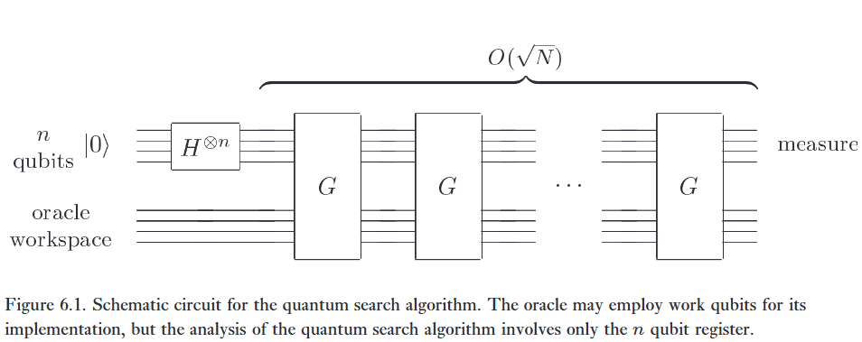
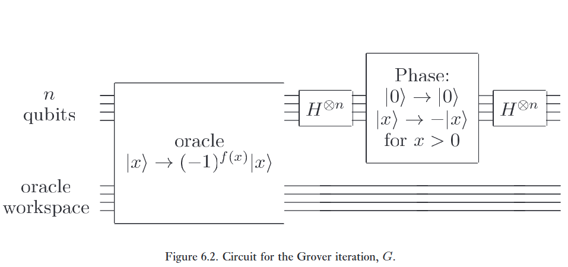
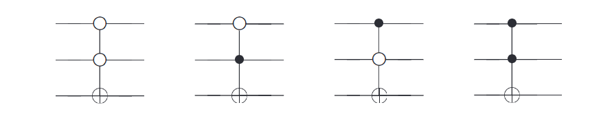
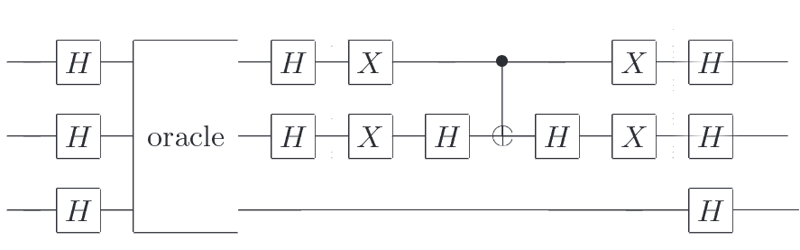
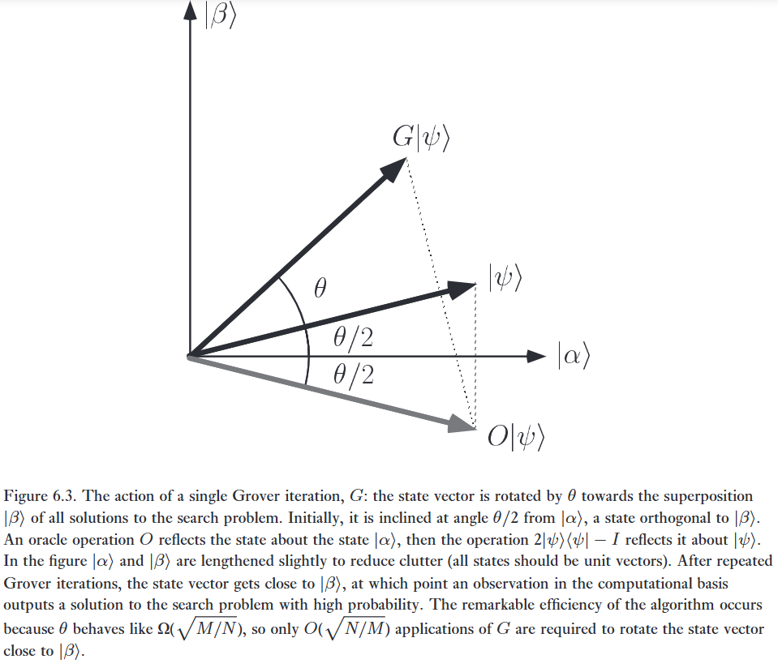

Hãy bắt đầu bằng cách thiết lập sân khấu cho thuật toán tìm kiếm dưới dạng một oracle (hộp đen/người tiên tri), tương tự như những gì đã gặp ở Mục 3.1.1. Điều này cho phép chúng ta trình bày một mô tả rất tổng quát về quy trình tìm kiếm, và một cách hình học để hình dung hành động của nó và xem nó hoạt động như thế nào.

# 1. The oracle

:::{.callout}
# tl;dr

## Phase kickback

Chúng ta lại gặp phase kickback, thêm một lần nữa, ở một tầm cao mới.

Có thể thấy, thanh điều khiển là $\vert x \rangle$ và thanh ghi đáp án là $\vert q \rangle$, khi áp dụng oracle unitary U, ta sẽ có:

$$
\vert{}x\rangle\vert{}q\rangle \xrightarrow{O} \vert{}x\rangle\vert{}q \oplus f(x)\rangle, \tag{6.1}
$$ 

Và chúng ta có thể kiểm tra xem x có phải là đáp án của mình hay không bằng cách qubit oracle ta đặt là $\vert 0 \rangle$, vậy thì $\vert 0 \oplus f(x)\rangle$ chỉ bằng 1 khi nào là đáp án, bằng không khi không phải là đáp án (hay có thể là nó = f(x)).

Tức là thanh điều khiển thật sự điều khiển.

Nhưng nếu ở đây chúng ta dùng qubit oracle là $\vert - \rangle$, thì sẽ xảy ra hiện tượng đá pha.

$$
\vert{}x\rangle \left( \frac{\vert{}0\rangle - \vert{}1\rangle}{\sqrt{2}} \right) \xrightarrow{O} (-1)^{f(x)} \vert{}x\rangle \left( \frac{\vert{}0\rangle - \vert{}1\rangle}{\sqrt{2}} \right). \tag{6.2}
$$

Mà qubit oracle không hề thay đổi, vì vậy chúng ta sẽ không bàn tới nó nữa trong các đoạn sau:

$$
\vert{}x\rangle \xrightarrow{O} (-1)^{f(x)} \vert{}x\rangle. \tag{6.3}
$$

:::

Giả sử chúng ta muốn tìm kiếm qua một không gian tìm kiếm có $N$ phần tử. Thay vì tìm kiếm trực tiếp trên các phần tử, chúng ta tập trung vào chỉ số (index) của các phần tử đó, vốn chỉ là một con số nằm trong khoảng từ $0$ đến $N - 1$. Để thuận tiện, chúng ta giả sử $N = 2^n$, vì vậy chỉ số có thể được lưu trữ trong $n$ bit, và bài toán tìm kiếm có chính xác $M$ giải pháp, với $1 \le M \le N$. Một trường hợp cụ thể của bài toán tìm kiếm có thể được biểu diễn một cách thuận tiện bằng một hàm $f$, lấy đầu vào là một số nguyên $x$, trong khoảng từ $0$ đến $N - 1$. Theo định nghĩa, $f(x) = 1$ nếu $x$ là một giải pháp cho bài toán tìm kiếm, và $f(x) = 0$ nếu $x$ không phải là một giải pháp cho bài toán tìm kiếm.Giả sử chúng ta được cung cấp một oracle lượng tử – một hộp đen mà hoạt động bên trong của nó chúng ta sẽ thảo luận sau, nhưng không quan trọng ở giai đoạn này – với khả năng nhận ra các giải pháp cho bài toán tìm kiếm. Sự nhận ra này được báo hiệu bằng cách sử dụng một qubit oracle. Chính xác hơn, oracle là một toán tử unita, $O$, được định nghĩa bởi hành động của nó trên cơ sở tính toán:

$$
\vert{}x\rangle\vert{}q\rangle \xrightarrow{O} \vert{}x\rangle\vert{}q \oplus f(x)\rangle, \tag{6.1}
$$

trong đó $\vert{}x\rangle$ là thanh ghi chỉ số, $\oplus$ biểu thị phép cộng modulo 2, và qubit oracle $\vert{}q\rangle$ là một qubit đơn lẻ bị lật nếu $f(x) = 1$, và không thay đổi trong trường hợp ngược lại. Chúng ta có thể kiểm tra xem $x$ có phải là giải pháp cho bài toán tìm kiếm của mình hay không bằng cách chuẩn bị $\vert{}x\rangle\vert{}0\rangle$, áp dụng oracle, và kiểm tra xem qubit oracle đã bị lật thành $\vert{}1\rangle$ hay chưa.

Trong thuật toán tìm kiếm lượng tử, thật hữu ích khi áp dụng oracle với qubit oracle ban đầu ở trạng thái $(\vert{}0\rangle - \vert{}1\rangle)/\sqrt{2}$, giống như đã làm trong thuật toán Deutsch–Jozsa ở Mục 1.4.4. Nếu $x$ không phải là một giải pháp cho bài toán tìm kiếm, việc áp dụng oracle lên trạng thái $\vert{}x\rangle(\vert{}0\rangle - \vert{}1\rangle)/\sqrt{2}$ không làm thay đổi trạng thái. Mặt khác, nếu $x$ là một giải pháp cho bài toán tìm kiếm, thì $\vert{}0\rangle$ và $\vert{}1\rangle$ được hoán đổi cho nhau bởi hành động của oracle, cho ra trạng thái cuối cùng là $-\vert{}x\rangle(\vert{}0\rangle - \vert{}1\rangle)/\sqrt{2}$. Do đó, hành động của oracle là:

$$
\vert{}x\rangle \left( \frac{\vert{}0\rangle - \vert{}1\rangle}{\sqrt{2}} \right) \xrightarrow{O} (-1)^{f(x)} \vert{}x\rangle \left( \frac{\vert{}0\rangle - \vert{}1\rangle}{\sqrt{2}} \right). \tag{6.2}
$$

Lưu ý rằng trạng thái của qubit oracle không bị thay đổi. Hóa ra điều này vẫn duy trì là $(\vert{}0\rangle - \vert{}1\rangle)/\sqrt{2}$ trong toàn bộ thuật toán tìm kiếm lượng tử, và do đó có thể được bỏ qua khỏi cuộc thảo luận tiếp theo về thuật toán, làm đơn giản hóa mô tả của chúng ta.

Với quy ước này, hành động của oracle có thể được viết là:

$$
\vert{}x\rangle \xrightarrow{O} (-1)^{f(x)} \vert{}x\rangle. \tag{6.3}
$$

Chúng ta nói rằng oracle đánh dấu các giải pháp cho bài toán tìm kiếm, bằng cách dịch chuyển pha của giải pháp. Đối với một bài toán tìm kiếm $N$ mục với $M$ giải pháp, hóa ra chúng ta chỉ cần áp dụng oracle tìm kiếm $O(\sqrt{N/M})$ lần để thu được một giải pháp, trên một máy tính lượng tử.

Cuộc thảo luận này về oracle mà không mô tả cách nó hoạt động trong thực tế là khá trừu tượng, và có lẽ còn gây bối rối. Có vẻ như oracle đã biết câu trả lời cho bài toán tìm kiếm; vậy thì việc có một thuật toán tìm kiếm lượng tử dựa trên những lần tham vấn oracle như vậy có thể có ích lợi gì?! Câu trả lời là có sự khác biệt giữa việc biết giải pháp cho một bài toán tìm kiếm, và khả năng nhận ra giải pháp đó; điểm mấu chốt là hoàn toàn có thể làm được điều sau mà không nhất thiết phải có khả năng làm được điều trước.

---

Một ví dụ đơn giản để minh họa điều này là bài toán phân tích thừa số. Giả sử chúng ta được cho một số lớn, $m$, và được biết rằng nó là tích của hai số nguyên tố, $p$ và $q$ – một tình huống tương tự như khi cố gắng bẻ gãy hệ thống mật mã khóa công khai RSA (Phụ lục 5). Để xác định $p$ và $q$, phương pháp hiển nhiên trên một máy tính cổ điển là tìm kiếm tất cả các số từ $2$ đến $m^{1/2}$ để tìm thừa số nguyên tố nhỏ hơn trong hai thừa số. Tức là, chúng ta liên tiếp thực hiện phép chia thử $m$ cho từng số trong khoảng từ $2$ đến $m^{1/2}$, cho đến khi chúng ta tìm thấy thừa số nguyên tố nhỏ hơn. Thừa số nguyên tố còn lại sau đó có thể được tìm thấy bằng cách chia $m$ cho số nguyên tố nhỏ hơn đó. Rõ ràng, phương pháp dựa trên tìm kiếm này yêu cầu xấp xỉ $m^{1/2}$ phép chia thử để tìm một thừa số trên một máy tính cổ điển.   

Thuật toán tìm kiếm lượng tử có thể được sử dụng để tăng tốc quá trình này. Theo định nghĩa, hành động của oracle khi đầu vào là trạng thái $\vert{}x\rangle$ là chia $m$ cho $x$, và kiểm tra xem phép chia có chia hết hay không, lật qubit oracle nếu đúng như vậy. Việc áp dụng thuật toán tìm kiếm lượng tử với oracle này mang lại thừa số nguyên tố nhỏ hơn trong hai thừa số với xác suất cao.   

Nhưng để làm cho thuật toán hoạt động, chúng ta cần xây dựng một mạch hiệu quả triển khai oracle. Cách làm điều này là một bài tập về các kỹ thuật tính toán thuận nghịch (reversible computation). Chúng ta bắt đầu bằng cách định nghĩa hàm $f(x) \equiv 1$ nếu $x$ chia hết $m$, và $f(x) = 0$ trong trường hợp ngược lại; $f(x)$ cho chúng ta biết liệu phép chia thử có thành công hay không. Sử dụng các kỹ thuật tính toán thuận nghịch đã thảo luận ở Mục 3.2.5, xây dựng một mạch thuận nghịch cổ điển đưa $(x, q)$ – biểu diễn một thanh ghi đầu vào ban đầu được đặt là $x$ và một thanh ghi đầu ra một bit ban đầu được đặt là $q$ – thành $(x, q \oplus f(x))$, bằng cách sửa đổi mạch cổ điển thông thường (không thuận nghịch) để thực hiện phép chia thử. Chi phí tài nguyên của mạch thuận nghịch này giống hệt (trong phạm vi một hệ số 2) so với mạch cổ điển không thuận nghịch được sử dụng cho phép chia thử, và do đó chúng ta coi hai mạch này tiêu thụ về cơ bản cùng một lượng tài nguyên. Hơn nữa, mạch thuận nghịch cổ điển có thể được dịch ngay lập tức thành một mạch lượng tử đưa $\vert{}x\rangle\vert{}q\rangle$ thành $\vert{}x\rangle\vert{}q \oplus f(x)\rangle$, như yêu cầu của oracle. Điểm mấu chốt là ngay cả khi không biết các thừa số nguyên tố của $m$, chúng ta có thể xây dựng một cách rõ ràng một oracle nhận ra giải pháp cho bài toán tìm kiếm khi nó nhìn thấy giải pháp đó. Sử dụng oracle này và thuật toán tìm kiếm lượng tử, chúng ta có thể tìm kiếm trong khoảng từ $2$ đến $m^{1/2}$ sử dụng $O(m^{1/4})$ lần tham vấn oracle. Tức là, chúng ta chỉ cần thực hiện phép chia thử xấp xỉ $m^{1/4}$ lần, thay vì $m^{1/2}$ lần, như với thuật toán cổ điển!   

Ví dụ về phân tích thừa số thú vị về mặt khái niệm nhưng không thực tế: có các thuật toán cổ điển để phân tích thừa số hoạt động nhanh hơn nhiều so với việc tìm kiếm qua tất cả các ước số có thể có. Tuy nhiên, nó minh họa cho cách thức tổng quát mà thuật toán tìm kiếm lượng tử có thể được áp dụng: các thuật toán cổ điển dựa trên các kỹ thuật nền tảng tìm kiếm có thể được tăng tốc bằng cách sử dụng thuật toán tìm kiếm lượng tử. Phần sau của chương này, chúng ta sẽ xem xét các kịch bản nơi thuật toán tìm kiếm lượng tử mang lại một sự trợ giúp thực sự hữu ích trong việc tăng tốc giải quyết các bài toán NP-đầy đủ.

# 2. The procedure

:::{.callout}
# Khá là ảo

Ban đầu cho n qubit 0 chồng chập vướng víu nhau.

Ví dụ có 100 đáp án là 000...000, 000...001, ....? Thì chúng vướng víu với nhau nên xác suất của đáp án đó là $1/100 = 0.01$, giá trị trung bình của 100 cái là 0.01.

Khi đi qua Oracle, đáp án đúng bị biến thành $0.01 \to -0.01$, còn đáp án sai thì giữ nguyên, giá trị trung bình của cái này thay đổi, chắc tầm 0.0098.

Đi tiếp Inversion about mean, sửa lại xác suất, chúng được lật ngược lại, lấy mean làm gương, từ $0.01 \to 0.0096$ thì khá nhỏ, nhưng mà với đáp án đúng $-0.01 \to 0.0296$ là nổ. 

:::

Về mặt sơ đồ, thuật toán tìm kiếm hoạt động như được thể hiện trong Hình 6.1. Bản thân thuật toán sử dụng một thanh ghi $n$ qubit duy nhất. Hoạt động bên trong của oracle, bao gồm cả khả năng nó cần thêm các qubit làm việc phụ, không quan trọng đối với mô tả của bản thân thuật toán tìm kiếm lượng tử. Mục tiêu của thuật toán là tìm ra một giải pháp cho bài toán tìm kiếm, sử dụng số lượng các lần áp dụng oracle ít nhất có thể.

Thuật toán bắt đầu với máy tính ở trạng thái $\vert{}0\rangle^{\otimes n}$. Biến đổi Hadamard được sử dụng để đưa máy tính vào trạng thái chồng chập đều,

$$
vert{}\psi\rangle = \frac{1}{N^{1/2}} \sum_{x=0}^{N-1} \vert{}x\rangle. \tag{6.4}
$$

Sau đó, thuật toán tìm kiếm lượng tử bao gồm việc áp dụng lặp đi lặp lại một chương trình con lượng tử, được gọi là vòng lặp Grover (Grover iteration) hoặc toán tử Grover, mà chúng tôi ký hiệu là $G$. Vòng lặp Grover, có mạch lượng tử được minh họa trong Hình 6.2, có thể được chia thành bốn bước:

(1) Áp dụng oracle $O$.
(2) Áp dụng biến đổi Hadamard $H^{\otimes n}$.
(3) Thực hiện một dịch chuyển pha có điều kiện trên máy tính, với mọi trạng thái cơ sở tính toán ngoại trừ $\vert{}0\rangle$ nhận một dịch chuyển pha là $-1$,

$$
\vert{}x\rangle \to -(-1)^{\delta_{x0}} \vert{}x\rangle. \tag{6.5}
$$

(4) Áp dụng biến đổi Hadamard $H^{\otimes n}$.

:::{.callout-note collapse="true"}
# Bài tập 6.1: 
Chỉ ra rằng toán tử unita tương ứng với dịch chuyển pha trong vòng lặp Grover là $2\vert{}0\rangle\langle 0\vert{} - I$.

:::

Mỗi phép toán trong vòng lặp Grover đều có thể được triển khai một cách hiệu quả trên một máy tính lượng tử. Bước 2 và 4, các phép biến đổi Hadamard, mỗi bước yêu cầu $n = \log(N)$ phép toán. Bước 3, phép dịch chuyển pha có điều kiện, có thể được triển khai bằng cách sử dụng các kỹ thuật của Mục 4.3, sử dụng $O(n)$ cổng. Chi phí cho lời gọi oracle phụ thuộc vào ứng dụng cụ thể; hiện tại, chúng ta chỉ cần lưu ý rằng vòng lặp Grover chỉ yêu cầu một lời gọi oracle duy nhất. Rất hữu ích khi lưu ý rằng hiệu ứng kết hợp của các bước 2, 3 và 4 là   

$$
H^{\otimes n} (2\vert{}0\rangle\langle 0\vert{} - I) H^{\otimes n} = 2\vert{}\psi\rangle\langle\psi\vert{} - I, \tag{6.6}
$$   

trong đó $\vert{}\psi\rangle$ là trạng thái chồng chập có trọng số bằng nhau của các trạng thái, (6.4). Do đó vòng lặp Grover, $G$, có thể được viết là $G = (2\vert{}\psi\rangle\langle\psi\vert{} - I)O$.   

:::{.callout-note collapse="true"}
# Bài tập 6.2: 
Chỉ ra rằng phép toán $(2\vert{}\psi\rangle\langle\psi\vert{} - I)$ được áp dụng lên một trạng thái tổng quát $\sum_k \alpha_k \vert{}k\rangle$ sẽ tạo ra   

$$
\sum_k [-\alpha_k + 2\langle\alpha\rangle] \vert{}k\rangle, \tag{6.7}
$$   

trong đó $\langle\alpha\rangle \equiv \sum_k \alpha_k / N$ là giá trị trung bình của các $\alpha_k$. Vì lý do này, $(2\vert{}\psi\rangle\langle\psi\vert{} - I)$ đôi khi được gọi là phép toán phản xạ qua giá trị trung bình (inversion about mean).   

:::

# 3. Geometric visualization

Vòng lặp Grover làm gì? Chúng ta đã lưu ý rằng $G = (2\vert{}\psi\rangle\langle\psi\vert{} - I)O$. Thực tế, chúng ta sẽ chỉ ra rằng vòng lặp Grover có thể được coi là một phép quay trong không gian hai chiều được kéo căng (spanned) bởi vector ban đầu $\vert{}\psi\rangle$ và trạng thái bao gồm một sự chồng chập đều của các giải pháp cho bài toán tìm kiếm. Để thấy điều này, thật hữu ích khi áp dụng quy ước rằng $\sum_x'$ chỉ ra một tổng trên tất cả các $x$ là giải pháp cho bài toán tìm kiếm, và $\sum_x''$ chỉ ra một tổng trên tất cả các $x$ không phải là giải pháp cho bài toán tìm kiếm. Định nghĩa các trạng thái chuẩn hóa   

$$
\vert{}\alpha\rangle \equiv \frac{1}{\sqrt{N-M}} \sum_x'' \vert{}x\rangle \tag{6.8}
$$   

$$
\vert{}\beta\rangle \equiv \frac{1}{\sqrt{M}} \sum_x' \vert{}x\rangle. \tag{6.9}
$$   

Đại số đơn giản chỉ ra rằng trạng thái ban đầu $\vert{}\psi\rangle$ có thể được biểu diễn lại thành   

$$
\vert{}\psi\rangle = \sqrt{\frac{N-M}{N}} \vert{}\alpha\rangle + \sqrt{\frac{M}{N}} \vert{}\beta\rangle, \tag{6.10}
$$   

do đó trạng thái ban đầu của máy tính lượng tử nằm trong không gian được kéo căng bởi $\vert{}\alpha\rangle$ và $\vert{}\beta\rangle$.   

Hiệu ứng của $G$ có thể được hiểu theo một cách tuyệt đẹp bằng cách nhận ra rằng phép toán oracle $O$ thực hiện một phép phản xạ qua vector $\vert{}\alpha\rangle$ trong mặt phẳng được xác định bởi $\vert{}\alpha\rangle$ và $\vert{}\beta\rangle$. Nghĩa là, $O(a\vert{}\alpha\rangle + b\vert{}\beta\rangle) = a\vert{}\alpha\rangle - b\vert{}\beta\rangle$. Tương tự, $2\vert{}\psi\rangle\langle\psi\vert{} - I$ cũng thực hiện một phép phản xạ trong mặt phẳng được xác định bởi $\vert{}\alpha\rangle$ và $\vert{}\beta\rangle$, qua vector $\vert{}\psi\rangle$. Và tích của hai phép phản xạ là một phép quay! Điều này cho chúng ta biết rằng trạng thái $G^k\vert{}\psi\rangle$ vẫn nằm trong không gian được kéo căng bởi $\vert{}\alpha\rangle$ và $\vert{}\beta\rangle$ đối với mọi $k$. Nó cũng cho chúng ta góc quay. Gọi $\cos \theta/2 = \sqrt{(N-M)/N}$, sao cho $\vert{}\psi\rangle = \cos \theta/2 \vert{}\alpha\rangle + \sin \theta/2 \vert{}\beta\rangle$. Như Hình 6.3 cho thấy, hai phép phản xạ cấu thành $G$ đưa $\vert{}\psi\rangle$ thành   

$$
G\vert{}\psi\rangle = \cos \frac{3\theta}{2} \vert{}\alpha\rangle + \sin \frac{3\theta}{2} \vert{}\beta\rangle, \tag{6.11}
$$   

vì vậy góc quay thực tế là $\theta$. Theo đó, việc tiếp tục áp dụng $G$ đưa trạng thái thành   

$$
G^k\vert{}\psi\rangle = \cos \left( \frac{2k+1}{2}\theta \right) \vert{}\alpha\rangle + \sin \left( \frac{2k+1}{2}\theta \right) \vert{}\beta\rangle. \tag{6.12}
$$   

Tóm lại, $G$ là một phép quay trong không gian hai chiều được kéo căng bởi $\vert{}\alpha\rangle$ và $\vert{}\beta\rangle$, quay không gian đi $\theta$ radian cho mỗi lần áp dụng $G$. Việc áp dụng lặp đi lặp lại vòng lặp Grover quay vector trạng thái đến gần $\vert{}\beta\rangle$. Khi điều này xảy ra, một quan sát trong cơ sở tính toán tạo ra với xác suất cao một trong những kết quả được chồng chập trong $\vert{}\beta\rangle$, nghĩa là, một giải pháp cho bài toán tìm kiếm! Một ví dụ minh họa thuật toán tìm kiếm với $N = 4$ được đưa ra trong Hộp 6.1.   

:::{.callout-important}
# Hộp 6.1: Tìm kiếm lượng tử: một ví dụ hai bit   

Dưới đây là một ví dụ rõ ràng minh họa cách thuật toán tìm kiếm lượng tử hoạt động trên một không gian tìm kiếm có kích thước $N = 4$. Oracle, trong đó $f(x) = 0$ đối với mọi $x$ ngoại trừ $x = x_0$, trong trường hợp đó $f(x_0) = 1$, có thể được coi là một trong bốn mạch   

  

tương ứng với $x_0 = 0, 1, 2$, hoặc $3$ từ trái sang phải, trong đó hai qubit trên cùng mang truy vấn $x$, và qubit dưới cùng mang phản hồi của oracle. Mạch lượng tử thực hiện các phép biến đổi Hadamard ban đầu và một vòng lặp Grover $G$ duy nhất là   

Ban đầu, hai qubit trên cùng được chuẩn bị ở trạng thái $\vert{}0\rangle$, và qubit dưới cùng ở trạng thái $\vert{}1\rangle$. Các cổng trong hộp nét đứt thực hiện phép toán dịch chuyển pha có điều kiện $2\vert{}00\rangle\langle00\vert{} - I$. Chúng ta phải lặp lại $G$ bao nhiêu lần để thu được $x_0$? Từ Phương trình (6.15), sử dụng $M = 1$, chúng ta thấy rằng cần ít hơn một vòng lặp. Hóa ra vì $\theta = \pi/3$ trong (6.14), chỉ cần chính xác một vòng lặp, để thu được hoàn hảo $x_0$, trong trường hợp đặc biệt này. Trong bức tranh hình học của Hình 6.3, trạng thái ban đầu của chúng ta $\vert{}\psi\rangle = (\vert{}00\rangle + \vert{}01\rangle + \vert{}10\rangle + \vert{}11\rangle)/2$ cách $\vert{}\alpha\rangle$ $30^\circ$, và một phép quay duy nhất với $\theta = 60^\circ$ đưa $\vert{}\psi\rangle$ đến $\vert{}\beta\rangle$. Bạn có thể tự mình xác nhận trực tiếp, bằng cách sử dụng các mạch lượng tử, rằng việc đo lường hai qubit trên cùng cho ra $x_0$, sau khi sử dụng oracle chỉ một lần. Ngược lại, một máy tính cổ điển – hoặc mạch cổ điển – cố gắng phân biệt giữa bốn oracle sẽ yêu cầu trung bình 2.25 lần truy vấn oracle!   
:::

:::{.callout-note}
# Bài tập 6.3: 
Chỉ ra rằng trong cơ sở $\vert{}\alpha\rangle, \vert{}\beta\rangle$, chúng ta có thể viết vòng lặp Grover dưới dạng

$$
G = \begin{bmatrix} \cos \theta & -\sin \theta \\ \sin \theta & \cos \theta \end{bmatrix}, \tag{6.13}
$$

trong đó $\theta$ là một số thực trong khoảng từ $0$ đến $\pi/2$ (giả định cho đơn giản rằng $M \le N/2$; giới hạn này sẽ sớm được dỡ bỏ), được chọn sao cho   

$$
\sin \theta = \frac{2\sqrt{M(N-M)}}{N}. \tag{6.14}
$$
:::

