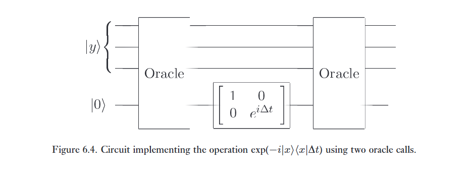
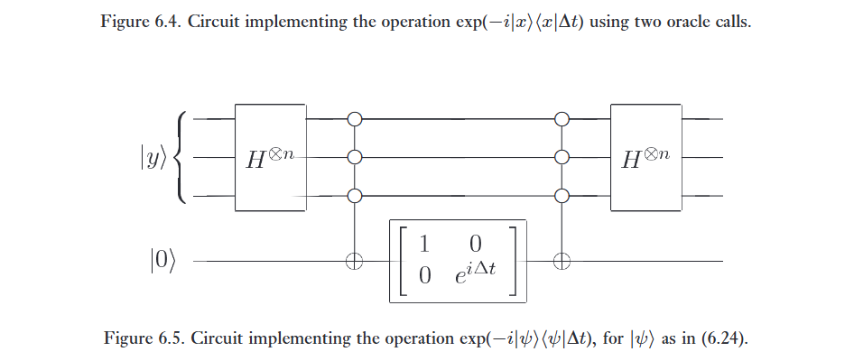
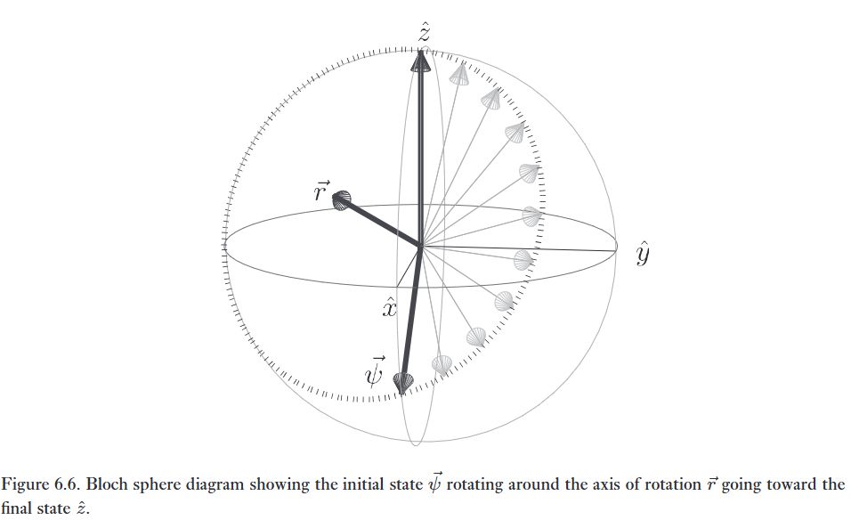

Tính đúng đắn của thuật toán tìm kiếm lượng tử rất dễ được kiểm chứng, nhưng hoàn toàn không rõ ràng làm thế nào người ta có thể nghĩ ra một thuật toán như vậy từ trạng thái không biết gì. Trong phần này, chúng tôi phác thảo một phương tiện heuristic (mang tính kinh nghiệm) mà nhờ đó người ta có thể 'đạo hàm' ra thuật toán tìm kiếm lượng tử, với hy vọng mang lại một số trực giác về nhiệm vụ phức tạp của việc thiết kế thuật toán lượng tử. Như một tác dụng phụ hữu ích, chúng ta cũng thu được một thuật toán tìm kiếm lượng tử tất định (deterministic quantum search algorithm). Bởi vì mục tiêu của chúng ta là thu được cái nhìn sâu sắc chứ không phải tính tổng quát, để cho đơn giản, chúng ta giả định rằng bài toán tìm kiếm có chính xác một giải pháp, mà chúng ta gắn nhãn là $x$.   

Phương pháp của chúng ta bao gồm hai bước. Đầu tiên, chúng ta đưa ra một dự đoán về một Hamiltonian có khả năng giải quyết bài toán tìm kiếm. Chính xác hơn, chúng ta viết ra một Hamiltonian $H$ phụ thuộc vào giải pháp $x$ và một trạng thái ban đầu $\vert{}\psi\rangle$ sao cho một hệ lượng tử tiến hóa theo $H$ sẽ thay đổi từ $\vert{}\psi\rangle$ thành $\vert{}x\rangle$ sau một khoảng thời gian được quy định. Một khi chúng ta đã tìm thấy một Hamiltonian và trạng thái ban đầu như vậy, chúng ta có thể chuyển sang bước thứ hai, đó là cố gắng mô phỏng hành động của Hamiltonian bằng cách sử dụng một mạch lượng tử. Thật đáng kinh ngạc, việc tuân theo quy trình này dẫn đến thuật toán tìm kiếm lượng tử một cách rất nhanh chóng! Chúng ta đã từng gặp quy trình gồm hai phần này trong khi nghiên cứu tính phổ quát (universality) trong các mạch lượng tử, ở Bài toán 4.3, và nó cũng phục vụ tốt trong việc nghiên cứu tìm kiếm lượng tử. 

---

Chúng ta giả sử rằng thuật toán bắt đầu với máy tính lượng tử ở một trạng thái $\vert{}\psi\rangle$. Chúng ta sẽ chốt lại $\vert{}\psi\rangle$ nên là gì sau, nhưng sẽ thuận tiện nếu để $\vert{}\psi\rangle$ chưa được xác định cho đến khi chúng ta hiểu được động lực học của thuật toán. Mục tiêu của tìm kiếm lượng tử là thay đổi $\vert{}\psi\rangle$ thành $\vert{}x\rangle$ hoặc một dạng xấp xỉ nào đó của nó. Những Hamiltonian nào chúng ta có thể đoán là sẽ làm tốt việc gây ra một sự tiến hóa như vậy? Sự đơn giản gợi ý rằng chúng ta nên đoán một Hamiltonian được xây dựng hoàn toàn từ các số hạng $\vert{}\psi\rangle$ và $\vert{}x\rangle$. Do đó, Hamiltonian phải là một tổng của các số hạng như $\vert{}\psi\rangle\langle\psi\vert{}$, $\vert{}x\rangle\langle x\vert{}$, $\vert{}\psi\rangle\langle x\vert{}$ và $\vert{}x\rangle\langle\psi\vert{}$. Có lẽ những lựa chọn đơn giản nhất theo hướng này là các Hamiltonian:   

$$
H = \vert{}x\rangle\langle x\vert{} + \vert{}\psi\rangle\langle\psi\vert{} \tag{6.18}
$$   

$$
H = \vert{}x\rangle\langle\psi\vert{} + \vert{}\psi\rangle\langle x\vert{}. \tag{6.19}
$$   

Hóa ra là cả hai Hamiltonian này đều dẫn đến thuật toán tìm kiếm lượng tử! Tuy nhiên, hiện tại, chúng ta giới hạn bản thân trong việc phân tích Hamiltonian ở Phương trình (6.18). Nhắc lại từ Mục 2.2.2 rằng sau một khoảng thời gian $t$, trạng thái của một hệ lượng tử tiến hóa theo Hamiltonian $H$ và ban đầu ở trạng thái $\vert{}\psi\rangle$ được cho bởi   

$$
\exp(-iHt)\vert{}\psi\rangle. \tag{6.20}
$$   

Về mặt trực giác, nó trông khá ổn: đối với $t$ nhỏ, hiệu ứng của sự tiến hóa là đưa $\vert{}\psi\rangle$ thành $(I - itH)\vert{}\psi\rangle = (1 - it)\vert{}\psi\rangle - it\langle x\vert{}\psi\rangle\vert{}x\rangle$. Tức là, vector $\vert{}\psi\rangle$ bị quay đi một chút, về phía hướng của $\vert{}x\rangle$. Hãy thực sự làm một phân tích đầy đủ, với mục tiêu là xác định xem có tồn tại một $t$ nào đó sao cho $\exp(-iHt)\vert{}\psi\rangle = \vert{}x\rangle$ hay không. Rõ ràng chúng ta có thể giới hạn phân tích trong không gian hai chiều được kéo căng bởi $\vert{}x\rangle$ và $\vert{}\psi\rangle$. Thực hiện quy trình Gram-Schmidt, chúng ta có thể tìm thấy $\vert{}y\rangle$ sao cho $\vert{}x\rangle, \vert{}y\rangle$ tạo thành một cơ sở trực chuẩn cho không gian này, và $\vert{}\psi\rangle = \alpha\vert{}x\rangle + \beta\vert{}y\rangle$, với một số $\alpha, \beta$ sao cho $\alpha^2 + \beta^2 = 1$, và để thuận tiện, chúng ta đã chọn các pha của $\vert{}x\rangle$ và $\vert{}y\rangle$ sao cho $\alpha$ và $\beta$ là số thực và không âm. Trong cơ sở $\vert{}x\rangle, \vert{}y\rangle$ chúng ta có   

$$
H = \begin{bmatrix} 1 & 0 \\ 0 & 0 \end{bmatrix} + \begin{bmatrix} \alpha^2 & \alpha\beta \\ \alpha\beta & \beta^2 \end{bmatrix} = \begin{bmatrix} 1 + \alpha^2 & \alpha\beta \\ \alpha\beta & 1 - \alpha^2 \end{bmatrix} = I + \alpha(\beta X + \alpha Z). \tag{6.21}
$$   

Do đó   

$$
\exp(-iHt)\vert{}\psi\rangle = \exp(-it) \left[ \cos(\alpha t)\vert{}\psi\rangle - i \sin(\alpha t)(\beta X + \alpha Z)\vert{}\psi\rangle \right]. \tag{6.22}
$$   

Hệ số pha toàn cục $\exp(-it)$ có thể được bỏ qua, và đại số đơn giản chỉ ra rằng $(\beta X + \alpha Z)\vert{}\psi\rangle = \vert{}x\rangle$, vì vậy trạng thái của hệ thống sau khoảng thời gian $t$ là   

$$
\cos(\alpha t)\vert{}\psi\rangle - i \sin(\alpha t)\vert{}x\rangle. \tag{6.23}
$$   

Do đó, việc quan sát hệ thống tại thời điểm $t = \pi/2\alpha$ mang lại kết quả $\vert{}x\rangle$ với xác suất bằng một: chúng ta đã tìm thấy một giải pháp cho bài toán tìm kiếm! Thật không may, thời điểm quan sát phụ thuộc vào $\alpha$, thành phần của $\vert{}\psi\rangle$ theo hướng $\vert{}x\rangle$, và do đó phụ thuộc vào $x$, điều mà chúng ta đang cố gắng xác định. Giải pháp hiển nhiên là cố gắng sắp xếp sao cho $\alpha$ giống nhau đối với mọi $\vert{}x\rangle$, tức là, chọn $\vert{}\psi\rangle$ là trạng thái chồng chập đều   

$$
\vert{}\psi\rangle = \frac{\sum_x \vert{}x\rangle}{\sqrt{N}}. \tag{6.24}
$$   

Việc thực hiện lựa chọn này cho $\alpha = 1/\sqrt{N}$ với mọi $x$, và do đó thời điểm quan sát $t = \pi\sqrt{N}/2$ không phụ thuộc vào việc biết giá trị của $x$. Hơn nữa, trạng thái (6.24) có ưu điểm hiển nhiên là chúng ta đã biết cách chuẩn bị một trạng thái như vậy bằng cách thực hiện phép biến đổi Hadamard.   

---

Bây giờ chúng ta biết rằng Hamiltonian (6.18) quay vector $\vert{}\psi\rangle$ thành $\vert{}x\rangle$. Liệu chúng ta có thể tìm một mạch lượng tử để mô phỏng Hamiltonian (6.18), và do đó thu được một thuật toán tìm kiếm lượng tử không? Áp dụng phương pháp của Mục 4.7, chúng ta thấy rằng một cách tự nhiên để mô phỏng $H$ là luân phiên mô phỏng các Hamiltonian $H_1 \equiv \vert{}x\rangle\langle x\vert{}$ và $H_2 \equiv \vert{}\psi\rangle\langle\psi\vert{}$ trong các khoảng tăng thời gian ngắn $\Delta t$. Các Hamiltonian này dễ dàng được mô phỏng bằng các phương pháp của Chương 4, như được minh họa trong Hình 6.4 và 6.5. 

:::{.callout-note collapse="true"}
# Bài tập 6.7:

Chứng minh rằng mạch trong hình 6.4, và 6.5 cài đặt $\exp(-i\vert x \rangle \langle x \vert \delta t)$ và $\exp(-i\vert \psi \rangle \langle \psi \vert \delta t)$, với $\vert \psi \rangle$ như trong (6.24).
:::

---

Số lượng lời gọi oracle yêu cầu bởi mô phỏng lượng tử được xác định bởi việc cần một bước thời gian nhỏ đến mức nào để thu được các kết quả chính xác một cách hợp lý. Giả sử chúng ta sử dụng một bước mô phỏng có độ dài $\Delta t$ chính xác đến $O(\Delta t^2)$. Tổng số bước được yêu cầu là $t/\Delta t = \Theta(\sqrt{N}/\Delta t)$, và do đó sai số tích lũy là $O(\Delta t^2 \times \sqrt{N}/\Delta t) = O(\Delta t\sqrt{N})$. Để thu được một xác suất thành công cao một cách hợp lý, chúng ta cần sai số là $O(1)$, điều này có nghĩa là chúng ta phải chọn $\Delta t = \Theta(1/\sqrt{N})$, dẫn đến số lượng lời gọi oracle tỷ lệ thuận theo $O(N)$ – không tốt hơn gì so với giải pháp cổ điển! Sẽ ra sao nếu chúng ta sử dụng một phương pháp mô phỏng lượng tử chính xác hơn, ví dụ như một phương pháp chính xác đến $O(\Delta t^3)$? Sai số tích lũy trong trường hợp này là $O(\Delta t^2\sqrt{N})$, và do đó để đạt được một xác suất thành công hợp lý, chúng ta cần chọn $\Delta t = \Theta(N^{-1/4})$, dẫn đến tổng số lời gọi oracle là $O(N^{3/4})$, đây là một sự cải thiện rõ rệt so với tình huống cổ điển, mặc dù vẫn chưa tốt bằng những gì đạt được bởi thuật toán tìm kiếm lượng tử ở Mục 6.1! Nói chung, việc chuyển sang một kỹ thuật mô phỏng lượng tử chính xác hơn dẫn đến sự giảm số lượng lời gọi oracle cần thiết để thực hiện mô phỏng:   

:::{.callout-note collapse="true"}
# Bài tập 6.8: 
Giả sử bước mô phỏng được thực hiện với độ chính xác $O(\Delta t^r)$. Chỉ ra rằng số lượng lời gọi oracle yêu cầu để mô phỏng $H$ với độ chính xác hợp lý là $O(N^{r/2(r-1)})$. Lưu ý rằng khi $r$ trở nên lớn, số mũ của $N$ tiến gần đến $1/2$.   

:::

Chúng ta đã và đang phân tích độ chính xác của mô phỏng lượng tử đối với Hamiltonian (6.18) bằng cách sử dụng các kết quả tổng quát về mô phỏng lượng tử từ Mục 4.7. Tất nhiên, trong trường hợp này chúng ta đang đối phó với một Hamiltonian cụ thể, chứ không phải trường hợp tổng quát, điều này gợi ý rằng việc tính toán một cách rõ ràng hiệu ứng của một bước mô phỏng thời gian $\Delta t$ có thể sẽ thú vị, thay vì dựa vào phân tích tổng quát. Chúng ta có thể làm điều này cho bất kỳ lựa chọn phương pháp mô phỏng cụ thể nào – có thể hơi tẻ nhạt để tìm ra hiệu ứng của bước mô phỏng, nhưng về cơ bản nó là một phép tính toán trực tiếp. Điểm khởi đầu hiển nhiên là tính toán một cách rõ ràng hành động của các kỹ thuật mô phỏng bậc thấp nhất, tức là, tính toán một hoặc cả hai biểu thức $\exp(-i\vert{}x\rangle\langle x\vert{}\Delta t) \exp(-i\vert{}\psi\rangle\langle\psi\vert{}\Delta t)$ hoặc $\exp(-i\vert{}\psi\rangle\langle\psi\vert{}\Delta t) \exp(-i\vert{}x\rangle\langle x\vert{}\Delta t)$. Các kết quả về cơ bản là giống nhau trong cả hai trường hợp; chúng ta sẽ tập trung vào việc nghiên cứu $U(\Delta t) \equiv \exp(-i\vert{}\psi\rangle\langle\psi\vert{}\Delta t) \exp(-i\vert{}x\rangle\langle x\vert{}\Delta t)$. Rõ ràng $U(\Delta t)$ chỉ tác động một cách không tầm thường trong không gian được kéo căng bởi $\vert{}x\rangle\langle x\vert{}$ và $\vert{}\psi\rangle\langle\psi\vert{}$, vì vậy chúng ta giới hạn bản thân trong không gian đó, làm việc trong cơ sở $\vert{}x\rangle, \vert{}y\rangle$, trong đó $\vert{}y\rangle$ được định nghĩa như trước đây. Lưu ý rằng trong biểu diễn này $\vert{}x\rangle\langle x\vert{} = (I + Z)/2 = (I + \hat{z} \cdot \vec{\sigma})/2$, trong đó $\hat{z} \equiv (0, 0, 1)$ là vector đơn vị theo hướng $z$, và $\vert{}\psi\rangle\langle\psi\vert{} = (I + \vec{v} \cdot \vec{\sigma})/2$, trong đó $\vec{v} = (2\alpha\beta, 0, (\alpha^2 - \beta^2))$ (nhắc lại rằng đây là biểu diễn vector Bloch; xem Mục 4.2). Một phép tính toán đơn giản chỉ ra rằng, tính đến một hệ số pha toàn cục không quan trọng,   

$$
U(\Delta t) = \left( \cos^2 \left(\frac{\Delta t}{2}\right) - \sin^2 \left(\frac{\Delta t}{2}\right) \vec{v} \cdot \hat{z} \right) I
$$ 

$$
- 2i \sin \left(\frac{\Delta t}{2}\right) \left( \cos \left(\frac{\Delta t}{2}\right) \frac{\vec{v} + \hat{z}}{2} + \sin \left(\frac{\Delta t}{2}\right) \frac{\vec{v} \times \hat{z}}{2} \right) \cdot \vec{\sigma}. \tag{6.25}
$$   

:::{.callout-note collapse="true"}
# Bài tập 6.9: 
Kiểm chứng Phương trình (6.25). (Gợi ý: xem Bài tập 4.15.) 

:::

Phương trình (6.25) ngụ ý rằng $U(\Delta t)$ là một phép quay trên mặt cầu Bloch quanh một trục quay $\vec{r}$ được định nghĩa bởi   

$$
\vec{r} = \cos \left(\frac{\Delta t}{2}\right) \frac{\vec{\psi} + \hat{z}}{2} + \sin \left(\frac{\Delta t}{2}\right) \frac{\vec{\psi} \times \hat{z}}{2}, \tag{6.26}
$$ 

và đi qua một góc $\theta$ được định nghĩa bởi   

$$
\cos \left(\frac{\theta}{2}\right) = \cos^2 \left(\frac{\Delta t}{2}\right) - \sin^2 \left(\frac{\Delta t}{2}\right) \vec{\psi} \cdot \hat{z}, \tag{6.27}
$$   

phương trình này được đơn giản hóa khi thay thế $\vec{\psi} \cdot \hat{z} = \alpha^2 - \beta^2 = (2/N - 1)$ thành   

$$
\cos \left(\frac{\theta}{2}\right) = 1 - \frac{2}{N} \sin^2 \left(\frac{\Delta t}{2}\right). \tag{6.28}
$$   

Lưu ý rằng $\vec{\psi} \cdot \vec{r} = \hat{z} \cdot \vec{r}$, vì vậy cả $\vert{}\psi\rangle\langle\psi\vert{}$ và $\vert{}x\rangle\langle x\vert{}$ đều nằm trên cùng một đường tròn quay quanh trục $\vec{r}$ trên mặt cầu Bloch. Tóm lại, hành động của $U(\Delta t)$ là quay $\vert{}\psi\rangle\langle\psi\vert{}$ quanh trục $\vec{r}$, đi qua một góc $\theta$ cho mỗi lần áp dụng $U(\Delta t)$, như được minh họa trong Hình 6.6. Chúng ta chấm dứt quy trình khi đã thực hiện đủ số lần quay để quay $\vert{}\psi\rangle\langle\psi\vert{}$ đến gần với giải pháp $\vert{}x\rangle\langle x\vert{}$. Ban đầu, chúng ta đã tưởng tượng rằng $\Delta t$ rất nhỏ, vì chúng ta đang xem xét trường hợp mô phỏng lượng tử, nhưng Phương trình (6.28) cho thấy điều khôn ngoan cần làm là chọn $\Delta t = \pi$, nhằm tối đa hóa góc quay $\theta$. Nếu chúng ta làm điều này, thì chúng ta thu được $\cos(\theta/2) = 1 - 2/N$, đối với $N$ lớn tương ứng với $\theta \approx 4/\sqrt{N}$, và số lượng lời gọi oracle yêu cầu để tìm giải pháp $\vert{}x\rangle$ là $O(\sqrt{N})$, giống hệt như đối với thuật toán tìm kiếm lượng tử ban đầu.   

 

Thực sự, nếu chúng ta đưa ra lựa chọn $\Delta t = \pi$, thì 'mô phỏng lượng tử' này trên thực tế hoàn toàn giống hệt với thuật toán tìm kiếm lượng tử ban đầu, vì các toán tử được áp dụng trong mô phỏng lượng tử là $\exp(-i\pi\vert{}\psi\rangle\langle\psi\vert{}) = I - 2\vert{}\psi\rangle\langle\psi\vert{}$ và $\exp(-i\pi\vert{}x\rangle\langle x\vert{}) = I - 2\vert{}x\rangle\langle x\vert{}$, và xét tới một hệ số pha toàn cục, chúng hoàn toàn giống hệt với các bước cấu thành vòng lặp Grover. Nhìn theo cách này, các mạch được hiển thị trong Hình 6.2 và 6.3 cho thuật toán tìm kiếm lượng tử chính là các sự đơn giản hóa của các mạch được hiển thị trong Hình 6.4 và 6.5 cho việc mô phỏng, trong trường hợp đặc biệt $\Delta t = \pi$!   

:::{.callout-note collapse="true"}
# Bài tập 6.10: 
Chỉ ra rằng bằng cách chọn $\Delta t$ một cách thích hợp, chúng ta có thể thu được một thuật toán tìm kiếm lượng tử sử dụng $O(\sqrt{N})$ truy vấn, và trong đó trạng thái cuối cùng chính xác là $\vert{}x\rangle$, nghĩa là, thuật toán hoạt động với xác suất 1, thay vì với một xác suất nào đó nhỏ hơn.

:::

Chúng ta đã 'đạo hàm' lại thuật toán tìm kiếm lượng tử từ một góc nhìn khác, góc nhìn của mô phỏng lượng tử. Tại sao cách tiếp cận này lại hiệu quả? Liệu nó có thể được sử dụng để tìm ra các thuật toán lượng tử nhanh khác không? Chúng ta không thể trả lời những câu hỏi này một cách dứt khoát, nhưng một vài suy nghĩ sau đây có thể mang lại đôi chút thú vị. Quy trình cơ bản được sử dụng gồm bốn phần: (1) chỉ định bài toán cần giải quyết, bao gồm mô tả về đầu vào và đầu ra mong muốn từ thuật toán lượng tử; (2) phỏng đoán một Hamiltonian để giải quyết bài toán, và xác minh rằng nó thực sự hoạt động; (3) tìm một quy trình để mô phỏng Hamiltonian; và (4) phân tích chi phí tài nguyên của quá trình mô phỏng. Điều này khác biệt so với cách tiếp cận thông thường hơn ở hai khía cạnh: chúng ta đoán một Hamiltonian, thay vì một mạch lượng tử, và không có bước nào tương tự như bước mô phỏng trong cách tiếp cận thông thường. Sự khác biệt quan trọng hơn trong hai sự khác biệt này là cái đầu tiên. Có rất nhiều sự tự do trong việc chỉ định một mạch lượng tử để giải quyết một bài toán. Mặc dù sự tự do đó, một phần, chịu trách nhiệm cho sức mạnh to lớn của tính toán lượng tử, nó làm cho việc tìm kiếm các mạch tốt trở nên khá khó khăn. Ngược lại, việc chỉ định một Hamiltonian là một bài toán bị ràng buộc nhiều hơn, và do đó mang lại ít sự tự do hơn trong việc giải quyết các bài toán, nhưng chính những ràng buộc đó trên thực tế lại có thể làm cho việc tìm ra một thuật toán lượng tử hiệu quả để giải quyết một bài toán trở nên dễ dàng hơn nhiều. Chúng ta đã thấy điều này xảy ra đối với thuật toán tìm kiếm lượng tử, và có lẽ các thuật toán lượng tử khác sẽ được khám phá bằng phương pháp này; chúng ta không biết. Điều dường như chắc chắn là góc nhìn 'các thuật toán lượng tử như là các mô phỏng lượng tử' này cung cấp một quan điểm thay thế hữu ích để kích thích sự phát triển của các thuật toán lượng tử.

:::{.callout-note collapse="true"}
# Bài tập 6.11: (Tìm kiếm lượng tử thời gian liên tục với nhiều giải pháp) 
Dự đoán một Hamiltonian mà nhờ đó người ta có thể giải quyết bài toán tìm kiếm thời gian liên tục trong trường hợp bài toán tìm kiếm có $M$ giải pháp.

:::

:::{.callout-note collapse="true"}
# Bài tập 6.12: (Hamiltonian thay thế cho tìm kiếm lượng tử) 
Giả sử

$$
H = \vert{}x\rangle\langle\psi\vert{} + \vert{}\psi\rangle\langle x\vert{}. \tag{6.29}
$$

(1) Chỉ ra rằng mất thời gian $O(1)$ để quay từ trạng thái $\vert{}\psi\rangle$ sang trạng thái $\vert{}x\rangle$, với một sự tiến hóa theo Hamiltonian $H$.
(2) Giải thích cách một mô phỏng lượng tử của Hamiltonian $H$ có thể được thực hiện, và xác định số lượng truy vấn oracle mà kỹ thuật mô phỏng của bạn yêu cầu để thu được giải pháp với xác suất cao.

:::

