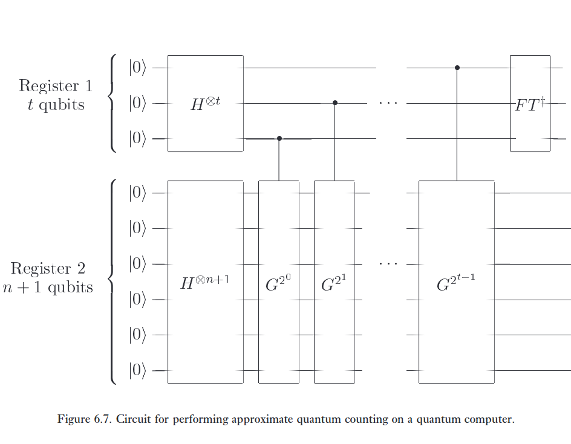

Chúng ta có thể xác định số lượng giải pháp, $M$, cho một bài toán tìm kiếm $N$ mục nhanh đến mức nào, nếu $M$ không được biết trước? Rõ ràng, trên một máy tính cổ điển, phải mất $\Theta(N)$ lần tham vấn oracle để xác định $M$. Trên một máy tính lượng tử, người ta có thể ước lượng số lượng giải pháp nhanh hơn nhiều so với khả năng trên một máy tính cổ điển bằng cách kết hợp vòng lặp Grover với kỹ thuật ước lượng pha dựa trên biến đổi Fourier lượng tử (Chương 5). Điều này có một số ứng dụng quan trọng. Đầu tiên, nếu chúng ta có thể ước lượng số lượng giải pháp một cách nhanh chóng thì cũng có thể tìm thấy một giải pháp một cách nhanh chóng, ngay cả khi số lượng giải pháp không được biết trước, bằng cách đếm số lượng giải pháp trước, và sau đó áp dụng thuật toán tìm kiếm lượng tử để tìm một giải pháp. Thứ hai, đếm lượng tử cho phép chúng ta quyết định xem một giải pháp thậm chí có tồn tại hay không, tùy thuộc vào việc số lượng giải pháp là bằng không, hay khác không. Điều này có các ứng dụng, ví dụ, đối với việc giải quyết các bài toán NP-đầy đủ, có thể được diễn đạt dưới dạng sự tồn tại của một giải pháp cho một bài toán tìm kiếm.   

:::{.callout-note collapse="true"}
# Bài tập 6.13: 
Xem xét một thuật toán cổ điển cho bài toán đếm, thuật toán này lấy mẫu một cách đồng đều và độc lập $k$ lần từ không gian tìm kiếm, và gọi $X_1, \dots, X_k$ là kết quả của các lần gọi oracle, tức là, $X_j = 1$ nếu lần gọi oracle thứ $j$ tiết lộ một giải pháp cho bài toán, và $X_j = 0$ nếu lần gọi oracle thứ $j$ không tiết lộ một giải pháp cho bài toán. Thuật toán này trả về ước lượng $S \equiv N \times \sum_j X_j / k$ cho số lượng giải pháp đối với bài toán tìm kiếm. Chỉ ra rằng độ lệch chuẩn (standard deviation) của $S$ là $\Delta S = \sqrt{M(N - M)/k}$. Chứng minh rằng để thu được xác suất ít nhất là $3/4$ của việc ước lượng $M$ một cách chính xác trong phạm vi sai số $\sqrt{M}$ đối với mọi giá trị của $M$ thì chúng ta phải có $k = \Omega(N)$.   

:::

:::{.callout-note collapse="true"}
# Bài tập 6.14: 
Chứng minh rằng bất kỳ thuật toán đếm cổ điển nào với xác suất ít nhất là $3/4$ để ước lượng $M$ một cách chính xác trong phạm vi sai số $c\sqrt{M}$ đối với một hằng số $c$ nào đó và đối với mọi giá trị của $M$ đều phải thực hiện $\Omega(N)$ lần gọi oracle.   

:::

Đếm lượng tử là một ứng dụng của quy trình ước lượng pha ở Mục 5.2 nhằm ước lượng các trị riêng của vòng lặp Grover $G$, từ đó cho phép chúng ta xác định số lượng nghiệm $M$ của bài toán tìm kiếm. Giả sử $\vert{}a\rangle$ và $\vert{}b\rangle$ là hai vector riêng của vòng lặp Grover trong không gian được kéo căng bởi $\vert{}\alpha\rangle$ và $\vert{}\beta\rangle$. Gọi $\theta$ là góc quay được xác định bởi vòng lặp Grover. Từ Phương trình (6.13), chúng ta thấy rằng các trị riêng tương ứng là $e^{i\theta}$ và $e^{i(2\pi - \theta)}$. Để thuận tiện cho việc phân tích, ta giả sử rằng oracle đã được mở rộng (augmented), như mô tả ở Mục 6.1, mở rộng kích thước không gian tìm kiếm lên $2N$, và đảm bảo rằng $\sin^2(\theta/2) = M/2N$.   

Mạch ước lượng pha được sử dụng cho đếm lượng tử được minh họa trong Hình 6.7. Chức năng của mạch là ước lượng $\theta$ với độ chính xác $m$ bit, với xác suất thành công ít nhất là $1 - \epsilon$. Thanh ghi thứ nhất chứa $t \equiv m + \lceil\log(2 + 1/2\epsilon)\rceil$ qubit, theo đúng thuật toán ước lượng pha, và thanh ghi thứ hai chứa $n + 1$ qubit, đủ để triển khai vòng lặp Grover trên không gian tìm kiếm mở rộng. Trạng thái của thanh ghi thứ hai được khởi tạo thành một chồng chập đều của tất cả các đầu vào có thể có $\sum_x \vert{}x\rangle$ bằng một biến đổi Hadamard. Như chúng ta đã thấy ở Mục 6.1, trạng thái này là một chồng chập của các trạng thái riêng $\vert{}a\rangle$ và $\vert{}b\rangle$, do đó theo kết quả của Mục 5.2, mạch ở Hình 6.7 cho chúng ta một ước lượng của $\theta$ hoặc $2\pi - \theta$ chính xác trong phạm vi $\vert{}\Delta\theta\vert{} \le 2^{-m}$, với xác suất ít nhất là $1 - \epsilon$. Hơn nữa, một ước lượng cho $2\pi - \theta$ rõ ràng tương đương với một ước lượng cho $\theta$ với cùng mức độ chính xác, vì vậy về mặt hiệu quả, thuật toán ước lượng pha xác định $\theta$ với độ chính xác $2^{-m}$ cùng xác suất $1 - \epsilon$.   

Sử dụng phương trình $\sin^2(\theta/2) = M/2N$ và ước lượng của chúng ta cho $\theta$, ta thu được một ước lượng về số lượng nghiệm, $M$. Sai số $\Delta M$ trong ước lượng này lớn đến mức nào?   

$$
\frac {\vert \Delta M} {2N} = \left\vert \sin^2\left(\frac {\theta + \Delta \theta} 2\right) - \sin^2\left(\frac \theta 2\right)  \right\vert
\tag{6.30}
$$

$$= \left( \sin\left(\frac{\theta + \Delta\theta}{2}\right) + \sin\left(\frac{\theta}{2}\right) \right) \left\vert{} \sin\left(\frac{\theta + \Delta\theta}{2}\right) - \sin\left(\frac{\theta}{2}\right) \right\vert{}. \tag{6.31}
$$   

Giải tích suy ra rằng $\vert{}\sin((\theta + \Delta\theta)/2) - \sin(\theta/2)\vert{} \le \vert{}\Delta\theta\vert{}/2$, và lượng giác sơ cấp chỉ ra rằng $\vert{}\sin((\theta + \Delta\theta)/2)\vert{} < \sin(\theta/2) + \vert{}\Delta\theta\vert{}/2$, do đó   

$$
\frac{\vert{}\Delta M\vert{}}{2N} < \left( 2\sin\left(\frac{\theta}{2}\right) + \frac{\vert{}\Delta\theta\vert{}}{2} \right) \frac{\vert{}\Delta\theta\vert{}}{2}. \tag{6.32}
$$   

Thay thế $\sin^2(\theta/2) = M/2N$ và $\vert{}\Delta\theta\vert{} \le 2^{-m}$ cho chúng ta ước lượng cuối cùng về sai số trong ước lượng $M$,   

$$
\vert{}\Delta M\vert{} < \left( \sqrt{2MN} + \frac{N}{2^{m+1}} \right) 2^{-m}. \tag{6.33}
$$   

Lấy một ví dụ, giả sử chúng ta chọn $m = \lceil n/2 \rceil + 1$, và $\epsilon = 1/6$. Khi đó ta có $t = \lceil n/2 \rceil + 3$, vì vậy thuật toán yêu cầu $\Theta(\sqrt{N})$ vòng lặp Grover, và do đó cần $\Theta(\sqrt{N})$ lời gọi oracle. Theo (6.33), độ chính xác của chúng ta là $\vert{}\Delta M\vert{} < \sqrt{M/2} + 1/4 = O(\sqrt{M})$. Hãy so sánh điều này với Bài tập 6.14, theo đó sẽ cần tới $O(N)$ lời gọi oracle để đạt được độ chính xác tương tự trên một máy tính cổ điển.

Thực tế, ví dụ vừa mô tả đóng vai trò kép như một thuật toán để xác định xem một nghiệm của bài toán tìm kiếm có tồn tại hay không, tức là liệu $M = 0$ hay $M \neq 0$. Nếu $M = 0$ thì chúng ta có $\vert{}\Delta M\vert{} < 1/4$, vì vậy thuật toán chắc chắn phải đưa ra ước lượng bằng không với xác suất ít nhất là $5/6$. Ngược lại, nếu $M \neq 0$ thì dễ dàng kiểm chứng rằng ước lượng cho $M$ không bằng $0$ với xác suất ít nhất là $5/6$.   

Một ứng dụng khác của đếm lượng tử là để tìm một nghiệm cho bài toán tìm kiếm khi số lượng nghiệm $M$ chưa được biết trước. Khó khăn trong việc áp dụng thuật toán tìm kiếm lượng tử như mô tả ở Mục 6.1 là số lần lặp lại vòng lặp Grover, Phương trình (6.15), phụ thuộc vào việc biết trước số lượng nghiệm $M$. Vấn đề này có thể được giải quyết bằng cách sử dụng thuật toán đếm lượng tử để trước tiên ước lượng $\theta$ và $M$ với độ chính xác cao bằng ước lượng pha, và sau đó áp dụng thuật toán tìm kiếm lượng tử như trong Mục 6.1, lặp lại vòng lặp Grover một số lần được xác định bởi (6.15), với các ước lượng cho $\theta$ và $M$ thu được từ ước lượng pha được thay vào để xác định $R$. Sai số góc trong trường hợp này nhiều nhất là $\pi/4(1 + \vert{}\Delta\theta\vert{}/\theta)$, do đó việc chọn $m = \lceil n/2 \rceil + 1$ như trước mang lại sai số góc nhiều nhất là $\pi/4 \times 3/2 = 3\pi/8$, tương ứng với xác suất thành công ít nhất là $\cos^2(3\pi/8) = 1/2 - 1/2\sqrt{2} \approx 0.15$ cho thuật toán tìm kiếm. Nếu xác suất thu được một ước lượng $\theta$ chính xác như vậy là $5/6$, như trong ví dụ trước đó của chúng ta, thì tổng xác suất thu được một nghiệm của bài toán tìm kiếm là $5/6 \times \cos^2(3\pi/8) \approx 0.12$, một xác suất có thể nhanh chóng được khuếch đại lên gần bằng $1$ chỉ bằng vài lần lặp lại quy trình kết hợp đếm – tìm kiếm này.   