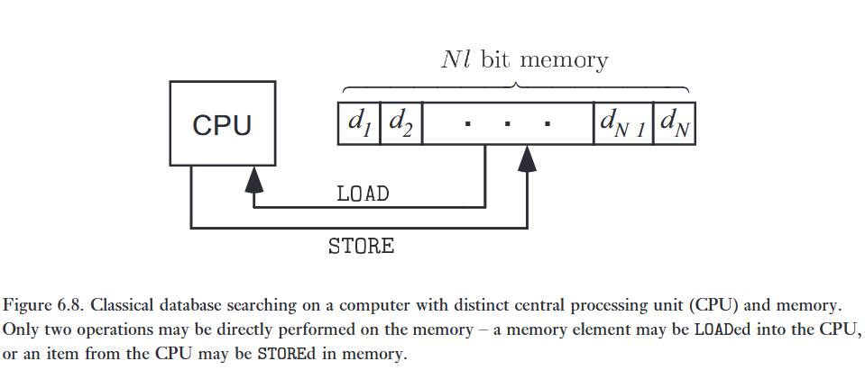

:::{.callout}
# tl;dr

Máy tính bình thường thì tốn O(N) nạp vào và tệ nhất là O(N) kiểm tra. Tuy Grover có thể tăng tốc căn N, nhưng việc nhập dữ liệu và trạng thái chồng chập cũng tốn ít nhất là O(N). Vậy là việc tìm kiếm dữ liệu trong tập không có cấu trúc hóa ra tốn O(N) sao?

Không, chúng ta dùng QRAM!

## qRAM + Grover

Giả sử chúng ta có 4 số: 07 - 04 - 23 - 01. Tương ứng với các địa chỉ là 00, 01, 10, và 11.

Chúng ta chuẩn bị 4 thanh ghi, $\vert \text{address} \rangle$, $\vert \text{answer} \rangle$ $\vert \text{data} \rangle$, và $\vert - \rangle$, đúng như tên của nó, chức năng lần lượt là, lưu địa chỉ, lưu đáp án cần tìm, lưu số, và ket - để phasekickback.

**Bước 1:** khởi tạo

Áp dụng các cổng Hadamard lên thanh địa chỉ:

$$
\vert \text{address} \rangle = \frac 1 2 (\vert 00 \rangle + \vert 01 \rangle + \vert 10 \rangle + \vert 11 \rangle)
$$

Các thanh lưu dữ liệu 

**Bước 2:** Áp qRAM lên

Biến $\vert \text{data} \rangle$ từ 0 có gì sang có gì, bằng hình 6.9.

Nhờ tính chồng chập, qRAM nạp cả 4 giá trị cùng một lúc, tạo ra một trạng thái vướng víu giữa thanh ghi địa chỉ và dữ liệu.

$$
\vert \psi_1 \rangle = \frac 1 2 (\vert 00 \rangle \vert 7\rangle 
+ \vert 01 \rangle \vert 8 \rangle 
+ \vert 10 \rangle \vert 23 \rangle 
+ \vert 11 \rangle \vert 1 \rangle)
$$

**Bước 3:** Oracle - Phasekickback

Đưa thanh ghi dữ liệu qua mạch kiểm tra Oracle. Ví dụ đáp án là $\vert 23 \rangle$, thì lúc này chỉ có pha của 23 bị đảo:

$$
\vert \psi_2 \rangle = \frac 1 2 (\vert 00 \rangle \vert 7\rangle 
+ \vert 01 \rangle \vert 8 \rangle 
- \vert 10 \rangle \vert 23 \rangle 
+ \vert 11 \rangle \vert 1 \rangle)
$$

**Bước 4:** Chạy ngược qRAM

Nếu chạy Grover khuếch đại bây giờ, thuật toán sẽ thất bại hoàn toàn, vì thanh ghi địa chỉ và thanh ghi dữ liệu đang vướng víu với nhau.

Vì vậy chúng ta phải gọi hàm $qRAM^\dagger$ để rút toàn bộ dữ liệu về mảng cổ điển, dọn sạch thanh ghi dữ liệu về lại $\vert 0 \rangle$, nhưng vẫn giữ lại được pha đã đảo của đáp án:

$$
\vert \psi_3 \rangle = \frac 1 2 (\vert 00 \rangle \vert 7\rangle 
+ \vert 01 \rangle
+ \vert 10 \rangle 
+ \vert 11 \rangle) \otimes \vert 0 \rangle
$$

**Bước 5:** Grover

Đáp án trả về là $\vert 10 \rangle$, tương ứng với 23.

:::

Giả sử ai đó đưa cho bạn một danh sách chứa một nghìn tên các loài hoa, và yêu cầu bạn tìm xem 'Perth Rose' (Hoa hồng Perth) xuất hiện ở đâu trên danh sách đó. Nếu bông hoa xuất hiện chính xác một lần trên danh sách, và danh sách không được sắp xếp theo bất kỳ cách hiển nhiên nào, thì bạn sẽ cần kiểm tra trung bình năm trăm cái tên, trước khi bạn tìm thấy 'Perth Rose'. Liệu có thể tăng tốc kiểu tìm kiếm cơ sở dữ liệu này bằng cách sử dụng thuật toán tìm kiếm lượng tử không? Thật vậy, thuật toán tìm kiếm lượng tử đôi khi được gọi là thuật toán tìm kiếm cơ sở dữ liệu, nhưng tính hữu dụng của nó cho ứng dụng đó bị giới hạn, và dựa trên các giả định nhất định. Trong phần này, chúng ta sẽ xem xét cách thuật toán tìm kiếm lượng tử có thể được sử dụng về mặt khái niệm để tìm kiếm một cơ sở dữ liệu phi cấu trúc, trong một bối cảnh khá giống với những gì được tìm thấy trên một máy tính thông thường. Bức tranh mà chúng ta xây dựng sẽ làm rõ những tài nguyên nào được yêu cầu để cho phép một máy tính lượng tử tìm kiếm các cơ sở dữ liệu cổ điển.   

---

Giả sử chúng ta có một cơ sở dữ liệu chứa $N \equiv 2^n$ mục, mỗi mục có độ dài $l$ bit. Chúng ta sẽ gắn nhãn các mục này là $d_1, \ldots, d_N$. Chúng ta muốn xác định xem một chuỗi $l$ bit cụ thể, $s$, nằm ở đâu trong cơ sở dữ liệu. Một máy tính cổ điển, được sử dụng để giải quyết bài toán này, thường được chia thành hai phần, được minh họa trong Hình 6.8. Một là đơn vị xử lý trung tâm, hay CPU, nơi diễn ra các thao tác dữ liệu, sử dụng một lượng nhỏ bộ nhớ tạm thời. Phần thứ hai là một bộ nhớ lớn lưu trữ cơ sở dữ liệu trong một chuỗi $2^n$ khối của các ô $l$ bit. Bộ nhớ được giả định là thụ động, theo nghĩa là nó không có khả năng tự mình xử lý dữ liệu. Những gì có thể làm là TẢI (LOAD) dữ liệu từ bộ nhớ vào CPU, và LƯU (STORE) dữ liệu từ CPU vào bộ nhớ, và thực hiện các thao tác trên dữ liệu được lưu trữ tạm thời trong CPU. Tất nhiên, các máy tính cổ điển có thể được thiết kế theo các hướng khác nhau, nhưng sự phân chia CPU-bộ nhớ này là một kiến trúc phổ biến và thông dụng.   

Để tìm xem một chuỗi $s$ cho trước nằm ở đâu trong cơ sở dữ liệu phi cấu trúc, thuật toán cổ điển hiệu quả nhất như sau. Đầu tiên, một chỉ số $n$-bit cho các phần tử cơ sở dữ liệu được thiết lập trong CPU. Chúng ta giả định rằng CPU đủ lớn để lưu trữ chỉ số $n \equiv \lceil\log N\rceil$ bit. Chỉ số bắt đầu ở số không, và được tăng lên một vào mỗi vòng lặp của thuật toán. Ở mỗi vòng lặp, mục cơ sở dữ liệu tương ứng với chỉ số được tải vào CPU, và so sánh với chuỗi đang được tìm kiếm. Nếu chúng giống nhau, thuật toán xuất ra giá trị của chỉ số và dừng lại. Nếu không, thuật toán tiếp tục tăng chỉ số. Rõ ràng, thuật toán này yêu cầu các mục phải được tải từ bộ nhớ $2^n$ lần trong trường hợp xấu nhất. Cũng rõ ràng rằng đây là thuật toán hiệu quả nhất có thể để giải quyết bài toán trong mô hình tính toán này.

Một thuật toán tương tự có thể được triển khai hiệu quả đến mức nào trên một máy tính lượng tử? Và, ngay cả khi sự tăng tốc lượng tử là có thể, thuật toán như vậy hữu ích đến mức nào? Trước tiên chúng tôi chỉ ra rằng sự tăng tốc là có thể, và sau đó quay lại câu hỏi về tính hữu dụng của một thuật toán như vậy. Giả sử máy tính lượng tử của chúng ta bao gồm hai đơn vị, giống hệt như máy tính cổ điển, một CPU và một bộ nhớ. Chúng ta giả định rằng CPU chứa bốn thanh ghi: (1) một thanh ghi 'chỉ số' (index) $n$ qubit được khởi tạo ở $\vert{}0\rangle$; (2) một thanh ghi $l$ qubit được khởi tạo ở $\vert{}s\rangle$ và giữ nguyên trạng thái đó trong toàn bộ quá trình tính toán; (3) một thanh ghi 'dữ liệu' (data) $l$ qubit được khởi tạo ở $\vert{}0\rangle$; và (4) một thanh ghi 1 qubit được khởi tạo ở $(\vert{}0\rangle - \vert{}1\rangle)/\sqrt{2}$.   Đơn vị bộ nhớ có thể được triển khai theo một trong hai cách. Cách đơn giản nhất là một bộ nhớ lượng tử chứa $N = 2^n$ ô, mỗi ô gồm $l$ qubit, chứa các mục cơ sở dữ liệu $\vert{}d_x\rangle$. Cách triển khai thứ hai là triển khai bộ nhớ như một bộ nhớ cổ điển với $N = 2^n$ ô, mỗi ô gồm $l$ bit, chứa các mục cơ sở dữ liệu $d_x$. Tuy nhiên, không giống như một bộ nhớ cổ điển truyền thống, nó có thể được định địa chỉ bằng một chỉ số $x$ có thể ở trong một trạng thái chồng chập của nhiều giá trị. Chỉ số lượng tử này cho phép một sự chồng chập của các giá trị ô được TẢI (LOAD) từ bộ nhớ. Việc truy cập bộ nhớ hoạt động theo cách sau: nếu thanh ghi chỉ số của CPU đang ở trạng thái $\vert{}x\rangle$ và thanh ghi dữ liệu đang ở trạng thái $\vert{}d\rangle$, thì nội dung $d_x$ của ô nhớ thứ $x$ được cộng vào thanh ghi dữ liệu: $\vert{}d\rangle \to \vert{}d \oplus d_x\rangle$, trong đó phép cộng được thực hiện theo từng bit (bitwise), theo modulo 2. Trước tiên, hãy xem khả năng này được sử dụng như thế nào để thực hiện tìm kiếm lượng tử, sau đó chúng ta sẽ thảo luận xem một bộ nhớ như vậy có thể được chế tạo vật lý như thế nào.   Phần then chốt của việc triển khai thuật toán tìm kiếm lượng tử là việc hiện thực hóa oracle, thứ phải lật pha của chỉ số định vị $s$ trong bộ nhớ. Giả sử CPU đang ở trạng thái   $$\vert{}x\rangle\vert{}s\rangle\vert{}0\rangle \frac{\vert{}0\rangle - \vert{}1\rangle}{\sqrt{2}}. \tag{6.35}$$   Áp dụng phép toán LOAD đưa máy tính vào trạng thái   $$\vert{}x\rangle\vert{}s\rangle\vert{}d_x\rangle \frac{\vert{}0\rangle - \vert{}1\rangle}{\sqrt{2}}. \tag{6.36}$$   Bây giờ thanh ghi thứ hai và thứ ba được so sánh, và nếu chúng giống nhau, thì một phép lật bit (bit flip) được áp dụng cho thanh ghi 4; nếu không thì không có gì bị thay đổi. Hiệu ứng của phép toán này là   

$$
\vert{}x\rangle\vert{}s\rangle\vert{}d_x\rangle \frac{\vert{}0\rangle - \vert{}1\rangle}{\sqrt{2}} \to 
\begin{cases} 
-\vert{}x\rangle\vert{}s\rangle\vert{}d_x\rangle \frac{\vert{}0\rangle - \vert{}1\rangle}{\sqrt{2}} & \text{if } d_x = s \\ 
\vert{}x\rangle\vert{}s\rangle\vert{}d_x\rangle \frac{\vert{}0\rangle - \vert{}1\rangle}{\sqrt{2}} & \text{if } d_x \neq s. 
\end{cases} \tag{6.37}
$$   

Thanh ghi dữ liệu sau đó được khôi phục về trạng thái $\vert{}0\rangle$ bằng cách thực hiện lại phép toán LOAD một lần nữa. Do đó, toàn bộ tác động của oracle giữ cho các thanh ghi 2, 3 và 4 không bị ảnh hưởng, và không bị vướng víu với thanh ghi 1. Vì vậy, hiệu ứng tổng thể là đưa trạng thái của thanh ghi 1 từ $\vert{}x\rangle$ thành $-\vert{}x\rangle$ nếu $d_x = s$, và giữ nguyên thanh ghi nếu ngược lại. Sử dụng oracle được triển khai theo cách này, chúng ta có thể áp dụng thuật toán tìm kiếm lượng tử để xác định vị trí của $s$ trong cơ sở dữ liệu, sử dụng $O(\sqrt{N})$ phép toán LOAD, so với $N$ phép toán LOAD được yêu cầu một cách cổ điển.   

Để oracle hoạt động chính xác trên các trạng thái chồng chập, thoạt nhìn có vẻ như bộ nhớ cần phải là cơ học lượng tử. Thực tế, như chúng ta đã lưu ý ở trên, với một số cảnh báo, bộ nhớ thực sự có thể được triển khai một cách cổ điển, điều này có khả năng làm cho nó chống chịu tốt hơn nhiều với các tác động của nhiễu. Nhưng một sơ đồ định địa chỉ (addressing) lượng tử vẫn là cần thiết; một bức tranh khái niệm minh họa cách điều này có thể được thực hiện được hiển thị trong Hình 6.9. Nguyên lý hoạt động là một phương tiện mà qua đó trạng thái được mã hóa nhị phân của chỉ số lượng tử (nơi từ $0$ đến $2^n - 1$ được biểu diễn bằng $n$ qubit) được dịch sang một mã hóa đơn phân (unary encoding) (nơi từ $0$ đến $2^n - 1$ được biểu diễn bằng vị trí của một đầu dò duy nhất (single probe) trong số $2^n$ vị trí có thể có) thứ định địa chỉ cơ sở dữ liệu cổ điển. Cơ sở dữ liệu tạo ra một sự thay đổi trên một bậc tự do bên trong đầu dò mà không liên quan đến vị trí của nó. Mã hóa từ nhị phân sang đơn phân sau đó được đảo ngược lại, để lại thanh ghi dữ liệu với nội dung mong muốn. 

---

Liệu có những trường hợp thực tế nào mà thuật toán tìm kiếm lượng tử có thể hữu ích cho việc tìm kiếm các cơ sở dữ liệu cổ điển không? Hai điểm khác biệt có thể được đưa ra. 

Thứ nhất, các cơ sở dữ liệu thông thường không phải là phi cấu trúc. Các cơ sở dữ liệu đơn giản, giống như cơ sở dữ liệu chứa tên các loài hoa đã thảo luận ở phần mở đầu của mục này, có thể được duy trì theo thứ tự bảng chữ cái, sao cho một thuật toán tìm kiếm nhị phân có thể được sử dụng để định vị một mục trong khoảng thời gian là $O(\log(N))$ đối với một cơ sở dữ liệu $N$ phần tử. Tuy nhiên, một số cơ sở dữ liệu có thể yêu cầu một cấu trúc phức tạp hơn nhiều, và mặc dù tồn tại các kỹ thuật tinh vi để tối ưu hóa các tìm kiếm cổ điển, với các truy vấn có bản chất đủ phức tạp hoặc không lường trước được, một cấu trúc được xác định trước có thể không giúp ích được gì, và bài toán về cơ bản có thể được coi là bài toán tìm kiếm cơ sở dữ liệu phi cấu trúc mà chúng ta đã thảo luận.    

Thứ hai, để một máy tính lượng tử có thể tìm kiếm một cơ sở dữ liệu cổ điển, một sơ đồ định địa chỉ lượng tử là cần thiết. Sơ đồ mà chúng tôi đã mô tả yêu cầu $O(N \log N)$ công tắc lượng tử – lượng phần cứng gần tương đương với những gì được yêu cầu để lưu trữ chính cơ sở dữ liệu đó. Có lẽ, những công tắc này một ngày nào đó có thể đơn giản và rẻ tiền như các phần tử bộ nhớ cổ điển, nhưng nếu không phải như vậy, thì việc chế tạo một máy tính lượng tử để thực hiện tìm kiếm lượng tử có thể không mang lại lợi thế về mặt kinh tế, so với việc sử dụng phần cứng tính toán cổ điển phân tán trên các phần tử bộ nhớ.    
 
Xem xét những cân nhắc này, có vẻ như ứng dụng chính của các thuật toán tìm kiếm lượng tử sẽ không phải là tìm kiếm các cơ sở dữ liệu cổ điển. Thay vào đó, việc sử dụng chúng có thể sẽ là tìm kiếm các giải pháp cho các bài toán khó, như đã thảo luận ở phần trước, chẳng hạn như bài toán chu trình Hamiltonian, người chào hàng, và các bài toán thỏa mãn (satisfiability).   

![Hình 6.9. Sơ đồ khái niệm của một bộ nhớ cổ điển 32 ô với một sơ đồ định địa chỉ lượng tử năm qubit. Mỗi vòng tròn đại diện cho một công tắc, được định địa chỉ bởi qubit được ghi bên trong nó. Ví dụ, khi $\vert{}x_4\rangle = \vert{}0\rangle$, công tắc tương ứng định tuyến qubit đầu vào sang bên trái; khi $\vert{}x_4\rangle = \vert{}1\rangle$, công tắc định tuyến qubit đầu vào sang bên phải. Nếu $\vert{}x_4\rangle = (\vert{}0\rangle + \vert{}1\rangle)/\sqrt{2}$, thì một sự chồng chập đều của cả hai tuyến đường được thực hiện. Các qubit của thanh ghi dữ liệu đi vào ở đỉnh của cây, và được định tuyến xuống cơ sở dữ liệu, nơi thay đổi trạng thái của chúng tùy theo nội dung của bộ nhớ. Các qubit sau đó được định tuyến ngược trở lại vào một vị trí xác định, rời khỏi đó cùng với thông tin được truy xuất. Về mặt vật lý, điều này có thể được hiện thực hóa bằng cách sử dụng, ví dụ, các photon đơn lẻ cho các qubit của thanh ghi dữ liệu, chúng được bẻ lái bằng cách sử dụng các giao thoa kế phi tuyến (Chương 7). Cơ sở dữ liệu cổ điển có thể chỉ là một tấm nhựa đơn giản, trong đó một số 'không' (minh họa bằng các ô vuông màu trắng) truyền ánh sáng đi qua mà không thay đổi gì, và một số 'một' (các ô vuông được tô bóng) làm dịch chuyển độ phân cực của ánh sáng tới đi $90^\circ$.](../../img/6.9.png)
