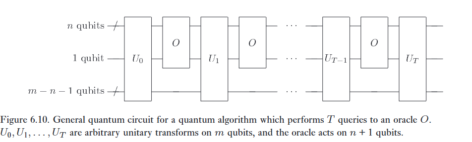

Chúng ta kết thúc chương này bằng một sự tổng quát hóa của thuật toán tìm kiếm lượng tử, qua đó cung cấp những cận dưới sâu sắc về sức mạnh của tính toán lượng tử. Ở đầu chương, chúng ta đã mô tả bài toán tìm kiếm là việc tìm một số nguyên $n$-bit $x$ sao cho hàm $f : \{0, 1\}^n \to \{0, 1\}$ cho giá trị $f(x) = 1$. Liên quan đến điều này là bài toán quyết định (decision problem) xem liệu có tồn tại $x$ sao cho $f(x) = 1$ hay không. Việc giải bài toán quyết định này có độ khó tương đương, và có thể được biểu diễn dưới dạng tính toán hàm Boole $F(X) = X_0 \vee X_1 \vee \dots \vee X_{N-1}$, trong đó $\vee$ ký hiệu phép toán OR nhị phân, $X_k \equiv f(k)$, và $X$ ký hiệu tập hợp $\{X_0, X_1, \dots, X_{N-1}\}$. Tổng quát hơn, chúng ta có thể muốn tính một hàm nào đó khác ngoài hàm OR. Ví dụ, $F(X)$ có thể là các hàm AND, PARITY (tổng modulo hai), hoặc MAJORITY ($F(X) = 1$ khi và chỉ khi số lượng $X_k = 1$ nhiều hơn số lượng $X_k = 0$). Nói chung, chúng ta có thể coi $F$ là bất kỳ hàm Boole nào. Một máy tính, cổ điển hoặc lượng tử, có thể tính các hàm này nhanh đến mức nào (đo bằng số lượng truy vấn), khi được cung cấp một oracle cho $f$?   

Có vẻ khó để trả lời những câu hỏi như vậy nếu không biết gì về hàm $f$, nhưng trên thực tế người ta có thể xác định được rất nhiều điều ngay cả trong mô hình 'hộp đen' này, nơi phương thức mà oracle hoàn thành nhiệm vụ của nó được mặc nhiên công nhận, và độ phức tạp chỉ được đo lường bằng số lượng truy vấn oracle cần thiết. Phân tích về thuật toán tìm kiếm ở các mục trước đã minh họa một cách tiếp cận những bài toán như vậy, nhưng một phương pháp mạnh mẽ hơn để tìm ra độ phức tạp truy vấn là phương pháp đa thức (method of polynomials), mà chúng ta sẽ mô tả ngắn gọn ngay sau đây.   

Hãy bắt đầu với một số định nghĩa hữu ích. Độ phức tạp truy vấn tất định $D(F)$ là số lượng truy vấn oracle tối thiểu mà một máy tính cổ điển phải thực hiện để tính $F$ một cách chắc chắn. Đại lượng lượng tử tương đương, $Q_E(F)$, là số lượng truy vấn oracle tối thiểu mà một máy tính lượng tử yêu cầu để tính $F$ một cách chắc chắn. Vì máy tính lượng tử về bản chất tạo ra các đầu ra xác suất, một đại lượng thú vị hơn là độ phức tạp sai số bị chặn $Q_2(F)$, tức số lượng truy vấn oracle tối thiểu mà một máy tính lượng tử yêu cầu để tạo ra một đầu ra bằng $F$ với xác suất ít nhất là $2/3$. (Con số $2/3$ là một số chọn tùy ý – xác suất chỉ cần bị chặn cách hữu hạn khỏi $1/2$ để có thể được khuếch đại lên gần bằng $1$ thông qua việc lặp lại.) Một thước đo liên quan là độ phức tạp không sai số $Q_0(F)$, số lượng truy vấn oracle tối thiểu mà một máy tính lượng tử yêu cầu để tạo ra một đầu ra hoặc bằng $F$ một cách chắc chắn, hoặc với xác suất nhỏ hơn $1/2$ sẽ thừa nhận một kết quả chưa thể kết luận. Tất cả các cận này phải đúng với mọi hàm oracle $f$ (hay nói cách khác, mọi đầu vào $X$ đưa vào $F$). Lưu ý rằng $Q_2(F) \le Q_0(F) \le Q_E(F) \le D(F) \le N$. 

Phương pháp đa thức dựa trên các tính chất của các đa thức đa tuyến tính có bậc tối thiểu (trên tập số thực) dùng để biểu diễn các hàm Boole. Tất cả các đa thức mà chúng ta sẽ xem xét dưới đây đều là hàm của các biến $X_k \in \{0, 1\}$ và do đó là đa tuyến tính, vì $X_k^2 = X_k$. Chúng ta nói rằng một đa thức $p : \mathbf{R}^N \to \mathbf{R}$ biểu diễn $F$ nếu $p(X) = F(X)$ với mọi $X \in \{0, 1\}^N$ (trong đó $\mathbf{R}$ ký hiệu tập hợp các số thực). Một đa thức $p$ như vậy luôn tồn tại, vì chúng ta có thể xây dựng một cách tường minh một ứng viên phù hợp:   

$$
p(X) = \sum_{Y \in \{0, 1\}^N} F(Y) \prod_{k=0}^{N-1} \left[1 - (Y_k - X_k)^2\right]. \tag{6.54}
$$   

Việc đa thức $p$ có bậc tối thiểu là duy nhất được dành lại làm Bài tập 6.18 cho độc giả. Bậc tối thiểu của một biểu diễn như vậy cho $F$, được ký hiệu là $\deg(F)$, là một thước đo hữu ích cho độ phức tạp của $F$. Ví dụ, người ta đã biết rằng $\deg(\text{OR})$, $\deg(\text{AND})$, và $\deg(\text{PARITY})$ đều bằng $N$. Trên thực tế, người ta biết rằng bậc của hầu hết các hàm đều có cấp độ lớn là $N$. Hơn nữa, người ta cũng đã chứng minh được rằng   

$$
D(F) \le 2\deg(F)^4. \tag{6.55}
$$   

Kết quả này đặt ra một cận trên cho hiệu năng của tính toán cổ điển tất định trong việc tính toán hầu hết các hàm Boole. Mở rộng khái niệm này, nếu một đa thức thỏa mãn $\vert{}p(X) - F(X)\vert{} \le 1/3$ với mọi $X \in \{0, 1\}^N$, chúng ta nói $p$ xấp xỉ $F$, và $\widetilde{\deg}(F)$ ký hiệu bậc tối thiểu của một đa thức xấp xỉ như vậy. Các thước đo này rất quan trọng trong tính toán cổ điển ngẫu nhiên hóa và, như chúng ta sẽ thấy, trong việc mô tả trường hợp lượng tử. Người ta đã biết rằng $\widetilde{\deg}(\text{PARITY}) = N$,   

$$
\widetilde{\deg}(\text{OR}) \in \Theta(\sqrt{N}) \quad \text{và} \quad \widetilde{\deg}(\text{AND}) \in \Theta(\sqrt{N}), \tag{6.56}
$$   

và   

$$
D(F) \le 216\widetilde{\deg}(F)^6. \tag{6.57}
$$   

Các cận của Phương trình (6.55) và (6.57) chỉ là những cận tốt nhất được biết đến tại thời điểm viết sách; phép chứng minh của chúng nằm ngoài phạm vi cuốn sách này, nhưng bạn có thể tìm thêm thông tin về chúng trong mục 'Lịch sử và tài liệu đọc thêm' ('History and further reading'). Người ta tin rằng có thể tồn tại các cận chặt hơn, nhưng những cận này đã đủ tốt cho mục đích của chúng ta.   

:::{.callout-note collapse="true"}
# Bài tập 6.18: 
Chứng minh rằng đa thức bậc tối thiểu biểu diễn một hàm Boole $F(X)$ là duy nhất.   

:::

:::{.callout-note collapse="true"}
# Bài tập 6.19: 
Chỉ ra rằng $P(X) = 1 - (1 - X_0)(1 - X_1)\dots(1 - X_{N-1})$ biểu diễn hàm OR. 

:::

Các đa thức nảy sinh một cách tự nhiên khi mô tả kết quả của các thuật toán lượng tử. Hãy viết đầu ra của một thuật toán lượng tử $\mathcal{Q}$ thực hiện $T$ truy vấn tới một oracle $O$ dưới dạng   

$$
\sum_{k=0}^{2^n-1} c_k \vert{}k\rangle. \tag{6.58}
$$   

Chúng ta sẽ chỉ ra rằng các biên độ $c_k$ là các đa thức có bậc nhiều nhất là $T$ theo các biến $X_0, X_1, \dots, X_{N-1}$. Bất kỳ thuật toán $\mathcal{Q}$ nào cũng có thể được hiện thực hóa bằng mạch lượng tử minh họa trong Hình 6.10. Trạng thái $\vert{}\psi_0\rangle$ ngay trước truy vấn oracle đầu tiên có thể được viết là   

$$
\vert{}\psi_0\rangle = \sum_{ij} \left( a_{i0j}\vert{}i\rangle\vert{}0\rangle + a_{i1j}\vert{}i\rangle\vert{}1\rangle \right)\vert{}j\rangle, \tag{6.59}
$$   

trong đó nhãn đầu tiên tương ứng với $n$ qubit truy vấn oracle, nhãn tiếp theo tương ứng với một qubit đơn lẻ nơi oracle lưu lại kết quả của nó, và nhãn cuối cùng tương ứng với $m - n - 1$ qubit làm việc được sử dụng bởi $\mathcal{Q}$. Sau truy vấn oracle, chúng ta thu được trạng thái   

$$
\vert{}\psi_1\rangle = \sum_{ij} \left( a_{i0j}\vert{}i\rangle\vert{}X_i\rangle + a_{i1j}\vert{}i\rangle\vert{}X_i \oplus 1\rangle \right)\vert{}j\rangle, \tag{6.60}
$$   

nhưng vì $X_i$ chỉ có thể bằng $0$ hoặc $1$, chúng ta có thể biểu diễn lại trạng thái này thành   

$$
\vert{}\psi_1\rangle = \sum_{ij} \left[ \left((1 - X_i)a_{i0j} + X_i a_{i1j}\right)\vert{}i0\rangle + \left((1 - X_i)a_{i1j} + X_i a_{i0j}\right)\vert{}i1\rangle \right]\vert{}j\rangle. \tag{6.61}
$$   

Lưu ý rằng trong $\vert{}\psi_0\rangle$, các biên độ của các trạng thái cơ sở tính toán có bậc $0$ theo $X$, trong khi các biên độ của $\vert{}\psi_1\rangle$ có bậc $1$ (tuyến tính theo $X$). Nhận xét quan trọng là bất kỳ phép toán unita nào mà $\mathcal{Q}$ thực hiện trước hoặc sau truy vấn oracle đều không thể làm thay đổi bậc của các đa thức này, nhưng mỗi lần gọi oracle có thể làm tăng bậc lên nhiều nhất là một. Do đó, sau $T$ truy vấn, các biên độ là các đa thức có bậc nhiều nhất là $T$. Hơn nữa, việc đo lường đầu ra cuối cùng (6.58) trong cơ sở tính toán tạo ra một kết quả $k$ với xác suất $P_k(X) = \vert{}c_k\vert{}^2$, vốn là các đa thức giá trị thực theo $X$ có bậc nhiều nhất là $2T$.   

Tổng xác suất $P(X)$ để thu được kết quả đầu ra bằng một từ thuật toán là tổng trên một tập con nào đó của các đa thức $P_k(X)$, và do đó cũng có bậc nhiều nhất là $2T$. Trong trường hợp $\mathcal{Q}$ tạo ra câu trả lời đúng một cách chắc chắn, chúng ta phải có $P(X) = F(X)$, và do đó $\deg(F) \le 2T$, từ đó suy ra   $$Q_E(F) \ge \frac{\deg(F)}{2}. \tag{6.62}$$   Trong trường hợp $\mathcal{Q}$ tạo ra một câu trả lời với xác suất mắc lỗi bị chặn, suy ra rằng $P(X)$ xấp xỉ $F(X)$, và do đó $\widetilde{\deg}(F) \le 2T$, từ đó ta suy ra   

$$
Q_2(F) \ge \frac{\widetilde{\deg}(F)}{2}. \tag{6.63}
$$   

Kết hợp (6.55) và (6.62), chúng ta tìm thấy rằng   

$$
Q_E(F) \ge \left[\frac{D(F)}{32}\right]^{1/4}. \tag{6.64}
$$   

Tương tự, kết hợp (6.57) và (6.63), chúng ta tìm thấy rằng   

$$
Q_2(F) \ge \left[\frac{D(F)}{13\,824}\right]^{1/6}. \tag{6.65}
$$   

Điều này có nghĩa là trong việc tính toán các hàm Boole bằng hộp đen, các thuật toán lượng tử chỉ có thể mang lại một sự tăng tốc đa thức so với các thuật toán cổ điển, trong trường hợp tốt nhất – và ngay cả điều đó nhìn chung cũng không khả thi (vì $\deg(F)$ có cấp $\Omega(N)$ đối với hầu hết các hàm). Mặt khác, người ta đã biết rằng đối với $F = \text{OR}$, $D(F) = N$, và độ phức tạp truy vấn cổ điển ngẫu nhiên hóa $R(F) \in \Theta(N)$, trong khi việc kết hợp (6.63) và (6.56), cùng với hiệu năng đã biết của thuật toán tìm kiếm lượng tử, chỉ ra rằng $Q_2(F) \in \Theta(\sqrt{N})$. Mức tăng tốc căn bậc hai này chính xác là những gì mà thuật toán tìm kiếm lượng tử đạt được, và phương pháp đa thức chỉ ra rằng kết quả này có lẽ có thể được tổng quát hóa cho một lớp bài toán rộng hơn một chút, nhưng nếu không có thông tin bổ sung về cấu trúc của hàm oracle hộp đen $f$, thì không thể có bất kỳ sự tăng tốc hàm mũ nào so với các thuật toán cổ điển.   

:::{.callout-note collapse="true"}
# Bài tập 6.20: 
Chứng minh rằng $Q_0(\text{OR}) \ge N$ bằng cách xây dựng một đa thức biểu diễn hàm OR từ đầu ra của một mạch lượng tử tính toán OR với độ sai số bằng không.   

:::

:::{.callout-note collapse="true"}
# Vấn đề 6.1: (Tìm giá trị nhỏ nhất) 
Giả sử $x_1, \dots, x_N$ là một cơ sở dữ liệu các số được lưu giữ trong bộ nhớ, như trong Mục 6.5. Hãy chỉ ra rằng chỉ cần $O(\log(N)\sqrt{N})$ truy cập vào bộ nhớ trên một máy tính lượng tử để tìm ra phần tử nhỏ nhất trong danh sách, với xác suất ít nhất là một nửa.   

:::

:::{.callout-note collapse="true"}
# Vấn đề 6.2: (Tìm kiếm lượng tử tổng quát) 
Gọi $\vert{}\psi\rangle$ là một trạng thái lượng tử, và định nghĩa $U_{\vert{}\psi\rangle} \equiv I - 2\vert{}\psi\rangle\langle\psi\vert{}$. Tức là, $U_{\vert{}\psi\rangle}$ cung cấp cho trạng thái $\vert{}\psi\rangle$ một pha $-1$, và giữ bất biến các trạng thái trực giao với $\vert{}\psi\rangle$.

(1) Giả sử chúng ta có một mạch lượng tử triển khai một toán tử unita $U$ sao cho $U\vert{}0\rangle^{\otimes n} = \vert{}\psi\rangle$. Hãy giải thích cách triển khai $U_{\vert{}\psi\rangle}$.
(2) Cho $\vert{}\psi_1\rangle = \vert{}1\rangle, \vert{}\psi_2\rangle = (\vert{}0\rangle - \vert{}1\rangle)/\sqrt{2}, \vert{}\psi_3\rangle = (\vert{}0\rangle - i\vert{}1\rangle)/\sqrt{2}$. Giả sử một oracle chưa biết $O$ được chọn từ tập hợp $U_{\vert{}\psi_1\rangle}, U_{\vert{}\psi_2\rangle}, U_{\vert{}\psi_3\rangle}$. Hãy đưa ra một thuật toán lượng tử có thể nhận dạng được oracle đó chỉ với một lần áp dụng oracle. (Gợi ý: xem xét mã hóa siêu đặc - superdense coding).
(3) Nghiên cứu: Tổng quát hơn, cho $k$ trạng thái $\vert{}\psi_1\rangle, \dots, \vert{}\psi_k\rangle$, và một oracle chưa biết $O$ được chọn từ tập $U_{\vert{}\psi_1\rangle}, \dots, U_{\vert{}\psi_k\rangle}$, cần bao nhiêu lần áp dụng oracle để nhận dạng được oracle này với xác suất cao?.   

:::

:::{.callout-note collapse="true"}
# Vấn đề 6.3: (Truy xuất cơ sở dữ liệu) 
Cho một oracle lượng tử trả về $\vert{}k, y \oplus X_k\rangle$ khi nhận được truy vấn $n$ qubit (và một qubit nháp - scratchpad qubit) $\vert{}k, y\rangle$, hãy chỉ ra rằng với xác suất cao, tất cả $N = 2^n$ bit của $X$ có thể thu được chỉ bằng $N/2 + \sqrt{N}$ truy vấn. Điều này ngụ ý cận trên tổng quát $Q_2(F) \le N/2 + \sqrt{N}$ đối với bất kỳ hàm $F$ nào.   

:::

:::{.callout-note collapse="true"}
# Vấn đề 6.4: (Tìm kiếm lượng tử và mật mã học) 
Tìm kiếm lượng tử, về tiềm năng, có thể được sử dụng để tăng tốc việc tìm kiếm các khóa mật mã. Ý tưởng là tìm kiếm thông qua không gian tất cả các khóa giải mã có thể có, trong mỗi trường hợp thử khóa đó, và kiểm tra xem thông điệp được giải mã có 'có nghĩa' hay không. Hãy giải thích tại sao ý tưởng này không hoạt động đối với mật mã Vernam (Mục 12.6). Khi nào thì nó có thể hoạt động cho các hệ thống mật mã như DES? (Để xem mô tả về DES, chẳng hạn, hãy xem [MvOV96] hoặc [Sch96a].).   

:::

